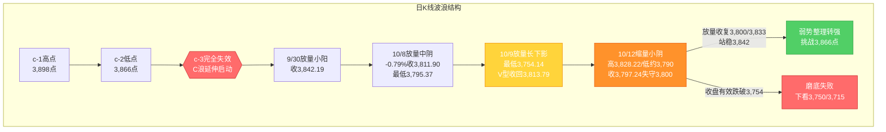
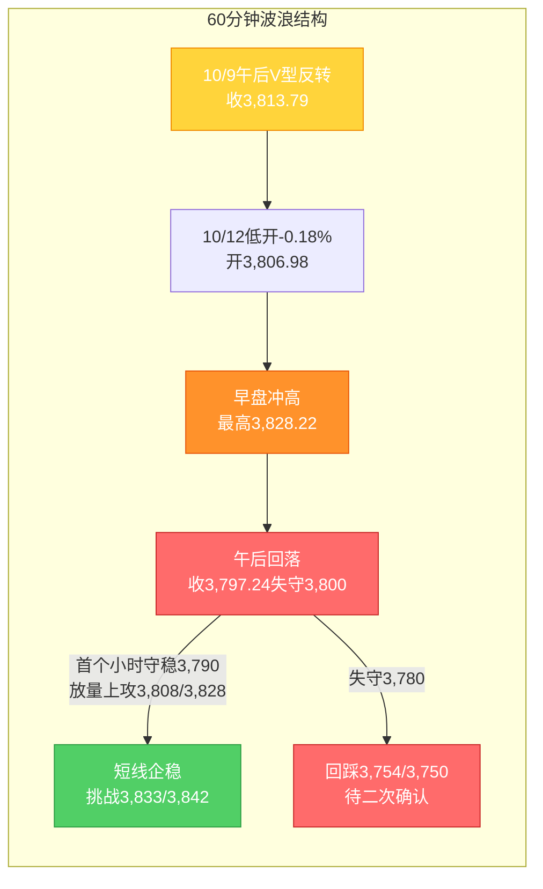

# A股晚报 - 2026年10月12日

> 数据截止时间：2026年10月12日 20:00（北京时间）；美股为10月9日（周五）收盘 + 10月12日盘前期指，欧股/亚太为10月12日，港股为10月12日收盘，大宗商品/汇率为10月12日盘后
> 报告性质：**国庆长假后首个完整交易周（第42周）周一（10/12）收盘晚报 + 10/12晨报盘前判断复盘** —— 周末关税冲击后的第一个交易日
> 核心观点：**A股10/12"缩量窄幅整理、结构分化"**：上证指数低开（-0.18%）后早盘一度冲高至3,828.22点，随后震荡回落、**尾盘走弱失守3,800点（收盘3,797.24、跌0.43%）**；深证成指-2.03%、创业板指-2.61%（**失守3,000点、创年内收盘新低**）、科创50-2.10%、北证50-2.46%。两市成交**1.54万亿元（缩量3,627亿元）**，全市场**仅1,167只上涨/4,325只下跌（超4,300股飘绿）、涨停48只、跌停22只**，**主力资金净流出151.62亿元（电子、通信净流出均超40亿居前）**。结构呈**"权重高股息护盘 + 题材轮动，科技成长与资源股补跌"**——**银行板块+2.32%居首（渝农商行+4.95%、招商银行+3.24%，中国银行/中信银行/工商银行续创历史新高）**，**影视院线/文化传媒（传媒+1.47%）、风电设备、食品饮料（茅台重登"股王"）**走强；**贵金属、稀土、有色金属（中证有色-3.03%）、石油石化、能源金属、房地产服务、种植业与林业跌幅居前**，**通信设备/元件领跌（剑桥科技-8%、长飞光纤/中际旭创-6%）**。**关键变量**：**周末（10/10-10/11）中美关税冲击的"二次映射"以"低开修复"预期落空告终**——**早盘冲高、午后回落（"冲高回落"而非"先抑后扬"）**，市场在"关税冲击可控（商务部审慎适度实施出口管制、中美贸易休战延长至明年1月、中欧稀土"绿色通道"）+ 业绩为王（三季报窗口）"双主线间重新定价。**综合判断：10/12"失守3,800点但缩量、低点未创新低（约3,790点>3,754.14点）"，日线底部结构由"V型修复待确认"转为"缩量磨底、弱势整理"；下一交易日（10/13，周二）关键看能否放量收复3,800/3,833点，以及科技成长（半导体/通信）能否止跌。**

---

## 一、市场回顾

### 1. 主要指数表现

| 指数 | 收盘点位 | 涨跌幅 | 涨跌点数 | 最高点 | 最低点 |
|------|---------|--------|---------|--------|--------|
| 上证指数 | **3,797.24** | **-0.43%** | -16.55 | **3,828.22** | **约3,790** |
| 深证成指 | **12,384.87** | **-2.03%** | -256.99 | — | — |
| 创业板指 | **2,963.82** | **-2.61%** | -79.51 | — | — |
| 科创50 | **1,426.72** | **-2.10%** | — | — | — |
| 科创综指 | — | **-2.51%** | — | — | — |
| 北证50 | — | **-2.46%** | — | — | — |

**特征**：**三大指数"低开→早盘冲高→午后回落→尾盘走弱"**，走出**"缩量小阴/带上影线"**组合。上证指数**低开-0.18%（开3,806.98点）**，早盘在银行、传媒带动下一度冲高至**3,828.22点（盘中最高，涨约0.38%）**，但午后科技成长与资源股（半导体/通信/稀土/贵金属/有色）集体补跌拖累回落，**尾盘走弱、收盘失守3,800点整数关口（收3,797.24、跌0.43%）**，全天振幅约1.0%。**风格极致分化**——**权重（银行）逆势创新高护盘，成长（创业板指/科创50/北证50跌逾2%）与资源（有色/稀土/贵金属）显著跑输**；**创业板指收于2,963.82点、创年内收盘新低、失守3,000点**。上证指数为**连续第2个交易日收于3,800点下方（10/9盘中最低3,754.14、10/12收盘3,797.24）**。

### 2. 成交量能

| 指标 | 数值 | 变化 | 说明 |
|------|------|------|------|
| 沪深两市成交额 | **15,378亿元（约1.54万亿）** | **缩量3,627亿元** | 较10/9的1.90万亿明显萎缩 |
| 沪深京三市成交额 | **约1.55万亿元** | 缩量3,659亿元 | 量能显著回落 |
| 上证/深证成交额 | 7,149.10亿 / 8,229.11亿 | — | 沪市量能萎缩更明显 |
| 北向资金成交额 | **2,480.23亿元** | 占两市16.13% | **净额数据交易所已不实时披露，以成交口径跟踪** |
| 主力资金 | **净流出151.62亿元** | 净流出扩大 | **电子、通信净流出均超40亿元居前** |
| 行业资金流向 | 10个行业净流入 | — | **传媒（约+17.8~23.65亿）、电力设备（+10.58亿）居前**；医药生物、基础化工净流入超2亿 |

**资金特征**：**量能"显著缩量"是今日核心特征（1.54万亿，缩量3,627亿）**——与晨报"放量/平量1.8-2.0万亿"的预期**显著背离**。究其原因：**关税冲击的实际低开幅度仅-0.18%（远小于外盘映射的-1%~-2%），恐慌盘未集中释放；叠加政策对冲前置（商务部表态"审慎适度实施出口管制"+中美贸易休战延长消息）+ 市场学习效应，观望情绪主导，"低开修复日易放量"的规律未能兑现**。**主力资金仍净流出151.62亿元（较10/9的116.88亿扩大）**，其中**电子、通信行业单行业净流出均超40亿元居前**（有色金属、计算机、机械设备、国防军工、公用事业净流出亦超10亿），显示**资金仍在从"AI硬件/科技成长"撤离**；**净流入集中于传媒、电力设备等题材/政策方向**。两融方面，截至10/9**两市融资余额合计25,218.84亿元、较前一交易日减少145.81亿元**，杠杆资金延续降仓（电子/通信为主要净偿还方向）。

### 3. 市场情绪

| 指标 | 数值 | 说明 |
|------|------|------|
| 上涨家数 | **1,167只（占比20.99%）** | 赚钱效应偏弱 |
| 下跌家数 | **4,325只** | **超4,300只个股飘绿** |
| 涨停家数 | **48只**（沪深两市） | 较10/9的72只明显回落 |
| 跌停家数 | **22只** | 跌停数量增加 |
| 封板率 | **60%** | 32股封板未遂 |
| 连板股 | 博纳影业、吉视传媒2连板；**新华传媒10连板（盘后停牌核查）** | 连板高度集中于传媒 |

**情绪特征**：**"冲高回落、个股普跌"的弱修复格局**——早盘随银行/传媒走强、个股一度红盘，午后随指数回落，**下跌家数扩大至4,325只、涨停收缩至48只**，赚钱效应较10/9（涨停72只、上涨3,297只）**明显走弱**。**结构上呈现"指数（沪指-0.43%）跌幅远小于个股（超4,300只下跌）"的失真**——银行等权重股护盘掩盖了多数个股的跌幅，**创业板指/科创50跌逾2%与沪指的-0.43%形成鲜明反差**，"指数失真/二八分化"特征显著。**新华传媒10连板后盘后公告将于10/13停牌核查**，为高位连板股风险的一次集中提示。

---

## 二、热点板块与异动分析

### 1. 当日领涨板块及驱动因素

申万31个一级行业**5涨26跌**，涨幅居前：

| 板块 | 涨跌幅 | 驱动因素 |
|------|--------|---------|
| 银行 | **+2.32%（居首）** | **高股息防御属性回归 + 资金避险 + 关税冲击期"类固收"偏好**；渝农商行+4.95%、招商银行+3.24%，中国银行/中信银行/工商银行**续创历史新高** |
| 传媒（影视院线/文化传媒） | **+1.47%** | **AI应用/短剧落地延续 + 事件驱动**；果麦文化20cm涨停，博纳影业/吉视传媒2连板，慈文传媒/新华文轩/新经典/新华传媒涨停 |
| 风电设备 | 涨幅居前 | 政策/装机预期 + 题材活跃；天顺风能涨停，振宏股份涨超10% |
| 食品饮料/大消费 | 逆势收红 | 大消费活跃，**贵州茅台重登A股"股王"** |
| 非银金融 | **+0.45%** | 情绪护盘（但主力资金仍净流出） |

**驱动逻辑**：①**关税冲击期"高股息/权重防御"占优**——银行板块受益于"避险+类固收"属性，叠加"保险资金/中长期资金入市"预期，续创历史新高；②**题材轮动延续**——**传媒/AI应用**承接10/9的强势（AI短剧/影视院线），**风电/储能（金冠电气、首航新能20cm涨停）**、大消费接力；③**"冲高回落"中的结构性避险**——在成长与资源普跌下，资金进一步向"权重+题材"集中。

### 2. 当日领跌板块及原因分析

| 板块 | 表现 | 原因分析 |
|------|------|---------|
| 通信设备/元件（AI硬件） | **领跌（剑桥科技-8%、长飞光纤/中际旭创-6%）** | **AI硬件侧"拥挤交易继续消化" + 外盘AI收入端质疑未消 + 关税冲击**；主力资金通信/电子净流出均超40亿 |
| 有色/贵金属/能源金属/小金属 | **跌幅居前（中证有色-3.03%，云南锗业-8.15%领跌）** | **避险交易降温（金价微跌） + 前期涨幅回吐 + 关税"利好兑现"** |
| 稀土 | **跌幅居前** | **产业利好兑现回吐**——北方稀土前三季度净利预增134.95%~138.84%、Q4稀土精矿交易价上调，利好落地后板块反跌 |
| 石油石化 | **跌幅居前（桐昆股份-8%、卫星化学-4%、昊华科技-3%）** | 油价震荡 + 需求担忧 + 关税冲击 |
| 房地产服务 | **跌幅居前** | 题材退潮 + 风偏压制 |
| 种植业与林业 | **跌幅居前** | 关税"农业对冲"逻辑落空（利好兑现/资金撤离） |
| 半导体/存储 | 走弱 | 外盘AI收入端质疑 + 三季报验证窗口开启 + 资金撤离 |

**结论**：今日领跌集中在**"AI硬件（通信/元件/半导体）+ 资源股（稀土/贵金属/有色/石油石化）"**，本质是**"AI硬件拥挤交易消化 + 关税冲击的科技定向承压 + 资源股'利好兑现'回吐 + 避险交易降温"**四重作用。**值得注意的反差**：**"关税对冲结构"（稀土/贵金属/军工/农业/自主可控）在晨报预判中为"看涨方向"，实际全线补跌**——关税冲击次日，A股映射**并未呈现"外盘教科书的对冲结构"，而是呈现"权重高股息护盘（银行）+ 题材轮动（传媒/影视/风电）"的内生结构**。

### 3. 个股异动复盘

- **银行股集体创新高**：渝农商行+4.95%、招商银行+3.24%、农业银行/建设银行+3.01%，**中国银行、中信银行、工商银行续创历史新高**（护盘主力）
- **传媒/影视院线涨停潮延续**：**果麦文化20cm涨停**；**博纳影业、吉视传媒回封2连板**；德才股份、慈文传媒、新华文轩、新经典、新华传媒涨停；欢瑞世纪（日涨幅偏离11.79%、换手率33.80%）登龙虎榜
- **高位连板股风险事件**：**新华传媒（600825）10连板**（9/21-10/12累计10个交易日涨停、累计涨幅159.51%），**盘后公告10/13开市起停牌核查**（累积巨大交易风险提示）
- **风电/储能**：天顺风能涨停、振宏股份涨超10%；**金冠电气、首航新能双双20cm涨停**；博汇科技（科创板）涨停
- **新能源车**：赛力斯（601127）涨停
- **业绩线**：**北方稀土**发布前三季度业绩预增（净利36.2-36.8亿、同比+134.95%~138.84%）；**金钼股份**前三季度净利同比+30.94%；**有研新材**（沪市首份三季报，Q3营收-13.86%、归母净利-30.61%、扣非+82.38%）
- **跌停/回调**：科技成长（通信设备/PCB/半导体方向）与大额净流出个股回调居前

---

## 三、关键数据与事件回顾

### 1. 国内重要经济数据

- 今日无重磅月度经济数据发布；市场聚焦**三季报披露窗口正式开启**（沪市首份三季报有研新材披露）
- **央行流动性**：延续10/8以来的呵护（10/8开展1.2万亿元3个月期买断式逆回购、净投放2,000亿元，下调PSL利率至1.5%），季末后资金面平稳

### 2. 政策消息

- **商务部新闻发言人10/12答记者问（四大关切）**：就"10/9商务部、海关总署对相关稀土物项实施出口管制"表示，**这是中国政府依据法律法规完善自身出口管制体系的正当做法，将"审慎适度实施出口管制措施"**（回应美方威胁）
- **商务部公告：对美10家实体实施出口管制措施**（依据《出口管制法》等，对特定美国实体精准反制，即日起施行）
- **中共中央、国务院：全面实施"人工智能+"行动**（政策主线，利好AI应用/算力/数据要素中长期）
- **中欧经贸磋商成果**：中方表示愿通过**"绿色通道"机制**为稀土及永磁体对欧出口许可审批继续提供便利
- **中美经贸：美财长称中美已同意将贸易休战协议延长至明年1月**（外交部回应）——**关税冲击"可逆/可控"的关键信号**
- **稀土：北方稀土与包钢股份公告第四季度稀土精矿关联交易价格上调至不含税38,769元/吨（环比+0.53%）**

### 3. 公司公告

- **业绩预告（三季报窗口开启）**：**北方稀土**预计前三季度归母净利36.2亿-36.8亿元（同比+134.95%~138.84%）；**金钼股份**前三季度营收124.46亿元（+14.34%）、净利29.94亿元（+30.94%）
- **沪市首份三季报**：**有研新材**披露（Q3营收23.04亿元、-13.86%；归母净利7,996.11万元、-30.61%；扣非净利7,366.99万元、+82.38%）
- **停牌核查**：**新华传媒**（10连板）公告10/13起停牌核查
- **龙虎榜**：金健米业（沪股通净买入2.31亿）、新华都、欢瑞世纪等登榜

---

## 四、海外市场联动

### 1. 美股三大指数（10月9日 周五收盘 + 10月12日盘前）

| 指数 | 收盘点位（10/9） | 涨跌幅 | 说明 |
|------|-----------------|--------|------|
| 道琼斯工业指数 | 51,654.95 | **+0.83%（+423.31点）** | 全周上涨 |
| 标普500指数 | 7,811.54 | **+0.59%（+46.18点）** | 全周小涨 |
| 纳斯达克综合指数 | — | **+0.64%（+172.83点）** | 全周小涨 |

**10月12日盘前期指**：道琼斯指数期货**+0.08%**、标普500期货**+0.05%**、**纳斯达克100指数期货-0.18%（转跌）**——**外盘情绪偏中性、科技略承压**。

**解读**：**10/9美股收涨（关税威胁前）**，但**周末（10/10-10/11）"黑色星期五"冲击（纳指-3.56%、中概金龙-6.10%）**未被完全消化；**10/12美股期指走势偏中性（纳指100期货转跌）**，反映**"关税冲击+AI科技承压"的扰动仍在延续**。**净影响：外盘对A股的"二次映射"以"低开→冲高回落"的方式部分兑现，但整体冲击可控（未出现恐慌性杀跌）。**

### 2. 欧洲/亚太市场

| 市场 | 表现（10/12） | 备注 |
|------|-------------|------|
| 恒生指数 | **24,271.20（+0.25%，+59.85点）** | 全日主板成交1,626.32亿港元 |
| 恒生科技 | **4,169.57（-0.67%）** | 高开低走 |
| 富时马来西亚指数 | +0.59% | 亚太涨跌不一 |
| 新加坡海峡时报指数 | +0.30% | — |

**情绪判断**：**港股10/12分化（恒指小涨、恒生科技高开低走-0.67%）**——**国有大行集体创新高**（与A股银行共振），**赛力斯大涨超15%**；恒生科技受科技股拖累走弱，**与A股"银行强、科技弱"的结构高度一致**。**港股"权重强/科技弱"的分化，映射并强化了A股当日"沪指抗跌、创业板/科创大跌"的结构特征。**

### 3. 大宗商品

| 品种 | 价格/表现（10/12） | 涨跌/驱动 |
|------|----------|----------|
| 布伦特原油 | **约104.1-105.6美元/桶** | 早盘涨0.83%报105.59，后震荡 |
| WTI原油 | **约92.56美元/桶** | 早盘+0.77% |
| 现货黄金 | **约4,186-4,198美元/盎司** | **微跌约0.2%（避险降温）** |
| 现货白银 | **约60.9美元/盎司** | +0.23% |
| 有色（LME/国内） | 走弱 | **中证有色指数-3.03%，云南锗业-8.15%领跌** |

**驱动逻辑**：①**黄金10/12微跌（约-0.2%）**，避险交易较周末"黑色星期五"明显降温，**直接压制A股贵金属/黄金股**（当日跌幅居前）；②**原油震荡偏强但A股石油石化领跌**——反映"需求担忧 + 关税冲击"下的**映射背离**（油价涨、油气股跌）；③**有色金属集体走弱**（中证有色-3.03%），前期涨幅回吐。

---

## 五、汇率与利率

| 指标 | 数值/表现 | 变化/说明 |
|------|----------|----------|
| 人民币中间价（10/12） | **6.7313** | **调升17个基点**（前值6.7330），连续偏强 |
| 在岸人民币即期（10/12 16:30） | **6.6930** | 较上一交易日**调贬9个基点** |
| 美元指数（10/9收） | **102.23** | +0.10% |
| 美元指数（10/12 9:30） | **102.1363** | 高位震荡 |

**特征**：①**人民币中间价连续调升（10/12升17基点至6.7313）**，但**在岸即期小幅调贬9基点至6.6930**，**"中间价偏强、即期微贬"**反映关税冲击下的短期资本流动扰动；②**央行明确人民币汇率政策立场（稳汇率预期）**延续，为A股资金面与情绪面提供**边际支撑**；③**美元指数高位震荡（102.1-102.2）**，需继续跟踪"关税冲击→外资风险偏好下降→北向流出"的传导（今日北向成交2,480.23亿、占16.13%，活跃度较10/9的15.61%小幅回升）。

---

## 六、收盘后重要信息

### 1. 盘后公告

- **停牌核查**：**新华传媒（600825）**因10连板（累计涨幅159.51%）公告将于**10/13开市起停牌核查**（高位连板股风险集中提示）
- **业绩快报/预增**：北方稀土（前三季度净利+134.95%~138.84%）、金钼股份（+30.94%）等披露；**10/13起三季报进入密集披露期**（有研新材、聚灿光电、冀东装备等）
- **有研新材**（沪市首份三季报）已披露，Q3扣非净利同比+82.38%

### 2. 盘后/次日盘前走势

- **美股期指**（10/12盘前）：道指期货+0.08%、标普期货+0.05%、**纳指100期货-0.18%（转跌）**
- **港股**：恒指+0.25%、恒生科技-0.67%（权重强/科技弱）
- **大宗**：布油涨0.83%报105.59、现货黄金微跌0.2%报4,186.17

### 3. 次日关注（下一交易日为10月13日，周二）

- **数据/事件**：**10/13三季报密集披露开启**（有研新材、聚灿光电、冀东装备等）
- **新股**：10/12申购**文峰光电（920296）**；关注后续新股上市安排（以交易所公告为准）
- **关税/经贸**：跟踪**商务部后续表态、中美贸易休战延长（至明年1月）**落地进展、**10月底APEC**与**11月1日美方关税决定**节点
- **市场**：关注A股**能否放量收复3,800/3,833点**、**科技成长（半导体/通信）能否止跌**；港股"权重强/科技弱"分化能否延续
- **限售解禁**：10月全月解禁约**3,047亿元（环比+62.82%）**，继续跟踪电子、公用事业等方向

---

## 七、波浪理论多周期分析

> 说明：基于10/12实际K线结构推演。**10/12"缩量失守3,800点但低点未创新低（约3,790点>3,754.14点）"，日线底部结构由"V型修复待确认"转为"缩量磨底、弱势整理"。**

### 1. 月K线波浪分析

- **当前波浪位置**：大周期**第2浪C浪延伸末段寻底**，10月月K线（10/8至今）呈**"先抑后扬、长下影"**雏形，**10/12收盘3,797.24点，暂处20月均线（约3,800点）下方约3点**，为**连续第三个月调整**
- **浪型结构描述**：2024年9月2,689点→2026年6月4,197点为**第1浪上升**；第2浪ABC调整：4,197点→3,754.14点（10/9最低）；10月开局（10/8）下探3,795.37点，10/9进一步下探**3,754.14点（再创阶段新低）后V型收回3,813.79点**，10/12冲高回落收3,797.24点；**月线现处20月均线下方，但月内低点3,754.14未再被刷新**，月线下影仍在，月度"破位下行"风险未显著恶化
- **关键目标位**：月度强支撑**3,800点（20月均线）**、3,754点（10/9低点）、3,750点；月度核心压力3,833点、3,842点、3,866点
- **验证条件**：**10月月K线能否收盘收复3,800点（20月均线）**——10/12暂失守，需后续交易日确认；若月内有效跌破3,750点，则月度底部证伪

### 2. 周K线波浪分析

- **当前波浪位置**：第42周（10/12-10/16，恢复5个交易日）**首日缩量小阴**，周K线现为**"带短上影的缩量小阴"**雏形（周开3,806.98、周内暂高3,828.22、暂低约3,790、现收3,797.24）
- **浪型结构描述**：本周为国庆后**首个完整交易周**。10/12缩量回落，**仍处5周/10周/20周/60周均线下方，短期均线空头排列未改**；周线级别尚未出现放量反转信号，**"底部构筑/下跌中继"分歧延续**
- **关键目标位**：周度支撑**3,800点（20月均线，核心）**、3,790点（10/12低点）、3,754点（10/9低点）；周度压力**3,833点**（短线分水岭）、**3,842点**（C浪低点反压）、**3,866点**（c-2低点，周线反转确认位）
- **验证条件**：**本周（5个交易日）能否收出长下影/小阳**——**放量站稳3,833并挑战3,866**为周线反转确认前提；收盘有效跌破3,754则信号失效

### 3. 日K线波浪分析（重点）

- **当前波浪位置**：**C浪延伸末段"缩量磨底、弱势整理"**——10/9放量长下影V型收回3,800后，10/12**缩量冲高回落、收盘失守3,800**，形成**"缩量小阴+失守整数关口"**组合，但**低点（约3,790）未创新低**，底部"弱势整理"未破位
- **浪型结构描述**：9/30放量小阳收3,842.19→10/8放量中阴-0.79%收3,811.90→**10/9放量长下影小阳+0.05%收3,813.79（最低3,754.14）→10/12缩量小阴-0.43%收3,797.24（最高3,828.22、最低约3,790）**；**低点序列首次出现"抬升"迹象（3,754.14→约3,790）**，但**收盘再度跌落3,800下方**，多空在3,750-3,830区间反复拉锯
- **关键目标位**：第一压力**3,800点（20月均线，失而复得位）**、**3,833点（9/30低点，短线分水岭）**；**强压力3,842点（C浪低点反压）、3,866点（c-2低点）**；第一支撑**3,790点（10/12低点）**、3,754点（10/9低点）；**下方目标3,750点/3,715点（黄金分割1.236延伸，仅当收盘有效跌破3,754点时启用）**
- **验证条件**：
  - **向上修复**：**放量收复3,800点并站稳3,833点** → 弱势整理转强，方有挑战3,842/3,866点可能
  - **向下确认**：**收盘有效跌破3,754点** → 磨底失败，下看3,750点及3,715点
  - **今日变量（10/12）**：关税冲击二次映射 → **低开-0.18%后冲高3,828.22，但缩量、午后回落**；**"缩量+低点未创新低+权重护盘"表明抛压有限，但量能不济限制反弹**

### 4. 60分钟K线波浪分析

- **当前波浪位置**：60分钟级别**"低开冲高→回落走弱"**，短线由"V型修复"转为**"弱势整理/待企稳"**
- **浪型结构描述**：60分钟10/12早盘低开后快速冲高（受银行/传媒带动），10:00后见高3,828.22，随后震荡下行，**60分钟MACD再度走弱、红柱收缩**，KDJ自中位区回落，尾盘收于日内低位附近（收盘接近全日低点）
- **关键目标位**：短期支撑**3,790点、3,780点**；短期压力**3,808点（10/12开盘）、3,828点（10/12高点）**
- **验证条件**：**下一交易日首个小时能否守稳3,790点并放量上攻3,808-3,828点**——守稳则短线企稳，跌破3,780则弱势整理级别降级、下看3,754

### 5. 30分钟K线波浪分析

- **当前波浪位置**：30分钟级别**"冲高回落、超买修正"**，短线动能转弱
- **浪型结构描述**：30分钟10/12呈"低开冲高→午后回落"，**MACD在零轴附近死叉、绿柱温和放大，KDJ自中高位下行**；量能集中在早盘冲高段与尾盘回落段（量价背离特征明显，冲高缩量、回落略放量）
- **关键目标位**：关键支撑**3,790点、3,780点**；短期压力3,808点、3,828点
- **验证条件**：**30分钟能否在3,790-3,800区间止跌企稳**，否则维持3,754-3,828区间弱势震荡

### 6. 波浪图（Mermaid绘制）

**日K线波浪结构图**：


**60分钟波浪结构图**：


### 7. 波浪理论综合判断

| 维度 | 判断 |
|------|------|
| 多周期共振状态 | **月/周/日/60分钟/30分钟由"底部修复分歧"转为"缩量磨底、弱势整理"**——10/12缩量失守3,800，60分钟/30分钟短线转弱；但**低点未创新低（约3,790>3,754.14）、权重护盘**，尚未形成向下共振；多周期"弱平衡、方向未明" |
| 当前操作级别 | **日线级别（防守为主）**（3,800为多空分水岭，3,833/3,842为确认位，3,790为短线防守，3,754为关键防守，3,750/3,715为失效目标） |
| 后续演变路径（10/13及本周） | **30%乐观**（科技成长止跌/放量收复3,800并站稳3,833→弱势整理转强，挑战3,842/3,866）、**50%中性**（3,754-3,828区间缩量磨底、银行护盘+题材轮动）、**20%悲观**（关税升级/外盘续跌/科技链放量再杀跌→收盘有效跌破3,754，下看3,750/3,715） |
| 关键拐点信号 | 向上：**放量收复3,800点并站稳3,833点** + 主力资金转净流入 + 半导体/通信止跌；向下：**收盘有效跌破3,754点** + 科技链放量再杀跌 + 港股/中概转弱 |
| 风险提示 | ①**缩量磨底特征**——量能不济（1.54万亿、缩量3,627亿）限制反弹，需要"放量"才能确认方向；②**结构极致分化**——银行护盘掩盖多数个股跌幅，"指数失真"；③**AI硬件拥挤交易消化+三季报验证窗口**，高位成长股业绩风险；④**关税博弈仍未终结**（11/1关税决定、APEC）；⑤波浪理论在C浪延伸末段+缩量拉锯阶段预测精度降低，需结合量能、政策面与结构综合判断 |

> **规律分析引用（第41周运行规律分析）**：该报告预测第42周（10/12-10/16）上证运行区间**3,730-3,880点**，判断"**震荡偏弱（低开修复、先抑后扬）**"，乐观/中性/悲观概率**30%/45%/25%**，并强调"**3,800点（20月均线）为最后防线**、**3,842点为信号确认位**、**关注稀土/军工/农业/贵金属对冲结构**"。**10/12实际运行（3,790-3,828、收3,797.24）落在预测区间内、方向"震荡偏弱"命中（收盘跌0.43%），但"低开修复/先抑后扬"的路径与"对冲结构"板块预判双双落空**——实际为"低开冲高回落"、强势方向为**银行/传媒（非对冲结构）**。本报告据此**将乐观概率由35%下调至30%、中性上调至50%**，并将**"缩量磨底/弱势整理"定为主基调**。

---

## 八、晨报复盘

### 1. 核心判断回顾

| 判断项目 | 晨报预测 | 实际结果 | 准确度 | 备注 |
|---------|---------|---------|-------|------|
| 上证指数趋势 | **震荡偏弱（低开修复、先抑后扬）** | **低开→冲高→回落，收跌0.43%** | ✓ | 方向"震荡偏弱"命中；但**"低开修复/先抑后扬"路径落空**（实为"冲高回落"） |
| 上证指数区间 | 3,760-3,870点 | 约3,790-3,828.22点 | ✓ | 落在区间内 |
| 强支撑位 | 3,800点 | **收盘3,797.24（收盘有效跌破3,800）** | ✗ | **尾盘失守3,800**（但缩量、幅度小，属"弱跌破"） |
| 弱支撑位 | 3,754点 | 最低约3,790点（未跌破） | ✓ | 3,754未破，低点反现抬升 |
| 强压力位 | 3,866点 | 最高3,828.22点（未触及） | ✓ | 压力有效 |
| 弱压力位 | 3,833点 | 最高3,828.22点（差约5点未触及） | ✓ | 压力有效 |
| 北向资金 | 结构性分化/净额承压 | **成交2,480.23亿、占16.13%（净额未披露）** | ~ | 净额口径不可评估，成交活跃度小幅回升 |
| 成交量 | **放量/平量1.8-2.0万亿** | **1.54万亿（缩量3,627亿）** | ✗ | **显著缩量，明显低于预期下沿** |

### 2. 板块预判回顾

| 板块 | 预判方向 | 实际涨跌幅 | 准确度 | 原因分析 |
|-----|---------|-----------|-------|---------|
| 稀土永磁 | 看涨 | **跌幅居前** | ✗ | 产业利好（净利预增/精矿涨价）兑现后回吐 |
| 贵金属/黄金 | 看涨 | **跌幅居前**（金价微跌） | ✗ | 避险交易降温，映射落空 |
| 自主可控（半导体设备/材料、信创） | 看涨 | 半导体/电子走弱 | ✗ | AI硬件拥挤交易消化+资金撤离 |
| 军工 | 看涨 | 净流出超10亿、走弱 | ✗ | 关税"对冲"逻辑落空 |
| 农业/种业 | 看涨 | **种植业与林业跌幅居前** | ✗ | 农业对冲逻辑落空 |
| 传媒/AI应用 | 看涨 | **影视院线/文化传媒涨幅居前（传媒+1.47%）** | ✓ | AI应用/短剧落地延续，**命中** |
| 券商 | 看涨 | 非银金融+0.45%（微涨、资金净流出） | ~ | 护盘但弹性受限 |
| 出口链/消费电子/跨境电商 | 看跌 | 消费电子承压 | ~ | 部分兑现 |
| AI硬件（半导体/存储/CPO/PCB） | 看跌 | **通信设备/元件领跌（剑桥科技-8%）** | ✓ | AI硬件承压，**命中** |
| 房地产 | 看跌 | **房地产服务跌幅居前** | ✓ | 命中 |
| 高位连板股 | 看跌 | 新华传媒10连板后停牌；博纳/欢瑞涨停 | ~ | 分化，高位股风险盘中提示 |
| （未预判）银行 | — | **+2.32%居首、续创历史新高** | — | **最大遗漏**（仅列为"防御/红利可低吸"，未纳入核心看涨） |

### 3. 准确率量化评估

- **趋势判断准确率：100%（1/1）**——预判"震荡偏弱"，实际收跌0.43%（方向命中）；**但路径判断（低开修复/先抑后扬）失败**
- **点位预测准确率：80%（4/5）**——区间、弱支撑、强/弱压力命中；**强支撑3,800收盘被有效跌破**（缩量小幅失守）
- **板块预判准确率：约33%（3/9）**——传媒/AI应用、AI硬件、房地产命中；稀土/贵金属/自主可控/军工/农业5项看涨落空，券商/高位连板/出口链分化
- **综合准确率：约71%**（(100%+80%+33%)/3），**趋势判断精准，板块预判显著分化**
- **最大遗漏**：**银行板块（+2.32%居首、续创历史新高）**——当日最强方向未纳入核心看涨；**"对冲结构"整体落空**

### 4. 偏差根因分析

【偏差1】成交量预判偏差（核心）
- 偏差描述：预判"放量/平量1.8-2.0万亿"，实际**缩量至1.54万亿（缩量3,627亿）**
- 根本原因：**逻辑误判**——过度套用"关税冲击的低开修复日易放量（恐慌盘+抢反弹盘）"规律，但**10/12实际低开幅度仅-0.18%（远小于外盘映射的-1%~-2%），恐慌盘未集中释放；叠加政策对冲前置（商务部表态+中美贸易休战延长）+市场学习效应，观望情绪主导，量能反而萎缩**；且10/9放量（1.90万亿）已透支部分换手
- 信息缺口：未充分评估"低开幅度显著小于映射预期"对成交量的抑制效应
- 逻辑缺陷：**"破位放量"规律依赖"破位深度"，当破位幅度极小时（仅-0.18%低开、收盘-0.43%），不应预设放量**
- 改进措施：**关税冲击次日若"低开幅度显著小于外盘映射预期"，应设"缩量观望"情景**；成交量预测须与"低开幅度/恐慌程度"挂钩，不可机械套用"修复日放量"

【偏差2】板块结构偏差（核心）
- 偏差描述：预判"关税对冲结构"（稀土/贵金属/军工/农业/自主可控）领涨，实际**全线补跌**；真正的强势方向为**银行（+2.32%居首）+ 传媒/AI应用（影视院线）**
- 根本原因：**逻辑误判 + 情绪面误读**——①把"外盘教科书的关税对冲结构"直接套用于A股，但**A股当日呈现"权重高股息护盘（银行创新高）+ 题材轮动（传媒/影视/风电）"的内生结构**；②**前期已抢跑的避险资产（贵金属/稀土）**在"金价微跌+产业利好兑现"下回吐；③市场学习效应下**"关税冲击"被快速消化，避险/对冲交易降温**
- 信息缺口：未预判"银行高股息防御在关税冲击期+资金避险下会续创新高"
- 逻辑缺陷：**"对冲结构"预判过度依赖外盘映射，忽视A股"权重护盘+题材轮动"的内生性**；**资源股"利好兑现回吐"未纳入考量**
- 改进措施：**关税冲击次日的板块映射须兼顾"内生结构"（权重高股息/题材轮动）与"外盘映射（对冲结构）"两条线**；**资源/周期股在"产业利好兑现日"应警惕回吐**；将**"银行/高股息"纳入关税冲击期的防御性预判清单**

【偏差3】路径预判偏差
- 偏差描述：预判"低开修复、先抑后扬"（早盘弱、午后强），实际**"低开→早盘冲高（3,828.22）→午后回落（收3,797.24）"**（冲高回落）
- 根本原因：**技术分析局限**——高估"政策对冲的即时性与力度"，低估"缩量+科技/资源补跌"的拖累
- 逻辑缺陷：将"政策对冲前置"简单线性外推为"日内V型反转"，未考虑**缩量环境下"早盘银行护盘冲高、午后无接力即回落"**的特征
- 改进措施：**缩量环境下，"护盘冲高"易演变为"冲高回落"**——关键防线附近的日内路径判断须结合量能；**量能不放大时不宜预设"日内反转"**

### 5. 分析检查清单

- [x] 趋势判断前是否检查：隔夜外盘走势 ✓（美股10/9收涨+周末关税冲击，正确识别"低开+震荡偏弱"）
- [x] 趋势判断前是否检查：北向资金流向 ✓（净额不可得，以成交口径跟踪）
- [x] 趋势判断前是否检查：技术指标状态 ✓（识别3,800为多空分水岭）
- [x] 趋势判断前是否检查：重大政策/事件 ✓（商务部表态、三季报窗口、关税进展）
- [x] 点位计算是否考虑：关键防线 ✓（3,800/3,833/3,754/3,866），但**未预判"缩量小幅失守3,800"**
- [ ] 成交量预测是否与"低开幅度/恐慌程度"挂钩（**未挂钩，导致放量误判**）
- [ ] 板块分析是否覆盖：**"内生结构（权重高股息/题材轮动）"与"外盘对冲结构"双线**（**未覆盖，漏判银行**）
- [ ] 板块分析是否覆盖：**资源股"产业利好兑现回吐"**（**未覆盖，稀土/贵金属落空**）
- [x] 风险提示是否充分：系统性风险、个股风险、政策风险 ✓（含新华传媒停牌核查）
- [x] 波浪分析检查项：多周期验证 ✓，底部信号条件（放量收复3,800/3,833）✓

### 6. 本次复盘发现的新规则

- **规则1（资金面分析）**：**关税冲击次日，若"低开幅度显著小于外盘映射预期"（如仅-0.18% vs 映射-1%~-2%），表明恐慌盘未集中释放、市场学习效应强，成交量可能"缩量观望"而非"破位放量"**——成交量预测须与"低开幅度/恐慌程度"挂钩
- **规则2（板块选择）**：**关税冲击次日，A股映射未必呈现"外盘教科书的对冲结构"（稀土/贵金属/军工/农业），而可能呈现"权重高股息护盘（银行）+ 题材轮动（传媒/影视/风电）"的内生结构**；前期已抢跑的避险资产（贵金属/稀土）易在"避险降温/利好兑现"下回吐
- **规则3（板块选择）**：**资源/周期股（稀土/有色/贵金属）在"产业利好兑现日"（业绩预增、产品涨价公告）反而领跌**，反映"预期已充分反映+高位兑现"，利好兑现日应警惕资源/周期股回吐
- **规则4（趋势分析）**：**指数收盘"弱跌破"关键防线（20月均线3,800，收盘3,797.24、仅差约3点且缩量）时，属"弱跌破/待确认"，不宜直接判定底部信号失效**——需结合"量能性质（缩量=抛压有限）+ 结构（权重护盘）+ 低点是否创新低"综合判断
- **规则5（趋势分析）**：**缩量环境下，关键防线的"护盘冲高"（如早盘银行带动）易演变为"冲高回落"**——量能不放大时，日内路径不宜预设"V型反转/先抑后扬"

### 7. 规则库更新

```
###资金面分析 关税冲击次日，若"低开幅度显著小于外盘映射预期"（如仅-0.18% vs 映射-1%~-2%），表明恐慌盘未集中释放、市场学习效应强，成交量可能"缩量观望"而非"破位放量"——成交量预测须与"低开幅度/恐慌程度"挂钩，不可机械套用"修复日放量"（发现日期：2026年10月12日）
###板块选择 关税冲击次日，A股映射未必呈现"外盘教科书的对冲结构"（稀土/贵金属/军工/农业），而可能呈现"权重高股息护盘（银行）+题材轮动（传媒/影视/风电）"的内生结构；前期已抢跑的避险资产（贵金属/稀土）易在"避险降温/利好兑现"下回吐（发现日期：2026年10月12日）
###板块选择 资源/周期股（稀土/有色/贵金属）在"产业利好兑现日"（业绩预增、产品涨价公告）反而领跌，反映"预期已充分反映+高位兑现"，利好兑现日应警惕资源/周期股回吐（发现日期：2026年10月12日）
###趋势分析 指数收盘"弱跌破"关键防线（如20月均线，收盘仅差约3点且缩量）时，属"弱跌破/待确认"，不宜直接判定底部信号失效——需结合"量能性质（缩量=抛压有限）+结构（权重护盘）+低点是否创新低"综合判断（发现日期：2026年10月12日）
###趋势分析 缩量环境下，关键防线的"护盘冲高"（如早盘权重股带动）易演变为"冲高回落"——量能不放大时，日内路径不宜预设"V型反转/先抑后扬"（发现日期：2026年10月12日）
```

---

## 九、策略回顾与调整

### 1. 短线策略回顾

| 策略项目 | 晨报建议 | 今日实际 | 执行效果 | 备注 |
|---------|---------|---------|---------|------|
| 短线仓位 | 15% | 维持 | ✓ | 低仓位规避缩量磨底风险 |
| 买入条件 | 守住3,800且放量收复3,833 | **3,800收盘失守、未收复3,833** | ✗ | **买入条件未触发**（且缩量，不符"放量"前提） |
| 卖出条件 | 反弹至3,833-3,866滞涨 | 最高3,828.22未触及压力区 | ✓ | 未触发 |
| 止损位 | 3,790点 | **最低约3,790点（触碰）** | ~ | **盘中触及止损位附近**，尾盘弱势 |
| 短线标的 | 稀土永磁/贵金属/军工/农业/传媒AI应用 | **仅传媒/AI应用有效，其余落空** | ~ | **标的严重分化**，未捕捉银行主线 |

### 2. 中线策略调整
- **当前中线方向**：**【持有 / 观望】**
- **方向调整原因**：10/12**缩量失守3,800（收盘3,797.24）、量能萎缩（1.54万亿）**，10/9的V型修复信号**未能延续**；但**低点未创新低（约3,790>3,754.14）、权重护盘、关税冲击可控（休战延长）**，磨底结构未破位；**"业绩为王"（三季报窗口）+ 缩量磨底**下，暂维持中性
- **中线仓位建议**：**20-25%**（维持，原因：磨底特征下不宜大幅加仓，待**放量收复3,800/3,833点**再上修）
- **中线目标区间**：上证指数 **3,754点 - 3,866点**（磨底区间）
- **中线止损位**：**3,754点**（收盘有效跌破则磨底失败）
- **中线布局板块调整**：
  - **增持**：**银行/高股息**（逻辑：关税冲击期"类固收"防御+资金避险，续创历史新高，**本次复盘新增**）、**传媒/AI应用**（逻辑：AI应用/短剧落地延续，事件驱动）
  - **维持**：**电力设备/风电/储能**（逻辑：政策催化+资金净流入居前）、**食品饮料/大消费**（逻辑：防御+茅台重登股王）
  - **谨慎/回避**：AI硬件（半导体/存储/CPO/PCB，逻辑：拥挤交易消化+外盘质疑未消）、**前期抢跑的避险/资源股（稀土/贵金属/有色，逻辑：避险降温+利好兑现回吐）**、高位连板股（新华传媒停牌核查）、三季报不及预期的高位成长股

### 3. 明日策略要点（下一交易日10月13日，周二）
- **短线**：**【观望为主】**，关注**3,800点/3,833点**（放量收复则转强）和**3,790点/3,754点**（支撑）
- **中线**：**【持有/观望】**，关注**3,833点/3,842点**（压力）和**3,754点**（关键防守）
- **仓位分配**：短线10% + 中线20-25% + 现金65-70%
- **操作前提**：**观察量能能否回补、科技成长（半导体/通信）能否止跌**；若放量收复3,800并站稳3,833则按上述布局小幅加仓；若收盘有效跌破3,754则降至低仓观望

### 4. 策略复盘规则输出

```
###板块选择 关税冲击期的中线布局，应将"银行/高股息（类固收防御）"与"传媒/AI应用（事件驱动）"纳入核心防御/进攻清单，而非仅依赖"外盘对冲结构"（稀土/贵金属/军工/农业）——A股结构性行情更依托内生主线（发现日期：2026年10月12日）
###资金面分析 缩量磨底阶段，短线"买入条件"须与"量能"绑定（放量才有效）；量能不放大时"护盘冲高"易回落，短线应"观望为主"而非追高（发现日期：2026年10月12日）
```

---

## 十、风险提示

1. **市场系统性风险**：
   - **量能不济/缩量磨底风险**：10/12量能萎缩至1.54万亿（缩量3,627亿），**"缩量+失守3,800"**，若量能持续低迷、无法放量收复3,800/3,833点，则弱势整理与磨底时间可能拉长
   - **结构极致分化/"指数失真"**：银行护盘使沪指仅跌0.43%，但**超4,300只个股下跌、创业板指跌2.61%创年内收盘新低**，多数投资者体感弱于指数
   - **科技成长承压**：AI硬件侧"拥挤交易继续消化"（通信设备领跌、剑桥科技-8%），叠加三季报验证窗口与关税扰动，科技成长（半导体/通信/CPO）仍有调整压力
   - **关键防线有效性待确认**：收盘3,797.24**小幅失守3,800（20月均线）**，需后续交易日重新确认；收盘有效跌破3,754则磨底失败、下看3,750/3,715
2. **个股风险事件**：
   - **高位连板股风险**：**新华传媒10连板（累计+159.51%）10/13起停牌核查**，高位连板股（博纳影业/欢瑞世纪等）存获利回吐风险
   - **三季报验证风险**：10/13起三季报密集披露（有研新材Q3归母净利-30.61%已现），**AI/半导体/创新药等高位成长股业绩不及预期风险**
   - **限售解禁**：10月全月解禁约3,047亿元（环比+62.82%），跟踪电子、公用事业等方向
   - **退市/ST风险**：相关风险警示股波动风险
3. **政策不确定性风险**：
   - **关税博弈反复**：美方威胁加征100%关税（11/1决定）、10月底APEC为关键窗口；虽"贸易休战延长至明年1月"释放缓和信号，但博弈反复仍可能压制风险偏好
   - **稀土/出口管制反制的双刃剑**：商务部"审慎适度实施出口管制"及对美10家实体反制，利好自主可控但或加剧博弈
   - **地缘与大宗**：金价高位波动（避险降温）、油价震荡，能源/贵金属映射波动；地产增量政策落地力度与持续性

---

## 十一、信息来源

1. **官方数据来源**：上海证券交易所（上证指数10/12收盘3,797.24、最高3,828.22、开盘3,806.98、成交7,149.10亿）、深圳证券交易所（深证成指10/12收盘12,384.87、成交8,229.11亿）、中证指数有限公司（科创50）、中国外汇交易中心（10/12人民币中间价6.7313）、中国商务部（10/12答记者问、对美10家实体出口管制公告）、中共中央/国务院（"人工智能+"行动）、中国证监会、香港交易所（恒生指数10/12）、美国财政部（Treasury）
2. **权威财经媒体**：新华社（Chinese shares close lower Monday；恒生指数收涨0.25%）、央广财经、上海证券报·中国证券网、证券时报（数据宝/主力资金/涨停揭秘/龙虎榜）、证券日报、中国证券报、第一财经、财联社、每日经济新闻、21世纪经济报道、北京商报、新京报贝壳财经、长沙晚报、中国经济网
3. **数据平台**：东方财富（Choice数据/北向资金）、同花顺（10jqka）、Wind资讯、证券之星、腾讯自选股、金投网（大宗商品/汇率）
4. **海外信息源**：Reuters、CNBC、Bloomberg、Nasdaq、CME FedWatch、AAStocks

> 数据截止时间：2026年10月12日 20:00（北京时间）；美股为10月9日收盘 + 10月12日盘前期指，港股/亚太/欧股为10月12日，大宗商品/汇率为10月12日盘后。

---

## 十二、文档更新检查

```
## 文档更新建议

### AGENTS.md更新
无需更新。晨报/晚报流程与输出格式要求（波浪分析5周期、复盘结构化、策略回顾、规则库输出）与实际执行一致。

### README.md更新
无需更新。文件结构与功能说明与实际一致（report/、history/、monthly/、yearly/、analysis/ 目录结构未变）。

### 无需更新
AGENTS.md 与 README.md 均无需更新。
```

---

*本期晚报由AI代理自动生成，仅供参考，不构成投资建议。投资有风险，入市需谨慎。*
*数据截止时间：2026年10月12日 20:00（北京时间）*