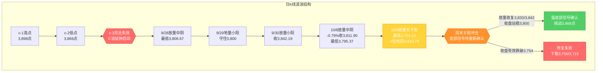
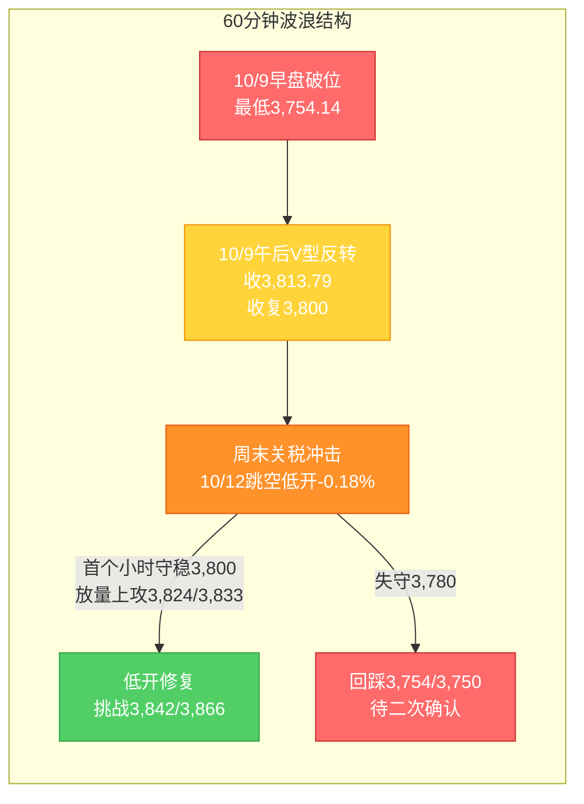

# A股晨报 - 2026年10月12日

> 数据截止时间：2026年10月12日 10:30（北京时间）；美股为10月9日（周五）收盘 + 周末"黑色星期五"（10/10）冲击，欧股/日韩为10/9至周末表现，港股、大宗商品、汇率为10/9及周末盘后
> 报告性质：**国庆长假后首个完整交易周（第42周）周一（10/12）开盘晨报** —— 以10/9"放量深V反转"复盘为基础 + **周末外盘"黑色星期五"+中美关税冲击** + 今日早盘前瞻
> 核心观点：**A股10/9上演"深V反转"**：上证指数早盘跌破3,800点（最低3,754.14，一度下探20月均线下方约46点），午后探底回升、**"3800点失而复得"，收3,813.79、涨0.05%**；两市成交**1.90万亿元（放量2,184亿元）**，主力资金**净流出116.88亿元（连续3日）**、电子单行业净流出119.23亿元居首；结构呈**"AI硬件杀跌→AI应用爆发"的高低切换**（传媒+5.28%居首、涨停潮）。**周末（10/10-10/11）突发重大变量**：**美方威胁对华加征100%关税 + 关键软件出口管制**，美股遭遇**"黑色星期五"**（**纳指-3.56%、标普500-2.71%、道指约-1.9%，均创4月以来最大单日跌幅**）、**股债汇"三杀"**，**中概股纳斯达克金龙指数-6.10%**（富途-11%、蔚来/晶科-10%、阿里/百度/小鹏-8%）；中方以**稀土出口管制反制**，**证监会主席吴清10/10召开座谈会稳预期、央行明确人民币汇率立场、商务部表态"不愿打，也不怕打"**，**黄金避险逆势走强、盘中创新高**。**今日（10/12）A股三大指数集体低开（沪指-0.18%、深证成指-0.43%、创业板指-0.65%，超2,900只个股飘绿），低开幅度明显小于外盘映射预期（乐观信号）**；**传媒娱乐、贵金属、钢铁、港口走强，存储芯片/CPO/固态电池/半导体/房地产回调**。**综合判断：今日上证大概率【震荡偏弱、低开修复（先抑后扬）】，区间参考3,760-3,870点，核心观察3,800点（20月均线"最后防线"）能否收盘站稳、以及3,833/3,842点能否放量收复；关税冲击映射以"低开修复"为基准情景，不宜线性外推外盘跌幅。**

---

## 一、昨日晚报复盘要点回顾

> 说明：上一交易日（10/9，周五）晚报已生成（`report/20261009/evening_report_20261009.md`），本节提取其复盘结论作为今日分析基础。

### 1. 昨日（10/9）判断回顾
- **趋势判断准确率：100%（1/1）**——预判"震荡偏弱"，实际"探底回升、收涨0.05%"（方向"震荡"命中，收盘力度强于预期）
- **点位预测准确率：约50%（2/4）**——强压力3,866、弱压力3,833命中（压力有效）；**区间下沿3,785被跌破（最低3,754.14）**、**强支撑3,800盘中大幅假跌破（-46点）后V型收回**（按"收盘有效"口径守住），合计打平
- **板块预判准确率：约50%（4/8）**——航运/油运、固态电池/电池、半导体/存储、CPO/光模块命中；**油气、银行、创新药误判**；煤炭/燃气/电力分化
- **综合准确率：约67%**——趋势判断精准，点位与板块两极分化；**最大遗漏=影视传媒/AI应用、券商、贵金属三大领涨方向**

### 2. 关键偏差及原因
- **偏差1（成交量预判·核心）**：预判"平量至小幅缩量1.5-1.7万亿"，实际**放量至1.90万亿（放量2,184亿）**。根因：**逻辑误判**——机械套用"本周仅2个交易日、明日休市→观望缩量"的节前/周末效应，**低估"关键防线破位引发的恐慌盘出逃 + 午后V型反转引发的抄底盘涌入"对成交的放大效应**
- **偏差2（板块结构·核心）**：过度外推10/8"防御/红利/能源占优"，**忽视10/9"资金高低切换至AI应用/题材（传媒/计算机/券商/有色）"**；未前瞻纳入"AI短剧落地+国庆档票房11.65亿元+金价重回4,200"等事件催化；**未将科技链拆分为"AI硬件 vs AI应用"**
- **偏差3（区间下沿/强支撑口径）**：预判区间下沿3,785、强支撑3,800，实际最低3,754.14（跌破约46点）后V型收回。根因：**技术分析局限**——把"最后防线"理解为"刚性支撑"，**未预留"放量破位下探后V型收回"的波动空间**

### 3. 沉淀的规则/检查项（本次直接应用）
- **规则1（趋势分析）**：关键防线"放量大幅假跌破（-1.5%以上）+当日V型反转收阳"属强底部信号，"T+1反转"概率高于"次日再确认"
- **规则2（板块选择）**：AI产业链内部存在"硬件↔应用"高低切换，科技链预判须按"AI硬件 vs AI应用"拆分
- **规则3（板块选择）**：指数逼近关键防线、资金"高切低"时，题材方向（券商/传媒/有色/贵金属）易成为V型反转推手
- **规则4（资金面分析）**："指数翻红"≠"资金转多"——放量V型反转日若主力资金仍连续净流出且单一行业净流出居首，结构分化下应保持谨慎
- **规则5（点位计算）**：关键防线破位+日内V型反转日应设"破位放量"情景，并给出"下探容错区间"（如3,800±50点）
- **规则6（第41周新增·趋势）**：休市期"关税威胁/地缘黑天鹅"致外盘大幅下挫时，次日A股高概率跳空低开（80-85%），但**基准情景应为"低开修复/先抑后扬"而非单向看跌**
- **规则7（第41周新增·点位）**：关键防线"放量假跌破+V型反转"确认后若紧接周末外生冲击，**底部信号应视为"待重新确认"**——关键验证位3,800（收盘有效跌破=失效）、3,842（放量站稳=确认）
- **规则8（第41周新增·板块）**：中美关税升级期，A股呈经典"对冲结构"——受益：自主可控（半导体设备/材料/信创）、稀土永磁、军工、农业（种业/大豆）；承压：出口链/消费电子/跨境电商；避险：黄金/贵金属
- **规则9（第41周新增·资金面）**：中概股（纳斯达克金龙指数）的超额跌幅是A股（尤其科技/港股）次日低开的**领先映射信号**

### 4. 对今日（10/12）分析的启示
- **需要关注的风险点**：①**周末关税冲击的"二次映射"**——美股"黑色星期五"（纳指-3.56%）、中概金龙-6.10%，但**国内政策对冲前置（证监会座谈会+央行汇率维稳）+市场学习效应**，构成"低开修复"的基准；②**10/9 V型反转的底部信号被周末外生冲击打断**，3,800/3,842的确认需重新验证；③**主力资金连续3日净流出、电子单行业净流出119亿**，结构脆弱
- **需要调整的分析逻辑**：①以**"关税冲击+对冲结构"**替换10/9的"防御/红利/能源占优"结构；②**科技链继续按"AI硬件（承压） vs AI应用（相对独立）"拆分**；③把**"稀土永磁、自主可控、军工、农业、贵金属"**纳入防御性/对冲性预判清单；④成交量预判设置**"低开修复放量"**情景

---

## 二、隔夜市场动态（10/9收盘至10/12开盘）

### 1. 美股市场（10月9日周五收盘 + 周末"黑色星期五"）

**（1）10月9日（周五）收盘**

| 指数 | 收盘点位 | 涨跌幅 | 说明 |
|------|---------|--------|------|
| 道琼斯工业指数 | 51,654.95 | **+0.83%** | 全周上涨 |
| 标普500指数 | 7,811.54 | **+0.59%** | 全周小涨 |
| 纳斯达克综合指数 | 27,366.17 | **+0.64%** | 全周小涨 |

**（2）周末"黑色星期五"（10/10，北京时间10/10深夜至凌晨收盘）**

| 指数 | 涨跌幅 | 说明 |
|------|--------|------|
| 纳斯达克综合指数 | **-3.56%** | **创4月以来最大单日跌幅** |
| 标普500指数 | **-2.71%** | **创4月以来最大单日跌幅** |
| 道琼斯工业指数 | **约-1.9%** | 相对抗跌 |
| 纳斯达克中国金龙指数 | **-6.10%** | **超额跌幅显著（领先映射信号）** |

**解读**：**周末核心催化=中美关税冲击**——**美方威胁对华加征100%关税并出台关键软件出口管制**，触发AI/半导体/科技板块大规模抛售；同时出现**罕见的"股债汇三杀"**（美股大幅下挫、**美债收益率集体走低、资金撤离美元资产**）。**中概股为重灾区**：纳斯达克金龙指数-6.10%，**富途控股-11%、蔚来/晶科能源-10%、哔哩哔哩-9%、阿里巴巴/百度/小鹏汽车-8%、京东-6%、拼多多-5%、网易/理想汽车-3%**。**净影响：外盘由10/9的"小幅收涨"急转为周末的"关税定向利空+风险偏好骤降"，对A股映射呈"低开扰动（科技/出口链定向承压）、避险与对冲方向相对占优"。**

### 2. 欧洲/亚太市场

| 市场 | 表现 | 备注 |
|------|------|------|
| 欧洲三大股指 | **尾盘全线跳水、集体下跌** | 受美股"黑色星期五"拖累 |
| 日经225（10/9） | 基本持平/小幅波动 | 节后弱势企稳 |
| 韩国KOSPI（10/12） | **开盘下跌** | 半导体/科技拖累 |
| 恒生指数（10/9） | **24,211.35（+1.79%）** | 成交2,091.99亿港元 |
| 恒生科技（10/9） | **+3.06%** | 科网股走高（小米+9.72%） |
| 恒生指数（10/8） | 23,785.79（-1.43%） | 本周先抑后扬 |

**情绪判断**：**港股10/9大涨（恒生科技+3.06%）、欧洲10/9收涨**，但**周末关税冲击后欧洲尾盘全线跳水、亚太（韩股）开盘下跌**，**外围风险偏好整体由"修复"急转为"避险"**。**港股与中概股（A+H中概）的周末表现是A股今日低开的一级前瞻信号。**

### 3. 大宗商品

| 品种 | 价格/表现 | 涨跌/驱动 |
|------|----------|----------|
| 现货黄金 | **盘中逆势创新高（重回4,200美元/盎司上方）** | **避险资金涌入**，"股债汇三杀"下的核心受益资产 |
| 现货白银 | 高位波动 | 跟随贵金属 |
| 原油（WTI/布伦特） | **下跌** | **风险资产抛售 + 需求担忧**，回吐10/8地缘涨幅 |

**驱动逻辑**：①**黄金**在关税冲击+股债汇三杀下**逆势走强、盘中创新高**，是今晨**贵金属/黄金股领涨**的核心催化；②**原油**因全球风险资产抛售而回落，**对A股油气板块映射转弱**（与10/8"油价飙升"逻辑反向）。

### 4. 汇率与利率

| 指标 | 数值/表现 | 变化/说明 |
|------|----------|----------|
| 美债收益率 | **集体走低（长端领跌）** | "股债汇三杀"中资金避险买债；**与10/8的"长端回落"方向一致** |
| 美元指数 | 走弱/剧烈波动 | **资金撤离美元资产**，避险交易升温 |
| 人民币中间价（10/9） | **6.7330** | **调升37个基点**，连续偏强 |
| 离岸人民币 | 维持偏强 | 前期已升破6.70附近 |
| 央行政策 | **明确人民币汇率政策立场（稳汇率预期）** | 周末边际正面信号 |

**特征**：①**美债收益率周末集体走低**，是**对成长股估值端的边际缓和**（但A股成长股同时面临"关税定向利空"，净影响需权衡）；②**央行明确人民币汇率立场**，对A股资金面与情绪面形成**边际正面支撑**；③需警惕"关税冲击→外资风险偏好下降→北向流出"的传导。

### 5. 周末重要政策/事件（关键）

- **中方反制与政策对冲**：①**中方以稀土出口管制反制**（稀土永磁为核心受益方向）；②**证监会主席吴清10/10召开座谈会**（稳预期、稳市场）；③**央行明确人民币汇率政策立场**（稳汇率预期）；④**商务部就美关税威胁表态"不愿打，但也不怕打"**
- **关税博弈节点**：**特朗普称11月1日再决定是否加征100%关税**；**10月底APEC会议**为中美经贸关系关键窗口——**冲击具"政治化/可逆"特征，可逆性高于2025年4月**
- **机构共识**：11家券商普遍认为**本次关税冲击"远低于2025年4月"**，"砸坑即买点""以我为主"（**"TACO交易"逻辑**强化"低开修复"）
- **地缘**：**沙特利雅得国际机场遭袭**（关注地缘与大宗波动）

### 6. 今日早盘概况（10/12 开盘，北京时间~10:00）

- **三大指数集体低开**：**上证指数低开0.18%、深证成指低开0.43%、创业板指低开0.65%**，超**2,900只个股飘绿**
- **低开幅度明显小于外盘映射预期**（关税黑天鹅通常对应-1%至-2%低开），**属"低开修复"的偏乐观信号**
- **盘面结构（对冲/避险占优）**：**传媒娱乐、文化传媒、贵金属、钢铁、港口、交通设施**走强；**存储芯片、CPO概念、固态电池、通信设备、电子元器件、半导体、房地产**回调
- **个股**：**时代万恒（固态电池）开盘不到一分钟直线涨停，走出6连板**；德新科技涨停；固态电池概念震荡回升
- **特征**：早盘呈**"指数低开、对冲方向（贵金属/传媒/钢铁）领涨、AI硬件（存储/CPO/半导体）承压"**的经典"关税冲击对冲结构"，**与周末外盘映射方向一致、但强度温和**

---

## 三、今日关注事项

### 1. 重要数据发布 / 政策（按时间排序）
- **关税/经贸**：关注**商务部**后续表态、**中方稀土出口管制**细则落地、**10月底APEC**与**11月1日美方关税决定**的博弈进展
- **政策对冲**：跟踪**证监会/央行**后续稳市举措（座谈会后续、流动性呵护、汇率维稳）；央行10/8已净投放2,000亿元、下调PSL利率至1.5%
- **宏观数据**：关注本周**9月CPI/PPI、金融数据（社融/信贷/M2）**等发布窗口（以官方发布为准）——**通胀与社融表现将影响政策预期与顺周期/银行板块**
- **三季报**：**10/13起进入密集披露期**（有研新材、聚灿光电、冀东装备等首披；10/14金盘科技、川投能源；10/15宇通客车等）

### 2. 限售股解禁
- **10月全月**解禁约**3,047亿元（环比+62.82%、同比+20.61%）**，**电子、公用事业、煤炭**解禁市值居前（西安奕材、中船特气规模居前）——**为本周需持续跟踪的风险点**
- 关注今日及本周**电子、公用事业**方向个股的解禁冲击

### 3. 公司公告 / 业绩
- **三季报预告密集披露**：截至10/9已有20余家披露，预喜为主（**东岳硅材**前三季度净利同比+约190倍~198倍为增幅最大）
- **业绩验证窗口开启**：**AI/半导体/创新药等高位成长股业绩不及预期风险**需警惕

### 4. 其他关注
- **新股**：关注今日新股申购与上市安排（以交易所公告为准）
- **交易安排**：**本周（第42周，10/12-10/16）恢复5个交易日**，本周为国庆后首个完整交易周

---

## 四、板块与个股分析（结合昨日复盘与周末冲击）

### 1. 基于昨日（10/9）复盘结论的板块调整
- **10/9强势板块（AI应用/题材）今日预期**：①**传媒/AI应用**——10/9传媒+5.28%居首、涨停潮，叠加"事件驱动+高低切换"逻辑，**今日早盘继续走强**（文化传媒领涨）；②**券商/非银**——情绪修复+护盘，但**受关税冲击风偏压制，弹性或收敛**；③**贵金属/黄金**——**周末金价逆势创新高**，映射强化
- **10/9领跌板块（AI硬件）今日预期**：①**半导体/存储/CPO/PCB**——叠加**外盘AI收入端质疑（10/8）+ 关税冲击（周末）+ 关键软件出口管制**，**定向偏空，继续承压**（今日早盘存储/CPO/半导体回调验证）；②**出口链/消费电子/跨境电商**——关税冲击直接承压
- **偏差板块修正逻辑**：**银行/红利**（10/9领跌）→ 关税冲击期"高股息防御"属性回归，可择机低吸；**油气**（10/9误判）→ **油价周末回落，映射转弱**，下调优先级

### 2. 周末信息驱动的板块机会（"关税冲击对冲结构"）
- **受益板块（对冲/避险）**：
  - （1）**稀土永磁**（逻辑：**中方稀土出口管制反制**，关税博弈核心受益方向）
  - （2）**自主可控（半导体设备/材料、信创、国产软件）**（逻辑：**关键软件出口管制→国产替代加速**）
  - （3）**军工、农业/种业/大豆**（逻辑：中美博弈对冲方向）
  - （4）**贵金属/黄金**（逻辑：**金价逆势创新高 + 避险升温**）
  - （5）**传媒/AI应用**（逻辑：**事件驱动 + AI硬件→应用高低切换**，10/9已启动、今日早盘延续）
- **受损板块**：
  - （1）**出口链/消费电子/跨境电商**（逻辑：**关税冲击直接承压**）
  - （2）**AI硬件（半导体/存储/CPO/PCB）**（逻辑：外盘AI收入端质疑 + 关税 + 主力资金持续净流出）
  - （3）**房地产**（今日早盘回调，题材与风偏双压）

### 3. 重点关注个股（结合10/9异动与周末信息）
- **稀土永磁龙头（北方稀土、中国稀土等）**：关注理由=**稀土出口管制反制**（关税对冲核心）；风险=情绪性脉冲后的波动
- **贵金属（山东黄金、中金黄金、白银有色等）**：关注理由=**金价创新高+避险升温**；技术位置=跟随金价高位
- **半导体设备/材料（自主可控方向）**：关注理由=**关键软件出口管制→国产替代加速**；风险=与AI硬件整体承压的分化
- **传媒/AI应用（芒果超媒、中文在线等）**：关注理由=**AI短剧/视频落地+高低切换**；风险=高位连板股获利回吐（新华传媒9连板）
- **时代万恒（600241）**：**固态电池6连板**（今日早盘一字涨停）；关注理由=**事件驱动+资金活跃**；风险=**连续涨停后的高位波动**
- **回避/谨慎**：出口链、高位连板股、三季报不及预期的高位成长股、大额解禁个股

---

## 五、今日核心判断（结构化输出，用于晚报复盘）

### 1. 趋势判断
- **上证指数：【震荡偏弱（低开修复、先抑后扬）】**
- **预测区间：3,760点 - 3,870点**（下探容错区间3,754±50点，极端下沿3,730点）
- **核心逻辑**：**周末关税冲击（美方威胁100%关税+关键软件出口管制）→美股"黑色星期五"（纳指-3.56%、中概金龙-6.10%）**，对A股构成"低开扰动（科技/出口链定向承压）"；但**基准情景为"低开修复"**——**国内政策对冲前置（证监会座谈会+央行汇率维稳+商务部表态）+市场学习效应（冲击远低于4月）**，且**今日早盘低开幅度仅-0.18%（远小于外盘映射预期）**，叠加**黄金避险、对冲结构（稀土/军工/农业/自主可控）活跃**提供结构性支撑。**综合看：低开不恐慌、日内或呈"先抑后扬"震荡修复，但3,800点（20月均线）能否收盘站稳、3,833/3,842能否放量收复为核心。**

### 2. 关键点位
- **强支撑位：3,800点**（依据：**20月均线，"最后防线"**；10/9盘中大幅假跌破（3,754.14）后V型收回——**今日能否收盘站稳为多空分水岭**）
- **弱支撑位：3,754点**（依据：**10/9 V型反转起点/阶段低点**，下探容错位；收盘有效跌破则底部信号失效）
- **强压力位：3,866点**（依据：**c-2低点，周线底部反转确认位**）
- **弱压力位：3,833点**（依据：**9/30低点，短线强弱分水岭**）；次级压力**3,842点**（C浪低点反压，加仓/确认位）

### 3. 板块预判
- **看涨板块**：（1）**稀土永磁**（逻辑：**中方稀土出口管制反制**）（2）**自主可控（半导体设备/材料、信创）**（逻辑：**关键软件出口管制→国产替代**）（3）**军工、农业/种业**（逻辑：中美博弈对冲）（4）**贵金属/黄金**（逻辑：**金价创新高+避险**）（5）**传媒/AI应用**（逻辑：事件驱动+高低切换）（6）**券商**（逻辑：情绪修复+护盘，弹性受限）
- **看跌板块**：（1）**出口链/消费电子/跨境电商**（逻辑：**关税直接承压**）（2）**AI硬件（半导体/存储/CPO/PCB）**（逻辑：AI收入端质疑+关税+资金净流出）（3）**房地产**（逻辑：早盘回调+题材与风偏双压）（4）**高位连板股**（逻辑：获利回吐）
- **风险板块**：①**三季报或不及预期的高位成长股**；②**本周大额解禁个股**（电子/公用事业/煤炭方向）；③**出口链海外收入占比高的个股**；④**退市风险/ST个股**

### 4. 资金面判断
- **北向资金预期：【结构性分化 / 净额承压】（依据：交易所已不实时披露净额，**以成交口径跟踪**；关税冲击或抑制外资风险偏好，但央行稳汇率+美债收益率回落提供支撑）
- **成交量预期：【放量 / 平量】1.8 - 2.0万亿元**（依据：**关税冲击的低开修复日易放量**（恐慌盘+抢反弹盘），参照"破位放量"规则；若午后情绪修复则量能维持1.9万亿上方，若持续缩量则反弹受限）

### 5. 风险预警（按优先级排序）
- **高风险**：①**中美关税冲击二次映射/升级发酵**——科技、出口链**定向杀跌风险**（关注11/1关税决定、APEC博弈）；②**3,800点（20月均线）有效性**——若**收盘有效跌破3,754点，则10/9 V型底部信号失效**，下看3,750/3,715；③**外盘续跌风险**——美股"黑色星期五"后若续跌、VIX高企，全球风险偏好下行
- **中风险**：①**主力资金连续3日净流出**（电子单行业净流出119亿）——结构脆弱，"指数修复≠资金转多"；②**三季报密集披露 + 10月解禁3,047亿（环比+62.82%）**；③**美债/美元剧烈波动**（股债汇三杀后的资产再定价）
- **低风险**：①**地缘（沙特利雅得机场遭袭、中东局势）**；②**原油下跌**（对油气映射转弱）；③**本周恢复5个交易日**，量能有望温和修复（广发：全A成交缩量约55%，历史上对应短期反弹机会）

### 6. 昨日复盘规则应用
- **应用规则1（关税黑天鹅次日"低开修复"为基准）**：周末关税冲击致外盘大跌，**今日低开（-0.18%）后以"低开修复/先抑后扬"为基准情景，不单日恐慌止损**
- **应用规则2（底部信号"待重新确认"）**：10/9 V型反转强底部信号被周末外生冲击打断，**需重新验证3,800（收盘跌破=失效）与3,842（放量站稳=确认）**
- **应用规则3（科技链按"AI硬件 vs AI应用"拆分）**：**下调AI硬件（半导体/存储/CPO/PCB）**，**保留AI应用/传媒（事件驱动+高低切换）**
- **应用规则4（关税期"对冲结构"）**：**上调稀土永磁、自主可控、军工、农业、贵金属**，**下调出口链/消费电子/跨境电商**
- **应用规则5（中概金龙为领先映射）**：以**中概金龙-6.10%**为一手映射参考，**A股低开幅度为其30-50%**（今日实际-0.18%，显著好于该口径上沿，**偏乐观**）
- **应用规则6（"指数翻红"≠"资金转多"）**：关注**主力资金能否由净流出转为净流入**（尤其电子/半导体止跌），作为修复可持续性的确认

---

## 六、波浪理论多周期分析

> 说明：基于10/9实际K线结构 + 周末外生冲击推演今日（10/12）路径。**10/9"放量长下影+V型收回3,800"的强底部信号，因周末关税冲击转为"待重新确认"。**

### 1. 月K线波浪分析

- **当前波浪位置**：大周期**第2浪C浪延伸末段寻底**，10月月K线（10/8-10/9）呈**"先抑后扬、长下影"**雏形，**10/9盘中跌破20月均线（约3,800点）后迅速收回**
- **浪型结构描述**：2024年9月2,689点→2026年6月4,197点为**第1浪上升**；第2浪ABC调整：4,197点→3,806.67点（9/28最低）；10月开局（10/8）下探3,795.37点，10/9进一步下探**3,754.14点（再创阶段新低）后V型收回3,813.79点**；月线触及20月均线后收回，为**连续第三个月调整**，但下影线拉长，"破位下行"风险阶段性缓和；**周末关税冲击使月线收盘方向存疑**
- **关键目标位**：月度强支撑**3,800-3,810点（20月均线）**、3,754点（10/9低点）、3,750点；月度核心压力3,842点、3,866点、3,898点
- **验证条件**：**10月月K线能否收盘站稳3,800点**——10/9已收复，但周末外生冲击后需重新确认；若月内有效跌破3,750点，则月度底部证伪

### 2. 周K线波浪分析

- **当前波浪位置**：第41周（10/8-10/9）周K线收**"带长下影的小阴/十字星"**（下影约59.6点、实体约-25点，下影/实体≈2.4），跌势放缓、下方承接增强；**第42周（10/12起）为国庆后首个完整交易周**
- **浪型结构描述**：周开约3,839点（10/8）→周内最低**3,754.14点（10/9）**→周收3,813.79点；周线仍处5周（约3,880-3,895）、10周（约3,875-3,890）、20周（约3,930-3,945）均线下方，**短期均线空头排列未改**，但长下影表明3,750-3,800为强承接区
- **关键目标位**：周度支撑**3,800点（20月均线，核心）**、3,754点（10/9低点）；周度压力**3,833点**（短线分水岭）、**3,842点**（C浪低点反压）、**3,866点**（c-2低点，周线反转确认位）
- **验证条件**：**本周（5个交易日）能否收出长下影/小阳**——**放量站稳3,833并挑战3,866**为周线反转确认前提；收盘有效跌破3,754则信号失效；**下周一（10/12）因周末外盘冲击大概率跳空低开，缺口回补情况为本周首要观察点（今日实际仅低开-0.18%，缺口小、偏乐观）**

### 3. 日K线波浪分析（重点）

- **当前波浪位置**：**C浪延伸末段"底部修复受挫 + 外生冲击"**——10/8放量中阴打破原"底部初步确认"结构；10/9放量下探3,754.14（再创新低）后V型收回3,813.79，形成**"放量+长下影+收复最后防线"**组合；但**周末关税冲击使该底部信号转为"待重新确认"**
- **浪型结构描述**：9/28放量中阴（最低3,806.67）→9/29地量小阳→9/30放量小阳收3,842.19→**10/8放量中阴-0.79%收3,811.90**→**10/9放量长下影小阳+0.05%收3,813.79（最低3,754.14）**；**低点序列仍创新低（3,806.67→…→3,795.37→3,754.14）**，但**收盘连续两日稳于3,810-3,814区间、且V型收回3,800**，显示**3,750-3,800为强承接区**
- **关键目标位**：第一压力**3,833点（9/30低点）**、**3,842点（C浪低点反压）**；**强压力3,866点（c-2低点）**；第一支撑**3,800点（20月均线，"最后防线"）**、3,754点（10/9低点）；**下方目标3,750点/3,715点（黄金分割1.236延伸，仅当收盘有效跌破3,754点时启用）**
- **验证条件**：
  - **向上修复**：**放量收复3,833点并站稳3,842点** → **"假跌破+V型反转+放量收阳"**的强底部信号确认，方有挑战3,866点可能
  - **向下确认**：**收盘有效跌破3,754-3,760点** → V型修复失败，下看3,750点及3,715点
  - **今日变量（10/12）**：周末关税冲击 → **跳空低开（实际仅-0.18%，远小于预期）**；对冲结构（稀土/军工/农业/贵金属/AI应用）活跃 → 有望**低开修复**；**需观察3,800点能否收盘站稳、缺口能否回补**

### 4. 60分钟K线波浪分析

- **当前波浪位置**：60分钟级别**"破位下行→深V反转"**，短线由弱转平/略偏强；**周末外生冲击后，短线转为"低开待修复"**
- **浪型结构描述**：60分钟10/9早盘单边下行至**3,754.14点**（量能放大、恐慌盘出逃）；午后逐级回升，**60分钟MACD在零轴下方形成"底背离"，绿柱持续收缩**，KDJ自超卖区回升，尾盘收于日内高位附近；今日低开后观察能否再现"低开→修复"
- **关键目标位**：短期支撑**3,800/3,780点**；短期压力3,824点（10/9高点）、3,833点
- **验证条件**：**今日首个小时能否守稳3,800点并放量上攻3,824-3,833点**——守稳则短线转强，跌破3,780则低开修复级别降级

### 5. 30分钟K线波浪分析

- **当前波浪位置**：30分钟级别**午后放量反转、超卖修复**，反弹时间预期一般3-5天
- **浪型结构描述**：30分钟10/9呈"低开破位→午后放量上行修复"，**MACD在低位金叉、红柱温和放大，KDJ中位区向上**；量能集中在午后修复段（放量回升特征）；今日低开后需观察对冲板块（稀土/贵金属）能否带动情绪
- **关键目标位**：关键支撑3,800/3,780点；短期压力3,824点、3,833点
- **验证条件**：**30分钟能否放量站稳3,824点并向3,833点推进**，否则维持3,780-3,833区间震荡

### 6. 波浪图（Mermaid绘制）

**日K线波浪结构图**：

**60分钟波浪结构图**：

### 7. 波浪理论综合判断

| 维度 | 判断 |
|------|------|
| 多周期共振状态 | **月/周/日/60分钟/30分钟由"全偏空"转为"底部修复分歧 + 外生冲击"**——10/9长下影+V型收回3,800使月/周/日出现底部信号雏形，但**周末关税冲击打断确认进程**；**低点序列仍创新低（3,754.14）、主力资金连续3日净流出**，尚未形成多周期向上共振 |
| 当前操作级别 | **日线级别**（"低开修复待确认"；3,800为多空分水岭，3,833/3,842为确认位，3,754为关键防守，3,750/3,715为失效目标） |
| 后续演变路径（10/12） | **35%乐观**（政策对冲见效/低开修复→放量收复3,833并站稳3,842→底部信号确认，挑战3,866）、**45%中性**（3,760-3,833区间震荡消化，对冲结构轮动）、**20%悲观**（关税升级发酵/外盘续跌→收盘有效跌破3,754，下看3,750/3,715） |
| 关键拐点信号 | 向上：**放量收复3,833点并站稳3,842点** + 主力资金转净流入 + AI硬件（半导体）止跌 + 缺口回补；向下：**收盘有效跌破3,754点** + 科技链放量再杀跌 + 港股/中概续弱 |
| 风险提示 | ①**关税冲击二次映射/升级**为核心外生变量（11/1关税决定、APEC）；②**10/9 V型底部信号"待重新确认"**，3,800/3,842为验证位；③**主力资金连续3日净流出、电子净流出119亿**，结构脆弱；④**三季报密集披露+10月解禁3,047亿**；⑤波浪理论在C浪延伸末段+外生冲击阶段预测精度降低，需结合政策面、外盘与量能综合判断 |

> **规律分析引用（第41周运行规律分析）**：该报告（周日10/11生成）预测第42周（10/12-10/16）上证运行区间**3,730-3,880点**，判断"**震荡偏弱（低开修复、先抑后扬）**"，乐观/中性/悲观概率**30%/45%/25%**，并强调"**3,800点（20月均线）为最后防线**、**3,842点为信号确认位**、**关税冲冲击期关注稀土/军工/农业/贵金属对冲结构**"。**今日实际低开仅-0.18%（显著小于外盘映射的-1%~-2%预期）**，为"低开修复"提供了偏乐观的早期证据；本报告据此**将乐观概率由30%微调至35%、悲观由25%微调至20%**。

---

## 七、投资策略建议（分短线+中线）

### 1. 短线策略（1-3个交易日）
- **适用场景**：基于日K线和60分钟K线技术信号
- **短线仓位：15%**（较10/9晚报的10%**上调5个百分点**——低开幅度温和、"低开修复"概率上修，但关税不确定性仍存，**不宜重仓**）
- **买入条件**：①**指数低开后守住3,800点并放量收复3,833点**；或②**对冲方向（稀土永磁、贵金属/黄金、军工、农业）回踩关键均线不破时低吸**；或③**传媒/AI应用龙头强势整理后放量突破**
- **卖出条件**：指数反弹至**3,833-3,866点压力区滞涨**、或量能萎缩、或**收盘跌破3,800点**
- **止损位：3,790点**（收盘有效破3,754则止损）或个股跌幅7%
- **短线标的**：（1）**稀土永磁**（逻辑：**稀土出口管制反制**，关税对冲核心）（2）**贵金属/黄金**（逻辑：**金价逆势创新高+避险**）（3）**军工/农业（种业、大豆）**（逻辑：中美博弈对冲）（4）**传媒/AI应用**（逻辑：事件驱动+高低切换）——**回避**出口链/消费电子、AI硬件（半导体/存储/CPO）、高位连板股

### 2. 中线策略（1-4周）
- **适用场景**：基于周K线波浪分析和运行规律分析结论
- **中线仓位：25%**（较10/9晚报的15-20%**小幅上调**——关税冲击"可逆性高+政策对冲前置+市场学习效应"，长期底部结构未破；**待放量收复3,842/3,866后再上修**）
- **方向判断：【持有 / 观望（略偏积极）】**
- **目标区间**：上证指数 **3,760点 - 3,898点**
- **中线布局板块**：（1）**对冲/自主可控（稀土永磁、半导体设备/材料、信创、军工、农业）**（逻辑：**关税博弈核心受益**）（2）**贵金属/黄金**（逻辑：避险升温+金价创新高）（3）**政策主线（券商、传媒/AI应用、固态电池/电力设备）**（逻辑：情绪修复+事件驱动+政策催化）（4）**防御/红利（银行/能源）**（逻辑：高股息、攻守兼备，回调后布局）
- **止盈条件**：指数到达**3,866-3,898点**或波段涨幅达到X%
- **止损条件**：指数**收盘有效跌破3,754点**（20月均线下方、V型底部证伪）或趋势确认反转

### 3. 仓位分配总览
| 策略类型 | 仓位比例 | 方向 | 重点板块 |
|---------|---------|------|---------|
| 短线 | 15% | 低吸/试探 | 稀土永磁、贵金属、军工/农业、传媒/AI应用 |
| 中线 | 25% | 持有/观望 | 对冲自主可控、贵金属、券商/传媒、银行/能源 |
| 现金 | 60% | — | — |

### 4. 与昨日（10/9）策略对比
- **短线仓位调整**：从**10%上调至15%**（原因：**关税冲击"低开修复"概率上修**，今日低开仅-0.18%验证；但对冲结构为主，**不追高、不满仓**）
- **中线仓位调整**：从**15-20%上调至25%**（原因：长期底部结构未破+政策对冲前置+市场学习效应；但需以**放量收复3,842**为加仓前置条件）
- **板块调整**：**上调**稀土永磁、贵金属/黄金、自主可控（半导体设备/材料/信创）、军工/农业（**关税对冲结构**）、传媒/AI应用；**下调**出口链/消费电子/跨境电商（**关税直接承压**）、AI硬件（半导体/存储/CPO）；**维持**银行/能源（防御）、券商（情绪修复）
- **操作前提**：**观察早盘是否"低开修复"**——若守住3,800并放量收复3,833则按上述布局小幅加仓；若收盘有效跌破3,754则降至低仓观望（短线降至5%以下）

---

## 八、信息来源

1. **官方数据来源**：上海证券交易所（上证指数10/9收盘3,813.79、最低3,754.14、最高3,824.71）、深圳证券交易所、证券时报网（10/12开盘：三大指数集体低开）、中国证监会（10/10座谈会）、中国人民银行（人民币汇率政策立场、10/8净投放2,000亿元）、商务部（就美关税威胁表态）、中国外汇交易中心（10/9人民币中间价6.7330）、香港交易所（恒生指数）、美国财政部（Treasury）
2. **权威财经媒体**：新华社/新华网、央视财经/央广网（10/12 A股开盘）、证券时报（数据宝/e公司/开盘综述）、上海证券报·中国证券网（10/12国际晨讯）、南方财经网（美国"股债汇三杀"）、中国证券报、第一财经、财联社、每日经济新闻、21世纪经济报道
3. **数据平台**：东方财富（Choice数据）、同花顺（10jqka）、Wind资讯、证券之星、CME FedWatch、Nasdaq.com
4. **海外信息源**：Reuters、CNBC、Bloomberg、South China Morning Post

> 数据截止时间：2026年10月12日 10:30（北京时间）；美股为10月9日收盘 + 周末"黑色星期五"（10/10）冲击，欧洲/亚太为10/9至周末表现，港股/大宗商品/汇率为10/9及周末盘后；今日早盘为10/12开盘后数据。

---

*本晨报由AI代理自动生成，仅供参考，不构成投资建议。投资有风险，入市需谨慎。*