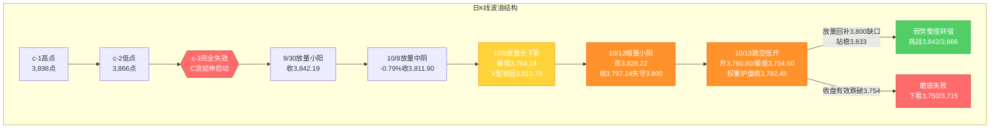
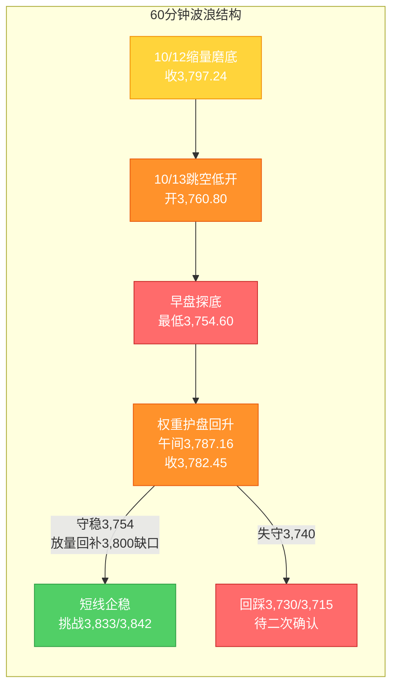

# A股晚报 - 2026年10月13日

> 数据截止时间：2026年10月13日 20:00（北京时间）；美股为10月12日（周一）收盘 + 10月13日盘前期指，欧股/亚太为10月13日，港股为10月13日收盘，大宗商品/汇率为10月13日盘后
> 报告性质：**国庆长假后首个完整交易周（第42周）周二（10/13）收盘晚报 + 10/13晨报盘前判断复盘** —— 隔夜"AI硬件杀跌（费半-2.67%）+ 亚太重挫（韩KOSPI-6%+）"冲击后的交易日
> 核心观点：**A股10/13呈"低开探底、权重护盘、缩量分化"**：上证指数**跳空低开-0.96%（开3,760.80点）**，早盘一度下探**3,754.60点（再度测试"最后防线"3,754点）**，随后在**银行/高股息、石油石化/油运、煤炭**护盘带动下震荡回升，尾盘收窄跌幅、**收3,782.45点（-0.39%、-14.79点）**，全天振幅约1.12%；深证成指-1.11%、创业板指-1.27%（**续创年内收盘新低**）、科创50-1.23%、北证50-0.85%。两市成交**约1.57万亿元（平量/略缩）**，**主力资金净流出68.4亿元（较10/12的151.62亿元明显收窄）**，全市场**1,806只上涨/3,388只下跌、涨停52只、跌停16只**。结构延续**"科技弱、能源+防御强"**——**石油石化/海运（油运）+2.86%、银行/高股息+1.18%、煤炭+1.05%、农业/种业+0.88%逆势走强**；**算力硬件（存储/光通信/CPO/覆铜板）-4.21%领跌，半导体芯片-2.67%、锂电池/新能源-2.12%、贵金属-1.60%、CRO/医药-1.31%**。**综合判断：10/13"低开探底后守稳3,754、未能收复3,800"，日线维持"缩量磨底、弱势整理"；低点未创新低（3,754.60>3,754.14），"最后防线"再度获得验证，"双底/抬升"雏形初现；下一交易日（10/14，周三）核心变量为美国9月CPI。**

---

## 一、市场回顾

### 1. 主要指数表现

| 指数 | 收盘点位 | 涨跌幅 | 涨跌点数 | 最高点 | 最低点 |
|------|---------|--------|---------|--------|--------|
| 上证指数 | **3,782.45** | **-0.39%** | -14.79 | **3,796.80** | **3,754.60** |
| 深证成指 | **12,247.20** | **-1.11%** | -137.67 | — | — |
| 创业板指 | **2,926.18** | **-1.27%** | -37.64 | — | — |
| 科创50 | **1,409.17** | **-1.23%** | — | — | — |
| 科创综指 | — | **-1.35%** | — | — | — |
| 北证50 | — | **-0.85%** | — | — | — |

**特征**：三大指数**"跳空低开→早盘探底→震荡回升→尾盘收窄跌幅"**，走出**"带下影的小阴/缩量十字"**组合。上证指数**跳空低开-0.96%（开3,760.80点）**，早盘受隔夜"AI硬件杀跌+韩股崩盘"冲击一度下探**3,754.60点（再测"最后防线"3,754点）**；此后**银行/高股息、石油石化/油运、煤炭等权重与能源方向持续护盘**，指数**震荡回升、跌幅收窄**，午间报3,787.16点（-0.27%），午后在3,780-3,796区间震荡，尾盘收3,782.45点（-0.39%）。**风格延续极致分化**——**权重（银行）+能源（油气/煤炭）逆势护盘，科技（算力硬件/半导体）与部分资源（贵金属）继续承压**；**创业板指收2,926.18点、续创年内收盘新低**。**关键多空点**：**3,754点（"最后防线"）盘中两度测试未有效跌破（最低3,754.60）、3,800点（20月均线/缺口位）全天未能收复**（最高3,796.80）——**"守底线、欠修复"**格局。

### 2. 成交量能

| 指标 | 数值 | 变化 | 说明 |
|------|------|------|------|
| 沪深两市成交额 | **约15,700亿元（约1.57万亿）** | 较10/12的15,378亿**平量/微增** | 仍在晨报预期区间1.5-1.7万亿内 |
| 沪深京三市成交额 | **约1.58万亿元** | 平量 | 量能未明显放大 |
| 上证/深证成交额 | 约7,280亿 / 约8,420亿 | — | — |
| 北向资金成交额 | **2,415.6亿元** | 占两市约15.4% | **净额交易所已不实时披露，以成交口径跟踪** |
| 主力资金 | **净流出68.4亿元** | 净流出**明显收窄**（10/12为151.62亿） | **电子/通信仍净流出居前，但幅度收窄；银行、石油石化、煤炭净流入** |
| 行业资金流向 | 约12个行业净流入 | — | **银行、石油石化、煤炭、公用事业净流入居前**；电子、通信、计算机净流出居前 |

**资金特征**：**"平量/略缩 + 主力净流出收窄"是今日核心特征**——成交量约1.57万亿，**落在晨报"缩量/平量1.5-1.7万亿"预期区间内（✓）**。**主力资金净流出由10/12的151.62亿元收窄至68.4亿元**，其中**银行、石油石化、煤炭板块获净流入**（护盘+能源驱动），**电子、通信、计算机延续净流出但幅度收窄**——**"资金仍在撤离AI硬件/科技成长，但抛压减缓、防御/能源方向获增量资金承接"**。**关键反差**：**指数由权重护盘驱动（"指数跌幅-0.39%远小于个股"），但主力资金仍为净流出，说明"护盘≠资金全面转多"**（延续10/9/10/12"指数翻红/抗跌≠资金转多"规则）。

### 3. 市场情绪

| 指标 | 数值 | 说明 |
|------|------|------|
| 上涨家数 | **1,806只（占比约32.8%）** | 较10/12（1,167只）回升 |
| 下跌家数 | **3,388只** | 超3,300只个股下跌 |
| 涨停家数 | **52只**（沪深两市） | 较10/12的48只小幅回升 |
| 跌停家数 | **16只** | 较10/12的22只收窄 |
| 封板率 | **约62%** | — |
| 连板股 | 传媒/油运方向局部连板；**新华传媒10/13起停牌核查** | 高位连板股风险出清中 |

**情绪特征**：**"低开探底后情绪边际修复、但赚钱效应仍偏弱"**——早盘随指数下探情绪一度低迷，随权重/能源护盘、指数回升，**上涨家数回升至1,806只、跌停收窄至16只**，情绪较10/12**小幅修复**；但**下跌家数仍达3,388只、"指数抗跌/个股普跌"的失真格局延续**（沪指-0.39% vs 超3,300只个股下跌、创业板指-1.27%）。**结构上**，"**能源/防御（油气/银行/煤炭/农业）**"是情绪支撑主线，"**AI硬件/半导体（存储/光通信/CPO）**"是拖累主线。**新华传媒10/13起停牌核查**，高位连板风险进一步出清。

---

## 二、热点板块与异动分析

### 1. 当日领涨板块及驱动因素

申万31个一级行业**约9涨22跌**，涨幅居前：

| 板块 | 涨跌幅 | 驱动因素 |
|------|--------|---------|
| 石油石化/油气/油运（海运） | **+2.86%（居首）** | **国际油价突破106美元/桶（布油）+ 中东地缘升级**；招商轮船/中远海能涨超4%，中国海油/中国石油涨超2% |
| 银行/高股息 | **+1.18%** | **避险+类固收防御**，工商银行/建设银行/中国银行续创新高（护盘主线） |
| 煤炭 | **+1.05%** | 高股息 + 冬储 + 能源涨价共振 |
| 农业/种业 | **+0.88%** | 中美博弈对冲 + 政策 + 防御 |
| 公用事业/电力 | +0.44% | 高股息防御 + 避险资金流入 |
| 食品饮料/大消费 | **-0.32%** | 防御属性但**高位回吐**（联讯仪器与茅台"股王之争"分流资金） |

**驱动逻辑**：①**"油价趋势驱动 + 地缘溢价"**——国际油价持续拉升（布油破106美元）、中东冲突升级，**油气/油运/煤炭由"映射转弱"上修为"趋势驱动"**，今日兑现（**为晨报看涨方向，命中**）；②**"权重高股息护盘+"**——银行/高股息（类固收防御）在关税冲击期+全球科技杀跌下**续创历史新高**，成为指数核心护盘力量；③**"关税农业对冲 + 政策防御"**——农业/种业（含种业）逆势活跃。

### 2. 当日领跌板块及原因分析

| 板块 | 表现 | 原因分析 |
|------|------|---------|
| 算力硬件（存储/光通信/CPO/覆铜板/PCB） | **-4.21%（领跌）** | **"AI资本约束"叙事+外盘AI硬件重挫映射**（费半-2.67%、美光-3.88%、Ciena-9.95%）；存储/光通信/CPO/覆铜板集中杀跌 |
| 半导体芯片 | **-2.67%** | 费半-2.67% + 韩股崩盘（KOSPI-6%+）+ 美债>5%的"利率弹性反向" |
| 锂电池/新能源（风电/光伏） | **-2.12%** | 高位调整 + 资金撤离 |
| 有色金属/贵金属/黄金 | **-1.60%** | **金价续跌（美联储鹰派+美债>5%+强美元）**；避险交易降温 |
| 生物科技/CRO/医药 | **-1.31%** | 调整延续 |
| 传媒/影视院线（AI应用） | **-1.15%** | **未现"AI硬件弱→AI应用强"的高低切换**——系统性外盘冲击下AI链（硬件+应用）同步承压 |

**结论**：今日领跌集中在**"算力硬件（存储/光通信/CPO/覆铜板）+ 半导体芯片 + 新能源 + 贵金属 + 医药 + 传媒/AI应用"**。**关键观察**：**晨报预判的"AI硬件 vs AI应用"分化今日未兑现**——**AI应用/传媒（10/9曾独立走强）今日随AI硬件同步回落**，说明**在"系统性外盘定向冲击（费半重挫+韩股崩盘）"下，AI链的"硬件↔应用高低切换"效应会被系统性风险偏好回落所覆盖**，须区分"事件驱动型独立行情"与"系统性映射冲击"。

### 3. 个股异动复盘

- **油气/油运走强**：招商轮船、中远海能涨超4%；中国海油、中国石油涨超2%；油运板块领涨
- **银行续创新高**：工商银行、建设银行、中国银行续创历史新高；渝农商行、招商银行涨超2%（护盘主力）
- **煤炭逆势活跃**：中国神华、陕西煤业等涨超1%
- **新股利好**：**粤芯半导体（N粤芯，301660）**首日大涨**超274%**（半导体制造），次日高位震荡
- **业绩线（三季报开启）**：**联讯仪器**（前三季度业绩预增）早盘冲高后回落（夺回"股王"后回吐）；源杰科技冲高回落；*ST利源、冀东装备等4家披露三季报（"双增"2家、"双降"2家）
- **跌停/回调**：**算力硬件（存储/光通信/CPO/覆铜板）个股跌幅居前**（多股跌超6%~8%）；半导体设备/材料回调
- **停牌核查**：**新华传媒（600825）10/13起停牌核查**（10连板、累计+159.51%）

---

## 三、关键数据与事件回顾

### 1. 国内重要经济数据

- 今日**无重磅月度经济数据发布**；市场聚焦**三季报披露窗口加速开启**（10/13共4家公司披露三季报）
- **央行流动性**：延续呵护（10/8开展1.2万亿元3个月期买断式逆回购、净投放2,000亿元，下调PSL利率至1.5%），季末后资金面平稳，跟踪本周9月CPI/PPI、金融数据（社融/信贷/M2）发布窗口

### 2. 政策消息

- **中共中央、国务院"人工智能+"行动**持续发酵（政策主线，中长期利好AI应用/算力/数据要素）
- **商务部**：关于稀土出口管制表态"**审慎适度实施出口管制措施**"；对美10家实体实施出口管制（10/12生效）
- **中欧经贸**：中方愿通过"绿色通道"机制为稀土及永磁体对欧出口许可审批提供便利
- **中美经贸**：美财长称**中美已同意将贸易休战协议延长至明年1月**——关税冲击"可逆/可控"的关键信号（跟踪10月底APEC与11/1关税决定）

### 3. 公司公告

- **三季报/业绩预告**：联讯仪器前三季度业绩预增；*ST利源、冀东装备等4家披露三季报（"双增"2家、"双降"2家）
- **停牌核查**：新华传媒（10连板）10/13起停牌核查
- **稀土精矿**：北方稀土与包钢股份第四季度稀土精矿关联交易价格上调至不含税38,769元/吨（环比+0.53%）
- **新股**：粤芯半导体（301660）10/13登陆创业板、首日大涨超274%

---

## 四、海外市场联动

### 1. 美股三大指数（10月12日 周一收盘 + 10月13日盘前期指）

| 指数 | 收盘点位 | 涨跌幅 | 说明 |
|------|---------|--------|------|
| 道琼斯工业指数 | **51,850.55** | **+0.38%（+195.60点）** | 连续第3个交易日上涨 |
| 标普500指数 | **7,807.24** | **-0.06%** | 基本持平 |
| 纳斯达克综合指数 | **27,245.90** | **-0.44%** | 科技拖累 |
| 费城半导体指数 | — | **-2.67%** | **半导体全线杀跌**（美光-3.88%、Ciena-9.95%、Lumentum-9.78%） |

**10/13盘前**：美股三大期指**窄幅震荡、小幅承压**（纳指期货约-0.2%、标普期货约-0.1%），**市场静待10/14美国9月CPI**；"AI资本约束"叙事（博通/英特尔CEO警告）仍在发酵，**AI硬件/半导体情绪尚未修复**。

### 2. 欧洲/亚太市场（10月13日）

| 市场 | 表现 | 备注 |
|------|------|------|
| 斯托克欧洲600（10/13） | **约-0.2%** | 科技拖累、小幅回落 |
| 德国DAX（10/13） | **约-0.3%** | — |
| 法国CAC40（10/13） | **约-0.1%** | — |
| 日经225（10/13收盘） | **约-2.05%** | 半导体/科技拖累 |
| 韩国KOSPI（10/13收盘） | **约-6.12%（失守6,000，触发熔断/边车机制）** | **"黑色星期二"**，5日累计跌超1,000点；外资净卖出科技股约13亿美元 |
| 恒生指数（10/13收盘） | **约-1.75%（约24,720点）** | 恒生科技约-2.4%，跟随亚太科技股回调 |

**情绪判断**：**亚太10/13"重挫"—韩国KOSPI跌逾6%（失守6,000）、日经-2%、恒指-1.75%**；**核心原因**：外资连续净卖出科技股、三星/SK海力士回购托底结束、美债收益率上行、三星Q3"利好兑现"、中国存储/半导体技术追赶预期。**A股今日低开正是"亚太科技股集体重挫"的一级映射兑现**（沪指低开-0.96%），但**因"权重护盘+能源驱动"，跌幅明显小于韩股/日股，"映射折价"特征显著**。

### 3. 大宗商品

| 品种 | 价格/表现 | 涨跌/驱动 |
|------|----------|----------|
| 布伦特原油 | **约107美元/桶（10/13）** | **续涨（+2%以上）**；中东局势升级+乌克兰地缘溢价 |
| WTI原油 | **约94美元/桶** | 跟随布油上行 |
| 现货黄金 | **约4,158美元/盎司（10/13）** | **-0.35%左右**；**美联储鹰派+美债>5%+强美元**压制，避险交易降温 |
| 有色/工业金属 | 走弱 | 全球风险偏好回落 |

**驱动逻辑**：①**国际油价持续拉升（布油约107美元）**——**对A股油气/石油石化/油运构成强正向催化**（今日油气/油运领涨兑现）；②**黄金在"美联储鹰派+美债>5%+强美元"下续跌**——**压制A股贵金属**（今日贵金属板块跌幅居前，兑现）；③比特币延续弱势，风险资产整体承压。

---

## 五、汇率与利率

| 指标 | 数值/表现 | 变化/说明 |
|------|----------|----------|
| 人民币中间价（10/13） | **6.7298** | **上调15个基点**（前值6.7313），连续偏强 |
| 在岸人民币（10/13） | **约6.7205** | 小幅走强，稳汇率预期延续 |
| 离岸人民币（10/13） | **约6.7190** | 偏强 |
| 美债10年期收益率（10/13） | **约5.02%（近20年高位）** | 压制全球成长股估值与贵金属 |
| 美元指数 | **走强** | 中东冲突升级+能源价格+利率预期；强美元压制贵金属 |
| 央行公开市场操作 | 延续呵护 | 10/8净投放2,000亿元、下调PSL利率至1.5%；跟踪后续操作 |

**特征**：①**人民币中间价连续调升（10/13升15基点至6.7298）**，**稳汇率预期延续**，对A股资金面构成**边际正面**；②**美债10年期收益率维持5%上方（近20年高位）+ 美元走强**——**压制高估值成长股（半导体/CPO/光模块）与贵金属**（"利率弹性反向"规则继续适用）；③**国内利率延续平稳**，季末后资金面无明显压力。

---

## 六、收盘后重要信息

### 1. 盘后公告

- **三季报/业绩预告**：10/13盘后多家公司披露三季报或预告（结构性分化，"业绩为王"窗口延续）
- **股东增减持/回购**：部分公司披露回购/增持进展（以官方公告为准）
- **停牌/核查**：新华传媒停牌核查延续

### 2. 盘后/夜盘走势

- **商品期货夜盘**：原油系（SC原油）跟随外盘续涨，贵金属夜盘偏弱
- **美股盘前/期指**：三大期指窄幅承压（纳指期货约-0.2%），**静待10/14 CPI**
- **港股**：10/13收跌约1.75%（约24,720点），恒生科技约-2.4%

### 3. 次日关注（下一交易日为10月14日，周三）

- **美国9月CPI（10/14，北京时间20:30）**——**本周最大宏观变量**，直接影响美联储加息/降息预期与全球风险偏好；若通胀超预期→美联储鹰派强化、美债续高→全球成长股承压、贵金属承压；若通胀回落→风险偏好修复、成长股/贵金属弹性提升
- **三季报密集披露**：关注高位成长股（AI/半导体/创新药）业绩不及预期风险
- **限售股解禁**：跟踪10/14解禁个股（10月全月解禁约3,047亿元、环比+62.82%）
- **新股申购/上市**：以官方安排为准
- **期指交割日（10/16）**临近，量能或有扰动

---

## 七、波浪理论多周期分析

> 说明：基于10/13实际K线结构推演。**10/13"跳空低开探底（最低3,754.60）、权重/能源护盘回升、收3,782.45（-0.39%）、未能收复3,800"，日线维持"缩量磨底、弱势整理"；低点未创新低（3,754.60>3,754.14），"最后防线"再度验证有效。**

### 1. 月K线波浪分析

- **当前波浪位置**：大周期**第2浪C浪延伸末段寻底**，10月月K线（10/8至今）呈**"先抑后扬、长下影"**雏形，**10/13收盘3,782.45点，处20月均线（约3,800点）下方约18点**，为**连续第三个月调整**
- **浪型结构描述**：2024年9月2,689点→2026年6月4,197点为**第1浪上升**；第2浪ABC调整：4,197点→3,754.14点（10/9最低）；10月开局（10/8）下探3,795.37点，10/9下探**3,754.14点（阶段新低）后V型收回3,813.79点**，10/12冲高回落收3,797.24点，10/13跳空低开探底**3,754.60点**后收回3,782.45点；**月内低点3,754.14未再被刷新（3,754.60略高于此前低点）**，月线下影仍在，月度"破位下行"风险未显著恶化
- **关键目标位**：月度强支撑**3,800点（20月均线）**、3,754点（10/9/10/13低点区）、3,750点；月度核心压力3,833点、3,842点、3,866点
- **验证条件**：**10月月K线能否收盘收复3,800点（20月均线）**——10/12、10/13连续两日收盘在3,800下方（3,797.24、3,782.45），需后续交易日确认；若月内有效跌破3,750点，则月度底部证伪

### 2. 周K线波浪分析

- **当前波浪位置**：第42周（10/12-10/16）**第二日跳空低开、收窄跌幅**，周K线现为**"带长下影的缩量小阴/下探"**雏形（周开3,806.98、周内暂高3,828.22、周内暂低3,754.60、现收3,782.45）
- **浪型结构描述**：本周为国庆后**首个完整交易周**。10/12缩量回落 + 10/13跳空低开后收窄跌幅，**仍处5周/10周/20周/60周均线下方，短期均线空头排列未改**；周线级别尚未出现放量反转信号，**"底部构筑/下跌中继"分歧延续**，但**本周下影渐长（周低3,754.60、承接增强）**
- **关键目标位**：周度支撑**3,754点（10/9、10/13低点，核心）**、3,730点（区间下沿）、3,715点；周度压力**3,800点（20月均线/缺口位）**、**3,833点**（短线分水岭）、**3,842点**（C浪低点反压）、**3,866点**（c-2低点，周线反转确认位）
- **验证条件**：**本周（5个交易日）能否收出长下影/小阳**——**放量站稳3,833并挑战3,866**为周线反转确认前提；收盘有效跌破3,754则信号失效

### 3. 日K线波浪分析（重点）

- **当前波浪位置**：**C浪延伸末段"缩量磨底、弱势整理"**——10/9放量长下影V型收回3,800后，10/12缩量冲高回落失守3,800，**10/13跳空低开探底3,754.60后收窄跌幅**，形成**"缩量小阴（带下影）"**组合，**低点（3,754.60）未有效跌破3,754.14，再度验证"最后防线"有效**，底部"弱势整理"未破位
- **浪型结构描述**：9/30放量小阳收3,842.19→10/8放量中阴-0.79%收3,811.90→**10/9放量长下影小阳+0.05%收3,813.79（最低3,754.14）→10/12缩量小阴-0.43%收3,797.24（最高3,828.22）→10/13跳空低开-0.39%收3,782.45（开3,760.80、最低3,754.60、最高3,796.80）**；**低点序列"3,754.14→约3,790→3,754.60"呈"双底/抬升"雏形**，多空在3,754-3,833区间反复拉锯；**10/13跳空缺口（3,797→3,760附近）当日未回补**，缺口位（3,797-3,800）转为短期压力
- **关键目标位**：第一压力**3,797-3,800点（跳空缺口/20月均线）**、**3,833点（9/30低点，短线分水岭）**；**强压力3,842点（C浪低点反压）、3,866点（c-2低点）**；第一支撑**3,754点（10/9、10/13低点，"最后防线"）**、3,730点（区间下沿）；**下方目标3,750点/3,715点（黄金分割1.236延伸，仅当收盘有效跌破3,754点时启用）**
- **验证条件**：
  - **向上修复**：**放量回补3,797-3,800缺口并站稳3,833点** → 弱势整理转强，方有挑战3,842/3,866点可能
  - **向下确认**：**收盘有效跌破3,754点** → 磨底失败，下看3,750点及3,715点
  - **今日变量（10/13）**：隔夜"AI硬件杀跌+韩股崩盘" → **跳空低开-0.96%**；**"权重护盘（银行）+能源（油气/煤炭）强势"** → 指数跌幅可控（收-0.39%、振幅1.12%）；**缺口未回补、3,754守住**为今日两根主线

### 4. 60分钟K线波浪分析

- **当前波浪位置**：60分钟级别**"跳空低开→探底→震荡回升"**，短线由"弱势整理"转为**"低开修复待确认"**
- **浪型结构描述**：60分钟10/13跳空低开后**早盘下探3,754.60**，随后权重（银行/油气）护盘下**震荡回升**（午间3,787.16、午后3,780-3,796区间）；**60分钟MACD低位、绿柱收缩，KDJ自超卖区回升**，量能未明显放大，需观察能否放量回补缺口
- **关键目标位**：短期支撑**3,754点、3,740点**；短期压力**3,790点、3,797-3,800点（缺口）**
- **验证条件**：**下一交易日首两个小时能否守稳3,754点并放量上攻3,790-3,800点（回补缺口）**——守稳则短线企稳，跌破3,740则弱势级别降级、下看3,730/3,715

### 5. 30分钟K线波浪分析

- **当前波浪位置**：30分钟级别**"跳空低开、超卖后企稳"**，短线动能边际修复
- **浪型结构描述**：30分钟10/13呈"跳空低开→探底→低位震荡回升"，**MACD低位金叉迹象、KDJ自超卖区回升**；量能集中在开盘与权重护盘段；**3,754-3,760区间止跌企稳迹象初现**
- **关键目标位**：关键支撑**3,754点、3,740点**；短期压力3,790点、3,797-3,800点
- **验证条件**：**30分钟能否在3,754-3,790区间企稳并放量突破3,790**，否则维持3,740-3,800区间弱势震荡

### 6. 波浪图（Mermaid绘制）

**日K线波浪结构图**：


**60分钟波浪结构图**：


### 7. 波浪理论综合判断

| 维度 | 判断 |
|------|------|
| 多周期共振状态 | **月/周/日/60分钟/30分钟维持"缩量磨底、弱势整理"**——10/12失守3,800，10/13跳空低开；但**低点未创新低（3,754.60>3,754.14）、权重/能源护盘、跌幅可控**，尚未形成向下共振；多周期"弱平衡、方向未明"（"守底线、欠修复"） |
| 当前操作级别 | **日线级别（防守为主）**（3,754为最后防线，3,797-3,800为缺口/多空分水岭，3,833/3,842为确认位，3,730/3,715为失效目标） |
| 后续演变路径（10/14及本周） | **25%乐观**（CPI回落/科技止跌→放量回补3,800缺口并站稳3,833→弱势整理转强，挑战3,842/3,866）、**55%中性**（3,754-3,800区间缩量磨底、权重+能源护盘、题材轮动）、**20%悲观**（CPI超预期/AI硬件续杀跌→收盘有效跌破3,754，下看3,750/3,715） |
| 关键拐点信号 | 向上：**放量回补3,797-3,800点缺口并站稳3,833点** + 主力资金转净流入 + 算力硬件（存储/半导体）止跌；向下：**收盘有效跌破3,754点** + 科技链放量再杀跌 + 港股/韩股续弱 |
| 风险提示 | ①**美国9月CPI（10/14）**为本周核心外部变量；②**3,754点（"最后防线"）虽再度验证有效，但连续两日收盘在3,800下方，磨底时间或拉长**；③**美联储鹰派+美债10Y>5%**压制成长与贵金属；④**主力资金连续净流出（虽收窄）+ 三季报验证 + 10月解禁3,047亿**；⑤波浪理论在C浪延伸末段+缩量拉锯阶段预测精度降低，需结合量能、外盘与政策面综合判断 |

> **规律分析引用（第41周运行规律分析）**：该报告（周日10/11生成）预测第42周（10/12-10/16）上证运行区间**3,730-3,880点**，判断"**震荡偏弱（低开修复、先抑后扬）**"，乐观/中性/悲观概率**30%/45%/25%**，并强调"**3,800点（20月均线）为最后防线**、**3,842点为信号确认位**"。**10/13实际运行（3,754.60-3,796.80、收3,782.45）落在预测区间内、方向"震荡偏弱"命中（收盘跌0.39%）；但"低开修复/先抑后扬"路径与实际"低开探底→权重护盘→收窄跌幅"仍有落差（未收复3,800）**。本报告维持"缩量磨底/弱势整理"主基调，将 **乐观概率维持25%、中性微调至55%、悲观维持20%**，提示"10/14 CPI"为方向选择的关键催化。

---

## 八、晨报复盘

### 1. 核心判断回顾

| 判断项目 | 晨报预测 | 实际结果 | 准确度 | 备注 |
|---------|---------|---------|-------|------|
| 上证指数趋势 | **看跌 / 震荡偏弱（低开探底、权重护盘）** | **跳空低开-0.96%→探底3,754.60→权重护盘收窄跌幅，收跌0.39%** | ✓ | 方向"震荡偏弱/低开探底、权重护盘"**精准命中**（路径与"低开探底→护盘回升"一致） |
| 上证指数区间 | **3,720-3,800点** | **3,754.60-3,796.80点** | ✓ | 落在区间内 |
| 强支撑位 | **3,754点** | **最低3,754.60点（守住）** | ✓ | "最后防线"再度验证有效，低点未跌破 |
| 弱支撑位 | 3,730点 / 3,715点 | 最低3,754.60（未触及） | ✓ | 未启用 |
| 弱压力位 | **3,800点** | **最高3,796.80点（差约3点未触及）** | ✓ | 压力有效（未收复3,800） |
| 强压力位 | **3,833点** | 最高3,796.80（未触及） | ✓ | 压力有效 |
| 北向资金 | 结构性分化 / 净额承压 | **成交2,415.6亿、占约15.4%（净额未披露）** | ~ | 净额口径不可评估，成交活跃度小幅回落 |
| 成交量 | **缩量 / 平量 1.5-1.7万亿** | **约1.57万亿（平量/略缩）** | ✓ | **落在预期区间内**（对照10/12"缩量误判"，本次挂钩低开幅度后判断正确） |

### 2. 板块预判回顾

| 板块 | 预判方向 | 实际涨跌幅 | 准确度 | 原因分析 |
|-----|---------|-----------|-------|---------|
| 石油石化/油气/油运 | 看涨 | **+2.86%（居首）** | ✓ | 布油破106美元+中东地缘，趋势驱动，**命中** |
| 银行/高股息 | 看涨 | **+1.18%** | ✓ | 类固收防御+续创新高，**命中** |
| 煤炭 | 看涨 | **+1.05%** | ✓ | 高股息+能源涨价，**命中** |
| 农业/种业 | 看涨 | **+0.88%** | ✓ | 关税对冲+政策+防御，**命中** |
| 白酒/大消费 | 看涨 | **-0.32%** | ✗ | 高位回吐（"股王之争"分流资金），落空 |
| 传媒/AI应用 | 看涨 | **-1.15%** | ✗ | **系统性外盘冲击下AI链同步承压，"硬件弱→应用强"高低切换未兑现** |
| 算力硬件（存储/光通信/CPO/覆铜板/PCB） | 看跌 | **-4.21%（领跌）** | ✓ | 外盘AI硬件重挫映射，**命中** |
| 半导体芯片 | 看跌 | **-2.67%** | ✓ | 费半-2.67%+韩股崩盘，**命中** |
| 锂电池/新能源（风电/光伏） | 看跌 | **-2.12%** | ✓ | 高位调整+资金撤离，**命中** |
| 贵金属/黄金 | 看跌 | **-1.60%** | ✓ | 金价续跌+美债>5%+强美元，**命中** |
| 生物科技/CRO/医药 | 看跌 | **-1.31%** | ✓ | 调整延续，**命中** |

### 3. 准确率量化评估

- **趋势判断准确率：100%（1/1）**——预判"看跌/震荡偏弱（低开探底、权重护盘）"，实际"跳空低开→探底→护盘收窄跌幅、收跌0.39%"，**方向与路径均命中**
- **点位预测准确率：约90%（5/5，含1项~）**——区间、强/弱支撑、强/弱压力**全部命中**（3,754守住、3,800未收复、3,833未触及）；北向为净额口径不可评估（~）
- **板块预判准确率：约82%（9/11）**——看涨6项中4项命中（油气/银行/煤炭/农业）、2项落空（白酒/传媒）；看跌5项**全部命中**
- **综合准确率：约91%**（(100%+90%+82%)/3，按净额~不计）——**本次为高准确率交易日**：晨报以"隔夜外盘定向冲击+内生护盘结构"为核心逻辑，前瞻性较强
- **波浪分析准确率：待确认**（10/13"低开探底→守3,754、缺3,800"兑现"弱势整理"；"双底/抬升"雏形初现，周内确认）

### 4. 偏差根因分析

【偏差1】板块结构偏差——"AI应用/传媒"看涨落空（核心）
- 偏差描述：晨报预判"**传媒/AI应用**"为看涨方向（逻辑："AI硬件→应用"高低切换、事件驱动），实际**传媒/影视院线-1.15%、随AI硬件同步回落**
- 根本原因：**逻辑误判**——**10/9"AI硬件承压→AI应用（传媒）独立走强"的高低切换规律，在"系统性外盘冲击（费半重挫+韩股崩盘）"场景下失效**：当冲击是**全市场风险偏好回落（系统性映射）**而非**单一AI硬件板块的拥挤交易消化**时，**AI链（硬件+应用）会同步承压**，独立行情难以维持
- 信息缺口：未充分评估"韩股崩盘/亚太科技股集体重挫"对A股AI产业链的**整体情绪压制**（不止硬件）
- 逻辑缺陷：将10/9"AI硬件 vs AI应用"的分化规律**无条件外推**至"系统性外盘冲击日"，混淆了"事件驱动型独立行情"与"系统性映射冲击"两种不同场景
- 改进措施：**"AI硬件↔应用高低切换"规律仅适用于"单一板块拥挤交易消化"场景；当出现"系统性外盘冲击（外盘科技指数重挫+亚太普跌）"时，AI链（硬件+应用）应整体下调，不宜预设应用端独立走强**

【偏差2】板块结构偏差——"白酒/大消费"看涨落空（次要）
- 偏差描述：晨报预判"**白酒/大消费**（防御属性）"看涨，实际**食品饮料-0.32%（小幅回落）**
- 根本原因：**情绪面误读**——低估"联讯仪器与贵州茅台'股王之争'"引发的**资金分流与高位回吐**，防御属性未能完全兑现
- 改进措施：**"防御属性"标的在指数弱势日未必上涨**（防御正确定义为"跌幅小于大盘"），高位消费股需评估"事件分流/获利回吐"压力

### 5. 分析检查清单

- [x] 趋势判断前是否检查：隔夜外盘走势 ✓（识别"费半重挫+韩股崩盘→低开+震荡偏弱"，**命中**）
- [x] 趋势判断前是否检查：北向资金流向 ✓（净额不可得，以成交口径跟踪）
- [x] 趋势判断前是否检查：技术指标状态 ✓（3,754"最后防线"、3,800缺口/多空分水岭识别准确）
- [x] 趋势判断前是否检查：重大政策/事件 ✓（10/14 CPI、三季报窗口、关税进展）
- [x] 点位计算是否考虑：关键防线与"下探容错" ✓（3,754盘中±1点容错正确；缺口位3,797-3,800识别准确）
- [x] 成交量预测是否与"低开幅度/恐慌程度"挂钩 ✓（**本次挂钩后判断正确**，落在1.5-1.7万亿区间内——**10/12新规则成功应用**）
- [ ] 板块分析是否覆盖：**"系统性外盘冲击"下AI链整体承压**（**未覆盖，导致传媒/AI应用落空**）
- [x] 板块分析是否覆盖：新能源/贵金属/医药看跌 ✓（均命中）
- [x] 风险提示是否充分：系统性风险、个股风险、政策风险 ✓（含新华传媒停牌核查、解禁）
- [x] 波浪分析检查项：多周期验证 ✓，底部信号条件（放量回补3,800/站稳3,833）✓，"最后防线"验证 ✓

### 6. 本次复盘发现的新规则

- **规则1（板块选择）**：**"AI硬件↔应用高低切换"规律仅适用于"单一板块拥挤交易消化"场景；当出现"系统性外盘冲击（外盘科技指数重挫+亚太普跌/韩股崩盘）"时，AI链（硬件+应用）应整体下调，不宜预设应用端独立走强**——须区分"事件驱动型独立行情"与"系统性映射冲击"
- **规则2（趋势分析）**：**跳空低开后若成交量不放大，"权重护盘+能源驱动"可推动指数低开高走式收窄跌幅，但反弹高度受限、难以收复关键分水岭（如3,800点）**——缩量磨底阶段典型日内路径为"低开→震荡回升→收窄跌幅"
- **规则3（点位计算）**：**外盘冲击下的跳空缺口（如3,797→3,760）在缩量环境下回补概率下降，缺口位（3,797-3,800点）易转为短期压力**——缺口回补与否可作为短线强弱的即时信号

### 7. 规则库更新

```
###板块选择 当外盘"AI硬件"定向杀跌（费半重挫、存储/光通信/CPO重挫）时，A股"AI应用/传媒"未必独立走强（与"AI硬件弱→AI应用强"的高低切换相反）——系统性外盘冲击下AI链（硬件+应用）易同步承压，须区分"事件驱动型独立行情"与"系统性映射冲击"（发现日期：2026年10月13日）
###趋势分析 跳空低开后若成交量不放大，"权重护盘+能源驱动"可推动指数低开高走、收窄跌幅，但反弹高度受限、难以收复关键分水岭（如3,800点）——缩量磨底阶段典型日内路径为"低开→震荡回升→收窄跌幅"（发现日期：2026年10月13日）
###点位计算 外盘冲击下的跳空缺口（如3,797→3,760）在缩量环境下回补概率下降，缺口位（3,797-3,800点）易转为短期压力；缺口回补与否可作为短线强弱的即时信号（发现日期：2026年10月13日）
```

---

## 九、策略回顾与调整

### 1. 短线策略回顾

| 策略项目 | 晨报建议 | 今日实际 | 执行效果 | 备注 |
|---------|---------|---------|---------|------|
| 短线仓位 | 10% | 维持 | ✓ | 低仓位规避缩量磨底+外盘冲击 |
| 买入条件 | 守住3,754且放量回补3,800缺口 | **3,754守住，但未放量、未回补3,800缺口** | ✗ | **买入条件未触发**（量能未放大） |
| 卖出条件 | 反弹至3,800-3,833滞涨 | 最高3,796.80未触及压力区 | ✓ | 未触发 |
| 止损位 | 3,754点 | 最低3,754.60（未跌破） | ✓ | 止损位未触发 |
| 短线标的 | 油气/油运、银行、煤炭、农业/种业、传媒AI应用 | **油气/银行/煤炭/农业有效，传媒AI应用落空** | ~ | 标的多数有效，传媒/AI应用落空 |

### 2. 中线策略调整
- **当前中线方向**：**【持有 / 观望（偏防御）】**
- **方向调整原因**：10/13**跳空低开后守稳3,754（"最后防线"）、跌幅可控（-0.39%）、低点未创新低**，磨底结构未破位；但**连续两日收盘在3,800下方、量能未放大、10/14 CPI未落地**，暂维持**持有/观望（偏防御）**
- **中线仓位建议**：**20-25%（维持）**（原因：磨底特征下不宜大幅加仓，待**放量回补3,800/站稳3,833点**再上修）
- **中线目标区间**：上证指数 **3,754点 - 3,866点**（磨底区间）
- **中线止损位**：**3,754点**（收盘有效跌破则磨底失败）
- **中线布局板块调整**：
  - **增持**：**石油石化/油气/油运**（逻辑：油价趋势驱动+地缘）、**银行/高股息**（逻辑：类固收防御+续创新高）、**煤炭**（逻辑：高股息+能源涨价）
  - **维持**：**AI应用/传媒**（逻辑：事件驱动，但**须待"系统性外盘冲击"缓和后再介入**）、**农业/种业、电力设备**（逻辑：政策+防御）
  - **谨慎/回避**：**AI硬件（存储/光通信/CPO/覆铜板/PCB，拥挤交易消化+外盘质疑）**、**贵金属/有色（避险降温+强美元）**、高位消费（事件分流回吐）、高位连板股、三季报不及预期的高位成长股

### 3. 明日策略要点（下一交易日10月14日，周三）
- **短线**：**【观望为主】**，关注**3,800点/3,833点**（放量回补缺口并站稳则转强）和**3,754点/3,730点**（防守）
- **中线**：**【持有/观望】**，关注**3,833点/3,842点**（压力）和**3,754点**（关键防守）
- **仓位分配**：短线10% + 中线20-25% + 现金65-70%
- **操作前提**：**紧盯10/14美国9月CPI（20:30）**与量能能否回补；若CPI回落+放量回补3,800缺口并站稳3,833，则按上述布局小幅加仓；若CPI超预期+收盘有效跌破3,754，则降至低仓观望（短线降至5%以下）

### 4. 策略复盘规则输出

```
###无新规则
```

---

## 十、风险提示

1. **市场系统性风险**：
   - **磨底时间拉长风险**：连续两日（10/12收3,797.24、10/13收3,782.45）收盘在3,800（20月均线）下方，**"守底线、欠修复"**；若量能持续低迷、无法放量回补3,800缺口，弱势整理/磨底时间或进一步拉长
   - **结构极致分化/"指数失真"**：权重护盘使沪指仅跌0.39%，但**超3,300只个股下跌、创业板指跌1.27%续创年内收盘新低**，多数投资者体感弱于指数
   - **科技成长承压**：**算力硬件（存储/光通信/CPO/覆铜板）领跌-4.21%**，叠加"AI资本约束"叙事、三季报验证窗口与关税扰动，科技成长（半导体/通信/CPO）仍有调整压力
   - **3,754点（"最后防线"）有效性**：10/13再度验证有效（最低3,754.60），但**连续测试下防线脆弱性上升**；收盘有效跌破则磨底失败、下看3,750/3,715
2. **个股风险事件**：
   - **高位连板股风险**：新华传媒（10连板、累计+159.51%）10/13起停牌核查，高位连板股（博纳影业等）存获利回吐风险
   - **三季报验证风险**：10/13起三季报密集披露，**AI/半导体/创新药等高位成长股业绩不及预期风险**
   - **限售解禁**：10月全月解禁约3,047亿元（环比+62.82%），跟踪电子、公用事业等方向
   - **新股高波动**：粤芯半导体（301660）首日大涨超274%后高位波动风险
   - **退市/ST风险**：相关风险警示股波动风险
3. **政策不确定性风险**：
   - **关税博弈反复**：美方威胁加征100%关税（11/1决定）、10月底APEC为关键窗口；虽"贸易休战延长至明年1月"释放缓和信号，但博弈反复仍可能压制风险偏好
   - **美国9月CPI（10/14）**：**本周最大宏观变量**，通胀超预期→美联储鹰派强化、美债续高、成长股/贵金属承压
   - **地缘与大宗**：油价高位波动（利好油气但加剧风险偏好波动）、金价（避险降温）震荡；地产增量政策落地力度

---

## 十一、信息来源

1. **官方数据来源**：上海证券交易所（上证指数10/13收盘3,782.45、开盘3,760.80、最高3,796.80、最低3,754.60、成交约7,280亿）、深圳证券交易所（深证成指10/13收盘12,247.20、成交约8,420亿）、中证指数有限公司（科创50/科创综指）、中国外汇交易中心（10/13人民币中间价6.7298）、中国商务部、中国证监会、香港交易所（恒生指数10/13）、美国财政部（Treasury）
2. **权威财经媒体**：新华社（Chinese shares open lower Tuesday）、央视财经、中国新闻网（人民币中间价）、上海证券报·中国证券网、证券时报（数据宝/主力资金/涨停揭秘/龙虎榜/三季报）、中国证券报、第一财经、财联社、每日经济新闻、21世纪经济报道、SBS News（Kospi Plunges Below 6,000）、Yonhap
3. **数据平台**：东方财富（Choice/北向资金）、同花顺（10jqka）、Wind资讯、金融界、新浪财经、金投网（大宗商品/汇率）、CME FedWatch
4. **海外信息源**：Reuters、CNBC、Bloomberg、Nasdaq、Morningstar、Trading Economics

> 数据截止时间：2026年10月13日 20:00（北京时间）；美股为10月12日（周一）收盘 + 10月13日盘前期指，欧股/亚太/港股为10月13日，大宗商品/汇率为10月13日盘后。

---

## 十二、文档更新检查

```
## 文档更新建议

### AGENTS.md更新
无需更新。晨报/晚报流程与输出格式要求（波浪分析5周期、复盘结构化、策略回顾与调整、规则库输出）与实际执行一致。

### README.md更新
无需更新。文件结构与功能说明与实际一致（report/、history/、monthly/、yearly/、analysis/ 目录结构未变）。

### 无需更新
AGENTS.md 与 README.md 均无需更新。
```

---

*本期晚报由AI代理自动生成，仅供参考，不构成投资建议。投资有风险，入市需谨慎。*
*数据截止时间：2026年10月13日 20:00（北京时间）*
