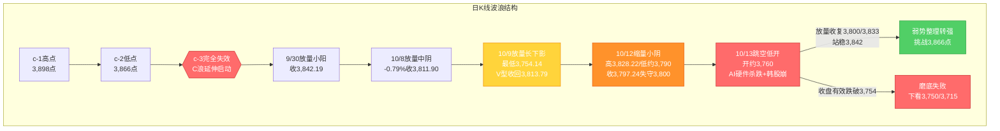
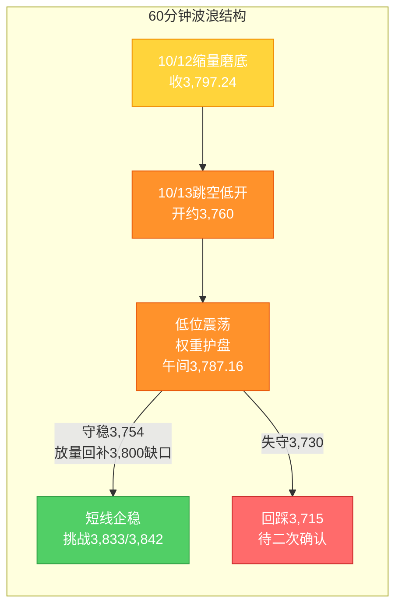

# A股晨报 - 2026年10月13日

> 数据截止时间：2026年10月13日 11:30（北京时间）；美股为10月12日（周一）收盘，欧洲为10月12日收盘，日韩为10月13日早盘，港股/大宗/汇率为10月13日盘前及早盘，A股为10月13日开盘及早盘数据
> 报告性质：**国庆长假后首个完整交易周（第42周）周二（10/13）晨报** —— 以10/12"缩量磨底、失守3,800"复盘为基础 + **隔夜美股"AI硬件杀跌"（费半-2.67%）+ 亚太重挫（KOSPI-6%+）** + 今日早盘前瞻
> 核心观点：**10/12 A股"缩量磨底、弱势整理"**：上证指数低开-0.18%后早盘冲高至3,828.22，午后回落、**尾盘失守3,800点（收3,797.24、跌0.43%）**；深证成指-2.03%、创业板指-2.61%（失守3,000、创年内收盘新低）、科创50-2.10%；两市成交**1.54万亿元（缩量3,627亿）**，主力资金**净流出151.62亿元（电子、通信净流出均超40亿居前）**，**仅1,167只上涨/4,325只下跌**；结构呈**"银行护盘（+2.32%居首、工建中续创新高）+ 传媒/AI应用（+1.47%）强、科技与资源补跌"**。**隔夜（10/12美东）重大变量**：**美股"分化杀科技"**——道指+0.38%（51,850.55，三连涨）、标普500-0.06%（7,807.24）、**纳指-0.44%（27,245.90）、费城半导体指数-2.67%**；**"AI资本约束"叙事发酵**——**博通CEO陈福阳与英特尔CEO警告"融资/资本可能成为AI扩张的最大瓶颈"**，叠加**OpenAI或推迟IPO至明年、苹果涨价、联想警告"内存价格创前所未有高位"**，**美光-3.88%（跌破1,000美元）、闪迪-5.97%、Ciena-9.95%、Lumentum-9.78%**；**美联储哈马克（Cleveland Fed）鹰派发声"或需收紧以压低通胀"**，10年期美债收益率仍高于5%（近20年高位）。**亚太10/13早盘重挫**——**日经225跌约2%、韩国KOSPI跌逾6%（失守6,000、触发熔断/边车机制，外资连续净卖出科技股约13亿美元、三星/SK海力士回购托底结束）**；**A股10/13三大指数集体低开**（**沪指-0.96%报3,760.8、深成指-1.79%、创业板指-2.18%、科创综指-2.19%**），**算力硬件（覆铜板/存储/光通信/CPO/PCB）、半导体芯片、锂电池、农业、风电领跌，海运、银行、油气、煤炭、白酒、种业逆势活跃**；**N粤芯半导体（创业板301660）首日大涨超274%**。**综合判断：今日上证大概率【看跌/震荡偏弱（低开探底、权重护盘）】，区间参考3,720-3,800点，核心观察3,754点（10/9低点"最后防线"）能否守住、以及3,800点（20月均线）能否收复；全球科技"AI资本约束"叙事+韩股崩盘对A股算力硬件/半导体构成定向压制，而油价创新高（布油破106美元）+ 银行/高股息护盘使指数跌幅相对可控、结构分化加剧。**

---

## 一、昨日晚报复盘要点回顾

> 说明：上一交易日（10/12，周一）晚报已生成（`report/20261012/evening_report_20261012.md`），本节提取其复盘结论作为今日分析基础。

### 1. 昨日（10/12）判断回顾
- **趋势判断准确率：100%（1/1）**——预判"震荡偏弱"，实际"低开→冲高→回落、收跌0.43%"（方向命中）；**但路径判断（低开修复/先抑后扬）落空**（实为"冲高回落"）
- **点位预测准确率：80%（4/5）**——区间（3,760-3,870）、弱支撑3,754、强/弱压力3,866/3,833命中（压力有效）；**强支撑3,800收盘被小幅有效跌破（收3,797.24）**（缩量、仅差约3点）
- **板块预判准确率：约33%（3/9）**——传媒/AI应用、AI硬件（通信/元件）、房地产命中；**稀土/贵金属/自主可控/军工/农业5项看涨落空**（"关税对冲结构"全线补跌）；券商/高位连板/出口链分化
- **综合准确率：约71%**——趋势判断精准，板块预判显著分化；**最大遗漏=银行板块（+2.32%居首、续创历史新高）**

### 2. 关键偏差及原因
- **偏差1（成交量预判·核心）**：预判"放量/平量1.8-2.0万亿"，实际**缩量至1.54万亿（缩量3,627亿）**。根因：**逻辑误判**——机械套用"关税冲击低开修复日易放量"，但**实际低开幅度仅-0.18%（远小于外盘映射-1%~-2%），恐慌盘未释放，叠加政策对冲前置+市场学习效应，观望缩量主导**
- **偏差2（板块结构·核心）**：预判"关税对冲结构"（稀土/贵金属/军工/农业/自主可控）领涨，**实际全线补跌**；真正强势为**"银行高股息护盘 + 传媒/影视/风电题材轮动"的内生结构**。根因：**过度依赖外盘教科书的对冲结构，忽视A股内生性（权重护盘+题材轮动）+ 资源股"利好兑现回吐"**
- **偏差3（路径预判）**：预判"低开修复、先抑后扬"，实际**"低开→早盘冲高3,828.22→午后回落"（冲高回落）**。根因：**缩量环境下"护盘冲高"易演变为"冲高回落"**，未考虑量能不放大即无接力

### 3. 沉淀的规则/检查项（本次直接应用）
- **规则1（资金面分析）**：关税冲击次日若"低开幅度显著小于外盘映射预期"，成交量可能"缩量观望"而非"破位放量"——成交量预测须与"低开幅度/恐慌程度"挂钩
- **规则2（板块选择）**：外部冲击次日，A股映射未必呈现"外盘对冲结构"，可能呈现"权重高股息护盘（银行）+ 题材轮动"的内生结构；前期已抢跑的避险资产易在"避险降温/利好兑现"下回吐
- **规则3（板块选择）**：资源/周期股在"产业利好兑现日"（业绩预增/产品涨价）反而领跌，应警惕高位兑现回吐
- **规则4（趋势分析）**：指数收盘"弱跌破"关键防线（20月均线，仅差约3点且缩量）属"弱跌破/待确认"，不宜直接判定底部信号失效
- **规则5（趋势分析）**：缩量环境下关键防线的"护盘冲高"易演变为"冲高回落"，量能不放大时不宜预设"日内反转"

### 4. 对今日（10/13）分析的启示
- **需要关注的风险点**：①**隔夜美股"AI资本约束"叙事（博通/英特尔CEO警告）+ 韩股崩盘（KOSPI-6%+）**对A股算力硬件/半导体构成**定向压制**；②**美联储鹰派（哈马克"或需收紧"）+ 美债10年>5%**，压制高估值成长；③**3,800点（20月均线）已失守**，3,754点"最后防线"有效性待验证；④**10/14美国CPI**（明日）为本周最大宏观变量
- **需要调整的分析逻辑**：①**科技链继续按"AI硬件（承压）vs AI应用（相对独立）"拆分**，今日外盘冲击指向AI硬件（存储/光通信/CPO/PCB）；②**"权重高股息（银行）+ 能源（油气/煤炭）"应纳入核心防御/护盘清单**（延续昨日内生结构）；③**成交量预判以"缩量/平量"为基准**（低开幅度温和→恐慌盘有限）；④**油气板块因"国际油价创新高"由"映射转弱"上修为"趋势驱动"**

---

## 二、隔夜市场动态（10/12收盘至10/13开盘）

### 1. 美股市场（10月12日周一收盘）

| 指数 | 收盘点位 | 涨跌幅 | 说明 |
|------|---------|--------|------|
| 道琼斯工业指数 | **51,850.55** | **+0.38%（+195.60点）** | **连续第3个交易日上涨** |
| 标普500指数 | **7,807.24** | **-0.06%** | 基本持平 |
| 纳斯达克综合指数 | **27,245.90** | **-0.44%** | 科技拖累 |
| 费城半导体指数 | — | **-2.67%** | **半导体全线杀跌** |

**（1）AI硬件/半导体"重灾区"**
- **存储**：**美光科技 -3.88%（跌破1,000美元/股、距6月高点回撤近两成、逼近技术性熊市）**、**闪迪 -5.97%**、SK海力士（ADR）-4%+
- **光通信**：**Ciena -9.95%、Lumentum -9.78%、Coherent -…**、康宁 -6%
- **个股**：ARM -4%+、AMD -2%+、阿斯麦/博通 -1%+

**（2）下跌催化（"AI资本约束"叙事）**
- **博通CEO陈福阳**（DBS Asia Future Forward Conference）警告：**"资本/融资可能成为AI扩张过程中比半导体、存储、电力短缺更大的制约因素"**
- **英特尔CEO**同步警告：**对算力基础设施需求将持续超过供应，但"资金获取能力"可能成为AI热潮的约束**
- **OpenAI或考虑将IPO推迟至明年**；**苹果涨价**；**联想警告"内存价格已达前所未有高度、供应短缺将持续"**
- **美联储哈马克（Cleveland Fed）**：**"可能需要收紧货币政策以降低通胀，央行应迅速行动"**（鹰派）

**解读**：**隔夜外盘呈"道指抗跌、纳指与费半承压"的分化结构**——**"AI资本约束"叙事（博通/英特尔CEO警告+OpenAI推迟IPO+苹果涨价）叠加美联储鹰派**，触发**AI硬件/半导体/存储/光通信集体回调**；**净影响：外盘对A股呈"科技链定向利空（AI硬件/半导体/存储/光通信/CPO）"、"能源/防御相对占优"的映射方向。**

### 2. 欧洲/亚太市场

| 市场 | 表现 | 备注 |
|------|------|------|
| 斯托克欧洲600（10/12） | **+0.7%（635.65）** | 温和收涨 |
| 德国DAX（10/12） | **+0.8%（25,277.68）** | — |
| 法国CAC40（10/12） | **+0.38%（7,832.88）** | — |
| 日经225（10/13早盘） | **约-2%** | 半导体/科技拖累 |
| 韩国KOSPI（10/13早盘） | **跌逾6%（失守6,000，触发熔断/边车机制）** | **"黑色星期二"，5日累计跌超1,000点** |

**情绪判断**：**欧洲10/12温和收涨（与美股分化、未受科技杀跌显著拖累），但亚太10/13早盘"重挫"**——**日经225跌约2%、韩国KOSPI跌逾6%（失守6,000、5日累计跌超1,000点）**。**韩股下跌主因**：①**外资连续净卖出科技股（单日约13亿美元，SK海力士被抛7.82亿美元、三星被抛4.15亿美元）**；②**三星/SK海力士合计约55万亿韩元回购计划提前结束、托底买盘消失**；③**美债收益率上行+韩元走强**；④**三星Q3业绩"利好兑现"（sell-on-news）**；⑤**中国存储/半导体技术追赶预期（韩国半导体产业协会承认"DRAM差2年、NAND仅差1年"）**。**亚太科技股的集体重挫，是A股今日科技链低开承压的一级前瞻信号。**

### 3. 大宗商品

| 品种 | 价格/表现 | 涨跌/驱动 |
|------|----------|----------|
| 布伦特原油 | **突破106美元/桶（10/13早盘）** | **持续拉升**；中东局势升级+乌克兰地缘溢价 |
| WTI原油 | **逼近94美元/桶** | 跟随布油上行 |
| 现货黄金 | **-0.56%，报4,171.81美元/盎司（10/12收）**；10/13盘初续跌约0.6%（COMEX至约4,190） | **美联储鹰派+"美债收益率>5%"压制，避险交易降温** |
| 有色/工业金属 | 走弱 | 全球风险偏好回落 |

**驱动逻辑**：①**国际油价持续拉升、布油突破106美元/桶**（**中东冲突升级+乌克兰地缘**）——**对A股油气/石油石化/油运构成强正向催化**（今日早盘A股油气、海运逆势活跃）；②**黄金在"美联储鹰派+美债收益率>5%"下回落**——**对A股贵金属形成压制**（与10/12"避险降温→贵金属领跌"一致）；③**比特币跌破83,000美元**，风险资产整体承压。

### 4. 汇率与利率

| 指标 | 数值/表现 | 变化/说明 |
|------|----------|----------|
| 人民币中间价（10/13） | **6.7298** | **上调15个基点**（前值6.7313），**连续偏强** |
| 美债10年期收益率 | **仍高于5%（近20年高位）** | **压制全球成长股估值** |
| 美元指数 | **走强** | 中东冲突升级+能源价格+全球利率预期上行；强美元压制贵金属 |
| 央行政策 | 汇率维稳立场延续 | 中间价连续调升，为资金面/情绪面提供边际支撑 |

**特征**：①**人民币中间价连续调升（10/13升15基点至6.7298）**，**稳汇率预期延续**，对A股资金面构成**边际正面**；②**美债10年期收益率维持5%上方（近20年高位）+ 美元走强**——**压制高估值成长股（半导体/CPO/光模块）与贵金属**；③**"利率弹性反向"规则在"美债续高+美联储鹰派"下继续适用**，科技成长承压。

### 5. 海外重要事件

- **"AI资本约束"叙事发酵**：博通/英特尔CEO警告"资本/融资是AI扩张最大瓶颈"；OpenAI或推迟IPO至明年；苹果涨价；联想警告内存价格创前所未有高位
- **美联储**：哈马克鹰派（"或需收紧以压低通胀"）；**10/28 FOMC**为关键窗口；**美联储周六起进入静默期**；**10/14美国CPI**（明日）为本周核心数据
- **地缘**：中东冲突升级（沙特/红海/霍尔木兹相关扰动）+ 乌克兰局势，共同推升国际油价

---

## 三、今日关注事项

### 1. 重要数据发布 / 政策（按时间排序）
- **10/14（明日）美国9月CPI**——**本周最大宏观变量**，直接影响美联储加息/降息预期与全球风险偏好
- **美联储**：10/28 FOMC（周六起进入静默期）；关注**CME FedWatch加息概率**与美国国债收益率走势
- **国内**：关注本周**9月CPI/PPI、金融数据（社融/信贷/M2）**发布窗口（以官方发布为准）；跟踪**证监会/央行**（10/8净投放2,000亿、下调PSL利率至1.5%）后续稳市举措
- **关税/经贸**：跟踪**商务部**后续表态、**中方稀土出口管制**细则落地、**10月底APEC**与**11月1日美方关税决定**的博弈进展

### 2. 三季报披露（密集期开启）
- **10/13：4家公司披露三季报**（*ST利源、冀东装备等；净利润、营收"双增"2家、"双降"2家）
- **联讯仪器**（10/12晚）发布2026年前三季度业绩预告，**今日早盘强势上涨超5%、重新夺回"A股股王"（超越贵州茅台）**；**源杰科技**早盘一度涨超3%
- **业绩验证风险**：AI/半导体/创新药等高位成长股业绩不及预期风险需警惕

### 3. 限售股解禁
- **10/13：共9家公司限售股解禁，合计6510.83万股、按最新收盘价计算合计解禁市值22.49亿元**
- **重点**：**杰理科技**（6176.74万股，占总股本14.27%，解禁市值约19.41亿元）；超捷股份、圣泉集团等
- **10月全月**解禁约**3,047亿元（环比+62.82%）**，电子、公用事业、煤炭方向需持续跟踪

### 4. 新股 / 其他关注
- **新股上市**：**粤芯半导体（N粤芯，301660）今日登陆创业板，发行价12.01元/股，首日大涨超274%**；通则康威中签号出炉
- **交易安排**：本周（第42周，10/12-10/16）**5个完整交易日**；**期指交割日为10/16（第42周第三个周五）**

---

## 四、板块与个股分析（结合昨日复盘与隔夜冲击）

### 1. 基于昨日（10/12）复盘结论的板块调整
- **10/12强势板块今日预期**：①**银行/高股息**——延续"关税冲击期类固收防御+资金避险"，**今日早盘工行、建行、中行续创新高**，**继续作为护盘主线**；②**传媒/AI应用（影视院线）**——事件驱动+高低切换，**与外盘AI硬件杀跌形成"硬件弱、应用相对独立"的分化**；③**油气/煤炭**——**国际油价突破106美元**，由10/12的"映射转弱"**上修为"趋势驱动"**
- **10/12领跌板块今日预期**：①**AI硬件（通信设备/元件/半导体）**——叠加**隔夜费半-2.67%、美光-3.88%、光通信重挫**，**定向继续承压**（今日早盘覆铜板/存储/光通信/CPO领跌验证）；②**贵金属/有色**——**黄金续跌（美债>5%+美元强）**，**继续承压**；③**房地产服务/种植业**——题材退潮延续（但今日种业/农业早盘活跃，与"关税农业对冲+政策"反复有关）
- **偏差板块修正逻辑**：**银行**（10/12最大遗漏）→ **正式纳入核心防御/看涨清单**；**资源股**（10/12利好兑现回吐）→ **区别于油气（趋势驱动，看涨）与贵金属/有色（避险降温，看跌）**

### 2. 隔夜信息驱动的板块机会
- **受益板块**：
  - （1）**石油石化 / 油气 / 油运（海运）**（逻辑：**国际油价突破106美元/桶、中东局势升级**，趋势驱动；今日早盘**油气、海运逆势活跃**）
  - （2）**银行 / 高股息（类固收防御）**（逻辑：**避险+关税冲击期防御属性**，工建中续创新高）
  - （3）**煤炭**（逻辑：高股息+冬储+能源涨价共振；今日早盘**煤炭逆势活跃**）
  - （4）**农业 / 种业**（逻辑：中美博弈对冲+政策+防御；今日早盘**种业活跃**）
  - （5）**白酒 / 大消费**（逻辑：防御属性；今日早盘白酒逆势活跃，联讯仪器争夺"股王"）
  - （6）**传媒 / AI应用**（逻辑：事件驱动+"AI硬件→应用"高低切换）
- **受损板块**：
  - （1）**算力硬件（存储/光通信/CPO/覆铜板/PCB）**（逻辑：**"AI资本约束"叙事+外盘AI硬件重挫映射**；今日早盘覆铜板/存储/光通信/CPO/玻纤/玻璃基板领跌）
  - （2）**半导体芯片**（逻辑：费半-2.67%+韩股崩盘+美债>5%的"利率弹性反向"）
  - （3）**锂电池 / 新能源（风电/光伏）**（逻辑：高位调整+资金撤离；今日早盘锂电池、风电、光伏走弱）
  - （4）**生物科技 / CRO / 医药**（逻辑：调整延续；今日早盘CRO、生物科技走弱）

### 3. 重点关注个股
- **油气/油运（中国海油、中国石油、招商轮船、中远海能等）**：关注理由=**布油破106美元+中东地缘**；今日早盘**招商轮船、中远海能涨超2%**
- **银行（工商银行、建设银行、中国银行、招商银行等）**：关注理由=**高股息防御+续创新高（护盘主线）**；风险=涨幅累积后的回吐
- **联讯仪器 / 源杰科技（光通信/半导体测试）**：关注理由=**三季报业绩"炸裂"+股王之争**；风险=**与AI硬件整体承压的分化（个股独立行情）**
- **粤芯半导体（301660）**：关注理由=**新股首日大涨超274%（半导体制造）**；风险=**新股高波动**
- **回避/谨慎**：算力硬件（存储/光通信/CPO/覆铜板）、半导体芯片、贵金属/有色、高位连板股（新华传媒10/13停牌核查）、大额解禁个股（杰理科技）、三季报不及预期的高位成长股

---

## 五、今日核心判断（结构化输出，用于晚报复盘）

### 1. 趋势判断
- **上证指数：【看跌 / 震荡偏弱（低开探底、权重护盘）】**
- **预测区间：3,720点 - 3,800点**（下探容错区间3,754±40点，极端下沿3,715点）
- **核心逻辑**：**隔夜美股"AI资本约束"叙事发酵（博通/英特尔CEO警告+OpenAI推迟IPO+苹果涨价）+ 费半-2.67% + 亚太重挫（KOSPI-6%+、日经-2%）+ 美联储鹰派（美债10Y>5%）**，对A股**科技链（AI硬件/半导体/存储/光通信/CPO）构成定向压制**，今日三大指数集体低开（沪指-0.96%）；但**国际油价突破106美元/桶（中东地缘）+ 银行/高股息护盘 + 人民币中间价连续调升**，使**指数跌幅相对可控、结构分化加剧**（"科技弱、能源+防御强"）。**综合看：低开探底、权重护盘下指数跌幅或小于科技板块；3,754点（10/9低点"最后防线"）能否守住、3,800点（20月均线）能否收复为核心。**

### 2. 关键点位
- **强支撑位：3,754点**（依据：**10/9 V型反转起点/阶段低点，"最后防线"**；自10/12起已**上移为下方核心防守**，收盘有效跌破则底部信号失效）
- **弱支撑位：3,730点 / 3,715点**（依据：第41周规律预测的**区间下沿3,730点**、**黄金分割1.236延伸目标3,715点**）
- **弱压力位：3,800点**（依据：**20月均线，失而复得位**；10/12收盘3,797.24小幅失守，**今日能否收复为多空分水岭**）
- **强压力位：3,833点**（依据：**9/30低点，短线强弱分水岭**）；次级压力**3,842点**（C浪低点反压）、**3,866点**（c-2低点，周线反转确认位）

### 3. 板块预判
- **看涨板块**：（1）**石油石化/油气/油运（海运）**（逻辑：**布油破106美元+中东地缘升级**，趋势驱动）（2）**银行/高股息**（逻辑：**避险+类固收防御**，工建中续创新高）（3）**煤炭**（逻辑：高股息+冬储+能源涨价）（4）**农业/种业**（逻辑：中美博弈对冲+政策+防御）（5）**白酒/大消费**（逻辑：防御属性，联讯仪器争夺"股王"）（6）**传媒/AI应用**（逻辑：事件驱动+"AI硬件→应用"高低切换）
- **看跌板块**：（1）**算力硬件（存储/光通信/CPO/覆铜板/PCB）**（逻辑：**"AI资本约束"叙事+外盘AI硬件重挫**）（2）**半导体芯片**（逻辑：费半-2.67%+韩股崩盘+美债>5%的"利率弹性反向"）（3）**锂电池/新能源（风电/光伏）**（逻辑：高位调整+资金撤离）（4）**贵金属/黄金**（逻辑：金价续跌+美债>5%+强美元）（5）**生物科技/CRO/医药**（逻辑：调整延续）
- **风险板块**：①**三季报或不及预期的高位成长股**；②**大额解禁个股**（如杰理科技19.41亿、电子/公用事业/煤炭方向）；③**前期抢跑的避险资产（贵金属/有色，利好兑现回吐风险）**；④**退市风险/ST个股**

### 4. 资金面判断
- **北向资金预期：【结构性分化 / 净额承压】**（依据：交易所已不实时披露净额，**以成交口径跟踪**；全球科技风险偏好回落或抑制外资对科技板块的风险偏好，但央行稳汇率+人民币中间价偏强提供支撑）
- **成交量预期：【缩量 / 平量】1.5 - 1.7万亿元**（依据：**低开幅度温和（沪指-0.96%）→恐慌盘有限→缩量观望**；参照10/12新规则"低开幅度显著小于映射预期→缩量观望"，**不宜机械套用"破位放量"**；期指交割日（10/16）临近但非今日）

### 5. 风险预警（按优先级排序）
- **高风险**：①**全球科技"AI资本约束"叙事发酵 + 韩股崩盘（KOSPI-6%+）**——A股**算力硬件/半导体/存储/光通信/CPO定向杀跌风险**（今日早盘覆铜板/存储/光通信领跌已现）；②**3,754点（"最后防线"）有效性**——若**收盘有效跌破3,754点，则磨底失败**，下看3,750/3,715；③**10/14美国CPI**（明日）——若通胀超预期，美联储鹰派强化、美债续高，全球成长股承压
- **中风险**：①**美联储鹰派（哈马克"或需收紧"）+ 美债10Y>5%（近20年高位）**——压制高估值成长与贵金属；②**主力资金连续净流出**（10/12电子/通信净流出均超40亿）——结构脆弱，"权重护盘≠资金转多"；③**三季报密集披露 + 10月解禁3,047亿**，高位成长股业绩与解禁双重风险
- **低风险**：①**中东地缘（油价波动）**——利好油气但加剧全球风险偏好波动；②**高位连板股**（新华传媒10/13停牌核查）；③**期指交割日（10/16）**临近，量能或有扰动

### 6. 昨日复盘规则应用
- **应用规则1（"低开幅度→成交量"挂钩）**：今日沪指低开-0.96%（大于10/12的-0.18%），但**仍属温和低开**，成交量以**"缩量/平量"**为基准，**不预设"破位放量"**
- **应用规则2（外部冲击次日"内生结构"）**：延续10/12"权重高股息（银行）护盘 + 题材轮动"的内生结构，**今日叠加"能源（油气/煤炭）趋势驱动"**，**不机械套用外盘对冲结构**
- **应用规则3（资源股分化）**：**油气（趋势驱动，看涨）≠ 贵金属/有色（避险降温，看跌）**——对资源股按"驱动逻辑"拆分
- **应用规则4（"弱跌破"待确认）**：10/12收盘3,797.24"弱跌破"3,800（20月均线）属"待确认"，**今日需重新验证3,754（收盘跌破=失效）与3,800（放量站稳=修复）**
- **应用规则5（缩量磨底短线"量能绑定"）**：**缩量磨底阶段，短线"买入条件"须与"量能"绑定（放量才有效）**，量能不放大时**"观望为主"而非追高**
- **应用规则6（科技链"AI硬件 vs AI应用"拆分）**：**下调AI硬件（存储/光通信/CPO/覆铜板/PCB）**，**保留AI应用/传媒（事件驱动+高低切换）**

---

## 六、波浪理论多周期分析

> 说明：基于10/12实际K线结构 + 隔夜外盘"AI硬件杀跌"推演今日（10/13）路径。**10/12"缩量失守3,800但低点未创新低（约3,790>3,754.14）"，日线底部结构维持"缩量磨底、弱势整理"；10/13跳空低开，缺口回补为观察点。**

### 1. 月K线波浪分析

- **当前波浪位置**：大周期**第2浪C浪延伸末段寻底**，10月月K线（10/8至今）呈**"先抑后扬、长下影"**雏形，**10/12收盘3,797.24点，处20月均线（约3,800点）下方约3点**，为**连续第三个月调整**
- **浪型结构描述**：2024年9月2,689点→2026年6月4,197点为**第1浪上升**；第2浪ABC调整：4,197点→3,754.14点（10/9最低）；10月开局（10/8）下探3,795.37点，10/9下探**3,754.14点（阶段新低）后V型收回3,813.79点**，10/12冲高回落收3,797.24点；**月线现处20月均线下方，但月内低点3,754.14未再被刷新**，月线下影仍在
- **关键目标位**：月度强支撑**3,800点（20月均线）**、3,754点（10/9低点）、3,750点；月度核心压力3,833点、3,842点、3,866点
- **验证条件**：**10月月K线能否收盘收复3,800点（20月均线）**——10/12暂失守，需后续交易日确认；若月内有效跌破3,750点，则月度底部证伪

### 2. 周K线波浪分析

- **当前波浪位置**：第42周（10/12-10/16）**第二日跳空低开**，周K线现为**"带短上影的缩量小阴/下探"**雏形（周开3,806.98、周内暂高3,828.22、今日低开至3,760一线）
- **浪型结构描述**：本周为国庆后**首个完整交易周**。10/12缩量回落 + 10/13跳空低开，**仍处5周/10周/20周/60周均线下方，短期均线空头排列未改**；周线级别尚未出现放量反转信号，**"底部构筑/下跌中继"分歧延续**
- **关键目标位**：周度支撑**3,754点（10/9低点，核心）**、3,730点（区间下沿）、3,715点；周度压力**3,800点（20月均线）**、**3,833点**（短线分水岭）、**3,842点**（C浪低点反压）、**3,866点**（c-2低点，周线反转确认位）
- **验证条件**：**本周（5个交易日）能否收出长下影/小阳**——**放量站稳3,833并挑战3,866**为周线反转确认前提；收盘有效跌破3,754则信号失效；**今日跳空缺口能否回补为本周首要观察点**

### 3. 日K线波浪分析（重点）

- **当前波浪位置**：**C浪延伸末段"缩量磨底、弱势整理"**——10/9放量长下影V型收回3,800后，10/12**缩量冲高回落、收盘失守3,800**，10/13**跳空低开**，形成**"缩量小阴+跳空缺口"**组合，但**低点（3,754.14）为最终防线**
- **浪型结构描述**：9/30放量小阳收3,842.19→10/8放量中阴-0.79%收3,811.90→**10/9放量长下影小阳+0.05%收3,813.79（最低3,754.14）→10/12缩量小阴-0.43%收3,797.24（最高3,828.22、最低约3,790）→10/13跳空低开（开约3,760）**；**低点序列"3,754.14→约3,790→今日待定"**，多空在3,750-3,830区间反复拉锯；**今日跳空缺口（3,797-3,760附近）回补与否为短线强弱信号**
- **关键目标位**：第一压力**3,800点（20月均线，缺口回补位）**、**3,833点（9/30低点，短线分水岭）**；**强压力3,842点（C浪低点反压）、3,866点（c-2低点）**；第一支撑**3,754点（10/9低点，"最后防线"）**、3,730点（区间下沿）；**下方目标3,750点/3,715点（黄金分割1.236延伸，仅当收盘有效跌破3,754点时启用）**
- **验证条件**：
  - **向上修复**：**放量收复3,800点并站稳3,833点** → 弱势整理转强，方有挑战3,842/3,866点可能
  - **向下确认**：**收盘有效跌破3,754点** → 磨底失败，下看3,750点及3,715点
  - **今日变量（10/13）**：隔夜"AI硬件杀跌"+韩股崩盘 → **跳空低开（沪指-0.96%）**；**"权重护盘（银行）+ 能源（油气/煤炭）强势"** → 指数跌幅或可控，需观察**3,754点支撑与缺口回补**

### 4. 60分钟K线波浪分析

- **当前波浪位置**：60分钟级别**"低开探底→弱势企稳"**，短线由"弱势整理"转为**"低开待修复/二次探底"**
- **浪型结构描述**：60分钟10/13跳空低开后**在3,760一线震荡**，早盘权重（银行/油气）护盘下**跌幅有所收窄**（午间沪指-0.27%、3,787.16）；**60分钟MACD低位、KDJ自超卖区回升**，需观察能否放量修复缺口
- **关键目标位**：短期支撑**3,754点、3,730点**；短期压力**3,790点、3,800点（缺口）**
- **验证条件**：**今日午后能否守稳3,754点并放量上攻3,790-3,800点（回补缺口）**——守稳则短线企稳，跌破3,730则弱势级别降级、下看3,715

### 5. 30分钟K线波浪分析

- **当前波浪位置**：30分钟级别**"跳空低开、超卖"**，短线动能待修复
- **浪型结构描述**：30分钟10/13呈"跳空低开→低位震荡"，**MACD低位、KDJ超卖区**；量能集中在开盘与权重护盘段；**需观察30分钟能否在3,754-3,760区间止跌企稳**
- **关键目标位**：关键支撑**3,754点、3,730点**；短期压力3,790点、3,800点
- **验证条件**：**30分钟能否在3,754-3,760区间止跌企稳**，否则维持3,730-3,800区间弱势震荡

### 6. 波浪图（Mermaid绘制）

**日K线波浪结构图**：

**60分钟波浪结构图**：

### 7. 波浪理论综合判断

| 维度 | 判断 |
|------|------|
| 多周期共振状态 | **月/周/日/60分钟/30分钟维持"缩量磨底、弱势整理"**——10/12缩量失守3,800，10/13跳空低开；**低点未创新低（3,754.14为防线）、权重护盘**，尚未形成向下共振；多周期"弱平衡、方向未明" |
| 当前操作级别 | **日线级别（防守为主）**（3,754为最后防线，3,800为多空分水岭/缺口位，3,833/3,842为确认位，3,730/3,715为失效目标） |
| 后续演变路径（10/13） | **25%乐观**（权重护盘/科技止跌→放量回补3,800缺口并站稳3,833→弱势整理转强，挑战3,842/3,866）、**50%中性**（3,754-3,800区间缩量磨底、权重+能源护盘、题材轮动）、**25%悲观**（AI硬件续杀跌/外盘续弱/韩股崩盘传导→收盘有效跌破3,754，下看3,750/3,715） |
| 关键拐点信号 | 向上：**放量回补3,800点缺口并站稳3,833点** + 主力资金转净流入 + 算力硬件（存储/半导体）止跌；向下：**收盘有效跌破3,754点** + 科技链放量再杀跌 + 港股/韩股续弱 |
| 风险提示 | ①**全球科技"AI资本约束"叙事+韩股崩盘**为今日核心外部变量；②**3,754点（"最后防线"）有效性**待验证；③**美联储鹰派+美债10Y>5%**压制成长与贵金属；④**主力资金连续净流出+三季报验证+10月解禁3,047亿**；⑤波浪理论在C浪延伸末段+缩量拉锯阶段预测精度降低，需结合量能、外盘与政策面综合判断 |

> **规律分析引用（第41周运行规律分析）**：该报告（周日10/11生成）预测第42周（10/12-10/16）上证运行区间**3,730-3,880点**，判断"**震荡偏弱（低开修复、先抑后扬）**"，乐观/中性/悲观概率**30%/45%/25%**，并强调"**3,800点（20月均线）为最后防线、3,842点为信号确认位、关注稀土/军工/农业/贵金属对冲结构**"。**10/12实际运行（3,790-3,828、收3,797.24）落在预测区间内、方向"震荡偏弱"命中**；本报告据10/12复盘（"缩量磨底/弱势整理"定为主基调）**将乐观概率由35%下调至30%**；今日（10/13）受隔夜"AI硬件杀跌"+韩股崩盘影响，**进一步将乐观概率下调至25%、悲观上调至25%**，中性维持50%。

---

## 七、投资策略建议（分短线+中线）

### 1. 短线策略（1-3个交易日）
- **适用场景**：基于日K线和60分钟K线技术信号
- **短线仓位：10%**（较10/12晚报的10-15%**小幅降低至10%**——缩量磨底+外盘科技定向冲击+韩股崩盘，**防御为主、不宜追高**）
- **买入条件**：①**指数守住3,754点并放量回补3,800点缺口**后低吸；或②**油气/油运、银行/高股息、煤炭、农业/种业等防御/趋势方向**回踩关键均线不破时低吸；或③**传媒/AI应用龙头强势整理后放量突破**（**所有买入以"量能放大"为前置**）
- **卖出条件**：指数反弹至**3,800-3,833点压力区滞涨**、或量能萎缩、或**收盘跌破3,754点**
- **止损位：3,754点**（收盘有效跌破则止损）或个股跌幅7%
- **短线标的**：（1）**石油石化/油气/油运（海运）**（逻辑：**布油破106美元+中东地缘**）（2）**银行/高股息**（逻辑：避险+类固收防御）（3）**煤炭**（逻辑：高股息+能源涨价）（4）**农业/种业、白酒**（逻辑：防御+关税对冲）（5）**传媒/AI应用**（逻辑：事件驱动+高低切换）——**回避**算力硬件（存储/光通信/CPO/覆铜板/PCB）、半导体芯片、贵金属/有色、高位连板股

### 2. 中线策略（1-4周）
- **适用场景**：基于周K线波浪分析和运行规律分析结论
- **中线仓位：20-25%**（**维持**——磨底特征下不宜大幅加仓，**待放量收复3,800/3,833点**再上修）
- **方向判断：【持有 / 观望（偏防御）】**
- **目标区间**：上证指数 **3,730点 - 3,880点**
- **中线布局板块**：（1）**能源与资源（石油石化/油气、煤炭）**（逻辑：**地缘+油价趋势+高股息**）（2）**银行/高股息（类固收防御）**（逻辑：避险+资金入市预期）（3）**AI应用/传媒（事件驱动）**（逻辑：AI硬件→应用高低切换）（4）**电力设备/风电/储能、食品饮料/大消费**（逻辑：政策催化+防御）——**谨慎/回避**：AI硬件（半导体/存储/CPO/PCB，拥挤交易消化+外盘质疑）、贵金属/有色（避险降温+利好兑现回吐）、高位连板股、三季报不及预期的高位成长股
- **止盈条件**：指数到达**3,866-3,898点**或波段涨幅达到X%
- **止损条件**：指数**收盘有效跌破3,754点**（"最后防线"失守、磨底失败）或趋势确认反转

### 3. 仓位分配总览
| 策略类型 | 仓位比例 | 方向 | 重点板块 |
|---------|---------|------|---------|
| 短线 | 10% | 防御/低吸（量能绑定） | 油气/油运、银行、煤炭、农业/种业、传媒AI应用 |
| 中线 | 20-25% | 持有/观望（偏防御） | 能源与资源、银行/高股息、AI应用/传媒、电力设备 |
| 现金 | 65-70% | — | — |

### 4. 与昨日（10/12）策略对比
- **短线仓位调整**：维持**10%**（原因：缩量磨底+外盘科技定向冲击+韩股崩盘，**防御为主**；短线买入须与量能绑定）
- **中线仓位调整**：维持**20-25%**（原因：磨底结构未破但**外盘科技冲击加剧不确定性**，待放量收复3,800/3,833再加仓）
- **板块调整**：**上调**石油石化/油气/油运、煤炭（**油价创新高+地缘**）、银行/高股息（**护盘主线**）；**下调**算力硬件（存储/光通信/CPO/覆铜板/PCB）、半导体芯片（**隔夜外盘杀跌映射**）、贵金属/有色（**避险降温**）；**维持**传媒/AI应用、农业/种业、白酒
- **操作前提**：**观察量能能否回补、算力硬件能否止跌**；若**放量回补3,800缺口并站稳3,833**则按上述布局小幅加仓；若**收盘有效跌破3,754**则降至低仓观望（短线降至5%以下）

---

## 八、信息来源

1. **官方数据来源**：上海证券交易所（上证指数10/12收盘3,797.24、最高3,828.22、最低约3,790）、深圳证券交易所（深证成指10/12收盘12,384.87；10/13开盘12,163.23）、中证指数有限公司（科创50/科创综指）、中国外汇交易中心（10/13人民币中间价6.7298）、中国商务部、中国证监会、香港交易所、新浪财经（A股10/13早盘/午间收盘数据）、东方财富、Wind资讯（限售解禁）
2. **权威财经媒体**：新华社/新华网（Chinese shares open lower Tuesday）、央视财经/央广财经（盘前速递·10/13）、中国新闻网（人民币中间价）、证券时报（数据宝/三季报/新股提示）、上海证券报·中国证券网（10/13开盘/新股/解禁）、澎湃新闻（10/13开盘）、每日经济新闻（黄金早参）、第一财经、财联社、36氪
3. **数据平台**：东方财富（AI硬件/存储股）、同花顺（10jqka）、金融界、新浪财经、金投网、CME FedWatch、Trading Economics（欧股/DAX）
4. **海外信息源**：Reuters、CNBC、Bloomberg、China Daily HK（Asian stocks dive）、SBS News（Kospi Plunges Below 6,000）、Yonhap（연합뉴스TV）、Morningstar（CAC40）

> 数据截止时间：2026年10月13日 11:30（北京时间）；美股为10月12日（周一）收盘，欧洲为10月12日收盘，日韩为10月13日早盘，港股/大宗/汇率为10月13日盘前及早盘，A股为10月13日开盘及早盘数据。

---

*本晨报由AI代理自动生成，仅供参考，不构成投资建议。投资有风险，入市需谨慎。*