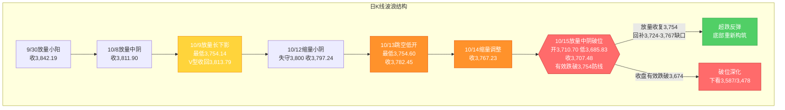
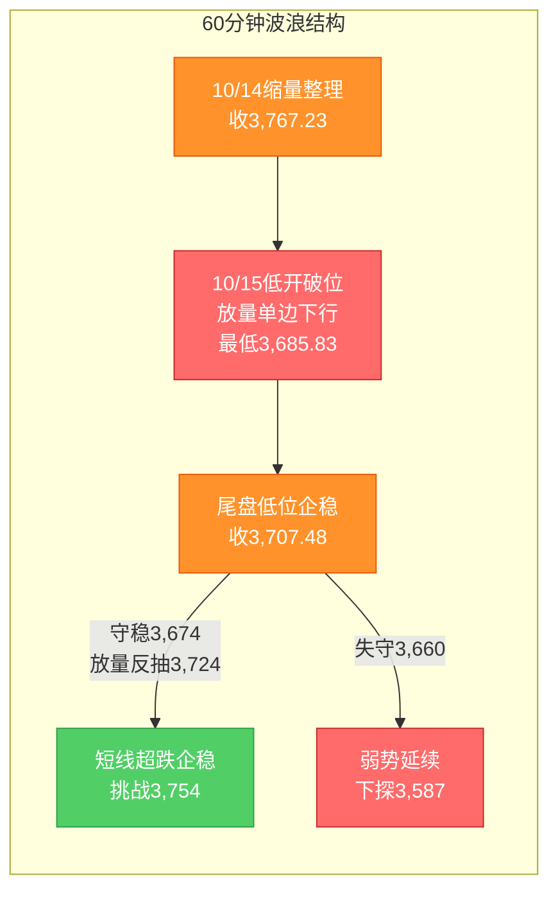

# A股晚报 - 2026年10月15日

> 数据截止时间：2026年10月15日 20:00（北京时间）；A股/港股/亚太为10月15日收盘，美股为10月14日收盘，大宗商品/汇率为10月14日盘后至10月15日
> 报告性质：**国庆长假后首个完整交易周（第42周）周四（10/15）晚报** —— 以 **10/15实际行情** 为基础 + **晨报（10/15）判断复盘** + **多周期波浪理论分析**
> 核心观点：**10/15 A股"低开低走、放量破位、普跌杀跌"**：上证指数**收3,707.48点（-1.59%）**，深证成指-2.43%、创业板指**-2.92%**、科创50-1.50%、科创综指-2.76%；两市成交**约16,330亿元（放量2,186亿元）**，主力资金**全天净流出544.47亿元**；全市场**超5,100只个股下跌（上涨仅400余只）**。**关键事件：上证指数收盘有效跌破"最后防线"3,754点（盘中最低3,685.83点），且收盘跌破黄金分割1.236延伸目标3,715点，"缩量磨底"结构证伪、日线转入"C浪延伸破位"。** 结构呈**"白酒（食品饮料）+大金融（券商/保险/银行）防御护盘" vs "海运/油气/通信设备/半导体/有色全线补跌"**。**外部变量**：隔夜"美国9月CPI超预期→加息押注升温+美债/美元走强"，**亚太科技市场熔断级暴跌（韩国KOSPI收跌7.57%触发熔断、日经225-4.90%、SK海力士-11%）**，叠加港股恒生科技-2.72%，**对A股科技链（半导体/存储/通信设备/CPO）构成定向冲击**。

---

## 一、市场回顾

### 1. 主要指数表现

| 指数 | 收盘点位 | 涨跌幅 | 开盘 | 最高 | 最低 |
|------|---------|--------|------|------|------|
| 上证指数 | **3,707.48** | **-1.59%（-59.75点）** | 3,710.70 | 3,724.56 | **3,685.83** |
| 深证成指 | **11,816.79** | **-2.43%** | — | — | — |
| 创业板指 | **2,783.18** | **-2.92%** | — | — | — |
| 科创50 | **约1,360** | **-1.50%** | — | — | — |
| 科创综指 | **1,586.88** | **-2.76%** | — | — | — |
| 深证综指 | 2,226.48 | -2.64% | — | — | — |
| 中小综指 | — | -2.30% | — | — | — |
| 创业板综指 | — | -2.99% | — | — | — |

**特征**：**四大股指集体收跌，成长风格显著弱于权重**——沪指-1.59%、深成指-2.43%、创业板指-2.92%、科创综指-2.76%（**科创综指7连跌**）。**上证指数盘中最低下探3,685.83点（失守3,700整数关口）、尾盘小幅回升，收3,707.48点，"险守3,700点"**。开盘3,710.70点（较昨收3,767.23**低开约56.5点、-1.50%**），**全天单边弱势、未能回补跳空缺口（3,724.56-3,767.23）**。

### 2. 成交量能

| 指标 | 数值 | 变化 |
|------|------|------|
| 沪深两市成交额 | **约16,330亿元（沪市7,744亿+深市8,586亿）** | **较上一交易日（14,144亿）放量2,186亿元** |
| 主力资金 | **全天净流出544.47亿元** | 较10/14（净流出25.61亿）**大幅扩大** |
| 北向资金 | **成交2,597.97亿元，占两市成交额15.91%**（净额交易所已不实时披露） | 活跃度维持高位 |
| 南向资金（港股通） | **净卖出50.80亿港元**（沪市通-6.65亿、深市通-44.15亿） | 转为净流出 |

**资金流向结构（申万一级）**：
- **主力资金净流入行业仅2个**：**医药生物（+5.48亿元）、食品饮料（+2.97亿元）**
- **主力资金净流出行业29个**：**电子行业净流出规模居首（逾120亿元）**，其后为通信、机械设备、计算机、有色金属等
- **个股净流入居前**：新易盛（+8.62亿）、冰山冷热（+7.93亿）、宁德时代（+6.10亿）
- **个股净流出居前**：中际旭创（-6.97亿）、中国船舶（-5.64亿）、中远海能（-3.38亿）

**解读**：**"破位放量"特征显著**——指数跌破关键防线引发**恐慌盘+止损盘集中释放**，成交量较10/14放大2,186亿元；主力资金**净流出大幅扩大至544.47亿元**，"权重护盘（白酒/大金融）≠ 资金转多"。**注意口径提示**：部分盘中（Wind实时）数据显示"电子行业获净流入"，但**全天（收盘口径）数据显示电子为净流出居首**，报告以"全天收盘口径"为准。

### 3. 市场情绪

| 指标 | 数值 | 说明 |
|------|------|------|
| 上涨家数 | **仅约425只（占比近8%）** | 极度萎缩 |
| 下跌家数 | **约5,105只** | **超5,100只下跌** |
| 平盘家数 | 38只 | — |
| 涨停股 | **36只（收盘封死）** | 封板率约72%，14股封板未遂 |
| 跌停股 | **28只** | 跌停家数上升 |
| 涨超9%个股 | 约45只 | — |
| 跌超9%个股 | 约69只 | 跌幅榜扩容 |

**情绪判断**：**市场宽度极度恶化**——上涨个股占比仅约8%、超5,100只下跌，属典型的**"普跌型放量杀跌"**；涨停36只（其中电子/交通运输/传媒各6/4/4只）、跌停28只，**赚钱效应极差、亏钱效应显著**。

---

## 二、热点板块与异动分析

### 1. 领涨板块及驱动因素

| 板块 | 表现 | 驱动因素 |
|------|------|---------|
| **食品饮料 / 白酒 / 酿酒** | **+0.72%（申万一级唯一上涨之一）** | 防御属性+低位补涨；**皇台酒业涨停**，金种子酒、今世缘、山西汾酒涨超3% |
| **非银金融（券商/保险）** | **+0.40%** | **大金融午后集体护盘**；**华林证券（002945）尾盘涨停**（"牛市旗手"异动），锦龙股份、中国平安逆市上涨 |
| **银行 / 央企银行 / 高股息** | 上涨 | 避险+类固收防御+护盘资金 |
| **电信服务** | 上涨 | 防御+高股息 |
| **医疗美容 / 创新药** | 局部活跃 | **百花医药、华北制药涨停** |
| **PCB（覆铜板）概念** | 逆市活跃 | 骏亚科技等表现亮眼（题材轮动） |
| **炒股软件 / 券商等权** | 概念涨幅居前 | 情绪修复预期（券商异动带动） |

### 2. 领跌板块及原因分析

| 板块 | 表现 | 原因 |
|------|------|------|
| **海运 / 航运港口（航运精选）** | **重挫（领跌）** | **招商轮船、中远海能、招商南油跌停**，中远海特跌超5%——**前期大涨后"获利了结+补跌"** |
| **通信 / 通信设备** | **-4.64%** | 隔夜费半-4.30%+亚太科技崩盘映射；**杰普特、新易盛跌超7%，长飞光纤跌超6%** |
| **国防军工** | **-3.98%** | 高估值成长补跌+外盘风险偏好回落 |
| **机械设备** | **-3.65%** | 工业机械跌幅明显，**远信工业、运机集团跌停** |
| **有色金属** | **-3.63%** | 强美元+美债高位+避险降温压制 |
| **建筑材料 / 玻璃纤维** | **-3.61%** | 周期与题材同步回调 |
| **存储芯片 / 半导体 / 计算机硬件** | 大跌 | **存储芯片概念股大跌**，**长鑫科技市值跌破3万亿元** |
| **油气 / 石油石化 / 焦炭 / 培育钻石** | 下挫 | 油价高位回落+前期强势股获利回吐 |

**结构解读**：**呈"两类极端分化"**——①**抗跌防御（白酒/食品饮料 + 大金融/券商/保险/银行 + 电信）**逆势护盘；②**前期强势趋势股（海运/油气/油运）+ 高估值科技成长（通信设备/半导体/存储/军工/有色）同步补跌**。**这与此前"红利/能源护盘"的格局不同——今日"能源/海运"由"护盘主线"转为"补跌主力"**，说明**放量破位日"高位趋势股"的获利了结压力大于"低位防御股"**。

### 3. 个股异动复盘

- **涨停复盘**：**华林证券（002945）**尾盘涨停（"牛市旗手"异动）；**皇台酒业**开盘约7分钟直线涨停；**百花医药、华北制药**（创新药）涨停；**慈文传媒、百洋股份**等收出5连板（**短剧游戏/微短剧/影视IP、饲料+国企改革**）；新华传媒高位（出版业+资产重组）
- **跌停复盘**：**招商轮船、中远海能、招商南油**（海运）跌停；**远信工业、运机集团**（机械设备）跌停
- **强势股回调**：**新易盛**（通信设备，跌超7%，但**主力资金逆势净流入8.62亿**——**董事长高光荣当日提议回购8-10亿元**）；**长鑫科技**市值跌破3万亿元
- **连板股**：市场连板高度下降、晋级率走低，**情绪退潮**特征明显

---

## 三、关键数据与事件回顾

### 1. 国内重要经济数据 / 政策
- **央行**：10/15开展**450亿元7天期逆回购（利率1.40%）+ 7,000亿元买断式逆回购（6个月/182天）**操作；因当日有5,000亿元买断式逆回购到期，**公开市场实现净投放2,450亿元**（流动性呵护延续）
- **央行数据**：**9月企业新发放贷款加权平均利率略低于3%**（融资成本维持低位）
- **证监会**：就**《公开募集证券投资基金运作管理办法（征求意见稿）》及配套规则公开征求意见**；并表示**稳步拓展期货市场对外开放广度深度**

### 2. 隔夜海外核心事件（10/14）
- **美国9月CPI超预期**：同比+3.7%（预期3.6%、前值3.4%）、环比+0.6%，**核心CPI同比+2.6%（亦超预期）**，汽油驱动 → **加息押注升温**
- **美股"杀科技"**：道指-0.09%、标普500-1.11%、**纳指-1.88%**（创7月以来最大单日跌幅）、**费城半导体指数-4.30%（芯片股指数六连跌，创去年5月以来最长下跌纪录）**

### 3. 公司重要公告
- **新易盛**：控股股东/实际控制人/董事长提议**回购8-10亿元**公司A股（10/15）
- **上海机场**：A股限制性股票激励计划第一个限售期解除限售条件成就（285名激励对象、约314.44万股）

---

## 四、海外市场联动

### 1. 美股三大指数（10月14日收盘，10/15报告核心外部变量）

| 指数 | 表现 | 说明 |
|------|------|------|
| 道琼斯工业指数 | **-0.09%** | 相对抗跌 |
| 标普500指数 | **-1.11%** | 科技拖累 |
| 纳斯达克综合指数 | **-1.88%** | 创7月以来最大单日跌幅 |
| 费城半导体指数 | **-4.30%** | **芯片股指数六连跌**（存储/半导体重挫） |

### 2. 亚太 / 欧洲市场（10月15日）

| 市场 | 表现 | 备注 |
|------|------|------|
| **韩国KOSPI** | **-7.57%（收5,554.22点）** | **盘中触发熔断（KOSPI/KOSDAQ跌超8%）、创4月8日以来收盘新低**；**SK海力士大跌11%**；韩国监管机构紧急开会 |
| **日经225** | **-4.90%（收64,425.95点）** | 半导体/科技崩盘拖累 |
| **恒生指数** | **-1.03%（收24,062.72点）** | 港股走低 |
| **恒生科技指数** | **-2.72%（收4,060.99点）** | **联想集团跌超14%、天数智芯跌超13%** |
| 港股通互联网指数 | -2.41%（收1,068.76点） | 互联网龙头回调 |

**情绪判断**：**亚太科技市场出现"熔断级"暴跌**（韩股-7.57%、日经-4.90%），**为A股科技链（通信设备/半导体/存储/CPO）提供极强负向前瞻**——这正是A股10/15科技链放量杀跌的**核心外因**。

### 3. 大宗商品

| 品种 | 价格/表现 | 涨跌/驱动 |
|------|----------|----------|
| 现货黄金（10/14） | 约4,105.20美元/盎司 | **-1.34%（失守4,100关口）**；CPI超预期+美元创一年多新高压制 |
| 现货白银（10/14） | — | **重挫近6%** |
| 现货黄金（10/15） | 约4,159.07美元/盎司 | **+1.31%（超跌反弹）** |
| 现货白银（10/15） | 约56.84美元/盎司 | **+2.19%** |
| WTI原油（10/14） | 约95.17美元/桶 | +0.40% |
| 布伦特原油（10/14） | 约106.11美元/桶 | -0.17%（高位小幅回落） |
| 美元指数（10/14） | 102.540 | **+0.35%，创一年多新高（18个月新高）** |

**驱动逻辑**：①**黄金"10/14大跌（CPI+强美元）→10/15超跌反弹"**——A股贵金属/有色**承压（-3.63%）**；②**美元指数创一年多新高**——压制成长股与大宗；③**油价高位小幅回落**——A股油气/油运（前期强势）**转为补跌**。

---

## 五、汇率与利率

| 指标 | 数值/表现 | 变化/说明 |
|------|----------|----------|
| 人民币中间价（10/15） | **6.7253** | **下调4个基点** |
| 在岸人民币（10/15 16:30 / 夜盘） | **6.6925 / 6.6978** | 整体延续偏强 |
| 美元指数 | 102.540 | **+0.35%，创一年多新高**；压制贵金属与成长股 |
| Shibor | 多数走低 | 资金面平稳 |
| 10年期美债收益率 | 高位区（CPI公布后冲高回落） | 压制高估值成长 |
| 央行公开市场操作 | **450亿7天逆回购（1.40%）+ 7,000亿买断式逆回购；净投放2,450亿** | 流动性呵护延续 |

**特征**：①**人民币延续偏强**（在岸6.6925/夜盘6.6978，中间价仅小幅下调4基点）——稳汇率为A股提供**边际支撑**；②**美元创一年多新高 + 美债高位**——**"利率弹性反向"规则继续主导**，压制科技成长与贵金属；③**央行净投放2,450亿元**——**流动性宽松延续，但未能阻止指数破位**（说明本轮调整主因是**外盘科技冲击 + 内生获利了结**，而非流动性）。

---

## 六、收盘后重要信息

1. **盘后公告**：**新易盛**董事长提议回购8-10亿元（护盘信号）；**上海机场**激励解禁
2. **夜盘 / 外盘动态**：**美股10/15盘前**关注**9月PPI、9月零售销售、初请失业金（北京时间20:30公布）**——CPI超预期后，**PPI与零售数据将进一步影响美债与全球风险偏好**
3. **次日关注（10/16，周五）**：**股指期货交割日**（第42周收官、量能或有扰动）；**重点关注指数能否在3,674点（"924"行情高点）附近止跌企稳**，以及**周末外盘（美股10/15表现）与关税博弈进展**；**三季报密集披露延续**（高位成长股业绩验证压力）

---

## 七、波浪理论多周期分析（重点章节）

> 说明：基于10/15实际K线结构更新。**10/15放量中阴（沪指-1.59%收3,707.48），收盘有效跌破"最后防线"3,754点、盘中最低3,685.83点（刷新10月新低），并跌破黄金分割1.236延伸目标3,715点——"缩量磨底"结构证伪，日线转入"C浪延伸破位"。**

### 1. 月K线波浪分析
- **当前波浪位置**：大周期**第2浪C浪延伸"破位下行"阶段**（"磨底"结构证伪）。10月月K线现为**"中阴破位"**——10/15收3,707.48点，**处20月均线（约3,800点）下方约93点**，**月内低点被刷新至3,685.83点**（低于10/9的3,754.14点），为**连续第三个月调整、且破位下行**
- **浪型结构描述**：2024年9月2,689点→2026年6月4,197点为**第1浪上升**；第2浪ABC调整：4,197点→3,754.14点（10/9）；10月呈"10/8放量中阴→10/9长下影V型收回→10/12失守3,800→10/13跳空低开探底3,754.60→10/14缩量调整→**10/15放量破位3,685.83**"；**月线下影（此前）已被证伪，"破位下行"风险显著恶化**
- **关键目标位**：月度下方支撑**3,674点（"924"行情高点/前期平台）**、**3,587点**、**3,478点（心理关口）**；上方压力**3,754点（原"最后防线"，已失守转压力）**、**3,800点（20月均线）**
- **验证条件**：**10月月K线能否在3,674点上方止跌**——若月内继续有效跌破3,674点，则月度下行空间打开（下看3,587/3,478）

### 2. 周K线波浪分析
- **当前波浪位置**：第42周（10/12-10/16）**第四日"放量中阴破位"**，周K线现为**"中阴/破位"**（周开约3,806.98、周内高3,828.22、周内低**3,685.83**、现收3,707.48）
- **浪型结构描述**：本周为国庆后首个完整交易周，**周线已跌破上周低点（3,754.14）并刷新周内新低**，**"底部构筑"证伪、转为"下跌中继/延伸"**；周收盘仍处5周/10周/20周/60周均线下方，**短期均线空头排列未改且跌势加速**
- **关键目标位**：周度下方支撑**3,674点**、3,587点；周度压力**3,754点（原防线）**、**3,767点（周缺口位）**、**3,800点**
- **验证条件**：**周五（10/16）能否收出长下影/止跌**——**放量收复3,754点为周线企稳前提**；若继续放量跌破3,674点，则周线破位确认

### 3. 日K线波浪分析（重点）
- **当前波浪位置**：**C浪延伸"破位下行"确认**——10/15放量中阴（-1.59%），**收盘3,707.48点有效跌破"最后防线"3,754点（连续7个交易日验证的防线）、并跌破黄金分割1.236延伸目标3,715点**，**10/9、10/13、10/14的"双底/抬升"雏形被证伪，磨底失败、转入破位下行**
- **浪型结构描述**：9/30收3,842.19→10/8放量中阴收3,811.90→10/9放量长下影小阳收3,813.79（低3,754.14）→10/12缩量小阴收3,797.24→10/13跳空低开收3,782.45（低3,754.60）→10/14缩量调整收3,767.23→**10/15跳空低开（开3,710.70、低开-1.50%）→放量中阴收3,707.48（低3,685.83）**；**低点序列"3,754.14→3,754.60→3,685.83"在今日打破"抬升"格局、再创新低**，**日线转弱确认**
- **关键目标位**：**下方支撑**：**第一支撑3,674点（"924"行情高点/前期平台、浙商证券"中线支撑"位）**、**第二支撑3,587点**、**第三支撑3,478点**；**上方压力**：**3,724.56点（今日高点，缺口下沿）**、**3,754点（原防线，转压力）**、**3,767点（昨收/缺口上沿）**、**3,800点（20月均线）**
- **验证条件**：
  - **向上修复**：**放量收复3,754点并回补3,724.56-3,767.23缺口** → 超跌反弹、底部重新构筑
  - **向下确认**：**收盘有效跌破3,674点** → 破位深化，下看3,587点及3,478点
  - **今日变量（10/15）**：隔夜"CPI超预期 + 日韩股市熔断级暴跌（韩KOSPI-7.57%）" → **A股低开低走、放量破位**；**央行净投放2,450亿 + 白酒/大金融护盘**仍未能托住指数，**说明外盘科技冲击 + 内生获利了结为主导**

### 4. 60分钟K线波浪分析
- **当前波浪位置**：60分钟级别**"放量破位下行"**，短线维持"弱势"
- **浪型结构描述**：60分钟10/15呈"低开→单边下行→尾盘低位企稳"，**放量杀跌**；60分钟MACD转弱、KDJ低位钝化，量能显著放大
- **关键目标位**：短期支撑**3,674点、3,660点**；短期压力**3,724点、3,754点**
- **验证条件**：**明日首两个小时能否守稳3,674点并放量反抽3,724点**——守稳则短线超跌企稳，跌破3,660则弱势级别降级、下看3,587

### 5. 30分钟K线波浪分析
- **当前波浪位置**：30分钟级别**"放量下探、尾盘企稳"**，短线动能偏弱
- **浪型结构描述**：30分钟10/15尾盘在3,690-3,710区间出现**小幅企稳迹象**，但量能集中于下跌段；**MACD低位、KDJ超卖**
- **关键目标位**：关键支撑**3,674点、3,660点**；短期压力**3,710点、3,724点**
- **验证条件**：**30分钟能否在3,674-3,710区间缩量企稳**，否则维持弱势震荡、下探3,660

### 6. 波浪图（Mermaid绘制）

**日K线波浪结构图**：

**60分钟波浪结构图**：

### 7. 波浪理论综合判断

| 维度 | 判断 |
|------|------|
| 多周期共振状态 | **月/周/日/60分钟/30分钟全线转弱，形成"向下共振"**——此前"弱平衡、方向未明"格局被打破：日线有效跌破"最后防线"3,754、周线跌破上周低点并创新低、月线月内低点刷新，**多周期方向一致向下** |
| 当前操作级别 | **日线级别（防守/减仓）**（3,674点为"924"行情高点/中线支撑，3,587/3,478为下移目标；3,754为被跌破的原防线、转反弹压力） |
| 后续演变路径（10/16及下周） | **25%乐观**（超跌反弹/央行流动性呵护/白酒大金融护盘→放量收复3,754、回补缺口→底部重新构筑）、**45%中性**（3,674-3,754区间弱势震荡、缩量整理、题材轮动）、**30%悲观**（外盘续弱/科技链续杀跌→收盘有效跌破3,674，下看3,587/3,478） |
| 关键拐点信号 | 向上：**放量收复3,754点并回补3,724.56-3,767.23缺口** + 主力资金转净流入 + 科技链（半导体/存储/通信设备）止跌；向下：**收盘有效跌破3,674点** + 外盘/亚太科技续跌 + 量能持续放大 |
| 风险提示 | ①**外盘科技冲击（美国CPI超预期 + 日韩股市熔断级暴跌）为本周核心外部变量**，对A股科技链构成定向压制；②**"最后防线"3,754被有效跌破、磨底结构证伪**，多周期向下共振，短期趋势转弱；③**主力资金净流出大幅扩大（544.47亿）+ 市场宽度极度恶化（超5,100只下跌）**，情绪修复需时间；④**美联储偏鹰+美元创一年多新高**压制成长与贵金属；⑤波浪理论在"C浪延伸破位+放量杀跌"阶段预测精度降低，需结合量能、外盘与政策面综合判断 |

> **规律分析引用（第41周运行规律分析，周日10/11生成）**：该报告预测第42周（10/12-10/16）上证运行区间**3,730-3,880点**，判断"**震荡偏弱（低开修复、先抑后扬）**"，乐观/中性/悲观概率**30%/45%/25%**，并强调"**3,800点（20月均线）为最后防线、3,842点为信号确认位**"。**本周前四日（10/12-10/15）实际运行（3,685.83-3,828.22、收3,707.48）——10/15收盘3,707.48已跌破预测区间下沿3,730点，悲观情景（跌破3,754并下看）兑现**；本报告据此**将"缩量磨底/弱势整理"主基调下调为"破位下行、防守为主"，乐观概率降至25%、中性45%、悲观上调至30%**。

---

## 八、晨报复盘（结构化输出）

### 1. 核心判断回顾

| 判断项目 | 晨报预测 | 实际结果 | 准确度 | 备注 |
|---------|---------|---------|-------|------|
| 上证指数趋势 | **看跌 / 震荡偏弱（低开、弱势整理、红利护盘）** | **跌（-1.59%，低开低走）** | **✓** | 方向命中，但跌幅超预期（"红利/能源护盘"未兑现） |
| 上证指数区间 | **3,730-3,800点** | **3,685.83-3,724.56点** | **✗** | 区间整体下移（高低点均低于预测下沿） |
| 强支撑位 | **3,754点** | **最低3,685.83点** | **✗** | **收盘有效跌破**（防线失效） |
| 强压力位 | **3,833点**（弱压力3,800） | **最高3,724.56点** | **✓** | 压力未触及（弱势特征） |
| 北向资金 | **结构性分化 / 净额承压** | 成交2,597.97亿（占15.91%，净额未披露） | **△** | 活跃度维持、方向难验证 |
| 成交量 | **缩量/平量 1.3-1.5万亿元** | **实际1.633万亿元（放量2,186亿）** | **✗** | **破位放量**（预判方向相反） |

### 2. 板块预判回顾

| 板块 | 预判方向 | 实际涨跌幅 | 准确度 | 原因分析 |
|-----|---------|-----------|-------|---------|
| 石油石化/油气/油运（海运） | 看涨 | 油气下挫、**海运跌停潮** | **✗** | 前期强势股获利了结+补跌 |
| 煤炭 | 看涨 | 焦炭下挫 | **✗** | 能源链同步回调 |
| 电力/公用事业/交通（港口航运） | 看涨 | 交通运输-2.93% | **✗** | 与海运同步补跌 |
| 银行/高股息 | 看涨 | 银行上涨、央企银行概念领涨 | **✓** | 防御+护盘 |
| AI影视/传媒 | 看涨（事件驱动） | 传媒下跌 | **✗** | 外盘科技冲击下AI链整体下调 |
| 算力硬件（存储/光通信/CPO/覆铜板） | 看跌 | 存储芯片大跌 | **✓** | 费半六连跌+外盘映射 |
| 半导体芯片 | 看跌 | 半导体下跌 | **✓** | 亚太科技崩盘映射 |
| 贵金属/黄金、有色 | 看跌 | 有色金属-3.63% | **✓** | 强美元+CPI压制 |
| 创新药/CRO/生物科技 | 看跌 | 创新药概念活跃（百花医药/华北制药涨停） | **✗** | 低位补涨+事件驱动 |

### 3. 准确率量化评估
- **趋势判断准确率：100%（1/1）**——"看跌/震荡偏弱"方向命中
- **点位预测准确率：约33%（1/3）**——区间✗、强支撑✗、强压力✓
- **板块预判准确率：约44%（4/9）**——看涨5项仅银行命中（1/5）；看跌4项中3项命中（3/4）
- **综合准确率：约50%**——方向正确但幅度与结构（防守资产）判断显著偏差

### 4. 偏差根因分析

【偏差1】点位区间与"最后防线"判断偏差（核心）
- 偏差描述：预测区间3,730-3,800、强支撑3,754，**实际最低3,685.83、收3,707.48，有效跌破3,754**
- 根本原因：**信息缺失 + 逻辑误判**——低估隔夜"美国CPI超预期"叠加"亚太科技市场熔断级暴跌（韩KOSPI-7.57%、日经-4.90%、SK海力士-11%）"的外溢冲击强度；**高估"央行净投放+红利护盘"的托底力度**
- 信息缺口：当时未充分纳入"韩国KOSPI触发熔断"这一亚太科技崩盘的一级映射信号
- 逻辑缺陷：将"油价上涨→油气/海运受益"的产业逻辑**线性外推**，忽视放量破位日"高位趋势股"的**获利了结/补跌**风险
- 改进措施：①将"亚太科技股（韩股/日经）是否出现熔断级暴跌"纳入关键防线有效性的**前置判断条件**；②关键防线给出更宽的"下探容错区间"；③破位预判时同步下调"高位趋势股"优先级

【偏差2】成交量预判偏差（核心）
- 偏差描述：预测"缩量/平量1.3-1.5万亿"，**实际放量1.633万亿（+2,186亿）**
- 根本原因：**逻辑误判**——沿用"CPI冲击→观望缩量"规律，忽视"**跌破关键防线→恐慌盘+止损盘集中释放→破位放量**"的机制
- 信息缺口：未将"是否可能有效跌破3,754"与"量能情景"绑定
- 逻辑缺陷：将"外部冲击型冲击"一律套用"缩量观望"，未区分"温和低开"与"破位杀跌"
- 改进措施：当晨报预判"看跌且存在破关键防线风险"时，**成交量须设"破位放量"情景**（对应规则19）

【偏差3】板块结构偏差（核心）
- 偏差描述：看涨清单中**油气/油运/煤炭/交通/传媒全部落空**，实际领涨为**白酒（食品饮料）+大金融（券商/保险/银行）**
- 根本原因：**逻辑误判 + 情绪面误读**——①将"油价上涨→油气/油运受益"外推，忽视"**前期强势股（海运/油气）在放量下跌中获利了结/补跌**"（10/15招商轮船/中远海能跌停）；②低估"**白酒+大金融**"的防御/护盘属性及"券商异动（牛市旗手）"信号
- 信息缺口：未预判"大金融午后集体护盘（华林证券涨停）"的护盘力量
- 逻辑缺陷：过度依赖"红利/能源护盘"的单一主线，未纳入"低位防御（白酒）+ 大金融"的双线结构
- 改进措施：**放量破位日应区分"低拥挤度防御（白酒/大金融）"与"前期强势补跌（海运/油气）"**，优先配置前者

### 5. 分析检查清单

- [x] 趋势判断前是否检查：隔夜外盘走势（**✓ CPI超预期+美股杀科技**）
- [x] 北向资金流向（**△ 净额未披露，以成交口径跟踪**）
- [x] 技术指标状态（**✓ 破位、均线空头**）
- [x] 重大政策/事件（**✓ 央行净投放、证监会新规**）
- [ ] 点位计算是否考虑：前期高低点（**部分，漏判"924"行情高点3,674的新支撑**）
- [x] 均线支撑/压力（**✓ 20月均线**）
- [x] 整数关口心理影响（**✓ 3,700**）
- [ ] 成交密集区（**不足**）
- [x] 板块分析是否覆盖：行业基本面变化（**✓**）
- [x] 资金流向数据（**✓ 全天净流出544.47亿**）
- [ ] 政策催化因素（**部分**）
- [x] 技术形态位置（**✓**）
- [x] 风险提示是否充分：宏观风险（**✓ 外盘科技冲击**）
- [x] 行业风险（**✓ 高位趋势股补跌**）
- [x] 个股风险（**✓ 前期强势股跌停**）
- [ ] 流动性风险（**低估央行净投放的托底失效**）
- [ ] 波浪分析检查项：**多周期共振方向（新增：确认"向下共振"信号）**、**亚太科技市场映射（新增）**

### 6. 本次复盘发现的新规则
- **规则1（趋势分析）**：当外盘"CPI超预期→美债/美元走强"且**亚太科技市场（韩股/日经）出现熔断级暴跌**时，A股科技链当日大概率**放量杀跌**、关键防线易被**有效跌破**，不宜以"国内政策对冲/红利护盘"低估跌幅
- **规则2（板块选择）**：**放量下跌/破位日**，前期涨幅较大的**强势趋势股**（如海运/油气）易遭"**获利了结+补跌**"，而"**白酒/大金融（券商/保险/银行）**"因防御属性与护盘资金**逆势走强**——破位日应优先配置"低拥挤度防御"而非"高位趋势股"
- **规则3（资金面分析）**：关键防线"**有效跌破日**"通常伴随"**放量**"（恐慌盘+止损盘释放）而非缩量；预判"看跌/可能破位"时成交量应设"破位放量"情景
- **规则4（点位计算）**：20月均线等"最后防线"**收盘有效跌破后**，该防线**转为上方压力**，下方支撑应下移至"**前期平台高点/整数关口**"（如"924"行情高点3,674点）及更低的心理关口（3,587/3,478）
- **规则5（波浪分析）**：C浪延伸末段若出现"**放量中阴收盘有效跌破'最后防线'且跌破黄金分割1.236延伸目标**"，则"磨底"结构**证伪**、转为"**C浪延伸破位**"，此后多周期易形成"**向下共振**"，操作级别应转为"防守/反弹减仓"
- **规则6（风险识别）**：当单日"**指数下跌 + 超5,000只个股下跌（占比>90%）+ 主力资金净流出超500亿**"同时出现时，属"**普跌型放量杀跌**"，市场宽度极度恶化，短期风险偏好难快速修复，应**控制仓位、等待"缩量企稳"信号**

### 7. 规则库更新

###趋势分析 当外盘"CPI超预期→美债/美元走强"且亚太科技市场（韩股/日经）出现熔断级暴跌时，A股科技链（半导体/存储/通信设备）当日大概率放量杀跌，关键防线易被有效跌破，不宜以"国内政策对冲/红利护盘"低估跌幅（发现日期：2026年10月15日）
###板块选择 放量下跌/破位日，前期涨幅较大的强势趋势股（如海运/油气）易遭"获利了结+补跌"（如招商轮船/中远海能跌停），而"白酒/大金融（券商/保险/银行）"因防御属性与护盘资金逆势走强——破位日应优先配置"低拥挤度防御"而非"高位趋势股"（发现日期：2026年10月15日）
###资金面分析 关键防线"有效跌破日"通常伴随"放量"（恐慌盘+止损盘释放）而非缩量；预判"看跌/可能破位"时成交量应设"破位放量"情景，不可套用"观望缩量"规律（发现日期：2026年10月15日）
###点位计算 20月均线等"最后防线"收盘有效跌破后，该防线转为上方压力，下方支撑应下移至"前期平台高点/整数关口"（如"924"行情高点3,674点）及更低心理关口（3,587/3,478）（发现日期：2026年10月15日）
###波浪分析 C浪延伸末段若出现"放量中阴收盘有效跌破'最后防线'且跌破黄金分割1.236延伸目标"，则"磨底"结构证伪、转为"C浪延伸破位"，此后多周期易形成"向下共振"，操作级别应转为"防守/反弹减仓"，反弹第一压力为被跌破的原防线（发现日期：2026年10月15日）
###风险识别 当单日"指数下跌+超5,000只个股下跌（占比>90%）+主力资金净流出超500亿"同时出现时，属"普跌型放量杀跌"，市场宽度极度恶化，短期风险偏好难快速修复，应控制仓位、等待"缩量企稳"信号（发现日期：2026年10月15日）

---

## 九、策略回顾与调整

### 1. 短线策略回顾
| 策略项目 | 晨报建议 | 今日实际 | 执行效果 | 备注 |
|---------|---------|---------|---------|------|
| 短线仓位 | 10% | 破位下跌，应降至5%以下 | **✗** | 防御不足（10%偏高） |
| 买入条件 | 守稳3,754并放量回补3,797-3,800缺口后低吸 | **未触及**（指数跌破3,754、缺口未回补） | **✓** | 条件未触发、正确未买入 |
| 卖出条件 | 反弹3,800-3,833滞涨 / 收盘跌破3,754 | **收盘3,707.48跌破3,754** | **✓** | 触发卖出信号 |
| 止损位 | 3,754点 | 最低3,685.83点（跌破） | **✗** | 止损位被有效跌破 |
| 短线标的 | 油气/油运、煤炭、电力/交通、银行 | 海运跌停、油气下挫、交通-2.93%、**银行上涨** | **✗** | 仅银行命中 |

### 2. 中线策略调整
- **当前中线方向：【减仓 / 观望】**
- **方向调整原因**：**"最后防线"3,754被有效跌破、磨底结构证伪，多周期转"向下共振"**——按波浪与资金面信号，中线由"持有/观望"下调为"减仓/观望"，**待指数在3,674点附近缩量企稳、放量收复3,754后重新评估**
- **中线仓位建议：15-20%（从20-25%下调）**（原因：日线破位、主力资金净流出扩大、市场宽度极度恶化）
- **中线目标区间**：上证指数 **3,674点 - 3,800点**
- **中线止损位**：**3,674点**（收盘有效跌破则进一步降低仓位）
- **中线布局板块调整**：**增配**白酒/食品饮料、大金融（券商/保险/银行）**防御方向**；**减配**海运/油气/油运（前期强势股，破位日补跌）；**谨慎**通信设备/半导体/存储/CPO（外盘科技冲击）

### 3. 明日策略要点
- **短线：【观望】（不宜抄底）**，关注**3,674点**（支撑）和**3,754点**（反弹压力）
- **中线：【减仓 / 观望】**，关注**3,674点**（中线支撑）和**3,800点**（20月均线）
- **仓位分配：短线5% + 中线15% + 现金80%**

### 4. 策略复盘规则输出
###趋势分析 破位下跌后短期不宜"抄底"，应等待"缩量企稳 + 放量收复原防线"的双重信号，避免在放量下跌趋势中逆势加仓（发现日期：2026年10月15日）

---

## 十、风险提示

1. **市场系统性风险**：**外盘科技冲击（美国CPI超预期+日韩股市熔断级暴跌）**为本周核心外部变量，A股科技链（半导体/存储/通信设备/CPO）承压；**"最后防线"3,754有效跌破、磨底结构证伪**，多周期向下共振，短期趋势转弱
2. **个股风险事件**：**前期强势趋势股（海运/油气/油运）获利了结/补跌风险**（招商轮船、中远海能跌停）；**三季报密集披露**（高位成长股业绩不及预期风险）；**大额解禁个股**（10月全月解禁约3,047亿元）
3. **政策不确定性风险**：**中美关税博弈**（11月1日决定、10月底APEC为关键窗口）；**美联储偏鹰**（10/15 PPI/零售数据、10月底FOMC）；**股指期货交割日（10/16）**量能扰动

---

## 十一、信息来源

1. **官方数据来源**：上海证券交易所（上证指数10/15收盘3,707.48、跌幅1.59%、最低3,685.83）、深圳证券交易所（深证成指/创业板指收盘）、中证指数有限公司（科创50/科创综指）、中国外汇交易中心（人民币中间价6.7253）、中国人民银行（公开市场操作）、美国劳工部（9月CPI）、美国财政部、香港交易所（恒生指数/恒生科技）、韩国交易所（KOSPI）、东京证券交易所（日经225）
2. **权威财经媒体**：新华社/新华网（Chinese shares close lower Thursday）、央视财经/央广网（10月15日A股收盘：沪指下挫1.59%险守3700点，成交1.63万亿放量2186亿）、中国证券报、上海证券报·中国证券网（上证指数险守3700点、北向资金动向）、证券时报（揭秘涨停：36只封死涨停、主力资金净流出544.47亿）、每日经济新闻（现货黄金）、财联社（美股收盘：纳指跌近2%）、第一财经、粤开证券研究院（粤开市场日报-20261015）
3. **数据平台**：东方财富（主力资金/北向资金/个股资金流）、同花顺（10jqka）、Wind资讯、新浪财经、金融界、南方财经、中国金融信息网（货币市场日报10/15）
4. **海外信息源**：AP News（Asian stocks plunge on tech sell-off）、Reuters、CNBC、Nasdaq

> 数据截止时间：2026年10月15日 20:00（北京时间）；A股/港股/亚太为10月15日收盘，美股为10月14日收盘，大宗商品/汇率为10月14日盘后至10月15日；10/15美国9月PPI/零售数据（20:30公布）尚未纳入。

---

## 十二、文档更新检查

### AGENTS.md更新
检查晚报流程与输出格式要求——与实际执行一致（晚报仍按"市场回顾→热点→事件→海外→汇率利率→盘后→波浪多周期→晨报复盘→策略回顾→风险→来源→文档检查"输出），**无需更新**。

### README.md更新
文件结构（report/、report/monthly/、report/yearly/、report/history/、analysis/、prompt/、script/、rules.md）与实际一致，**无需更新**。

### 无需更新
AGENTS.md 与 README.md 均无需更新。

---

*本晚报由AI代理自动生成，仅供参考，不构成投资建议。投资有风险，入市需谨慎。*
