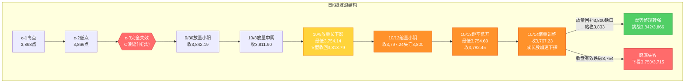
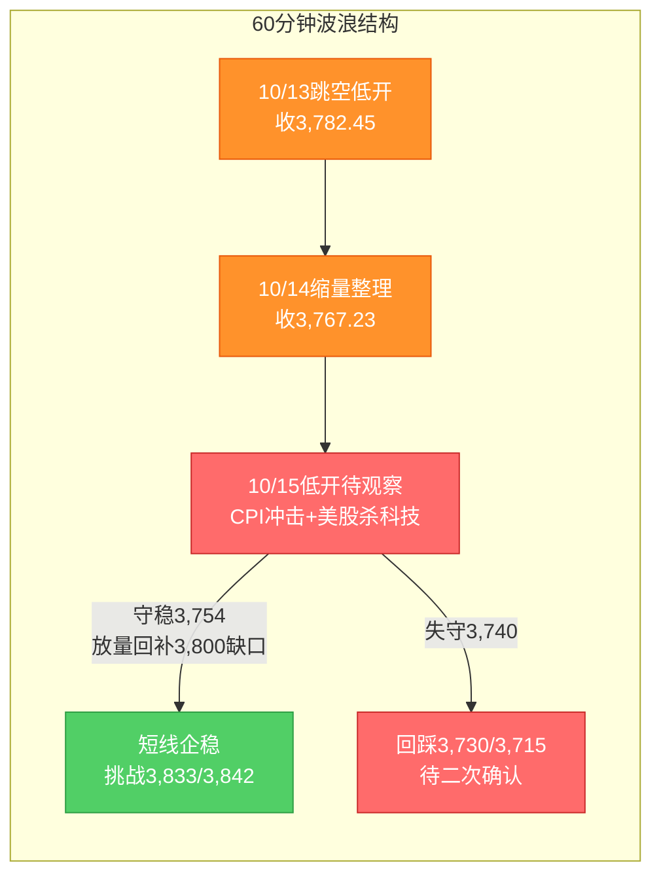

# A股晨报 - 2026年10月15日

> 数据截止时间：2026年10月15日 09:00（北京时间）；美股/欧洲为10月14日收盘，亚太/港股为10月14日收盘，大宗商品/汇率为10月14日盘后至10月15日盘前，A股为10月14日收盘数据
> 报告性质：**国庆长假后首个完整交易周（第42周）周四（10/15）晨报** —— 以 **10/13晚报复盘结论 + 10/14实际行情（含美国9月CPI）** 为基础 + **隔夜美股反应（纳指-1.88%、费半-4.30%）** + 今日盘前前瞻
> 核心观点：**10/14 A股"缩量调整、极致分化"**：上证指数**收3,767.23点（-0.88%）**，深证成指-1.97%、创业板指**-3.10%（续创年内新低）**、科创50-3.29%；两市成交**约14,144亿元（缩量约2,615亿元）**，主力资金**净流出25.61亿元**；结构呈**"红利（油气/煤炭/电力/交通）逆势走强 + AI影视题材逆势活跃，半导体/存储/CPO/创新药走弱"**。**隔夜（10/14美东）重大变量**：**美国9月CPI超预期（同比+3.7% vs 预期3.6%、前值3.4%；环比+0.6%）重燃加息押注**，**美股"杀科技"**——**道指-0.09%（51,621.48）、标普500-1.11%（7,718.94）、纳指-1.88%（26,692.87，创7月以来最大单日跌幅）、费城半导体指数-4.30%**，存储链再遭重挫（SK海力士ADR-6%+、闪迪-5%+、美光/西部数据/希捷-4%+），**苹果逆势+0.5%、市值首破5万亿美元**。**综合判断：今日上证大概率【看跌/震荡偏弱（低开、弱势整理、红利护盘）】，区间参考3,730-3,800点，核心观察3,754点（"最后防线"）能否守住、3,800点（20月均线/缺口）能否收复；"CPI超预期→美债续高→全球科技估值承压"对A股AI硬件/半导体构成定向压制，而油价续涨（布油106.09美元）+ 央行7,000亿逆回购呵护 + 红利/高股息护盘，使指数跌幅相对可控、结构分化延续。**

---

## 一、昨日晚报复盘要点回顾

> 说明：**仓库中缺少10/14（周三）晚报**（`report/20261014/` 未生成）。本节以**最近一期可得的10/13晚报（`report/20261013/evening_report_20261013.md`）复盘结论与沉淀规则**为基础，并结合**10/14实际行情**（10/14 A股缩量分化、盘后美国9月CPI超预期）进行动态修正。

### 1. 最近一期（10/13）判断回顾
- **趋势判断准确率：100%（1/1）**——预判"看跌/震荡偏弱（低开探底、权重护盘）"，实际"跳空低开-0.96%→探底3,754.60→权重护盘收窄跌幅、收-0.39%"，方向与路径均命中
- **点位预测准确率：约90%（5/5，含1项~）**——区间、强/弱支撑、强/弱压力全部命中（3,754守住、3,800未收复、3,833未触及）
- **板块预判准确率：约82%（9/11）**——看涨6项中4项命中（油气/银行/煤炭/农业）、2项落空（白酒/传媒）；看跌5项全部命中
- **综合准确率：约91%**——以"隔夜外盘定向冲击+内生护盘结构"为核心逻辑，前瞻性较强

### 2. 10/14实际行情（对10/13前瞻判断的"事后验证"）
- **A股**：上证指数**收3,767.23点（-0.88%）**、深证成指-1.97%、创业板指-3.10%（**续创年内收盘新低**）、科创50-3.29%、科创综指-2.97%、北证50-0.66%；两市成交**约14,144亿元（较上一交易日缩量约2,615亿元）**——**"权重护盘使沪指跌幅相对可控、成长股（创业板/科创）加速下探"的极致分化延续**
- **结构**：**红利资产（油气、电力、煤炭、港口航运/交通）普遍逆势走强**，**AI影视/传媒题材逆势活跃**；**半导体、CPO/存储、创新药、有色回调**
- **关键验证**：**3,754点（"最后防线"）在10/14继续守住（收盘3,767.23高于防线）**；**3,800点（20月均线/缺口）连续第三日未能收复**——**"守底线、欠修复"格局未改**
- **资金**：主力资金**净流出25.61亿元**（抛压较10/12/10/13继续收窄）；电子设备/有色/机械设备获净流入居前，金融净流出居前

### 3. 沉淀的规则/检查项（本次直接应用）
- **规则1（板块选择）**：**系统性外盘冲击（外盘科技指数重挫+亚太普跌）下，AI链（硬件+应用）易同步承压**，须区分"事件驱动型独立行情"与"系统性映射冲击"（10/13发现）
- **规则2（趋势分析）**：**跳空低开后若成交量不放大，"权重护盘+能源驱动"可推动指数低开高走式收窄跌幅，但反弹高度受限、难以收复关键分水岭（如3,800点）**（10/13发现）
- **规则3（点位计算）**：**外盘冲击下的跳空缺口（如3,797→3,760）在缩量环境下回补概率下降，缺口位（3,797-3,800点）易转为短期压力**（10/13发现）
- **规则4（资金面分析）**：**缩量磨底阶段，短线"买入条件"须与"量能"绑定（放量才有效）**；量能不放大时"护盘冲高"易回落，短线"观望为主"而非追高（10/12发现）
- **规则5（资金面分析）**：**成交量预测须与"低开幅度/恐慌程度"挂钩**，不可机械套用"修复日放量"（10/12发现）
- **规则6（趋势分析）**：指数收盘"弱跌破"关键防线（缩量、仅差数点）属"弱跌破/待确认"，不宜直接判定底部信号失效（10/12发现）

### 4. 对今日（10/15）分析的启示
- **需要关注的风险点**：①**美国9月CPI超预期（同比+3.7%）→加息押注升温→美债续高→全球科技估值承压**，对A股AI硬件/半导体构成**定向压制**；②**3,754点（"最后防线"）虽连续守住，但连续三日收盘在3,800下方、磨底时间拉长**；③**创业板/科创续创新低**，成长股情绪偏弱；④**期指交割日（10/16）**临近、三季报密集披露、10月解禁3,047亿
- **需要调整的分析逻辑**：①**延续"红利/能源/高股息护盘 + 科技成长承压"的内生结构**（10/14已验证）；②**科技链继续按"AI硬件（承压）vs AI应用（相对独立）"拆分**，但**系统性外盘冲击下须警惕AI链整体下调**；③**成交量以"缩量/平量"为基准**（CPI冲击后观望 + 央行流动性呵护）；④**贵金属因"CPI超预期+美元走强+美债续高"继续承压**

---

## 二、隔夜市场动态（10/14收盘至10/15开盘）

### 1. 美股市场（10月14日 周二收盘）

| 指数 | 收盘点位 | 涨跌幅 | 说明 |
|------|---------|--------|------|
| 道琼斯工业指数 | **51,621.48** | **-0.09%（-48.62点）** | 相对抗跌 |
| 标普500指数 | **7,718.94** | **-1.11%（-86.51点）** | 科技拖累 |
| 纳斯达克综合指数 | **26,692.87** | **-1.88%（-510点+）** | **创7月以来最大单日跌幅** |
| 费城半导体指数 | — | **-4.30%** | **半导体全线重挫** |

**（1）"杀科技"重灾区（存储/半导体/算力）**
- **存储**：**SK海力士（ADR）-6%+、闪迪-5%+、美光科技/西部数据/希捷科技-4%+**（存储链连续多日承压）
- **半导体/算力**：**ARM-6%+、AMD-5%+、英特尔-4%+、博通/迈威尔-3%+**；**CoreWeave-15%+**
- **大型科技**：**英伟达-3%+、Meta-3%+、特斯拉-2%+、谷歌/微软/亚马逊-1%+**；**苹果逆势+0.5%，总市值首破5万亿美元（5.01万亿）**

**（2）下跌催化：美国9月CPI超预期 → 加息押注升温**
- **美国9月CPI：同比+3.7%（预期3.6%、前值3.4%）、环比+0.6%（前值0.4%）**，**能源/汽油驱动（9月汽油价格指数环比+9.1%）**——**通胀"过热"强化加息预期**
- **纽约联储调查**：美国一年期通胀预期升至**3.9%（2023年5月以来最高）**，三年期3.3%，五年期维持3%
- **传导**：**CPI超预期→美债收益率上行（10年期续处约5%上方，近20年高位区域）→美元走强（美元指数+0.37%至102.554）→高估值成长股/贵金属承压**——"利率弹性反向"规则再度主导

**解读**：隔夜外盘呈**"道指抗跌、纳指/费半重挫"的典型"杀估值"结构**——**CPI超预期点燃加息押注，对高久期科技资产（半导体/存储/算力/光通信）构成定向利空**；**苹果因"消费电子避险+AI叙事"逆势创新高**。**净影响：外盘对A股呈"科技链定向利空（AI硬件/半导体/存储/CPO/光通信）、红利/能源/防御相对占优"的映射方向。**

### 2. 欧洲/亚太市场（10月14日）

| 市场 | 表现 | 备注 |
|------|------|------|
| 恒生指数（10/14收盘） | **-0.13%（24,314.17）** | 油气、互联网走强，创新药、AI主题回调；**内银股获利了结** |
| 恒生科技指数（10/14收盘） | **+0.91%（4,174.47）** | 相对独立走强 |
| 恒生国企指数（10/14收盘） | **-0.10%（8,183.17）** | — |
| 日经225 / 韩国KOSPI（10/14） | 半导体/科技延续偏弱 | 亚太科技股延续10/13"重挫"后的高波动 |

**情绪判断**：**港股10/14窄幅分化（恒指-0.13%、恒生科技+0.91%），南向资金小幅净卖出1.35亿港元**——**"油气/互联网强、创新药/AI弱、内银获利了结"**，与A股"红利强、科技弱"的内生结构同向。**亚太科技股延续高波动**，为A股科技链提供负向前瞻。

### 3. 大宗商品

| 品种 | 价格/表现 | 涨跌/驱动 |
|------|----------|----------|
| 布伦特原油（10/14） | **约106.09美元/桶** | **+0.38%（续涨）**；中东地缘+乌克兰地缘溢价 |
| WTI原油（10/14） | **约95.17美元/桶** | **+1.09%** |
| 现货黄金（10/14） | **约4,105美元/盎司** | **-1%以上（连续第三个交易日收跌）**，盘中最低约4,073.29美元；**CPI超预期+美元走强+美债续高**压制；COMEX黄金-1.14%、沪金-1.14%，SPDR黄金ETF减仓1.21吨 |
| 有色/工业金属 | 偏弱 | 全球风险偏好回落+强美元 |

**驱动逻辑**：①**国际油价续涨（布油约106美元）**——对A股**油气/石油石化/油运**构成持续正向催化（10/14油气逆势领涨已验证）；②**黄金三连跌（加息预期升温+强美元）**——**继续压制A股贵金属/有色**；③**"油价上涨→通胀预期升温→美债长端上行"传导链形成**，同时压制成长股估值与贵金属（对应10/7沉淀规则）。

### 4. 汇率与利率

| 指标 | 数值/表现 | 变化/说明 |
|------|----------|----------|
| 在岸人民币（10/15夜盘） | **约6.6978** | 较上一交易日夜盘**收跌50个基点**，**整体延续偏强** |
| 人民币中间价 | 以中国外汇交易中心官方公布为准（10/13为6.7298） | 连续偏强基调延续 |
| 美元指数（10/14） | **102.554** | **+0.37%**；CPI超预期+能源价格推动走强，压制贵金属与成长股 |
| 美债10年期收益率 | **约5%上方（近20年高位区域）** | **CPI超预期推动上行**，压制高估值成长与贵金属 |
| 央行公开市场操作 | **10/15开展7,000亿元逆回购** | **流动性呵护延续**，季末后资金面平稳，为情绪面提供边际支撑 |

**特征**：①**人民币延续偏强（在岸夜盘6.6978）**，稳汇率预期延续，对A股资金面构成**边际正面**；②**美元走强+美债续高**——**"利率弹性反向"规则在"CPI超预期+美联储偏鹰"下继续适用**，科技成长（半导体/CPO/光模块）与贵金属承压；③**央行10/15开展7,000亿逆回购**，流动性宽松延续，对冲外部冲击、稳定市场预期。

### 5. 海外重要事件

- **美国9月CPI超预期（10/14 20:30北京时间公布）**：同比+3.7%、环比+0.6%，能源驱动；**"通胀过热→加息押注升温"成为本周核心变量**
- **美股"杀科技"**：纳指-1.88%、费半-4.30%，存储/半导体/算力重挫；**苹果市值破5万亿美元**
- **美联储**：加息预期回摆、**10/28 FOMC**为关键窗口；**10/15公布美国9月PPI**；**美联储已进入静默期**
- **地缘**：中东冲突升级（红海/霍尔木兹扰动）+ 乌克兰局势，共同推升国际油价

---

## 三、今日关注事项

### 1. 重要数据发布 / 政策（按时间排序）
- **10/15 美国9月PPI**——关注通胀链条（CPI超预期后）能否延续，影响美债与全球风险偏好
- **央行**：**10/15开展7,000亿元逆回购**，流动性呵护延续；跟踪**9月CPI/PPI、金融数据（社融/信贷/M2）**发布窗口
- **美联储**：10/28 FOMC临近（静默期内以CME FedWatch加息概率+美债收益率为跟踪核心）
- **关税/经贸**：跟踪**中美关税博弈**进展、**10月底APEC**与**11月1日美方关税决定**博弈，以及**中方稀土出口管制**细则落地

### 2. 三季报披露（密集期）
- 10/13起三季报密集披露、10/14延续；**关注AI/半导体/创新药等高位成长股业绩不及预期风险**（10/14半导体/创新药走弱部分反映业绩验证压力）

### 3. 限售股解禁
- **10/15：共5家公司限售股解禁，合计4,506.1万股，按最新收盘价计算合计解禁市值约6.1亿元**（双英集团、科莱瑞迪、神农集团解禁量居前）
- **10月全月**解禁约**3,047亿元（环比+62.82%）**，电子、公用事业、煤炭方向需持续跟踪

### 4. 新股 / 其他关注
- **新股上市**：**联亚药业（301569）**于10/15登陆深交所创业板（发行价7.00元/股，市盈率27.99倍）；**莫森泰克（920162）**上市
- **交易安排**：第42周（10/12-10/16）**5个完整交易日**；**期指交割日为10/16（本周五）**，临近交割量能或有扰动

---

## 四、板块与个股分析（结合10/14复盘与隔夜冲击）

### 1. 基于10/14行情的板块调整
- **10/14强势板块今日预期**：①**红利资产（油气、煤炭、电力、交通/港口航运）**——**油价续涨（布油106美元）+高股息防御**，**延续护盘主线**；②**AI影视/传媒**——事件驱动+题材轮动，**关注是否能在外盘科技杀跌下保持独立**（**须警惕10/13教训：系统性外盘冲击下AI链易整体下调**）；③**银行/高股息**——避险+类固收防御
- **10/14领跌板块今日预期**：①**半导体/存储/CPO/光通信（AI硬件）**——叠加**隔夜费半-4.30%、SK海力士ADR-6%+、美光/闪迪-4~5%**，**定向继续承压**；②**创新药/CRO/医药**——延续调整；③**有色/贵金属**——**黄金三连跌（CPI+强美元）**，**继续承压**
- **偏差板块修正逻辑**：**成长股（创业板/科创）**连续下探→**下调科技成长整体优先级**；**红利/能源**→**正式纳入核心防御/看涨清单**

### 2. 隔夜信息驱动的板块机会
- **受益板块**：
  - （1）**石油石化 / 油气 / 油运（海运）**（逻辑：**布油续涨约106美元、中东地缘**，趋势驱动；10/14已逆势领涨）
  - （2）**煤炭**（逻辑：高股息+冬储+能源涨价共振；10/14逆势走强）
  - （3）**电力 / 公用事业 / 交通（港口航运）**（逻辑：高股息防御+油价映射；10/14红利走强）
  - （4）**银行 / 高股息（类固收防御）**（逻辑：避险+关税冲击期防御属性）
  - （5）**AI影视 / 传媒（AI应用）**（逻辑：事件驱动+题材轮动；**但须以"外盘冲击缓和"为前置**）
- **受损板块**：
  - （1）**算力硬件（存储/光通信/CPO/覆铜板/PCB）**（逻辑：**CPI超预期+外盘AI硬件重挫（费半-4.30%）映射**）
  - （2）**半导体芯片**（逻辑：费半-4.30%+存储链重挫+美债>5%的"利率弹性反向"）
  - （3）**锂电池/新能源（风电/光伏）**（逻辑：高位调整+资金撤离）
  - （4）**贵金属/黄金、有色**（逻辑：**金价三连跌+美元走强+美债续高**）
  - （5）**创新药/CRO/生物科技**（逻辑：调整延续+港股创新药回调映射）

### 3. 重点关注个股
- **油气/油运（中国海油、中国石油、招商轮船、中远海能等）**：关注理由=**布油106美元+中东地缘**；10/14油气逆势领涨
- **红利（煤炭：中国神华、陕西煤业；电力：长江电力等；银行：工建中农）**：关注理由=**高股息防御+资金避险**
- **AI影视/传媒龙头**：关注理由=**事件驱动+高低切换（须以外部冲击缓和为前置）**；风险=**系统性外盘冲击下同步承压（10/13教训）**
- **联亚药业（301569）**：关注理由=**新股上市（创业板，发行价7.00元）**；风险=**新股高波动**
- **回避/谨慎**：算力硬件（存储/光通信/CPO/覆铜板）、半导体芯片、贵金属/有色、创新药、高位连板股、大额解禁个股、三季报不及预期的高位成长股

---

## 五、今日核心判断（结构化输出，用于晚报复盘）

### 1. 趋势判断
- **上证指数：【看跌 / 震荡偏弱（低开、弱势整理、红利护盘）】**
- **预测区间：3,730点 - 3,800点**（下探容错区间3,754±40点，极端下沿3,715点）
- **核心逻辑**：**隔夜美国9月CPI超预期（同比+3.7%）重燃加息押注 → 美债续高、美元走强 → 全球科技成长估值承压**，**纳指-1.88%、费半-4.30%、存储链重挫**，对A股**科技链（AI硬件/半导体/存储/CPO/光通信）构成定向压制**；但**油价续涨（布油106.09美元）+ 央行7,000亿逆回购呵护 + 红利/高股息护盘**，使**指数跌幅相对可控、结构分化延续**（"科技弱、红利+能源强"）。**综合看：低开探底、红利护盘下指数跌幅或小于科技板块；3,754点（"最后防线"）能否守住、3,800点（20月均线/缺口）能否收复为核心。**

### 2. 关键点位
- **强支撑位：3,754点**（依据：**10/9、10/13、10/14连续验证的"最后防线"/阶段低点区**；收盘有效跌破则磨底失败）
- **弱支撑位：3,730点 / 3,715点**（依据：第41周规律预测的**区间下沿3,730点**、**黄金分割1.236延伸目标3,715点**）
- **弱压力位：3,800点**（依据：**20月均线/10/13跳空缺口位（3,797-3,800）**；已连续三日收盘在其下方，**收复为多空分水岭**）
- **强压力位：3,833点**（依据：**9/30低点，短线强弱分水岭**）；次级压力**3,842点**（C浪低点反压）、**3,866点**（c-2低点，周线反转确认位）

### 3. 板块预判
- **看涨板块**：（1）**石油石化/油气/油运（海运）**（逻辑：布油续涨约106美元+中东地缘）（2）**煤炭**（逻辑：高股息+冬储+能源涨价）（3）**电力/公用事业/交通（港口航运）**（逻辑：高股息防御+油价映射）（4）**银行/高股息**（逻辑：避险+类固收防御）（5）**AI影视/传媒**（逻辑：事件驱动+题材轮动，**以外部冲击缓和为前置**）
- **看跌板块**：（1）**算力硬件（存储/光通信/CPO/覆铜板/PCB）**（逻辑：CPI超预期+外盘AI硬件重挫映射）（2）**半导体芯片**（逻辑：费半-4.30%+美债>5%的"利率弹性反向"）（3）**锂电池/新能源（风电/光伏）**（逻辑：高位调整+资金撤离）（4）**贵金属/黄金、有色**（逻辑：金价三连跌+美元强+美债续高）（5）**创新药/CRO/生物科技**（逻辑：调整延续+港股创新药回调）
- **风险板块**：①**三季报或不及预期的高位成长股**；②**大额解禁个股**（电子/公用事业/煤炭方向）；③**高位连板股**（获利回吐）；④**前期抢跑的避险资产（贵金属/有色，利好兑现回吐风险）**；⑤**退市风险/ST个股**

### 4. 资金面判断
- **北向资金预期：【结构性分化 / 净额承压】**（依据：交易所已不实时披露净额，**以成交口径跟踪**；全球科技风险偏好回落或抑制外资对科技成长的风险偏好，但央行稳汇率+人民币偏强提供支撑）
- **成交量预期：【缩量 / 平量】1.3 - 1.5万亿元**（依据：**CPI冲击+外盘科技重挫→观望情绪升温→缩量**；央行7,000亿逆回购呵护流动性；**参照10/12规则"低开幅度/恐慌程度→成交量"挂钩，不宜机械套用"破位放量"**；期指交割日（10/16）临近但非今日）

### 5. 风险预警（按优先级排序）
- **高风险**：①**美国9月CPI超预期（同比+3.7%）→加息押注升温+美债续高**——**A股算力硬件/半导体/存储/CPO定向杀跌风险**；②**3,754点（"最后防线"）有效性**——连续三日收盘在3,800下方、**磨底时间或拉长**，若收盘有效跌破3,754，则磨底失败、下看3,750/3,715；③**创业板/科创续创新低**，成长股情绪偏弱，谨防"指数失真、个股普跌"加剧
- **中风险**：①**美联储偏鹰+美债10Y续处约5%上方（近20年高位）**——压制高估值成长与贵金属；②**主力资金净流出延续**（10/14净流出25.61亿）——"权重护盘≠资金转多"；③**三季报密集披露 + 10月解禁3,047亿**，高位成长股业绩与解禁双重风险
- **低风险**：①**中东地缘（油价波动）**——利好油气但加剧全球风险偏好波动；②**高位连板股**（获利回吐风险）；③**期指交割日（10/16）**临近，量能或有扰动

### 6. 昨日复盘规则应用
- **应用规则1（"系统性外盘冲击→AI链整体下调"·10/13）**：隔夜费半-4.30%、存储链重挫属**系统性外盘科技冲击**，**AI链（硬件+应用）整体下调**，"AI影视/传媒"仅作"事件驱动+题材"的小仓试探，**不预设应用端独立走强**
- **应用规则2（"低开幅度→成交量"挂钩·10/12）**：**CPI冲击下A股大概率低开**，但**属"外部冲击型温和低开"**，成交量以**"缩量/平量"**为基准，**不预设"破位放量"**
- **应用规则3（"缩量磨底短线量能绑定"·10/12）**：**缩量磨底阶段短线"买入条件"须与"量能"绑定（放量才有效）**，量能不放大时**"观望为主"**
- **应用规则4（"弱跌破待确认"·10/12）**：**连续三日收盘在3,800下方**——3,800（20月均线）**"弱跌破、待确认"**，**今日需重新验证3,754（收盘跌破=失效）与3,800（放量站稳=修复）**
- **应用规则5（"缩量下跳空缺口回补概率下降"·10/13）**：**3,797-3,800缺口**在缩量环境下**易转为短期压力**，**缺口回补与否为短线强弱即时信号**
- **应用规则6（"利率弹性反向"·历史规则）**：**CPI超预期→美债续高**，**半导体/CPO/光模块等高久期资产"利率弹性反向"看跌**，**贵金属在"美元走强"下继续承压**

---

## 六、波浪理论多周期分析

> 说明：基于10/14实际K线结构 + 隔夜"CPI超预期+美股杀科技"推演今日（10/15）路径。**10/14缩量调整（沪指-0.88%收3,767.23），"最后防线"3,754连续守住、3,800连续三日未收复，日线维持"缩量磨底、弱势整理"；创业板/科创续创新低，成长浪型更弱。**

### 1. 月K线波浪分析

- **当前波浪位置**：大周期**第2浪C浪延伸末段寻底**，10月月K线（10/8至今）呈**"先抑后扬、长下影"**雏形，**10/14收盘3,767.23点，处20月均线（约3,800点）下方约33点**，为**连续第三个月调整**
- **浪型结构描述**：2024年9月2,689点→2026年6月4,197点为**第1浪上升**；第2浪ABC调整：4,197点→3,754.14点（10/9最低）；10月开局下探3,795.37点，10/9下探**3,754.14点（阶段新低）后V型收回**，10/12失守3,800、10/13跳空低开探底3,754.60收回、**10/14缩量调整收3,767.23**；**月内低点3,754.14仍未再被刷新（3,754.60略高）**，月线下影仍在，月度"破位下行"风险未显著恶化
- **关键目标位**：月度强支撑**3,800点（20月均线）**、3,754点（10/9-10/14低点区）、3,750点；月度核心压力3,833点、3,842点、3,866点
- **验证条件**：**10月月K线能否收盘收复3,800点（20月均线）**——10/12-10/14连续三日收盘在3,800下方，需后续交易日确认；若月内有效跌破3,750点，则月度底部证伪

### 2. 周K线波浪分析

- **当前波浪位置**：第42周（10/12-10/16）**第四日缩量调整**，周K线现为**"带下影的缩量小阴/下探"**雏形（周开3,806.98、周内暂高3,828.22、周内暂低3,754.60、现收3,767.23）
- **浪型结构描述**：本周为国庆后**首个完整交易周**。10/12缩量回落、10/13跳空低开后收窄跌幅、**10/14缩量调整（成长股加速下探）**，**仍处5周/10周/20周/60周均线下方，短期均线空头排列未改**；周线级别尚未出现放量反转信号，**"底部构筑/下跌中继"分歧延续**，但**本周下影渐长（周低3,754.60、承接增强）**
- **关键目标位**：周度支撑**3,754点（10/9-10/14低点，核心）**、3,730点（区间下沿）、3,715点；周度压力**3,800点（20月均线/缺口位）**、**3,833点**（短线分水岭）、**3,842点**（C浪低点反压）、**3,866点**（c-2低点，周线反转确认位）
- **验证条件**：**本周（5个交易日）能否收出长下影/小阳**——**放量站稳3,833并挑战3,866**为周线反转确认前提；收盘有效跌破3,754则信号失效

### 3. 日K线波浪分析（重点）

- **当前波浪位置**：**C浪延伸末段"缩量磨底、弱势整理"**——10/9放量长下影V型收回3,800后，10/12缩量冲高回落失守3,800，10/13跳空低开探底3,754.60后收窄跌幅，**10/14缩量调整收3,767.23**，形成**"缩量小阴+连续三日收盘在3,800下方"**组合，**低点（3,754.14/3,754.60）未有效跌破，底部"弱势整理"未破位**，但**创业板/科创续创新低，成长浪型更弱**
- **浪型结构描述**：9/30放量小阳收3,842.19→10/8放量中阴收3,811.90→**10/9放量长下影小阳收3,813.79（最低3,754.14）→10/12缩量小阴收3,797.24→10/13跳空低开收3,782.45（最低3,754.60）→10/14缩量调整收3,767.23（-0.88%）**；**低点序列"3,754.14→约3,790→3,754.60→（10/14≥3,754）"呈"双底/抬升"雏形**，多空在3,754-3,833区间反复拉锯；**10/13跳空缺口（3,797→3,760附近）至今未回补，缺口位（3,797-3,800）为短期压力**
- **关键目标位**：第一压力**3,797-3,800点（跳空缺口/20月均线）**、**3,833点（9/30低点，短线分水岭）**；**强压力3,842点（C浪低点反压）、3,866点（c-2低点）**；第一支撑**3,754点（10/9-10/14低点，"最后防线"）**、3,730点（区间下沿）；**下方目标3,750点/3,715点（黄金分割1.236延伸，仅当收盘有效跌破3,754点时启用）**
- **验证条件**：
  - **向上修复**：**放量回补3,797-3,800缺口并站稳3,833点** → 弱势整理转强，方有挑战3,842/3,866点可能
  - **向下确认**：**收盘有效跌破3,754点** → 磨底失败，下看3,750点及3,715点
  - **今日变量（10/15）**：隔夜"CPI超预期+美股杀科技" → **低开概率较高**；**"红利/能源（油气/煤炭/电力）护盘 + 央行7,000亿逆回购"** → 指数跌幅或可控，需观察**3,754点支撑与缺口回补**

### 4. 60分钟K线波浪分析

- **当前波浪位置**：60分钟级别**"缩量磨底→低开待修复"**，短线维持"弱势整理、方向未明"
- **浪型结构描述**：60分钟10/14呈"缩量窄幅震荡、重心小幅下移"；**60分钟MACD低位、KDJ中性偏弱**，量能未放大，需观察今日低开后能否放量止跌
- **关键目标位**：短期支撑**3,754点、3,740点**；短期压力**3,790点、3,797-3,800点（缺口）**
- **验证条件**：**今日首两个小时能否守稳3,754点并放量上攻3,790-3,800点（回补缺口）**——守稳则短线企稳，跌破3,740则弱势级别降级、下看3,730/3,715

### 5. 30分钟K线波浪分析

- **当前波浪位置**：30分钟级别**"缩量整理、动能偏弱"**，短线动能待修复
- **浪型结构描述**：30分钟10/14呈"低位缩量震荡"，**MACD低位、KDJ偏弱**；量能低迷，**3,754-3,770区间止跌企稳迹象待确认**
- **关键目标位**：关键支撑**3,754点、3,740点**；短期压力3,790点、3,797-3,800点
- **验证条件**：**30分钟能否在3,754-3,790区间企稳并放量突破3,790**，否则维持3,740-3,800区间弱势震荡

### 6. 波浪图（Mermaid绘制）

**日K线波浪结构图**：

**60分钟波浪结构图**：

### 7. 波浪理论综合判断

| 维度 | 判断 |
|------|------|
| 多周期共振状态 | **月/周/日/60分钟/30分钟维持"缩量磨底、弱势整理"**——连续三日收盘在3,800下方；但**低点未创新低（3,754.14为防线）、红利/能源护盘、跌幅可控**，尚未形成向下共振；多周期"弱平衡、方向未明"（"守底线、欠修复"） |
| 当前操作级别 | **日线级别（防守为主）**（3,754为最后防线，3,797-3,800为缺口/多空分水岭，3,833/3,842为确认位，3,730/3,715为失效目标） |
| 后续演变路径（10/15及本周） | **25%乐观**（CPI利空出尽/红利护盘/科技止跌→守稳3,754、放量回补3,800缺口并站稳3,833→弱势整理转强，挑战3,842/3,866）、**50%中性**（3,754-3,800区间缩量磨底、红利+能源护盘、题材轮动）、**25%悲观**（AI硬件续杀跌/外盘续弱→收盘有效跌破3,754，下看3,750/3,715） |
| 关键拐点信号 | 向上：**放量回补3,797-3,800点缺口并站稳3,833点** + 主力资金转净流入 + 算力硬件（存储/半导体）止跌；向下：**收盘有效跌破3,754点** + 科技链放量再杀跌 + 港股/亚太大跌 |
| 风险提示 | ①**美国9月CPI超预期（同比+3.7%）**为本周核心外部变量，压制全球成长估值与贵金属；②**3,754点（"最后防线"）虽连续守住，但连续三日收盘在3,800下方，磨底时间或拉长**；③**美联储偏鹰+美债10Y续处约5%上方**压制成长与贵金属；④**主力资金净流出延续 + 三季报验证 + 10月解禁3,047亿**；⑤波浪理论在C浪延伸末段+缩量拉锯阶段预测精度降低，需结合量能、外盘与政策面综合判断 |

> **规律分析引用（第41周运行规律分析）**：该报告（周日10/11生成）预测第42周（10/12-10/16）上证运行区间**3,730-3,880点**，判断"**震荡偏弱（低开修复、先抑后扬）**"，乐观/中性/悲观概率**30%/45%/25%**，并强调"**3,800点（20月均线）为最后防线、3,842点为信号确认位**"。**本周前四日（10/12-10/14）实际运行（3,754.14-3,828.22、收3,767.23）落在预测区间内、方向"震荡偏弱"命中**；但"低开修复/先抑后扬"路径与实际"缩量磨底、未收复3,800"仍有落差。本报告维持"缩量磨底/弱势整理"主基调，**乐观概率维持25%、中性维持50%、悲观维持25%**，提示"CPI超预期后的外盘科技杀跌"为方向选择的关键催化。

---

## 七、投资策略建议（分短线+中线）

### 1. 短线策略（1-3个交易日）
- **适用场景**：基于日K线和60分钟K线技术信号
- **短线仓位：10%**（**维持**——CPI超预期+外盘科技重挫+缩量磨底，**防御为主、不宜追高**）
- **买入条件**：①**指数守住3,754点并放量回补3,797-3,800点缺口**后低吸；或②**油气/油运、煤炭、电力、银行/高股息等防御/趋势方向**回踩关键均线不破时低吸；**所有买入以"量能放大"为前置**；**AI影视/传媒仅在"外盘冲击缓和"后小仓试探**
- **卖出条件**：指数反弹至**3,800-3,833点压力区滞涨**、或量能萎缩、或**收盘跌破3,754点**
- **止损位：3,754点**（收盘有效跌破则止损）或个股跌幅7%
- **短线标的**：（1）**石油石化/油气/油运（海运）**（逻辑：布油约106美元+中东地缘）（2）**煤炭**（逻辑：高股息+能源涨价）（3）**电力/公用事业/交通（港口航运）**（逻辑：高股息防御+油价映射）（4）**银行/高股息**（逻辑：避险+类固收防御）——**回避**算力硬件（存储/光通信/CPO/覆铜板/PCB）、半导体芯片、贵金属/有色、创新药、高位连板股

### 2. 中线策略（1-4周）
- **适用场景**：基于周K线波浪分析和运行规律分析结论
- **中线仓位：20-25%**（**维持**——磨底特征下不宜大幅加仓，**待放量收复3,800/站稳3,833点**再上修）
- **方向判断：【持有 / 观望（偏防御）】**
- **目标区间**：上证指数 **3,730点 - 3,880点**
- **中线布局板块**：（1）**能源与资源（石油石化/油气、煤炭）**（逻辑：地缘+油价趋势+高股息）（2）**银行/高股息（类固收防御）**（逻辑：避险+资金入市预期）（3）**电力/公用事业/交通**（逻辑：高股息防御+油价映射）（4）**AI应用/传媒（事件驱动）**（逻辑：高低切换，**待外部冲击缓和后介入**）——**谨慎/回避**：AI硬件（半导体/存储/CPO/PCB，拥挤交易消化+外盘质疑）、贵金属/有色（避险降温+美元强）、创新药、高位连板股、三季报不及预期的高位成长股
- **止盈条件**：指数到达**3,866-3,898点**或波段涨幅达到X%
- **止损条件**：指数**收盘有效跌破3,754点**（"最后防线"失守、磨底失败）或趋势确认反转

### 3. 仓位分配总览
| 策略类型 | 仓位比例 | 方向 | 重点板块 |
|---------|---------|------|---------|
| 短线 | 10% | 防御/低吸（量能绑定） | 油气/油运、煤炭、电力/交通、银行 |
| 中线 | 20-25% | 持有/观望（偏防御） | 能源与资源、银行/高股息、电力/公用事业、AI应用/传媒 |
| 现金 | 65-70% | — | — |

### 4. 与昨日（10/14）策略对比
- **短线仓位调整**：维持**10%**（原因：CPI超预期+外盘科技重挫+缩量磨底，**防御为主**；短线买入须与量能绑定）
- **中线仓位调整**：维持**20-25%**（原因：磨底结构未破但**CPI冲击加剧不确定性**，待放量收复3,800/3,833再加仓）
- **板块调整**：**上调**油气/油运、煤炭、电力/交通（**油价创新高+高股息防御**）、银行/高股息（**护盘主线**）；**下调**算力硬件（存储/光通信/CPO/覆铜板）、半导体芯片（**CPI+外盘杀科技映射**）、贵金属/有色（**金价三连跌+强美元**）、创新药；**维持**AI应用/传媒（**待外部冲击缓和**）
- **操作前提**：**观察量能能否回补、算力硬件能否止跌、外盘（美股期指/亚太）是否企稳**；若**放量回补3,800缺口并站稳3,833**则按上述布局小幅加仓；若**收盘有效跌破3,754**则降至低仓观望（短线降至5%以下）

---

## 八、信息来源

1. **官方数据来源**：上海证券交易所（上证指数10/14收盘3,767.23、跌幅0.88%）、深圳证券交易所（深证成指10/14收盘）、中证指数有限公司（科创50/科创综指）、中国外汇交易中心（人民币汇率）、美国劳工部（9月CPI）、美国财政部（Treasury）、香港交易所（恒生指数10/14）、国家外汇管理局
2. **权威财经媒体**：新华社/新华网（美国9月消费者价格指数涨幅扩大）、央视财经/央广财经（盘前速递·10/15；美CPI数据重燃加息押注）、中国证券报（美股科技股下跌，苹果市值超5万亿美元）、上海证券报·中国证券网（A股缩量调整中分化加剧；14日主力资金净流出25.61亿元）、证券时报（昨夜美科技股重挫；美股三大指数集体收跌）、每日经济新闻（在岸人民币夜盘；国际油价集体收涨；黄金交易提醒）、财联社（港股早报；A股限售股解禁一览）、第一财经、金融界（金价三连跌）
3. **数据平台**：东方财富（Choice/主力资金/港股收盘）、同花顺（10jqka）、Wind资讯（限售解禁/北向）、新浪财经/金融界（大宗商品/汇率/黄金）、CME FedWatch、Trading Economics
4. **海外信息源**：Reuters、CNBC、Bloomberg、Nasdaq、Morningstar、Advisor Perspectives（CPI: Inflation at 3.7% in September）

> 数据截止时间：2026年10月15日 09:00（北京时间）；美股/欧洲为10月14日收盘，亚太/港股为10月14日收盘，大宗商品/汇率为10月14日盘后至10月15日盘前，A股为10月14日收盘数据。

---

*本晨报由AI代理自动生成，仅供参考，不构成投资建议。投资有风险，入市需谨慎。*
