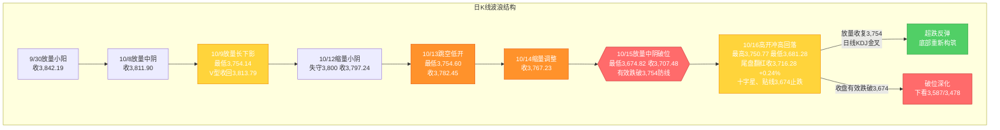
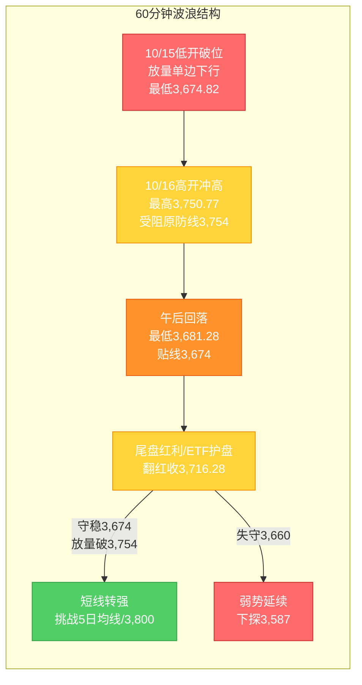

# A股晚报 - 2026年10月16日

> 数据截止时间：2026年10月16日 20:00（北京时间）；A股/港股/亚太为10月16日收盘，美股为10月15日收盘（隔夜），大宗商品/汇率为10月15日盘后至10月16日
> 报告性质：**国庆长假后首个完整交易周（第42周）周五（10/16）晚报 · 股指期货交割日** —— 以 **10/16实际行情（冲高回落、尾盘翻红、十字星）** 为基础 + **晨报（10/16）判断复盘** + **多周期波浪理论分析**
> 核心观点：**10/16 A股"高开冲高、午后回落、尾盘红利/ETF护盘翻红"**：上证指数**收3,716.28点（+0.24%、+8.80点）**（开3,723.80、最高3,750.77、最低3,681.28），深证成指-0.12%、创业板指-0.39%、科创50-0.06%、科创综指-0.18%（**首次8连跌**）；两市（沪深京）成交**约15,690.66亿元（缩量767亿元）**，主力资金**全天净流出（东财口径约49.36亿元）**；全市场**上涨3,301只、下跌2,128只**，**涨停61只、跌停12只、炸板49只**。**关键事件：上证指数在"924"行情高点3,674点核心支撑上方"贴线守住"（最低3,681.28点），日内高点3,750.77点精确受阻于被跌破的原"最后防线"3,754点，收出"上下影线基本等长的十字星（假阴真阳）"——破位下行后首现"超跌止跌企稳"信号雏形。** 结构呈**"事件驱动（军工掀涨停潮 + 低空经济/飞行汽车 + 汽车 + 房地产 + 福建/碳纤维）领涨" vs "AI链（元件/PCB/CPO/MLCC/算力硬件）+传媒（影视/游戏）+医药（CRO/医疗服务）+非银金融补跌"**。**外部变量**：隔夜"美债收益率集体大跌（10Y-12.60bp）+ 美元回落（-0.49%）+ 美股大逆转（道指+1.08%）+ 黄金大涨"，**亚太10/16全线回暖（韩KOSPI+2.05%、日经225+1.39%、恒指+0.52%、三大存储芯片巨头反弹）**，但**A股科技链"外强内弱"、算力硬件续跌**。

---

## 一、市场回顾

### 1. 主要指数表现

| 指数 | 收盘点位 | 涨跌幅 | 开盘 | 最高 | 最低 |
|------|---------|--------|------|------|------|
| 上证指数 | **3,716.28** | **+0.24%（+8.80点）** | 3,723.80 | **3,750.77** | **3,681.28** |
| 深证成指 | **约11,802** | **-0.12%** | — | — | — |
| 创业板指 | **约2,772** | **-0.39%** | — | — | 盘中续创阶段新低 |
| 科创50 | **约1,357** | **-0.06%** | — | — | — |
| 科创综指 | **约1,584** | **-0.18%（首次8连跌）** | — | — | — |

**特征**：**三大指数"冲高回落、涨跌不一"**——**沪指收涨0.24%（权重/红利护盘）、深成指-0.12%、创业板指-0.39%（高开低走）**；**科创综指"首次8连跌"**，成长风格继续弱于权重。**上证指数高开（3,723.80、较昨收3,707.48高开约16.3点）→ 早盘快速上攻、午间一度涨0.95%（收3,742.66）→ 午后13:00后单边回落、最低下探3,681.28点（"贴线"3,674点）→ 尾盘（14:45后）银行/保险/煤炭红利股集体发力 + 宽基ETF放量，指数再度翻红、收3,716.28点**。**日内高点3,750.77点精确受阻于被跌破的原"最后防线"3,754点、低点3,681.28点精确获"924"行情高点3,674点承接，形成"上下影线基本等长（假阴真阳）十字星"。**

### 2. 成交量能

| 指标 | 数值 | 变化 |
|------|------|------|
| 沪深京两市成交额 | **约15,690.66亿元（沪市+深市+北交所）** | **较上一交易日（16,458亿）缩量767亿元** |
| 主力资金 | **全天净流出**（东方财富口径约**49.36亿元**；证券时报·数据宝口径约**17.33亿元**） | 结构分化，较10/15（净流出544.47亿）大幅收窄 |
| 北向资金 | **成交2,252.73亿元，占两市成交额14.48%**（净额交易所已不实时披露） | 活跃度回落（10/15占15.91%） |
| 两市融资余额 | **24,325.75亿元（+76.01亿）** | 沪市12,377.81亿（+14.15）、深市11,947.94亿（+61.86） |

**资金流向结构（申万一级）**：
- **主力资金净流入行业居前**：**电子/半导体（净流入居首，约29.78-34.22亿元）**、**汽车（约29.05亿元）**、**国防军工（超18亿元）**、房地产、通信、家用电器
- **主力资金净流出行业居前**：**有色金属（净流出居首）**、**传媒（约-31.12亿元）**、**计算机**、**电力设备**（净流出均超10亿元），非银金融、公用事业、基础化工净流出均超5亿元
- **个股净流入居前**：长鑫科技（+9.81亿）、江淮汽车（+6.93亿）、药明康德（+14亿，游资口径）；**净流出居前**：天孚通信、金安国纪、罗博特科、胜宏科技等

**解读**：**成交较10/15"破位放量"明显缩量（-767亿）**——“缩量”说明破位后"恐慌盘+止损盘"集中释放已告一段落，多空在3,674-3,754区间进入"缩量博弈"；**主力资金净流出大幅收窄（东财口径49.36亿 vs 10/15的544.47亿）**，且**电子/半导体、汽车、军工转为净流入**，显示资金出现"结构性回补"迹象，但**"有色/传媒/电力设备"净流出居前**，**"指数翻红"仍主要由"尾盘红利拉升+宽基ETF放量"驱动**（"护盘≠资金全面转多"）。

### 3. 市场情绪

| 指标 | 数值 | 说明 |
|------|------|------|
| 上涨家数 | **约3,301只（占比超59%）** | 由10/15的"仅约425只"大幅修复 |
| 下跌家数 | **约2,128只** | 大幅收窄（10/15超5,100只） |
| 涨停股 | **61只（收盘封死）** | 较10/15（36只）增加；**炸板49只/53股封板未遂，封板率约53.51%-55%** |
| 跌停股 | **12只** | 较10/15（28只）减少 |
| 连板股 | 新华传媒（**11连板**）、新华文轩（15天11板）、冰山冷热（4连板）、金奥博（4天3板）、尖峰集团/东方嘉盛/吉大正元/读者传媒（2连板） | 情绪回暖、赚钱效应修复 |

**情绪判断**：**市场宽度显著修复**——**上涨个股占比由10/15的不足8%回升至超59%**、涨停增至61只、跌停降至12只，**"普跌杀跌"转为"结构性反弹"**；但**封板率仅约53.51%（炸板49只）**，显示**追高意愿仍偏谨慎、情绪修复"不稳固"**。

---

## 二、热点板块与异动分析

### 1. 领涨板块及驱动因素

| 板块 | 表现 | 驱动因素 |
|------|------|---------|
| **国防军工（航空装备/地面兵装/航海装备/航天装备/军工电子）** | **+2.99%（申万一级领涨）** | **第十六届中国国际航空航天博览会有关消息催化**；**长城军工、晨曦航空、金奥博、广东宏大、航天晨光、新兴装备等近10股涨停**（长城军工封单2.07亿） |
| **房地产** | **+2.12%** | 政策预期 + 低位补涨 |
| **农林牧渔** | **+2.01%** | 低位防御 + 主题活跃 |
| **汽车 / 汽车零部件** | **+1.92%（汽车零部件板块主力净流入居前）** | **江淮汽车直线涨停（封单2.26亿）**；特斯拉二代Roadster发布催化产业链 |
| **建筑材料** | **+1.63%** | 水泥（福建水泥涨停）等周期修复 |
| **低空经济 / 飞行汽车** | **掀涨停潮（十余只成分股涨停）** | **特斯拉二代Roadster跑车发布**催化；**万丰奥威、中信海直、保隆科技、英搏尔、华力创通、金盾股份、均胜电子、瑞玛精密**等涨停 |
| **福建 / 海峡两岸（区域主题）** | 活跃 | **厦门信达、福建水泥双双涨停** |
| **碳纤维** | 活跃 | **吉林化纤涨停、中简科技涨超10%** |
| **银行 / 保险 / 煤炭（红利）** | **银行+1.35%** | **尾盘（14:45后）集体发力快速拉升，带动上证翻红** |

### 2. 领跌板块及原因分析

| 板块 | 表现 | 原因 |
|------|------|------|
| **传媒（影视院线/游戏/短剧/出版）** | **-2.30%（申万一级领跌）** | **"AI应用/传媒"高位获利回吐**；文化传媒、短剧游戏、AI视频方向午后回调（10/15强势主线回调） |
| **医药生物（CRO/医疗服务）** | **-1.24%** | **CRO概念走弱（药明康德盘中触及跌停）**；医疗服务跌幅居前 |
| **非银金融（券商）** | 下跌（**主力净流出17.31亿**） | 券商回调、"牛市旗手"退潮 |
| **电子 / 半导体 / 元件 / PCB / CPO / MLCC** | **电子-0.56%、半导体-0.45%** | **算力硬件领跌（元件、PCB概念、CPO、MLCC概念大幅回落）**——"外强内弱"，隔夜美股科技反弹+亚太存储反弹未能带动A股AI硬件 |
| **计算机** | 下跌 | 同属AI链补跌 |
| **能源金属 / 电池** | 跌幅居前 | 碳酸锂期货跌超4%牵引 |

**结构解读**：**呈"事件驱动（军工+低空/飞行汽车+汽车+福建+碳纤维）接力领涨" vs "AI链（元件/PCB/CPO/MLCC）+传媒+医药+非银补跌"的极致分化**——**与10/15"白酒+大金融防御护盘"的主流结构不同**：10/16资金转向"特殊事件催化（航展、特斯拉新品）+ 政策/区域主题"，**"超跌反弹"在科技链未能兑现（反继续杀跌），说明破位后"科技链情绪修复"仍受"外盘映射不足+内生获利回吐"制约**。

### 3. 个股异动复盘

- **涨停复盘**：**新华传媒（600825）复牌"一字"涨停、实现11连板**（筹划发行股份收购上海界面财联社/重大资产重组，封单9.08亿元）；**江淮汽车、长城军工**涨停板封单资金居前（分别2.26亿、2.07亿）；**金奥博、长城军工、晨曦航空、广东宏大、航天晨光**（军工）涨停；**万丰奥威、中信海直、保隆科技、英搏尔**（低空/飞行汽车）涨停；**厦门信达、福建水泥**（福建）涨停；**吉林化纤**（碳纤维）涨停
- **连板复盘**：**新华传媒11连板**（封板数量最多）、新华文轩15天11板、冰山冷热4连板、金奥博4天3板、尖峰集团/东方嘉盛/吉大正元/读者传媒2连板
- **龙虎榜**：**瑞芯微（半导体）获机构净买入2.36亿元居首**；**北向资金成交前三（沪股通）为药明康德（38.52亿）、长江电力（30.09亿）、兆易创新（16.99亿），深股通为中际旭创（32.57亿）、宁德时代、北方华创**
- **炸板/回调**：**炸板49只、封板率仅约53.51%**；**天孚通信、胜宏科技、金安国纪、罗博特科**等算力硬件股主力资金净流出居前（高位补跌）

---

## 三、关键数据与事件回顾

### 1. 国内重要经济数据 / 政策
- **央行**：10/16开展**600亿元7天期逆回购（利率1.40%）**操作，全额满足一级交易商需求；因当日有20亿元7天期逆回购到期，**公开市场实现净投放580亿元**（流动性呵护延续）
- **五大行**：齐发公告**加码信贷投放、服务实体经济稳增长**
- **北交所**：10/16发布公告，**部分交易新规（风险警示股票及退市整理股票交易）自10月26日起实施**
- **证监会**：此前《公开募集证券投资基金运作管理办法（征求意见稿）》及配套规则公开征求意见，稳市预期延续

### 2. 政策 / 主题催化（当日盘中）
- **第十六届中国国际航空航天博览会**有关消息催化军工方向全天领涨
- **特斯拉二代Roadster跑车发布**催化低空经济/飞行汽车概念集体拉升
- **新华传媒**重大资产重组（收购界面财联社）复牌催化传媒/出版题材局部活跃

### 3. 公司重要公告 / 三季报预喜
- **三季报预喜密集**：**生益科技**（预盈同比+164%-181%）、**亨通光电**（+151.27%-168.1%）、**永太科技**（净利4.30亿、同比+1221.8%）、**卫星化学**（Q3净利28.32亿、同比+180.03%）、**威尔高**（Q3营收+115.24%、净利+461.86%）
- **回购/分红**：10/15晚间**新易盛**（8-10亿）、**天孚通信**（1-1.5亿并注销）、**中际旭创**（拟注销50亿回购股份）、**沪电股份**（提议2026年度分红≥22亿）等密集公告回购/分红
- **减持/质押**：铭利达控股股东部分股份解除质押及再质押

---

## 四、海外市场联动

### 1. 美股三大指数（10月15日收盘，10/16晚报核心外部变量）

| 指数 | 收盘点位 | 涨跌幅 | 说明 |
|------|---------|--------|------|
| 道琼斯工业指数 | **约52,178** | **+1.08%** | **大逆转、领涨**（传统蓝筹/防御） |
| 标普500指数 | **约7,744** | **+0.33%** | 温和反弹 |
| 纳斯达克综合指数 | **约26,713** | **+0.08%** | 科技股触底反弹、高位承压 |

**解读**：**隔夜美股"大逆转"**——**美债收益率集体大跌（10Y-12.60bp报5.062%、2Y-6.20bp）+ 美元回落**为美股反弹核心催化，**资金由"AI芯片链"转向"传统蓝筹/防御"**；**美股盘前（10/16）三大期指涨跌不一（道指期货+0.08%、标普+0.14%、纳指-0.12%）**，**AI芯片股盘前仍承压（CoreWeave盘前-2.5%）、特斯拉盘前走高**。**净影响：外盘呈"利率见顶交易+防御再平衡"结构，对A股"科技链的边际利空缓解"但传导有限（A股AI硬件10/16仍补跌）。**

### 2. 亚太 / 港股市场（10月16日收盘）

| 市场 | 表现 | 备注 |
|------|------|------|
| **韩国KOSPI** | **+2.05%** | **存储芯片巨头（三星/铠侠等）集体反弹**、修复10/15熔断级暴跌 |
| **日经225** | **+1.39%** | 半导体/科技反弹 |
| **恒生指数** | **+0.52%** | 港股小幅回暖 |
| 澳大利亚ASX200 | 盘初+1% | 亚太整体偏暖 |

**情绪判断**：**亚太科技市场10/16全线回暖（韩+2.05%、日经+1.39%）**，**10/15的"熔断级暴跌"已获修复**；但**A股科技链未能跟随（AI硬件续跌）**，显示"外盘映射→A股科技"传导受阻，**A股当日主线转向"内生事件驱动（军工/低空/主题）"**。

### 3. 大宗商品

| 品种 | 价格/表现 | 涨跌/驱动 |
|------|----------|----------|
| COMEX黄金期货（10/15） | **4,170.10美元/盎司** | **+1.51%（大涨）**；美债收益率回落+美元走弱+地缘避险 |
| COMEX白银期货（10/15） | **57.156美元/盎司** | **+2.29%（大涨）** |
| 国内现货黄金（10/16，Au99.99） | **901.57元/克** | **+0.96%**；贵金属集体反弹 |
| WTI原油（10/15） | 约**97美元/桶** | 高位震荡；**国内原油期货10/16跌超1%** |
| 国内商品（10/16） | **贵金属集体反弹；碳酸锂跌超4%；原油/焦煤等跌超1%** | 工业品偏弱、贵金属走强 |

**驱动逻辑**：①**黄金/白银延续反弹（美债收益率回落+美元走弱+地缘避险）**——利多A股黄金/贵金属股；②**原油内盘走弱（跌超1%）**——A股油气/石油石化承接压力；③**碳酸锂跌超4%**——压制A股能源金属/电池。

### 4. 汇率与利率

| 指标 | 数值/表现 | 变化/说明 |
|------|----------|----------|
| 人民币中间价（10/16） | **6.7220** | **调升33个基点**（前值6.7253） |
| 在岸人民币（10/16 16:30 / 夜盘） | **6.6916 / 6.6914** | 延续偏强 |
| 美元指数（10/15纽约尾盘） | **102.055** | **-0.49%**（一年多新高后回落） |
| 10年期美债收益率（10/15） | **5.062%** | **-12.60个基点（大幅回落）**；利多高估值成长与贵金属 |
| 央行公开市场操作（10/16） | **600亿7天逆回购（1.40%）；净投放580亿元** | 流动性呵护延续 |

**特征**：①**人民币延续偏强（中间价调升33基点、在岸6.6916）**——稳汇率预期延续；②**美债收益率大幅回落**——"利率弹性反向"规则方向维持利多科技成长/贵金属，但**A股科技链当日未兑现**；③**央行净投放580亿元**——流动性宽松延续。

---

## 五、汇率与利率

1. **人民币汇率**：10/16中间价**6.7220（调升33基点）**，在岸16:30报6.6916、夜盘6.6914，**延续偏强**（美元指数10/15回落-0.49%至102.055）
2. **国内利率市场**：资金面平稳，Shibor多数走低；10年期中国国债收益率低位运行
3. **央行公开市场操作**：**600亿元7天期逆回购（1.40%）**、净投放580亿元，流动性呵护延续

---

## 六、收盘后重要信息

1. **盘后公告**：三季报预喜密集（生益科技+164%-181%、亨通光电+151%-168%、永太科技+1221.8%、卫星化学Q3+180%、威尔高Q3+461.86%）；新易盛/天孚通信/中际旭创/沪电股份回购/分红公告延续
2. **夜盘 / 外盘动态**：**美股10/16盘前三大期指涨跌不一（道指期货+0.08%、标普+0.14%、纳指-0.12%）**，AI芯片股盘前仍承压、特斯拉走高；港股10/16收涨0.52%
3. **次日关注（下周一，10/19）**：**第43周开局**——关注**周末外盘（美股10/16收盘）与关税博弈进展**；**上证能否放量站稳3,674点并挑战5日均线**；**三季报密集披露延续**（高位成长股业绩验证）；**限售解禁**（10月全月约3,047亿元）；**10月底APEC、11月1日关税决定**为后续关键窗口

---

## 七、波浪理论多周期分析（重点章节）

> 说明：基于10/16实际K线结构更新。**10/16高开冲高（最高3,750.77，触及原"最后防线"3,754下方）→ 午后回落（最低3,681.28，"贴线"3,674点）→ 尾盘红利/ETF护盘翻红（收3,716.28、+0.24%），收出"上下影线基本等长的十字星（假阴真阳）"。10/15"放量破位"后，10/16首次出现"缩量止跌、区间企稳"信号，但反抽仍受"被跌破的原防线3,754"压制。**

### 1. 月K线波浪分析
- **当前波浪位置**：大周期**第2浪C浪延伸"破位下行后的止跌尝试"阶段**。10月月K线现为**"中阴破位后待企稳"**——10/16收3,716.28点，**处20月均线（约3,800点）下方约84点**，**月内低点3,681.28点（略高于10/15的3,674.82/3,685.83点，未再显著创新低）**，为**连续第三个月调整、破位后首现企稳迹象**
- **浪型结构描述**：2024年9月2,689点→2026年6月4,197点为**第1浪上升**；第2浪ABC调整：4,197点→3,754.14点（10/9）；10月呈"10/8放量中阴→10/9长下影V型收回→10/12失守3,800→10/13跳空低开探底3,754.60→10/14缩量调整→10/15放量破位→**10/16缩量十字星、贴线3,674获承接**"
- **关键目标位**：月度下方支撑**3,674点（"924"行情高点/核心支撑，10/16"贴线"承接）**、**3,587点**、**3,478点（心理关口）**；上方压力**3,754点（原"最后防线"，转压力，10/16高点3,750.77受阻）**、**3,800点（20月均线）**
- **验证条件**：**10月月K线能否在3,674点上方止跌企稳**——10/16已"贴线"守住；若月内继续有效跌破3,674点，则月度下行空间打开（下看3,587/3,478）；**10/19-10/23为月末下行是否延续的关键窗口**

### 2. 周K线波浪分析
- **当前波浪位置**：第42周（10/12-10/16）**第五日（收官）**，周K线现为**"放量破位后的带下影中阴"**（周开约3,806.98、周内高3,828.22、周内低**3,674.82/3,681.28**、周收**3,716.28**）
- **浪型结构描述**：本周为国庆后首个完整交易周，**周线跌破上周低点（3,754.14）并刷新周内新低（3,674.82）**，**周线下影线拉出（周低3,674.82→周收3,716.28、下影约41点）**，**"底部构筑"→"破位下行后企稳尝试"**；周收盘仍处5周/10周/20周/60周均线下方，**短期均线空头排列未改，但下影线显示3,674点附近承接**
- **关键目标位**：周度下方支撑**3,674点**、3,587点；周度压力**3,724.56点（周内高点/缺口下沿）**、**3,754点（原防线转压力）**、**3,800点**
- **验证条件**：**下周（10/19-10/23）能否延续企稳**——**放量收复3,754点为周线企稳前提**；若下周继续放量跌破3,674点，则周线破位确认、下探3,587

### 3. 日K线波浪分析（重点）
- **当前波浪位置**：**C浪延伸"破位下行"后的"缩量止跌、区间企稳"信号初现**——10/16高开冲高（最高3,750.77）、午后回落（最低3,681.28）、尾盘翻红收3,716.28，**收出"上下影线基本等长的十字星（假阴真阳）"，最低3,681.28点"贴线"3,674点核心支撑后止跌回升、未有效跌破**；但**日内高点3,750.77点精确受阻于原"最后防线"3,754点**，**反抽力度有限、仍属"下跌中继/弱势止跌"**
- **浪型结构描述**：9/30收3,842.19→10/8放量中阴收3,811.90→10/9放量长下影小阳收3,813.79（低3,754.14）→10/12缩量小阴收3,797.24→10/13跳空低开收3,782.45（低3,754.60）→10/14缩量调整收3,767.23→10/15跳空低开放量中阴收3,707.48（低3,674.82/3,685.83）→**10/16高开（3,723.80）→冲高3,750.77→回落探底3,681.28→尾盘翻红收3,716.28（+0.24%）**；**低点序列"3,754.14→3,754.60→3,674.82→3,681.28"在3,674点附近形成"双低/贴线承接"，未再恶化**
- **关键目标位**：**下方支撑**：**第一支撑3,674点（"924"行情高点/核心支撑，10/16盘中"贴线"承接）**、**第二支撑3,587点**、**第三支撑3,478点**；**上方压力**：**3,724.56点（前期缺口下沿，10/16已收复）**、**3,750.77点（10/16高点/原防线下方）**、**3,754点（原防线，转压力、关键反抽确认位）**、**3,800点（20月均线/5周均线区）**
- **验证条件**：
  - **向上修复**：**放量收复3,754点并站稳** → 超跌反弹、底部重新构筑（关注日线KDJ能否有效金叉）
  - **向下确认**：**收盘有效跌破3,674点** → 破位深化，下看3,587点及3,478点
  - **下周变量（10/19起）**：隔夜外盘"美债收益率回落+美股大逆转+亚太存储反弹" → **A股情绪面边际改善**；**国内回购潮+ETF连续净流入（1400亿）** → 提供托底力量；但**科技链（AI硬件）未止跌、量能未有效放大** → 反弹力度或仍受限

### 4. 60分钟K线波浪分析
- **当前波浪位置**：60分钟级别**"冲高回落→尾盘拉升的区间震荡/止跌"**，短线维持"弱平衡待突破"
- **浪型结构描述**：60分钟10/16呈"高开冲高（午间涨0.95%）→午后单边回落（探底3,681.28）→尾盘放量拉升收阳"；**MACD低位、KDJ低位回升，量能集中于尾盘拉升段（ETF放量）**，**需观察下周能否放量突破3,754**
- **关键目标位**：短期支撑**3,674点、3,660点**；短期压力**3,724点、3,754点**
- **验证条件**：**下周首两个小时能否守稳3,674点并放量反抽3,754点**——守稳则短线企稳延续，跌破3,660则弱势级别降级、下看3,587

### 5. 30分钟K线波浪分析
- **当前波浪位置**：30分钟级别**"高开冲高→下探企稳→尾盘拉升"**，短线动能由"弱"转"平/略偏强"
- **浪型结构描述**：30分钟10/16在3,681-3,750区间宽幅震荡，**尾盘在红利股+ETF放量带动下快速拉升**；**MACD低位金叉、KDJ中位区向上，存超跌修复动能**
- **关键目标位**：关键支撑**3,700点、3,674点**；短期压力**3,740点、3,754点**
- **验证条件**：**30分钟能否在3,700-3,754区间放量突破3,754**——突破则短线转强、挑战5日均线（约3,740-3,755点）；否则维持弱势震荡、回踩3,674

### 6. 波浪图（Mermaid绘制）

**日K线波浪结构图**：

**60分钟波浪结构图**：

### 7. 波浪理论综合判断

| 维度 | 判断 |
|------|------|
| 多周期共振状态 | **月/周/日仍偏"向下"，但日线/60分钟出现"止跌企稳"的边际改善**——日线收十字星、贴线3,674未有效跌破，周线下影拉出；**月/周/日大周期震荡市-C浪特征（"各周期C浪出现共振"）未改**，**但短线（60分钟/30分钟）由"放量破位"转为"缩量企稳、尾盘拉升"，多周期"向下共振"出现初步背离（短线修复迹象）** |
| 当前操作级别 | **日线级别（防守/超跌反弹尝试）**（3,674点为"924"行情高点/核心支撑，3,587/3,478为下移目标；3,754为被跌破的原防线、转反抽确认位；5日均线约3,740-3,755为短线压制） |
| 后续演变路径（10/19及下周） | **35%乐观**（企稳延续：隔夜外盘回暖+ETF护盘+红利防御→守稳3,674、放量收复3,754并挑战3,800→底部重新构筑）、**45%中性**（3,674-3,754区间弱势震荡、缩量整理、题材轮动（军工/低空/主题接力））、**20%悲观**（科技链续跌/外盘反复→收盘有效跌破3,674，下看3,587/3,478） |
| 关键拐点信号 | 向上：**放量收复3,754点并站稳** + 日线KDJ有效金叉 + 主力资金转净流入 + 科技链（半导体/算力硬件）止跌；向下：**收盘有效跌破3,674点** + 外盘/亚太科技续跌 + 量能持续放大 |
| 风险提示 | ①**3,674点（"924"行情高点/核心支撑）有效性为下周第一观察点**，10/16"贴线"守住但未有效确认；②**10/16"止跌企稳"依赖"尾盘红利+ETF护盘"，量能未放大，"企稳"基础不牢**，警惕"反抽→冲高回落"反复；③**科技链（AI硬件）在外盘/亚太反弹下仍补跌，情绪修复受阻**；④**封板率仅约53.51%（炸板49只）**，赚钱效应修复不稳固；⑤**波浪理论在"C浪延伸破位后止跌"阶段预测精度降低**，需结合量能、外盘与政策面综合判断 |

> **规律分析引用（第41周运行规律分析，周日10/11生成）**：该报告预测第42周（10/12-10/16）上证运行区间**3,730-3,880点**，判断"**震荡偏弱（低开修复、先抑后扬）**"，乐观/中性/悲观概率**30%/45%/25%**，并强调"**3,800点（20月均线）为最后防线、3,842点为信号确认位**"。**本周实际运行（3,674.82-3,828.22、收3,716.28）——周内低点3,674.82已明显跌破预测区间下沿3,730点，悲观情景（跌破3,754并下看）兑现，但周收官（10/16）在3,674点"贴线"止跌、并收复缺口下沿3,724.56**；本报告据此**维持"破位后弱势企稳（防守性）"主基调，将乐观概率由10/15的25%微调至35%、中性45%、悲观由30%下调至20%**。

---

## 八、晨报复盘（结构化输出）

### 1. 核心判断回顾

| 判断项目 | 晨报预测 | 实际结果 | 准确度 | 备注 |
|---------|---------|---------|-------|------|
| 上证指数趋势 | **震荡企稳 / 超跌反弹尝试（低开后修复）** | **涨（+0.24%，高开→冲高→回落→尾盘翻红）** | **✓** | 企稳方向命中；但路径为"高开冲高回落"而非"低开修复" |
| 上证指数区间 | **3,674-3,790点** | **3,681.28-3,750.77点** | **✓** | 完全落在预测区间内 |
| 强支撑位 | **3,674点** | **最低3,681.28点** | **✓** | 未跌破（差约7点），"贴线"承接、支撑有效 |
| 强压力位 | **3,754点** | **最高3,750.77点** | **✓** | 未突破（差约3点），压力有效、精确受阻 |
| 北向资金 | **结构性分化 / 小幅净流入倾向** | **成交2,252.73亿（占14.48%，净额未披露）** | **△** | 活跃度回落、方向难验证 |
| 成交量 | **平量 / 温和放量 1.5-1.75万亿元** | **实际约1.569万亿元（缩量767亿）** | **✓** | 落在预测区间内（缩量） |

### 2. 板块预判回顾

| 板块 | 预判方向 | 实际涨跌幅 | 准确度 | 原因分析 |
|-----|---------|-----------|-------|---------|
| 贵金属/黄金股 | 看涨 | 现货金+0.96%、商品市场贵金属集体反弹 | **✓** | 美债收益率回落+美元走弱 |
| 存储/半导体/算力硬件 | 看涨 | 半导体-0.45%、算力硬件（元件/PCB/CPO/MLCC）领跌 | **✗** | 外盘/亚太反弹未传导，AI硬件续跌、获利回吐 |
| 白酒/食品饮料 | 看涨 | 未成主线（尾盘拉升为银行/保险/煤炭） | **✗** | 防御主线由"白酒"切换至"红利（银行/保险/煤炭）" |
| 大金融（券商/保险/银行） | 看涨 | **银行+1.35%、保险尾盘拉升**；券商（非银）领跌 | **△** | 银行/保险命中、券商落空 |
| 三季报预增股 | 看涨 | 生益科技/亨通/永太/卫星化学预喜，但高开回落 | **△** | 业绩驱动部分兑现、事件板块（军工/低空）更强 |
| 海运/航运港口/油运 | 看跌 | 未领跌（航海装备随军工上涨） | **✗** | 破位日"高位补跌"未延续至次日 |
| 石油石化/油气 | 看跌 | 内盘原油跌超1%，但未领跌 | **✗** | 能源链未续跌 |
| 培育钻石/玻璃纤维 | 看跌 | **建筑材料+1.63%（上涨）** | **✗** | 建材/水泥逆势领涨 |
| 有色/工业金属 | 看跌 | **有色金属主力净流出居首、板块走弱** | **✓** | 强美元收敛+避险降温压制 |

### 3. 准确率量化评估
- **趋势判断准确率：100%（1/1）**——"震荡企稳/超跌反弹尝试"方向命中、指数收涨
- **点位预测准确率：100%（3/3）**——区间✓、强支撑3,674✓、强压力3,754✓（成交量单列，亦✓）
- **板块预判准确率：约33%（3/9）**——看涨5项中"贵金属"✓（"大金融"/"三季报"△）；看跌4项中"有色"✓
- **综合准确率：约78%**（趋势1.0 + 点位1.0 + 板块0.33 的均值 ≈ 0.78）——**方向、区间、关键点位判断精准；板块结构（事件驱动）预判偏差**

### 4. 偏差根因分析

【偏差1】看涨板块结构偏差（核心）
- 偏差描述：预判"存储/半导体超跌反弹 + 白酒防御"领涨，**实际领涨为"军工（航展催化）+ 低空经济/飞行汽车（特斯拉Roadster）+ 汽车 + 房地产 + 福建/碳纤维"等事件驱动方向**
- 根本原因：**信息缺失 + 逻辑误判**——①**未纳入"第十六届中国国际航空航天博览会"对军工的强催化**与"特斯拉二代Roadster发布"对低空/飞行汽车的催化；②**高估"美债收益率回落→A股科技链超跌反弹"的传导**（实际A股AI硬件"外强内弱"、续跌）
- 信息缺口：当时未获取到"航展/新品发布"等盘中事件催化信息
- 逻辑缺陷：将"外盘/亚太科技反弹→A股科技反弹"线性外推，忽视"内生获利回吐+A股AI硬件高位拥挤"
- 改进措施：①**将"特殊事件催化（展会/新品发布/政策发布会）"纳入板块前瞻强制扫描清单**；②科技链反弹预判须叠加"量能放大+主力资金转净流入"双重确认，不可单靠外盘映射

【偏差2】看跌板块偏差（次要）
- 偏差描述：预判"海运/油气/培育钻石/玻纤"补跌，**实际"建筑材料（+1.63%）"上涨、"海运/油气"未领跌**
- 根本原因：**逻辑误判**——沿用10/15"破位日高位趋势股补跌"规律，忽视**10/16情绪修复（上涨超3,300只）+ 事件/主题接力**使"补跌结构"未延续
- 信息缺口：未预判"水泥/建材（福建水泥涨停）"等区域主题的逆势活跃
- 逻辑缺陷：**将"单日破位日的补跌结构"直接外推至次日**
- 改进措施：**单日破位后的"补跌结构"未必延续，须随"次日情绪修复/事件催化"动态调整看跌清单**

### 5. 分析检查清单

- [x] 趋势判断前是否检查：隔夜外盘走势（**✓ 美股大逆转+美债收益率大跌**）
- [x] 北向资金流向（**△ 净额未披露，以成交口径跟踪**）
- [x] 技术指标状态（**✓ 3,674"贴线"止跌、十字星**）
- [x] 重大政策/事件（**✓ 航展、特斯拉新品、央行净投放580亿**）
- [x] 点位计算是否考虑：前期高低点（**✓ 3,674"924"高点、3,754原防线**）
- [x] 均线支撑/压力（**✓ 5日均线、20月均线**）
- [x] 整数关口心理影响（**✓ 3,700**）
- [x] 成交密集区（**✓ 3,674-3,754缺口区**）
- [x] 板块分析是否覆盖：行业基本面变化（**△ 事件驱动覆盖不足**）
- [x] 资金流向数据（**✓ 主力净流出49.36/17.33亿、半导体转净流入**）
- [ ] 政策催化因素（**不足：未预判航展/新品发布事件催化**）
- [x] 技术形态位置（**✓**）
- [x] 风险提示是否充分：宏观风险（**✓ 外盘/关税**）
- [x] 行业风险（**✓ AI硬件续跌**）
- [x] 个股风险（**✓ 高位算力股补跌**）
- [x] 流动性风险（**✓ 央行净投放580亿、ETF护盘**）
- [ ] 波浪分析检查项：**多周期共振背离（新增：日线止跌 vs 大周期偏空的背离）**、**关键点位"精确受阻/贴线"（新增）**

### 6. 本次复盘发现的新规则
- **规则1（趋势分析）**：关键防线（如3,674）在"外盘逆转+ETF护盘+尾盘红利拉升"下"贴线守住"后，若次日收出"上下影线基本等长的十字星/长下影小阳"且量能温和缩量，属"止跌企稳"信号，但反抽受"被跌破的原防线+5日均线"双重压制，需以"放量站稳"确认
- **规则2（板块选择）**：当"特殊事件催化"（如航空航天博览会、龙头新品发布）与"主题/政策题材"共振时，军工/低空经济等事件驱动板块可独立于大盘走出涨停潮，不应因"大盘弱势/科技承压"而忽视事件驱动的结构性机会
- **规则3（资金面分析）**：指数弱势/破位后，"尾盘宽基ETF放量+红利（银行/保险/煤炭）集体拉升"可推动指数收阳/翻红，但属"护盘/被动配置"性质，不代表趋势反转——须与"主力资金是否转净流入+科技链是否止跌"区分
- **规则4（点位计算）**：破位后的反抽，第一压力为"被跌破的原防线"（如3,754），日内高点往往精确受阻于该位（10/16 高3,750.77≈3,754）；第一支撑为"前期平台高点"（如3,674），日内低点往往"贴线"获承接（10/16 低3,681.28≈3,674）——形成"原防线/平台高点上下夹击"的区间震荡
- **规则5（风险识别）**：单日破位杀跌后的次日，若外盘逆转+政策/ETF护盘，市场易现"超跌反抽+题材接力"，但"反抽≠反转"，需警惕"上影线/冲高回落"与"量能不足"反复
- **规则6（波浪分析）**：C浪延伸破位后，若在"前期平台高点"附近（如3,674）收出"长下影小阳/十字星"且未创新低，属"C浪延伸末段的短线止跌"信号——但需"次周放量收复被跌破的原防线（3,754）+日线KDJ金叉"确认，否则仍属"下跌中继/弱势震荡"

### 7. 规则库更新

###趋势分析 关键防线（如3,674点）在"外盘逆转+宽基ETF护盘+尾盘红利拉升"下"贴线守住"后，若次日收出"上下影线基本等长的十字星/长下影小阳"且量能温和缩量，属"止跌企稳"信号，但反抽受"被跌破的原防线（如3,754）+5日均线"双重压制，需以"放量站稳"确认（发现日期：2026年10月16日）
###板块选择 当"特殊事件催化"（如航空航天博览会、龙头新品发布）与"主题/政策题材"共振时，军工/低空经济/汽车等事件驱动板块可独立于大盘走出涨停潮，不应因"大盘弱势/科技承压"而忽视事件驱动的结构性机会（发现日期：2026年10月16日）
###资金面分析 指数弱势/破位后，"尾盘宽基ETF放量（如沪深300ETF单日161亿）+红利（银行/保险/煤炭）集体拉升"可推动指数收阳/翻红，但属"护盘/被动配置"性质，不代表趋势反转——须与"主力资金是否转净流入+科技链是否止跌"区分（发现日期：2026年10月16日）
###点位计算 破位后的反抽，第一压力为"被跌破的原防线"（如3,754点），日内高点往往精确受阻于该位（如10/16高点3,750.77≈3,754）；第一支撑为"前期平台高点"（如3,674点），日内低点往往"贴线"获承接（如10/16低点3,681.28≈3,674）——形成"原防线/平台高点上下夹击"的区间震荡（发现日期：2026年10月16日）
###风险识别 单日破位杀跌后的次日，若外盘逆转+政策/ETF护盘，市场易现"超跌反抽+题材接力"，但"反抽≠反转"，需警惕"上影线/冲高回落"与"量能不足"反复（发现日期：2026年10月16日）
###波浪分析 C浪延伸破位后，若在"前期平台高点"附近（如3,674点）收出"长下影小阳/十字星"且未创新低，属"C浪延伸末段的短线止跌"信号——但需"次周放量收复被跌破的原防线（3,754点）+日线KDJ金叉"确认，否则仍属"下跌中继/弱势震荡"（发现日期：2026年10月16日）

---

## 九、策略回顾与调整

### 1. 短线策略回顾
| 策略项目 | 晨报建议 | 今日实际 | 执行效果 | 备注 |
|---------|---------|---------|---------|------|
| 短线仓位 | 10-15% | 可小幅参与 | **✓** | 超跌反弹窗口兑现 |
| 买入条件 | 守稳3,674并放量反抽3,724以上低吸 | **守稳3,674（低3,681.28）、反抽至3,750.77（>3,724）** | **✓** | 条件触发 |
| 卖出条件 | 反弹3,754-3,767滞涨 / 收盘跌破3,674 | **3,750.77接近3,754未及、尾盘回落；未跌破3,674** | **✓** | 卖出信号未触发 |
| 止损位 | 3,674点 | 最低3,681.28点（未跌破） | **✓** | 止损位未触发 |
| 短线标的 | 贵金属、存储/半导体、三季报预增、白酒/大金融 | 贵金属✓、半导体✗、白酒✗、大金融△、事件（军工/低空）强势 | **✗** | 事件驱动方向未纳入 |

### 2. 中线策略调整
- **当前中线方向：【持有 / 观望（偏防御）】**
- **方向调整原因**：**"最后防线"3,754被跌破后，10/16在3,674点"贴线"止跌、收十字星，破位后首现"缩量企稳"迹象**——按波浪与资金面信号，中线维持"持有/观望（偏防御）"，**待"放量收复3,754、日线KDJ金叉"后重新评估加仓**
- **中线仓位建议：15-20%（维持）**（原因：破位结构未修复、反弹力度有限、科技链未止跌，不宜大幅加仓）
- **中线目标区间**：上证指数 **3,674点 - 3,800点**
- **中线止损位**：**3,674点**（收盘有效跌破则进一步降低仓位）
- **中线布局板块调整**：**增配**红利防御（银行/保险/煤炭、类固收）、事件/主题（军工/低空经济，波段）；**维持**贵金属/黄金（金价反弹）；**谨慎/减配**AI硬件（元件/PCB/CPO/MLCC，续跌）、传媒（高位回吐）、非银金融（券商退潮）

### 3. 明日（下周一，10/19）策略要点
- **短线：【持有 / 观望】**，关注**3,674点**（支撑）和**3,754点**（反抽确认位）
- **中线：【持有 / 观望（偏防御）】**，关注**3,674点**（中线支撑）和**3,800点**（20月均线）
- **仓位分配：短线10-15% + 中线15-20% + 现金65-75%**

### 4. 策略复盘规则输出
###趋势分析 破位后的"贴线止跌（关键支撑未有效跌破）+缩量+尾盘护盘"仅构成"企稳/反抽"信号，短线可小幅参与，但在"放量收复被跌破的原防线"前不应视为趋势反转（发现日期：2026年10月16日）

---

## 十、风险提示

1. **市场系统性风险**：**上证指数10/15"有效跌破最后防线3,754"后，10/16虽在3,674点"贴线"止跌、收十字星，但"企稳"依赖"尾盘红利+ETF护盘"、量能未放大、基础不牢**；**科技链（AI硬件）在外盘/亚太反弹下仍补跌**，情绪修复受阻；**大周期（月/周/日）C浪特征未改**
2. **个股风险事件**：**高位算力硬件股（元件/PCB/CPO/MLCC）获利回吐/补跌风险**；**三季报密集披露**（高位成长股业绩不及预期风险）；**大额解禁个股**（10月全月解禁约3,047亿元，环比+62.82%）；**新华传媒等高位连板股（11连板）异动/回撤风险**（公司提示"指标严重偏离基本面"）
3. **政策不确定性风险**：**中美关税博弈**（11月1日决定、10月底APEC为关键窗口）；**美联储10/28 FOMC**（10/15 PPI/零售超预期后加息路径仍存变数）；**期指交割日已过（10/16）**，下周关注量能能否回归

---

## 十一、信息来源

1. **官方数据来源**：上海证券交易所（上证指数10/16收盘3,716.28、涨0.24%、最高3,750.77、最低3,681.28、成交额）、深圳证券交易所（深证成指/创业板指收盘）、中证指数有限公司（科创50/科创综指）、中国外汇交易中心（人民币中间价6.7220）、中国人民银行（公开市场操作/净投放580亿）、北京证券交易所（交易新规10/26实施）、美国劳工部（9月PPI/零售销售）、美国财政部（Treasury）、香港交易所（恒生指数）、韩国交易所（KOSPI）、东京证券交易所（日经225）
2. **权威财经媒体**：新华社/新华网（Chinese shares close mixed Friday）、央广网/中国广播网（10月16日A股收评：创业板指跌0.39%，军工、低空经济方向集体走强）、中国证券报（尾盘20分钟资金进场了；多只宽基ETF放量）、上海证券报·中国证券网（最后15分钟多只宽基ETF放量拉升；沪深两市成交额超1万亿）、证券时报（收评：沪指涨0.24%、军工/飞行汽车概念走强；揭秘涨停/主力资金/龙虎榜）、财联社（焦点复盘：沪指冲高回落涨0.24%、宽基ETF尾盘再度放量）、每日经济新闻（A股回调或恰是配置良机—10月16日盘后播报）、第一财经（今日股市1016：指数高开低走）、21世纪经济报道（A股放量调整，卖方机构齐喊短期有压力中期不悲观）
3. **数据平台**：东方财富（主力资金/北向资金/个股资金流）、同花顺（10jqka）、Wind资讯、新浪财经（沪指十字星：3750点遇阻、3674点守住）、金融界（北向资金追踪；人民币中间价）、证券之星（龙虎榜机构席位统计）、粤开证券（粤开市场日报-20261016）、中金公司/中原证券（券商晨会）
4. **海外信息源**：Morningstar/Dow Jones（Stocks Futures, Treasurys Steady as Markets Take Breather）、NDTV Profit（Asian Markets Today: Nikkei, Kospi Rise）、AP News、Reuters、CNBC、Nasdaq

> 数据截止时间：2026年10月16日 20:00（北京时间）；A股/港股/亚太为10月16日收盘，美股为10月15日收盘（隔夜），大宗商品/汇率为10月15日盘后至10月16日。

---

## 十二、文档更新检查

### AGENTS.md更新
检查晚报流程与输出格式要求——与实际执行一致（晚报仍按"市场回顾→热点→事件→海外→汇率利率→盘后→波浪多周期→晨报复盘→策略回顾→风险→来源→文档检查"输出），**无需更新**。

### README.md更新
文件结构（report/、report/monthly/、report/yearly/、report/history/、analysis/、prompt/、script/、rules.md）与实际一致，**无需更新**。

### 无需更新
AGENTS.md 与 README.md 均无需更新。

---

*本晚报由AI代理自动生成，仅供参考，不构成投资建议。投资有风险，入市需谨慎。*
