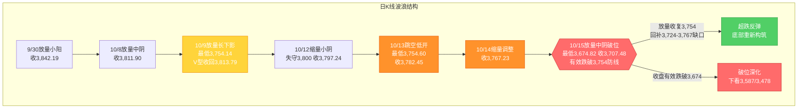
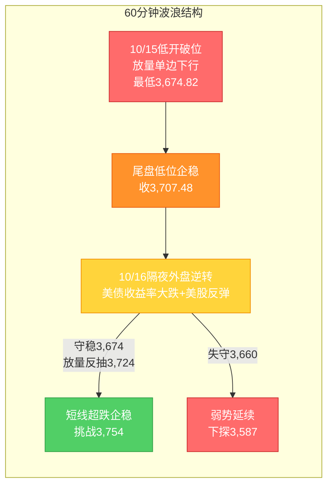

# A股晨报 - 2026年10月16日

> 数据截止时间：2026年10月16日 09:00（北京时间）；美股/欧洲为10月15日收盘，亚太/港股为10月15日收盘，大宗商品/汇率为10月15日盘后至10月16日盘前，A股为10月15日收盘数据
> 报告性质：**国庆长假后首个完整交易周（第42周）周五（10/16）晨报 · 期指交割日** —— 以 **10/15晚报复盘结论 + 10/15实际行情（放量破位）** 为基础 + **隔夜美股大逆转（道指+1.08%、美债收益率集体大跌）** + 今日盘前前瞻
> 核心观点：**10/15 A股"低开低走、放量破位"**：上证指数**收3,707.48点（-1.59%）**、深证成指-2.43%、创业板指**-2.92%**、科创50-1.50%、万得全A-2.28%；两市成交**约1.633万亿元（放量2,186亿元）**，主力资金**全天净流出544.47亿元**，**超5,100只个股下跌**。**关键事件：沪指收盘有效跌破"最后防线"3,754点，盘中最低下探3,674.82点（逼近"924"行情高点3,674点核心支撑）后小幅回收。"缩量磨底"结构证伪、日线转入"C浪延伸破位"。** **隔夜（10/15美东）重大变量出现"逆转"**：**美国9月PPI同比+6.3%（预期5.4%、创2022年12月来最高）、零售销售环比+0.8%（超预期）**，但**美债收益率集体大幅回落（10年期-12.60bp报5.062%、2年期-6.20bp）**，**美元指数纽约尾盘-0.54%报101.97**，**美股三大指数全线收涨（道指+1.08%、标普+0.33%、纳指+0.08%）**，**科技股触底反弹、中概股走强（金龙指数+1.96%）**，**COMEX黄金+2.06%、白银+3.09%**。**叠加国内"回购潮 + 三季报预增潮 + 宽基ETF尾盘放量护盘（1500多只ETF成交近2,166亿、放量近57%）"，今日上证大概率【震荡企稳 / 超跌反弹尝试】，区间参考3,674-3,790点，核心观察3,674点（"924"行情高点/核心支撑）能否守住、3,754点（原"最后防线"转压力）能否放量收复；"美债收益率回落 + 美元走弱"对全球科技成长与贵金属形成边际利多，但需警惕期指交割日（10/16）量能扰动与破位后的反抽力度有限。**

---

## 一、昨日晚报复盘要点回顾

> 说明：基于**10/15晚报（`report/20261015/evening_report_20261015.md`）复盘结论**，并结合**10/15实际行情**（放量破位）进行动态修正。

### 1. 昨日判断回顾
- **趋势判断准确率：100%（1/1）**——晚报预判"看跌/震荡偏弱"，实际"低开低走-1.59%"，方向命中，但跌幅与结构（防守资产）判断显著偏差
- **点位预测准确率：约33%（1/3）**——区间✗（预测3,730-3,800，实际3,674.82-3,724.56）、强支撑✗（3,754被有效跌破）、强压力✓（3,833未触及）
- **板块预判准确率：约44%（4/9）**——看涨5项仅"银行/高股息"命中；看跌4项命中3项（算力硬件/半导体/贵金属）
- **综合准确率：约50%**——方向正确，但幅度与"防守资产（白酒/大金融）"结构误判

### 2. 关键偏差及原因
- **偏差1（核心）**：**点位区间与"最后防线"判断偏差**——低估隔夜"美国CPI超预期 + 亚太科技市场熔断级暴跌（韩KOSPI-7.57%、日经-4.90%、SK海力士-11%）"的外溢冲击强度，高估"央行净投放 + 红利护盘"的托底力度
- **偏差2（核心）**：**成交量预判偏差**——沿用"CPI冲击→观望缩量"规律，忽视"跌破关键防线→恐慌盘+止损盘集中释放→破位放量"机制
- **偏差3（核心）**：**板块结构偏差**——看涨清单中"油气/油运/煤炭/交通/传媒"全部落空，实际领涨为"白酒（食品饮料）+ 大金融（券商/保险/银行）"防御护盘

### 3. 沉淀的规则/检查项（本次直接应用）
- **规则1（趋势分析）**：当外盘"CPI超预期→美债/美元走强"且亚太科技市场（韩股/日经）出现熔断级暴跌时，A股科技链当日大概率放量杀跌、关键防线易被有效跌破，不宜以"国内政策对冲/红利护盘"低估跌幅（10/15）
- **规则2（板块选择）**：放量下跌/破位日，前期涨幅较大的强势趋势股（如海运/油气）易遭"获利了结+补跌"，而"白酒/大金融（券商/保险/银行）"因防御属性与护盘资金逆势走强——破位日应优先配置"低拥挤度防御"而非"高位趋势股"（10/15）
- **规则3（资金面分析）**：关键防线"有效跌破日"通常伴随"放量"（恐慌盘+止损盘释放）而非缩量；预判"看跌/可能破位"时成交量应设"破位放量"情景（10/15）
- **规则4（点位计算）**：20月均线等"最后防线"收盘有效跌破后，该防线转为上方压力，下方支撑应下移至"前期平台高点/整数关口"（如"924"行情高点3,674点）及更低心理关口（3,587/3,478）（10/15）
- **规则5（波浪分析）**：C浪延伸末段若出现"放量中阴收盘有效跌破'最后防线'且跌破黄金分割1.236延伸目标"，则"磨底"结构证伪、转为"C浪延伸破位"，此后多周期易形成"向下共振"，操作级别应转为"防守/反弹减仓"（10/15）
- **规则6（风险识别）**：当单日"指数下跌 + 超5,000只个股下跌（占比>90%）+ 主力资金净流出超500亿"同时出现时，属"普跌型放量杀跌"，市场宽度极度恶化，应控制仓位、等待"缩量企稳"信号（10/15）

### 4. 对今日（10/16）分析的启示
- **需要关注的风险点**：①**3,674点（"924"行情高点/核心支撑）**成为破位后下一道防线，10/15盘中最低3,674.82点已"贴线"获支撑，需观察能否守住；②**期指交割日（10/16）**量能或有扰动，警惕交割日尾盘异动；③**三季报密集披露**（高位成长股业绩验证压力）；④**10月全月解禁约3,047亿元**、本日11家解禁约37.98亿元
- **需要调整的分析逻辑**：①**隔夜外盘由"杀科技"转为"大逆转"**——美债收益率集体大跌、美元回落、美股反弹，**"利率弹性反向"规则转为利多科技成长与贵金属**，应适度上修科技链/贵金属的短线预期；②**国内"回购潮+三季报预增潮+宽基ETF放量护盘"密集**，情绪面出现"主动护盘"信号；③破位后短线以"**超跌反弹 + 量能绑定**"为主，**不预设趋势反转**，仍以"缩量企稳 + 放量收复原防线"为加仓前提

---

## 二、隔夜市场动态（10/15收盘至10/16开盘）

### 1. 美股市场（10月15日 周三收盘）

| 指数 | 收盘点位 | 涨跌幅 | 说明 |
|------|---------|--------|------|
| 道琼斯工业指数 | **52,177.69** | **+1.08%（+556.21点）** | **大逆转、领涨**（耐克+超5%、赛富时+逾4%） |
| 标普500指数 | **7,744.06** | **+0.33%（+25.12点）** | 温和反弹 |
| 纳斯达克综合指数 | **26,713.03** | **+0.08%（+20.16点）** | 高位承压后微涨、**科技股触底反弹** |

**（1）结构分化：传统蓝筹强劲反弹 vs AI芯片链深度回调**
- **道指大涨近500点、纳指高位承压**——**"道指领涨、纳指滞涨"的极致分化**，资金由"AI芯片链"转向"传统蓝筹/防御"
- **大型科技股多数下跌**：**英伟达-近2%、特斯拉-超1%、苹果-0.28%、脸书-0.11%**；**微软+超1%、谷歌+0.45%、亚马逊+0.27%**
- **存储芯片股普跌**（存储链延续弱势）；**CoreWeave 5年期CDS利差创历史新高（1194.5bp）**、部分债收益率升至15%-16%，**英伟达CEO黄仁勋出面"灭火"**

**（2）上涨催化：美债收益率集体大跌 + 美元回落 + 通胀数据"利空出尽"**
- **美国9月PPI：同比+6.3%（预期5.4%、前值修正后）、创2022年12月以来最高；环比+1.3%（2022年3月以来最大涨幅）**——能源价格飙升驱动
- **美国9月零售销售：环比+0.8%（预期0.4%），但除燃油外多项核心消费支出录得负增长**——通胀挤压效应蔓延
- **美国上周初请失业金：19.9万人（预期20万），徘徊于57年低位**；续请171万（2023年3月以来最低）；**纽约联储10月制造业景气指数大幅攀升17.9点至25.5（近五年最强）**
- **关键传导（与CPI日相反）**：**数据公布后美债收益率集体直线下挫**——**2年期-6.20bp报4.736%、5年期-10.90bp报4.878%、10年期-12.60bp报5.062%、30年期-11.50bp报5.407%**；**美元指数纽约尾盘-0.54%报101.97**（一年多新高后显著回落）

**解读**：隔夜外盘呈**"道指领涨、纳指滞涨、美债收益率大跌"的"资金再平衡 + 利率见顶交易"结构**——**PPI/零售数据虽超预期，但美债收益率不升反大跌（交易"通胀见顶/加息预期摆动"），美元回落、资金由AI芯片链转向传统蓝筹/防御**。**净影响：外盘对A股呈"科技链边际利空缓解（美债收益率回落 + 美股反弹）、贵金属利多（金价大涨）、防御蓝筹相对占优"的映射方向，较10/15隔夜的"定向利空科技链"明显缓和。**

### 2. 欧洲/亚太市场（10月15日）

| 市场 | 表现 | 备注 |
|------|------|------|
| **韩国KOSPI** | **-7.57%（收5,554.22点）** | **韩国创业板指数-7.65%；盘中均跌超8%触发熔断（今年第10次）**；**爱德万测试-近15%、铠侠-超12%、SK海力士-11%、三星电子/软银-超9%**；韩国金融委员会紧急开会 |
| **日经225** | **-4.90%（收64,425.95点）** | 半导体/科技崩盘拖累 |
| **恒生指数** | **-1.03%（收24,062.72点）** | 半导体/AI主题领跌、海运乏力 |
| **恒生科技指数** | **-2.72%（收4,060.99点）** | **联想集团-超14%、天数智芯-超13%**；创本轮调整新低 |
| 恒生国企指数 | -0.98%（收8,103.27点） | **银行板块走强（工商银行/建设银行/农业银行再创新高）**；南向资金净卖出超50亿港元 |
| 德国DAX / 法国CAC40 / 英国富时100 | +0.33% / +0.78% / +1.08% | 英国8月GDP超预期；**资金涌入医药、电信等防御性板块**；欧洲斯托克50 -0.36% |

**情绪判断**：**亚太科技市场10/15出现"熔断级"暴跌（韩股-7.57%、日经-4.90%）**——这正是A股10/15科技链放量杀跌的**核心外因**，且**A股/港股已于10/15当日充分反映**；**欧洲市场则因"防御板块+债市收益率回落"全线上涨**，资金再平衡特征明显。

### 3. 大宗商品

| 品种 | 价格/表现 | 涨跌/驱动 |
|------|----------|----------|
| WTI原油（10/15） | **97.55美元/桶** | **+2.59%（反弹）**；但供应端缓解预期（特朗普考虑放松"影子船队"制裁、美国游说盟友释放1亿桶原油、西班牙释放440万桶）压制上行 |
| 布伦特原油（10/15） | **105.69美元/桶** | **-0.35%**；霍尔木兹海峡通行风险反复 |
| COMEX黄金期货（10/15） | **4,192.50美元/盎司** | **+2.06%（大涨）**；通胀超预期+地缘避险+央行购金共振 |
| COMEX白银期货（10/15） | **57.60美元/盎司** | **+3.09%（大涨）** |
| 现货黄金（10/15） | 约4,167.24美元/盎司 | -0.08%（高位盘整） |
| LME铜（10/15） | 14,309美元/吨 | **-1.25%** |
| LME铝 / 锌 / 镍 / 铅 / 锡 | 2,987.5 / 3,673.5 / 15,250 / 1,887 / 50,415 | 基本金属多数下跌（铝持平、锌-1.21%、镍-1.68%、铅-0.50%、锡-0.06%） |

**驱动逻辑**：①**黄金/白银大涨（通胀超预期 + 地缘避险 + 央行购金）**——**利多A股贵金属/黄金股**（此前连续承压）；②**油价"WTI反弹、布油回落"分化**——供应端缓解预期（IEA拟释放超2,000万桶柴油、美国游说释放原油）压制油价趋势，**对A股油气/油运由前期正向催化转为中性偏空**；③**铜等工业金属下跌**——压制A股有色/资源。

### 4. 汇率与利率

| 指标 | 数值/表现 | 变化/说明 |
|------|----------|----------|
| 美元指数（10/15纽约尾盘） | **101.97** | **-0.54%（一年多新高后显著回落）**；利多人民币与成长股 |
| 离岸人民币（10/15纽约尾盘） | **6.6894** | **+66个基点（走强）** |
| 在岸人民币（10/15 16:30） | **6.6916** | +9个基点（偏强） |
| 人民币中间价（10/15） | **6.7253** | 下调4个基点 |
| 10年期美债收益率（10/15） | **5.062%** | **-12.60个基点（大幅回落）**；**利多高估值成长与贵金属** |
| 中国10年期国债收益率（10/15） | 1.645% | 小幅下行 |
| Shibor（隔夜/7天） | 1.266% / 1.346% | 小幅走低，资金面平稳 |

**特征**：①**美债收益率集体大跌 + 美元回落**——**"利率弹性反向"规则方向反转**，**对A股科技成长（半导体/CPO/存储）与贵金属由"压制"转为"边际利多"**；②**人民币延续偏强（离岸6.6894、在岸6.6916）**——稳汇率预期延续，对A股资金面构成**边际正面**；③**中债收益率低位（10年1.645%）**——国内流动性宽松延续。

### 5. 海外重要事件
- **美国9月PPI同比+6.3%（超预期）**、零售销售+0.8%（超预期），**但美债收益率不升反大跌**——"通胀见顶/利率见顶"交易升温
- **美股大逆转**：道指+1.08%、标普+0.33%、纳指+0.08%；**纳斯达克部分交易一度中断**（技术性波动）
- **台积电Q3业绩创纪录**：营收1.49万亿新台币（+50.9%）、净利7,631亿新台币（+68.7%），**连续六个季度创新高**；**上调全年营收增速预期至约44%**
- **EPFR**：纽交所上市股票未平仓卖空数量环比+2.7%、首破210亿股创纪录，**或为反向看涨信号**
- **地缘**：中东冲突（霍尔木兹海峡/红海扰动）反复；特朗普考虑放松"影子船队"油轮制裁

---

## 三、今日关注事项

### 1. 重要数据发布 / 政策（按时间排序）
- **国内**：**央行行长潘功胜在G20财长会议表示"将继续实施好适度宽松的货币政策"**；**财政部部长蓝佛安表示"精准有效实施更加积极的财政政策"**——政策基调偏暖
- **国内数据**：9月公路物流运价指数环比回升0.14%；**外商直接投资权益存量连续6年增长**；跟踪9月社融/信贷/M2、9月CPI/PPI发布窗口
- **美国**：关注后续官员表态；**10/28 FOMC**为关键窗口（CME FedWatch加息概率 + 美债收益率为跟踪核心）
- **关税/经贸**：跟踪**中美关税博弈**（11月1日决定、10月底APEC为关键窗口）；**商务部称若以"产能过剩"为借口损害中方利益，将坚决必要回应**

### 2. 三季报披露（密集期 · 预增潮延续）
- **10/15晚间预增潮持续**：**江波龙**（净利+1864.55%-1990.84%）、**恒逸石化**（+3318.59%-3405.13%）、**赣锋锂业**（+19541%）、**海光信息**（+38.16%-51.93%）、**光迅科技**（+65.37%-82.26%）、**大族数控**（+214.03%）、**大族激光**（+145.55%-157.13%）、**亿纬锂能**（+80%-90%）、**中科曙光**（+78.48%）、深南电路、睿创微纳；**沐曦股份**前三季度扭亏（营收+105.60%-151.29%）
- **风险提示**：**仍需警惕高位成长股业绩不及预期风险**（存储龙头江波龙"净利大增但存储涨价边际趋缓"，股价年内已从高点回撤67%）

### 3. 公司公告（回购潮 + 增持密集）
- **拟回购**：**新易盛**（8-10亿）、**佰维存储**（2-2.5亿并注销）、**鹏鼎控股**（3-5亿）、**天孚通信**（1-1.5亿）、**长芯博创**（2-3亿）、**拓荆科技、长川科技、温氏股份**
- **中际旭创**：拟注销50亿元回购股份；**沪电股份**：控股股东提议2026年度现金分红不低于22亿元
- **风险公告**：***ST萃华**：深交所决定终止公司股票上市；汇金股份、奥拓电子、金龙汽车等涉诉讼/仲裁

### 4. 限售股解禁
- **10/16：共11家公司限售股解禁，合计解禁量7,079.12万股，解禁市值约37.98亿元**（**三协电机、中超控股、国泰环保**解禁量居前）
- **10月全月**解禁约**3,047亿元（环比+62.82%）**，电子、公用事业、煤炭方向需持续跟踪

### 5. 新股 / 可转债 / 其他关注
- **新股上市**：**南方乳业（920196）**于10/16登陆北交所（发行价14.21元/股，市盈率11.99倍，募资约5亿元）
- **可转债**：**中科转债（123289）**今日申购；**新股路演**：皇冠新材（001381）
- **交易安排**：第42周（10/12-10/16）5个完整交易日；**期指交割日为10/16（本周五）**，量能或有扰动
- **ETF护盘信号**：**10/15股票型ETF成交额大增（1500多只ETF成交近2,166亿元、较前一日放量近57%）**，多只宽基ETF尾盘放量（**沪深300ETF易方达成交超194亿元、环比放大近23倍**）

---

## 四、板块与个股分析（结合10/15复盘与隔夜冲击）

### 1. 基于10/15行情的板块调整
- **10/15强势板块今日预期**：①**白酒/食品饮料**——防御属性+护盘资金，**延续护盘主线**；②**大金融（券商/保险/银行）**——避险+类固收防御+"牛市旗手"异动，**10/15尾盘护盘（券商/五大行/半导体龙头拉升）**；③**电信/高股息**——防御+高股息
- **10/15领跌板块今日预期**：①**海运/航运港口**——前期大涨后"获利了结+补跌"（**招商轮船/中远海能/招商南油跌停**），叠加**油价供应缓解预期**，**延续承压**；②**通信设备/半导体/存储/CPO**——**隔夜"美债收益率大跌 + 美股科技反弹 + 台积电超预期"**，**边际利空缓解、或迎超跌反弹**（但需量能确认）；③**玻纤/培育钻石/油气**——高位补跌+油价回落
- **偏差板块修正逻辑**：**成长股（创业板/科创）连续下探**→**下调科技成长整体优先级但"超跌反弹"可择机参与**；**白酒/大金融**→**正式纳入核心防御/看涨清单**

### 2. 隔夜信息驱动的板块机会
- **受益板块**：
  - （1）**贵金属 / 黄金股**（逻辑：**COMEX黄金+2.06%、白银+3.09% + 美元回落 + 地缘避险**；此前连续承压后反转）
  - （2）**存储 / 半导体 / 算力硬件**（逻辑：**台积电Q3创纪录、上调全年指引 + 江波龙业绩暴增 + 美债收益率回落 + 回购潮 + ETF护盘**，**超跌反弹**）
  - （3）**白酒 / 食品饮料**（逻辑：防御+护盘属性延续）
  - （4）**大金融（券商/保险/银行）**（逻辑：避险+护盘+"牛市旗手"券商异动）
  - （5）**三季报业绩预增股**（逻辑：业绩驱动，赣锋锂业/海光信息/亿纬锂能/光迅科技/大族激光等）
- **受损板块**：
  - （1）**海运 / 航运港口 / 油运**（逻辑：**前期强势股获利了结+补跌 + 油价供应缓解预期**）
  - （2）**石油石化 / 油气**（逻辑：**油价供应端缓解预期（IEA释放储备、美国游说释放原油）、布油回落**）
  - （3）**培育钻石 / 玻璃纤维**（逻辑：高位补跌延续）
  - （4）**有色 / 工业金属（铜/镍/锌）**（逻辑：LME铜-1.25%、镍-1.68%，外盘下跌映射）

### 3. 重点关注个股
- **贵金属/黄金股（山东黄金、中金黄金、紫金矿业等）**：关注理由=**COMEX金价大涨+美元回落+地缘避险**；技术位置=前期回调后企稳
- **存储/半导体龙头（江波龙、海光信息、光迅科技等）**：关注理由=**三季报暴增+台积电超预期+美债收益率回落+回购潮**
- **白酒/大金融（贵州茅台、山西汾酒、华林证券、中国平安、五大行）**：关注理由=**防御+护盘+牛市旗手**
- **回购/分红概念（新易盛、佰维存储、中际旭创、沪电股份）**：关注理由=**"真金白银"护盘**
- **回避/谨慎**：海运/油运/油气（前期强势补跌）、培育钻石/玻纤、高位连板股、大额解禁个股、三季报不及预期的高位成长股、退市风险股（*ST萃华）

---

## 五、今日核心判断（结构化输出，用于晚报复盘）

### 1. 趋势判断
- **上证指数：【震荡企稳 / 超跌反弹尝试（低开后修复）】**
- **预测区间：3,674点 - 3,790点**（下探容错区间3,674±30点，极端下沿3,587点）
- **核心逻辑**：**隔夜外盘"大逆转"——美债收益率集体大跌（10年期-12.60bp）、美元回落（-0.54%）、美股全线反弹、黄金大涨**，与10/15隔夜的"CPI冲击→杀科技"方向相反，**对A股科技链（半导体/存储/CPO）的"定向利空"明显缓解、对贵金属转为利多**；叠加**国内"回购潮 + 三季报预增潮 + 宽基ETF尾盘放量护盘"**密集释放积极信号。**但10/15已放量破位（跌破3,754防线）、市场宽度极度恶化（超5,100只下跌），叠加期指交割日（10/16）量能扰动，反弹力度或有限**。**综合看：低开后有望在3,674点（"924"行情高点/核心支撑）附近企稳并尝试反抽3,754点，能否放量收复3,754点为短线强弱分水岭。**

### 2. 关键点位
- **强支撑位：3,674点**（依据：**"924"行情高点/前期平台核心支撑；10/15盘中最低3,674.82点已"贴线"获支撑，收盘有效跌破则破位深化**）
- **弱支撑位：3,660点 / 3,587点**（依据：短线均线支撑、黄金分割下移目标位3,587点）
- **强压力位：3,754点**（依据：**原"最后防线"，10/15收盘有效跌破后转为上方压力**；放量收复为短线转强前提）
- **弱压力位：3,724.56点 / 3,767点**（依据：**10/15盘中高点3,724.56点（缺口下沿）、3,767点（缺口上沿/前收）**）；次级压力**3,800点（20月均线）**、**3,842点（C浪低点反压）**

### 3. 板块预判
- **看涨板块**：（1）**贵金属/黄金股**（逻辑：COMEX金价+2.06%、白银+3.09%+美元回落+地缘避险）（2）**存储/半导体/算力硬件**（逻辑：台积电超预期+江波龙业绩暴增+美债收益率回落+回购潮，超跌反弹）（3）**白酒/食品饮料**（逻辑：防御+护盘）（4）**大金融（券商/保险/银行）**（逻辑：避险+护盘+"牛市旗手"异动）（5）**三季报预增股**（逻辑：业绩驱动）
- **看跌板块**：（1）**海运/航运港口/油运**（逻辑：前期强势股获利了结+补跌+油价供应缓解）（2）**石油石化/油气**（逻辑：油价供应端缓解预期、布油回落）（3）**培育钻石/玻璃纤维**（逻辑：高位补跌延续）（4）**有色/工业金属**（逻辑：LME铜/镍/锌下跌映射）
- **风险板块**：①**三季报或不及预期的高位成长股**；②**大额解禁个股**（电子/公用事业/煤炭方向）；③**高位连板股**（获利回吐）；④**退市风险/ST个股**（*ST萃华终止上市）；⑤**期指交割日尾盘异动**（资金博弈）

### 4. 资金面判断
- **北向资金预期：【结构性分化 / 小幅净流入倾向】**（依据：交易所已不实时披露净额，**以成交口径跟踪**；**美元回落+人民币偏强+美股反弹**或边际改善外资风险偏好）
- **成交量预期：【平量 / 温和放量】1.5 - 1.75万亿元**（依据：**宽基ETF尾盘放量护盘（成交近2,166亿、放量57%）+ 回购潮提振情绪**，但**破位后观望情绪仍存**；**参照10/15规则"跌破关键防线→破位放量"，今日若企稳则量能或温和放大，若续跌则需防再度放量**）

### 5. 风险预警（按优先级排序）
- **高风险**：①**3,674点（"924"行情高点/核心支撑）有效性**——若收盘有效跌破，则破位深化、下看3,587点及3,478点；②**期指交割日（10/16）**量能扰动、尾盘异动风险；③**三季报密集披露**，高位成长股业绩不及预期风险
- **中风险**：①**亚太科技股崩盘（韩熔断）余波**——虽隔夜美股反弹，但科技链情绪修复需时间；②**主力资金净流出延续**（10/15净流出544.47亿）——"护盘≠资金转多"；③**美债10Y虽回落但仍处约5%上方（近20年高位）**，压制高估值成长与贵金属的反弹空间
- **低风险**：①**中东地缘（油价波动）**——利空油气但加剧全球风险偏好波动；②**10月解禁3,047亿**、本日11家解禁37.98亿元；③**高位连板股**获利回吐风险

### 6. 昨日复盘规则应用
- **应用规则1（"外盘冲击→AI链整体下调"·10/15）**：**隔夜外盘已由"杀科技"转为"大逆转"**（美债收益率大跌、美股反弹），**该规则今日方向反转**——A股科技链**转为"边际利空缓解、超跌反弹"**，但仍以"量能放大"为确认前提
- **应用规则2（"破位日高位趋势股补跌"·10/15）**：**海运/油运/油气等前期强势股**在破位日易"获利了结+补跌"，**今日继续回避**；**优先配置"白酒/大金融"低拥挤度防御**
- **应用规则3（"关键防线有效跌破→放量"·10/15）**：**3,754已被有效跌破**，**今日成交量须设"企稳温和放量 vs 续跌破位放量"双情景**
- **应用规则4（"防线跌破转压力"·10/15）**：**3,754点转为上方压力**，**下方支撑下移至"924"行情高点3,674点**——今日核心观察**3,674点支撑与3,754点压力**的攻防
- **应用规则5（"磨底证伪→向下共振"·10/15）**：**多周期已形成"向下共振"**，**今日操作以"超跌反弹（防守性）"为主、不预设趋势反转**，需"缩量企稳 + 放量收复3,754"双重信号
- **应用规则6（"普跌型放量杀跌→控仓等待"·10/15）**：**10/15属普跌型放量杀跌**，**今日应控制仓位、等待"缩量企稳"信号，避免追高**

---

## 六、波浪理论多周期分析

> 说明：基于10/15实际K线结构更新。**10/15放量中阴（沪指-1.59%收3,707.48），收盘有效跌破"最后防线"3,754点、盘中最低3,674.82点（逼近"924"行情高点3,674点核心支撑），"缩量磨底"结构证伪，日线转入"C浪延伸破位"。** 结合隔夜"美债收益率大跌 + 美股大逆转"推演今日（10/16）路径。

### 1. 月K线波浪分析
- **当前波浪位置**：大周期**第2浪C浪延伸"破位下行"阶段**（"磨底"结构证伪）。10月月K线现为**"中阴破位"**——10/15收3,707.48点，**处20月均线（约3,800点）下方约93点**，**月内低点刷新至3,674.82点**（低于10/9的3,754.14点），为**连续第三个月调整、且破位下行**
- **浪型结构描述**：2024年9月2,689点→2026年6月4,197点为**第1浪上升**；第2浪ABC调整：4,197点→3,754.14点（10/9）；10月呈"10/8放量中阴→10/9长下影V型收回→10/12失守3,800→10/13跳空低开探底3,754.60→10/14缩量调整→**10/15放量破位3,674.82**"；**月线下影（此前）已被证伪，"破位下行"风险显著恶化**
- **关键目标位**：月度下方支撑**3,674点（"924"行情高点/前期平台）**、**3,587点**、**3,478点（心理关口）**；上方压力**3,754点（原"最后防线"，已失守转压力）**、**3,800点（20月均线）**
- **验证条件**：**10月月K线能否在3,674点上方止跌**——若月内继续有效跌破3,674点，则月度下行空间打开（下看3,587/3,478）；**今日为月末下行是否加速的关键一日**

### 2. 周K线波浪分析
- **当前波浪位置**：第42周（10/12-10/16）**第五日（收官承压）**，周K线现为**"中阴/破位"**（周开约3,806.98、周内高3,828.22、周内低**3,674.82**、现收3,707.48）
- **浪型结构描述**：本周为国庆后首个完整交易周，**周线已跌破上周低点（3,754.14）并刷新周内新低（3,674.82）**，**"底部构筑"证伪、转为"下跌中继/延伸"**；周收盘仍处5周/10周/20周/60周均线下方，**短期均线空头排列未改且跌势加速**
- **关键目标位**：周度下方支撑**3,674点**、3,587点；周度压力**3,724点（周内高点/缺口下沿）**、**3,754点（原防线转压力）**、**3,800点**
- **验证条件**：**周五（10/16）能否收出长下影/止跌**——**放量收复3,754点为周线企稳前提**；若继续放量跌破3,674点，则周线破位确认、下周仍偏弱

### 3. 日K线波浪分析（重点）
- **当前波浪位置**：**C浪延伸"破位下行"确认**——10/15放量中阴（-1.59%），**收盘3,707.48点有效跌破"最后防线"3,754点**，**10/9、10/13、10/14的"双底/抬升"雏形被证伪，磨底失败、转入破位下行**；**但盘中最低3,674.82点恰好触及"924"行情高点3,674点核心支撑后小幅回收，显示该位置存在承接**
- **浪型结构描述**：9/30收3,842.19→10/8放量中阴收3,811.90→10/9放量长下影小阳收3,813.79（低3,754.14）→10/12缩量小阴收3,797.24→10/13跳空低开收3,782.45（低3,754.60）→10/14缩量调整收3,767.23→**10/15跳空低开（开3,710.70）→放量中阴收3,707.48（低3,674.82）**；**低点序列"3,754.14→3,754.60→3,674.82"打破"抬升"格局、再创新低**，**日线转弱确认**
- **关键目标位**：**下方支撑**：**第一支撑3,674点（"924"行情高点/前期平台，10/15盘中已验证承接）**、**第二支撑3,587点**、**第三支撑3,478点**；**上方压力**：**3,724.56点（10/15高点，缺口下沿）**、**3,754点（原防线，转压力）**、**3,767点（缺口上沿）**、**3,800点（20月均线）**
- **验证条件**：
  - **向上修复**：**放量收复3,754点并回补3,724.56-3,767.23缺口** → 超跌反弹、底部重新构筑
  - **向下确认**：**收盘有效跌破3,674点** → 破位深化，下看3,587点及3,478点
  - **今日变量（10/16）**：隔夜"美债收益率大跌 + 美股大逆转 + 黄金大涨" → **A股情绪面边际改善、低开企稳概率上升**；**国内回购潮+ETF护盘** → 提供托底力量；但**期指交割日（10/16）**量能扰动，需观察**3,674点支撑与3,754点反抽力度**

### 4. 60分钟K线波浪分析
- **当前波浪位置**：60分钟级别**"放量破位后低位企稳"**，短线维持"弱势待修复"
- **浪型结构描述**：60分钟10/15呈"低开→单边下行→尾盘低位企稳"，**放量杀跌**；60分钟MACD低位、KDJ低位钝化，量能显著放大，**需观察今日能否放量反抽**
- **关键目标位**：短期支撑**3,674点、3,660点**；短期压力**3,724点、3,754点**
- **验证条件**：**今日首两个小时能否守稳3,674点并放量反抽3,724点**——守稳则短线超跌企稳，跌破3,660则弱势级别降级、下看3,587

### 5. 30分钟K线波浪分析
- **当前波浪位置**：30分钟级别**"放量下探、尾盘企稳"**，短线动能偏弱但存反弹契机
- **浪型结构描述**：30分钟10/15尾盘在3,690-3,710区间出现**小幅企稳迹象**，量能集中于下跌段；**MACD低位、KDJ超卖，存在超跌反弹条件**
- **关键目标位**：关键支撑**3,674点、3,660点**；短期压力**3,710点、3,724点**
- **验证条件**：**30分钟能否在3,674-3,710区间缩量企稳并放量突破3,710**，否则维持弱势震荡、下探3,660

### 6. 波浪图（Mermaid绘制）

**日K线波浪结构图**：

**60分钟波浪结构图**：

### 7. 波浪理论综合判断

| 维度 | 判断 |
|------|------|
| 多周期共振状态 | **月/周/日/60分钟/30分钟仍处"向下共振"**——日线有效跌破"最后防线"3,754、周线跌破上周低点并创新低、月线月内低点刷新；**但30分钟/60分钟在3,674点获承接、KDJ超卖，叠加隔夜外盘逆转，存在"超跌反弹"的短线修复窗口** |
| 当前操作级别 | **日线级别（防守/超跌反弹）**（3,674点为"924"行情高点/核心支撑，3,587/3,478为下移目标；3,754为被跌破的原防线、转反抽压力） |
| 后续演变路径（10/16及下周） | **40%乐观**（超跌反弹：隔夜外盘逆转+回购潮+ETF护盘→守稳3,674、放量收复3,754并回补缺口→底部重新构筑）、**40%中性**（3,674-3,754区间弱势震荡、缩量整理、题材轮动）、**20%悲观**（外盘反复/科技链续杀跌→收盘有效跌破3,674，下看3,587/3,478） |
| 关键拐点信号 | 向上：**放量收复3,754点并回补3,724.56-3,767.23缺口** + 主力资金转净流入 + 科技链（半导体/存储/通信设备）止跌；向下：**收盘有效跌破3,674点** + 外盘/亚太科技续跌 + 量能持续放大 |
| 风险提示 | ①**3,674点（"924"行情高点/核心支撑）有效性为今日第一观察点**，若收盘有效跌破则破位深化；②**隔夜外盘"大逆转"（美债收益率大跌+美股反弹+黄金大涨）为今日核心边际利多**，但**美债10Y仍处约5%上方**，反弹空间受限；③**期指交割日（10/16）量能扰动**，警惕尾盘异动；④**市场宽度极度恶化（超5,100只下跌）后情绪修复需时间**，反弹或呈"结构性、防御性"；⑤波浪理论在"C浪延伸破位+超跌反抽"阶段预测精度降低，需结合量能、外盘与政策面综合判断 |

> **规律分析引用（第41周运行规律分析，周日10/11生成）**：该报告预测第42周（10/12-10/16）上证运行区间**3,730-3,880点**，判断"**震荡偏弱（低开修复、先抑后扬）**"，乐观/中性/悲观概率**30%/45%/25%**，并强调"**3,800点（20月均线）为最后防线、3,842点为信号确认位**"。**本周前四日（10/12-10/15）实际运行（3,674.82-3,828.22、收3,707.48）——10/15盘中最低3,674.82已跌破预测区间下沿3,730点，悲观情景（跌破3,754并下看）兑现**；本报告据此**将"缩量磨底/弱势整理"主基调下调为"破位后超跌反弹（防守性）"，并结合隔夜外盘逆转将乐观概率上调至40%、中性40%、悲观下调至20%**。

---

## 七、投资策略建议（分短线+中线）

### 1. 短线策略（1-3个交易日）
- **适用场景**：基于日K线和60分钟K线技术信号
- **短线仓位：10-15%**（**较上一日微升**——隔夜外盘逆转+回购潮+ETF护盘，**可小仓参与超跌反弹，但不宜追高**）
- **买入条件**：①**指数守稳3,674点并放量反抽3,724点（缺口下沿）以上**后低吸；或②**贵金属/黄金股、三季报预增股、存储/半导体龙头**在企稳不破关键位时低吸；**所有买入以"量能放大"为前置**；**回避海运/油运/油气等前期强势补跌股**
- **卖出条件**：指数反弹至**3,754-3,767点压力区滞涨**、或量能萎缩、或**收盘跌破3,674点**
- **止损位：3,674点**（收盘有效跌破则止损）或个股跌幅7%
- **短线标的**：（1）**贵金属/黄金股**（逻辑：COMEX金价+2.06%+美元回落+地缘避险）（2）**存储/半导体龙头**（逻辑：台积电超预期+江波龙业绩暴增+美债收益率回落，超跌反弹）（3）**三季报预增股**（逻辑：业绩驱动，赣锋锂业/海光信息/亿纬锂能等）（4）**白酒/大金融**（逻辑：防御+护盘）——**回避**海运/油运/油气、培育钻石/玻纤、高位连板股、大额解禁个股

### 2. 中线策略（1-4周）
- **适用场景**：基于周K线波浪分析和运行规律分析结论
- **中线仓位：15-20%**（**维持偏防御**——破位特征下不宜大幅加仓，**待放量收复3,754/站稳3,800点**再上修）
- **方向判断：【持有 / 观望（偏防御）】**
- **目标区间**：上证指数 **3,674点 - 3,800点**
- **中线布局板块**：（1）**贵金属/黄金股**（逻辑：金价反转+美元回落+地缘避险）（2）**白酒/食品饮料**（逻辑：防御+护盘）（3）**大金融（券商/保险/银行）**（逻辑：避险+护盘+类固收）（4）**存储/半导体（业绩驱动+超跌）**（逻辑：台积电超预期+三季报暴增+美债收益率回落，**待企稳后分批介入**）——**谨慎/回避**：海运/油运/油气（前期强势补跌）、有色/工业金属（外盘下跌）、高位连板股、三季报不及预期的高位成长股
- **止盈条件**：指数到达**3,754-3,800点**或波段涨幅达到X%
- **止损条件**：指数**收盘有效跌破3,674点**（"924"行情高点/核心支撑失守）或趋势确认反转

### 3. 仓位分配总览
| 策略类型 | 仓位比例 | 方向 | 重点板块 |
|---------|---------|------|---------|
| 短线 | 10-15% | 超跌反弹（量能绑定） | 贵金属/黄金、存储/半导体、三季报预增股、白酒/大金融 |
| 中线 | 15-20% | 持有/观望（偏防御） | 贵金属/黄金、白酒/食品饮料、大金融、存储/半导体 |
| 现金 | 65-75% | — | — |

### 4. 与昨日（10/15）策略对比
- **短线仓位调整**：**从5%微升至10-15%**（原因：**隔夜外盘大逆转 + 回购潮 + 宽基ETF放量护盘**，超跌反弹窗口打开，**可小仓参与但以量能为前提**）
- **中线仓位调整**：**维持15-20%**（原因：破位结构未修复，**待放量收复3,754/站稳3,800再加仓**）
- **板块调整**：**上调**贵金属/黄金股（**金价大涨+美元回落**）、存储/半导体（**台积电超预期+三季报暴增+美债收益率回落**）、三季报预增股（**业绩驱动**）；**下调**海运/油运（**前期强势补跌+油价供应缓解**）、油气（**布油回落**）、有色/工业金属（**LME下跌**）；**维持**白酒/大金融（**防御护盘**）
- **操作前提**：**观察量能能否放大、科技链（半导体/存储）能否止跌、外盘（美股期指/亚太）是否延续企稳**；若**放量收复3,754并回补缺口**则按上述布局小幅加仓；若**收盘有效跌破3,674**则降至低仓观望（短线降至5%以下）

---

## 八、信息来源

1. **官方数据来源**：上海证券交易所（上证指数10/15收盘3,707.48、跌幅1.59%、最低3,674.82、最高3,724.56、沪市成交7,743.92亿）、深圳证券交易所（深证成指/创业板指收盘）、中证指数有限公司（科创50/万得全A）、中国外汇交易中心（人民币中间价6.7253）、中国人民银行（G20财长会/公开市场操作）、美国劳工部（9月PPI/零售销售）、美国财政部（Treasury）、香港交易所（恒生指数/恒生科技）、韩国交易所（KOSPI）、东京证券交易所（日经225）
2. **权威财经媒体**：新华社/新华网（纽约股市三大股指15日上涨）、央视财经/央广网（美股三大指数全线收涨；盘前速递10/16）、中国证券报（美股存储芯片股普跌，中国资产上涨；回购潮）、上海证券报·中国证券网（纽约股市三大股指15日上涨；恒生指数收跌1.03%）、证券时报（美股大逆转！科技股触底反弹；揭秘涨停；限售股解禁一览）、每日经济新闻（港股继续回调；江波龙前三季度净利预增最高近20倍）、财联社（A股限售股解禁一览）、第一财经、国际金融报（国际金融要情·10/16）
3. **数据平台**：东方财富（主力资金/北向资金/港股收盘）、同花顺（10jqka）、Wind资讯、新浪财经（国际金融要情）、金融界、中国金融信息网、国金证券/财信证券/粤开证券（券商晨会）
4. **海外信息源**：AP News、Reuters、CNBC、Bloomberg、Nasdaq、EPFR

> 数据截止时间：2026年10月16日 09:00（北京时间）；美股/欧洲为10月15日收盘，亚太/港股为10月15日收盘，大宗商品/汇率为10月15日盘后至10月16日盘前，A股为10月15日收盘数据。

---

*本晨报由AI代理自动生成，仅供参考，不构成投资建议。投资有风险，入市需谨慎。*
