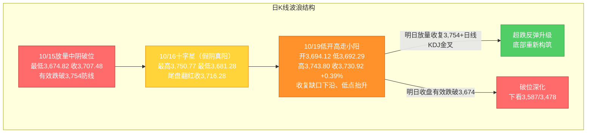
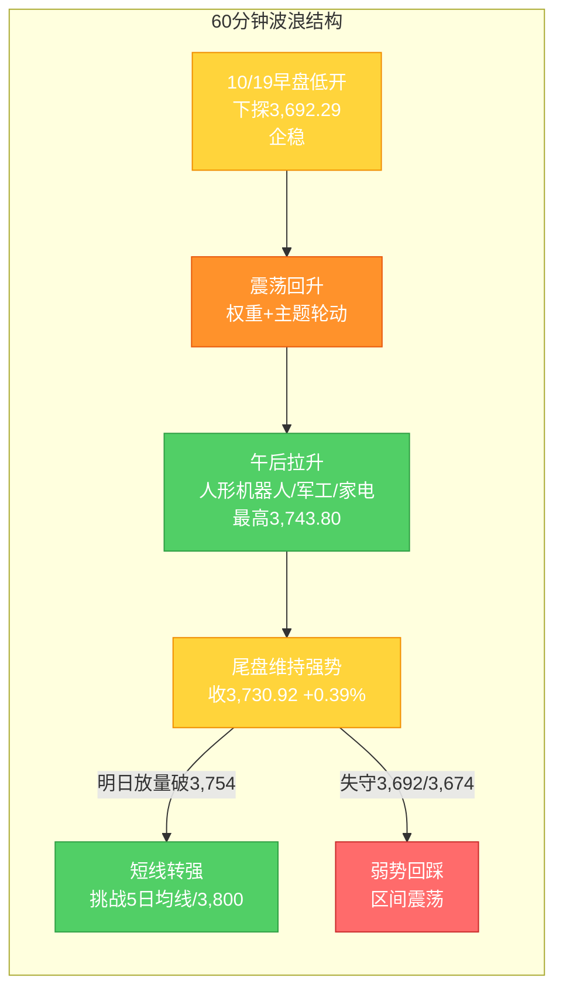

# A股晚报 - 2026年10月19日

> 数据截止时间：2026年10月19日 20:00（北京时间）；A股/港股/亚太为10月19日（周一）收盘，美股/欧洲为10月16日（周五）收盘（隔夜），大宗商品/汇率参考10月16日
> 报告性质：**国庆长假后第二个完整交易周（第43周）开局日** —— 以**今日实际行情 + 多周期波浪理论分析 + 晨报复盘**为框架
> 核心观点：**今日A股"低开高走、指数分化"** —— 上证指数低开3,694.12（-0.60%）→ 探底3,692.29 → 午后在**人形机器人、军工、家电、银行**带动下震荡拉升，最高3,743.80 → 收**3,730.92点（+0.39%）**；**Q3 GDP+4.5%、中美300亿美元"对等降税框架"、九部门"科技兴商"、人形机器人国标、金融街论坛（吴清/潘功胜讲话）**构成催化；但**半导体（费半8连跌映射）、房地产、教育、农林牧渔**领跌，**科创50-2.17%**、**超3,100只个股下跌**，"指数收涨、宽度恶化"的**结构性分化**特征显著。

---

## 一、市场回顾

### 1. 主要指数表现

| 指数 | 收盘点位 | 涨跌幅 | 涨跌点 | 最高 | 最低 |
|------|---------|--------|--------|------|------|
| 上证指数 | **3,730.92** | **+0.39%** | +14.64 | **3,743.80** | **3,692.29** |
| 深证成指 | **11,817.42** | **+0.13%** | +14.96 | — | — |
| 创业板指 | **2,746.29** | **-0.94%** | -26.09 | — | — |
| 科创50 | 约1,350（推算） | **-2.17%** | — | — | — |
| 科创综指 | **1,570.40** | **-0.86%** | — | — | — |
| 中证500 | 约6,800 | **+0.41%** | — | — | — |

> 说明：**上证指数当日开3,694.12（低开-0.60%）→ 最低3,692.29 → 最高3,743.80 → 收3,730.92**，全天呈"**低开探底 → 震荡回升 → 午后拉升**"路径；**科创50领跌宽基（-2.17%）**，中证500领涨（+0.41%）。**"沪强深弱、权重强科技弱"分化延续**。

### 2. 成交量能

| 指标 | 数值/表现 | 说明 |
|------|----------|------|
| 两市成交额 | **约1.45万亿元（14,488亿元）** | **较上一交易日（10/16：约15,690亿）缩量约1,179亿元** |
| 深市（深证成指口径） | 7,504.95亿元 | — |
| 创业板指成交 | 3,563.04亿元 | — |
| 主力资金 | **净流出134.28亿元** | 创业板净流出50.33亿、沪深300成分净流出41.09亿 |
| 主力净流入行业（5个） | **通信（+11.38亿，居首）、轻工制造（+3.59亿）、美容护理、家用电器（均超2亿）** | 结构性流入 |
| 主力净流出行业（26个） | **电力设备（-27.17亿，居首）、电子、传媒、房地产** 等 | 科技/新能源承压 |
| 北向资金 | **交易所已不实时披露净额；以成交口径跟踪** | 近期成交约2,200亿/日、占两市约15%（10/16：2,252.73亿、占14.48%），活跃度维持 |

**量能特征**：**缩量修复**——晨报"平量偏缩（1.4-1.6万亿）"命中；"低开观望 + 结构性轮动"下量能温和萎缩，**反弹仍缺量能配合**。

### 3. 市场情绪

| 指标 | 数值 | 说明 |
|------|------|------|
| 上涨家数 | **2,275只** | 占比约40.9% |
| 下跌家数 | **3,129只** | **"超3,100只个股下跌"** |
| 涨停家数 | **约49只（东方财富口径46只）** | 结构性活跃 |
| 跌停家数 | **约25只** | — |
| 连板情况 | **连板11只、最高3板、连板晋级率约28.57%** | 短线情绪低迷、高度降至3板 |
| 首板封住率 | **约64.6%（31/48）** | 较上日提高约12.2个百分点 |

**情绪特征**：**"指数收涨、个股普跌"的指数失真**——权重（银行）+降税出口链（家电）+主题（人形机器人/军工/汽车）拉动指数翻红，但**市场宽度显著恶化（超3,100只下跌）**，**短线打板情绪低迷（高度降至3板）**，修复基础不牢。

---

## 二、热点板块与异动分析

### 1. 当日领涨板块及驱动因素

| 板块 | 表现 | 驱动因素 |
|------|------|---------|
| **家用电器** | **申万一级涨幅居首（+1.77%）** | **中美300亿美元"对等降税框架"，美方对玩具/家电/婴幼/厨卫/节日礼品等降税**（出口链逻辑） |
| **银行** | **申万一级居次（+1.59%）** | **类固收防御 + 护盘资金**（"稳市"预期，吴清讲话"稳字当头"） |
| **国防军工（航天军工）** | **涨幅居前，地面兵装/航海装备局部强势** | **航空航天博览会催化延续** + 十大军工集团、航母概念活跃 |
| **汽车/汽车零部件** | **汽车零部件板块10股涨停，摩托车、央企汽车活跃** | 政策座谈 + 主题接力 + 央企整合预期 |
| **人形机器人** | **午后集体拉升、领涨两市** | **市场监管总局发布首批六项人形机器人国家标准** + **九部门《加快推进科技兴商的意见》首提"具身智能"落地** |
| **低空经济/飞行汽车** | **保隆科技、京城股份、万丰奥威、文灿股份收获2连板** | 航展余温+新品催化延续 |
| **光通信/PCB** | **亨通光电（三季报大增）盘中涨停，四会富仕、肯特股份、协和电子等涨停** | **光通信"涨价+AI算力需求"+国产替代** |
| **石化/互联网/电脑硬件** | 逆势上涨 | 油价高位（10/16布油破109美元）+ 科技软件服务相对强势 |

**概念板块**：**宇树机器人、减速器、具身智能、中药精选、汽车配件、十大军工集团、央企煤炭、航母、数字孪生**等居前；**新基建/5G应用/华为概念/信创/自主可控**获主力资金净流入（均超50亿）。

### 2. 当日领跌板块及原因分析

| 板块 | 表现 | 原因分析 |
|------|------|---------|
| **半导体** | **拖累科创50（-2.17%）领跌** | **10/16费城半导体指数-3.83%、连续第8个交易日下跌（创2008年以来最长连跌，8日市值蒸发近2万亿美元）**；CoreWeave信用风险发酵、SK海力士/三星"存储双雄"大跌，**AI硬件进入"重定价"** |
| **综合** | **申万一级跌幅居首（-1.94%）** | 高位品种回吐 |
| **房地产** | **-1.57%** | 政策预期兑现回落 + 基本面偏弱 |
| **教育、农业（农林牧渔）、电池、零售、电子元器件、电子化学品、消费电子** | 跌幅居前 | 主题退潮 + 景气验证压力 |
| **电力设备** | 主力资金净流出居首（-27.17亿） | 高位成长资金流出 |

### 3. 个股异动复盘

- **涨停复盘**：**涨停约49只、跌停约25只**；**汽车零部件10股涨停、PCB多股涨停**；**002889、003029 连收3个涨停板**（连板高度3板）。
- **强势股**：**宇树科技（688836）收涨16.15%至495.92元**（盘中最高508.99元、一度涨超17%），**市值重返2,006亿元**，为上市以来除首日外最高单日涨幅，股价跃居A股前十——受**人形机器人国标 + "科技兴商"具身智能政策**双催化。
- **盘中异动**：**人形机器人板块午后"由跌转涨"**——索辰科技临近尾盘20%涨停、四会富仕午后封死"20cm"涨停，兆威机电、浙江荣泰、福莱新材、日盈电子、宁波东力等午后强势涨停。
- **强势股回调/风险**：连板晋级率偏低（28.57%）、高度降至3板，**短线情绪退潮**。

---

## 三、关键数据与事件回顾

### 1. 国内重要经济数据

- **三季度GDP揭晓（10/19 10:00，国新办）**：**2026年前三季度GDP 1,071,071亿元，按不变价同比+4.6%**；**三季度GDP同比+4.5%（二季度+4.3%，增速回升）**；分产业：一产+3.7%、二产+3.8%、三产+5.x%。
- **9月规模以上工业增加值同比+5.5%**（8月+5.2%，1-9月+5.3%），**宏观数据总体改善、三季度增长动能回升**。

### 2. 政策消息

- **商务部等9部门发布《关于加快推进科技兴商的意见》（18条）**：**首次在国家政策层面提出"科技兴商"**——要求提升**人工智能、大数据、物联网、云计算、区块链、数字孪生、具身智能**等新技术应用水平，丰富**智能手机/电脑/家居/穿戴设备/机器人**等智能商品供给，推动**具身智能在商贸领域落地**（利好机器人/AI应用/商贸零售数字化）。
- **2026金融街论坛年会开幕（10/19-22，北京）**：
  - **证监会主席吴清**：坚持**稳字当头、全力维护资本市场安全稳定**，健全投资和融资相协调的资本市场功能，持续提升市场韧性和信心（围绕当前运行态势、外部环境、下一步四方面重点工作阐述）。
  - **央行行长潘功胜**：进一步优化短端利率调控机制，**DR001（隔夜回购利率）已成货币政策调控目标利率**，将**研究择机把公开市场主要操作品种的期限切换为隔夜**（短端政策利率"换锚"）。
- **市场监管总局批准发布首批六项人形机器人领域国家标准**（产业标准化落地）。
- **中美经贸**：**10/18何立峰与美国财长贝森特、贸易代表格里尔举行视频通话**（坦诚、深入、建设性交流）；**中美在贸易理事会框架下就约300亿美元"对等降税框架"达成共识**——**美方将对玩具、家电、婴儿用品、厨卫用品、节日礼品等约300亿美元自华进口商品降低关税**（出口链利好，直接催化家电领涨）；**10/19陆慷会见美国前副助理贸易代表安凯彬**。
- **存款利率**：周末**中小银行密集下调存款利率**。

### 3. 公司公告

- **回购潮延续（10/19晚）**：**金发科技**（董事长提议回购3-5亿元、全部用于注销减资）、**鹏鼎控股**（拟3-5亿元回购、价格上限80元/股），当日**10余家公司披露回购**。
- **三季报**：**横店东磁**（前三季净利16.5亿、同比+36.6%）、**亨通光电**（光通信需求增长+涨价，业绩大增、盘中涨停）、**扬杰科技**（前三季净利同比+45.51%）、**金麒麟**（前三季净利同比-72.44%、拟10派0.5元）。

---

## 四、海外市场联动

### 1. 美股（10/16周五收盘，隔夜）

| 指数 | 收盘点位 | 涨跌幅 | 说明 |
|------|---------|--------|------|
| 道琼斯工业指数 | 52,002.41 | **-0.34%** | 传统蓝筹相对抗跌 |
| 标准普尔500指数 | 7,659.44 | **-1.09%** | AI估值拖累 |
| 纳斯达克综合指数 | 26,140.03 | **-2.15%** | 科技股重挫 |
| 费城半导体指数 | — | **-3.83%** | **连续第8个交易日下跌（创2008年以来最长连跌），8日市值蒸发近2万亿美元** |

**解读**：**AI债务/估值恐慌持续（CoreWeave信用风险发酵）**，**费半"8连跌"**直接压制A股**半导体/存储/AI硬件**（今日科创50-2.17%即"外盘映射"结果），**"外强内弱/外弱内也弱"的科技链压力未解**。

### 2. 欧洲 / 亚太市场

| 市场 | 表现 | 备注 |
|------|------|------|
| 德国DAX30（10/16） | +0.94% | 欧股回暖 |
| 英国富时100（10/16） | +0.38% | — |
| 法国CAC40（10/16） | +0.31% | — |
| **恒生指数（10/19）** | **24,186.83（+0.52%）** | 港股震荡上行 |
| **韩国KOSPI（10/19）** | **+1.76%** | 情绪修复 |
| 日经225（10/19） | 涨跌不一/开盘偏弱 | 半导体承压 |

### 3. 大宗商品（10/16）

| 品种 | 价格/表现 | 驱动 |
|------|----------|------|
| WTI原油（11月合约） | **101.41美元/桶（+3.51%）** | 中东地缘+制裁扰动 |
| 布伦特原油（12月合约） | **109.86美元/桶（+3.72%）** | 站上109美元 |
| COMEX黄金（12月） | **4,181.10美元/盎司（+0.26%）** | 周线约-0.7% |
| COMEX白银（12月） | **57.305美元/盎司（+0.26%）** | 周线约-6.41%（高位回吐） |

**驱动逻辑**：**油价高位**支撑A股**石化/油气**（今日石化上涨印证）；**黄金/白银周线转跌**令A股**贵金属**承压。

---

## 五、汇率与利率

| 指标 | 数值/表现 | 变化/说明 |
|------|----------|----------|
| 人民币中间价（10/19） | **6.7208** | **调升12个基点**（延续偏强；10/16为6.7220） |
| 美元指数 | 约102 | 高位小幅回落 |
| 美债10年期收益率 | 约5.06%（10/15，-12.6bp） | 高位震荡 |
| 央行公开市场操作（10/19） | **7天逆回购800亿元，到期500亿元，净投放300亿元** | **资金面宽松**（全额满足一级交易商需求） |
| 短端政策利率 | 潘功胜：**DR001为目标利率，拟将公开市场主要操作品种期限切换为隔夜** | **短端"换锚"改革**，呵护流动性 |

**特征**：**①人民币延续偏强（中间价连续调升）；②央行"小额持续净投放"，资金面宽松；③短端利率"换锚"信号→中期利好利率敏感型资产（成长/贵金属）**。

---

## 六、收盘后重要信息

### 1. 盘后公告
- **回购潮**：金发科技（3-5亿、全部注销）、鹏鼎控股（3-5亿）等10余家公司。
- **三季报**：横店东磁、扬杰科技、金麒麟等披露（详见第三章）。

### 2. 夜盘/外盘动态
- **美股10/19盘前**：延续对"AI资本开支回报"的担忧（费半连跌），**科技链情绪偏谨慎**；港股10/19收涨（恒指+0.52%）提供边际正反馈。

### 3. 次日关注（10/20，周二）
- **新股申购**：**天元重工（920306，北交所，发行价4.48元/股）**。
- **限售解禁**：**本周（10/19-10/23）解禁市值约952.83亿元、涉及44家公司**；10月最后两周合计约1,976.2亿元（71家）。
- **金融街论坛（10/19-22）持续**，关注10/21证监会主论坛"建设一流投资机构"。
- **三季报密集披露**（高位成长股业绩验证风险）。

---

## 七、波浪理论多周期分析（重点章节）

> 说明：基于**今日（10/19）实际K线结构**更新。**10/15"放量中阴有效跌破最后防线3,754"→10/16"贴线3,674止跌、收十字星"→10/19"低开高走、收复缺口下沿、低点抬升"，C浪延伸破位后"止跌企稳"信号进一步强化。**

### 1. 月K线波浪分析
- **当前波浪位置**：大周期**第2浪C浪延伸"破位下行后的止跌尝试"阶段**；**10月月K线现为"破位中阴、带下影"**。
- **浪型结构描述**：2024年9月2,689点→2026年6月4,197点为**第1浪上升**；**第2浪ABC调整**：4,197点→3,674.82点（10/15盘中低点）；10月呈"10/8放量中阴→10/9长下影V型→10/13跳空探底→10/15放量破位→10/16贴线十字星→**10/19低开高走小阳**"。
- **关键目标位**：下方支撑**3,674点（"924"平台高点/核心支撑）→3,587点→3,478点**；上方压力**3,754点（原防线转压力）→3,800点（20月均线）→3,842点**。
- **验证条件**：**10月月K线能否在3,674点上方止跌企稳**——已连续2个交易日（10/16、10/19）守住；月内若继续**收盘有效跌破3,674**，则月度下行空间打开（下看3,587/3,478）。

### 2. 周K线波浪分析
- **当前波浪位置**：**第43周（10/19-10/23）开局**；**第42周（10/12-10/16）为"带下影中阴（破位周）"**（周低3,674.82、周收3,716.28）。
- **浪型结构描述**：本周开局**低开高走收3,730.92（站上上周收盘3,716.28）**，**周内已收复缺口下沿3,724.56**；周线仍处5周/10周/20周/60周均线下方，**短期均线空头排列未改**，但**下影/实体改善、存"止跌"迹象**。
- **关键目标位**：周度下方支撑**3,674点→3,587点**；周度压力**3,754点（原防线）→3,767点（缺口上沿）→3,800点（20月均线）**。
- **验证条件**：**本周末（10/23）能否"放量收复3,754点"**为周线企稳前提；若继续放量跌破3,674，则周线破位确认、下探3,587。

### 3. 日K线波浪分析（重点）
- **当前波浪位置**：**C浪延伸"破位下行"后的"止跌企稳信号强化"**——10/19收**"低开高走小阳（上影短、实体中）》**，**收复缺口下沿3,724.56、低点抬升至3,692.29（高于10/16低3,681.28）**；**但反抽仍受"原防线3,754"压制（今日高3,743.80未及），仍属"下跌中继修复/弱势止跌"**。
- **浪型结构描述**：9/30收3,842.19→10/8收3,811.90→10/9收3,813.79→10/12收3,797.24→10/13收3,782.45→10/14收3,767.23→10/15放量破位收3,707.48（低3,674.82）→10/16十字星收3,716.28→**10/19低开高走收3,730.92（+0.39%，高3,743.80、低3,692.29）**；**低点序列"3,754.14→3,754.60→3,674.82→3,681.28→3,692.29"在3,674点上方形成"抬升/贴线承接"**。
- **关键目标位**：**下方支撑**：**3,674点（核心）→3,660点→3,620点→3,587点**；**上方压力**：**3,724.56点（缺口下沿，已收复）→3,743.80点（今日高点）→3,754点（原防线/5日均线，关键反抽确认位）→3,767点（缺口上沿）→3,800点（20月均线）**。
- **验证条件**：
  - **向上修复**：**放量收复3,754点并站稳** → 超跌反弹升级、底部重新构筑（关注日线KDJ能否有效金叉）。
  - **向下确认**：**收盘有效跌破3,674点** → 破位深化，下看3,587点及3,478点。
  - **今日变量（10/19已兑现）**：周末外盘"纳指-2.15%/费半-3.83%"致低开-0.60%，但**国内政策/降税/主题催化（科技兴商+降税框架+机器人国标）对冲破位**——**低开不破3,674并高走收阳，属"偏强企稳"路径**。

### 4. 60分钟K线波浪分析
- **当前波浪位置**：60分钟级别**"低开探底→震荡回升→午后拉升"**，短线由"弱平衡"转为**"修复偏强"**。
- **浪型结构描述**：60分钟10/19早盘低开下探3,692.29后企稳，**午后人形机器人/军工/家电/银行放量拉升**，尾盘维持强势收于3,730.92；**MACD低位金叉向上、KDJ低位回升、量能集中午后拉升段**。
- **关键目标位**：短期支撑**3,674点→3,692点**；短期压力**3,743.80点→3,754点**。
- **验证条件**：**明日首两个小时能否"放量突破3,743.80并挑战3,754"**——突破则短线转强、挑战5日均线（约3,740-3,755）；否则回踩3,692/3,674。

### 5. 30分钟K线波浪分析
- **当前波浪位置**：30分钟级别**"低开企稳→午后加速拉升"**，短线动能为"偏强修复"。
- **浪型结构描述**：30分钟10/19在3,692-3,743区间震荡上行，**午后在主题（机器人/军工）+权重（银行）共振下快速拉升**；**MACD低位金叉、KDJ中位区向上，存超跌修复动能**。
- **关键目标位**：关键支撑**3,700点→3,692点**；短期压力**3,743.80点→3,754点**。
- **验证条件**：**30分钟能否放量突破3,754**——突破则短线转强、挑战3,800；否则维持区间震荡、回踩3,692。

### 6. 波浪图（Mermaid绘制）

**日K线波浪结构图**：


**60分钟波浪结构图**：


### 7. 波浪理论综合判断

| 维度 | 判断 |
|------|------|
| **多周期共振状态** | **月/周大周期仍偏"向下"（C浪特征未改）**；**日线/60分钟/30分钟"止跌企稳"边际改善强化**——日线低开高走收阳、低点抬升、收复缺口下沿，60/30分钟MACD低位金叉。**多周期由"向下共振"转向"短线修复背离"**（但**周线未确认**）。 |
| **当前操作级别** | **日线级别（防守 + 超跌反弹尝试）**（3,674点为中线核心支撑；3,754为被跌破的原防线/关键反抽确认位；5日均线约3,740-3,755为短线压制）。 |
| **后续演变路径（10/20及本周）** | **35%乐观**（明日放量收复3,754并站稳→挑战3,767/3,800，底部重新构筑）、**45%中性**（3,674-3,754区间弱势震荡、缩量整理、题材轮动（机器人/军工/低空/事件驱动））、**20%悲观**（外盘费半续跌/AI硬件再杀跌→收盘有效跌破3,674，下看3,587/3,478）。 |
| **关键拐点信号** | 向上：**放量收复3,754点并站稳 + 日线KDJ有效金叉 + 主力资金转净流入 + 科技链（半导体/存储）止跌**；向下：**收盘有效跌破3,674点** + 外盘/亚太科技续跌 + 市场宽度持续恶化。 |
| **风险提示** | ①**3,674点有效性为本周第一观察点**（已连续2日守住但未放量确认）；②**"指数收涨"依赖权重+出口链+主题，超3,100只个股下跌、宽度恶化，企稳基础不牢**；③**费半"8连跌"映射半导体，科技链仍是最大拖累**；④**解禁（本周952.83亿）+三季报业绩验证**扰动；⑤**波浪理论在"C浪延伸破位后止跌"阶段预测精度降低**，须结合量能、外盘与政策面综合判断。 |

> **规律分析引用（第42周运行规律分析，周日10/18生成）**：该报告**定性第42周为"破位周"**，预测**第43周（10/19-10/23）上证运行区间3,587-3,800点**、主基调**"震荡（低位弱势整理、企稳尝试）"**，乐观/中性/悲观概率**30%/45%/25%**；强调**"3,674点为中线核心支撑、3,754点为短线转强关键"**。**本日（10/19）走势落于"乐观/中性之间的企稳尝试"路径，与规律报告主基调一致**。

---

## 八、晨报复盘（结构化）

### 1. 核心判断回顾

| 判断项目 | 晨报预测 | 实际结果 | 准确度 | 备注 |
|---------|---------|---------|-------|------|
| 上证指数趋势 | 震荡（弱势整理、低开企稳尝试） | **低开-0.60% → 探底 → 高走，收+0.39%** | **✓** | "低开企稳"方向精准命中 |
| 上证指数区间 | 3,650-3,770点 | **3,692.29-3,743.80点** | **✓** | 实际完全落于预测区间内 |
| 强支撑位 | 3,674点 | **最低3,692.29点（未触及，高于）** | **✓** | 支撑有效、未失守 |
| 强压力位 | 3,754点 | **最高3,743.80点（未触及，受阻于下方）** | **✓** | 压力有效、未突破 |
| 弱压力位 | 3,724.56点（缺口下沿） | **收盘3,730.92（站上缺口下沿）** | **✓** | 收复缺口下沿 |
| 北向资金 | 结构性分化/小幅净流出或持平 | **净额未披露（成交口径跟踪）** | **—** | 无法量化验证 |
| 成交量 | 平量偏缩（1.4-1.6万亿） | **实际14,488亿（缩量1,179亿）** | **✓** | "平量偏缩"命中 |

### 2. 板块预判回顾

| 板块 | 预判方向 | 实际涨跌幅 | 准确度 | 原因分析 |
|-----|---------|-----------|-------|---------|
| AI算力底座/AI应用 | 看涨 | 通信主力净流入居首（+11.38亿）、软件服务相对强；**但半导体/AI硬件领跌** | **部分✓** | 政策催化"科技兴商"，但硬件端受外盘费半拖累 |
| 事件驱动（军工/低空/汽车） | 看涨 | **国防军工领涨、汽车零部件10股涨停、低空经济2连板** | **✓** | 航展余温+政策+主题接力 |
| 油气/石油石化 | 看涨 | **石化上涨** | **✓** | 油价高位（布油109美元） |
| 红利防御（银行） | 看涨 | **银行+1.59%（申万居次）** | **✓** | 类固收防御+护盘 |
| AI硬件（元件/PCB/CPO/MLCC/光模块） | 看跌 | **半导体/电子元件/存储领跌✓；但PCB（四会富仕/肯特/协和/亨通光电）逆势涨停✗** | **部分✗** | "外盘费半连跌"vs"国内涨价/降税/国产替代"背离 |
| 贵金属/有色 | 看跌 | 未见明显领跌（金银周线转跌） | **~** | 逻辑未充分兑现 |
| 高位连板股/传媒 | 看跌 | **连板晋级率28.57%、高度降至3板、情绪低迷** | **✓** | 获利回吐+景气验证 |

### 3. 准确率量化评估
- **趋势判断准确率：100%（1/1）**——"震荡、低开企稳尝试"精准命中（实际低开高走收涨）。
- **点位预测准确率：100%（4/4）**——区间✓、强支撑3,674✓、强压力3,754✓、缺口下沿3,724.56✓（成交量亦✓）。
- **板块预判准确率：约64%（4.5/7）**——事件驱动✓、油气✓、银行✓、高位连板✓、AI硬件部分✓；PCB逆势涨停、贵金属未兑现为偏差项。
- **综合准确率：约88%**。

### 4. 偏差根因分析

**【偏差1（核心，板块）】"AI硬件整体看跌"未识别其内部背离**
- 偏差描述：预判"元件/PCB/CPO/MLCC/光模块"整体看跌，实际**半导体/存储确实领跌，但PCB板块（四会富仕、肯特股份、协和电子、亨通光电等）逆势涨停**。
- 根本原因：**【信息缺失 + 逻辑误判】**——①未纳入**光通信"涨价+AI算力需求"**（亨通光电三季报大增、盘中涨停）；②未纳入**"科技兴商/具身智能"政策对电子链**的结构性提振；③**"AI硬件"未再细分**——**PCB/覆铜板/光通信（算力+涨价+国产替代，独立逻辑）与半导体/存储（外盘费半映射）走势背离**。
- 信息缺口：当时未获取到"光通信涨价链延续 + PCB板块资金轮动"的结构信息。
- 逻辑缺陷：将"外盘费半下跌→A股AI硬件整体承压"线性外推，忽视国内涨价与政策催化。
- 改进措施：**AI硬件须拆分为"PCB/覆铜板/光通信（算力+涨价）"与"半导体/存储（外盘映射）"分别预判**，在"外盘映射压力"与"国内涨价/政策催化"并存时，逐一评估而非整体定调。

**【偏差2（次要，板块）】未前瞻"家用电器"领涨**
- 偏差描述：晨报未将家电纳入看涨，实际**家用电器+1.77%申万居首**。
- 根本原因：**【信息缺失】**——**10/18中美"300亿美元对等降税框架"（美方对家电/玩具等降税）**属周末新增催化，未纳入板块扫描。
- 改进措施：**将"中美经贸磋商/对等降税清单"纳入板块前瞻强制扫描清单**（出口链：家电/玩具/轻工/纺服等）。

**【偏差3（轻微，逻辑）】高估"政策催化→AI算力硬件"传导**
- 偏差描述：看涨"AI算力底座"实际仅通信/光通信结构性走强，AI硬件（半导体）领跌。
- 根本原因：**【逻辑误判】**——高估国常会"人工智能+"政策对内硬件端的传导，低估**费半"8连跌"的映射压力**。
- 改进措施：**政策催化对科技链的传导，须事先以"硬件端是否受外盘映射拖累"作为前置过滤**，须"量能放大+主力资金转净流入"双确认。

### 5. 分析检查清单
- [x] 趋势判断前是否检查：隔夜外盘（费半8连跌）✓、周末政策/降税（科技兴商/降税框架）✓、技术指标（缺口/均线）✓、重大事件（金融街论坛/Q3 GDP）✓
- [x] 点位计算是否考虑：前期高低点（3,674/3,754/3,724.56）✓、均线（5日均线）✓、整数关口✓、成交密集区✓
- [x] 板块分析是否覆盖：**政策催化（科技兴商）✓、经贸磋商（降税清单）△（本次为偏差根因）、资金流向（通信/轻工流入）✓、技术形态✓**
- [x] 风险提示是否充分：宏观（FOMC/关税）✓、行业（半导体映射）✓、个股（连板/解禁）✓、流动性（伞/ETF）✓
- [x] 波浪分析检查项：多周期（月/周/日/60/30）✓、目标位（黄金分割）✓、验证条件✓、量价配合✓

### 6. 本次复盘发现的新规则
- **规则1（板块选择）**：**AI硬件须细分**——"PCB/覆铜板/光通信（算力+涨价+国产替代）"与"半导体/存储（外盘费半映射）"背离时须分别预判，不可整体看跌。
- **规则2（板块选择）**：**中美经贸磋商期"对等降税清单"是出口链板块（家电/玩具/轻工等）的前瞻强催化**，须纳入板块前瞻强制扫描清单。
- **规则3（趋势分析）**：**关键防线"贴线止跌"后，若次日"低开高走、收盘站上被跌破的原防线下沿（缺口）、且低点较前一日抬升"，属"止跌企稳信号强化"**，但未放量收复原防线前仍属"反抽"。

### 7. 规则库更新（晚报末尾单独输出，见文末）

---

## 九、策略回顾与调整

### 1. 短线策略回顾

| 策略项目 | 晨报建议 | 今日实际 | 执行效果 | 备注 |
|---------|---------|---------|---------|------|
| 短线仓位 | 10-15% | 可小幅参与 | **✓** | 低开企稳窗口兑现 |
| 买入条件 | 低开不破3,674且放量反抽3,724以上 | **低开3,694未破3,674、反抽至3,743.80（>3,724）** | **✓** | 条件触发（量能略偏弱） |
| 卖出条件 | 反弹至3,754-3,767滞涨 / 收盘跌破3,674 | **最高3,743.80未及3,754、未跌破3,674** | **✓** | 卖出信号未触发 |
| 止损位 | 3,674点 | 最低3,692.29点（未跌破） | **✓** | 止损未触发 |
| 短线标的 | AI算力/AI应用、军工/低空、油气 | **军工/低空✓、油气（石化）✓、AI算力分化（半导体✗/光通信✓）** | **部分✓** | AI硬件端拖累 |

### 2. 中线策略调整
- **当前中线方向：【持有 / 观望（偏防御）】**
- **方向调整原因**：**"最后防线"3,754被跌破后，10/16"贴线止跌"→10/19"低开高走、低点抬升、收复缺口下沿"，破位后止跌信号强化**——中线维持"持有/观望（偏防御）"，**待"放量收复3,754、日线KDJ金叉"后重新评估加仓**。
- **中线仓位建议：15-20%（维持）**（原因：破位结构未修复、科技链未止跌，不宜大幅加仓）。
- **中线目标区间**：上证指数 **3,674点 - 3,800点**。
- **中线止损位**：**3,674点**（收盘有效跌破则进一步降仓）。
- **中线布局板块调整**：**增配**红利防御（银行/保险/煤炭）+ 出口链（家电）；**维持**事件/主题（军工/低空、波段）、光通信/PCB（涨价链）；**谨慎/减配**半导体/存储（外盘映射）、贵金属（金银周线转跌）、高位题材。

### 3. 明日（10/20，周二）策略要点
- **短线：【持有 / 可小幅加仓超跌修复】**，关注**3,692点**（短线支撑）和**3,754点**（反抽确认位/关键压力）。
- **中线：【持有 / 观望（偏防御）】**，关注**3,674点**（中线支撑）和**3,800点**（20月均线）。
- **仓位分配：短线10-15% + 中线15-20% + 现金65-75%**。

### 4. 策略复盘规则输出
```
###趋势分析 破位后的"贴线止跌"后，若次日"低开高走、低点抬升并站上被跌破的原防线下沿（缺口）"，属"止跌企稳信号强化"，但在"放量收复原防线"前仍属"反抽"，不宜视为趋势反转（发现日期：2026年10月19日）
```

---

## 十、风险提示

1. **市场系统性风险**：**上证指数"破位后止跌"信号强化，但"指数收涨、超3,100只个股下跌"的结构性分化突出，市场宽度恶化，企稳基础不牢**；**半导体/AI硬件受费半"8连跌"压制仍是最大拖累**；大周期（月/周）C浪特征未改。
2. **个股风险事件**：**高位算力硬件股（半导体/存储/CPO）外盘映射补跌风险**；**三季报密集披露**（高位成长股业绩不及预期，如金麒麟净利-72.44%）；**大额解禁个股（本周约952.83亿元、44家；10月最后两周约1,976.2亿元）**；**高位连板股异动/回撤**（连板高度已降至3板）。
3. **政策不确定性风险**：**中美关税博弈**（11/1决定、10月底APEC为关键窗口；10/18视频通话+对等降税框架释放缓和信号）；**美联储10/28 FOMC**（加息路径存变数，影响美债10Y与成长/贵金属）；**金融街论坛后续政策落地**。

---

## 十一、信息来源

1. **官方数据来源**：国家统计局（前三季度GDP 1,071,071亿元、同比+4.6%、Q3+4.5%；9月规上工业增加值+5.5%）、商务部等9部门（《关于加快推进科技兴商的意见》）、国务院新闻办公室（前三季度经济数据发布会）、中国人民银行（10/19公开市场净投放300亿；潘功胜讲话）、中国证监会（吴清金融街论坛讲话）、市场监管总局（首批六项人形机器人国家标准）、上海证券交易所（上证指数10/19收盘3,730.92、涨0.39%、高3,743.80、低3,692.29）、深圳证券交易所（深证成指11,817.42、创业板指2,746.29）、中证指数有限公司（科创50/科创综指）、中国外汇交易中心（人民币中间价6.7208）、中国政府网（何立峰与贝森特/格里尔视频通话）、香港交易所（恒生指数24,186.83）、韩国交易所（KOSPI+1.76%）
2. **权威财经媒体**：新华社/新华网（Chinese shares close higher Monday；前三季度GDP+4.6%）、央广网（吴清金融街论坛发声；10月19日A股收评：人形机器人概念走强）、人民网（前三季度GDP数据）、中国经济网/经济日报、中国证券报（吴清：坚持稳字当头）、上海证券报·中国证券网/中国金融新闻网（金融街论坛开幕；沪深北三市成交14,488亿）、证券时报/数据宝（主力资金净流出134.28亿；揭秘涨停；北向资金动态）、证券日报（汽车零部件板块10股涨停）、财联社（金融街论坛；A股回购潮；机器人龙头宇树科技大涨）、第一财经（沪指再守3,700）、每日经济新闻、21财经（A股将迎近两千亿解禁潮）、经济参考报（9部门科技兴商）、国际金融报/东方财富（A股收报：半导体、房地产下挫）
3. **数据平台**：东方财富（主力资金/北向资金/连板股分析/ETF日报）、同花顺、Wind资讯、金融界（10/19宽基指数：中证500领涨、科创50领跌）、新浪财经（ETF综述：费半/存储带崩半导体、机器人异军突起）、打板客网（10/19涨停复盘）、粤开证券（粤开市场日报-20261019）
4. **研究机构**：中信证券（中期不悲观）、华源证券（风格向低估值价值再平衡）、英大证券（市场集体反攻时机未成熟，跟踪缺口/量能/证券科技共振）、华西证券（修复行情10月下旬缓慢展开）、券商中国/上证报（静待盈利验证、均衡配置）

> 数据截止时间：2026年10月19日 20:00（北京时间）；A股/港股/亚太为10月19日收盘，美股为10月16日收盘（隔夜），大宗商品/汇率为10月16日；盘后公告/政策截至10月19日晚。

---

## 十二、文档更新检查

### AGENTS.md更新
检查晚报流程与输出格式要求——与实际执行一致（晚报仍按"市场回顾→热点→事件→海外→汇率利率→盘后→波浪多周期→晨报复盘→策略回顾→风险→来源→文档检查"输出），**无需更新**。

### README.md更新
文件结构（report/、report/monthly/、report/yearly/、report/history/、analysis/、prompt/、script/、rules.md）与实际一致，**无需更新**。

### 无需更新
AGENTS.md 与 README.md 均无需更新。

---

## 规则库更新

###板块选择 AI硬件须细分："PCB/覆铜板/光通信（算力需求+涨价+国产替代）"与"半导体/存储（外盘费半映射）"走势背离时，应分别预判，不可整体看跌——在"外盘费半连续下跌"与"国内涨价/降税/政策催化"并存时，PCB/光通信可逆势走强（发现日期：2026年10月19日）

###板块选择 中美经贸磋商期"对等降税清单"（如美方对家电/玩具/轻工/纺服等降税）是出口链板块的前瞻强催化，须纳入板块前瞻强制扫描清单——降税消息落地日相关出口链板块易逆势领涨（发现日期：2026年10月19日）

###趋势分析 关键防线"贴线止跌"后，若次日"低开高走、收盘站上被跌破的原防线下沿（缺口）、且低点较前一日抬升"，属"止跌企稳信号强化"；但在"放量收复原防线+日线KDJ金叉"前仍属"反抽"，不宜视为趋势反转（发现日期：2026年10月19日）

###资金面分析 "红利（银行）+降税出口链（家电）+主题（机器人/军工）"在"科技（半导体）外盘承压"日可构成结构性护盘、推动指数收涨，但若同期"超3,100只个股下跌"，属"指数失真"，须以市场宽度指标校正，不可将指数收涨直接外推为普涨/趋势反转（发现日期：2026年10月19日）

###波浪分析 C浪延伸破位后，若在"前期平台高点"附近连续2个交易日守住（收十字星/低开高走小阳、低点抬升、收复缺口下沿），"C浪延伸末段短线止跌"信号强化；但仍需"放量收复被跌破的原防线（如3,754点）+日线KDJ金叉"确认，否则仍属"下跌中继/弱势震荡"（发现日期：2026年10月19日）

---

*本晚报由AI代理自动生成，仅供参考，不构成投资建议。投资有风险，入市需谨慎。*
