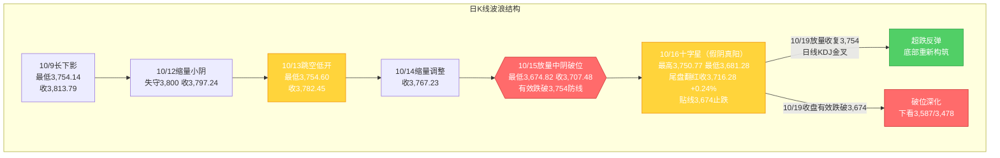
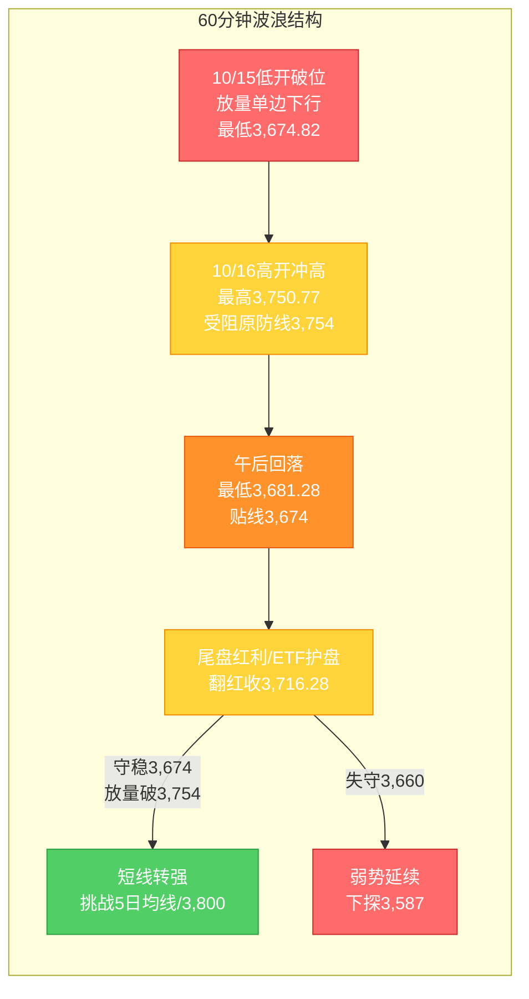

# A股晨报 - 2026年10月19日

> 数据截止时间：2026年10月19日 08:00（北京时间）；A股为10月16日（周五）收盘，美股为10月16日（周五）收盘（隔夜），欧洲为10月16日收盘，大宗商品/汇率为10月16日
> 报告性质：**国庆长假后第二个完整交易周（第43周）开局日** —— 以 10/16 晚报（**"放量破位后贴线止跌、收十字星"**）为基础 + **周末外盘走弱与国内政策/资金对冲信息** + **多周期波浪理论分析**
> 核心观点：**10/16 A股在"924"行情平台高点3,674点"贴线"止跌、收十字星（假阴真阳），破位后首现"缩量企稳"信号雏形**；但**周末（10/16周五）外盘再度走弱（纳指-2.15%、费城半导体-3.8%、CoreWeave-12%，AI软件估值恐慌）**，**周一（10/19）或承压低开**。**多空对冲要素密集**：利多——**国常会"深化拓展人工智能+"（算电协同）+ A股科技龙头"回购潮"（生益科技/海光信息/中科曙光/澜起科技/长鑫科技）+ 潘功胜重申适度宽松 + 金融街论坛今日开幕**；利空——**纳指/费半续跌映射AI硬件、Q3 GDP今日揭晓（预期约4.4%）、10月解禁超千亿、三季报高位成长股业绩验证**。**今日核心博弈：3,674点（"924"平台高点）能否守稳 vs 3,754点（原防线/5日均线）能否被放量收复。**

---

## 一、昨日晚报复盘要点回顾

### 1. 昨日（10/16）判断回顾

| 项目 | 准确率 | 说明 |
|------|--------|------|
| 趋势判断 | **100%（1/1）** | "震荡企稳/超跌反弹尝试"方向命中，上证收涨+0.24% |
| 点位预测 | **100%（3/3）** | 区间3,674-3,790✓、强支撑3,674✓（未跌破）、强压力3,754✓（精确受阻） |
| 板块预判 | **约33%（3/9）** | 贵金属✓、有色✓；存储/半导体、白酒、海运/油气、玻纤等落空 |
| **综合准确率** | **约78%** | 方向、区间、关键点位精准；**板块结构（事件驱动）预判偏差** |

### 2. 关键偏差及原因
- **偏差1（核心，板块结构）**：预判"存储/半导体超跌反弹+白酒防御"领涨，实际领涨为**"军工（第十六届中国国际航空航天博览会催化）+ 低空经济/飞行汽车（特斯拉二代Roadster发布）+ 汽车+房地产+福建/碳纤维"**等**事件驱动方向**。根本原因：**信息缺失+逻辑误判**——未纳入"航展/新品发布"强催化；高估"美债收益率回落→A股科技链超跌反弹"传导（A股AI硬件"外强内弱"续跌）。
- **偏差2（次要，看跌清单）**：预判"海运/油气/培育钻石/玻纤"补跌，实际"建筑材料+1.63%"上涨、"海运/油气"未领跌。根本原因：**将10/15"破位日高位趋势股补跌"结构直接外推至次日**，忽视情绪修复（上涨超3,300只）+事件/主题接力。
- **偏差3（轻微，量能路径）**：实际为"缩量企稳"（缩量767亿）——恐慌盘已于10/15一次性释放，破位后次日更可能"缩量"而非"续放量"。

### 3. 沉淀的规则/检查项（10/16晚报新增，共6条）
- **规则1（趋势）**：关键防线"贴线守住"+十字星/长下影小阳+缩量=止跌企稳信号，但需"放量站稳被跌破的原防线"确认。
- **规则2（板块）**：特殊事件催化（航展/新品发布/政策发布会）可驱动军工/低空经济等板块**独立于大盘走出涨停潮**，须纳入板块前瞻**强制扫描清单**。
- **规则3（资金面）**："尾盘宽基ETF放量+红利集体拉升"可推动指数翻红，属"护盘/被动配置"，**非趋势反转**。
- **规则4（点位）**：破位后反抽，**第一压力=被跌破的原防线（3,754）、第一支撑=前期平台高点（3,674）**，日内高低点常"精确受阻/贴线"。
- **规则5（风险）**：破位次日"超跌反抽+题材接力"可现，但"反抽≠反转"，警惕量能不足的冲高回落。
- **规则6（波浪）**：C浪延伸破位后"平台高点附近长下影小阳/十字星+未创新低"=短线止跌信号，需"次周放量收复原防线+日线KDJ金叉"确认。

### 4. 对今日（10/19）分析的启示
- **需要关注的风险点**：①**3,674点（核心支撑）有效性**为今日第一观察点；②**周末外盘续跌（纳指-2.15%）→AI硬件映射压力**；③**Q3 GDP（预期约4.4%）落地后情绪扰动**；④**"企稳"依赖ETF/红利护盘、基础不牢，"反抽≠反转"**。
- **需要调整的分析逻辑**：①**强制扫描"政策发布会/展会/新品发布"事件催化**（今日聚焦**金融街论坛+国常会"人工智能+"细则**）；②看涨"超跌科技链"须叠加**"量能放大+主力资金转净流入"双重确认**，不可仅凭外盘映射；③看跌清单须**随"事件/政策催化"动态调整**，不机械外推破位结构。

---

## 二、隔夜市场动态（10/16周五收盘，周末至今）

### 1. 美股市场（10/16收盘）

| 指数 | 收盘点位 | 涨跌幅 | 说明 |
|------|---------|--------|------|
| 道琼斯工业指数 | **52,002.41** | **-0.34%（-175.28点）** | 权重相对抗跌 |
| 标准普尔500指数 | **7,659.44** | **-1.09%（-84.62点）** | AI软件估值反转拖累 |
| 纳斯达克综合指数 | **26,140.03** | **-2.15%（-572.99点）** | **科技股重挫、AI软件股大幅回吐** |
| 罗素2000 | — | **约-2.1%** | 小盘股承压 |

**解读**：**美股周五"科技领跌"**——**AI相关软件股估值遭遇"急转"（CoreWeave-12%）**，AI债务/估值恐慌再起；**道指相对抗跌（传统蓝筹防御）**。**净影响：对A股AI硬件链（元件/PCB/CPO/MLCC、光模块）构成"隔夜定向利空"映射**，但对**国内政策驱动的AI应用/算力（国常会"人工智能+"）**或形成"内强外弱"的博弈。

### 2. 欧洲 / 亚太市场

| 市场 | 表现 | 备注 |
|------|------|------|
| 德国DAX30 | **+0.94%** | 欧股集体收涨 |
| 英国富时100 | **+0.38%** | 温和上行 |
| 法国CAC40 | **+0.31%** | 温和上行 |
| 欧洲STOXX600 | **+0.67%** | 集体回暖 |
| 韩国KOSPI | **+2.05%（10/16）** | 存储芯片巨头反弹，修复10/15熔断级暴跌 |
| 日经225 | **+1.39%（10/16）** | 半导体/科技反弹 |
| 恒生指数 | **+0.52%（10/16）** | 港股小幅回暖 |

**情绪判断**：**欧股与亚太（10/16）虽偏暖，但周五美股（10/16）回吐**——**"外盘企稳"并未形成趋势性确认**，全球风险偏好仍受**"AI估值/债务恐慌 + 中东地缘"**扰动，**周一A股外盘环境偏空**。

### 3. 大宗商品（10/16）

| 品种 | 价格/表现 | 涨跌/驱动 |
|------|----------|----------|
| WTI原油（11月合约） | **101.41美元/桶** | **+3.51%（+3.44美元）**；中东地缘+影子船队制裁扰动 |
| 布伦特原油（12月合约） | **109.86美元/桶** | **+3.72%（+3.94美元）** |
| COMEX黄金（12月） | **4,181.10美元/盎司** | **+0.26%**（10/15曾+1.51%）；**周线约-0.7%** |
| COMEX白银（12月） | **57.305美元/盎司** | **+0.26%**；**周线约-6.41%（高位回吐）** |

**驱动逻辑**：①**原油单日大涨逾3.5%（收于100美元上方）**——利多A股**油气/石油石化**（"油价反弹初期优先反弹动能逻辑"）；②**黄金/白银高位窄幅收涨、周线转跌**——贵金属"避险+利率"逻辑边际降温，**A股贵金属股短期承压**；③**油价上行→通胀预期→美债长端压力**——为成长股估值增添扰动。

### 4. 汇率与利率

| 指标 | 数值/表现 | 变化/说明 |
|------|----------|----------|
| 人民币中间价（10/16） | **6.7220** | **调升33个基点**（延续偏强） |
| 美元指数 | **约102** | 10/15纽约尾盘-0.49%，高位小幅回落 |
| 美债10年期收益率 | **约5.06%（10/15，-12.6bp）** | 高位回落，周末因"沃什偏鸽"续获支撑 |
| 美联储加息预期 | **10月加息概率由约27%降至15%以下** | **沃什IMF年会讲话偏鸽**；高盛预计下次加息在12月落地 |

**特征**：①**人民币延续偏强**（中间价调升33基点）；②**"沃什偏鸽"缓解10月加息担忧**——**边际利多高估值成长/贵金属**（但A股科技链对外盘映射更敏感，需观察）；③**国内流动性呵护延续**。

### 5. 重要海外事件
- **美联储主席沃什IMF年会讲话偏鸽**：不提前预判10月议息会议决定，**市场对10/27-28会议加息概率预期降至15%以下**（此前约27%）。
- **美国2026财年联邦预算赤字扩大至1.99万亿美元**（净利息支出1.05万亿创历史新高）——中长期财政/利率扰动。
- **潘功胜（10/17，第54届IMFC会议）**：将继续实施好**适度宽松的货币政策**，保持流动性充裕。

---

## 三、今日关注事项

### 1. 重要数据发布（按时间排序）
- **10:00** **2026年前三季度国民经济运行情况发布会**（国新办，国家统计局新闻发言人毛盛勇）——**三季度GDP今日揭晓**，彭博综合预测**Q3增速约4.4%**（财新调查预测均值4.4%，区间4.3%-4.5%）；**需重点关注GDP与9月工业增加值、社零、投资数据落地后的市场反应**。

### 2. 政策/监管动态（周末至今）
- **国务院常务会议（10/16，李强主持）**：听取"人工智能+"行动进展情况汇报，强调**"不断深化拓展'人工智能+'行动"、"加强技术攻关和算法创新、促进算电协同、增加高质量数据供给"、"以实体经济为重点强化供需衔接、推进中试验证"**——**AI算力底座（服务器/光模块/数据中心/存储/算电协同）+ AI赋能实体（工业软件、智能制造）**获政策催化。
- **2026金融街论坛年会（10/19-22，北京）**：**开幕式拟于10/19下午举行**；**央行行长潘功胜、金融监管总局局长丁向群、证监会主席吴清、外汇局局长朱鹤新将出席并作主题演讲**（吴清将出席10/19开幕式并发表主题演讲）；主题"开放·合作·包容——共筑全球金融发展新生态"。
- **北交所**：部分交易新规（风险警示股票及退市整理股票交易）**自10月26日起实施**（此前已公告）。

### 3. 公司公告（周末密集）
- **A股科技龙头"回购潮"（10/18晚）**：**海光信息**（董事长提议回购5-8亿元）、**中科曙光**（董事长提议3-5亿元）、**生益科技**、**澜起科技**、**长鑫科技**等相继披露回购计划/进展，**科技股密集出手稳定预期**。
- **三季报预喜**：**恒力石化**预计前三季净利润约**102.56亿元（同比+104.2%）**；截至目前**超130家A股公司披露三季报**，预喜占比高。
- **筹划重大资产重组**：有公司10/18晚公告**筹划重大资产重组、今起停牌**。
- **行业**：**四部门组织30余家车企座谈**，加强汽车产品研发测试验证管理。

### 4. 其他关注
- **新股申购**：**皇冠新材**（001381，**发行价16.98元/股**，深主板，发行市盈率25.87倍）**今日（10/19）申购**，单一账户申购上限13,500股；本周另有**天元重工**（北交所，发行价4.48元/股）申购。
- **限售解禁**：**10/19 共18家A股公司解禁，合计市值约141.79亿元**（含润本股份等）；**10月全月解禁约3,047亿元，本周现"超千亿解禁潮"、6股解禁比例均超50%**。
- **重要会议/发布会**：金融街论坛年会（10/19-22）；国新办前三季度经济数据发布会（10/19 10:00）。

---

## 四、板块与个股分析（结合昨日复盘）

### 1. 基于昨日复盘结论的板块调整
- **昨日看涨板块今日预期**：**贵金属**——黄金周线转跌、白银周线-6.41%，**下调为"中性/边际承压"**；**大金融**——银行/保险护盘属性延续，**维持偏多**；**三季报预增股**——**恒力石化（+104.2%）等预喜延续**，**维持结构性偏多**（但须防"业绩兑现回落"）。
- **昨日看跌板块今日预期**：**海运/油气**——**10/16国际油价大涨逾3.5%**，按"油价反弹初期优先反弹动能"规则，**油气/石油石化由看跌上调至"中性偏多（事件驱动）"**；**有色/贵金属**——**维持偏空**（周线白银大跌）。
- **昨日偏差板块修正**：**事件驱动（军工/低空经济）**——**延续偏多**（特斯拉高管再披露"能飞"技术细节、航展催化余温）；**AI硬件（存储/半导体）**——**由"看涨超跌反弹"修正为"谨慎/偏空"**（外盘纳指-2.15%、费半-3.8%映射）。

### 2. 隔夜信息驱动的板块机会
- **受益板块**：
  - （1）**AI算力底座 / AI应用**（逻辑：**国常会"深化拓展'人工智能+'、算电协同"+科技龙头回购潮**；服务器/光模块/数据中心/存储；**属"政策+资金"驱动的超跌修复博弈**，须量能确认）
  - （2）**事件驱动（军工/低空经济/飞行汽车）**（逻辑：**航展催化延续 + 特斯拉"能飞"技术细节 + 汽车产业政策座谈**）
  - （3）**油气/石油石化**（逻辑：**国际油价单日大涨逾3.5%、站上100美元**；"油价反弹初期"规则）
  - （4）**红利防御（银行/保险/煤炭/白酒）**（逻辑：**类固收避险+护盘资金+"稳市"预期**）
- **受损板块**：
  - （1）**AI硬件（元件/PCB/CPO/MLCC/光模块）**（逻辑：**纳指-2.15%、费半-3.8%隔夜映射，AI软件估值恐慌**）
  - （2）**贵金属/有色**（逻辑：**黄金周线-0.7%、白银周线-6.41%，避险/利率逻辑降温**）
  - （3）**高位连板股/传媒**（逻辑：**获利回吐、景气验证**）

### 3. 重点关注个股
- **海光信息 / 中科曙光**：回购提议催化（5-8亿 / 3-5亿），**算力/AI硬件国产链**代表；关注**能否由"回购护盘"转为"放量上行"**。
- **生益科技 / 恒力石化**：**三季报预喜（生益科技预盈+164%-181%、恒力石化+104.2%）**，业绩驱动的确定性方向。
- **万丰奥威 / 中信海直（低空经济）**：**特斯拉新品+航展催化延续**，事件驱动主题，**追高风险大、宜关注回踩机会**。

---

## 五、今日核心判断（结构化输出）

### 1. 趋势判断
- 上证指数：**【震荡（弱势整理、低开企稳尝试）】**
- 预测区间：**3,650点 - 3,770点**
- 核心逻辑：**周末外盘走弱（纳指-2.15%）压制AI硬件，周一或低开；但国常会"人工智能+"、科技龙头回购潮、潘功胜"适度宽松"、金融街论坛开幕构成政策/资金对冲，叠加10/16已在3,674点"贴线"止跌、收十字星**——多空对冲下**大概率"低开震荡修复、区间整理"**，方向选择待**3,674与3,754**争夺。

### 2. 关键点位
- 强支撑位：**3,674点**（依据："924"行情平台高点/核心支撑，10/16盘中低点3,681.28"贴线"承接）
- 弱支撑位：**3,660点 / 3,620点**（依据：60/30分钟短期支撑与黄金分割延伸缓冲）
- 强压力位：**3,754点**（依据：被跌破的原"最后防线"，与5日均线重合，10/16高点3,750.77精确受阻）
- 弱压力位：**3,724.56点（缺口下沿）/ 3,767点（缺口上沿）**（依据：10/13-10/15跳空缺口区间）

### 3. 板块预判
- 看涨板块：（1）**AI算力底座/AI应用**（逻辑：国常会"人工智能+"+算电协同+回购潮，超跌修复博弈）（2）**事件驱动（军工/低空经济/汽车）**（逻辑：航展+"能飞"新品+产业政策）（3）**油气/石油石化**（逻辑：油价单日+3.5%）（4）**红利防御（银行/保险/煤炭）**（逻辑：护盘+类固收）
- 看跌板块：（1）**AI硬件（元件/PCB/CPO/MLCC/光模块）**（逻辑：纳指/费半隔夜重挫映射）（2）**贵金属/有色**（逻辑：金银周线转跌）（3）**高位连板股/传媒**（逻辑：获利回吐）
- 风险板块：**高位连板股（异动/回撤风险）、三季报或不及预期的高位成长股、大额解禁个股（10月约3,047亿）、ST/退市风险股**

### 4. 资金面判断
- 北向资金预期：**【结构性分化，小幅净流出或持平】**（交易所已不实时披露净额，以成交口径跟踪，10/16占成交14.48%、活跃度回落）
- 成交量预期：**【平量偏缩，约1.4-1.6万亿元】**（低开观望+缩量磨底延续；若放量收复3,754则转"温和放量"）

### 5. 风险预警（按优先级排序）
- 高风险：**①3,674点（核心支撑）有效性**——收盘有效跌破则破位深化，下看3,587/3,478；**②外盘映射**——纳指-2.15%/费半-3.8%，AI硬件链或再杀跌
- 中风险：**Q3 GDP（预期约4.4%）及9月经济数据落地**不及预期的情绪扰动；**三季报高位成长股业绩验证**；**10月解禁超千亿（本周6股解禁比例>50%）**
- 低风险：**中东地缘/油价波动**（油价已大涨，通胀/成本扰动）；**金融街论坛政策预期落空**；**高位连板股回撤**

### 6. 昨日复盘规则应用
- **应用规则1（点位计算）**：以**"被跌破的原防线3,754=第一压力、平台高点3,674=第一支撑"**作为今日区间预测的核心框架。
- **应用规则2（趋势分析）**：**"贴线止跌+十字星+缩量"仅为企稳信号**，须以**"放量收复3,754+日线KDJ金叉"**确认，未确认前维持"弱势震荡"定性。
- **应用规则3（板块选择）**：**强制扫描"政策发布会/展会/新品发布"事件催化**——今日聚焦**金融街论坛（吴清讲话）+ 国常会"人工智能+" + 科技龙头回购**，事件/政策驱动板块（AI、军工/低空）优先于"外盘映射型"科技硬件。

---

## 六、投资策略建议（分短线+中线）

### 1. 短线策略（1-3个交易日）
- 适用场景：基于日K线与60分钟K线技术信号
- 短线仓位：**10-15%**
- 买入条件：**指数低开不破3,674点且放量反抽3,724点以上**可小仓参与（**量能不放大不追高**）；**AI/算力、事件驱动板块需"放量+资金转净流入"确认**
- 卖出条件：**反弹至3,754-3,767压力区滞涨**，或**收盘有效跌破3,674点**
- 止损位：**3,674点**（或个股跌幅5%）
- 短线标的：（1）**AI算力底座/AI应用**（逻辑：国常会政策+回购潮催化，超跌修复）（2）**军工/低空经济**（逻辑：航展+"能飞"事件驱动）（3）**油气/石油石化**（逻辑：油价单日大涨）

### 2. 中线策略（1-4周）
- 适用场景：基于周K线波浪分析与运行规律分析结论
- 中线仓位：**15-20%**
- 方向判断：**【持有 / 观望（偏防御）】**
- 目标区间：上证指数 **3,674点 - 3,800点**
- 中线布局板块：（1）**低拥挤度防御（银行/保险/煤炭/白酒）**（逻辑：类固收避险+护盘）（2）**AI算力/政策主线（算力底座、AI应用）**（逻辑：国常会"人工智能+"+回购潮，待放量确认）（3）**事件驱动（军工/低空，波段）**（逻辑：航展/新品催化）
- 止盈条件：指数到达**3,800点**或波段涨幅达5%
- 止损条件：**收盘有效跌破3,674点**或趋势确认反转

### 3. 仓位分配总览

| 策略类型 | 仓位比例 | 方向 | 重点板块 |
|---------|---------|------|---------|
| 短线 | **10-15%** | 超跌修复（量能绑定） | AI算力/AI应用、军工/低空、油气 |
| 中线 | **15-20%** | 持有/观望（偏防御） | 红利防御、AI政策主线、事件驱动 |
| 现金 | **65-75%** | — | — |

### 4. 与昨日策略对比

| 项目 | 昨日（10/16）建议 | 今日（10/19）建议 | 调整原因 |
|------|------------------|------------------|---------|
| 短线仓位 | 10-15% | **10-15%（维持）** | 企稳信号待确认，量能不放前不追高 |
| 中线仓位 | 15-20% | **15-20%（维持）** | 破位结构未修复，维持防御 |
| 重点方向 | 贵金属、存储/半导体、白酒/大金融 | **AI算力/AI应用、军工/低空、油气、红利防御** | 外盘科技续跌→下调AI硬件；油价大涨→上调油气；政策/回购→上调AI |

---

## 七、波浪理论多周期分析

> 说明：基于10/16实际K线结构更新。**10/15"放量中阴有效跌破最后防线3,754"后，10/16高开冲高（最高3,750.77，受阻原防线3,754）→午后回落（最低3,681.28，"贴线"3,674）→尾盘红利/ETF护盘翻红（收3,716.28、+0.24%），收"上下影线基本等长的十字星（假阴真阳）"。破位后首现"缩量止跌、区间企稳"信号雏形。**

### 1. 月K线波浪分析
- **当前波浪位置**：大周期**第2浪C浪延伸"破位下行后的止跌尝试"阶段**；10月月K线现为**"破位中阴、带下影"**
- **浪型结构描述**：2024年9月2,689点→2026年6月4,197点为**第1浪上升**；第2浪ABC调整：4,197点→3,674.82点（10/15盘中低点）；10月呈"10/8放量中阴→10/9长下影V型收回→10/12失守3,800→10/13跳空探底3,754.60→10/15放量破位→**10/16缩量十字星、贴线3,674获承接**"
- **关键目标位**：下方支撑**3,674点（"924"平台高点/核心支撑）**、3,587点、3,478点；上方压力**3,754点（原防线转压力）**、**3,800点（20月均线）**
- **验证条件**：**10月月K线能否在3,674点上方止跌企稳**——10/16已"贴线"守住；月内若继续收盘有效跌破3,674，则月度下行空间打开（下看3,587/3,478）

### 2. 周K线波浪分析
- **当前波浪位置**：第42周（10/12-10/16）收官收**"带下影中阴"**（周开约3,806.98、周高3,828.22、周低**3,674.82**、周收3,716.28；实体约-90.7点、下影约41.5点>上影21.2点）
- **浪型结构描述**：本周为"破位周"——**周线跌破上周低点（3,754.14）并刷新周内新低（3,674.82）**，**下影显示3,674点附近承接**；周收盘仍处5周/10周/20周/60周均线下方，**短期均线空头排列未改**
- **关键目标位**：周度下方支撑**3,674点**、3,587点；周度压力**3,724.56点（缺口下沿）**、**3,754点（原防线）**、3,800点
- **验证条件**：**本周（第43周，10/19-10/23）能否延续企稳**——**放量收复3,754点为周线企稳前提**；若继续放量跌破3,674，则周线破位确认、下探3,587

### 3. 日K线波浪分析（重点）
- **当前波浪位置**：**C浪延伸"破位下行"后的"缩量止跌、区间企稳"信号初现**——10/16收"上下影线基本等长的十字星（假阴真阳）"，最低3,681.28"贴线"3,674核心支撑后止跌、未有效跌破；**但反抽受"原防线3,754"压制，仍属"下跌中继/弱势止跌"**
- **浪型结构描述**：9/30收3,842.19→10/8放量中阴收3,811.90→10/9长下影收3,813.79（低3,754.14）→10/12缩量小阴收3,797.24→10/13跳空低开收3,782.45（低3,754.60）→10/14缩量调整收3,767.23→10/15放量中阴破位收3,707.48（低3,674.82）→**10/16十字星收3,716.28（+0.24%）**；**低点序列"3,754.14→3,754.60→3,674.82→3,681.28"在3,674点附近形成"双低/贴线承接"**
- **关键目标位**：**下方支撑**：**3,674点（核心）**、3,660点、3,620点、3,587点；**上方压力**：**3,724.56点（缺口下沿，已收复）**、3,750.77点（10/16高点）、**3,754点（原防线/5日均线，关键反抽确认位）**、3,767点（缺口上沿）、3,800点（20月均线）
- **验证条件**：
  - **向上修复**：**放量收复3,754点并站稳** → 超跌反弹、底部重新构筑（关注日线KDJ能否有效金叉）
  - **向下确认**：**收盘有效跌破3,674点** → 破位深化，下看3,587点及3,478点
  - **今日变量（10/19）**：周末外盘"纳指-2.15%"或致低开；**国常会"人工智能+"、科技龙头回购潮、金融街论坛、潘功胜"适度宽松"**提供政策/资金对冲——**低开幅度决定强弱：低开不破3,674并快速收复者为强，低开失守3,674者为弱**

### 4. 60分钟K线波浪分析
- **当前波浪位置**：60分钟级别**"冲高回落→尾盘拉升的区间震荡/止跌"**，短线维持"弱平衡待突破"
- **浪型结构描述**：60分钟10/16呈"高开冲高（午间涨0.95%）→午后单边回落（探底3,681.28）→尾盘放量拉升收阳"；**MACD低位、KDJ低位回升，量能集中于尾盘拉升段（ETF放量）**
- **关键目标位**：短期支撑**3,674点、3,660点**；短期压力**3,724点、3,754点**
- **验证条件**：**今日首两个小时能否守稳3,674点并放量反抽3,754点**——守稳则短线企稳延续，跌破3,660则弱势级别降级、下看3,587

### 5. 30分钟K线波浪分析
- **当前波浪位置**：30分钟级别**"高开冲高→下探企稳→尾盘拉升"**，短线动能由"弱"转"平/略偏强"
- **浪型结构描述**：30分钟10/16在3,681-3,750区间宽幅震荡，**尾盘在红利股+ETF放量带动下快速拉升**；**MACD低位金叉、KDJ中位区向上，存超跌修复动能**
- **关键目标位**：关键支撑**3,700点、3,674点**；短期压力**3,740点、3,754点**
- **验证条件**：**30分钟能否放量突破3,754**——突破则短线转强、挑战5日均线（约3,740-3,755点）；否则维持弱势震荡、回踩3,674

### 6. 波浪图（Mermaid绘制）

**日K线波浪结构图**：

**60分钟波浪结构图**：

### 7. 波浪理论综合判断

| 维度 | 判断 |
|------|------|
| 多周期共振状态 | **月/周/日仍偏"向下"，但日线/60分钟出现"止跌企稳"的边际改善**——日线收十字星、贴线3,674未有效跌破，周线下影拉出；**月/周/日大周期震荡市-C浪特征未改**，**但短线（60分钟/30分钟）由"放量破位"转为"缩量企稳、尾盘拉升"，多周期"向下共振"出现初步背离（短线修复迹象）** |
| 当前操作级别 | **日线级别（防守/超跌反弹尝试）**（3,674点为"924"平台高点/核心支撑，3,587/3,478为下移目标；3,754为被跌破的原防线、转反抽确认位；5日均线约3,740-3,755为短线压制） |
| 后续演变路径（10/19及本周） | **30%乐观**（企稳延续：低开修复+政策/回购催化+红利防御→守稳3,674、放量收复3,754并挑战3,800→底部重新构筑）、**45%中性**（3,674-3,754区间弱势震荡、缩量整理、题材轮动（AI/军工/低空/事件驱动））、**25%悲观**（外盘续跌/AI硬件再杀跌→收盘有效跌破3,674，下看3,587/3,478） |
| 关键拐点信号 | 向上：**放量收复3,754点并站稳** + 日线KDJ有效金叉 + 主力资金转净流入 + 科技链（半导体/算力硬件）止跌；向下：**收盘有效跌破3,674点** + 外盘/亚太科技续跌 + 量能持续放大 |
| 风险提示 | ①**3,674点有效性为今日第一观察点**，10/16"贴线"守住但未有效确认；②**10/16"止跌企稳"依赖"尾盘红利+ETF护盘"，量能未放大，"企稳"基础不牢**，警惕"反抽→冲高回落"反复；③**周末外盘"纳指-2.15%"映射AI硬件，情绪修复或受阻**；④**Q3 GDP等数据落地扰动**；⑤**波浪理论在"C浪延伸破位后止跌"阶段预测精度降低**，需结合量能、外盘与政策面综合判断 |

> **规律分析引用（第42周运行规律分析，周日10/18生成）**：该报告**定性第42周为"破位周"**，预测**第43周（10/19-10/23）上证运行区间3,587-3,800点**、主基调**"震荡（低位弱势整理、企稳尝试）"**，乐观/中性/悲观概率**30%/45%/25%**；强调**"3,674点（平台高点）为中线核心支撑（收盘有效跌破则下看3,587/3,478）、3,754点（原防线）为短线转强关键"**。本报告据此**维持"破位后弱势企稳（防守/反抽）"主基调，与规律报告概率保持一致**。

---

## 七、信息来源

1. **官方数据来源**：上海证券交易所（上证指数10/16收盘3,716.28、涨0.24%、最高3,750.77、最低3,681.28）、深圳证券交易所、中证指数有限公司、中国外汇交易中心（人民币中间价6.7220）、中国人民银行、国务院/中国政府网（国常会）、国务院新闻办公室（前三季度经济数据发布会）、美国劳工部/美国财政部（赤字）、美国商品期货/新华社（油价/金价）、香港交易所、韩国交易所、东京证券交易所
2. **权威财经媒体**：新华网（纽约股市三大股指16日显著下跌、国际油价16日显著上涨）、央视新闻/中国证券网（金融街论坛年会今日开幕）、上海证券报·中国证券网（新股提示、金融街论坛）、财联社（周末要闻汇总、债市早参）、证券时报（科技龙头集体回购）、中国证券报、21财经（美股复盘）、每日经济新闻（每经早参）、格隆汇
3. **数据平台**：东方财富、同花顺、Wind资讯、新浪财经、腾讯新闻、大河/隔夜欧美、生意社（原油）
4. **研究机构**：券商中国、彭博（Q3 GDP预测）、财新（三季度GDP调查）、高盛（加息路径）、中金/银河/财通/方正等券商策略

> 数据截止时间：2026年10月19日 08:00（北京时间）；A股为10月16日（周五）收盘，美股/欧洲为10月16日（周五）收盘（隔夜），大宗商品/汇率为10月16日；周末政策与公司公告截至10月18日晚。

---

*本晨报由AI代理自动生成，仅供参考，不构成投资建议。投资有风险，入市需谨慎。*
