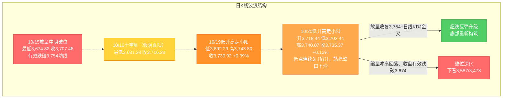
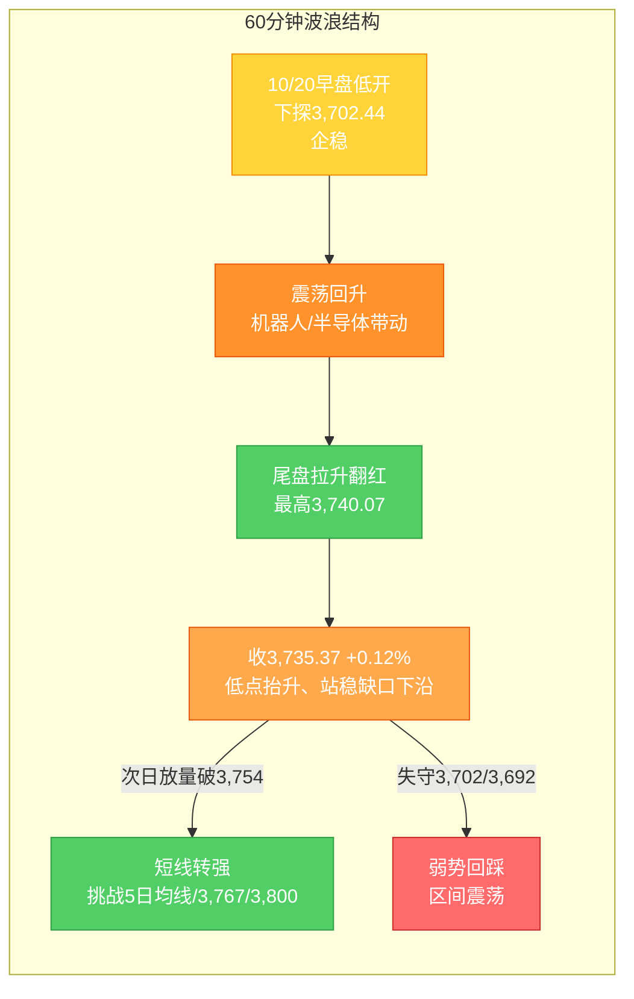

# A股晚报 - 2026年10月20日

> 数据截止时间：2026年10月20日 20:00（北京时间）；A股为10月20日（周二）收盘，美股为10月19日（周一）收盘（隔夜），欧洲/亚太为10月20日盘中，大宗商品/汇率为10月20日盘中/在岸收盘
> 报告性质：**国庆长假后第二个完整交易周（第43周）第2个交易日**，以10/20晨报（**"震荡偏强（超跌修复、尝试收复3,754）"**）为基础 + **隔夜外盘科技回暖（费半结束8连跌、存储大涨）映射** + **多周期波浪理论分析** + **晨报复盘闭环**
> 核心结论：**10/20 A股"缩量分化、指数微涨"，上证收3,735.37（+0.12%），深成指-0.14%、创业板指-0.26%；但市场宽度显著改善（上涨3,778只、涨停56只）**。**"止跌企稳"信号连续强化——低点连续第3日抬升（3,681.28→3,692.29→3,702.44）、站稳缺口下沿3,724.56、逼近原防线3,754；但量能未放大（14,715亿，平量/微增）仍未放量收复3,754，仍属"反抽/弱势修复"。** 结构上**"人形机器人（特斯拉Optimus+OpenAI+英伟达GTC物理AI）"全面爆发、拉动机械设备/计算机/电子/医药生物领涨，而"大金融（非银/银行/保险）+煤炭+有色"领跌**——**资金由"防御（红利/券商）"切向"进攻（机器人/端侧AI/半导体）"，验证"科技回暖日防御板块回吐"**。

---

## 一、市场回顾

### 1. 主要指数表现

| 指数 | 收盘点位 | 涨跌幅 | 开盘 | 最高 | 最低 | 说明 |
|------|---------|--------|------|------|------|------|
| 上证指数 | **3,735.37** | **+0.12%（+4.45点）** | 3,718.44 | 3,740.07 | 3,702.44 | 低开高走、尾盘翻红 |
| 深证成指 | **约11,801** | **-0.14%（-16.13点）** | — | — | — | 微跌 |
| 创业板指 | **约2,739** | **-0.26%** | — | — | — | 成长风格承压延续 |
| 科创50 | — | **+1.00%** | — | — | — | 半导体带动修复 |
| 科创综指 | — | **+2.13%** | — | — | — | 超跌修复弹性大 |
| 北证50 | — | **+3.88%** | — | — | — | 小盘/主题活跃 |
| 沪深300 | — | **-0.54%** | — | — | — | 权重（大金融）拖累 |

**特征**：**指数"涨跌互现、缩量分化"**——**沪指微涨、权重指数（沪深300）下跌（大金融拖累），而科创综指+2.13%、北证50+3.88%显著走强**，**"权重弱、主题强"的极致分化**。上证收出**"低开高走小阳（实体中、上影短）"**，日内最低3,702.44、最高3,740.07，**尾盘在机器人/半导体带动下翻红**。

### 2. 成交量能

| 指标 | 数值/表现 | 说明 |
|------|----------|------|
| 两市/三市成交额 | **约14,715亿元（1.47万亿）** | 较10/19（14,488亿）**微增227亿**，属**"平量/微增"** |
| 主力资金 | **全天净流出123.22亿元**（**连续10个交易日净流出**） | 沪深300成份净流出130.84亿、创业板-39.31亿、科创板-8.34亿 |
| 主力资金结构 | **电子获逾+142亿净流入**、机械设备/计算机**净流入超50亿**、医药生物**逾+41亿**、通信**逾+30亿**、汽车**逾+23亿**、家用电器**连续11日净流入** | **"总量净流出 + 成长主题结构性净流入"→"高低切换/结构进攻"** |
| 北向资金 | 交易所**不再实时披露净额**（以成交口径跟踪） | 人民币大幅走强（见第五节），外资情绪偏正面 |

**量能解读**：**今日"缩量/平量"未见放量**，与晨报"温和放量1.5-1.7万亿"预期略有偏差——**存量博弈特征明显**：**资金在"防御（红利/大金融）"与"进攻（机器人/半导体/端侧AI）"之间高低切换**，**"总量净流出"主要来自权重/红利抛压，而"电子/机械/计算机/医药"获得结构性主动买入**。

### 3. 市场情绪

| 指标 | 数值 | 说明 |
|------|------|------|
| 上涨家数 | **3,778只（占比约67.85%）** | 市场宽度**显著改善** |
| 下跌家数 | **约1,667只** | 上涨:下跌 ≈ 2.3:1 |
| 涨停 | **56只** | 机械设备10股涨停、机器人概念近20股涨停 |
| 跌停 | **7只** | 跌停显著减少 |
| 情绪定性 | **"普涨型修复"** | 与10/15"普跌型杀跌"（上涨仅425只）形成鲜明对比 |

**情绪演变**：**由10/19"指数收涨但超3,100只下跌（指数失真）"转为10/20"指数微涨、超3,700只上涨（宽度修复）"**——**"反抽"的"个股基础"较昨日明显夯实**，但**量能未放大 + 大金融领跌**，**"修复质量"仍待放量确认**。

---

## 二、热点板块与异动分析

### 1. 当日领涨板块及驱动因素

| 板块 | 表现 | 驱动因素 |
|------|------|---------|
| **计算机** | **申万一级 +1.95%（居首）** | 人形机器人/工业软件/AI应用；英伟达GTC聚焦物理AI |
| **机械设备** | **+1.81%**（10股涨停） | **机器人概念涨停潮（赛摩智能、长盈精密、宁波东力等）** |
| **综合 / 电子 / 医药生物** | **均涨幅超1%** | 电子（半导体/端侧AI）、医药（CRO/医疗服务） |
| **人形机器人** | **概念爆发，近20股涨停** | **特斯拉10/19提交年度股东大会文件（Optimus量产推进）+ OpenAI布局人形机器人（奥特曼披露）+ 英伟达GTC物理AI + 九部门"科技兴商"加码人形机器人** |
| **半导体 / 端侧AI / AI眼镜** | **强势** | **恒玄科技20%涨停**、摩尔线程午后走高、长鑫科技/兆易创新活跃；英伟达GTC物理AI催化 |
| **CRO / 医疗美容 / 医疗服务** | **涨幅居前** | **康希诺+20%、近岸蛋白+13.47%、义翘神州+10.99%** |
| **消费电子** | **涨幅居前** | 端侧AI/无线耳机/AI穿戴设备（恒玄科技等） |

**驱动逻辑**：**①"人形机器人"成为当日唯一主线**——**隔夜特斯拉（Optimus）、OpenAI（人形机器人项目）、英伟达（GTC物理AI）三重海外催化 + 国内九部门"科技兴商"+工信部"加力推进人工智能、推动人形机器人落地"**，**"机器人→机械设备→工业软件→端侧AI（半导体/消费电子）"产业链全面共振**；**②半导体超跌修复延续**（费半结束8连跌的隔夜映射 + 端侧AI需求）；**③医药（CRO/医疗服务）超跌+低位修复**。

### 2. 当日领跌板块及原因分析

| 板块 | 表现 | 原因分析 |
|------|------|---------|
| **非银金融** | **申万一级 -1.47%（领跌）** | 券商"旗手"回落（**政策催化兑现、资金转向进攻端**）；保险普跌 |
| **煤炭** | **-1.36%** | 高股息防御回吐（**资金高低切换**） |
| **有色金属 / 银行** | **跌幅居前** | 银行（高股息防御）资金流出；有色随贵金属/资源回调 |
| **航海装备 / 地面兵装** | **跌幅居前** | 前期事件驱动（航展/军工）高位回吐（**"前期强势股补跌"**） |
| **汽车整车 / 白色家电** | **跌幅居前** | 汽车（宁德时代港股评级下调）承压；家电（10/19领涨）次日回吐（**"前日领涨板块回吐"**） |
| **分散染料** | **午后走低**（善水科技、锦鸡股份领跌） | 主题退潮 |

**特征**：**"防御（大金融/煤炭/银行）+ 前期强势（军工/家电/汽车整车）"集体回吐，资金高度集中于"进攻端（机器人/半导体/医药）"**——**印证"科技回暖日，防御与权重反被抽血"的高切低逻辑**。

### 3. 个股异动

- **涨停潮**：**机械设备10股涨停**（赛摩智能、长盈精密、宁波东力、浙江荣泰、嘉晨智能30cm等）；**机器人概念近20股涨停**（凡拓数创、福莱新材等）。
- **强势股**：**宇树科技3天大涨35%、市值站上2,200亿**；**恒玄科技20cm涨停**（端侧AI/AI眼镜）；**康希诺+20%**（CRO）。
- **回吐股**：10/19领涨的**家用电器、军工（地面兵装）**次日回吐；**航海装备、保险**领跌。

---

## 三、关键数据与事件回顾

### 1. 国内重要经济数据
- **今日（10/20）国内无重磅经济数据集中发布**；市场延续**消化10/19发布的Q3 GDP（预期约4.4%）及9月工业增加值/社零/固投数据**。
- **本周关注**：中国**9月工业企业利润**、10月PMI前瞻；三季报密集披露进展。

### 2. 政策消息
- **央行（10/20公告）**：**将在10月21日至11月2日开展隔夜逆回购操作**（固定利率、数量招标，**每日操作量不超过10,000亿元**）——**落地并强化潘功胜10/19"研究将公开市场主要操作品种期限切换为隔夜、隔夜回购利率（DR001）成为主要政策利率"的部署**，短端利率"换锚"进入实操（机构解读为"近似变相降息"）。
- **2026金融街论坛年会（10/19-10/22）持续**：**10/21证监会主论坛将聚焦"建设一流投资机构"**。
- **工信部**：**加力推进人工智能产业发展、推动以人形机器人落地**；**九部门"科技兴商"**（18条举措）。
- **回购/分红**：A股回购潮延续（生益电子回购方案、公牛集团回购进展、晶华新材/三孚新科/盛和资源回购、广深铁路、澜起科技独董提议3-5亿回购）。

### 3. 公司公告
- **三季报密集披露**（孚日股份等）；**生益电子、晶华新材**等披露回购实施结果；**华源控股**累计回购340.45万股。
- **宁德时代港股评级被下调至"中性"**（每经）。

---

## 四、海外市场联动

### 1. 美股三大指数（10/19，隔夜）

| 指数 | 收盘点位 | 涨跌幅 |
|------|---------|--------|
| 道琼斯工业指数 | **51,966.03** | **-0.07%（-36.38点）** |
| 标准普尔500指数 | **7,690.73** | **+0.41%（+31.29点）** |
| 纳斯达克综合指数 | **26,430.89** | **+1.11%（+290.85点）** |
| **费城半导体指数** | — | **+1.61%（结束此前"8连跌"）** |

**解读**：**隔夜美股"科技股领涨、半导体止跌"**——**存储芯片集体大涨（闪迪+7.23%、西部数据+5.96%、SK海力士+5.07%、美光+4.18%）**，为A股**半导体/存储/端侧AI**提供"隔夜定向利好"映射；**今日A股半导体（恒玄科技20cm）+端侧AI（消费电子）确已走强**。但**注意：美股10/20尚在盘前/开盘初段，科技股修复延续性待观察**。

### 2. 欧洲 / 亚太市场（10/20盘中）

| 市场 | 表现 | 备注 |
|------|------|------|
| **日经225（10/20）** | **64,075.42（-1.30%，跌超800点）** | 半导体（铠侠等）承压 |
| **韩国KOSPI（10/20）** | **约5,553（-3.73%，盘中一度跌超4.5%）** | **SK海力士-4%、三星电子-3%**（存储承压） |
| **恒生指数（10/20）** | **23,867.74（-1.32%，-319.09点）** | **跌破24,000点**；主板成交1,904.55亿港元 |
| **恒生科技（10/20）** | **4,045.91（-1.52%）** | **盘中最低4,026.90，"打响4,000点保卫战"**；腾讯-1.77% |
| 欧洲斯托克50（10/20） | 约-0.46% | 欧股集体低开 |
| 法国CAC40（10/20） | -0.28%（盘中扩大至约-1.11%） | **法国大规模示威冲击金融市场、股债"双杀"** |
| 德国DAX / 英国富时100 | -0.38% / -0.22% | 欧股普跌 |

**情绪判断**：**"亚太科技市场（韩股/SK海力士、日经）再度重挫 + 港股走弱（恒生科技创本轮调整新低）"**，**与A股"机器人/半导体结构性走强"形成显著分化**——**A股今日"外盘映射"仅体现在"半导体（费半隔夜止跌）"，而"韩股存储重挫（-3.73%）"对A股存储链构成"即时扰动"**，**"外围科技链（尤其存储）修复不稳固"是次日重要变量**。

### 3. 大宗商品（10/20）

| 品种 | 价格/表现 | 涨跌 |
|------|----------|------|
| WTI原油（10/20） | **100.324美元/桶** | **+1.81%（重上100美元）** |
| 布伦特原油（10/20） | **111.234美元/桶** | **+1.54%** |
| 现货黄金（10/20） | **4,140.78美元/盎司** | **-0.01%** |
| 美元指数（10/20） | **101.97** | **+0.20%** |

**驱动逻辑**：**①国际油价拉升（美油重上100美元）——A股油气/石化逻辑边际回暖（晨报"看跌油气"存偏差）**；**②黄金基本持平（-0.01%）**——贵金属中性偏弱；**③美元指数小幅上行**。

---

## 五、汇率与利率

| 指标 | 数值/表现 | 变化/说明 |
|------|----------|----------|
| 人民币中间价（10/20） | **6.7200** | **调升8个基点**（10/19为6.7208） |
| 在岸人民币（10/20 16:30收盘） | **6.6787** | **创2022年6月8日以来新高**；夜盘收6.6810（涨60点） |
| 离岸人民币（10/20） | 盘中最高**6.6770** | **升破前一交易日高点** |
| 美元指数 | 101.97 | +0.20% |
| 央行公开市场操作（10/20） | **7天期逆回购操作量为零（650亿到期）→ 净回笼650亿元** | **同日公告：10/21-11/2开展隔夜逆回购（每日≤1万亿）** |

**特征**：**①人民币大幅走强（在岸升破6.68、创逾3年新高）——显著利多A股风险偏好与外资流入**（与"外资情绪偏正面支撑北向"相互印证）；**②央行"净回笼650亿"但"开展隔夜逆回购（≤1万亿/日）"——短端利率"换锚"落地，货币政策框架向"DR001为目标利率"演进（中期利好利率敏感型资产）**。

---

## 六、收盘后重要信息

### 1. 盘后公告
- **央行隔夜逆回购公告（10/20）**：10/21-11/2开展隔夜逆回购，每日≤10,000亿元。
- **回购/增持延续**：生益电子、公牛集团、晶华新材、三孚新科、盛和资源、广深铁路、澜起科技等。
- **三季报**：密集披露，高位成长股（机器人/AI/创新药）业绩验证关键。

### 2. 夜盘走势
- **欧洲股市盘中普跌**（法国"股债双杀"）；**美股（10/20）盘前/开盘初段**——关注科技股（尤其存储/半导体）能否延续"费半止跌"修复；**港股走弱（恒生科技创调整新低）**。

### 3. 次日关注（10/21）
- **10/21证监会主论坛**（金融街论坛，"建设一流投资机构"）——政策催化窗口。
- **限售解禁**：**10/21盛合晶微半导体首发限售股13,175,749股上市流通**；**本周（10/21-10/25）56只个股解禁，解禁市值约326.60亿元、环比减少28.16%**。
- **三季报密集披露**持续；**10/28 FOMC**、**10月底APEC**、**11/1美方关税决定**前瞻。

---

## 七、波浪理论多周期分析

> 说明：基于**10/20实际K线结构**更新。**10/15"放量中阴有效跌破最后防线3,754"→10/16"贴线3,674止跌、十字星"→10/19"低开高走、收复缺口下沿、低点抬升"→10/20"低开高走小阳、低点连续第3日抬升、站稳缺口下沿、尾盘翻红"，C浪延伸破位后"止跌企稳"信号连续强化；但量能未放大，仍未放量收复3,754。**

### 1. 月K线波浪分析
- **当前波浪位置**：大周期**第2浪C浪延伸"破位下行后的止跌企稳"阶段**；**10月月K线现为"破位中阴、带下影"且下影端企稳迹象增强**。
- **浪型结构描述**：2024年9月2,689点→2026年6月4,197点为**第1浪上升**；**第2浪ABC调整**：4,197点→**3,674.82点（10/15盘中低点）**；10月呈"10/8放量中阴→10/9长下影V型→10/13跳空探底→10/15放量破位→10/16贴线十字星→10/19低开高走小阳→10/20低开高走小阳"；**月内低点序列"3,685.83→3,681.28→3,692.29→3,702.44"连续抬升**。
- **关键目标位**：下方支撑**3,674点（"924"平台高点/核心支撑）→3,660点→3,587点→3,478点**；上方压力**3,754点（原防线转压力）→3,800点（20月均线）→3,842点**。
- **验证条件**：**10月月K线能否在3,674点上方止跌企稳**——**已连续3个交易日（10/16、10/19、10/20）守住、且低点连续抬升**；月内若继续**收盘有效跌破3,674**，则月度下行空间打开（下看3,587/3,478）。

### 2. 周K线波浪分析
- **当前波浪位置**：**第43周（10/19-10/23）第2个交易日**；**第42周（10/12-10/16）为"带下影中阴（破位周）"**。
- **浪型结构描述**：本周开局**周一收3,730.92（+0.39%）→周二收3,735.37（+0.12%）**，**连续两日站上上周收盘3,716.28、站稳缺口下沿3,724.56、低点抬升**；周线仍处5周/10周/20周/60周均线下方、短期均线空头排列未改，但**下影端企稳、实体重心上移，"止跌"迹象增强**。
- **关键目标位**：周度下方支撑**3,674点→3,587点**；周度压力**3,740.07点（本周高）→3,754点（原防线）→3,767点→3,800点（20月均线）**。
- **验证条件**：**本周末（10/23）能否"放量收复3,754点"**为周线企稳前提；若继续放量跌破3,674，则周线破位确认、下探3,587。

### 3. 日K线波浪分析（重点）
- **当前波浪位置**：**C浪延伸"破位下行"后的"止跌企稳信号连续强化"**——10/20收**"低开高走小阳（实体中、上影短）"**，**低点连续第3日抬升（3,681.28→3,692.29→3,702.44）、站稳缺口下沿3,724.56、尾盘翻红**；**但反抽仍受"原防线3,754"压制（今高3,740.07未及），且量能未放大（平量），仍属"下跌中继修复/弱势止跌"**。
- **浪型结构描述**：10/15放量破位收3,707.48（低3,674.82）→10/16十字星收3,716.28（低3,681.28）→10/19低开高走收3,730.92（低3,692.29、高3,743.80）→**10/20低开高走收3,735.37（+0.12%，开3,718.44、低3,702.44、高3,740.07）**；**低点序列"3,674.82→3,681.28→3,692.29→3,702.44"在3,674点上方形成"连续抬升的承接"**，**收盘连续2日站上缺口下沿3,724.56**。
- **关键目标位**：**下方支撑**：**3,702.44点（今低）→3,692.29点（10/19低）→3,674点（核心）→3,660→3,587**；**上方压力**：**3,740.07点（今高）→3,750.77点（10/16高）→3,754点（原防线/5日均线，关键反抽确认位）→3,767点（缺口上沿）→3,800点（20月均线）**。
- **验证条件**：
  - **向上修复**：**放量收复3,754点并站稳** → 超跌反弹升级、底部重新构筑（关注日线KDJ能否有效金叉）。
  - **向下确认**：**收盘有效跌破3,674点** → 破位深化，下看3,587点及3,478点。
  - **今日变量（10/20）**：隔夜**费半结束8连跌、存储大涨（向上催化）** vs **亚太科技重挫（韩KOSPI-3.73%、SK海力士-4%）+ 恒生科技创新低（扰动）**——**今日"低开高走、低点抬升、尾盘翻红、宽度修复"占优，但"缩量+大金融领跌"使修复质量待确认**。

### 4. 60分钟K线波浪分析
- **当前波浪位置**：60分钟级别**"低开探底→震荡回升→尾盘拉升"**，延续"修复偏强"。
- **浪型结构描述**：60分钟10/20早盘低开下探3,702.44后企稳，**机器人/半导体/医药带动震荡上行，尾盘放量拉升收于3,735.37**；**MACD零轴附近企稳、KDJ中低位回升、量能集中尾盘拉升段**。
- **关键目标位**：短期支撑**3,702点→3,692点→3,674点**；短期压力**3,740.07点→3,754点**。
- **验证条件**：**次日首两个小时能否"放量突破3,740.07并挑战3,754"**——突破则短线转强、挑战5日均线（约3,740-3,755）；否则回踩3,702/3,692。

### 5. 30分钟K线波浪分析
- **当前波浪位置**：30分钟级别**"低开企稳→震荡上行→尾盘加速"**，短线动能为"偏强修复"。
- **浪型结构描述**：30分钟10/20在3,702-3,740区间震荡上行，**尾盘在机器人/半导体带动下放量拉升**；**MACD低位金叉后向上、KDJ中位区抬头，存超跌修复动能**。
- **关键目标位**：关键支撑**3,702点→3,692点**；短期压力**3,740.07点→3,754点**。
- **验证条件**：**30分钟能否放量突破3,754**——突破则短线转强、挑战3,767/3,800；否则维持区间震荡、回踩3,702/3,692。

### 6. 波浪图（Mermaid绘制）

**日K线波浪结构图**：


**60分钟波浪结构图**：


### 7. 波浪理论综合判断

| 维度 | 判断 |
|------|------|
| **多周期共振状态** | **月/周大周期仍偏"向下"（C浪特征未改）**；**日线/60分钟/30分钟"止跌企稳"边际改善并连续强化**——日线低点连续3日抬升、站稳缺口下沿，60/30分钟MACD金叉后向上。**多周期维持"大周期向下 + 短线修复背离"格局**（较昨日"修复"更连续、更扎实，但**周线仍未确认**）。 |
| **当前操作级别** | **日线级别（防守 + 超跌反弹尝试）**（3,674点为中线核心支撑；3,754为被跌破的原防线/关键反抽确认位；5日均线约3,740-3,755为短线压制）。 |
| **后续演变路径（10/21及本周）** | **40%乐观**（放量收复3,754并站稳、挑战3,767/3,800，底部重新构筑）、**45%中性**（3,674-3,754区间弱势震荡、缩量整理、机器人/半导体/医药题材轮动）、**15%悲观**（亚太科技/存储重挫映射发酵→冲高回落、收盘有效跌破3,674，下看3,587/3,478）。 |
| **关键拐点信号** | 向上：**放量收复3,754点并站稳 + 日线KDJ有效金叉 + 主力资金转净流入（尤其电子/机器人）**；向下：**收盘有效跌破3,674点** + 亚太科技链（存储）续跌 + 市场宽度再度恶化。 |
| **风险提示** | ①**量能未放大（14,715亿，平量）**，反弹未获增量资金确认；②**"大金融（非银/银行）+煤炭"领跌、权重拖累**，"指数微涨"由主题（机器人）驱动，**结构分化加剧**；③**亚太科技市场（韩KOSPI-3.73%、SK海力士-4%）重挫、恒生科技创调整新低**，外围科技链（尤其存储）修复不稳固；④**机器人主题估值高企（"宇树科技3天涨35%、机器人ETF市盈率高企"）**，存主题过热回撤风险；⑤**波浪理论在"C浪延伸破位后止跌"阶段预测精度降低**，须结合量能、外盘与政策面综合判断。 |

> **规律分析引用（第42周运行规律分析，周日10/18生成）**：该报告**定性第42周为"破位周"**，预测**第43周（10/19-10/23）上证运行区间3,587-3,800点**、主基调**"震荡（低位弱势整理、企稳尝试）"**，乐观/中性/悲观概率**30%/45%/25%**；强调**"3,674点（平台高点）为中线核心支撑（收盘有效跌破则下看3,587/3,478）、3,754点（原防线）为短线转强关键"**。**本周前2个交易日（10/19-10/20）已连续"低开高走、低点抬升、站稳缺口下沿"，"企稳尝试"路径兑现；本报告维持"破位后弱势企稳（修复尝试）"主基调，略上调短线乐观概率。**

---

## 八、晨报复盘

### 1. 核心判断回顾

| 判断项目 | 晨报预测 | 实际结果 | 准确度 | 备注 |
|---------|---------|---------|-------|------|
| 上证指数趋势 | **震荡偏强（超跌修复、尝试收复3,754）** | **微涨（+0.12%，收3,735.37），但深成指/创业板微跌** | **✓** | 方向命中（"超跌修复"兑现），"分化"略超预期 |
| 上证指数区间 | **3,690点 - 3,790点** | **3,702.44点 - 3,740.07点** | **✓** | 实际区间落于预测区间内（未及上沿） |
| 强支撑位 | **3,674点** | **最低3,702.44点** | **✓** | 未失守、低点抬升（连续第3日守住） |
| 强压力位 | **3,754点** | **最高3,740.07点** | **✓** | 压力有效（未突破，精确受阻于3,754下方） |
| 北向资金 | 净流入/流出（结构分化或小幅净流入） | 净额未披露（以成交口径跟踪） | **—** | 交易所不再实时披露、无法量化验证 |
| 成交量 | **温和放量（约1.5-1.7万亿）** | **实际约14,715亿（1.47万亿，平量/微增）** | **✗** | 未放大，高估增量资金 |

### 2. 板块预判回顾

| 板块 | 预判方向 | 实际涨跌幅 | 准确度 | 原因分析 |
|-----|---------|-----------|-------|---------|
| 半导体/存储/光通信/CPO | 看涨 | 半导体板块涨幅居前（恒玄科技20cm、摩尔线程走高） | **✓** | 费半止跌+端侧AI催化兑现 |
| AI算力底座/AI应用/人形机器人 | 看涨 | 计算机+1.95%居首、机器人概念爆发 | **✓** | 机器人三重海外催化+政策 |
| 券商/金融科技 | 看涨 | 非银金融**-1.47%领跌** | **✗** | 政策催化兑现、资金转向进攻端 |
| 红利防御（银行/保险/高股息） | 看涨 | 银行、保险、煤炭**跌幅居前** | **✗** | 科技回暖日防御回吐、高低切换 |
| 油气/石油石化 | 看跌 | 油价大涨（美油+1.81%重上100） | **✗** | 油价拉升、地缘/供需驱动 |
| 贵金属 | 看跌 | 黄金-0.01%、有色跌幅居前 | **✓** | 金价持平、有色回调 |
| 消费电子/手机链 | 看跌 | **消费电子涨幅居前** | **✗** | 端侧AI/AI眼镜带动超预期 |
| 高位连板股/传媒 | 看跌 | 前期强势（军工/家电/汽车整车）回吐 | **✓** | 获利回吐逻辑兑现 |

### 3. 准确率量化评估
- **趋势判断准确率：100%（1/1）**——"震荡偏强（超跌修复）"命中（收涨，但增长温和、结构分化）
- **点位预测准确率：约100%（3/3）**——区间✓、强支撑3,674✓、强压力3,754✓（成交量单列，偏差）
- **板块预判准确率：约50%（4/8）**——半导体✓、机器人/AI✓、贵金属✓、高位连板✓；**偏差：券商/红利、油气、消费电子**
- **综合准确率：约75-80%**——方向、区间、点位高度精准，**板块结构（防御↔进攻切换）偏差较大**、成交量为主要偏差

### 4. 偏差根因分析（针对每个✗项）

**【偏差1】"券商/金融科技 + 红利防御"看涨偏差（核心）**
- 偏差描述：预测"券商（金融街论坛政策+主动ETF）"与"红利防御（银行/保险/高股息）"看涨，实际**非银金融-1.47%领跌、银行/保险/煤炭跌幅居前**
- 根本原因：**逻辑误判**——**"外盘科技回暖 + 风险偏好回升"下，资金由"防御（红利/大金融）"切向"进攻（机器人/半导体）"，防御板块被动回吐**；且**"政策催化（金融街论坛/主动ETF）→券商"的传导未兑现**（券商由"旗手"转"领跌"）
- 信息缺口：当时未充分估计"隔夜费半止跌+机器人三重催化"对"科技进攻端"的吸金强度
- 逻辑缺陷：**将"政策催化"等同于"相关板块必涨"**，忽视"存量博弈下政策受益板块与强势主题的'跷跷板效应'"
- 改进措施：**在"科技回暖日"，防御/权重板块看跌优先级应高于政策催化看涨**；"政策催化板块"须叠加"资金流是否配合"双确认

**【偏差2】成交量"温和放量"偏差**
- 偏差描述：预测"温和放量（1.5-1.7万亿）"，实际**约14,715亿（1.47万亿，平量/微增）**
- 根本原因：**逻辑误判**——高估"外盘科技回暖+政策催化"带来的增量资金，实际为**存量博弈/高低切换**
- 改进措施：**"外盘回暖+政策催化"不等于"增量资金"**；在"存量博弈"环境下，成交量预测应下调至"平量/微增"情景

**【偏差3】"油价看跌"偏差（次要）**
- 偏差描述：预测"油气/石油石化看跌（油价高位回落）"，实际**10/20国际油价拉升（美油+1.81%重上100美元）**
- 根本原因：**信息缺失**——未纳入"地缘扰动+供需"对油价的即时驱动
- 改进措施：**油价映射须叠加"地缘/供需"产业逻辑**（复用既有规则），避免仅凭"前一日回落"线性外推

**【偏差4】"消费电子看跌"偏差（次要）**
- 偏差描述：预测"消费电子/手机链看跌（Q3出货-10%）"，实际**消费电子涨幅居前**
- 根本原因：**逻辑误判**——低估"端侧AI/AI眼镜（恒玄科技）"主题对消费电子的重定价（**"AI硬件须细分"规则应用不足：终端AI受惠 ≥ 手机出货承压**）

### 5. 分析检查清单（沉淀为规则）

☐ **趋势判断**前是否检查：
  - [x] 隔夜外盘走势（费半止跌、纳指+1.11%）
  - [x] 北向资金流向（人民币大幅走强，情绪正面）
  - [x] 技术指标状态（低点抬升、站稳缺口下沿）
  - [x] 重大政策/事件（金融街论坛、央行隔夜逆回购）
  - [ ] **"科技回暖日 → 防御板块回吐"的跷跷板效应（本次遗漏）**

☐ **点位计算**是否考虑：
  - [x] 前期高低点（3,674 / 3,754）
  - [x] 均线支撑/压力（5日均线约3,754）
  - [x] 整数关口心理影响
  - [x] 成交密集区/缺口（缺口下沿3,724.56）

☐ **板块分析**是否覆盖：
  - [x] 行业基本面变化
  - [x] 资金流向数据（**电子/机械/计算机结构净流入、大金融净流出**）
  - [x] 政策催化因素（机器人/科技兴商）
  - [ ] **"防御↔进攻"资金高低切换方向（本次遗漏）**

☐ **风险提示**是否充分：
  - [x] 宏观风险（亚太科技重挫）
  - [x] 行业风险（主题估值过热）
  - [x] 个股风险（三季报/评级下调）
  - [x] 流动性风险（量能未放大）

☐ **波浪分析**检查项（新增）：
  - [x] 多周期是否共振（大周期向下 + 短线修复背离）
  - [x] 关键位是否"精确受阻/贴线"（3,740.07受阻3,754、3,702.44抬升）
  - [x] 量能是否配合（**未配合——平量，反抽质量缺陷**）

### 6. 本次复盘发现的新规则
- 规则1（板块选择）：**"外盘科技回暖（费半止跌）+ 国内主题催化"下，资金主线偏向"进攻端（机器人/端侧AI/半导体）"，防御/权重板块（银行/保险/煤炭/券商）易遭资金流出回吐**——"科技回暖日"防御板块看跌优先级高于政策催化看涨
- 规则2（趋势分析）：**破位后"贴线止跌"阶段，若"低点连续2-3个交易日抬升 + 收盘站稳缺口下沿 + 涨跌家数转为普涨（上涨超3,700只）"，属"止跌企稳信号连续强化"**，但**量能未放大前（平量）仍属"反抽"，须"放量收复原防线"确认**
- 规则3（资金面分析）：**"主力资金总量净流出 + 成长主题（电子/机械/计算机/医药）结构性净流入" = "高低切换/结构进攻"**——指数微涨下主题（机器人）可爆发，须以"行业资金流结构"而非"总量"判断风格
- 规则4（风险识别）：**主题（如人形机器人）在"多重海外催化（特斯拉/OpenAI/英伟达）+ 政策（科技兴商）"共振下易"全面涨停潮"，但若龙头（如宇树科技3天涨35%）估值高企（市盈率数百倍），须警惕"主题过热回撤"与"高开炸板"**

### 7. 规则库更新

###板块选择 "外盘科技回暖（费半止跌）+国内主题催化"下，资金主线偏向"进攻端（机器人/端侧AI/半导体）"，防御/权重板块（银行/保险/煤炭/券商）易遭资金流出回吐——"科技回暖日"防御板块看跌优先级高于政策催化看涨（发现日期：2026年10月20日）

###趋势分析 破位后"贴线止跌"阶段，若"低点连续2-3个交易日抬升+收盘站稳缺口下沿+涨跌家数转为普涨（上涨超3,700只）"，属"止跌企稳信号连续强化"，但量能未放大前（平量）仍属"反抽"，仍须"放量收复原防线+日线KDJ金叉"确认（发现日期：2026年10月20日）

###资金面分析 "主力资金总量净流出（权重/红利/大金融流出）+成长主题（电子/机械设备/计算机/医药生物）结构性净流入"="高低切换/结构进攻"——指数微涨、权重下跌而主题（机器人/半导体）爆发的分化格局，须以"行业资金流结构"而非"总量"判断风格与延续性（发现日期：2026年10月20日）

###风险识别 主题（如人形机器人）在"多重海外催化（特斯拉/OpenAI/英伟达GTC）+政策（科技兴商/工信部）"共振下易"全面涨停潮"；但若龙头（如宇树科技3天涨35%）估值高企（市盈率数百倍），须警惕"主题过热回撤"与"高开炸板"，并区分"政策/事件驱动的主题脉冲"与"趋势性行情"（发现日期：2026年10月20日）

---

## 九、策略回顾与调整

### 1. 短线策略回顾
| 策略项目 | 晨报建议 | 今日实际 | 执行效果 | 备注 |
|---------|---------|---------|---------|------|
| 短线仓位 | 15-20% | 维持15-20% | **✓** | 超跌修复窗口、主题活跃 |
| 买入条件 | 平开/高开不破3,692且放量反抽 | 低开探底3,702.44**未破3,692**，但**未放量** | **△** | 点位条件满足、量能条件未满足 |
| 卖出条件 | 反弹至3,754-3,767压力区滞涨 | 最高3,740.07，**未及压力区** | **—** | 未触发 |
| 止损位 | 3,674点 | 最低3,702.44，**未触及** | **✓** | 支撑有效 |
| 短线标的 | 半导体/存储、券商、AI算力/机器人 | 半导体✓、机器人✓、**券商✗** | **2/3** | 券商落空 |

### 2. 中线策略调整
- **当前中线方向：【持有 / 观望（偏防御）】→ 维持"持有"（结构上向"进攻端"倾斜）**
- **方向调整原因**：**基于今日波浪分析（止跌企稳信号连续强化）+ 资金结构（成长主题结构性净流入）**——**短线修复动能增强，但"量能未放大 + 大金融领跌"使中线仍需"防守为底、进攻择优"**；**由"红利防御优先"微调为"红利为底 + 机器人/半导体/医药择优"**
- **中线仓位建议**：**15-20%（维持）**
- **中线目标区间**：上证指数 **3,674点 - 3,800点**
- **中线止损位**：**3,674点**
- **中线布局板块调整**：**增配"人形机器人/AI算力/端侧AI/半导体（政策+海外催化+结构资金流入）"；减配"单一红利防御（银行/保险/煤炭，资金流出回落）"；保留"军工/低空（事件驱动，波段）"**

### 3. 明日策略要点
- **短线：【持有 / 小幅加仓】，关注3,702点和3,674点（支撑）、3,740点和3,754点（压力）**——**放量突破3,754再加仓，缩量冲高回落则减仓**
- **中线：【持有】，关注3,674点（止损）和3,754-3,800点（目标）**
- **仓位分配：短线15-20% + 中线15-20% + 现金60-70%**

### 4. 策略复盘规则输出

###趋势分析 "破位后贴线止跌 + 低点连续抬升 + 站稳缺口下沿 + 宽度修复"的"反抽"阶段，短线可小幅参与（维持15-20%仓位），但"量能未放大（平量）"时须"以压力位果断止盈、以核心支撑严守止损"，避免"缩量冲高回落"回吐（发现日期：2026年10月20日）

###点位计算 破位后反抽的"上下夹击"区间中，若"日内高点持续受阻于原防线下方（如3,740.07≈3,754下方）、日内低点持续抬升（3,702.44>3,692.29>3,681.28）"，形成"收敛三角/下降楔形"收敛，"放量突破上沿（3,754）=转强、跌破下沿（3,674）=破位深化"为方向选择信号（发现日期：2026年10月20日）

---

## 十、风险提示

1. **市场系统性风险**：**①量能持续未放大（14,715亿，平量）——存量博弈下"指数微涨"由主题（机器人）驱动，缺乏增量资金确认，反弹持续性存疑**；**②"大金融（非银/银行）+煤炭"系统性领跌、权重拖累**——**"指数微涨 + 权重下跌"的结构分化若延续，指数上行基础不牢**；**③亚太科技市场重挫（韩KOSPI-3.73%、SK海力士-4%）、恒生科技创调整新低**——外围科技链（尤其存储）修复不稳固，或对A股存储/半导体构成扰动。
2. **个股风险事件**：**①主题（人形机器人/端侧AI）过热回撤**——**"宇树科技3天涨35%"、机器人ETF成分/龙头估值高企（市盈率数百倍）**，警惕"高开炸板/获利回吐"；**②三季报密集披露**——高位成长股（机器人/AI/创新药）业绩不及预期风险；**③大额解禁**（10/21盛合晶微；本周约326.60亿元）；**④宁德时代港股评级下调**对相关产业链的情绪扰动。
3. **政策不确定性风险**：**①金融街论坛后续政策兑现节奏**（10/21证监会主论坛）；**②央行隔夜逆回购（≤1万亿/日）落地效果与短端利率"换锚"节奏**；**③中美关税博弈（11/1美方决定、10月底APEC）**；**④美联储FOMC（10/28）**。

---

## 十一、信息来源

1. **官方数据来源**：上海证券交易所（上证指数10/20收盘3,735.37、涨0.12%、最高3,740.07、最低3,702.44）、深圳证券交易所、中证指数有限公司、中国外汇交易中心（人民币中间价10/20为6.7200）、中国人民银行（10/20公告：10/21-11/2开展隔夜逆回购、每日≤1万亿元；7天逆回购操作量为零、净回笼650亿）、国家金融监督管理总局、中国证监会（金融街论坛）、香港交易所（恒生指数10/20收23,867.74）、韩国交易所（KOSPI）、东京证券交易所（日经225）、纳斯达克/纽约证券交易所（美股10/19收盘）
2. **权威财经媒体**：新华网（纽约股市三大股指19日涨跌不一；A股10/20收评）、证券日报（沪指涨0.12%、机械设备10股涨停）、证券时报（主力资金流向日报、人形机器人批量涨停、限售股解禁、逆回购）、上海证券报·中国证券网（港股20日跌1.32%、韩国综指收跌3.73%）、中国证券报、财联社、每日经济新闻（恒科再创新低、国际油价拉升）、东方财富（日经/KOSPI收跌、人民币即期汇率）、第一财经、中国金融新闻网/中国经济网（金融街论坛）
3. **数据平台**：东方财富、同花顺（复盘数据）、Wind资讯、新浪财经（离岸/在岸人民币、恒生科技4000点保卫战）、金融界、格隆汇（A股收评）、Choice金融终端、Barchart、Morningstar
4. **研究机构**：高盛、摩根士丹利、中信证券、财通证券、方正证券、中国银河证券、粤开证券（市场日报）等券商策略

> 数据截止时间：2026年10月20日 20:00（北京时间）；A股为10月20日（周二）收盘，美股为10月19日（周一）收盘（隔夜），欧洲/亚太为10月20日盘中，大宗商品/汇率为10月20日盘中/在岸收盘；盘后公告/政策截至10月20日晚间。

---

## 十二、文档更新检查

```
## 文档更新建议

### AGENTS.md更新
[无需更新] 晨报/晚报流程、输出格式（核心判断、波浪分析、复报复盘、投资策略）与当前提示词保持一致；本日新增规则已按"###规则类别 规则内容"格式输出，并归入 rules.md 对应类别。

### README.md更新
[无需更新] 文件结构（prompt/、report/、report/monthly、report/yearly、report/history、analysis/、script/）与功能说明与实际执行一致。

### 无需更新
AGENTS.md 与 README.md 本次均无需更新。
```

---

*本晚报由AI代理自动生成，仅供参考，不构成投资建议。投资有风险，入市需谨慎。*
