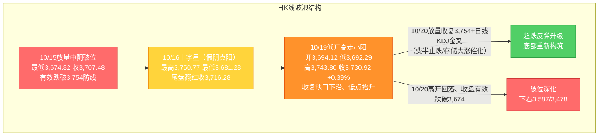
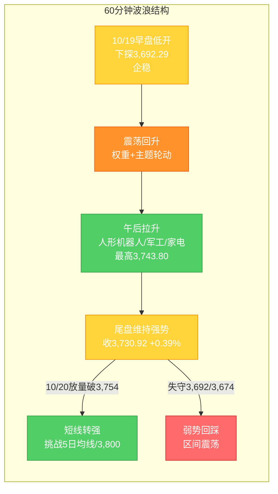

# A股晨报 - 2026年10月20日

> 数据截止时间：2026年10月20日 08:00（北京时间）；A股为10月19日（周一）收盘，美股/欧洲为10月19日（周一）收盘（隔夜），大宗商品/汇率为10月19日纽约尾盘
> 报告性质：**国庆长假后第二个完整交易周（第43周）第2个交易日** —— 以 10/19 晚报（**"破位后止跌企稳信号强化、指数收涨但宽度恶化"**）为基础 + **隔夜外盘科技链反转（费半结束8连跌、存储大涨）与国内金融街论坛政策密集落地信息** + **多周期波浪理论分析**
> 核心观点：**10/19 A股"低开高走、指数分化收涨"，上证收3,730.92（+0.39%），"破位后止跌企稳"信号进一步强化**；**隔夜（10/19美股）出现关键反转信号——费城半导体指数结束此前连续8个交易日下跌（+1.61%，盘中一度涨近3%），存储芯片股集体大涨（闪迪+7.23%、西部数据+5.96%、SK海力士+5.07%、美光+4.18%）、纳指+1.11%**，直接缓解昨日"AI硬件是最大拖累"的外盘映射压力；**国内潘功胜金融街论坛重磅政策（设立非银机构大额赎回流动性支持工具、扩大SLF适用范围、研究将公开市场主要操作品种期限切换为隔夜——隔夜回购利率成主要政策利率，机构解读为"近似变相降息"）+ 首批18只主动ETF获批**构成政策催化。**今日核心博弈：能否借"外盘科技回暖+政策催化"放量收复3,754点（被跌破的原防线/关键反抽确认位）vs 3,674点（"924"平台高点/核心支撑）在欧股普跌、对冲基金减持科技股扰动下的守稳。**

---

## 一、昨日晚报复盘要点回顾

### 1. 昨日（10/19）判断回顾

| 项目 | 准确率 | 说明 |
|------|--------|------|
| 趋势判断 | **100%（1/1）** | "震荡、低开企稳尝试"精准命中（低开-0.60%→探底→高走，收+0.39%） |
| 点位预测 | **100%（4/4）** | 区间3,650-3,770✓、强支撑3,674✓（未失守）、强压力3,754✓（未突破）、缺口下沿3,724.56✓（收复）；成交量"平量偏缩"✓ |
| 板块预判 | **约64%（4.5/7）** | 军工✓、汽车/低空✓、油气/石化✓、银行✓、高位连板✓；**偏差：PCB逆势涨停（AI硬件内部背离）、贵金属未兑现** |
| **综合准确率** | **约88%** | 方向、区间、关键点位精准；板块结构部分偏差 |

### 2. 关键偏差及原因
- **偏差1（核心，板块结构）**：预判"AI硬件（元件/PCB/CPO/MLCC/光模块）整体看跌"，实际**半导体/存储确实领跌，但PCB板块（四会富仕、肯特股份、协和电子、亨通光电）逆势涨停**。根本原因：**信息缺失+逻辑误判**——未纳入光通信"涨价+AI算力需求"与"科技兴商/具身智能"政策提振，**"AI硬件"未再细分**。
- **偏差2（次要，板块）**：未前瞻**家用电器（+1.77%、申万一级居首）**领涨。根本原因：**信息缺失**——10/18**中美"300亿美元对等降税框架"（美方对家电降税）**属周末新增催化，未纳入板块扫描。
- **偏差3（轻微，逻辑）**：高估"政策催化→AI算力硬件"传导，看涨"AI算力底座"实际仅通信/光通信结构性走强、硬件端因费半"8连跌"领跌。

### 3. 沉淀的规则/检查项（10/19晚报新增，共5条）
- **规则1（板块选择）**：**AI硬件须细分**——"PCB/覆铜板/光通信（算力+涨价+国产替代）"与"半导体/存储（外盘费半映射）"背离时须分别预判，不可整体看跌。
- **规则2（板块选择）**：**中美经贸磋商期"对等降税清单"是出口链板块（家电/玩具/轻工等）的前瞻强催化**，须纳入板块前瞻强制扫描清单。
- **规则3（趋势分析）**：**关键防线"贴线止跌"后，若次日"低开高走、站上被跌破的原防线下沿（缺口）、低点抬升"，属"止跌企稳信号强化"**，但未放量收复原防线前仍属"反抽"。
- **规则4（资金面分析）**：**"红利+降税出口链+主题"护盘可推动指数收涨，但若同期"超3,100只个股下跌"，属"指数失真"**，须以市场宽度校正。
- **规则5（波浪分析）**：**C浪延伸破位后于"前期平台高点"连续2日守住（十字星/低开高走小阳、低点抬升、收复缺口下沿）→ 短线止跌信号强化**，仍需"放量收复原防线+日线KDJ金叉"确认。

### 4. 对今日（10/20）分析的启示
- **需要关注的风险点**：①**3,674点（核心支撑）有效性为本周第一观察点**；②**10/19"指数收涨"依赖权重+出口链+主题护盘、超3,100只个股下跌、宽度恶化，企稳基础不牢**；③**欧股10/19普跌（富时100-1.07%、CAC40-1.40%）+ 高盛数据显示对冲基金以十年来最快速度减持科技股**；④**三季报密集披露+解禁扰动**。
- **需要调整的分析逻辑**：①**隔夜外盘"费半结束8连跌、存储大涨"逆转昨日"AI硬件外盘映射利空"，AI硬件（半导体/存储）由"谨慎/偏空"上修至"超跌修复"**，但仍须以"量能放大+主力资金转净流入"双重确认；②**强制扫描"政策发布会/论坛"事件催化**（今日聚焦**金融街论坛潘功胜/吴清讲话+主动ETF获批**）；③看涨"科技链修复"须叠加**"放量收复3,754"**确认，不可仅凭外盘回暖外推。

---

## 二、隔夜市场动态（10/19收盘，隔夜）

### 1. 美股市场（10/19周一收盘）

| 指数 | 收盘点位 | 涨跌幅 | 说明 |
|------|---------|--------|------|
| 道琼斯工业指数 | **51,966.03** | **-0.07%（-36.38点）** | 传统蓝筹持平整理 |
| 标准普尔500指数 | **7,690.73** | **+0.41%（+31.29点）** | 科技回暖带动 |
| 纳斯达克综合指数 | **26,430.89** | **+1.11%（+290.85点）** | **科技股领涨、"一周以来首次反弹"** |
| 罗素2000 | — | **约+0.28%（+6.93点）** | 小盘股小幅回升 |
| **费城半导体指数** | — | **+1.61%（盘中一度涨近3%）** | **结束此前连续8个交易日下跌**（上周累计跌逾11%） |

**解读**：**美股"分化回升、科技股成为唯一主线"**——**亚马逊（+4%）领涨科技股，存储/半导体链集体爆发：闪迪+7.23%、西部数据+5.96%、SK海力士+5.07%、美光科技+4.18%、希捷科技+4.67%、英特尔+4.96%、泛林集团+4.26%、迈威尔科技+4.06%、泰瑞达+4.14%，英伟达/谷歌+1%**；**费半"8连跌"终结**。**净影响：对A股AI硬件链（半导体/存储/CPO/光模块）构成"隔夜定向利好"映射**，昨日"AI硬件是最大拖累"逻辑今日边际反转。**但需注意：欧股10/19全线下跌（与美国科技股分化），且高盛数据显示对冲基金正以至少十年来最快速度减持科技股，全球科技链情绪修复仍不稳固。**

### 2. 欧洲 / 亚太市场

| 市场 | 表现 | 备注 |
|------|------|------|
| 德国DAX30（10/19） | **-1.24%** | 欧股集体下挫 |
| 英国富时100（10/19） | **-1.07%** | — |
| 法国CAC40（10/19） | **-1.40%** | — |
| 富时意大利MIB（10/19） | **-1.60%** | — |
| **日经225（10/19）** | **64,916.70（-0.62%）** | 半导体承压 |
| **韩国KOSPI（10/19）** | **5,768.01（+1.76%）** | 存储双雄（SK海力士/三星）修复 |
| **恒生指数（10/19）** | **约24,186.83（+0.52%）** | 港股震荡上行；内地与香港拟推进人民币股票交易柜台纳入港股通 |

**情绪判断**：**欧股（10/19）全线下跌与美股科技股独立回暖形成"分化"**——**全球风险偏好整体仍偏谨慎，但科技链（半导体/存储）出现"超跌反弹"的边际修复信号**；**亚太（10/19）韩股领涨（+1.76%）、日经小跌、港股小涨**，对A股开盘**中性偏暖**。

### 3. 大宗商品（10/19）

| 品种 | 价格/表现 | 涨跌/驱动 |
|------|----------|----------|
| WTI原油（主力合约） | **约98.24美元/桶** | **约-0.79%**（各口径跌幅约-0.8%~-2.2%，油价高位回落、盘中一度跌破97美元） |
| 布伦特原油（主力合约） | **约109.22美元/桶** | **约-0.58%**（仍站稳109美元上方） |
| COMEX黄金（12月） | **4,160.30美元/盎司** | **-0.50%**；现货金 **约4,143.91美元/盎司（-0.5%）** |
| LME基本金属 | **多数上涨**（伦镍 **+1.54%** 报15,600美元） | 工业金属偏暖 |

**驱动逻辑**：①**油价高位回落（美油跌破100美元、布油守住109美元）**——A股**油气/石化**短期动能减弱、"油价反弹初期"逻辑边际降温；②**黄金小幅下跌（美联储加息押注限制上行、但国债收益率回落提供支撑）**——A股**贵金属**承压延续；③**LME基本金属多数上涨**——A股**有色**边际回暖。

### 4. 汇率与利率（10/19纽约尾盘）

| 指标 | 数值/表现 | 变化/说明 |
|------|----------|----------|
| 人民币中间价（10/19） | **6.7208** | **调升12个基点**（10/16为6.7220） |
| 离岸人民币（10/19纽约尾盘） | **6.6822** | **升值41个基点**（人民币延续偏强、逼近6.68） |
| 美元指数 | **101.99** | **+0.20%**（高位小幅上行） |
| 美债10年期收益率 | **约5.1%** | 高位波动（10/16收5.081%，10/19盘中回升） |
| 美联储加息预期 | — | 市场对10/27-28会议加息概率预期仍偏低（沃什偏鸽后维持） |

**特征**：①**人民币走强**（中间价调升+离岸升破6.69）——**边际利多A股风险偏好与外资流入**；②**美元指数小幅上行、美债高位**——对高估值成长估值构成扰动，但**潘功胜"短端利率换锚（隔夜回购成主要政策利率）"被视为"近似变相降息"，中期利好利率敏感型资产（成长/券商/贵金属）**；③**国内流动性呵护延续**。

### 5. 重要海外事件
- **高盛数据：对冲基金以至少十年来最快速度减持科技股**（财联社10/20投资避雷针）——**全球科技股资金面偏谨慎**，对A股科技链修复构成"心理扰动"。
- **中国智能手机2026年Q3出货量同比下降10%**——**消费电子/手机链需求承压**。
- **纽约商品交易所商品夜盘（10/19）多数下跌、化工品跌幅居前（DCE乙二醇-3.73%）**——**化工/商品链偏弱**。
- **贝达药业**：合作伙伴的伏罗尼布眼科制剂三期临床试验**未达主要终点**（**创新药个股利空**）。

---

## 三、今日关注事项

### 1. 重要数据发布（按时间排序）
- **今日（10/20）国内外无重磅经济数据集中发布**；**重点关注2026金融街论坛年会（10/19-22持续）后续政策表述**与**三季报密集披露进展**。
- **本周关注**：10/21 **证监会主论坛（"建设一流投资机构"）**；**美联储10/27-28议息会议**前瞻。

### 2. 政策/监管动态（昨日收盘后发布）
- **2026金融街论坛年会（10/19 开幕，北京）**——**央行行长潘功胜重磅披露一系列即将出台的政策举措**：
  - **会同金融监管总局、证监会设立"应对非银机构大额赎回的流动性支持工具"**（防范流动性风险）；
  - **扩大常备借贷便利（SLF）的适用机构范围**；
  - **推动银行间和交易所债券市场互联互通落地**；
  - **试点进一步便利境外金融机构在境内外汇市场开展人民币购售业务**；
  - **研究择机将公开市场主要操作品种的期限切换为隔夜**——**隔夜回购利率（DR001）成为主要政策利率**（机构解读为"近似变相降息"，短端利率"换锚"）；**将退出存贷款基准利率**；
  - 强调**中国没有必要、也无意通过汇率贬值获取贸易竞争优势**，回应人民币国际化、人工智能等关切。
- **金融监管总局局长丁向群**：切实提升监管有效性、有力防控金融风险，加快数字化智能化转型。
- **证监会**：**首批18只主动ETF正式获批（10/19）**——**助力中长期资金入市**（吴清6/17陆家嘴论坛宣布支持交易所推出主动ETF后落地）；**10/21证监会主论坛将聚焦"建设一流投资机构"**。
- **商务部等9部门《关于加快推进科技兴商的意见》+ 市场监管总局首批六项人形机器人国家标准**（10/19延续催化）。

### 3. 公司公告（10/19晚密集）
- **回购潮延续（10/19晚）**：**金发科技**（董事长提议回购3-5亿元、**全部用于注销减资**）、**鹏鼎控股**（拟最高5亿元回购、价格上限80元/股）、**裕同科技、生益电子、优迅股份、良信股份、长龄液压、涛涛车业、日联科技、华海清科、智信精密**等**11余家公司**披露回购/增持。
- **大手笔分红**：**A股龙头"10派13元"高分红方案**（高股息资产受机构关注，多只银行股创年内新高）。
- **三季报**：**密集披露期**——**国产存储板块结构分化、资金转向"业绩验证"**；**横店东磁/亨通光电/扬杰科技**等前期已披露预喜。
- **个股利空**：**贝达药业**眼科制剂三期临床未达主要终点。

### 4. 其他关注
- **新股申购**：**天元重工（920306，北交所，发行价4.48元/股）今日申购**；**皇冠新材（001381）公布中签率**。
- **限售解禁**：**盛合晶微半导体**首发限售股**13,175,749股将于10/21上市流通**；本周（10/19-10/23）解禁市值约**952.83亿元**（44家）；**10月最后两周合计约1,976.2亿元**。
- **重要会议/发布会**：2026金融街论坛年会（**10/19-22**持续）。

---

## 四、板块与个股分析（结合昨日复盘）

### 1. 基于昨日复盘结论的板块调整
- **昨日看涨板块今日预期**：**AI算力底座/AI应用**——**隔夜费半结束8连跌、存储大涨，"AI硬件外盘映射利空"边际反转**，**由"谨慎/偏空（硬件端）"上修至"超跌修复"**（须量能确认）；**事件驱动（军工/低空/汽车）**——**维持偏多**（航展余温+政策主题）；**红利防御（银行/保险/煤炭）**——**维持偏多**（护盘+类固收，多只银行股创年内新高）。
- **昨日看跌板块今日预期**：**油气/石油石化**——**10/19国际油价高位回落（美油跌破100美元）**，"油价反弹初期"动能减弱，**由"中性偏多"下调至"中性/承压"**；**贵金属/有色**——**黄金小幅下跌、维持偏空**（有色因LME金属上涨边际修复）；**高位连板股/传媒**——**维持偏空**（获利回吐、连板高度已降至3板）。
- **昨日偏差板块修正**：**AI硬件（半导体/存储）**——**由"看跌"上修为"超跌修复"**（费半止跌+存储大涨映射）；**PCB/覆铜板/光通信**——**维持"涨价链+算力需求"偏多**（昨日逆势涨停印证）；**家用电器（出口链）**——**降税框架催化持续，维持偏多**。

### 2. 隔夜信息驱动的板块机会
- **受益板块**：
  - （1）**半导体 / 存储 / 光通信 / CPO**（逻辑：**费半结束8连跌、存储芯片集体大涨（美光+4.18%、SK海力士+5.07%、闪迪+7.23%）的隔夜正向映射**；超跌修复）
  - （2）**券商 / 金融科技**（逻辑：**金融街论坛政策密集（非银流动性支持工具、债券市场互联互通）+ 首批18只主动ETF获批 + 短端利率"换锚"/近似变相降息**）
  - （3）**红利防御（银行/保险/高股息）**（逻辑：**护盘 + 类固收避险 + "10派13元"高分红示范 + 主动ETF中长期资金**）
  - （4）**AI算力底座 / AI应用 / 人形机器人**（逻辑：**科技兴商+机器人国标+金融街论坛AI议题延续**；超跌修复）
- **受损板块**：
  - （1）**油气 / 石油石化**（逻辑：**国际油价高位回落、美油跌破100美元**）
  - （2）**贵金属**（逻辑：**黄金小幅下跌、美联储加息押注限制上行**）
  - （3）**消费电子 / 手机链**（逻辑：**中国Q3智能手机出货量同比下降10%**）
  - （4）**化工**（逻辑：**商品期市夜盘化工品领跌**）

### 3. 重点关注个股
- **存储/半导体龙头（如兆易创新、江波龙、德明利、佰维存储）**：**费半止跌+存储隔夜大涨**映射，**关注能否"放量修复"**（昨日半导体领跌，今日修复弹性大）。
- **光通信/PCB（亨通光电、四会富仕、生益科技/生益电子）**：**涨价+AI算力需求+回购（生益电子）**，**昨日逆势涨停延续性**。
- **券商（头部券商）**：**金融街论坛政策+主动ETF+成交活跃度回升**，**关注情绪面修复带来的弹性**。
- **贝达药业（利空）**：**眼科制剂三期临床未达终点**，**注意创新药个股情绪冲击**。

---

## 五、今日核心判断（结构化输出，用于晚报复盘）

### 1. 趋势判断
- 上证指数：**【震荡偏强（超跌修复、尝试收复3,754）】**
- 预测区间：**3,690点 - 3,790点**
- 核心逻辑：**隔夜外盘出现关键反转——费半结束"8连跌"、存储芯片集体大涨、纳指+1.11%，昨日"AI硬件是最大拖累"的外盘映射压力边际解除**；**国内金融街论坛潘功胜密集政策（非银流动性支持工具、隔夜回购成主要政策利率/近似"变相降息"）+ 首批18只主动ETF获批**构成政策与资金催化；**叠加10/19已"低开高走收阳、低点抬升、收复缺口下沿"，止跌企稳信号强化**——**今日大概率"高开或平开、震荡修复、挑战3,754"**。但**欧股普跌、高盛对冲基金"十年来最快减持科技股"、"指数失真（超3,100只下跌）"**压制修复高度，**方向选择仍待3,674与3,754的争夺**。

### 2. 关键点位
- 强支撑位：**3,674点**（依据："924"行情平台高点/核心支撑，10/19盘中低点3,692.29在其上方，连续2日未有效跌破）
- 弱支撑位：**3,660点 / 3,620点**（依据：60/30分钟短期支撑与黄金分割延伸缓冲）
- 强压力位：**3,754点**（依据：被跌破的原"最后防线"，与5日均线重合，10/19高点3,743.80受阻于其下方）
- 弱压力位：**3,767点（缺口上沿）/ 3,724.56点（缺口下沿，已收复）**（依据：10/13-10/15跳空缺口区间）

### 3. 板块预判
- 看涨板块：（1）**半导体/存储/光通信/CPO**（逻辑：费半结束8连跌+存储大涨的隔夜正向映射，超跌修复）（2）**券商/金融科技**（逻辑：金融街论坛政策+主动ETF+短端"换锚"）（3）**红利防御（银行/保险/高股息）**（逻辑：护盘+类固收+高分红）（4）**AI算力底座/AI应用/人形机器人**（逻辑：科技兴商+机器人国标+政策延续）
- 看跌板块：（1）**油气/石油石化**（逻辑：国际油价高位回落、美油跌破100美元）（2）**贵金属**（逻辑：金价下跌、加息押注限制上行）（3）**消费电子/手机链**（逻辑：Q3手机出货-10%）（4）**高位连板股/传媒**（逻辑：获利回吐、连板高度降至3板）
- 风险板块：**高位连板股（异动/回撤风险）、三季报或不及预期的高位成长股（如贝达药业临床失败类）、大额解禁个股（本周约952.83亿、10月最后两周约1,976.2亿）、化工链（商品夜盘领跌）**

### 4. 资金面判断
- 北向资金预期：**【结构性分化，或转为小幅净流入】**（交易所已不实时披露净额，以成交口径跟踪；**人民币走强（离岸升至6.6822）+外盘科技回暖或提振外资情绪**）
- 成交量预期：**【温和放量，约1.5-1.7万亿元】**（科技链修复+政策催化或带动量能温和放大；若放量收复3,754则确立"修复放量"，若量能不放大则维持1.4-1.5万亿区间磨底）

### 5. 风险预警（按优先级排序）
- 高风险：**①3,674点（核心支撑）有效性**——若"高开回落"收盘有效跌破则破位深化，下看3,587/3,478；**②"指数失真"（10/19超3,100只个股下跌、宽度恶化）**——若科技修复未能扩散、个股普跌延续，则指数上行基础不牢
- 中风险：**全球科技股资金面扰动**——高盛数据显示对冲基金以十年来最快速度减持科技股；**欧股10/19普跌**映射；**三季报高位成长股业绩验证**（贝达药业临床失败类事件）；**解禁（本周约952.83亿）**
- 低风险：**油价回落致油气链承压**；**金融街论坛后续政策预期兑现节奏**；**高位连板股回撤**；**美联储10/27-28 FOMC 变数**

### 6. 昨日复盘规则应用
- **应用规则1（板块选择）**：**AI硬件须细分**——今日**"半导体/存储"因费半止跌、存储大涨而上修至超跌修复**，"PCB/光通信"维持涨价链偏多，**分别预判、不整体定调**。
- **应用规则2（趋势分析）**：**"贴线止跌+低开高走小阳+低点抬升+收复缺口下沿"=止跌企稳信号强化**，**今日若放量收复3,754则升级为"底部重新构筑"**；在放量收复前仍以"反抽/修复"定性。
- **应用规则3（板块选择）**：**强制扫描"论坛/发布会/政策"事件催化**——今日聚焦**金融街论坛（潘功胜政策举措+吴清）与主动ETF**，政策驱动板块（券商/金融科技、红利）优先纳入。

---

## 六、投资策略建议（分短线+中线）

### 1. 短线策略（1-3个交易日）
- 适用场景：基于日K线与60分钟K线技术信号
- 短线仓位：**15-20%**（较昨日10-15%小幅上调：外盘科技回暖+政策催化，超跌修复窗口打开）
- 买入条件：**指数平开/高开不破3,692点且放量反抽**可小仓参与修复；**半导体/存储、券商需"放量+主力资金转净流入"双确认**；**不追高、以回踩3,692-3,700低吸为主**
- 卖出条件：**反弹至3,754-3,767压力区滞涨**，或**收盘有效跌破3,674点**
- 止损位：**3,674点**（或个股跌幅5%）
- 短线标的：（1）**半导体/存储/光通信**（逻辑：费半结束8连跌+存储大涨映射，超跌修复弹性大）（2）**券商/金融科技**（逻辑：金融街论坛政策+主动ETF催化）（3）**AI算力/AI应用/人形机器人**（逻辑：科技兴商+政策延续）

### 2. 中线策略（1-4周）
- 适用场景：基于周K线波浪分析与运行规律分析结论
- 中线仓位：**15-20%（维持）**
- 方向判断：**【持有 / 观望（偏防御）】**
- 目标区间：上证指数 **3,674点 - 3,800点**
- 中线布局板块：（1）**低拥挤度防御（银行/保险/煤炭/高股息）**（逻辑：类固收避险+护盘+高分红）（2）**AI算力/政策主线（算力底座、AI应用、半导体存储）**（逻辑：科技兴商+金融街论坛政策+外盘科技修复，待放量确认）（3）**事件驱动（军工/低空，波段）**（逻辑：航展/新品催化）
- 止盈条件：指数到达**3,800点（20月均线）**或波段涨幅达5%
- 止损条件：**收盘有效跌破3,674点**或趋势确认反转

### 3. 仓位分配总览

| 策略类型 | 仓位比例 | 方向 | 重点板块 |
|---------|---------|------|---------|
| 短线 | **15-20%** | 超跌修复（量能绑定） | 半导体/存储、券商、AI算力 |
| 中线 | **15-20%** | 持有/观望（偏防御） | 红利防御、AI政策主线、事件驱动 |
| 现金 | **60-70%** | — | — |

### 4. 与昨日策略对比

| 项目 | 昨日（10/19）建议 | 今日（10/20）建议 | 调整原因 |
|------|------------------|------------------|---------|
| 短线仓位 | 10-15% | **15-20%（小幅上调）** | 外盘科技回暖+政策催化，超跌修复窗口打开 |
| 中线仓位 | 15-20% | **15-20%（维持）** | 破位结构未修复，待放量收复3,754再评估加仓 |
| 重点方向 | AI算力/AI应用、军工/低空、油气、红利防御 | **半导体/存储/光通信、券商/金融科技、红利防御、AI算力** | 外盘费半止跌+存储大涨→上修半导体/存储；油价回落→下调油气；金融街论坛政策→上调券商 |

---

## 七、波浪理论多周期分析

> 说明：基于**10/19实际K线结构**更新。**10/15"放量中阴有效跌破最后防线3,754"→10/16"贴线3,674止跌、收十字星"→10/19"低开高走、收复缺口下沿、低点抬升"，C浪延伸破位后"止跌企稳"信号进一步强化；隔夜外盘"费半结束8连跌、存储大涨"为向上修复提供催化。**

### 1. 月K线波浪分析
- **当前波浪位置**：大周期**第2浪C浪延伸"破位下行后的止跌尝试"阶段**；**10月月K线现为"破位中阴、带下影"**。
- **浪型结构描述**：2024年9月2,689点→2026年6月4,197点为**第1浪上升**；**第2浪ABC调整**：4,197点→3,674.82点（10/15盘中低点）；10月呈"10/8放量中阴→10/9长下影V型→10/13跳空探底→10/15放量破位→10/16贴线十字星→10/19低开高走小阳"。
- **关键目标位**：下方支撑**3,674点（"924"平台高点/核心支撑）→3,587点→3,478点**；上方压力**3,754点（原防线转压力）→3,800点（20月均线）→3,842点**。
- **验证条件**：**10月月K线能否在3,674点上方止跌企稳**——已连续2个交易日（10/16、10/19）守住；月内若继续**收盘有效跌破3,674**，则月度下行空间打开（下看3,587/3,478）。

### 2. 周K线波浪分析
- **当前波浪位置**：**第43周（10/19-10/23）第2个交易日**；**第42周（10/12-10/16）为"带下影中阴（破位周）"**（周低3,674.82、周收3,716.28）。
- **浪型结构描述**：本周开局**低开高走收3,730.92（站上上周收盘3,716.28）**，**周内已收复缺口下沿3,724.56**；周线仍处5周/10周/20周/60周均线下方，**短期均线空头排列未改**，但**下影/实体改善、存"止跌"迹象**。
- **关键目标位**：周度下方支撑**3,674点→3,587点**；周度压力**3,754点（原防线）→3,767点（缺口上沿）→3,800点（20月均线）**。
- **验证条件**：**本周末（10/23）能否"放量收复3,754点"**为周线企稳前提；若继续放量跌破3,674，则周线破位确认、下探3,587。

### 3. 日K线波浪分析（重点）
- **当前波浪位置**：**C浪延伸"破位下行"后的"止跌企稳信号强化"**——10/19收**"低开高走小阳（上影短、实体中）"**，**收复缺口下沿3,724.56、低点抬升至3,692.29（高于10/16低3,681.28）**；**但反抽仍受"原防线3,754"压制（10/19高3,743.80未及），仍属"下跌中继修复/弱势止跌"**。
- **浪型结构描述**：9/30收3,842.19→10/8收3,811.90→10/9收3,813.79→10/12收3,797.24→10/13收3,782.45→10/14收3,767.23→10/15放量破位收3,707.48（低3,674.82）→10/16十字星收3,716.28→**10/19低开高走收3,730.92（+0.39%，高3,743.80、低3,692.29）**；**低点序列"3,754.14→3,754.60→3,674.82→3,681.28→3,692.29"在3,674点上方形成"抬升/贴线承接"**。
- **关键目标位**：**下方支撑**：**3,674点（核心）→3,660点→3,620点→3,587点**；**上方压力**：**3,724.56点（缺口下沿，已收复）→3,743.80点（10/19高点）→3,754点（原防线/5日均线，关键反抽确认位）→3,767点（缺口上沿）→3,800点（20月均线）**。
- **验证条件**：
  - **向上修复**：**放量收复3,754点并站稳** → 超跌反弹升级、底部重新构筑（关注日线KDJ能否有效金叉）。
  - **向下确认**：**收盘有效跌破3,674点** → 破位深化，下看3,587点及3,478点。
  - **今日变量（10/20）**：隔夜**费半结束8连跌、存储大涨、纳指+1.11%**（**向上催化**）vs **欧股普跌、对冲基金减持科技股**（**扰动**）——**高开不回落并放量收复3,754者为强，高开回落失守3,692者为弱**。

### 4. 60分钟K线波浪分析
- **当前波浪位置**：60分钟级别**"低开探底→震荡回升→午后拉升"**，短线由"弱平衡"转为**"修复偏强"**。
- **浪型结构描述**：60分钟10/19早盘低开下探3,692.29后企稳，**午后人形机器人/军工/家电/银行放量拉升**，尾盘维持强势收于3,730.92；**MACD低位金叉向上、KDJ低位回升、量能集中午后拉升段**。
- **关键目标位**：短期支撑**3,692点→3,674点**；短期压力**3,743.80点→3,754点**。
- **验证条件**：**今日首两个小时能否"放量突破3,743.80并挑战3,754"**——突破则短线转强、挑战5日均线（约3,740-3,755）；否则回踩3,692/3,674。

### 5. 30分钟K线波浪分析
- **当前波浪位置**：30分钟级别**"低开企稳→午后加速拉升"**，短线动能为"偏强修复"。
- **浪型结构描述**：30分钟10/19在3,692-3,743区间震荡上行，**午后在主题（机器人/军工）+权重（银行）共振下快速拉升**；**MACD低位金叉、KDJ中位区向上，存超跌修复动能**。
- **关键目标位**：关键支撑**3,700点→3,692点**；短期压力**3,743.80点→3,754点**。
- **验证条件**：**30分钟能否放量突破3,754**——突破则短线转强、挑战3,800；否则维持区间震荡、回踩3,692。

### 6. 波浪图（Mermaid绘制）

**日K线波浪结构图**：

**60分钟波浪结构图**：

### 7. 波浪理论综合判断

| 维度 | 判断 |
|------|------|
| **多周期共振状态** | **月/周大周期仍偏"向下"（C浪特征未改）**；**日线/60分钟/30分钟"止跌企稳"边际改善强化**——日线低开高走收阳、低点抬升、收复缺口下沿，60/30分钟MACD低位金叉。**多周期由"向下共振"转向"短线修复背离"**（隔夜外盘科技回暖增强修复动能，但**周线仍未确认**）。 |
| **当前操作级别** | **日线级别（防守 + 超跌反弹尝试）**（3,674点为中线核心支撑；3,754为被跌破的原防线/关键反抽确认位；5日均线约3,740-3,755为短线压制）。 |
| **后续演变路径（10/20及本周）** | **40%乐观**（高开修复+外盘科技回暖+政策催化→放量收复3,754并站稳、挑战3,767/3,800，底部重新构筑）、**40%中性**（3,692-3,754区间震荡修复、缩量整理、科技修复与题材轮动（半导体/券商/机器人））、**20%悲观**（欧股映射/对冲基金减持科技股发酵→高开回落、收盘有效跌破3,674，下看3,587/3,478）。 |
| **关键拐点信号** | 向上：**放量收复3,754点并站稳 + 日线KDJ有效金叉 + 主力资金转净流入 + 半导体/存储放量修复**；向下：**收盘有效跌破3,674点** + 外盘科技修复中断 + 市场宽度持续恶化。 |
| **风险提示** | ①**3,674点有效性为本周第一观察点**（已连续2日守住但未放量确认）；②**"指数收涨"依赖权重+出口链+主题，超3,100只个股下跌、宽度恶化，企稳基础不牢**；③**隔夜外盘科技回暖（费半止跌+存储大涨）与"欧股普跌+对冲基金十年来最快减持科技股"形成博弈**，修复可持续性待观察；④**三季报业绩验证（贝达药业临床失败类）+解禁（本周952.83亿）**扰动；⑤**波浪理论在"C浪延伸破位后止跌"阶段预测精度降低**，须结合量能、外盘与政策面综合判断。 |

> **规律分析引用（第42周运行规律分析，周日10/18生成）**：该报告**定性第42周为"破位周"**，预测**第43周（10/19-10/23）上证运行区间3,587-3,800点**、主基调**"震荡（低位弱势整理、企稳尝试）"**，乐观/中性/悲观概率**30%/45%/25%**；强调**"3,674点（平台高点）为中线核心支撑（收盘有效跌破则下看3,587/3,478）、3,754点（原防线）为短线转强关键"**。**本报告据隔夜外盘科技回暖+政策催化，将乐观概率小幅上调至40%、中性40%、悲观20%，整体仍维持"破位后弱势企稳（修复尝试）"主基调。**

---

## 八、信息来源

1. **官方数据来源**：上海证券交易所（上证指数10/19收盘3,730.92、涨0.39%、最高3,743.80、最低3,692.29）、深圳证券交易所、中证指数有限公司、中国外汇交易中心（人民币中间价10/19为6.7208）、中国人民银行（潘功胜金融街论坛讲话：设立非银机构大额赎回流动性支持工具、扩大SLF适用机构范围、推动债券市场互联互通、研究将公开市场主要操作品种期限切换为隔夜）、国家金融监督管理总局（丁向群讲话）、中国证监会（首批18只主动ETF获批）、美国劳工部/纳斯达克（美股收盘）、纳斯达克PHLX（费城半导体指数）、香港交易所、韩国交易所（KOSPI）、东京证券交易所（日经225）
2. **权威财经媒体**：新华网（纽约股市/纽约金价19日、潘功胜金融街论坛政策）、证券时报（昨夜纳指大涨/存储板块全线爆发；日韩股市收盘；对冲基金减持科技股）、中国证券报（科技股反弹/费半结束8连跌；10派13元高分红）、上海证券报·中国证券网（10月20日新股提示；四点半观市）、财联社（10/20投资避雷针、债市早参"隔夜回购成主要政策利率"、港股早报、美股存储芯片股大涨）、每日经济新闻（国际油价收跌）、第一财经（欧洲三大股指全线下跌）、中国金融新闻网/中国经济网（金融街论坛）
3. **数据平台**：东方财富（欧洲三大股指；国际油价；美股半导体/存储/光通信；费城半导体指数开盘）、同花顺、Wind资讯、新浪财经（隔夜欧美/美元指数/离岸人民币；美股存储芯片股集体大涨）、金融界（10/19亚太股市：KOSPI+1.76%、恒指+0.52%、上证+0.39%）、大河财立方（隔夜欧美10月20日）、Barchart（美股指数收盘）、世界黄金协会（Weekly Markets Monitor）
4. **研究机构**：高盛（对冲基金减持科技股数据）、摩根士丹利（中国股市至2026年末约5%-10%上行空间）、中信证券/华源证券/华西证券等券商策略

> 数据截止时间：2026年10月20日 08:00（北京时间）；A股为10月19日（周一）收盘，美股/欧洲为10月19日（周一）收盘（隔夜），大宗商品/汇率为10月19日纽约尾盘；盘后公告/政策截至10月20日早间。

---

*本晨报由AI代理自动生成，仅供参考，不构成投资建议。投资有风险，入市需谨慎。*
