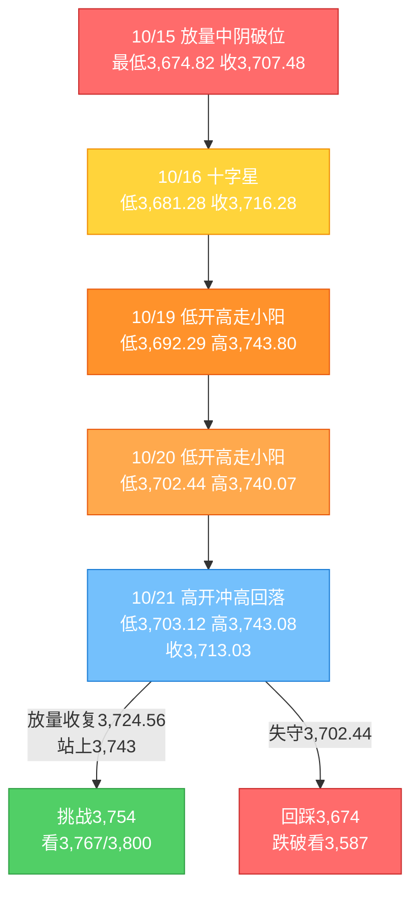
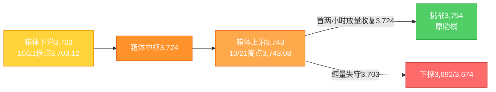

# A股晚报 - 2026年10月21日

> 数据截止时间：2026年10月21日 20:00（北京时间）；A股为10月21日收盘数据，美股为10月20日收盘（隔夜）及10月21日盘前/期货，欧洲为10月21日盘中，亚太为10月21日收盘，大宗商品/汇率为10月21日盘中或最近收盘
> 报告性质：**国庆长假后第二个完整交易周（第43周）第3个交易日**；以10/21晨报（**"震荡偏强，区间3,715-3,790"**）+ **宁德时代三季报"增收不增利"冲击** + **国家数据集团成立催化数据要素** + **多周期波浪分析** 为基础

---

## 一、市场回顾

### 1. 主要指数表现

| 指数 | 收盘点位 | 涨跌幅 | 开盘 | 最高 | 最低 | 备注 |
|------|---------|--------|------|------|------|------|
| 上证指数 | **3,713.03** | **-0.60%（-22.34点）** | 3,740.57 | 3,743.08 | 3,703.12 | 高开冲高回落，尾盘急跌后小幅拉回；振幅1.07% |
| 深证成指 | **11,704.35** | **-0.82%** | — | — | — | 深证50领跌，权重股拖累 |
| 创业板指 | **2,694.71** | **-1.62%** | — | — | — | **连跌8日，失守2,700点**；宁德时代跌超12% |
| 科创50 | — | **+0.06%** | — | — | — | 存储/半导体结构性支撑，相对抗跌 |
| 科创综指 | — | **-0.08%** | — | — | — | 盘中回补10/15下跳缺口后回落 |
| 北证50 | — | **-0.72%** | — | — | — | 小幅回调 |
| 沪深300 | 约4,110点 | **约-1.0%** | — | — | — | 盘中14:15报4,110.46（-1%），权重拖累 |
| 上证50 | — | **中阴** | — | — | — | 高开低走，中国电信、中国神华等权重跌幅居前 |

**盘面特征**：三大指数**集体高开**（沪指高开+0.14%），开盘后短暂冲高至3,743.08，随后一路震荡走低；午后维持低位，**尾盘放量急跌**至3,703.12后小幅拉回，收3,713.03。**"高开冲高回落、尾盘跳水"** 是典型的**利好高开兑现+权重业绩雷**组合。上证最低3,703.12点，**连续第4个交易日抬高**（3,681.28→3,692.29→3,702.44→3,703.12），但收盘**失守3,724.56点缺口下沿**，为10/19以来首次。

### 2. 成交量能与资金流向

| 指标 | 数值 | 变化/说明 |
|------|------|----------|
| 两市及北交所成交额 | **14,421亿元** | 较10/20的14,715亿元**缩量295亿元（-2.0%）**；另一Wind口径14,294亿元，口径差异约127亿元 |
| 沪市成交额 | **6,427.52亿元** | 较10/20的7,000亿元减少572亿元 |
| 深市成交额 | **约7,866亿元** | 较10/20回落 |
| 北向资金成交额 | **2,220.82亿元** | 占两市总成交额**15.54%**；**净额未披露**（交易所已不实时披露） |
| 主力资金 | **净流出44.35亿元** | **连续第11个交易日净流出**；创业板净流出27.85亿元，科创板净流入14.82亿元，沪深300净流出88.51亿元 |
| 行业资金 | **12个行业净流入、19个净流出** | 电子+48.83亿元居首、通信+16.46亿元、机械设备/农林牧渔均超+8亿元；电力设备约-56亿元居首，传媒/汽车/计算机均净流出超7亿元 |

**北向十大成交股**：沪股通——紫金矿业28.16亿元、药明康德18.12亿元、贵州茅台16.92亿元；深股通——**宁德时代162.12亿元**、中际旭创37.93亿元、新易盛23.05亿元。

**资金结构判断**：**"总量净流出+电子/通信/农业结构性净流入"**——资金并未全面撤退，而是从**电池链/新能源/权重**切向**数据要素/光通信/存储/农业**，属**"权重杀跌+主题脉冲"**的结构性行情；但主力连续11日净流出，说明增量资金仍缺位。

### 3. 市场情绪与宽度

| 指标 | 数值 | 说明 |
|------|------|------|
| 上涨家数 | **1,980只（35.57%）** | 较10/20的3,778只大幅回落 |
| 下跌家数 | **3,364只** | 普跌格局 |
| 平盘 | 约223只 | — |
| 涨停 | **50只** | 主板44只、创业板4只、科创板2只 |
| 跌停 | **5只** | 电池链、食品饮料个股为主 |
| 炸板 | **25只** | 封板率**66.67%** |
| 涨超9% / 跌超9% | **63只 / 16只** | 局部赚钱效应仍在，但集中度高 |

**情绪判断**：**"指数普跌、宽度转弱、涨停家数从56降至50、炸板率上升"**——市场从10/20的"普涨修复"转向**"分化退潮"**；亏钱效应主要集中在**电池链、新能源、白酒、家电、煤炭、金融权重**，赚钱效应集中在**数据要素、AI漫剧/传媒、猪肉、光通信、存储**。

---

## 二、热点板块与异动分析

### 1. 当日领涨板块及驱动因素

| 板块/概念 | 表现 | 驱动因素 |
|-----------|------|----------|
| **农林牧渔（猪肉/水产）** | **申万+1.95%，居首** | 猪周期反转预期+产能去化；东瑞股份、东方海洋、百洋股份涨停，平潭发展、晨光生物、天康生物、神农集团、巨星农牧涨超5% |
| **电子/存储/光通信** | **申万电子+0.79%** | 日韩存储双巨头延续强势（KOSPI+3.29%）；存储芯片活跃；天孚通信获主力净流入7.84亿元；利亚德、敏芯股份、致尚科技、莱特光电、光峰科技、利通电子涨停或涨超10% |
| **数据要素/数字经济** | **板块10余只涨停** | **国家数据集团10/20在雄安揭牌**（国资委2026年第1号公告，央企第28位）；利亚德、三维天地、慧辰股份、兆讯传媒20%涨停；恒大高新、天威视讯、航天信息10%涨停；读者传媒5天3板，南威软件、星光股份4天3板 |
| **文化传媒/AI漫剧** | **逆势走强** | 读者传媒、出版传媒涨停，粤传媒2连板；AI漫剧概念反复活跃 |
| **建筑材料、通信、计算机、房地产、综合** | 小幅上涨 | 低位轮动+数据要素/光通信带动 |

**领涨逻辑**：**"国家级数据主体落地"是当日最强政策催化**，数据要素成为唯一具备"批量涨停+梯队完整"的主线；**日韩存储/半导体强势**为电子提供外部支撑，但A股存储链高开后分化，未能形成全面涨停潮；**猪肉/农业**属低位防御+猪周期预期，是弱势市场的避险方向。

### 2. 当日领跌板块及原因

| 板块/概念 | 表现 | 原因分析 |
|-----------|------|----------|
| **电力设备/电池/固态电池** | **申万-3.67%，居首** | **宁德时代三季报"增收不增利"跌12.03%**，拖累电池链；时代万恒跌停，蔚蓝锂芯-9.25%、先导智能-9.00%、尚太科技跌超9%、天赐材料-4.31%、亿纬锂能-5.27%、国轩高科-6.94%、恩捷股份-6.14% |
| **美容护理** | **-1.94%** | 高位消费补跌 |
| **煤炭** | 跌幅居前 | 新集能源跌超5%，中国神华、山煤国际、晋控煤业跌超2%；红利防御遭抽血 |
| **食品饮料/白酒** | 明显下跌 | 盐津铺子跌停，东鹏饮料、山西汾酒跌超5%，古井贡酒、青岛啤酒跌超3% |
| **汽车/新能源车** | 跌幅居前 | 长城汽车-2.95%、上汽集团-1.58%；新能源车产业链随电池链调整 |
| **家电/电信/金融** | 调整 | 中国电信-3.78%、格力电器-3.81%；银行、保险、券商集体疲软 |

**领跌逻辑**：**宁德时代业绩说明会→Q3毛利率创近四年新低→单季净利环比-5.77%→"增收不增利"**，是本日**最大的权重业绩雷**；其作为创业板/沪深300核心权重，直接导致**创业板指失守2,700、沪深300跌约1%**。同时，**红利/大金融/白酒**在风险偏好回落时并未起到防御作用，反而成为**资金流出方向**，说明**"高低切换"已进入"高位补跌"阶段**。

### 3. 个股异动复盘

- **连板高度**：**海洋王、东安动力、大业股份均4连板**，为当日最高板；封单金额前三为**三峡新材4.99亿元、大业股份4.01亿元、海洋王2亿元**。
- **数据要素梯队**：利亚德、三维天地、慧辰股份、兆讯传媒**20%涨停**；恒大高新、天威视讯、航天信息**10%涨停**；读者传媒**5天3板**；南威软件、星光股份**4天3板**。
- **猪肉/农业**：东瑞股份、东方海洋、百洋股份涨停；平潭发展、晨光生物、天康生物、神农集团、巨星农牧涨超5%。
- **强势股回调**：宁德时代-12.03%报227.90元，创**18个月新低**，成交162.12亿元（深股通成交第一），主力净流出约12.35亿元；阳光电源-4.92%、先导智能-9.00%、亿纬锂能-5.27%。
- **权重走弱**：中国石油-2.26%、中国海油-1.66%、中国电信-3.78%、格力电器-3.81%、长城汽车-2.95%、上汽集团-1.58%。

---

## 三、关键数据与事件回顾

### 1. 国内重要经济数据

- **三季度GDP（10/19公布）**：前三季度GDP同比**+4.6%**；分季度看，Q1 +5.0%、Q2 +4.3%、**Q3 +4.5%（较Q2回升0.2个百分点）**；三季度GDP总量**375,367亿元**。经济"稳中有升"，但市场并未给予正面定价，说明**当前矛盾在微观盈利与资金面，而非宏观总量**。
- **三季度经济结构**：出口增速加快、消费改善、投资降幅收窄；新旧动能转换持续推进（高端制造、数字经济贡献提升）。

### 2. 政策与监管动态

- **国家数据集团成立（10/20）**：国务院国资委2026年第1号公告，经国务院批准组建**国家数据集团有限公司**，由国资委履行出资人职责，总部设在**河北雄安新区**，位列央企名录第28位；以数据资源开发利用为主责主业，目标是成为**数据要素服务国家队、数据基础设施互联互通引领者**。这是当日**数据要素板块批量涨停**的直接催化。
- **2026金融街论坛（10/19-10/22）**：央行行长潘功胜10/19宣布将**设立应对非银机构大额赎回的流动性支持工具**、扩大SLF适用机构范围、推动银行间与交易所债券市场互联互通；证监会主席吴清10/19宣布**同意首批18只主动ETF注册**，并提出**深化再融资改革、择机发布新修订的再融资注册管理办法、鼓励回购增持、完善违规减持约束、推动长周期考核、深化公募改革**。10/21为证监会承办主论坛日，政策信号延续。
- **央行公开市场操作（10/21）**：**7天期逆回购操作量为零**；开展**800亿元隔夜逆回购**；当日有560亿元7天期逆回购到期，**净投放240亿元**，资金面整体偏松。
- **中美经贸**：双方已达成"**300亿美元对300亿美元**"对等降税框架，超过90%产品免除相互加征的全部关税；后续关注**APEC窗口**及美方**11/1加征100%关税决定**的进展。

### 3. 公司公告与三季报

| 公司/事件 | 内容 | 市场影响 |
|-----------|------|----------|
| **宁德时代** | 前三季度营收4,421.37亿元、归母净利645.30亿元，均增三成以上；**Q3营收1,652.21亿元（+58.58%）、归母净利212.46亿元（+14.54%）**；但**Q3净利环比-5.77%、扣非环比-9.84%，单季销售净利率13.60%为2024年以来最低** | **股价-12.03%报227.90元，创18个月新低**；管理层解释：2%电池消费税、出口退税下调、低价储能长协订单集中交付；Q4低价订单交付高峰已过 |
| **天齐锂业** | 预计前三季度归母净利**51亿-60亿元，同比+2735%~+3235%** | 业绩已预告，股价随电池链回落，"利好兑现" |
| **中国移动** | 前三季度移动客户净增889万户，5G网络客户达**7.02亿户** | 权重蓝筹，未形成明显提振 |
| **天岳先进** | 前三季度净利同比大幅增长（碳化硅景气） | 半导体材料结构性亮点 |
| **春风动力** | 前三季度净利**20.21亿元，同比+42.78%** | 出口/摩托车景气 |
| **三季报整体** | 截至10/21，**150家公司披露**，98家净利同比增长、52家下降，**34家业绩增幅翻倍**；当日43家披露，12家翻倍 | 业绩分化加剧，**"业绩雷"与"业绩超预期"并存** |
| **盘后公告** | 杰瑞股份（Q3+募投变更）、宝光股份（Q3）、弘信电子（Q3）、海通发展（Q3净利8.19亿元）、格林生物（Q3净利-16.17%）等 | 三季报进入密集披露期 |

### 4. 解禁与新股

- **今日解禁**：10家公司合计解禁**4.93亿股、市值640.48亿元**（中船特气等居前），为10月解禁高峰日之一；从盘面看，**解禁压力被宁德业绩雷掩盖**，未成为独立下跌主线。
- **本周解禁**：10/21-10/25约**326.60亿元**，环比-28.16%；10月全月解禁约**3,000亿元**。
- **新股**：北交所文峰光电（920296）今日上市。

---

## 四、海外市场联动

### 1. 美股（10/20收盘，隔夜）

| 指数 | 收盘 | 涨跌幅 | 解读 |
|------|------|--------|------|
| 道琼斯 | **52,495.88** | **+1.02%（+529.85点）** | 价值/金融/医药权重发力 |
| 标普500 | **7,712.57** | **+0.28%（+21.84点）** | 小幅收涨 |
| 纳斯达克 | **26,424.82** | **-0.02%（-6.07点）** | 科技内部分化，平收 |
| 费城半导体 | — | **-0.29%** | "8连跌"后的修复暂停 |

**结构**：**"道指大涨、纳指平收、费半小跌"**——资金由科技成长向价值/医药再平衡；存储分化（西部数据+3.44%、希捷+2.17%，美光-0.98%、SK海力士ADR-2.16%）。

### 2. 美股盘前/期货（10/21）

- **标普500期货+0.2%~+0.25%，纳斯达克100期货+0.6%~+0.7%，道指期货基本持平**。
- **SpaceX盘前涨约8%**：AI业务收入同比暴增**830%**、首次成为最大收入来源，净利润超预期2.3倍；**超微电脑（SMCI）盘前涨约15%**，初步季报亮眼。
- 解读：**AI交易情绪修复**，但A股并未同步走强，说明**海外AI利好对A股的传导已边际减弱**，内因（宁德业绩雷、量能不足）占主导。

### 3. 欧洲市场（10/21盘中）

| 指数 | 表现 |
|------|------|
| 德国DAX | **-0.06%** |
| 英国富时100 | **-0.29%** |
| 法国CAC40 | **-0.38%** |
| 欧洲斯托克50 | **-0.38%** |
| 欧洲斯托克600 | 盘中一度**+0.2%**（AI股带动） |

欧洲整体**小幅偏弱、内部AI股结构性走强**，对A股影响中性。

### 4. 亚太市场（10/21收盘）

| 市场 | 收盘 | 涨跌幅 | 说明 |
|------|------|--------|------|
| 日经225 | **64,638.88** | **+0.88%** | 半导体/出口链支撑 |
| 韩国KOSPI | **5,735.66** | **+3.29%** | 三星电子、SK海力士存储双巨头爆发 |
| 恒生指数 | **23,651.87** | **-0.90%** | 连续第二日下跌 |
| 恒生科技 | — | **-1.26%** | 科技股承压；南向资金净卖出44.34亿港元 |

**关键反差**：**KOSPI+3.29%、日经+0.88%，但A股创业板-1.62%、恒生科技-1.26%**——**亚太存储强势未能传导至A股成长指数**，核心原因是**宁德时代业绩雷+创业板权重结构**，以及**A股存量博弈下的"利好高开兑现"**。

### 5. 大宗商品与美元

| 品种 | 价格/表现 | 说明 |
|------|-----------|------|
| WTI原油 | **100.06美元/桶，+2.24%（盘中）** | 主力合约换月，油价重回100美元上方 |
| 布伦特原油 | **110.18美元/桶，+1.28%（19:07）** | 中东地缘溢价仍在，盘中一度触及111.32 |
| 现货黄金 | **约4,115美元/盎司** | **连续第4日下跌**，美债10Y约5.1%高位压制；12月期金10/20收4,142.50（-0.42%） |
| 美元指数 | **101.787，+0.10%** | 窄幅波动，人民币仍偏强 |

---

## 五、汇率与利率

| 指标 | 数值 | 变化/说明 |
|------|------|----------|
| 人民币中间价（10/21） | **6.7192** | 较前一日**上调8个基点** |
| 在岸人民币 | **约6.6763** | 日内小幅走强 |
| 离岸人民币 | **6.6748** | 较周一纽约尾盘**涨74点** |
| 美元指数 | **101.787** | +0.10% |
| 中国10年期国债收益率 | **1.6333%** | 低位平稳 |
| 中国1年期国债收益率 | **1.1702%** | 低位 |
| 美国10年期国债收益率 | **约5.1%** | 高位，压制全球成长股估值 |
| Shibor O/N | **1.2610%** | +0.10bp |
| Shibor 1W | **1.3240%** | +0.40bp |
| Shibor 3M | **1.4110%** | **-1.19bp** |
| 7天回购定盘利率 | **1.37%** | -0.5bp |
| 央行公开市场 | **800亿元隔夜逆回购；7天期0；到期560亿元；净投放240亿元** | 资金面整体偏松 |

**解读**：**"人民币偏强+国内资金面偏松+美债高位"**——国内流动性对A股友好，但**美债5.1%高位**持续压制成长股估值，是创业板/科创走弱的外部约束；央行"7天零操作+隔夜800亿"标志短端利率"换锚"进入实操，DR001逐步成为主要政策利率。

---

## 六、收盘后重要信息

### 1. 盘后公告与三季报

- **三季报密集披露**：截至10/21已有150家披露，98家净利增长、34家翻倍；盘后杰瑞股份、宝光股份、弘信电子、海通发展、格林生物等披露Q3，**业绩分化加剧**。
- **宁德时代业绩说明会**：管理层称Q3毛利率下行源于低价储能长协订单集中交付、2%消费税、出口退税下调；**Q4低价订单交付高峰已过**，后续储能系统打包方案毛利率更高；对2027年行业需求仍"可以期待"。
- **解禁**：咸亨国际225万股、海通发展48万股均于**10/27**上市流通（盘后公告）。
- **回购/增持**：澜起科技独立董事此前提议3亿-5亿元回购；证监会鼓励回购增持的政策导向延续。

### 2. 夜盘与盘前

- **美股期货小幅走高**：标普+0.2%、纳指100+0.6%、道指持平；SpaceX+8%、SMCI+15%。
- **油价走高**：WTI重回100美元上方、布伦特110美元上方；**黄金延续弱势**。
- **港股**：恒指-0.90%、恒生科技-1.26%，南向净卖出44.34亿港元，风险偏好偏弱。

### 3. 次日关注（10/22，周四）

| 时间 | 事项 | 说明 |
|------|------|------|
| 全天 | **2026金融街论坛最后一日** | **国家外汇局10/22上午主办专场活动**，关注跨境资金/汇率政策信号 |
| 全天 | **科大讯飞全球1024开发者节** | AI应用/大模型主题催化 |
| 20:30 | **美国截至10/17当周初请失业金人数** | 影响美联储10/28 FOMC预期 |
| 14:00 | **英国9月核心CPI** | 影响欧系利率预期 |
| 全天 | **欧元区数据** | 关注消费者信心/工业景气 |
| 全天 | **三季报密集披露** | 高位成长股（AI/半导体/机器人/创新药）业绩雷风险 |
| 全周 | **限售解禁约326.60亿元** | 10月全月约3,000亿元，关注高比例解禁个股 |

---

## 七、波浪理论多周期分析

### 1. 月K线波浪分析

- **当前波浪位置**：大周期**第2浪C浪延伸末端**，处于"3,674核心支撑上方、3,754原防线下方"的收敛末端。
- **浪型结构描述**：2024/9（2,689点）→2026/6（4,197点）为第1浪；此后进入第2浪ABC调整，C浪自3,842点下方延伸至**3,674.82点（10/15低点）**；10月月K线目前为**带下影中阴**（3,842.19→3,713.03，**-3.36%**），月内低点3,674.82，下影线初现，但收盘仍低于**20月均线3,800**。
- **关键目标位**：下方**3,674（核心）→3,587→3,478**；上方**3,724.56（缺口下沿）→3,754（原防线）→3,800（20月均线）→3,842**。
- **验证条件**：月内收盘不破3,674，则"C浪末端止跌"仍成立；若月收盘有效跌破3,674，则C浪延伸深化，下看3,587/3,478；若月内放量收复3,754并站上3,800，则C浪结束概率上升。

### 2. 周K线波浪分析

- **当前波浪位置**：第43周（10/19-10/23）第3个交易日，处于**第42周"放量破位中阴"后的弱势整理**。
- **浪型结构描述**：本周一3,730.92（+0.39%）、周二3,735.37（+0.12%）、周三3,713.03（-0.60%），周内高点3,743.80、低点3,692.29；**周线暂为-0.09%**（相对上周收盘3,716.28），仍处**5/10/20/60周均线下方**，空头排列未改；上周低点3,674.82尚未被跌破。
- **关键目标位**：下方**3,692.29→3,674.82→3,587**；上方**3,724.56→3,754→3,800**。
- **验证条件**：**本周五（10/23）能否放量收在3,724.56上方并挑战3,754**，是周线由"破位"转"企稳"的关键；若周收盘跌破3,692，则周线二次探底。

### 3. 日K线波浪分析（重点）

- **当前波浪位置**：C浪延伸"破位下行"后的**"收敛三角末端"**，方向选择临近。
- **浪型结构描述**：10/15放量破位（低3,674.82）→10/16十字星（低3,681.28）→10/19低开高走（低3,692.29）→10/20低开高走（低3,702.44）→10/21高开冲高回落（低3,703.12），**低点连续4日抬升**；但高点3,750.77→3,743.80→3,740.07→3,743.08**基本持平**，构成**收敛三角**。今日收盘3,713.03**失守3,724.56缺口下沿**，为10/19以来首次，**短线转弱信号**；但低点3,703.12仍守住3,702.44，**三角下沿未破**。
- **关键目标位**：上方**3,724.56→3,743.08→3,754（关键）→3,767→3,800**；下方**3,703.12→3,702.44→3,692.29→3,674（核心）**。
- **验证条件**：
  - **向上**：放量收复3,724.56并站上3,743，挑战3,754；站稳3,754则收敛三角向上选择，看3,767/3,800。
  - **向下**：收盘跌破3,702.44（尤其3,692），则三角向下破位，回踩3,674；跌破3,674则看3,587。
  - **今日信号**：**"高开冲高回落+收盘失守缺口下沿+量能缩至1.44万亿"**，短线天平略向下方倾斜，但尚未破3,702，属"弱势震荡待选择"。

### 4. 60分钟K线波浪分析

- **当前波浪位置**：60分钟**箱体（3,703-3,743）上沿受阻后的回落**，处于箱体中下部。
- **浪型结构描述**：今日开盘3,740.57，首小时冲高3,743.08（**精确受阻于箱体上沿**），随后逐级回落；尾盘放量下探3,703.12（**精确测试箱体下沿**）后小幅拉回至3,713.03。60分钟MACD高位死叉后回落至零轴附近，KDJ低位钝化，**短线动能偏弱**。
- **关键目标位**：上方**3,724→3,743**；下方**3,703→3,692**。
- **验证条件**：明日首两小时能否**放量收复3,724**——站上则重回箱体中枢，挑战3,743；若失守3,703，则下探3,692/3,674。

### 5. 30分钟K线波浪分析

- **当前波浪位置**：30分钟**高开低走、逐级下移**，处于短线下跌段。
- **浪型结构描述**：开盘冲高后形成**逐级降低的高点**，尾盘放量跳水，30分钟MACD死叉后绿柱放大、KDJ低位，**短线超卖但未出现底背离**。
- **关键目标位**：上方**3,724→3,743**；下方**3,703→3,692**。
- **验证条件**：30分钟MACD能否**零轴下方金叉+放量**——是日内反弹的前提；若继续放量下破3,703，则加速测试3,692/3,674。

### 6. 波浪图（Mermaid）

**日K线波浪结构图**：

**60分钟波浪结构图**：

### 7. 波浪理论综合判断

| 维度 | 判断 |
|------|------|
| **多周期共振状态** | **大周期（月/周）仍向下；日线由"止跌修复"转为"收敛末端弱势"；60/30分钟短线向下**——由10/20的"短线修复背离"转为**"大周期向下+短周期回落"的偏空共振**，未出现向上背离 |
| **当前操作级别** | **日线级别（防守为主，等待方向选择）**；3,674为中线生死线，3,754为短线转强线，3,702.44为三角下沿 |
| **后续演变路径** | **45%偏空**（失守3,702.44→回踩3,674，跌破看3,587）、**35%中性**（3,703-3,743箱体震荡，数据要素/农业轮动）、**20%偏多**（放量收复3,724.56→3,743→3,754） |
| **关键拐点信号** | 向上：**放量收复3,724.56 + 站上3,743 + 日线KDJ金叉 + 主力资金转净流入**；向下：**收盘跌破3,702.44 + 电池链继续杀跌 + 创业板失守2,650** |
| **风险提示** | 波浪在"C浪延伸末端+收敛三角"精度下降，须以**量能、宁德业绩雷扩散、外盘利率**三重验证；若政策/外围突发，浪型可能直接失效 |

---

## 八、晨报复盘

### 1. 核心判断回顾

| 判断项目 | 晨报预测 | 实际结果 | 准确度 | 备注 |
|---------|---------|---------|-------|------|
| 上证指数趋势 | **震荡偏强** | **跌0.60%（高开冲高回落）** | **✗** | 外部利好高开兑现，宁德业绩雷拖累 |
| 上证指数区间 | **3,715-3,790点** | **3,703.12-3,743.08点** | **✗** | 下沿低11.88点，上沿未达 |
| 强支撑位 | **3,702点** | **最低3,703.12点** | **✓** | 精确命中，仅差1.12点 |
| 强压力位 | **3,754点** | **最高3,743.08点** | **✓** | 未触及，压力有效 |
| 北向资金 | **净流入20-50亿元** | **净额未披露；成交2,220.82亿元（占15.54%）** | **—** | 数据不可得，无法验证 |
| 成交量 | **温和放量1.50-1.65万亿** | **1.4421万亿（缩量295亿）** | **✗** | 存量博弈，外部利好未带来增量 |

### 2. 板块预判回顾

| 板块 | 预判方向 | 实际涨跌幅/表现 | 准确度 | 原因分析 |
|-----|---------|----------------|-------|---------|
| 存储/半导体/先进封装 | 看涨 | 电子**+0.79%**，科创50**+0.06%**，存储芯片活跃 | **✓** | 日韩存储强势支撑，但高开分化，未成最强主线 |
| 智能驾驶/车路云/汽车电子 | 看涨 | 汽车板块跌幅居前；长城汽车-2.95%、上汽-1.58% | **✗** | WICV大会"开幕即兑现"，弱势市场事件驱动失效 |
| 数据要素/数字经济 | 看涨 | 板块**10余只涨停**，多只20cm | **✓** | 国家数据集团成立，当日最强主线 |
| 锂矿/锂电材料 | 看涨 | 电力设备**-3.67%**，电池/能源金属领跌 | **✗** | 宁德业绩雷压制板块β，天齐利好被淹没 |
| 贵金属/黄金 | 看跌 | 西部黄金-1.26%，金价四连跌 | **✓** | 美债5.1%高位+加息预期压制 |
| 石油石化/油服 | 看跌 | 中国石油-2.26%、中国海油-1.66% | **✓** | 油价虽涨，但红利/权重遭抽血，方向命中 |
| 煤炭/银行/保险 | 看跌 | 煤炭跌幅居前，银行/保险疲软 | **✓** | 高低切换延续，防御失效 |

**风险板块回顾**：**券商/非银**——证券板块跌幅居前，晨报"政策利好兑现"风险提示**✓**；**高位连板机器人**——4连板仍有（海洋王/东安动力/大业股份），但炸板25只、封板率66.67%，**分化加剧**；**今日解禁个股**——640.48亿元解禁落地，未成为独立主线，但中船特气等需跟踪。

### 3. 准确率量化评估

- **趋势判断准确率：0%（0/1）**
- **点位预测准确率：67%（2/3：强支撑✓、强压力✓、区间✗）**
- **板块预判准确率：86%（6/7）**
- **成交量判断准确率：0%（0/1）**
- **综合准确率：约46%**（按趋势30%、点位30%、板块30%、量能10%加权）

### 4. 偏差根因分析

**【偏差1】上证趋势"震荡偏强"落空（核心）**
- **偏差描述**：预测"高开消化后尝试收复3,754、区间3,715-3,790"，实际"高开冲高3,743后一路走低、收3,713.03（-0.60%）"。
- **根本原因**：**逻辑误判+信息缺失**——过度权重"日韩存储双巨头爆发（KOSPI+3.29%）、美股期货走高"的外部利好，**低估了宁德时代三季报"增收不增利"的权重杀伤**；同时忽视"沪指仅高开+0.14%、远低于外盘映射"这一**高开乏力信号**。
- **信息缺口**：晨报虽提到宁德时代"前三季度净利+31.6%"，但**未拆解Q3单季环比-5.77%、毛利率创四年新低、2%消费税与出口退税冲击**，也未预判"业绩说明会利空发酵"。
- **逻辑缺陷**：把"外盘科技强"直接外推为"A股成长强"，忽略**A股权重结构（宁德占创业板/沪深300权重）**与**存量博弈下"利好高开即兑现"**。
- **改进措施**：①建立"**权重股业绩雷**"强制情景：当创业板前三大权重之一披露"增收不增利"且盘前ADR/港股大跌时，直接下调指数区间0.5%-1.0%；②当**A股高开幅度不足外盘映射的1/3**时，将"高开低走"设为主情景；③晨报必须拆解权重股单季环比/毛利率，而非只看累计同比。

**【偏差2】区间下沿3,715被跌破**
- **偏差描述**：预测下沿3,715，实际最低3,703.12。
- **根本原因**：**技术分析局限+权重冲击**——收敛三角下沿3,702.44未被跌破，但宁德/新能源链的杀跌使指数短暂击穿3,715。
- **改进措施**：在"权重业绩雷"情景下，区间下沿应以**三角下沿/前低**为锚（3,702），而非均线/缺口推算值。

**【偏差3】成交量"温和放量"落空**
- **偏差描述**：预测1.50-1.65万亿，实际1.4421万亿。
- **根本原因**：**逻辑误判**——"外盘回暖+政策催化"≠增量资金；高开后量能未放大，反而缩量295亿，验证**存量博弈/高低切换**。
- **改进措施**：将"**开盘30分钟成交额是否同比放大10%以上**"作为全天量能的前置判断；若高开但早盘缩量，直接采用"平量/缩量"情景。

**【偏差4】智能驾驶"看涨"落空（板块）**
- **偏差描述**：预判WICV大会催化智能驾驶，实际汽车板块跌幅居前。
- **根本原因**：**情绪面误读**——弱势市场"事件驱动"易"开幕即兑现"；且汽车链受宁德/新能源拖累。
- **改进措施**：事件驱动板块在**指数处于收敛末端/量能不足**时，默认"会前布局、会中兑现"，不把开幕日当买点。

**【偏差5】锂矿"看涨"落空（板块）**
- **偏差描述**：预判天齐业绩预增27-32倍带动锂矿，实际电力设备-3.67%、电池链领跌。
- **根本原因**：**逻辑误判**——"个股业绩预增"难敌"板块龙头业绩雷"的β；天齐利好已提前预告，属"利好兑现"。
- **改进措施**：**个股利好须让位于板块β**；当板块龙头出现业绩雷时，同板块个股的业绩预增只作为"抗跌"而非"看涨"依据。

**【偏差6】北向资金无法验证**
- **偏差描述**：预测净流入20-50亿元，实际净额未披露。
- **根本原因**：**信息缺失**——交易所不再实时披露北向净额。
- **改进措施**：北向判断改用"**成交额/占比+十大成交股+人民币汇率**"三要素，并在报告中明确标注"净额不可得"，不将净额作为准确率分子。

### 5. 分析检查清单

- [x] 趋势判断前检查隔夜外盘走势（美股、日韩、港股）
- [x] 趋势判断前检查北向资金/外资流向（改用成交额口径）
- [x] 趋势判断前检查技术指标状态（均线、缺口、三角）
- [x] 趋势判断前检查重大政策/事件（金融街论坛、国家数据集团）
- [x] **趋势判断前检查权重股业绩雷（新增，宁德时代）**
- [x] 点位计算考虑前期高低点（3,674/3,702/3,754）
- [x] 点位计算考虑均线支撑/压力（20月均线3,800）
- [x] 点位计算考虑整数关口心理影响（3,700/3,750）
- [x] 点位计算考虑成交密集区（3,724缺口）
- [x] 板块分析覆盖行业基本面变化（宁德毛利率）
- [x] 板块分析覆盖资金流向数据（电子+48.83亿、电力设备-56亿）
- [x] 板块分析覆盖政策催化因素（国家数据集团）
- [x] 板块分析覆盖技术形态位置（数据要素首板/4天3板）
- [x] 风险提示覆盖宏观风险（美债5.1%、中美关税）
- [x] 风险提示覆盖行业风险（电池链/新能源）
- [x] 风险提示覆盖个股风险（宁德业绩雷、高位连板）
- [x] 风险提示覆盖流动性风险（主力连续11日净流出、两融）
- [x] 波浪分析检查多周期共振（月/周/日/60/30）
- [x] 波浪分析检查量能验证（1.44万亿缩量）
- [x] 波浪分析检查关键位有效性（3,702.44/3,674）

### 6. 本次复盘发现的新规则

- **规则1（趋势分析）**：当外部科技市场大涨（KOSPI+3%级）而A股高开不足0.5%、且开盘30分钟量能未放大时，须将"高开冲高回落"设为主情景；**权重股业绩雷可完全对冲外盘利好**。
- **规则2（板块选择）**：权重龙头（如宁德时代）出现"增收不增利"、单季毛利率创新低并跌超10%时，**电池链/新能源/创业板系统性承压**，同板块个股的业绩预增只作为"抗跌"依据，不可逆势看涨。
- **规则3（资金面分析）**：主力资金连续净流出、但科创板/电子获结构性净流入时，属"**权重杀跌+主题脉冲**"，指数难有趋势性行情；应以行业资金结构而非总量判断风格。
- **规则4（波浪分析）**：收敛三角末端出现"**低点连续抬高但高点持平、收盘失守缺口下沿、量能缩量**"时，向下选择概率上升；以三角下沿（3,702.44）为短线失效线，以3,674为中线生死线。
- **规则5（风险识别）**：国家级主题（数据要素）首日批量涨停后，次日大概率分化；**4连板高位股在指数走弱日炸板率上升**，追高需等换手确认。
- **规则6（板块选择）**：事件驱动型板块（智能驾驶大会）在弱势市场"**开幕即兑现**"，会前布局、会中减仓，不把开幕日当买点。

### 7. 规则库更新

###趋势分析 当外部科技市场大涨（如KOSPI+3%级）而A股高开不足0.5%、且开盘30分钟量能未放大时，应将"高开冲高回落"设为主情景；权重股业绩雷可完全对冲外盘利好（发现日期：2026年10月21日）
###板块选择 权重龙头（如宁德时代）出现"增收不增利"、单季毛利率创新低并跌超10%时，电池链/新能源/创业板系统性承压，同板块个股的业绩预增只作为"抗跌"依据，不可逆势看涨（发现日期：2026年10月21日）
###资金面分析 主力资金连续净流出、但科创板/电子获结构性净流入时，属"权重杀跌+主题脉冲"，指数难有趋势性行情；应以行业资金结构而非总量判断风格（发现日期：2026年10月21日）
###波浪分析 收敛三角末端出现"低点连续抬高但高点持平、收盘失守缺口下沿、量能缩量"时，向下选择概率上升；以三角下沿（如3,702.44）为短线失效线，以3,674为中线生死线（发现日期：2026年10月21日）
###风险识别 国家级主题（数据要素）首日批量涨停后，次日大概率分化；4连板高位股在指数走弱日炸板率上升，追高需等换手确认（发现日期：2026年10月21日）
###板块选择 事件驱动型板块（如智能驾驶大会）在弱势市场"开幕即兑现"，会前布局、会中减仓，不把开幕日当买点（发现日期：2026年10月21日）

---

## 九、策略回顾与调整

### 1. 短线策略回顾

| 策略项目 | 晨报建议 | 今日实际 | 执行效果 | 备注 |
|---------|---------|---------|---------|------|
| 短线仓位 | **25%** | 若按计划执行，早盘高开追高易受损；3,724失守后应降至15% | **✗/部分** | 仓位偏高，需随跌破3,724减仓 |
| 买入条件① | 高开回踩3,724不破且分时放量 | 开盘后即跌破3,724，条件失效 | **✓（未触发，规避）** | 未触发买入，规避追高 |
| 买入条件② | 10:30前放量站上3,740 | 开盘3,740.57，但未放量站稳，10:30前回落 | **✗（假信号）** | 高开≠放量突破 |
| 卖出条件 | 3,767-3,790且量能萎缩 | 最高3,743.08，未触及 | **—** | 未触发 |
| 止损位 | 上证收盘3,674 | 最低3,703.12，未触及 | **✓（未触发）** | 止损有效 |
| 短线标的 | 存储/智能驾驶/数据要素 | 存储/数据要素强，智能驾驶弱 | **部分✓** | 数据要素成最强主线 |

### 2. 中线策略调整

- **当前中线方向**：**【持有/观望】**（由晨报"持有/小幅加仓"下调）
- **方向调整原因**：**宁德时代业绩雷+收敛三角末端+量能不足**，指数短期缺乏向上突破条件；但3,674未破、政策底仍在，暂不转向"减仓"。
- **中线仓位建议**：**20%-25%**（从25%下调至20%-25%，原因：权重业绩雷+三角末端不确定性）
- **中线目标区间**：上证指数 **3,754点-3,800点**
- **中线止损位**：**3,674点**（收盘有效跌破则减至10%以下）
- **中线布局板块调整**：**减配电池链/新能源/锂矿**（宁德业绩雷+储能价格战）；**保留半导体/存储、数据要素、光通信**；**新增农业/猪肉作为防御性观察**（猪周期预期+低位）。

### 3. 明日策略要点

- **短线**：**【观望/轻仓】**，关注**3,702.44点**（三角下沿）和**3,724.56点**（缺口下沿）；若3,702不破且分时放量，可轻仓试错；若收盘跌破3,702，等待3,674附近再评估。
- **中线**：**【持有/观望】**，关注**3,674点**（生死线）和**3,754点**（转强线）；**3,754未放量收复前不加仓**。
- **仓位分配**：短线**15%-20%** + 中线**20%-25%** + 现金**55%-65%**。

---

## 十、风险提示

1. **市场系统性风险**：
   - **权重股业绩雷扩散**：宁德时代Q3"增收不增利"已引发电池链系统性下跌，三季报密集期（10/21-10/31）高位成长股（AI/半导体/机器人/创新药）若业绩不及预期，可能引发第二轮杀跌。
   - **量能持续萎缩+主力连续11日净流出**：1.44万亿的存量博弈难以支撑3,754上方套牢盘，指数易"久盘必跌"。
   - **收敛三角末端方向选择**：3,702.44/3,674一旦失守，下看3,587/3,478；创业板失守2,700、连跌8日，成长风格承压。
2. **个股风险事件**：
   - **宁德时代**：Q3毛利率创四年新低，2%消费税/出口退税影响延续，股价创18个月新低，需防"业绩下修—机构调仓—继续杀跌"负反馈。
   - **高位连板股**：海洋王/东安动力/大业股份4连板，炸板25只、封板率66.67%，弱势市场炸板率上升。
   - **解禁个股**：本周326.60亿元、10月全月约3,000亿元解禁，高比例解禁个股存减持压力。
3. **政策与外部不确定性**：
   - **美债10Y约5.1%高位+美联储10/28 FOMC**：若加息预期再升温，全球成长股估值承压。
   - **油价高企（布伦特110美元）+中东地缘**：输入性通胀风险，压制国内货币政策空间。
   - **中美关税**：11/1美方加征100%关税决定、APEC窗口，若生变将冲击出口链/科技链。
   - **两融担保比例下降**：指数跌入新低后，部分杠杆资金接近风险线，需防被动平仓。

---

## 十一、信息来源

1. **官方数据来源**：上海证券交易所（10/21上证收3,713.03、-0.60%、开3,740.57、高3,743.08、低3,703.12、沪市成交6,427.52亿）、深圳证券交易所、北京证券交易所、国家统计局（前三季度GDP+4.6%、Q3+4.5%、Q3 GDP 375,367亿元）、中国人民银行（10/21 800亿元隔夜逆回购、7天期零操作、净投放240亿元）、中国外汇交易中心（中间价6.7192）、中国货币网（10Y国债1.6333%、Shibor）、证监会（金融街论坛、首批18只主动ETF）、国务院国资委（国家数据集团）。
2. **权威财经媒体**：新华社/新华网、证券时报（收评、涨停复盘、资金流向）、上海证券报·中国证券网、中国证券报、证券日报（农林牧渔/数据要素）、澎湃新闻（收评）、央广网、财联社、21世纪经济报道、第一财经、中国经济网。
3. **数据平台**：东方财富Choice（北向成交2,220.82亿、行业资金）、同花顺、Wind资讯、新浪财经（汇率/商品）、证券时报数据宝、乐咕乐股、格隆汇。
4. **研究机构**：中金公司、银河证券、招商证券、中泰证券、国泰海通、国联民生、中信建投、瑞银证券。

> 数据截止时间：2026年10月21日 20:00（北京时间）。部分盘中数据（美股期货、欧洲股指、油价、金价）为发稿时点值，可能与收盘存在差异；北向资金净额交易所未实时披露，以成交额口径跟踪；不同数据商成交额口径存在约1%差异。

---

## 十二、文档更新检查

## 文档更新建议

### AGENTS.md更新
无需更新：晨报/晚报流程、输出格式与实际执行一致。

### README.md更新
无需更新：文件结构、功能说明与实际一致。

### 无需更新
AGENTS.md、README.md均无需更新。

---

*本晚报由AI代理自动生成，仅供参考，不构成投资建议。投资有风险，入市需谨慎。*
