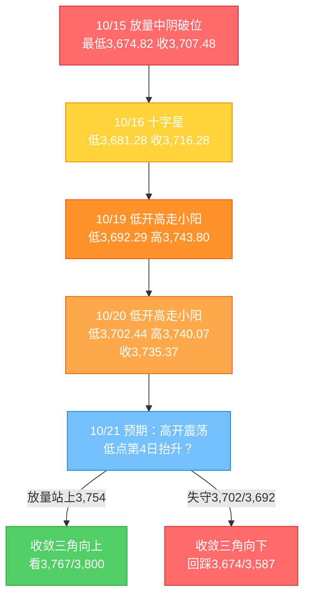
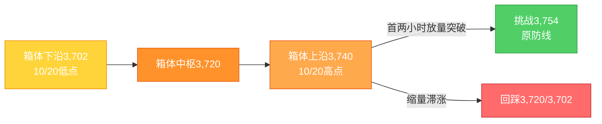

# A股晨报 - 2026年10月21日

> 数据截止时间：2026年10月21日 09:05（北京时间）；A股为10月20日（周二）收盘，美股/欧股为10月20日（周二）收盘（隔夜），亚太为10月21日开盘至发稿，大宗商品/汇率为10月20日纽约尾盘/在岸收盘
> 报告性质：**国庆长假后第二个完整交易周（第43周）第3个交易日**，以10/20晚报（**"缩量分化、指数微涨，止跌企稳信号连续强化"**）+ **隔夜美股道指大涨、纳指微跌、存储分化** + **今晨日韩股市直线拉升、存储双巨头爆发** + **多周期波浪分析** 为基础

---

## 一、昨日晚报复盘要点回顾

### 1. 昨日判断回顾（10/20晨报 vs 实际）

| 维度 | 准确率 | 说明 |
|------|--------|------|
| 趋势判断 | **100%（1/1）** | "震荡偏强（超跌修复）"命中，上证收涨0.12% |
| 点位预测 | **约100%（3/3）** | 区间3,690-3,790✓、强支撑3,674✓、强压力3,754✓ |
| 板块预判 | **约50%（4/8）** | 半导体✓、机器人/AI✓、贵金属✓、高位连板✓；券商/红利、油气、消费电子✗ |
| 成交量 | **✗** | 预测1.5-1.7万亿，实际约1.46万亿（平量） |
| 综合准确率 | **约75-80%** | 方向与点位精准，板块结构（防御↔进攻切换）偏差较大 |

### 2. 关键偏差及原因

- **偏差1（核心）：券商/红利防御看涨落空**——非银金融-1.47%领跌、银行/保险/煤炭跌幅居前。根因是**"科技回暖日资金由防御切向进攻"的跷跷板效应**，且"政策催化≠板块必涨"，须叠加资金流双确认。
- **偏差2：成交量"温和放量"落空**——实际平量。根因是**高估"外盘回暖+政策催化"带来的增量资金**，实为存量博弈/高低切换。
- **偏差3/4（次要）：油价看跌、消费电子看跌**——油价盘中拉升、消费电子受端侧AI重定价。属信息缺失与AI硬件细分逻辑应用不足。

### 3. 沉淀的规则/检查项

- **规则A（板块选择）**：外盘科技回暖+国内主题催化下，资金主线偏向"进攻端（机器人/端侧AI/半导体）"，**防御/权重（银行/保险/煤炭/券商）易遭抽血，"科技回暖日"防御板块看跌优先级高于政策催化看涨**。
- **规则B（趋势分析）**：破位后"低点连续2-3日抬升+站稳缺口下沿+上涨家数超3,700只"= **止跌企稳信号连续强化**；但**量能未放大前仍属"反抽"，须"放量收复3,754+日线KDJ金叉"确认**。
- **规则C（资金面）**：**"总量净流出+成长主题结构性净流入"="高低切换/结构进攻"**，须以行业资金结构而非总量判断风格。
- **规则D（风险识别）**：主题在多重海外催化下易"涨停潮"，但龙头估值高企时须防"高开炸板/获利回吐"。

### 4. 对今日分析的启示

- **必须正视"跷跷板"**：今日存储/智能驾驶有强催化，则**券商、红利、贵金属等防御方向应主动下调评级**，不能因"证监会主论坛"就给券商加分。
- **量能是唯一"否决项"**：昨日的企稳只有"宽度修复"、没有"增量资金"；今日若高开后**不能补量至1.5万亿以上**，则3,754一带仍是"冲高回落"的高发区。
- **警惕"利好高开即兑现"**：日韩存储大涨是"隔夜已知利好"，A股存储链大概率**高开**，需防"高开冲高回落"（规则D）。

---

## 二、隔夜市场动态（10/20收盘至10/21早间）

### 1. 美股市场（10/20收盘）

| 指数 | 收盘点位 | 涨跌幅 | 解读 |
|------|---------|--------|------|
| 道琼斯工业指数 | **52,495.88** | **+1.02%（+529.85点）** | 价值/金融/医药权重发力，领涨三大指数 |
| 标准普尔500指数 | **7,712.57** | **+0.28%（+21.84点）** | 小幅收涨 |
| 纳斯达克综合指数 | **26,424.82** | **-0.02%（-6.07点）** | 平收，科技股内部分化 |
| 费城半导体指数 | — | **-0.29%** | 结束"8连跌"后的修复暂停 |

**结构特征**：**"道指大涨、纳指微跌、费半小跌"**——**资金由"科技成长"向"价值/医药"再平衡**。个股层面：**存储分化**（西部数据+3.44%、希捷+2.17%，闪迪-0.42%、美光-0.98%、SK海力士ADR-2.16%）；**半导体设备/ARM走弱**（泛林-3.21%、ARM-3.07%、阿斯麦-0.99%）；**生物医药齐涨**（Moderna+6%）；**中概股普涨**；SpaceX盘后涨超8%。

**对A股的映射**：**"美股存储分化" ≠ "存储链利空"**——因为**今晨日韩存储双巨头已接棒大涨**（见下），A股存储链的"定价锚"已由美股切换至亚太。

### 2. 欧洲市场（10/20收盘）

| 指数 | 收盘点位 | 涨跌幅 |
|------|---------|--------|
| 英国富时100 | **10,733.00** | **-0.29%** |
| 法国CAC40 | **7,838.49** | **-0.38%** |
| 德国DAX | **25,304.42** | **-0.06%** |

欧洲三大股指**全线小幅下跌**（法国政局/示威扰动延续），对A股影响中性偏弱。

### 3. 亚太市场（10/21早间，关键变量）

| 市场 | 表现 | 说明 |
|------|------|------|
| **日经225** | 开盘**+1.26%报64,885.95**，盘中涨幅扩大至约**+2%（涨近1,300点）** | 半导体/存储链全线走强 |
| **韩国KOSPI** | 开盘**+2.05%报5,666.34**，盘中一度**+3.28%报5,734.63** | **三星电子、SK海力士两大存储巨头爆发** |
| 恒生指数（10/20收盘） | **23,867.74（-1.32%）** | 跌破24,000；南向资金净流出约17亿 |
| 恒生科技（10/20收盘） | **-1.52%** | 盘中创本轮调整新低 |

**关键判断**：**10/20"亚太科技重挫（韩KOSPI-3.73%、SK海力士-4%）"的利空，在10/21早间被"日韩直线拉升、存储双巨头爆发"全面逆转**——这是今日A股开盘**最强的边际利好**，直接指向**存储/半导体/先进封装/消费电子（端侧AI）**。

### 4. 大宗商品（10/20纽约收盘）

| 品种 | 价格 | 涨跌 | 说明 |
|------|------|------|------|
| WTI原油（11月合约） | **101.79美元/桶** | **-1.80%（-1.87美元）** | 盘中曾触及五个月高位后回落，仍处高位 |
| 布伦特原油（12月合约） | **108.79美元/桶** | **-0.69%（-0.76美元）** | 中东地缘溢价仍在 |
| 现货黄金 | **4,125.08美元/盎司** | **-0.37%** | 美联储加息预期升温压制金价，4,000美元为关键关口 |

### 5. 汇率与利率

| 指标 | 数值 | 变化/说明 |
|------|------|----------|
| 美元指数 | **101.701** | **-0.27%**（前一日101.980） |
| 人民币中间价（10/20） | **6.7200** | 调升8个基点（今日中间价9:15公布） |
| 在岸人民币（10/20 16:30） | **6.6791** | 升26点，**创2022年6月8日以来新高** |
| 离岸人民币（10/20） | 盘中最高**6.6770** | 突破前一日高点 |
| 美国10年期国债收益率 | **约3.98%** | 纽约尾盘下行约2.5bp，长端压力缓和 |
| 中国10年期国债收益率 | **1.6225%** | 下行0.75bp |

**解读**：**"美元走弱+人民币创逾3年新高+美债长端回落"三重组合，对A股风险偏好与外资流入构成正向支撑**——这是今日可看"震荡偏强"的宏观基础。

### 6. 重要海外事件

- **美联储10月按兵不动预期升温**（市场对进一步加息的分歧加大），美股呈现"价值涨、成长平"的再平衡。
- **中东地缘风险溢价再起**（伊朗与巴基斯坦会晤、胡塞武装袭击沙特基础设施），油价虽回落但仍处五个月高位。
- **法国政局/示威冲击金融市场**，欧洲股债偏弱。

---

## 三、今日关注事项

### 1. 重要数据与时间（北京时间）

| 时间 | 事项 | 说明 |
|------|------|------|
| 09:15 | 人民币对美元中间价 | 关注能否延续"升破6.68"的强势 |
| 全天 | 央行公开市场操作 | **560亿元7天期逆回购到期**，关注续作与隔夜逆回购投放 |
| 22:30 | 美国EIA原油库存（截至10/16当周） | 前值-855.7万桶，预期-110.7万桶 |

### 2. 政策/监管动态

- **2026金融街论坛年会（10/19-10/22）**：**今日（10/21）证监会承办主论坛**，主题"建设一流投资机构 服务资本市场高质量发展 共享投资中国新机遇"，设"培育壮大耐心资本""双向开放下的长期投资机遇"两场圆桌。**证监会已宣布同意首批18只主动ETF注册**；吴清主席提出"深化再融资改革、择机发布新修订的再融资注册管理办法""加快推动出台上市公司监管条例""加力推进证券公司高质量发展行动"。
- **央行短端利率"换锚"进入实操**：10/21-11/2开展隔夜逆回购（每日≤1万亿元），DR001逐步成为主要政策利率。
- **国家数据集团成立（10/20）**：数据要素市场化配置改革进入"国家队"落地阶段。
- **证监会研究推进将《证券法》修改纳入下一届全国人大立法规划**。
- **首批场外科创债指数基金正式获批**。

### 3. 公司公告（10/20晚至10/21早）

| 类型 | 内容 |
|------|------|
| **业绩爆发** | **天齐锂业**：预计前三季度归母净利**51亿-60亿元，同比+2735%~+3235%**（锂价上行+SQM投资收益） |
| **权重业绩** | **宁德时代**：前三季度净利**同比+31.6%**；**中国移动**：5G网络客户达7.02亿户 |
| **半导体** | **天岳先进**：前三季度净利同比大幅增长（碳化硅景气） |
| **其他** | 云南锗业第三大股东章建平三季度增仓1,961.57万股 |

### 4. 其他关注

- **限售解禁（今日压力点）**：**10家公司合计解禁4.93亿股、解禁市值640.48亿元**（中船特气等居前），为10月解禁高峰日之一。
- **新股**：北交所**文峰光电（920296）今日上市**。
- **2026世界智能网联汽车大会（10/21-10/23，北京亦庄）**：工信部、交通运输部、北京市政府主办，聚焦自动驾驶技术合作、标准规则协调、车路云一体化——**智能驾驶/车联网/汽车电子直接催化**。
- **第93届全国药品交易会**、**第十九届中欧投资贸易科技合作洽谈会（10/21-23，成都）**。

---

## 四、板块与个股分析

### 1. 基于昨日复盘结论的板块调整

| 昨日预判 | 今日调整 | 依据 |
|---------|---------|------|
| 半导体/存储 看涨 | **维持看涨，并升级为"今日第一主线"** | 日韩存储双巨头爆发+隔夜WDC/STX上涨+存储涨价周期 |
| 机器人/AI 看涨 | **维持看涨，但降为"第二梯队"** | 机器人已连续爆发、龙头估值高企，防"高开炸板" |
| 券商/金融科技 看涨 | **下调为"看跌/中性"** | 昨日已领跌，规则A：科技回暖日政策催化难敌跷跷板 |
| 红利防御 看涨 | **下调为"看跌"** | 资金持续高低切换 |
| 油气 看跌 | **维持看跌** | 油价回落1.8% |
| 贵金属 看跌 | **维持看跌** | 金价-0.37%、加息预期压制 |

### 2. 隔夜信息驱动的板块机会

- **受益板块**
  1. **存储/半导体/先进封装**（逻辑：韩国三星、SK海力士今晨爆发，日经半导体链涨2%；存储涨价周期+国产替代；隔夜WDC+3.44%、STX+2.17%）
  2. **智能驾驶/车路云/汽车电子**（逻辑：世界智能网联汽车大会今日开幕，政策+标准+国际合作三重催化）
  3. **数据要素/数字经济**（逻辑：国家数据集团成立，数据资产入表与交易体系加速）
  4. **锂矿/锂电材料**（逻辑：天齐锂业前三季度净利预增27-32倍，锂价上行得到业绩验证）
  5. **人形机器人/端侧AI**（逻辑：Optimus量产信号+机构提示"估值低位配置窗口"，但需防高位分化）

- **受损板块**
  1. **贵金属/黄金股**（逻辑：金价跌破4,130、美联储加息预期升温、美债避险属性强于黄金）
  2. **石油石化/油服**（逻辑：WTI回落1.8%，地缘溢价边际消退）
  3. **煤炭/银行/保险等红利防御**（逻辑：风险偏好回升→高低切换，规则A）
  4. **券商/非银**（逻辑：政策催化已在10/19-10/20兑现，主论坛"利好落地即卖出"）

### 3. 重点关注个股（仅作方向示例，不构成推荐）

| 标的 | 关注理由 | 技术位置/操作提示 |
|------|---------|------------------|
| 存储链（兆易创新、佰维存储、德明利、江波龙等） | 日韩存储双巨头爆发+涨价周期 | 若高开>3%不追，等回踩5日线；放量突破前高可跟 |
| 智能驾驶（德赛西威、经纬恒润、四维图新等） | WICV大会今日开幕 | 事件驱动，宜"会前布局、会中兑现"，防冲高回落 |
| 数据要素（易华录、深桑达A、云赛智联等） | 国家数据集团成立 | 主题脉冲，关注首板/换手 |
| 锂矿（天齐锂业、赣锋锂业等） | 业绩预增27-32倍 | 业绩已预告，防"利好兑现"，回踩不破20日线可持 |
| 机器人（减速器/丝杠/电机） | Optimus量产+估值低位 | 高位股不追，优选二线补涨 |

---

## 五、今日核心判断（结构化，用于晚报复盘）

### 1. 趋势判断

- **上证指数：【震荡偏强】**（高开消化后尝试收复3,754）
- **预测区间：3,715点 - 3,790点**
- **核心逻辑**：**外因全面转暖**（日韩存储双巨头爆发、美股道指+1.02%、美元回落、人民币创3年新高、美债长端回落）叠加**内因"止跌企稳"连续第3日强化**（低点3,681→3,692→3,702连续抬升、站稳缺口下沿3,724.56），今日**大概率高开**；但**量能未放大（1.46万亿）+640亿解禁+存储"隔夜利好已充分反应"**，决定**上行高度有限、以"高开震荡、反复争夺3,740-3,754"为主**，不宜预设"单边放量突破"。

### 2. 关键点位

- **强支撑位：3,702点**（依据：10/20日内低点，亦是"低点连续3日抬升"的起点，跌破则企稳结构破坏）
- **弱支撑位：3,724点**（依据：10/15破位缺口下沿，已连续2日收盘站稳，回踩不破属强势）
- **强压力位：3,754点**（依据：**被跌破的原防线**，收敛三角上沿，放量收复=反抽升级为反转）
- **弱压力位：3,767点**（依据：缺口上沿）；**日内第一压力3,740点**（10/20最高）

### 3. 板块预判

- **看涨板块**：
  1. **存储/半导体/先进封装**（逻辑：日韩存储双巨头爆发+涨价周期+国产替代，今日最强映射）
  2. **智能驾驶/车路云/汽车电子**（逻辑：世界智能网联汽车大会今日开幕，政策与标准催化）
  3. **数据要素/数字经济**（逻辑：国家数据集团成立）
  4. **锂矿/锂电材料**（逻辑：天齐锂业业绩预增27-32倍验证锂价上行）
- **看跌板块**：
  1. **贵金属/黄金**（逻辑：金价-0.37%、加息预期升温）
  2. **石油石化/油服**（逻辑：WTI-1.8%）
  3. **煤炭/银行/保险（红利防御）**（逻辑：风险偏好回升下的高低切换，规则A）
- **风险板块**：**券商/非银**（政策主论坛"利好兑现"风险，昨日已领跌）；**高位连板机器人股**（估值高企、防炸板）；**今日大额解禁个股**（中船特气等，640亿解禁）。

### 4. 资金面判断

- **北向资金预期：【净流入】20-50亿元**（依据：人民币升破6.68创3年新高、美元指数回落、日韩风险偏好回升）
- **成交量预期：【温和放量】1.50-1.65万亿**（依据：外围转暖+存储主线明确；但存量博弈未改，不宜预期突破1.7万亿）

### 5. 风险预警（按优先级）

- **高风险**：**今日640.48亿元集中解禁（10家）**——若解禁股（中船特气等）大幅低开，可能压制半导体设备/材料情绪；**存储链"高开冲高回落"**——利好隔夜已充分反应，开盘若高开超3%而量能不继，易形成"一日游"。
- **中风险**：**量能持续不足**——若全天成交低于1.45万亿，3,754难以有效收复，"收敛三角"向下破位风险回升；**机器人主题过热**——宇树科技等龙头估值高企，防高位补跌拖累情绪。
- **低风险**：**油价/金价波动**对资源股的结构性扰动；**美股科技分化**（纳指平收、费半-0.29%）对A股算力链的压制；**金融街论坛政策**若不及预期，券商可能再度走弱。

### 6. 昨日复盘规则应用

- **应用规则B（趋势）**：昨日"低点连续3日抬升+站稳缺口+宽度修复"仅构成"反抽"，**今日必须"放量收复3,754"才算反转**——因此判断为"震荡偏强"而非"看涨"，且把3,754设为"减仓/止盈"而非"追涨"位置。
- **应用规则A（板块）**：**科技（存储/智能驾驶）强催化日，主动看跌券商/红利/贵金属**，不再因"证监会主论坛"给券商加分。
- **应用规则C（资金）**：以"行业资金结构"判风格——若电子/计算机/汽车获净流入而银行/非银净流出，则"结构进攻"延续，可持股；若存储高开却主力净流出，则视为"兑现"信号。
- **应用规则D（风险）**：对机器人等已连续爆发的主题，**不追高、只做回踩**，防"高开炸板"。

---

## 六、波浪理论参考（多周期）

### 1. 月K线

- **当前波浪位置**：大周期**第2浪C浪延伸"破位后的止跌企稳"阶段**。
- **浪型结构**：2024/9（2,689点）→2026/6（4,197点）为第1浪；第2浪ABC调整至**3,674.82点（10/15低点）**；10月月K线呈"破位中阴+长下影"，月内低点3,685.83→3,681.28→3,692.29→3,702.44**连续抬升**。
- **关键位**：支撑**3,674（核心）→3,660→3,587**；压力**3,754（原防线）→3,800（20月均线）→3,842**。
- **验证条件**：月内收盘不破3,674，则"月线止跌"成立；若收盘有效跌破，下看3,587/3,478。

### 2. 周K线

- **当前波浪位置**：第43周（10/19-10/23）第3个交易日；第42周为"带下影中阴（破位周）"。
- **浪型结构**：本周一3,730.92（+0.39%）、周二3,735.37（+0.12%），连续两日站上上周收盘3,716.28、站稳缺口下沿；但仍在5/10/20/60周均线下方，**空头排列未改**。
- **关键位**：支撑**3,674→3,587**；压力**3,740→3,754→3,767→3,800**。
- **验证条件**：**本周末（10/23）能否放量站上3,754**，是周线由"破位"转"企稳"的唯一确认。

### 3. 日K线（重点）

- **当前波浪位置**：C浪延伸"破位下行"后的**"止跌企稳信号连续强化"**；10/20收"低开高走小阳（开3,718.44、低3,702.44、高3,740.07、收3,735.37）"。
- **浪型结构**：10/15放量破位（低3,674.82）→10/16十字星（低3,681.28）→10/19低开高走（低3,692.29）→10/20低开高走（低3,702.44），**低点四连抬升**；但高点3,743.80→3,740.07**微降**，与低点抬升构成**"收敛三角"**。
- **关键位**：支撑**3,702.44→3,692.29→3,674（核心）**；压力**3,740.07→3,750.77→3,754（关键）→3,767→3,800**。
- **验证条件**：
  - **向上**：放量突破3,754并站稳 → 收敛三角向上选择，反抽升级为反转，看3,767/3,800。
  - **向下**：收盘跌破3,702.44（尤其3,692） → 收敛三角向下破位，回踩3,674，跌破则看3,587。
  - **今日变量**：日韩存储双巨头爆发（强向上）vs 640亿解禁+量能不足（向下扰动）；**方向上偏多，但需"量"确认**。

### 4. 60分钟K线

- **当前波浪位置**：60分钟"低开探底→震荡回升→尾盘拉升"，处于**箱体（3,702-3,740）上沿附近**。
- **浪型结构**：10/20尾盘放量拉升收于3,735.37，MACD零轴附近企稳、KDJ中低位回升。
- **关键位**：支撑**3,702→3,692**；压力**3,740→3,754**。
- **验证条件**：**今日首两小时能否放量站上3,740**——站上则打开3,754空间；否则回踩3,720/3,702。

### 5. 30分钟K线

- **当前波浪位置**：30分钟"震荡上行+尾盘加速"，短线动能偏强。
- **关键位**：支撑**3,702→3,692**；压力**3,740→3,754**。
- **验证条件**：30分钟MACD能否**零轴上方二次金叉**并放量——是"日内续攻"的技术前提；若顶背离，则高开即为卖点。

### 6. 波浪图（Mermaid）

**日K线波浪结构图**：

**60分钟波浪结构图**：

### 7. 波浪综合判断

| 维度 | 判断 |
|------|------|
| 多周期共振 | **大周期（月/周）仍向下，日线/60分/30分"止跌企稳"边际改善**——维持"大周期向下+短线修复"背离格局 |
| 当前操作级别 | **日线级别（防守+超跌反弹尝试）**；3,674为中线生死线，3,754为短线转强线 |
| 演变路径（今日） | **50%乐观**（高开后放量站上3,740、挑战3,754）、**40%中性**（3,702-3,754区间震荡，存储/智能驾驶轮动）、**10%悲观**（解禁+高开兑现→回落跌破3,702，回踩3,674） |
| 关键拐点信号 | 向上：**放量站上3,754 + 日线KDJ金叉 + 主力资金转净流入**；向下：**收盘跌破3,702/3,692 + 存储链高开低走** |
| 风险提示 | 量能仍是最大缺陷；波浪在"C浪延伸末端"精度下降，须以量能、解禁、外盘三重验证 |

---

## 七、投资策略建议

### 1. 短线策略（1-3个交易日）

- **适用场景**：日K线收敛三角 + 60分钟箱体上沿
- **短线仓位：25%**（由昨日15-20%上调5个百分点，理由：外盘转暖+主线明确，但解禁与量能限制上限）
- **买入条件**：①**高开回踩3,724不破且分时放量**；或②**10:30前放量站上3,740**。二者满足其一再开仓，**不追高开>2%的存储股**。
- **卖出条件**：①指数触及**3,767-3,790**且量能萎缩；②存储链**高开3%后10:30前回落翻绿**（主线失效信号）。
- **止损位**：**上证收盘3,674点**；个股跌幅**-5%**（高位机器人股-3%）。
- **短线标的**：
  1. **存储/先进封装**（逻辑：日韩双巨头爆发+涨价周期，选"低开或平开"的补涨标的，回避一字板）
  2. **智能驾驶/车路云**（逻辑：WICV大会今日开幕，事件驱动，快进快出）
  3. **数据要素**（逻辑：国家数据集团成立，主题脉冲）

### 2. 中线策略（1-4周）

- **适用场景**：周K线破位后企稳尝试 + 月线3,674支撑
- **中线仓位：25%**（由昨日15-20%上调至20-25%区间上限，理由：人民币强势+政策底+日韩科技共振）
- **方向判断：【持有 / 小幅加仓】**
- **目标区间**：上证指数 **3,754点 - 3,800点**
- **中线布局板块**：
  1. **半导体/存储/设备材料**（逻辑：全球存储涨价周期+国产替代+日韩共振）
  2. **智能驾驶/汽车电子**（逻辑：政策标准落地+车企智能化渗透率提升）
  3. **锂电/锂矿**（逻辑：天齐业绩验证锂价上行，行业周期反转）
  4. 保留**红利（电力/公用事业）**作底仓，但**降低银行/保险权重**
- **止盈条件**：指数到达**3,800点**或波段涨幅达**8%**
- **止损条件**：指数**收盘跌破3,674点**，或存储涨价逻辑被证伪（现货价格转跌）

### 3. 仓位分配总览

| 策略类型 | 仓位比例 | 方向 | 重点板块 |
|---------|---------|------|---------|
| 短线 | 25% | 持有/回踩加仓 | 存储、智能驾驶、数据要素 |
| 中线 | 25% | 持有/小幅加仓 | 半导体、汽车电子、锂电、电力 |
| 现金 | 50% | — | — |

### 4. 与昨日策略对比

- **短线仓位**：15-20% → **25%**（原因：日韩存储双巨头爆发+外围全面转暖，主线更清晰）
- **中线仓位**：15-20% → **25%**（原因：人民币创3年新高+政策端"再融资改革/主动ETF"持续落地）
- **板块调整**：**增配**存储/先进封装、智能驾驶、数据要素、锂矿；**减配**券商/非银、银行/保险、贵金属、油气
- **风控不变**：**3,674仍是唯一硬止损**；**3,754未放量收复前，不把仓位加过50%**

---

## 八、信息来源

1. **官方数据来源**：上海证券交易所（10/20上证收3,735.37、+0.12%、高3,740.07、低3,702.44）、深圳证券交易所（深成指11,801.29、-0.14%）、中国外汇交易中心（10/20中间价6.7200）、中国人民银行（10/21-11/2隔夜逆回购）、中国证监会（金融街论坛、首批18只主动ETF）、国家统计局、纳斯达克（SOX 10/19 11,316.34 +1.61%）、韩国交易所（KOSPI）、东京证券交易所（日经225）
2. **权威财经媒体**：新华社/新华网（纽约股市三大股指20日涨跌不一、美元指数20日下跌、人民币市场汇价）、上海证券报·中国证券网（美元指数20日下跌）、证券时报（日韩股市直线拉升、两大存储巨头爆发；银河证券观点；10/21每日研选）、中国证券报（A股业绩利好刷屏）、经济日报（金融持续深化改革）、央广财经（10/21盘前速递：560亿逆回购到期、宁德时代/天齐锂业三季报）、21世纪经济报道（国家数据集团成立、WICV大会今日开幕）、财联社（美股收盘、债市早参）、每日经济新闻（10/21解禁640.48亿元）
3. **数据平台**：东方财富、同花顺、Wind资讯、新浪财经（人民币即期汇率、美债收益率）、Choice金融终端、格隆汇（欧洲股指收盘）、中国货币网
4. **研究机构**：银河证券、广发证券、申万宏源、中银证券（晨会聚焦）、甬兴证券（存储涨价）

> 数据截止时间：2026年10月21日 09:05（北京时间）。部分盘中数据（日韩股市、A50期货）为发稿时点值，可能与收盘存在差异；解禁市值按最新收盘价计算。

---

*本晨报由AI代理自动生成，仅供参考，不构成投资建议。投资有风险，入市需谨慎。*
