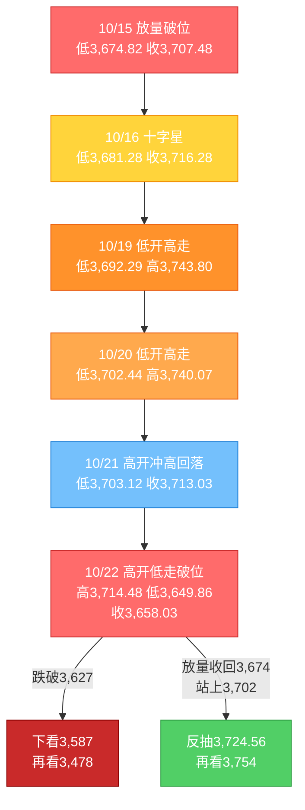
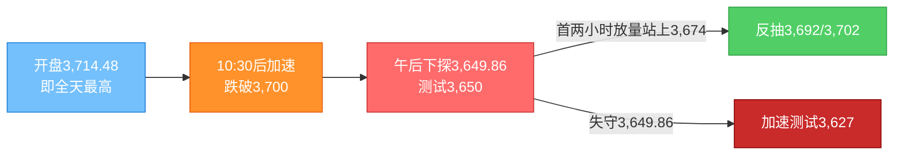

# A股晚报 - 2026年10月22日

> 数据截止时间：2026年10月22日 20:00（北京时间）；A股为10月22日收盘数据，美股为10月21日收盘（隔夜）及10月22日盘前，欧洲为10月22日盘中，亚太为10月22日收盘，大宗商品/汇率为10月22日盘中或最近收盘
> 报告性质：**国庆长假后第二个完整交易周（第43周）第4个交易日**；以10/22晨报（**"震荡偏强，区间3,702-3,762"**）+ **全球风险偏好骤降（日韩-3.5%、恒生科技-5.03%、纳指期货-1.9%）** + **美债10Y 5.12%高位与AI交易质疑** + **多周期波浪分析** 为基础

---

## 一、市场回顾

### 1. 主要指数表现

| 指数 | 收盘点位 | 涨跌幅 | 开盘 | 最高 | 最低 | 备注 |
|------|---------|--------|------|------|------|------|
| 上证指数 | **3,658.03** | **-1.48%（-55.00点）** | 3,714.48 | 3,714.48 | **3,649.86** | **高开0.04%后单边下行，失守3,700、3,674两道关口** |
| 深证成指 | **11,357.32** | **-2.96%（-2.97%口径）** | 11,690.34 | — | — | 成长权重拖累，跌破11,400 |
| 创业板指 | **2,576.90** | **-4.37%** | 低开0.25% | — | — | **收于全天最低，跌破2,600；较6月历史高点回撤超40%** |
| 科创50 | **1,305.87** | **-2.78%（-2.79%口径）** | — | — | — | 半导体/CPO/软件集体下挫 |
| 科创综指 | — | 早盘一度+0.24%，收盘转跌 | — | — | — | 高开低走，科技情绪反转 |
| 北证50 | — | **-0.93%** | — | — | — | 相对抗跌 |
| 沪深300 | — | **-1.84%** | — | — | — | 权重与成长同步走弱 |
| 上证50 | — | 小幅下跌 | — | — | — | 银行局部护盘，工行/建行创历史新高 |

**盘面特征**：三大指数**开盘涨跌不一**（沪指高开+0.04%、深成指低开-0.12%、创业板指低开-0.25%），开盘价3,714.48即为全天最高点，此后**单边震荡下行**。10:30后跌势加速，**跌停家数由个位数快速增至收盘62家**；午后无有效反抽，**尾盘宽基ETF放量承接**（沪深300ETF华泰柏瑞最后半小时成交额突破60亿元），但指数仍收于日内低位。上证**失守3,700点与3,674点"中线生死线"**，最低3,649.86点；创业板指**收在全天最低2,576.90点**。全A总市值回落至**117.44万亿元**，较5月高点137.33万亿元**蒸发约19.89万亿元**；上证、深成、创业板均已回落至"924行情"起点附近。

### 2. 成交量能与资金流向

| 指标 | 数值 | 变化/说明 |
|------|------|----------|
| 沪深两市成交额 | **15,287.08亿元** | 较10/21的14,293.48亿元（同口径）**放量993.60亿元（+6.95%）**；三市口径约**1.54万亿元** |
| 沪市成交额 | **7,060.96亿元** | 较10/21的6,427.52亿元放量633亿元 |
| 深市成交额 | **8,226.13亿元** | 较10/21的约7,866亿元放量约360亿元 |
| 创业板成交额 | **4,040.51亿元** | 放量下跌，抛压集中 |
| 北向资金成交额 | **2,326.22亿元** | 占两市总成交额**15.22%**；**净额未披露**（交易所已不实时披露） |
| 主力资金 | **净流出540.55亿元** | **连续第12个交易日净流出**，为10/15（-544.47亿）以来单日最大流出 |
| 行业资金 | **仅3个行业净流入、28-29个净流出** | 美容护理+3.74亿、家用电器+2.28亿居前；**电子-137.02亿居首**、通信-83.08亿、计算机-36.00亿、有色-32.40亿、传媒-31.80亿、基础化工-25.33亿、非银-16.60亿 |

**北向十大成交股**：沪股通——紫金矿业30.29亿元、药明康德28.64亿元、贵州茅台17.18亿元；深股通——**宁德时代66.99亿元、中际旭创51.46亿元、新易盛32.55亿元**。

**资金结构判断**：**"总量大幅净流出+科技链全面失血+消费防御小幅流入"**——电子、通信、计算机三大科技行业合计净流出约256亿元，占全日主力净流出的近一半；资金仅小幅流向美容护理、家电等低位消费。**与10/21"权重杀跌+主题脉冲"不同，今日是"科技主线整体撤退"**，属于风险偏好系统性下移，而非单纯高低切换。

**护盘资金**：股票型ETF自9/28以来**连续13个交易日净流入，累计超2,100亿元**；10/21单日净流入143.20亿元；今日尾盘多只宽基ETF再度爆量，**"国家队"承接迹象明确**，但未能扭转指数方向。

### 3. 市场情绪与宽度

| 指标 | 数值 | 说明 |
|------|------|------|
| 上涨家数 | **535只（占9.59%）** | 较10/21的1,980只断崖式回落 |
| 下跌家数 | **4,999只** | **普跌，占比近90%** |
| 平盘 | **43只** | — |
| 涨停 | **33只** | 机械设备9只、电力设备8只为主，但**板块整体仍跌** |
| 跌停 | **62只** | **跌停数为涨停数的1.88倍**，为10/15以来最多 |
| 触及涨停 | 26只 | **封板率仅55.93%**，炸板率高 |
| 连板高度 | **海洋王、大业股份5连板** | 星光股份、三峡新材3连板；哈空调、上海九百、海量数据、天洋新材、出版传媒2连板 |

**情绪判断**：**"放量普跌、宽度极致恶化、跌停压过涨停"**——上涨家数不足一成，跌停62家、封板率55.93%，说明**短线资金不敢接力、恐慌盘与止损盘集中释放**。与10/15"普跌型放量杀跌"形态相似，但今日**科技主线（通信/电子）为杀跌核心**，且**尾盘有ETF承接**，属"恐慌释放+国家队托底"并存的弱势格局。

---

## 二、热点板块与异动分析

### 1. 当日领涨板块及驱动因素

| 板块/概念 | 表现 | 驱动因素 |
|-----------|------|----------|
| **家用电器** | **申万+0.08%，唯一上涨的一级行业** | 低位防御+中美"对等降税框架"出口链逻辑；美的集团涨超1%，3只个股涨停 |
| **人形机器人/具身智能** | **逆势活跃，涨停集中方向** | 大业股份5连板（19秒封板、封单近40万手）、兆威机电4天2板、大洋电机/襄阳轴承/鸣志电器涨停，德马科技/福莱新材/万向钱潮跟涨；弱势市场资金抱团"低相关性主题" |
| **银行** | **局部回暖，工行/建行创历史新高** | 低估值+高股息避险；但申万银行指数仍**-0.27%**，属"个股强、板块弱" |
| **工程机械/电机** | 涨幅居前 | 山河智能、南方路机涨停；出口+更新周期逻辑，低位补涨 |
| **国防军工** | 湖南天雁涨停 | 个股事件驱动，板块整体**-2.19%** |
| **存储芯片** | **午后急升** | 云汉芯城20cm涨停、华天科技直线涨停（封单超200万手）、大普微/德明利/有研新材/睿能科技跟涨；但**电子行业仍-3.60%**，属超跌反抽 |

**领涨逻辑**：**"防御（家电/银行）+低相关性主题（机器人）+超跌反抽（存储）"**——在科技主线全面撤退时，资金只能退守低位防御与筹码独立的小主题；**涨停股集中于机械设备（9只）、电力设备（8只）却未带动板块**（机械设备-2.44%、电力设备-2.01%），说明**涨停是"个股行为"而非"板块行情"**。

### 2. 当日领跌板块及原因

| 板块/概念 | 表现 | 原因分析 |
|-----------|------|----------|
| **通信/通信设备** | **申万-6.17%，跌幅居首** | 新易盛跌超10.67%-12%、中际旭创跌超8%、长飞光纤跌超8%；Lumentum/Marvell盘前跌近5%，光通信全球共振下杀 |
| **传媒/影视院线/AI漫剧** | **-4.78%** | 新华传媒、引力传媒、龙版传媒、德才股份跌停，果麦文化跌超13%；前期强势主题"补跌" |
| **电子/半导体/元件/CPO** | **-3.60%** | 京仪装备跌超8%，和林微纳/帝奥微/优迅股份/炬光科技/燧原科技跌超7%；华盛昌、崇达技术跌停；费半隔夜+1.97%未能传导，SK海力士ADR盘前-4.81% |
| **综合** | **-4.66%** | 小市值/题材股集中补跌 |
| **社会服务/基础化工/有色** | -3.18%/-3.17%/-2.97% | 风险偏好回落，周期与消费服务同步走弱 |
| **计算机** | **-2.79%** | 软件、算力租赁、AI应用集体调整 |
| **机械设备/国防军工/环保/商贸零售** | 均跌超2% | 昨日强势方向回吐 |
| **电力设备** | **-2.01%** | 宁德时代业绩雷余波未消，电池链继续承压 |
| **汽车** | -1.72% | 特斯拉Q3营收不及预期、下调资本开支目标，盘前跌超5% |
| **食品饮料/银行/非银** | -0.43%/-0.27%/-0.71% | 防御属性仅体现为"跌幅较小"，非绝对收益 |

**领跌逻辑**：**"全球AI硬件杀估值"是核心矛盾**——①美债10Y仍在5.12%高位（10/22盘中回落至5.04%），压制高估值成长；②市场质疑科技巨头AI资本开支的回报周期；③美股盘前英伟达-2.33%、英特尔-4.51%、美光-3.57%、闪迪-4.30%、SK海力士ADR-4.81%、Marvell-5.13%，**存储/光通信全球同步重挫**；④日韩股市-3.5%、恒生科技-5.03%，**亚太科技链系统性下跌**。A股通信/电子作为高β方向，跌幅被放大。

### 3. 个股异动复盘

- **连板梯队**：**海洋王、大业股份5连板**（成交额12.71亿元、6.85亿元）；星光股份、三峡新材3连板；哈空调、上海九百、海量数据、天洋新材、出版传媒2连板；其余24只为首次涨停，其中11只成交额不足3亿元，**接力资金明显不足**。
- **机器人逆势**：大业股份开盘19秒涨停、封单近40万手；兆威机电4天2板；大洋电机、襄阳轴承、鸣志电器涨停。
- **算力硬件重挫**：新易盛-10.67%（盘中一度-12%）、中际旭创-8%以上、长飞光纤-8%以上；华盛昌、崇达技术跌停；联讯仪器-8.66%、景旺电子-8.32%。
- **传媒补跌**：引力传媒、新华传媒、龙版传媒、德才股份跌停，果麦文化-13%。
- **银行新高**：工商银行、建设银行再创历史新高，但板块指数收跌，属**"避险资金抱团大行、放弃中小行"**。
- **高价股收缩**：百元股数量降至156只，**单日减少15只**，A股平均股价12.85元，高估值成长股是主要减员方向。

---

## 三、关键数据与事件回顾

### 1. 国内重要经济数据

- 今日**无重磅月度经济数据发布**。市场矛盾集中在**微观盈利（三季报）+外部利率（美债5%+）+风险偏好**，而非宏观总量。
- **三季度GDP（10/19公布）**：前三季度同比+4.6%，Q3 +4.5%（较Q2回升0.2个百分点），经济"稳中有升"的判断未变；但市场未给予正面定价，说明**当前下跌属估值与情绪驱动**。

### 2. 政策与监管动态

- **2026金融街论坛年会10/22闭幕**：主题"开放·合作·包容——共筑全球金融发展新生态"，40多个国家和地区、400余位嘉宾参会。**国家外汇局10/22上午主办专场**，重申人民币汇率双向浮动、中国无意通过贬值获取贸易优势。
- **国新办10/22 15:00举行"十五五"商务高质量发展新闻发布会**：涉及外贸、消费、服务贸易政策信号，对出口链/消费链有中期指引，但**当日未能对冲风险偏好回落**。
- **中办、国办《关于推动科技创新和产业创新深度融合的意见》继续发酵**：政策指向半导体设备、工业软件、机器人、数据要素，但**在"全球AI杀估值"环境下，政策催化被外部流动性压制**。
- **央行公开市场（10/22）**：**7天期逆回购操作量为零**；开展**1,730亿元隔夜逆回购**；当日有800亿元隔夜+450亿元7天逆回购到期，**净投放480亿元**；DR001收于**1.26%**，资金面均衡偏松。隔夜逆回购逐步成为主要操作品种，短端"换锚"延续。
- **股票型ETF持续净流入**：自9/28以来连续13个交易日净流入、累计超2,100亿元，**"国家队"托底仍在**。

### 3. 公司公告与三季报

| 公司/事件 | 内容 | 市场影响 |
|-----------|------|----------|
| **同花顺（300033）** | 前三季度营收/净利**20.37亿元、同比+68.86%**；Q3净利10.84亿元、**同比+53.97%** | 金融信息服务景气，但股价随计算机板块调整 |
| **吉比特（603444）** | 前三季度净利15.85亿元、**+30.55%**，拟**10派60元**；但Q3营收17.7亿元、**同比-10.07%** | "前三季度强、单季弱"，高分红对冲部分压力 |
| **凤形股份** | Q3营收1.47亿元（-1.42%），净利1,545万元、**+57.57%** | 中小盘业绩改善，弹性有限 |
| **特宝生物** | 实控人及一致行动人**承诺5年内不减持** | 减持压力缓解，属个股利好 |
| **海通发展** | 发布**集中竞价回购股份预案** | 回购增持政策导向延续 |
| **潍柴动力** | 控股股东增持计划实施期限过半的进展公告 | 权重蓝筹护盘信号 |
| **三季报整体** | 10/22进入密集披露期，**"业绩超预期"与"业绩雷"并存** | 高位成长股（AI/半导体/机器人/创新药）业绩不及预期即遭杀跌 |

### 4. 解禁与新股

- **本周解禁**：10/21-10/25约**326.60亿元**，环比-28.16%；10月全月约**3,000亿元**。今日解禁压力较10/21的640亿元明显减轻，**未成为独立下跌主线**。
- **新股**：创业板通则康威（301718）今日上市，发行价26.88元、发行市盈率44.72倍。
- **后续解禁**：上海汽配1.19亿股将于**11/2**解禁。

---

## 四、海外市场联动

### 1. 美股（10/21收盘，隔夜）

| 指数 | 收盘 | 涨跌幅 | 解读 |
|------|------|--------|------|
| 道琼斯 | **52,856.09** | **+0.69%（+360.21点）** | 强劲财报提振 |
| 标普500 | **7,757.17** | **+0.58%（+44.60点）** | 三大指数全线收涨 |
| 纳斯达克 | **26,702.86** | **+1.05%（+278.04点）** | 科技领涨，AI交易一度回暖 |
| 费城半导体 | — | **+1.97%** | 芯片股集体上涨 |

### 2. 美股盘前（10/22，截至北京时间17:10）

| 指数/个股 | 表现 | 说明 |
|-----------|------|------|
| 道指期货 | **-0.69%~-0.73%** | 全线转跌 |
| 标普500期货 | **-1.03%~-1.10%** | 风险偏好骤降 |
| 纳斯达克100期货 | **-1.81%~-1.93%** | **AI交易质疑再起** |
| 特斯拉 | **-5.08%** | Q3营收不及预期，**下调资本开支目标** |
| 英伟达 | -2.33%~-2.45% | AI芯片龙头承压 |
| 英特尔 / AMD | -4.51% / -3.68% | 芯片股普跌 |
| 美光 / 闪迪 / SK海力士ADR | -3.57% / -4.30% / -4.81% | **存储链全球同步下杀** |
| Lumentum / Marvell | -4.91% / -5.13% | 光通信重挫 |
| 康宁 | -4.38% | 光通信/材料 |

**关键反差**：**隔夜费半+1.97%、纳指+1.05%，但10/22盘前纳指期货-1.9%、存储/光通信集体重挫**——**"隔夜收盘"与"次日盘前"方向完全相反**，而A股在09:25开盘时已能看到日韩大跌（KOSPI 08:15已低开-1.14%），这是今日"高开低走"的核心外部线索。

### 3. 欧洲市场（10/22盘中）

| 指数 | 表现 |
|------|------|
| 德国DAX | **-1.10%，25,354.16** |
| 法国CAC40 | **-1.28%，7,820.53** |
| 英国富时100 | 开盘-0.54%，盘中维持弱势 |
| 欧洲斯托克50 | 开盘-0.8% |

欧洲受**油价大涨+AI担忧**双压，德国10年期国债收益率跌至3.3486%（9/4以来最低），显示避险资金流向债市。

### 4. 亚太市场（10/22收盘）

| 市场 | 收盘 | 涨跌幅 | 说明 |
|------|------|--------|------|
| 日经225 | **62,907.84** | **-2.65%** | 半导体/出口链重挫 |
| 韩国KOSPI | **5,533.77** | **-3.52%** | 存储双巨头回吐前日涨幅 |
| 恒生指数 | **22,934.68** | **-3.03%（-717.19点）** | 全线下跌 |
| 恒生科技 | **3,793.93** | **-5.03%（-200.84点）** | 联想集团跌近11%、华虹宏力跌超9%、智谱跌超7% |

**判断**：**亚太科技链"领跌全球"**——KOSPI-3.52%、恒生科技-5.03%、A股创业板-4.37%，形成"存储/光通信/AI硬件"的全球共振下杀；A股难以独立。

### 5. 大宗商品与美元

| 品种 | 价格/表现 | 说明 |
|------|-----------|------|
| WTI原油 | **约99美元/桶，+2.07%** | 消息称美以已制定新一轮对伊朗打击计划，地缘溢价重燃 |
| 布伦特原油 | **111.01美元/桶，+2.29%** | 盘中涨超3%，能源供应扰动预期升温 |
| 现货黄金 | **4,087.4美元/盎司，-1.3%** | 避险资金流向美元/美债，金价跳水 |
| 现货白银 | **56.11美元/盎司，-3.18%** | 高位剧烈波动 |
| 美元指数 | 高位持稳（约101.7-102区间） | 避险需求支撑 |

**解读**：**"油涨、金跌、股跌"**——油价因中东局势大涨，反而强化"通胀—利率—估值"的负反馈；黄金未受益于避险，说明本轮是**流动性收缩型下跌**而非单纯避险。

---

## 五、汇率与利率

| 指标 | 数值 | 变化/说明 |
|------|------|----------|
| 人民币中间价（10/22） | **6.7195** | 较10/21的6.7192**上调3个基点**，延续强势 |
| 在岸人民币 | 约6.67-6.68 | 窄幅偏强 |
| 离岸人民币 | 约6.67-6.68 | 美元走强背景下仍具韧性 |
| 美元指数 | 约101.7-102 | 避险支撑，高位持稳 |
| 美国10年期国债收益率 | **5.122%（10/21收盘，+0.9bp）**；10/22盘中**回落8bp至5.04%** | **5%以上高位仍是全球成长股估值之锚** |
| 美国2年期国债收益率 | **4.810%（+2.7bp）** | 高位持平 |
| 中国10年期国债收益率 | **1.6325% → 盘中下行至1.60%附近** | 避险配置需求升温 |
| 中国1年期国债收益率 | 约1.17% | 低位 |
| Shibor O/N | 约1.26%（DR001 1.26%） | 资金面均衡偏松 |
| 央行公开市场（10/22） | **7天期0；隔夜逆回购1,730亿元；到期1,250亿元；净投放480亿元** | 短端"换锚"实操延续 |

**解读**：**"人民币偏强+国内资金面偏松+美债5%以上"**——国内流动性并不构成下跌原因，**核心压制来自美债高位与全球AI估值收缩**。10/22美债盘中回落8bp至5.04%，若持续性成立，将边际缓解成长股压力，但**10/28 FOMC前难以确认**。

---

## 六、收盘后重要信息

### 1. 盘后公告与三季报

- **三季报密集披露**：同花顺（+68.86%）、吉比特（+30.55%、10派60元）、凤形股份（Q3+57.57%）等发布；**业绩分化加剧**，市场对"单季不及预期"容忍度极低。
- **回购/增持**：海通发展发布集中竞价回购预案；潍柴动力披露控股股东增持进展；特宝生物实控人承诺5年内不减持。
- **解禁**：上海汽配1.19亿股将于11/2上市流通。

### 2. 夜盘与盘前

- **美股期货维持弱势**：道指期货-0.7%、标普-1.1%、纳指100-1.9%；特斯拉-5%、芯片/光通信普跌。
- **油价大涨**：布伦特盘中涨超3%至111美元上方，WTI重回99美元；**黄金跳水-1.3%**。
- **港股**：恒指-3.03%、恒生科技-5.03%，南向资金风险偏好同步回落。
- **A50期货**：跟随亚太走弱（盘中跌幅扩大）。

### 3. 次日关注（10/23，周五）

| 时间 | 事项 | 说明 |
|------|------|------|
| 07:30 | **日本9月全国CPI** | 前值1.9%，影响日元与亚太风险偏好 |
| 07:15-08:30 | **法国/德国/欧元区/英国10月制造业PMI初值** | 检验欧洲经济动能 |
| 20:30 | **美国截至10/17当周初请失业金人数**（10/22晚间公布） | 影响10/28 FOMC预期 |
| 21:45 | **美国10月Markit综合/制造业PMI初值** | 前值57.1，关注是否回落 |
| 全天 | **三季报密集披露** | 高位成长股业绩雷风险仍高 |
| 全天 | **ESMO大会（10/23-10/27）** | 创新药/生物医药主题催化 |
| 全周 | **限售解禁约326.60亿元** | 10月全月约3,000亿元 |

**技术关键节点（市场人士口径）**：周五收盘**低于3,627点**，日线级别钝化消失、结构不再；**高于3,708点**，日线结构形成。即"跌31点钝化消失、涨50点结构形成"，**3,627为本轮日线级别的最后观察位**。

---

## 七、波浪理论多周期分析

### 1. 月K线波浪分析

- **当前波浪位置**：大周期**第2浪C浪延伸深化段**。此前判断的"C浪延伸末端止跌"已被**收盘有效跌破3,674点**证伪，浪型由"末端磨底"转为**"C浪延伸再下台阶"**。
- **浪型结构描述**：2024/9（2,689点）→2026/6（4,197点）为第1浪；此后第2浪ABC调整，C浪自3,842点下方延伸，10/15低点3,674.82曾"贴线"止跌，10/16-10/20连续4日低点抬升（3,681.28→3,692.29→3,702.44→3,703.12），但**10/21失守缺口下沿3,724.56、10/22收盘3,658.03有效跌破3,674**，收敛三角向下选择。10月月K线目前为**中阴**（3,842.19→3,658.03，**-4.79%**），月内最低3,649.86，**收盘位于20月均线3,800下方约142点**。
- **关键目标位**：下方**3,627（日线钝化位）→3,587（黄金分割延伸）→3,478（心理关口）**；上方**3,674（已失守转压力）→3,692→3,702.44（原三角下沿）→3,724.56→3,754（原防线）→3,800（20月均线）**。
- **验证条件**：若月内收盘继续低于3,627，则C浪延伸确认，下看3,587/3,478；若3个交易日内放量收复3,674并站上3,702，则"假破位"成立、C浪末端仍有效；月收盘站上3,754才谈"C浪结束"。

### 2. 周K线波浪分析

- **当前波浪位置**：第43周（10/19-10/23）第4个交易日，**"弱势整理→二次破位"**，周线由"收敛三角雏形"转为**"下破"**。
- **浪型结构描述**：本周一3,730.92（+0.39%）、周二3,735.37（+0.12%）、周三3,713.03（-0.60%）、周四3,658.03（-1.48%），周内高点3,743.80、低点**3,649.86**；**周线暂为-1.57%**（相对上周收盘3,716.28），**一举跌破5/10/20/60周均线**，空头排列强化；上周低点3,674.82已被跌穿。
- **关键目标位**：下方**3,627→3,587→3,478**；上方**3,674→3,692→3,702.44→3,724.56→3,754**。
- **验证条件**：**周五（10/23）收盘能否收回3,674**是周线是否"假破位"的关键；若周收盘低于3,649.86（周内低点）并逼近3,627，则周线二次探底确认，下周看3,587。

### 3. 日K线波浪分析（重点）

- **当前波浪位置**：C浪延伸"收敛三角末端"**向下选择**，进入**C-5延伸下跌段**。
- **浪型结构描述**：10/15放量破位（低3,674.82）→10/16十字星（低3,681.28）→10/19低开高走（低3,692.29）→10/20低开高走（低3,702.44）→10/21高开冲高回落（低3,703.12）→**10/22高开3714.48即全天最高、单边下行至3,649.86、收3,658.03**。此前"低点连续4日抬升+高点持平"的收敛三角，**今日以"收盘跌破三角下沿3,702.44、并跌破3,674生死线"完成向下选择**，形态由"收敛"转为"下降通道"。
- **关键目标位**：下方**3,649.86（今日低点）→3,627（钝化位）→3,587（黄金分割）→3,478**；上方**3,674（生死线，已失守）→3,692→3,702.44（三角下沿，反抽强压力）→3,724.56**。
- **验证条件**：
  - **向下延续**：收盘跌破3,627，则日线钝化消失、结构不成立，下看3,587；若3,587失守，看3,478。
  - **向上修复**：需**放量收回3,674并站上3,702.44**，且日线KDJ金叉、主力资金转净流入；收盘站上3,708则日线结构形成。
  - **今日信号**：**"高开低走+放量近千亿+跌停62家+收盘破3,674"**，属**破位确认**，非"假摔"。

### 4. 60分钟K线波浪分析

- **当前波浪位置**：60分钟**下降通道的第3段加速下跌**，尾盘略有承接但未止跌。
- **浪型结构描述**：开盘3,714.48后逐级下移，10:30后加速，午后下探3,649.86，尾盘在3,650-3,658窄幅横盘；**60分钟MACD零轴下方死叉、绿柱放大，KDJ低位钝化**，短线超卖但**未出现底背离**。
- **关键目标位**：下方**3,649.86→3,627**；上方**3,674→3,692**。
- **验证条件**：明日首两小时若**放量站上3,674**，则60分钟形成"双底/底背离"修复，反抽3,692-3,702；若**失守3,649.86**，则加速测试3,627。

### 5. 30分钟K线波浪分析

- **当前波浪位置**：30分钟**五浪下跌末端/延伸段**，处于超卖区。
- **浪型结构描述**：全天形成**逐级降低的高点**（3,714.48→3,700附近→3,680附近→3,658），尾盘量能萎缩；30分钟MACD绿柱虽仍扩张但斜率放缓，KDJ在超卖区钝化，**存在技术性反抽需求，但无底背离确认**。
- **关键目标位**：上方**3,674→3,692**；下方**3,649.86→3,627**。
- **验证条件**：30分钟MACD零轴下方**金叉+放量**是日内反抽前提；若反抽不能收复3,674，则属"下跌中继"，反抽后仍有二次下探。

### 6. 波浪图（Mermaid）

**日K线波浪结构图**：



**60分钟波浪结构图**：



### 7. 波浪理论综合判断

| 维度 | 判断 |
|------|------|
| **多周期共振状态** | **月/周/日/60分钟/30分钟"五周期向下共振"**——月线C浪延伸深化、周线下破、日线三角向下选择、60/30分钟下降通道，**为10/15以来最一致的空头排列，无任何周期出现底背离** |
| **当前操作级别** | **日线级别（防守/反弹减仓）**；3,674为"生死线"（已失守）、3,627为"日线结构最后观察位"、3,587为下一目标 |
| **后续演变路径** | **50%继续下探**（失守3,627→3,587）、**30%弱反抽**（3,650-3,674区间修复后再度回落）、**20%强修复**（政策/ETF发力，放量收回3,674并站上3,702，看3,724） |
| **关键拐点信号** | 向上：**放量收回3,674 + 站上3,702.44 + 日线KDJ金叉 + 主力资金转净流入 + 跌停家数降至20家以内**；向下：**收盘跌破3,627 + 通信/电子继续领跌 + 创业板失守2,550** |
| **风险提示** | 波浪在"C浪延伸+破位加速"阶段目标位易被外生冲击放大；若中东局势升级、美债再上5.2%，3,587可能一周内到达；反之若政策强干预，浪型可"V型失效" |

**与第42周运行规律分析的衔接**：第42周报告结论为"破位周、多周期向下共振、3,674为中线生死线"。今日**3,674被收盘有效跌破**，意味着该报告预设的"3,674上方贴线止跌"情景**失效**，**悲观情景（下看3,587）成为主情景**，验证了"关键防线有效跌破后不轻言见底"的规律。

---

## 八、晨报复盘

### 1. 核心判断回顾

| 判断项目 | 晨报预测 | 实际结果 | 准确度 | 备注 |
|---------|---------|---------|-------|------|
| 上证指数趋势 | **震荡偏强** | **跌1.48%（高开低走、单边下行）** | **✗** | 方向完全相反；高开0.04%即最高点 |
| 上证指数区间 | **3,702-3,762点** | **3,649.86-3,714.48点** | **✗** | 下沿被击穿52点，上沿未达 |
| 强支撑位 | **3,702点** | **最低3,649.86点** | **✗** | 收盘3,658.03，**有效跌破** |
| 弱支撑位 | **3,692点** | **最低3,649.86点** | **✗** | 同样失守 |
| 强压力位 | **3,754点** | **最高3,714.48点** | **✓** | 未触及，压力有效 |
| 弱压力位 | **3,743点** | **最高3,714.48点** | **✓** | 未触及 |
| 日内第一压力 | **3,724.56点** | **最高3,714.48点** | **✓** | 开盘即受阻，压力有效 |
| 北向资金 | **净流入10-30亿元** | **净额未披露；成交2,326.22亿元（占15.22%）** | **—** | 数据不可得，不计入准确率 |
| 成交量 | **平量至温和放量1.45-1.60万亿** | **15,287.08亿元（放量993.60亿）** | **✓** | 落在区间上沿，量能判断正确 |

### 2. 板块预判回顾

| 板块 | 预判方向 | 实际涨跌幅/表现 | 准确度 | 原因分析 |
|-----|---------|----------------|-------|---------|
| 半导体/存储/先进封装 | 看涨 | **电子-3.60%**；存储午后局部反抽（华天科技涨停） | **✗** | 隔夜费半+1.97%未传导，SK海力士ADR-4.81%、美光-3.57%压制 |
| AI算力/光通信/CPO | 看涨 | **通信-6.17%居首**；新易盛-10.67%、中际旭创-8% | **✗** | 美股光通信盘前重挫（Lumentum-4.91%、Marvell-5.13%），全球共振 |
| 机器人/物理AI/具身智能 | 看涨 | **逆势活跃**：大业股份5连板、兆威机电4天2板、大洋电机/襄阳轴承/鸣志电器涨停 | **✓** | 弱势市场资金抱团低相关性主题 |
| 消费电子/端侧AI | 看涨 | 电子-3.60%、元件领跌；家电仅+0.08% | **✗** | 元件/PCB/消费电子随AI硬件整体下杀 |
| 电池链/锂电材料/新能源 | 看跌 | **电力设备-2.01%** | **✓** | 宁德业绩雷余波+创业板负反馈 |
| 白酒/食品饮料 | 看跌 | **食品饮料-0.43%** | **✓** | 跌幅较小但方向正确 |
| 煤炭/银行/保险（红利防御） | 看跌 | **银行-0.27%、非银-0.71%**；但工行/建行创历史新高 | **✓/部分** | 板块收跌、个股抱团，防御属性仅体现为"抗跌" |

**风险板块回顾**：**高位连板股**——海洋王/大业股份仍5连板，但**炸板26只、封板率55.93%**，分化加剧，风险提示**✓**；**三季报高位成长股**——同花顺等业绩超预期仍随板块下跌，业绩雷与杀估值并存，**✓**；**事件驱动板块**——AI漫剧/影视院线跌停潮，**"开幕即兑现"再次验证，✓**。

### 3. 准确率量化评估

- **趋势判断准确率：0%（0/1）**
- **点位预测准确率：60%（3/5：强压力✓、弱压力✓、日内第一压力✓；强支撑✗、弱支撑✗、区间✗，按3/5计）**
- **板块预判准确率：57%（4/7：机器人✓、电池链✓、食品饮料✓、银行✓；半导体✗、AI算力✗、消费电子✗）**
- **成交量判断准确率：100%（1/1）**
- **综合准确率：约39%**（按趋势30%、点位30%、板块30%、量能10%加权：0×30% + 60%×30% + 57%×30% + 100%×10% = **39.1%**）

### 4. 偏差根因分析

**【偏差1】上证趋势"震荡偏强"完全落空（核心）**
- **偏差描述**：预测"小幅高开后反复争夺3,724.56、挑战3,743，区间3,702-3,762"，实际"高开0.04%即全天最高3,714.48，单边下行收3,658.03（-1.48%）"。
- **根本原因**：**信息缺失+逻辑误判**——晨报以"隔夜美股三大指数收涨+费半+1.97%+科技创新政策"为多头依据，**未把"10/22当日亚太开盘与美股期货方向"纳入决策**。事实上，KOSPI在08:15已低开-1.14%、日经低开-0.13%，A股09:25仅高开0.04%，**已是"外盘转弱+高开乏力"的明确信号**，但晨报仍给出"震荡偏强"。
- **信息缺口**：未获取"美以制定新一轮对伊朗打击计划"这一盘前消息（导致油价+2%、避险升温），也未跟踪"特斯拉Q3营收不及预期、下调资本开支"对全球AI链的冲击。
- **逻辑缺陷**：把"隔夜收盘强势"外推为"次日A股强势"，**忽略"隔夜收盘—亚太开盘—美股期货"三者方向可能背离**；且昨日（10/21）刚发生"利好高开回落"，**同一错误在24小时内重复**。
- **改进措施**：①晨报09:00前必须记录**日韩开盘、美股期货、A50期货**三项即时数据，若其中两项转弱，趋势判断直接下调一档；②"隔夜欧美收涨"不再作为看涨主依据，**当日亚太方向优先级高于隔夜欧美收盘**；③油价单日涨超2%时，强制加入"避险/通胀"情景。

**【偏差2】强支撑3,702与弱支撑3,692双双失守**
- **偏差描述**：预测强支撑3,702（三角下沿）、弱支撑3,692，实际最低3,649.86、收盘3,658.03。
- **根本原因**：**技术分析局限**——把"收敛三角下沿"当作"支撑"，但**三角末端的方向选择一旦向下，原下沿即转为压力**，下方应直接看3,674/3,627；晨报虽写"跌破3,702则三角向下选择、回踩3,674"，但**未把"回踩3,674"纳入当日区间**，仍以3,702为下沿。
- **改进措施**：收敛三角末端的区间下沿应设为"三角下沿-1个ATR"（约3,680），并在情景中明确"跌破后目标3,674/3,627"；**强支撑与"失效线"必须分开表述**。

**【偏差3】半导体/存储"看涨"落空（板块核心）**
- **偏差描述**：预测费半+1.97%、三星/SK海力士升级中国工厂将带动A股半导体/存储，实际电子-3.60%、半导体普跌（京仪装备-8%、炬光科技-7%）。
- **根本原因**：**逻辑误判**——**"隔夜费半收涨"被"当日盘前SK海力士ADR-4.81%、美光-3.57%、闪迪-4.30%"完全推翻**；A股开盘时，存储链的全球定价已转向。
- **改进措施**：半导体/存储的看涨判断，**必须以"美股盘前（而非隔夜收盘）方向"为准**；若盘前存储三巨头（美光/闪迪/SK海力士ADR）集体跌超3%，直接下调为"看跌/回避"。

**【偏差4】AI算力/光通信"看涨"落空（板块核心）**
- **偏差描述**：预测AI交易修复、SpaceX/Meta财报超预期带动光通信，实际通信-6.17%居首、新易盛-10.67%。
- **根本原因**：**信息缺失+情绪面误读**——未跟踪到"市场重新质疑AI资本开支回报"这一叙事反转，也未看到Lumentum/Marvell/康宁盘前跌4%-5%；**把"财报超预期"等同于"AI交易持续"，忽略了"资本开支下调"（特斯拉）的反向信号**。
- **改进措施**：AI链判断须同时看"收入端（财报）"与"支出端（capex指引）"，**任一巨头下调capex即视为AI链利空**；光通信/CPO以"美股盘前光模块/光通信个股方向"为前置条件。

**【偏差5】消费电子/端侧AI"看涨"落空（板块）**
- **偏差描述**：预测CEIC2026开幕催化消费电子，实际元件/PCB领跌、电子-3.60%。
- **根本原因**：**情绪面误读**——弱势市场"大会开幕即兑现"（规则57），且消费电子属电子行业子项，难独立于板块β。
- **改进措施**：事件驱动板块在"指数破位日"一律不作看涨，**先看板块β、再看事件α**。

**【偏差6】北向资金仍无法验证**
- **偏差描述**：预测净流入10-30亿元，实际净额未披露（成交2,326.22亿元、占15.22%）。
- **根本原因**：**信息缺失**——交易所不再实时披露北向净额。
- **改进措施**：延续"成交额/占比+十大成交股+汇率"三要素判断，报告中明确标注"净额不可得"，不计入准确率。

### 5. 分析检查清单

- [x] 趋势判断前检查隔夜外盘走势（美股、日韩、港股）
- [ ] **趋势判断前检查当日亚太开盘与美股期货（新增，本次缺失→导致核心偏差）**
- [x] 趋势判断前检查北向资金/外资流向（改用成交额口径）
- [x] 趋势判断前检查技术指标状态（均线、缺口、三角）
- [x] 趋势判断前检查重大政策/事件（金融街论坛闭幕、十五五发布会）
- [x] 趋势判断前检查权重股业绩雷（宁德时代余波）
- [x] **趋势判断前检查油价/地缘冲击（新增，本次晨报缺失）**
- [x] 点位计算考虑前期高低点（3,674/3,702/3,754）
- [x] 点位计算考虑均线支撑/压力（20月均线3,800）
- [x] 点位计算考虑整数关口心理影响（3,700/3,650）
- [x] 点位计算考虑成交密集区（3,724缺口）
- [x] **点位计算区分"支撑"与"失效线"（新增）**
- [x] 板块分析覆盖行业基本面变化（三季报）
- [x] 板块分析覆盖资金流向数据（电子-137亿、通信-83亿）
- [x] 板块分析覆盖政策催化因素（科技创新意见）
- [x] 板块分析覆盖技术形态位置（存储超跌反抽）
- [x] **板块分析前检查美股盘前AI硬件方向（新增，本次缺失）**
- [x] 风险提示覆盖宏观风险（美债5.12%、中东油价）
- [x] 风险提示覆盖行业风险（通信/电子/电力设备）
- [x] 风险提示覆盖个股风险（高位连板、三季报雷）
- [x] 风险提示覆盖流动性风险（主力连续12日净流出）
- [x] 波浪分析检查多周期共振（月/周/日/60/30）
- [x] 波浪分析检查量能验证（放量993.60亿）
- [x] 波浪分析检查关键位有效性（3,674已破、3,627待验）

### 6. 本次复盘发现的新规则

- **规则1（趋势分析）**：**当日亚太开盘方向优先级高于隔夜欧美收盘**——隔夜欧美收涨但日韩低开、美股期货跌超1%时，A股"高开低走"应设为主情景。
- **规则2（板块选择）**：**美股AI硬件盘前方向覆盖隔夜收盘**——费半隔夜+1.97%但盘前存储/光通信跌超3%时，A股半导体/光通信当日补跌概率高，隔夜涨幅不构成看涨依据。
- **规则3（点位计算）**：**收敛三角下沿被收盘有效跌破后，原下沿转为反抽压力**，下方目标依次为前低、日线钝化位、黄金分割延伸位；区间预测须包含"破位后目标位"。
- **规则4（风险识别）**：**"美债10Y≥5%+油价单日涨超2%+全球股市普跌"三者共振=流动性+避险双杀**，成长指数跌幅通常为沪指的2-3倍，应优先减仓高β。
- **规则5（资金面分析）**：**放量普跌（成交放大近千亿、下跌近5000家）+宽基ETF尾盘爆量+连续净流入超2000亿="国家队承接+恐慌释放"**，不构成见底信号，需等"缩量止跌+宽度修复"。
- **规则6（波浪分析）**：**月/周/日/60/30分钟"五周期向下共振"+收盘有效跌破中线生死线**时，C浪延伸深化，操作级别下调为"防守/反弹减仓"，下一目标看黄金分割延伸位。

### 7. 规则库更新

###趋势分析 当日亚太开盘方向优先级高于隔夜欧美收盘：隔夜欧美收涨但日韩低开、美股期货跌超1%时，A股"高开低走"应设为主情景，隔夜涨幅不作为看涨主依据（发现日期：2026年10月22日）
###板块选择 美股AI硬件"盘前方向"覆盖"隔夜收盘"：费半隔夜上涨但盘前存储/光通信集体跌超3%时，A股半导体/光通信当日大概率补跌，隔夜涨幅不构成看涨依据（发现日期：2026年10月22日）
###点位计算 收敛三角下沿被收盘有效跌破后，原下沿转为反抽压力，下方目标依次为前低、日线钝化位、黄金分割延伸位；区间预测须包含"破位后目标位"（发现日期：2026年10月22日）
###风险识别 "美债10Y≥5%+油价单日涨超2%+全球股市普跌"三者共振属"流动性+避险"双杀，成长指数跌幅通常为沪指的2-3倍，应优先减仓高β（发现日期：2026年10月22日）
###资金面分析 放量普跌（成交放大近千亿、下跌近5000家）叠加宽基ETF尾盘爆量、连续净流入超2000亿，属"国家队承接+恐慌盘释放"，不构成见底信号，需等"缩量止跌+宽度修复"（发现日期：2026年10月22日）
###波浪分析 月/周/日/60/30分钟"五周期向下共振"且收盘有效跌破中线生死线时，C浪延伸深化，操作级别下调为"防守/反弹减仓"，下一目标看黄金分割延伸位（发现日期：2026年10月22日）

---

## 九、策略回顾与调整

### 1. 短线策略回顾

| 策略项目 | 晨报建议 | 今日实际 | 执行效果 | 备注 |
|---------|---------|---------|---------|------|
| 短线仓位 | **20%** | 高开0.04%即最高，追高即被套 | **✗** | 仓位偏高，应在开盘15分钟确认走弱后降至10%以下 |
| 买入条件① | 回踩3,724.56不破且分时放量 | 开盘3,714.48直接低于3,724.56，条件失效 | **✓（未触发，规避）** | 未触发买入，规避追高 |
| 买入条件② | 首两小时放量站上3,743 | 全天最高3,714.48，未触及 | **✓（未触发）** | 条件设置有效 |
| 卖出条件 | 3,754-3,762且量能萎缩 | 未触及 | **—** | 未触发 |
| 止损位 | 收盘3,702 / 个股-5% | 收盘3,658.03，**止损触发** | **✓（风控生效）** | 按纪律应清短线仓 |
| 短线标的 | 半导体/存储、AI算力、机器人 | 机器人强，半导体/AI算力重挫 | **部分✓（1/3）** | 仅机器人贡献正收益 |

### 2. 中线策略调整

- **当前中线方向**：**【减仓】**（由晨报"持有/观望"下调）
- **方向调整原因**：**收盘有效跌破3,674中线生死线+五周期向下共振+主力连续12日净流出**，中线持有前提（3,674不破）已失效；但ETF连续净流入超2,100亿、3,587为黄金分割强支撑，**不宜一次性清仓，宜分批降至低仓**。
- **中线仓位建议**：**10%-15%**（从20%-25%下调至10%-15%，原因：3,674破位、C浪延伸深化）
- **中线目标区间**：上证指数 **3,587点-3,674点**（由3,754-3,800下调，原目标已失效）
- **中线止损位**：**3,587点**（收盘有效跌破则减至5%以下）
- **中线布局板块调整**：**减配半导体/光通信/AI算力**（全球AI杀估值未止）；**保留机器人/工程机械等低位主题（不超过中线仓位三分之一）**；**新增银行/家电等低估值防御作为底仓**；**电池链/新能源继续回避**。

### 3. 明日策略要点

- **短线**：**【观望/极轻仓】**，关注**3,627点**（日线钝化位，跌破则结构消失）和**3,674点**（生死线，收回则假破位）；**不抄底、不接飞刀**，若早盘缩量下探3,627附近且跌停家数明显减少，可用不超过10%仓位试错；若放量跌破3,627，空仓等待3,587。
- **中线**：**【减仓/防守】**，关注**3,587点**（黄金分割支撑）和**3,674点**（反抽压力）；**3,674未放量收复前不加仓**。
- **仓位分配**：短线**0%-10%** + 中线**10%-15%** + 现金**75%-90%**。

### 4. 策略复盘规则输出

```
###趋势分析 破位日的短线仓位应与"关键位得失"绑定：开盘即低于预设买入位时，仓位应主动降至计划的一半以下，而非等待止损（发现日期：2026年10月22日）
###点位计算 中线止损位被收盘有效跌破后，中线目标区间须同步下移至下一黄金分割位，不得沿用原目标（发现日期：2026年10月22日）
```

---

## 十、风险提示

1. **市场系统性风险**：
   - **C浪延伸深化风险**：收盘有效跌破3,674"中线生死线"，若3,627（日线钝化位）再失守，下看3,587/3,478，创业板或进一步考验2,550。
   - **全球AI估值收缩**：美债10Y 5.12%高位+科技巨头资本开支回报质疑，纳指期货-1.9%、日韩-3.5%、恒生科技-5.03%，**A股科技链难独立**。
   - **流动性负反馈**：主力连续12日净流出（今日-540.55亿），若两融杠杆资金被动平仓，可能引发"多杀多"。
   - **中东地缘+油价**：美以新一轮对伊朗打击计划传闻推动布油至111美元，若局势升级，输入性通胀将压缩国内政策空间。
2. **个股风险事件**：
   - **高位连板股**：海洋王、大业股份5连板，封板率仅55.93%、炸板26只，弱势市场补跌风险大。
   - **三季报业绩雷**：10/22-10/31为密集披露期，高位成长股（AI/半导体/机器人/创新药）单季不及预期即闪崩。
   - **科技权重**：新易盛、中际旭创、宁德时代等高位/权重股仍在下降通道，需防"机构调仓—继续杀跌"。
3. **政策与外部不确定性**：
   - **10/28 FOMC**：美债5%以上，若释放鹰派信号，全球成长股再承压。
   - **中美关税**：11/1美方加征100%关税决定、APEC窗口，出口链/科技链存变数。
   - **"国家队"托底边界**：ETF连续13日净流入超2,100亿仍未止跌，说明**托底只能减缓斜率、难以逆转趋势**，不宜把"护盘"当"见底"。

---

## 十一、信息来源

1. **官方数据来源**：上海证券交易所（10/22上证收3,658.03、-1.48%、开3,714.48、高3,714.48、低3,649.86、沪市成交7,060.96亿）、深圳证券交易所（深成指11,357.32、-2.96%、成交8,226.13亿；创业板2,576.90、-4.37%、成交4,040.51亿）、北京证券交易所、中国人民银行（10/22 7天期零操作、隔夜逆回购1,730亿元、净投放480亿元）、中国外汇交易中心（中间价6.7195）、中国货币网（10Y国债1.6325%、DR001 1.26%）、国务院新闻办公室（"十五五"商务发布会）、国家外汇管理局（金融街论坛专场）。
2. **权威财经媒体**：新华社/新华网（A股收跌）、央广网（收评）、证券时报（资金流向、涨停复盘、北向成交）、上海证券报·中国证券网（日韩股市、港股收盘）、中国证券报、证券日报（33只个股逆势涨停）、每日经济新闻（盘后播报、科技板块点评）、财联社、第一财经、中国经济网、东方财富（涨停复盘）。
3. **数据平台**：东方财富Choice（成交额、涨跌家数、涨停统计）、同花顺、Wind资讯、证券时报数据宝、香港交易所（恒指/恒生科技）、Euronext、Nasdaq。
4. **研究机构**：中金公司、银河证券、招商证券、中信建投、国泰海通、源达信息、东方财富证券、瑞银证券。

> 数据截止时间：2026年10月22日 20:00（北京时间）。美股为10月21日收盘及10月22日盘前；欧洲为10月22日盘中；亚太为10月22日收盘；油价/金价为10月22日盘中。北向资金净额交易所未实时披露，以成交额口径跟踪；不同数据商成交额口径存在约1%差异（沪深两市同口径15,287.08亿元，三市口径约1.54万亿元）。

---

## 十二、文档更新检查

## 文档更新建议

### AGENTS.md更新
无需更新：晨报/晚报流程、输出格式与实际执行一致。

### README.md更新
无需更新：文件结构、功能说明与实际一致。

### 无需更新
AGENTS.md、README.md均无需更新。

---

*本晚报由AI代理自动生成，仅供参考，不构成投资建议。投资有风险，入市需谨慎。*
