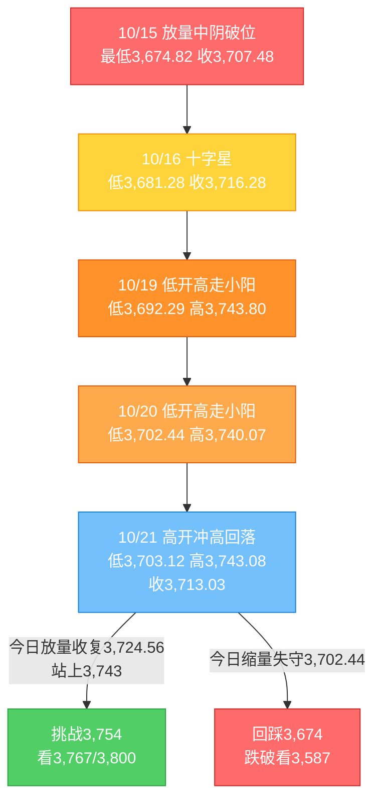
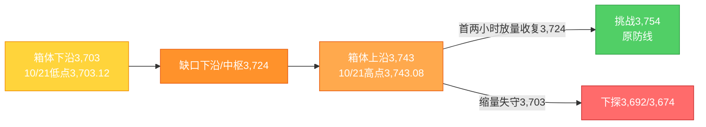

# A股晨报 - 2026年10月22日

> 数据截止时间：2026年10月22日 09:05（北京时间）；A股为10月21日（周三）收盘数据，美股/欧股为10月21日（周三）收盘（隔夜），亚太为10月21日收盘，大宗商品/汇率为10月21日纽约尾盘及10月22日早间
> 报告性质：**国庆长假后第二个完整交易周（第43周）第4个交易日**；以10/21晚报（**"高开冲高回落、宁德业绩雷拖累，收敛三角末端"**）+ **隔夜美股三大指数全线收涨、费半+1.97%** + **中办国办《推动科技创新和产业创新深度融合的意见》发布** + **多周期波浪分析** 为基础

---

## 一、昨日晚报复盘要点回顾

### 1. 昨日判断回顾（10/21晨报 vs 实际）

| 维度 | 准确率 | 说明 |
|------|--------|------|
| 趋势判断 | **0%（0/1）** | 晨报"震荡偏强"落空，上证收**-0.60%**（高开冲高回落） |
| 点位预测 | **67%（2/3）** | 强支撑3,702✓（实际最低3,703.12）、强压力3,754✓（最高3,743.08）、区间3,715-3,790✗ |
| 板块预判 | **86%（6/7）** | 存储/半导体✓、数据要素✓、贵金属✓、石油石化✓、煤炭/银行✓；智能驾驶✗、锂矿✗ |
| 成交量 | **0%（0/1）** | 预测"温和放量1.50-1.65万亿"，实际**1.4421万亿**（缩量295亿） |
| 综合准确率 | **约46%** | 按趋势30%、点位30%、板块30%、量能10%加权 |

### 2. 关键偏差及原因

- **偏差1（核心）：趋势"震荡偏强"落空**——过度权重"日韩存储爆发+美股期货走高"的外部利好，**低估宁德时代Q3"增收不增利"的权重杀伤**；同时忽视"沪指仅高开+0.14%、远低于外盘映射"的高开乏力信号（**逻辑误判+信息缺失**）。
- **偏差2：区间下沿3,715被击穿**——权重业绩雷冲击下，区间下沿应以"三角下沿/前低"（3,702）为锚，而非均线推算值（**技术分析局限**）。
- **偏差3：成交量"温和放量"落空**——"外盘回暖+政策催化"≠增量资金，高开后反而缩量295亿，验证存量博弈（**逻辑误判**）。
- **偏差4：智能驾驶"看涨"落空**——WICV大会"开幕即兑现"，弱势市场事件驱动失效（**情绪面误读**）。
- **偏差5：锂矿"看涨"落空**——天齐业绩预增难敌板块龙头业绩雷的β，"利好兑现"（**逻辑误判**）。
- **偏差6：北向净额不可得**——交易所不再实时披露，判断需改用"成交额/占比+十大成交股+汇率"三要素（**信息缺失**）。

### 3. 沉淀的规则/检查项

- **规则1（趋势分析）**：外部科技市场大涨（KOSPI+3%级）而A股高开不足0.5%、且开盘30分钟量能未放大时，"高开冲高回落"应设为主情景；**权重股业绩雷可完全对冲外盘利好**。
- **规则2（板块选择）**：权重龙头出现"增收不增利"、单季毛利率创新低并跌超10%时，电池链/新能源/创业板系统性承压，同板块个股业绩预增只作"抗跌"依据。
- **规则3（资金面）**：主力连续净流出、但科创板/电子结构性净流入时，属"权重杀跌+主题脉冲"，以行业资金结构而非总量判断风格。
- **规则4（波浪）**：收敛三角末端"低点抬高但高点持平+收盘失守缺口下沿+缩量"时，向下选择概率上升；三角下沿3,702.44为短线失效线，3,674为中线生死线。
- **规则5（风险识别）**：国家级主题首日批量涨停后次日大概率分化；4连板高位股在指数走弱日炸板率上升，追高需等换手确认。
- **规则6（板块选择）**：事件驱动型板块在弱势市场"开幕即兑现"，会前布局、会中减仓。

### 4. 对今日分析的启示

- **必须"先看量、再看价"**：昨日的"外盘强+政策强"已被证伪一次，今日若高开仍不能补量至1.45万亿以上，**3,724.56缺口下沿的争夺仍会反复**，不可直接外推为"放量反转"。
- **权重业绩雷的余波未消**：宁德时代创18个月新低后，电池链/新能源的负反馈仍在，**创业板（连跌8日、失守2,700）仍是最大拖累项**。
- **今日新增"政策变量"**：中办国办科技创新意见为**内因驱动**（非隔夜已知利好），与10/21的外盘映射不同，**存在"低开高走/日内发酵"的可能**，但需资金确认。
- **位置决定策略**：指数仍处"收敛三角末端+3,702/3,754上下夹击"区间，**任何方向在放量突破前都只是试探**。

---

## 二、隔夜市场动态（10/21收盘至10/22早间）

### 1. 美股市场（10/21收盘）

| 指数 | 收盘点位 | 涨跌幅 | 解读 |
|------|---------|--------|------|
| 道琼斯工业指数 | **52,856.09** | **+0.69%（+360.21点）** | 强劲财报提振，价值与科技同步走强 |
| 标准普尔500指数 | **7,757.17** | **+0.58%（+44.60点）** | 三大指数全线收涨 |
| 纳斯达克综合指数 | **26,702.86** | **+1.05%** | 科技股领涨，AI交易回暖 |
| 费城半导体指数 | — | **+1.97%** | 芯片股集体上涨，超威半导体+3.36%、阿斯麦/ARM均涨超2% |

**结构特征**：**"科技领涨、道指跟涨、费半强于大盘"**——SpaceX绩后涨超7%（AI业务收入同比暴增、首次成为最大收入来源），特斯拉涨超3%；**Meta财报出炉，盘后一度涨超3%-6%**；中概股普跌，与美股科技形成反差。**对A股的映射偏正面**，尤其半导体/存储/AI算力链。

### 2. 欧洲与亚太市场

| 市场 | 收盘/表现 | 涨跌幅 | 说明 |
|------|-----------|--------|------|
| 德国DAX | — | **+1.35%** | 欧股全线走强，科技与工业领涨 |
| 法国CAC40 | — | **+0.97%** | 涨逾1% |
| 英国富时100 | — | **+0.19%** | 小幅收涨 |
| 意大利富时MIB | — | **+1.17%** | 全线上涨 |
| 恒生指数（10/21） | **23,651.87** | **-0.90%** | 连续第二日下跌 |
| 恒生科技（10/21） | **3,994.77** | **-1.26%** | 南向净卖出44.34亿港元 |
| 日经225（10/21） | **64,638.88** | **+0.88%** | 半导体/出口链支撑 |
| 韩国KOSPI（10/21） | **5,735.66** | **+3.29%** | 存储双巨头爆发 |

**关键反差**：**隔夜欧美全面转强、费半+1.97%，但10/21港股与A股成长指数逆势下跌**——外盘利好向A股的传导已被"宁德业绩雷+存量博弈"阻断一次；**今日需观察港股能否补涨、A股能否修复这一"映射缺口"**。富时中国A50期货夜盘收涨0.29%，今晨低开后现涨0.15%，**指向"小幅高开、力度有限"**。

### 3. 大宗商品

| 品种 | 价格 | 涨跌幅 | 说明 |
|------|------|--------|------|
| WTI原油（12月合约） | **97.15美元/桶** | **-0.68%（-0.67美元）** | 回落至100美元下方，地缘溢价边际消退 |
| 布伦特原油（12月合约） | **108.82美元/桶** | **+0.03%（+0.03美元）** | 盘中一度冲破111美元，收盘基本持平 |
| 伦敦现货黄金 | **4,139.52美元/盎司** | **+0.35%** | 美债收益率回落+防御需求，结束四连跌 |
| COMEX黄金期货 | **4,159.50美元/盎司** | **+0.41%** | 小幅反弹 |
| COMEX白银 | — | 前一日+1.51% | 高位波动加剧 |

**解读**：**"油弱、金稳、铜缺数据"**——油价回落缓解输入性通胀压力，但布伦特仍在108美元上方；黄金在4,100美元附近获得支撑，**贵金属由"单边下跌"转为"高位震荡"**，对A股黄金股的压制边际减弱。

### 4. 汇率与利率

| 指标 | 数值 | 变化/说明 |
|------|------|----------|
| 美元指数 | **101.780** | **+0.08%**，窄幅波动 |
| 人民币中间价（10/21） | **6.7192** | 较前一日上调8个基点 |
| 离岸人民币（10/22早间） | **约6.68** | 维持强势区间 |
| 美国10年期国债收益率 | **约5.11%** | **下行约3bp**，低于近期5.3%高位 |
| 美国2年期国债收益率 | **约4.79%** | 基本持平 |
| 中国10年期国债收益率 | **1.6333%** | 低位平稳 |
| Shibor O/N | **1.2610%** | 资金面偏松 |
| 央行公开市场（10/21） | **800亿元隔夜逆回购；7天期0；净投放240亿元** | 短端"换锚"实操延续 |

**解读**：**"美债长端回落+美元走平+人民币偏强"**——外部估值压制边际缓解，是国内成长股修复的有利条件；但**美联储10/27-28会议维持利率不变概率约83%、12月加息概率仍高**，中期约束未解除。

### 5. 重要海外事件

- **美股财报季强劲**：SpaceX AI业务收入同比暴增830%、净利润超预期2.3倍；Meta财报超预期，盘后上涨；**"AI资本开支—收入兑现"叙事修复**。
- **三星、SK海力士计划升级中国工厂**（10/21消息）：存储产业链在华产能与技术升级预期升温，**利好A股半导体设备/材料/存储封测**。
- **中东石油运量已恢复至战前水平**：地缘溢价进一步消退，油价上行动能减弱。
- **美国初请失业金（10/22 20:30）**：影响美联储10/28 FOMC预期。

---

## 三、今日关注事项

### 1. 重要数据与事件（按时间排序）

| 时间 | 事项 | 预期/说明 |
|------|------|----------|
| 09:15 | 人民币中间价 | 关注能否延续6.71附近强势 |
| 上午 | **2026金融街论坛最后一日：国家外汇局主办专场** | 跨境资金/汇率政策信号，影响外资与人民币资产定价 |
| 14:00 | **英国9月核心CPI** | 影响欧系利率与全球风险偏好 |
| 15:00 | **国新办"十五五"商务高质量发展新闻发布会** | 外贸、消费、服务贸易政策信号 |
| 20:30 | **美国截至10/17当周初请失业金人数** | 影响美联储10/28会议预期 |
| 全天 | **中办国办科技创新意见发酵** | 新质生产力、产学研融合、企业主导创新 |
| 全天 | **三季报密集披露** | 高位成长股（AI/半导体/机器人/创新药）业绩雷风险 |
| 全天 | **2026消费电子创新大会（CEIC2026，深圳，10/22-24）** | 端侧AI、AI眼镜、折叠屏、消费电子新品 |
| 全天 | **2026世界物理AI大会暨宇树合作伙伴生态大会（杭州）** | 具身智能/人形机器人催化 |
| 全天 | **科大讯飞全球1024开发者节** | 大模型/AI应用主题 |

### 2. 政策/监管动态

- **中办、国办《关于推动科技创新和产业创新深度融合的意见》**（10/21晚间发布，10/22《人民日报》头版）：以发展新质生产力、建设现代化产业体系为目标，构建**企业主导、各主体协同的产学研融通创新体系**；强化科技创新与产业创新战略规划、重大任务、政策措施的统筹协调，以先进技术改造提升传统产业。**这是今日最重要的内因催化**，直接指向**半导体设备/工业软件/机器人/数据要素/科技成果转化**。
- **2026金融街论坛（10/19-10/22）收官**：央行此前宣布设立应对非银机构大额赎回的流动性支持工具、扩大SLF适用机构范围；证监会宣布首批18只主动ETF注册、深化再融资改革。今日外汇局专场为最后一个政策观察窗口。
- **深交所调整港股通标的**：调入勤力资源、调出伟禄科技股份-旧（对大盘影响有限）。

### 3. 公司公告与三季报

| 公司/事件 | 内容 | 市场影响 |
|-----------|------|----------|
| **光庭信息（301221）** | Q3净利2,943.18万元，**同比+1482.18%** | 汽车电子软件景气验证，关注智能驾驶链情绪修复 |
| **华锐精密** | 前三季度净利预增**118%-147%**（3.00-3.40亿元） | 刀具/高端制造景气，机械板块结构性亮点 |
| **宝光股份** | 前三季度净利5,966.45万元（+20.59%），Q3净利+70.99% | 电力设备（灭弧室）结构性改善 |
| **海南矿业** | 前三季度净利预增**92%-124%**（6-7亿元） | 资源品业绩改善 |
| **泰尔股份（2连板）** | 公告工业机器人业务占营收仅3.82% | 高位连板股"概念证伪"风险，防炸板 |
| **三季报整体** | 截至10/21已150家披露，98家增长、34家翻倍；10/22进入密集期 | 业绩分化加剧，"业绩雷"与"超预期"并存 |

### 4. 其他关注

- **新股上市**：创业板**通则康威（301718）**，发行价26.88元/股，发行市盈率44.72倍。
- **限售解禁**：本周（10/21-10/25）约**326.60亿元**，环比-28.16%；10月全月约3,000亿元。今日解禁压力较10/21的640亿元明显减轻。
- **高位连板股**：海洋王、东安动力、大业股份4连板，10/21炸板25只、封板率66.67%，**追高需等换手确认**。

---

## 四、板块与个股分析

### 1. 基于昨日复盘结论的板块调整

| 昨日预判/实际 | 今日调整 | 依据 |
|---------|---------|------|
| 存储/半导体 看涨✓（电子+0.79%） | **维持看涨，升级为"第一主线"** | 费半+1.97%、三星/SK海力士升级中国工厂、日韩存储延续强势 |
| 数据要素 看涨✓（10余只涨停） | **维持看涨，但降为"分化参与"** | 首日批量涨停后次日分化（规则5），只做换手充分的龙头 |
| 智能驾驶 ✗（汽车领跌） | **下调为"中性/事件修复"** | 光庭信息Q3+1482%提供业绩支撑，但需指数配合，不追高 |
| 锂矿/电池链 ✗（电力设备-3.67%） | **下调为"看跌/回避"** | 宁德业绩雷余波未消，板块β承压，业绩预增仅作抗跌依据（规则2） |
| 贵金属 看跌✓（金价四连跌） | **上调为"中性"** | 隔夜金价+0.35%、美债回落，压制边际减弱 |
| 煤炭/银行/保险 看跌✓ | **维持看跌** | 风险偏好回升下的高低切换延续（规则3） |

### 2. 隔夜信息驱动的板块机会

- **受益板块**
  1. **半导体/存储/先进封装**（逻辑：费半+1.97%、三星/SK海力士升级中国工厂、存储涨价周期+国产替代；10/21电子已获主力净流入48.83亿元居首）
  2. **AI算力/光通信/CPO**（逻辑：SpaceX AI收入+830%、Meta财报超预期、美股AI交易修复；10/21天孚通信获净流入7.84亿元）
  3. **机器人/物理AI/具身智能**（逻辑：世界物理AI大会暨宇树生态大会今日杭州召开、具身智能生态大会；主题催化密集，但需防高位分化）
  4. **消费电子/端侧AI**（逻辑：CEIC2026今日深圳开幕，AI眼镜/折叠屏/端侧AI新品密集）
  5. **科技创新/工业软件/新质生产力**（逻辑：中办国办意见头版发布，产学研融合+企业主导创新，政策级别高）

- **受损板块**
  1. **电池链/锂电材料/新能源**（逻辑：宁德时代业绩雷余波、Q3毛利率创四年新低、创业板权重负反馈）
  2. **白酒/食品饮料**（逻辑：10/21盐津铺子跌停、东鹏/汾酒跌超5%，高位消费补跌未止）
  3. **煤炭/银行/保险等红利防御**（逻辑：外盘risk-on+科技催化→高低切换，防御继续被抽血）
  4. **石油石化/油服**（逻辑：WTI回落至97.15美元，地缘溢价消退）

### 3. 重点关注个股（仅作方向示例，不构成推荐）

| 标的 | 关注理由 | 技术位置/操作提示 |
|------|---------|------------------|
| 存储链（兆易创新、佰维存储、德明利、江波龙等） | 费半+1.97%+三星/SK海力士升级中国工厂 | 高开>3%不追，等回踩5日线；放量突破前高可跟 |
| 半导体设备/材料（北方华创、中微公司、拓荆科技等） | 国产替代+存储扩产+政策意见 | 关注是否放量突破10/21高点，缩量冲高不追 |
| AI算力/光通信（天孚通信、中际旭创、新易盛等） | 美股AI交易修复+Meta/SpaceX财报 | 10/21已获资金流入，回踩不破5日线可持 |
| 机器人/具身智能（减速器、丝杠、电机等） | 物理AI大会+宇树生态大会今日召开 | 事件驱动"会前布局、会中兑现"，高位股不追 |
| 消费电子（AI眼镜/折叠屏/端侧AI） | CEIC2026今日深圳开幕 | 主题脉冲，优选低位首板，防"开幕即兑现" |
| 数据要素（易华录、深桑达A、云赛智联等） | 国家数据集团+科技创新意见 | 首日涨停潮后分化，只做换手充分的龙头 |

---

## 五、今日核心判断（结构化，用于晚报复盘）

### 1. 趋势判断

- **上证指数：【震荡偏强】**
- **预测区间：3,702点 - 3,762点**
- **核心逻辑**：**隔夜外盘全面转强（纳指+1.05%、费半+1.97%、欧股普涨）+ 中办国办科技创新意见头版发布 + A50期货小涨**，内外因素共振下**今日大概率小幅高开**；但**10/21刚经历"利好高开回落"、量能仅1.44万亿、宁德业绩雷余波未消**，决定**上行以"反复争夺3,724.56缺口下沿、挑战3,743"为主**，**3,754未放量收复前不预设单边突破**。

### 2. 关键点位

- **强支撑位：3,702点**（依据：收敛三角下沿3,702.44，10/21最低3,703.12贴线守住，跌破则三角向下选择）
- **弱支撑位：3,692点**（依据：10/19低点3,692.29，三角下沿第二道防线）
- **强压力位：3,754点**（依据：**被跌破的原防线**，放量收复=反抽升级为反转）
- **弱压力位：3,743点**（依据：10/21高点3,743.08与60分钟箱体上沿）；**日内第一压力3,724.56点**（10/15破位缺口下沿，10/21收盘失守）

### 3. 板块预判

- **看涨板块**：
  1. **半导体/存储/先进封装**（逻辑：费半+1.97%、三星/SK海力士升级中国工厂、电子资金净流入居首）
  2. **AI算力/光通信/CPO**（逻辑：美股AI交易修复、SpaceX/Meta财报超预期）
  3. **机器人/物理AI/具身智能**（逻辑：世界物理AI大会+宇树生态大会今日召开）
  4. **消费电子/端侧AI**（逻辑：CEIC2026深圳开幕）
- **看跌板块**：
  1. **电池链/锂电材料/新能源**（逻辑：宁德业绩雷余波+创业板负反馈，规则2）
  2. **白酒/食品饮料**（逻辑：高位消费补跌未止）
  3. **煤炭/银行/保险（红利防御）**（逻辑：risk-on下的高低切换，规则3）
- **风险板块**：**高位连板股**（4连板+炸板率上升，规则5）；**三季报高位成长股**（AI/半导体/机器人/创新药业绩雷）；**事件驱动板块**（大会"开幕即兑现"，规则6）；**高比例解禁个股**。

### 4. 资金面判断

- **北向资金预期**：交易所**净额不可得**，以成交额口径跟踪；预计成交额**2,100-2,300亿元、占比15%-16%**，**方向偏净流入10-30亿元**（依据：人民币偏强、美元走平、外盘risk-on）
- **成交量预期：【平量至温和放量】1.45-1.60万亿**（依据：外盘转暖+政策催化，但昨日刚证伪"放量"逻辑；**开盘30分钟成交额同比放大10%以上才上调至1.60万亿**）

### 5. 风险预警（按优先级）

- **高风险**：**"利好高开冲高回落"重演**——10/21已发生一次，若今日高开超0.5%但开盘30分钟量能未放大，3,724.56/3,743大概率得而复失；**三季报业绩雷**——高位成长股密集披露，单季不及预期即可能闪崩。
- **中风险**：**宁德时代负反馈延续**——创18个月新低后若继续下跌，将拖累创业板/沪深300；**量能不足**——若全天低于1.45万亿，3,754无法收复，三角向下破位风险回升；**美债5.11%+10/28 FOMC**——外部估值约束未解除。
- **低风险**：**油价回落**对油气链的压制；**中东地缘**反复；**中美关税**（11/1美方决定、APEC窗口）；**解禁**（本周326.6亿元，压力较昨日减轻）。

### 6. 昨日复盘规则应用

- **应用规则1（趋势）**：昨日"外盘强+A股高开乏力"已给出教训，**今日以"开盘30分钟量能"作为情景切换开关**——放量则看3,743/3,754，缩量则按"3,702-3,743箱体"处理。
- **应用规则2（板块）**：**电池链/新能源不因"超跌"而抄底**，同板块业绩预增只作抗跌依据；**半导体/AI算力才是资金主线**。
- **应用规则3（资金）**：以行业资金结构判风格——若电子/计算机/机械设备净流入、银行/非银净流出，则"结构进攻"延续；若科技高开却主力净流出，视为兑现信号。
- **应用规则4（波浪）**：**3,702.44为短线失效线、3,674为中线生死线**，三角未选择前不重仓。
- **应用规则5/6（风险/板块）**：**不追4连板、不追大会开幕日**，等换手与回踩。

---

## 六、波浪理论参考（多周期）

### 1. 月K线波浪分析

- **当前波浪位置**：大周期**第2浪C浪延伸末端**，处于"3,674核心支撑上方、3,754原防线下方"的收敛末端。
- **浪型结构描述**：2024/9（2,689点）→2026/6（4,197点）为第1浪；此后进入第2浪ABC调整，C浪自3,842点下方延伸至**3,674.82点（10/15低点）**；10月月K线目前为**带下影中阴**（3,842.19→3,713.03，**-3.36%**），月内低点3,674.82，下影线初现，但收盘仍低于**20月均线3,800**。
- **关键目标位**：下方**3,674（核心）→3,587→3,478**；上方**3,724.56（缺口下沿）→3,754（原防线）→3,800（20月均线）→3,842**。
- **验证条件**：月内收盘不破3,674，则"C浪末端止跌"仍成立；若月收盘有效跌破3,674，则C浪延伸深化，下看3,587/3,478；若月内放量收复3,754并站上3,800，则C浪结束概率上升。

### 2. 周K线波浪分析

- **当前波浪位置**：第43周（10/19-10/23）第4个交易日，处于**第42周"放量破位中阴"后的弱势整理**。
- **浪型结构描述**：本周一3,730.92（+0.39%）、周二3,735.37（+0.12%）、周三3,713.03（-0.60%），周内高点3,743.80、低点3,692.29；**周线暂为-0.09%**（相对上周收盘3,716.28），仍处**5/10/20/60周均线下方**，空头排列未改；上周低点3,674.82尚未被跌破。
- **关键目标位**：下方**3,692.29→3,674.82→3,587**；上方**3,724.56→3,754→3,800**。
- **验证条件**：**本周五（10/23）能否放量收在3,724.56上方并挑战3,754**，是周线由"破位"转"企稳"的关键；若周收盘跌破3,692，则周线二次探底。

### 3. 日K线波浪分析（重点）

- **当前波浪位置**：C浪延伸"破位下行"后的**"收敛三角末端"**，方向选择临近。
- **浪型结构描述**：10/15放量破位（低3,674.82）→10/16十字星（低3,681.28）→10/19低开高走（低3,692.29）→10/20低开高走（低3,702.44）→10/21高开冲高回落（低3,703.12），**低点连续4日抬升**；但高点3,750.77→3,743.80→3,740.07→3,743.08**基本持平**，构成**收敛三角**。10/21收盘3,713.03**失守3,724.56缺口下沿**，为10/19以来首次，**短线转弱信号**；但低点3,703.12仍守住3,702.44，**三角下沿未破**。
- **关键目标位**：上方**3,724.56→3,743.08→3,754（关键）→3,767→3,800**；下方**3,703.12→3,702.44→3,692.29→3,674（核心）**。
- **验证条件**：
  - **向上**：放量收复3,724.56并站上3,743，挑战3,754；站稳3,754则收敛三角向上选择，看3,767/3,800。
  - **向下**：收盘跌破3,702.44（尤其3,692），则三角向下破位，回踩3,674；跌破3,674则看3,587。
  - **今日变量**：外盘全面转强+科技创新政策（向上）vs 量能不足+宁德余波（向下）；**方向上略偏多，但必须由"量"确认**。

### 4. 60分钟K线波浪分析

- **当前波浪位置**：60分钟**箱体（3,703-3,743）下沿获支撑后的反弹尝试**，处于箱体中下部。
- **浪型结构描述**：10/21开盘3,740.57，首小时冲高3,743.08（**精确受阻于箱体上沿**），随后逐级回落；尾盘放量下探3,703.12（**精确测试箱体下沿**）后小幅拉回至3,713.03。60分钟MACD高位死叉后回落至零轴附近，KDJ低位钝化，**短线动能偏弱但已接近超卖**。
- **关键目标位**：上方**3,724→3,743**；下方**3,703→3,692**。
- **验证条件**：今日首两小时能否**放量收复3,724**——站上则重回箱体中枢，挑战3,743；若失守3,703，则下探3,692/3,674。

### 5. 30分钟K线波浪分析

- **当前波浪位置**：30分钟**高开低走、逐级下移后的超卖区**，短线存在反弹修复需求。
- **浪型结构描述**：10/21开盘冲高后形成**逐级降低的高点**，尾盘放量跳水，30分钟MACD死叉后绿柱放大、KDJ低位，**短线超卖但未出现明显底背离**。
- **关键目标位**：上方**3,724→3,743**；下方**3,703→3,692**。
- **验证条件**：30分钟MACD能否**零轴下方金叉+放量**——是日内反弹的前提；若继续放量下破3,703，则加速测试3,692/3,674。

### 6. 波浪图（Mermaid）

**日K线波浪结构图**：

**60分钟波浪结构图**：

### 7. 波浪理论综合判断

| 维度 | 判断 |
|------|------|
| **多周期共振状态** | **大周期（月/周）仍向下；日线收敛三角末端待选择；60/30分钟短线超卖待修复**——呈"**大周期向下+短周期反弹**"的背离格局，反弹级别有限 |
| **当前操作级别** | **日线级别（防守为主，等待方向选择）**；3,674为中线生死线，3,754为短线转强线，3,702.44为三角下沿 |
| **后续演变路径** | **45%偏多**（放量收复3,724.56→挑战3,743/3,754）、**35%中性**（3,702-3,743箱体震荡，科技/机器人轮动）、**20%偏空**（缩量冲高回落→收盘跌破3,702.44，回踩3,674） |
| **关键拐点信号** | 向上：**放量收复3,724.56 + 站上3,743 + 日线KDJ金叉 + 主力资金转净流入**；向下：**收盘跌破3,702.44 + 科技高开低走 + 创业板失守2,650** |
| **风险提示** | 波浪在"C浪延伸末端+收敛三角"精度下降，须以**量能、宁德余波、美债利率**三重验证；若政策/外围突发，浪型可能直接失效 |

---

## 七、投资策略建议

### 1. 短线策略（1-3个交易日）

- **适用场景**：基于日K线和60分钟K线技术信号
- **短线仓位：20%**（较昨日15%-20%小幅上调，因外盘+政策双重改善，但仍低于10/21晨报的25%）
- **买入条件**：
  1. 高开回踩**3,724.56不破**且分时量能同比放大 → 轻仓试探；
  2. 首两小时**放量站上3,743** → 加至20%；
  3. 若低开在3,702-3,713企稳且30分钟MACD金叉 → 可低吸。
- **卖出条件**：触及**3,754-3,762**且量能萎缩 → 分批止盈；收盘失守3,724 → 减半。
- **止损位**：上证**收盘3,702点**（短线硬止损）或个股跌幅**5%**。
- **短线标的**：（1）半导体/存储（逻辑：费半+1.97%+存储扩产，回踩5日线低吸）（2）AI算力/光通信（逻辑：美股AI交易修复+资金回流）（3）机器人/物理AI（逻辑：今日大会催化，仅做低位、不追高）

### 2. 中线策略（1-4周）

- **适用场景**：基于周K线波浪分析和运行规律分析结论
- **中线仓位：20%-25%**（维持10/21晚报建议，不加仓）
- **方向判断：【持有/观望】**
- **目标区间**：上证指数 **3,754点 - 3,800点**
- **中线布局板块**：（1）半导体设备/存储（逻辑：国产替代+三星/SK海力士在华扩产+政策支持）（2）AI算力/光通信（逻辑：AI资本开支兑现、业绩确定性高）（3）数据要素/工业软件（逻辑：国家数据集团+科技创新意见，政策级别高）
- **止盈条件**：指数到达**3,800点**或波段涨幅达到**8%**
- **止损条件**：指数**收盘跌破3,674点**或趋势确认反转

### 3. 仓位分配总览

| 策略类型 | 仓位比例 | 方向 | 重点板块 |
|---------|---------|------|---------|
| 短线 | 20% | 轻仓试探 | 半导体/存储、AI算力、机器人 |
| 中线 | 20%-25% | 持有/观望 | 半导体设备、光通信、数据要素 |
| 现金 | 55%-60% | — | — |

### 4. 与昨日策略对比

- **短线仓位调整**：从**15%-20%**微调至**20%**（原因：外盘全面转强+科技创新政策，但量能未验证，仅小幅上调）。
- **中线仓位调整**：维持**20%-25%**不变（原因：3,674未破、政策底仍在，但3,754未收复前不加仓）。
- **板块调整**：**增配半导体设备/存储、AI算力**（外盘+政策共振）；**减配/回避电池链、白酒、红利**（业绩雷+高低切换）；**数据要素由"重点看涨"降为"分化参与"**。

---

## 八、信息来源

1. **官方数据来源**：上海证券交易所（10/21上证收3,713.03、-0.60%、成交6,427.52亿）、深圳证券交易所、北京证券交易所、中国人民银行（10/21净投放240亿元）、中国外汇交易中心（中间价6.7192）、中国货币网（10Y国债1.6333%、Shibor）、中共中央办公厅/国务院办公厅（《关于推动科技创新和产业创新深度融合的意见》）、国务院新闻办公室（10/22"十五五"商务发布会）、国家外汇管理局（金融街论坛专场）。
2. **权威财经媒体**：新华社/新华网（油价、美元指数）、人民日报（10/22头版）、证券时报（美股收盘、芯片股）、上海证券报（新股提示、三季报）、中国证券报、财联社（A50期货、欧洲股指）、澎湃新闻、新浪财经、腾讯新闻。
3. **数据平台**：东方财富Choice、同花顺、Wind资讯、证券时报数据宝、香港交易所、Euronext、Morningstar。
4. **研究机构**：中金公司、银河证券、招商证券、中信建投、国泰海通、瑞银证券。

> 数据截止时间：2026年10月22日 09:05（北京时间）。美股/欧股为10月21日收盘，亚太为10月21日收盘；A50期货、离岸人民币为10月22日早间值；北向资金净额交易所未实时披露，以成交额口径跟踪；不同数据商成交额口径存在约1%差异。

---

*本晨报由AI代理自动生成，仅供参考，不构成投资建议。投资有风险，入市需谨慎。*
