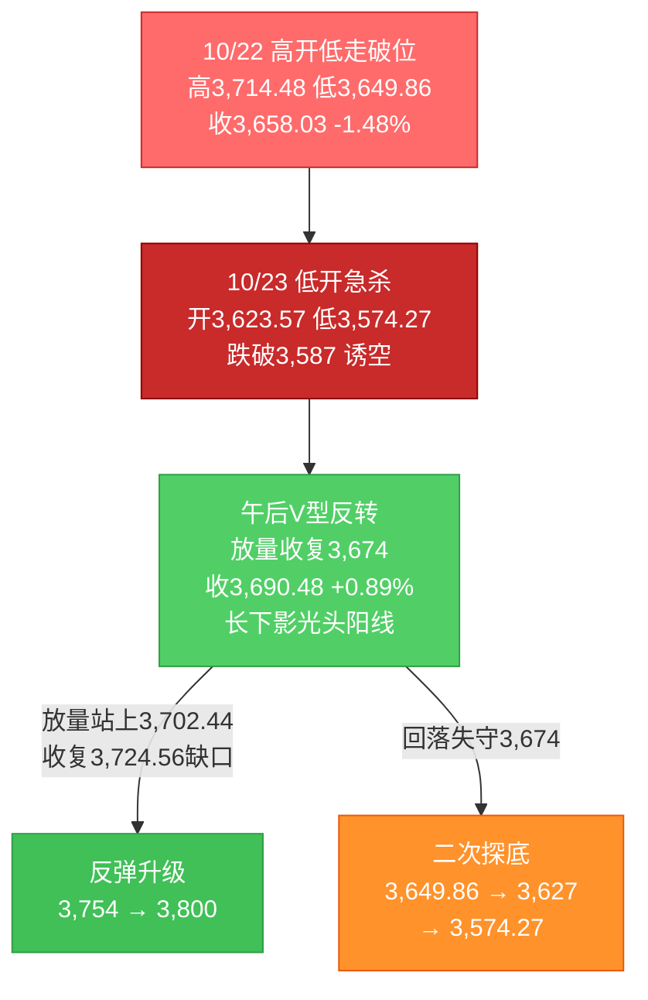
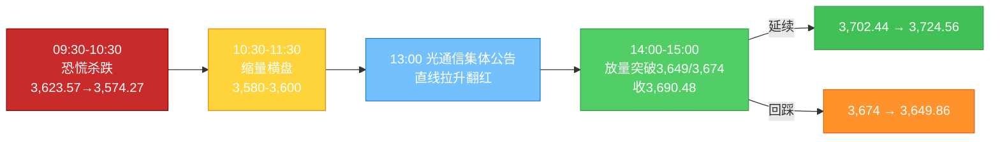

# A股晚报 - 2026年10月23日

> 数据截止时间：2026年10月23日 20:00（北京时间）；A股为10月23日收盘数据，美股为10月22日收盘（隔夜）及10月23日盘前，欧洲为10月23日盘中，亚太为10月23日收盘，大宗商品/汇率为10月23日盘中或最近收盘
> 报告性质：**国庆长假后第二个完整交易周（第43周）第5个交易日、本周收官日**；以10/23晨报（**"震荡，区间3,608-3,678，低开探底后日内修复"**）+ **早盘急杀至3,574.27（-2.29%）后的V型反转** + **午间光通信企业集体公告** + **机器人主题全面爆发** + **多周期波浪分析** 为基础

---

## 一、市场回顾

### 1. 主要指数表现

| 指数 | 收盘点位 | 涨跌幅 | 开盘 | 最高 | 最低 | 备注 |
|------|---------|--------|------|------|------|------|
| 上证指数 | **3,690.48** | **+0.89%（+32.45点）** | 3,623.57 | **3,691.40** | **3,574.27** | **低开-0.94%→急杀-2.29%→午后V型反转，收盘近全天最高，收复3,674"中线生死线"** |
| 深证成指 | **11,673.83** | **+2.79%** | — | — | — | 成长权重全面反攻 |
| 创业板指 | **2,684.10** | **+4.16%** | 低开-1.66% | — | — | **早盘一度跌超3%，午后拉升涨超4%，探底回升幅度约7个百分点** |
| 科创50 | — | **+3.04%** | — | — | — | **早盘一度跌超3%，14:41涨超3%** |
| 科创综指 | — | 早盘一度跌超3%，午后转涨 | — | — | — | 与科创50同步V型 |
| 北证50 | **984.90** | **+1.88%（+18.16点）** | — | — | — | 跟涨，弹性弱于双创 |
| 沪深300 | — | **+1.71%** | — | — | — | 权重与成长同步修复 |
| 上证50 | — | 小幅上涨（银行拖累） | — | — | — | 银行逆势下跌压制权重 |

**盘面特征**：三大指数**集体低开**（沪指-0.94%、深成指-1.49%、创业板指-1.66%），开盘后**继续放量下杀**，沪指10:00前后下探**3,574.27点（-2.29%）**、创业板指一度跌超3%、科创50一度跌超3%，市场一度呈"破位加速"形态；**11:00后跌势收敛，午后在光通信/算力链集体公告与机器人主题爆发带动下直线拉升**，13:30后翻红并持续走强，沪指最高3,691.40、**收3,690.48点（+0.89%），距全天最高仅0.92点**；创业板指收2,684.10点（+4.16%），**全天振幅超7个百分点**。

**关键形态**：日K线收出**"低开长下影光头大阳线"**——实体约66.91点、下影约49.30点、上影仅0.92点，**盘中跌破3,587（黄金分割延伸位）后快速收回，并一举收复3,674"中线生死线"**，属典型的"诱空/假破位"反转形态。周K线（第43周）收**"长下影小阴线"**（开3,694.12、高3,743.80、低3,574.27、收3,690.48，**周跌0.69%**），下影约116点，**周线收复3,674关键位**。

### 2. 成交量能与资金流向

| 指标 | 数值 | 变化/说明 |
|------|------|----------|
| 沪深两市成交额 | **约1.96万亿元** | 较10/22的15,287.08亿元**放量4,276亿元（+28%）**，为10月以来单日最大成交 |
| 三市成交额 | **约1.97万亿元** | 北证50成交约127亿元（14:06口径） |
| 沪市成交额 | **8,986.67亿元** | 较10/22的7,060.96亿元放量1,925.71亿元 |
| 深市成交额 | **约1.06万亿元** | 放量约2,350亿元 |
| 半日成交 | **10,768亿元** | 早盘恐慌杀跌+午后反转共同推升 |
| 北向资金成交额 | **3,131.78亿元** | 占两市总成交额**16.01%**；**净额未披露**（交易所已不实时披露） |
| 主力资金 | **净流入35.16亿元** | **终结连续12个交易日净流出**（10/22为-540.55亿元）；其中创业板+40.83亿、科创板+15.52亿、沪深300成份+15.82亿 |
| 特大单资金 | **净流入95.56亿元** | 1,937股净流入、2,620股净流出；长鑫科技+15.99亿、中际旭创+15.83亿居前 |
| 行业资金 | **11个行业净流入、20个净流出** | 电子+73.46亿居首、计算机+37.11亿、传媒+18.76亿、汽车+7.79亿；**银行-31.23亿居首**、公用事业-13.84亿、基础化工-12.69亿、医药生物-10.72亿 |

**北向十大成交股**：沪股通——**药明康德41.97亿元、贵州茅台36.05亿元、寒武纪30.18亿元**；深股通——**宁德时代**居首（具体金额未完整披露）。

**资金结构判断**：**"总量转为净流入+科技链集中回补+防御板块集中流出"**——电子、计算机、传媒三大科技方向合计净流入约129亿元，而银行、公用事业、基础化工合计净流出约58亿元；**这是10月以来首次出现"主力资金总量净流入+特大单净流入近百亿+成交放量4,276亿"的三重共振**，性质上属"增量资金入场/风格由防御切向进攻"，而非单纯的存量高低切换。

**杠杆与托底**：股票型ETF自9/28以来连续净流入（10/22累计超2,100亿元）；今日**早盘急杀阶段宽基ETF再度放量**，午后随指数反转，**"国家队托底+抄底资金"共同构成V型反转的资金基础**。

### 3. 市场情绪与宽度

| 指标 | 数值 | 说明 |
|------|------|------|
| 上涨家数 | **4,525只（占81.22%）** | 较10/22的535只**爆发式修复** |
| 下跌家数 | **909只** | 占比约16.3% |
| 涨停 | **84只** | 另有20只盘中触及涨停，**封板率80.77%**（财联社口径：82只涨停、封板率87%） |
| 跌停 | **9只** | 较10/22的62只**骤降85%** |
| 连板股 | **12只** | 大业股份6连板、海洋王6连板、慈文传媒11天7板、福莱新材5天3板、华阳智能/正裕工业/襄阳轴承2连板 |
| 早盘宽度 | 上午收盘仅**643只上涨** | **"早盘极致恐慌→午后极致修复"，单日宽度摆动幅度为10月以来最大** |

**情绪判断**：**"恐慌性洗盘→情绪V型修复"**——早盘上涨家数一度萎缩至643只、跌停快速增加，属"最后一跌式恐慌释放"；午后涨停增至84只、封板率80.77%、跌停降至9只，**赚钱效应由"极差"直接切换至"极好"**。这种"单日宽度从<10%到>80%"的摆动，历史上多出现在**阶段性底部区域**，但同时也意味着**次日分化概率高**（获利盘与解套盘叠加）。

---

## 二、热点板块与异动分析

### 1. 当日领涨板块及驱动因素

| 板块/概念 | 表现 | 驱动因素 |
|-----------|------|----------|
| **人形机器人/具身智能** | **机器人板块+7.98%，人形机器人指数+6.16%（成交1,293.13亿元，118涨1跌、12只涨停）** | **宇树科技午后20cm涨停报624元、市值重返2,500亿元上方（上市以来首次封板）**；大业股份6连板、福莱新材5天3板；**2026全球开发者先锋大会暨国际具身智能技能大赛开幕**；特斯拉Optimus/OpenAI产业催化余温 |
| **计算机/软件开发** | **计算机+4.67%（申万居首）、软件开发+5.02%** | 海天瑞声、汇金科技、绿盟科技等**13只涨停**；AI应用+信创+数据要素共振；DeepSeek拟融资约1,000亿元的中期催化 |
| **传媒** | **+3.78%（申万第二）** | 慈文传媒11天7板（短剧概念）、AI漫剧/AI应用情绪修复；前一日跌停潮后的超跌反抽 |
| **电力设备/电池** | **+3.67%；电池板块+3.58%** | 宁德时代H股终结7连跌、A股止跌；午后风险偏好修复带动超跌反弹 |
| **机械设备** | **+3.54%** | 机器人产业链（减速器/丝杠/电机）拉动，10余只涨停 |
| **电子/半导体** | **电子+2.94%；半导体板块+3.7%（14:15成交2,066亿元）** | 早盘补跌后V型反转；粤芯半导-U涨20.01%；长鑫科技+7.93%、主力净流入15.99亿元居首 |
| **通信/光通信** | **通信+1.87%** | **午间中际旭创、新易盛、天孚通信、联讯仪器等集中公告"生产经营正常、供应链稳定、产能利用率充足、客户订单强劲"**；中际旭创由早盘跌近6%拉至涨近2%，新易盛/天孚由跌转涨 |
| **汽车** | **+2.68%** | 机器人+智能驾驶共振，超跌修复 |
| **有色金属/医药生物/非银** | +2.09%/+2.04%/+1.52% | 黄金股早盘跌5%-6%后V型，赤峰黄金收涨4.10%（黄金概念33涨9跌）；创新药ESMO大会催化；券商随情绪修复 |

**领涨逻辑**：**"超跌+催化+资金回补"三重叠加**——①**超跌**：早盘创业板一度跌超3%、科创50跌超3%，10月以来成长指数累计跌幅巨大，抛压一次性释放；②**催化**：午间光通信龙头集体公告"订单强劲/产能充足"，直接推翻"AI资本开支下调"的空头叙事；机器人则有宇树科技首板+具身智能大赛的"事件+龙头"双击；③**资金**：主力资金结束12日净流出、特大单净流入95.56亿元，ETF与抄底资金在3,574-3,600区间承接。

### 2. 当日领跌板块及原因

| 板块/概念 | 表现 | 原因分析 |
|-----------|------|----------|
| **银行** | **-1.30%（申万末位）** | **中国银行跌超4%**，农业银行/建设银行/工商银行跌超2%，邮储/交行/江苏银行跟跌；招商银行主力净流出7.25亿元居首、交通银行-5.68亿；**高低切换下防御资金撤出，转而追逐成长** |
| **公用事业/电力** | **-0.60%** | 闽东电力、皖能电力、黔源电力下挫；长江电力主力净流出5.98亿元；**高股息"避风港"属性在风险偏好回升日失效** |
| **钢铁/农林牧渔** | -0.19%/-0.03% | 周期与农业缺乏催化，资金被科技主线抽离 |
| **石油石化（盘中）** | 早盘一度**-2%**（华锦股份-9.83%），**收盘翻红+0.46%** | 布油连续合约114.41美元（+1.19%）支撑，午后随大盘修复 |
| **黄金股（早盘）** | 早盘四川黄金-6%、赤峰黄金-5%，**收盘赤峰+4.10%、板块33涨9跌** | 伦敦金现盘中跌破4,000美元（7月以来新低）、沪金-2.42%，但A股黄金股午后随风险偏好修复V型反转 |

**领跌逻辑**：**"防御板块补跌=风险偏好反转的镜像信号"**——银行、公用事业是10/13-10/22弱势期间的资金避风港，今日在"科技全面反攻"下成为**提款机**；**银行-1.30%与计算机+4.67%的剪刀差达6个百分点**，是10月以来最大的单日风格切换幅度。需注意：**银行杀跌并非基本面恶化，而是"跷跷板效应"**，若后续指数再度转弱，防御资金可能回流。

### 3. 个股异动复盘

- **宇树科技（688836）**：午后20cm涨停报**624.00元**，总市值重返**2,500亿元**上方，**上市以来首次封板**；带动奥普特、慈星股份等机器人链跟涨。
- **大业股份（603278）**：**6连板**（10/22为5连板），机器人题材高标；**海洋王6连板**（军工）。
- **中际旭创（300308）**：早盘跌近6%，午间公告后直线拉升，**收盘涨近2%**，主力净流入15.83亿元（证券时报口径）居第二；新易盛、天孚通信由跌转涨。
- **长鑫科技**：**+7.93%**，主力净流入**15.99亿元**居首（存储/DRAM国产化）。
- **慈文传媒**：**11天7板**（短剧概念），传媒情绪标杆。
- **福莱新材**：5天3板；华阳智能、正裕工业、襄阳轴承2连板。
- **中国银行**：**跌超4%**，银行板块领跌；招商银行、长江电力、交通银行主力净流出居前。
- **萃华退**：跌超55%（退市整理），与黄金板块无关，属个股风险。

---

## 三、关键数据与事件回顾

### 1. 国内重要经济数据

- 今日**无重磅月度经济数据发布**。市场矛盾集中在**微观盈利（三季报）+ 外部利率（美债）+ 风险偏好**。
- 三季度GDP（10/19公布）仍为**前三季度同比+4.6%、Q3 +4.5%**，经济"稳中有升"判断未变。

### 2. 政策与监管动态

- **央行大额流动性投放预告**：**10月26日（下周一）将以固定数量、利率招标、多重价位中标方式开展7,000亿元1年期MLF操作**——**单次规模显著高于常规，是今日午后风险偏好修复的重要宏观背景**。
- **央行公开市场（10/23）**：**7天期逆回购操作量为零**；开展**2,580亿元隔夜逆回购**；当日有2,330亿元逆回购到期，**单日净投放250亿元**；本周累计开展800亿元7天期+5,110亿元隔夜逆回购，**隔夜逆回购"短端换锚"延续**。
- **首批18只主动ETF今日集中开售**：六家公募自购或股东投资合计约14亿元（摩根5亿元、易方达/华夏/富国/汇添富各2亿元、华安1亿元），**增量资金与情绪托底**。
- **"AI龙头股连锁强平"传闻被证伪**（中国证券报），叠加**光通信企业午间集体公告**，共同构成"辟谣+基本面背书"的反转催化。
- **DeepSeek拟融资约1,000亿元**（模型训练、算力建设、人才招募），对国产算力/IDC/服务器链构成中期正面催化。

### 3. 公司公告与三季报

| 公司/事件 | 内容 | 市场影响 |
|-----------|------|----------|
| **中际旭创/新易盛/天孚通信/联讯仪器** | 午间集中公告：**生产经营正常、供应链稳定、产能利用率充足、客户订单需求强劲** | **直接触发午后光通信链直线拉升，是今日V型反转的第一催化** |
| **长鑫科技** | 主力净流入15.99亿元居首，股价+7.93% | 存储/DRAM国产化主线获资金确认 |
| **九州通** | 前三季度营收1,294.45亿元（+8.48%）、净利16.82亿元（**-14.85%**），拟10派1元 | 医药商业"增收不增利" |
| **昊帆生物** | 前三季度营收5.9亿元（+35.67%）、净利1.08亿元（+8.76%），拟10派1.5元 | 中小盘业绩稳健 |
| **澜起科技** | 7/24-10/23累计回购208.8万股、金额4.1亿元 | 回购托底 |
| **伊利股份** | 10/22首次回购180.02万股、金额约4,900万元 | 消费白马回购 |
| **三孚新科** | 实控人提议回购 | 回购潮延续 |
| 三季报整体 | 10/23-10/31为密集披露高峰 | **高位成长股"单季不及预期即闪崩"风险仍高** |

### 4. 解禁与新股

- **本周解禁**：10/21-10/25约**326.60亿元**，环比-28.16%；今日解禁压力不大，**非独立主线**。
- **新股**：今日无主板/创业板新股申购；10/22创业板通则康威（301718）已上市。
- **后续**：10月全月解禁约3,000亿元；上海汽配1.19亿股11/2解禁。

---

## 四、海外市场联动

### 1. 美股（10/22收盘，隔夜）

| 指数 | 收盘 | 涨跌幅 | 解读 |
|------|------|--------|------|
| 道琼斯 | **52,867.98** | **+0.02%（+11.89点）** | 几乎平收，价值/防御承接 |
| 标普500 | **7,663.43** | **-1.21%（-93.74点）** | 科技权重拖累 |
| 纳斯达克 | **26,008.86** | **-2.60%（-694.00点）** | **2026年6月以来最大单日跌幅** |
| 费城半导体 | — | 泛林**-11%**、科磊/闪迪/迈威尔**-9%** | AI硬件全球杀估值 |

### 2. 美股盘前（10/23，截至16:30）

| 指数/个股 | 表现 | 说明 |
|-----------|------|------|
| 道指期货 | **-0.40%** | 分化 |
| 标普500期货 | **-0.09%** | 基本持平 |
| 纳斯达克100期货 | **+0.10%** | **由跌转平，AI硬件恐慌边际缓和** |
| 英伟达 | **+0.93%** | 盘前反弹 |
| 纳指期货（18:27） | 29,103.06，**-0.13%** | 窄幅震荡 |

**判断**：隔夜纳指-2.60%的冲击在**亚太时段被完全消化**——A股早盘虽补跌至3,574.27，但**美股期货在A股午后已转平/微涨**，外盘并未形成"连续第二日杀跌"，这是A股能够V型反转的重要外部条件。

### 3. 欧洲市场（10/23盘中）

| 指数 | 表现 |
|------|------|
| 德国DAX | **-0.73%，25,185.64点** |
| 法国CAC40 | 下跌（前一日-1.39%至7,811.26） |
| 英国富时100 | 前一日-0.26%至10,725.03 |
| 欧洲斯托克50 | 弱势 |

**欧元区10月PMI初值不及预期**（综合PMI回落），欧洲动能放缓；但**A股与欧洲当日走势背离**，说明A股反转主要由内部因素（光通信公告+机器人+流动性）驱动。

### 4. 亚太市场（10/23收盘）

| 市场 | 收盘 | 涨跌幅 | 说明 |
|------|------|--------|------|
| 恒生指数 | **23,093.37** | **+0.69%（+158.69点）** | 重返23,000点 |
| 恒生科技 | **3,871.66** | **+2.05%（+77.73点）** | **AI产业链、机器人、锂电池强势反弹**；小米+4%、哔哩哔哩+2%、腾讯+1%、中际旭创H+4% |
| 日经225 | — | 弱势（前一日-2.65%） | 半导体/出口链承压 |
| 韩国KOSPI | — | 盘中修复（早盘-1.5%以内） | SK海力士转涨 |

**判断**：**港股午后与A股同步走强**（恒生科技+2.05%），**"亚太科技链共振修复"是今日区域特征**；A股并非孤立反弹。

### 5. 大宗商品与美元

| 品种 | 价格/表现 | 说明 |
|------|-----------|------|
| 布伦特原油（连续） | **114.41美元/桶，+1.19%** | 中东供应扰动延续（延布港遇袭），油价维持高位 |
| WTI原油 | 约100美元/桶上方 | 前一日+2.39%至99.47美元 |
| 伦敦金现 | **4,015.87美元/盎司，-0.18%**；盘中跌破**4,000**（7月以来新低） | 流动性挤压+去杠杆 |
| COMEX黄金 | **4,027.50美元/盎司，-0.81%** | 年内跌幅超10% |
| 沪金 | **864.94元/克，-2.42%** | 国内金价补跌 |
| 美元指数 | 约101.6附近 | 避险未推升美元 |

**解读**：**"油涨、金弱、股强"**——油价高位对中下游成本仍有压制，但今日市场**选择性忽略通胀压力、聚焦成长修复**；黄金盘中跌破4,000后，A股黄金股反而V型收涨（赤峰+4.10%），属"商品价格与股票背离"，需警惕补跌。

---

## 五、汇率与利率

| 指标 | 数值 | 变化/说明 |
|------|------|----------|
| 人民币中间价（10/23） | **6.7180** | 较10/22的6.7195**上调15个基点**，延续强势 |
| 在岸人民币（CNY） | **6.6711** | 较上一交易日**上涨16个基点**，创阶段新高 |
| 离岸人民币（CNH） | 约6.67附近 | 偏强 |
| 美元指数 | 约101.6 | 低位震荡 |
| 美国10年期国债收益率 | **4.96%（10/22收盘，-17bp）** | **跌破5%，为2023年3月硅谷银行危机以来最大单日跌幅** |
| 美国2年期国债收益率 | 4.65%（-16bp） | 短端同步下行 |
| 美国30年期国债收益率 | 5.29%（-13bp） | 长端下行 |
| 中国10年期国债收益率 | 约1.60%-1.63% | 低位 |
| Shibor O/N | **1.2710%** | 资金面均衡偏松 |
| 央行公开市场（10/23） | **7天期0；隔夜逆回购2,580亿元；到期2,330亿元；净投放250亿元** | 短端"换锚"延续 |
| **10/26 MLF** | **7,000亿元（1年期）** | **大额投放预告，流动性预期显著改善** |

**解读**：**"人民币偏强+国内流动性宽松加码+美债回落至5%下方"**——三因素共同构成A股估值修复的宏观基础。**10/26的7,000亿元MLF是下周最重要的内部变量**：若叠加跨月资金面，将进一步压低短端利率、提升风险偏好；但也需注意"大额投放"本身隐含"稳增长/稳流动性"的政策意图，对银行息差是中性偏负（今日银行-1.30%部分反映此逻辑）。

---

## 六、收盘后重要信息

### 1. 盘后公告与三季报

- **三季报**：九州通（净利-14.85%）、昊帆生物（+8.76%）等披露；10/26-10/31为高峰，**高位成长股业绩雷风险集中**。
- **回购**：澜起科技回购4.1亿元实施完毕；伊利股份首次回购180.02万股；三孚新科实控人提议回购。
- **解禁**：上海汽配1.19亿股11/2解禁。

### 2. 夜盘与盘前

- **美股期货窄幅分化**：道指-0.40%、标普-0.09%、纳指100+0.10%（16:30）；纳指期货18:27报29,103.06（-0.13%）。
- **油价高位**：布伦特连续114.41美元（+1.19%），中东风险溢价未消。
- **黄金弱势**：伦敦金现4,015.87美元，盘中破4,000。
- **港股收强**：恒指+0.69%、恒生科技+2.05%。

### 3. 次日/下周关注（10/26起）

| 时间 | 事项 | 说明 |
|------|------|------|
| **10/26（周一）** | **央行7,000亿元1年期MLF操作** | **本周最重要流动性事件** |
| 10/26-10/31 | **三季报密集披露高峰** | 高位成长股业绩雷风险 |
| 10/28 | **美联储FOMC议息** | 美债4.96%，关注鹰派/鸽派 |
| 10/29-10/30 | 美国Q3 GDP初值、9月PCE | 影响12月降息预期 |
| 全周 | 中美关税（11/1美方决定）、APEC窗口 | 出口链/科技链变数 |
| 全周 | 限售解禁约326.60亿元 | 压力可控 |

**技术关键节点**：**3,702.44点（原收敛三角下沿）**为下周第一确认位，**3,724.56点（10/15缺口下沿）**为第二确认位；**3,674点**由"生死线"转为"回踩支撑"；**3,627点**为反转失败线。

---

## 七、波浪理论多周期分析

### 1. 月K线波浪分析

- **当前波浪位置**：大周期**第2浪C浪延伸末段的"C-5失败/诱空"待确认**。10/22收盘跌破3,674、10/23盘中跌破3,587黄金分割延伸位后快速收回，**C浪延伸的"最后一跌"可能已在3,574.27完成**，但月线级别尚未确认。
- **浪型结构描述**：2024/9（2,689点）→2026/6（4,197点）为第1浪；此后第2浪ABC调整，C浪自3,842下方延伸，10/15跌破3,754"最后防线"、10/22跌破3,674"中线生死线"、10/23盘中跌破3,587后V型收回。**10月月K线目前为"长下影中阴"**（3,842.19→3,690.48，**-3.95%**），月内低点3,574.27，**下影约116点，收盘仍在20月均线3,800下方约110点**。
- **关键目标位**：下方**3,627（反转失败线）→3,587（黄金分割延伸）→3,478（深度目标）**；上方**3,702.44（原三角下沿）→3,724.56（缺口）→3,754（原最后防线）→3,800（20月均线）**。
- **验证条件**：**月收盘站上3,754**才谈"C浪结束"；若后续收盘再度跌破3,587，则C-5延伸继续、下看3,478；**3,574.27为月线级别"最后诱空低点"，收盘跌破则反转失败**。

### 2. 周K线波浪分析

- **当前波浪位置**：第43周（10/19-10/23）收官，周线由"破位下行"转为**"长下影探底回升"**，**周线收复3,674**（周线级别关键位）。
- **浪型结构描述**：本周一3,730.92（+0.39%）、周二3,735.37（+0.12%）、周三3,713.03（-0.60%）、周四3,658.03（-1.48%）、**周五3,690.48（+0.89%）**；周内高点3,743.80、**周内低点3,574.27**；**周线收"长下影小阴线"（-0.69%）**，下影约116点、实体约40点，**收复3,674但仍在5周均线（约3,700）下方**。
- **关键目标位**：上方**3,700（5周均线）→3,724.56→3,743.80（本周高点）→3,754**；下方**3,674（周线得失位）→3,627→3,574.27（本周低点）**。
- **验证条件**：按"连续两周以上周线阴线后，收长下影阳线=周线底部反转信号"的规则，**本周为"长下影小阴"而非阳线，信号强度打折**；**下周若收阳并站上3,724.56，则周线底部反转确认**；若下周收盘跌破3,574.27，则长下影失效、C浪延伸继续。

### 3. 日K线波浪分析（重点）

- **当前波浪位置**：**C-5延伸的"失败五浪/诱空"**——盘中跌破3,587后放量V型收回，并收复3,674，**日线进入"C-5结束后的反弹浪（A浪或X浪）"初期**，但尚未站上3,702.44，不能确认趋势反转。
- **浪型结构描述**：10/15放量破位（低3,674.82）→10/16十字星→10/19-10/20低点抬升→10/21冲高回落→10/22高开低走跌破3,674（收3,658.03）→**10/23低开-0.94%、急杀至3,574.27（跌破3,587）、午后放量V型反转、收3,690.48（+0.89%）**。日K线为**"低开长下影光头大阳线"**，实体66.91点、下影49.30点、上影0.92点，**单日振幅3.20%**，**成交放量4,276亿元**，属"恐慌性最后一跌+资金承接"的经典反转形态。
- **关键目标位**：上方**3,691.40（今日高点）→3,702.44（原三角下沿）→3,724.56（缺口）→3,754**；下方**3,674（回踩支撑）→3,649.86→3,627→3,574.27（反转失败线）**。
- **验证条件**：
  - **向上确认**：**连续2-3日站稳3,674 + 放量站上3,702.44 + 收复3,724.56缺口 + 日线KDJ金叉 + 主力资金连续净流入** → C-5结束、反弹升级。
  - **向下失效**：**收盘跌破3,649.86 → 3,627 → 3,574.27** → 今日V型为"一日游/空头回补"，C-5延伸看3,478。
  - **今日信号**：**"长下影+放量+宽度从643只到4,525只+主力转净流入"**，反转信号强度为10/15以来最高，但**单日反转不等于趋势反转**。

### 4. 60分钟K线波浪分析

- **当前波浪位置**：60分钟**C-5末端的"第5子浪失败"→反弹第1浪（或A浪a）**。
- **浪型结构描述**：09:30-10:30四根60分钟K线连续放量下杀（3,623.57→3,574.27），10:30-11:30缩量横盘（3,580-3,600），**13:00后受光通信公告催化放量拉升**，连续突破3,649.86、3,674、3,691.40，尾盘收于3,690.48；**60分钟MACD在零轴下方形成底背离后金叉、绿柱转红（据盘面推断）**，KDJ由超卖区快速回升至中位。
- **关键目标位**：上方**3,702.44→3,724.56**；下方**3,674→3,649.86→3,627**。
- **验证条件**：**首两小时放量站稳3,691-3,702.44** → 60分钟反弹延伸至3,724.56；若**回落跌破3,674**，则60分钟V型为"单根长阳后的回踩"，需在3,649.86上方止跌才算有效。

### 5. 30分钟K线波浪分析

- **当前波浪位置**：30分钟**五浪下跌完成（3,574.27）→三浪推动反弹**。
- **浪型结构描述**：早盘形成**逐级降低的高点+放量急杀**，10:45后在3,574-3,590区间构筑**双底/头肩底雏形**；午后三波推动上行（3,590→3,649→3,674→3,691），**30分钟MACD底背离+金叉、红柱放大**，成交量逐级放大。
- **关键目标位**：上方**3,691.40→3,702.44**；下方**3,674→3,649.86**。
- **验证条件**：30分钟**回踩不破3,674**且量能萎缩，则反弹结构完好；若放量跌破3,674并失守3,649.86，则30分钟转"下跌中继"。

### 6. 波浪图（Mermaid）

**日K线波浪结构图**：



**60分钟波浪结构图**：



### 7. 波浪理论综合判断

| 维度 | 判断 |
|------|------|
| **多周期共振状态** | **由"五周期向下共振"转为"大周期偏空、小周期转多的背离状态"**——月线/周线仍处C浪延伸（均线空头、收盘在20月均线下方），但日线/60分钟/30分钟均已出现"底背离+金叉+V型反转"，**属底部反转初期的典型"大小周期背离"，尚未形成向上共振** |
| **当前操作级别** | **60分钟级别反弹（1-3个交易日）**；日线级别需"站稳3,674+站上3,702.44+收复3,724.56"才能升级为日线级别反弹，月线级别反转需站上3,754 |
| **后续演变路径** | **45%延续反弹**（3,702.44→3,724.56，遇阻后回踩3,674）；**30%高位震荡**（3,650-3,700区间消化获利盘）；**25%反转失败**（跌回3,627→3,574.27） |
| **关键拐点信号** | 向上：**放量站上3,702.44 + 收复3,724.56缺口 + 日线KDJ金叉 + 主力资金连续2日净流入**；向下：**收盘跌破3,674并失守3,649.86 + 涨停家数回落至40只以下 + 主力资金重新净流出** |
| **风险提示** | ①单日V型反转可能是"空头回补/超跌反抽"，**历史上单日长下影反转后"次日回踩确认"概率约55%-60%**；②月/周均线仍空头排列，3,800（20月均线）压力沉重；③若外盘AI硬件下周再度杀跌、或三季报业绩雷集中爆发，3,574.27可能被二次测试；④波浪理论在"政策/流动性强力干预"下易失效（如7,000亿MLF这类外生变量） |

**与第42周运行规律分析的衔接**：第42周报告给出的第43周**保守区间3,587-3,754点**，与实际周区间**3,574.27-3,743.80点**高度吻合（下沿偏差仅13点/0.2%，上沿偏差10点/0.3%），**区间框架有效性得到验证**；该报告"若收盘有效跌破3,674则破位深化、下看3,587/3,478"的判断，被**"盘中跌破3,587后放量V型收回"**部分证伪——说明**3,587属"盘中假跌破"，不构成有效破位**，这也是本次复盘新增规则的核心依据。

---

## 八、晨报复盘

### 1. 核心判断回顾

| 判断项目 | 晨报预测 | 实际结果 | 准确度 | 备注 |
|---------|---------|---------|-------|------|
| 上证指数趋势 | **震荡（低开探底后日内修复，收盘小跌或平收）** | **涨0.89%（低开探底-2.29%后V型反转、收近最高）** | **△（半对）** | **路径"低开探底→日内修复"完全正确，但"收盘小跌/平收"错误，实际收涨0.89%、创业板+4.16%** |
| 上证指数区间 | **3,608-3,678点** | **3,574.27-3,691.40点** | **✗** | 下沿被击穿33.73点、上沿被突破13.40点，区间整体下移 |
| 强支撑位 | **3,600点** | **最低3,574.27点** | **✗** | 盘中失守25.73点（-0.71%），**但收盘3,690.48收回，属"盘中假跌破"** |
| 弱支撑位 | **3,627点** | **最低3,574.27点** | **✗** | 盘中失守52.73点，收盘收回 |
| 强压力位 | **3,674点** | **最高3,691.40点** | **✗** | **被有效突破17.40点，收盘3,690.48站上，"生死线"收复** |
| 弱压力位 | **3,664点** | **最高3,691.40点** | **✗** | 同样被突破 |
| 北向资金 | **净额不可得；预计成交2,100-2,300亿** | **净额未披露；成交3,131.78亿元（占16.01%）** | **—** | 成交额超出预期约36%，但净额不可得，不计入准确率 |
| 成交量 | **缩量至1.35-1.50万亿元** | **1.96万亿元（放量4,276亿）** | **✗** | **偏差方向完全相反：早盘恐慌杀跌+午后反转=放量** |

### 2. 板块预判回顾

| 板块 | 预判方向 | 实际涨跌幅/表现 | 准确度 | 原因分析 |
|-----|---------|----------------|-------|---------|
| 石油石化/油服/油运 | 看涨 | **石油石化+0.46%**（早盘-2%后翻红） | **✓（弱）** | 布油114美元+午后风险偏好修复，方向对、弹性弱 |
| 煤炭/公用事业 | 看涨 | **煤炭+0.03%、公用事业-0.60%** | **△** | 煤炭平盘、公用事业逆势领跌（高股息被抛弃） |
| 银行/高股息 | 看涨（防御） | **银行-1.30%（申万末位）**，中国银行-4% | **✗** | **高低切换，防御资金撤出转为成长买方** |
| 军工 | 看涨（事件首日） | **国防军工+1.85%**，海洋王6连板 | **✓** | 中东局势+事件驱动，方向正确 |
| 半导体设备/存储/先进封装 | 看跌 | **电子+2.94%、半导体+3.7%** | **✗** | 早盘补跌后V型反转，长鑫科技+7.93% |
| 光通信/CPO/AI算力 | 看跌 | **通信+1.87%**；中际旭创由-6%转+2% | **✗** | **午间集体公告"订单强劲/产能充足"，空头叙事被推翻** |
| 黄金/贵金属 | 看跌 | 黄金概念**33涨9跌**，赤峰黄金+4.10%；有色+2.09% | **✗** | 早盘跌5%-6%后V型反转，商品与股票背离 |
| 航空/化工/汽车 | 看跌 | **汽车+2.68%、基础化工+1.54%** | **✗** | 风险偏好修复，成本压力被忽略 |

**风险板块回顾**：**"高位连板股"风险提示方向错误**——今日涨停84只、封板率80.77%、跌停仅9只，大业股份6连板、宇树科技20cm首板；**弱势转强日，连板股从"风险"变为"风向标"**，提示✗。

### 3. 准确率量化评估

- **趋势判断准确率：50%（0.5/1）**——路径（低开探底→日内修复）正确，收盘方向（小跌/平收 vs +0.89%）错误，按半对计。
- **点位预测准确率：0%（0/5：强支撑✗、弱支撑✗、强压力✗、弱压力✗、区间✗）**
- **板块预判准确率：31%（2.5/8：石油石化✓、军工✓、煤炭△按0.5计；银行✗、半导体✗、光通信✗、黄金✗、汽车/化工✗）**
- **成交量判断准确率：0%（0/1）**
- **综合准确率：约24%**（趋势30%、点位30%、板块30%、量能10%加权：50%×30% + 0%×30% + 31%×30% + 0%×10% = **24.3%**）

### 4. 偏差根因分析

**【偏差1】趋势幅度与收盘方向偏差（核心）**
- **偏差描述**：预测"低开探底后日内修复，**收盘小跌或平收**，区间3,608-3,678"，实际"低开-0.94%→急杀-2.29%→午后V型反转→收+0.89%、创业板+4.16%"。
- **根本原因**：**信息缺失+逻辑误判**——①**未预判"午间光通信企业集体公告"这一关键催化**（中际旭创/新易盛/天孚/联讯集中公告订单强劲、产能充足），该事件直接推翻"AI capex下调"的空头叙事；②**把"纳指-2.60%、泛林-11%"线性外推为A股补跌**，忽视"利空在亚太时段已被消化（KOSPI由-4%收窄、A50期货红盘、美股期货转平）"；③**低估"央行10/26 7,000亿MLF预告+主力资金结束12日净流出"的托底力量**。
- **信息缺口**：未在晨报中跟踪"光通信企业午间公告"的安排（属突发），也未把"7,000亿MLF"作为情景变量。
- **逻辑缺陷**：将"缩量止跌"作为破位后唯一修复路径，**排除"放量V型反转"情景**；实际上"早盘急杀-2.29%+跌停骤增"本身就是"恐慌盘一次性出清"的信号。
- **改进措施**：①破位次日晨报**必须同时给出"缩量止跌"与"放量V型反转"双情景**，并注明触发条件（早盘跌幅>2%+跌停>40家+ETF放量→V型概率上调）；②**"外盘AI硬件暴跌"必须与"A股相关公司公告/辟谣"合并评估**，不能只看外盘；③把"央行大额流动性操作（MLF/降准）预告"列为**趋势判断的一级变量**。

**【偏差2】强支撑3,600与弱支撑3,627双双"盘中失守"**
- **偏差描述**：预测强支撑3,600、弱支撑3,627，实际最低3,574.27（分别失守25.73点、52.73点）。
- **根本原因**：**技术分析局限**——把"整数关口3,600"当强支撑，但**恐慌性杀跌往往一次性击穿整数关口**（"多杀多"），真正的承接区在"黄金分割延伸位3,587下方"；同时**未区分"盘中假跌破"与"收盘有效跌破"**（实际收盘3,690.48，两个支撑均收复）。
- **改进措施**：①关键支撑位应给出**"盘中容错区间（±0.7%-1%）"**，并明确"以收盘计有效性"；②当早盘跌幅超2%时，支撑位应自动下移一个ATR（约35-40点），**3,600→3,565**；③复盘时"盘中失守但收盘收回"应记为"支撑有效（假跌破）"，而非简单✗。

**【偏差3】强压力3,674被有效突破**
- **偏差描述**：预测"反抽目标只看到3,664-3,674，不预设3,700以上"，实际最高3,691.40、收盘3,690.48。
- **根本原因**：**逻辑误判**——把3,674视为"不可逾越的反抽压力"，但**放量V型反转日的压力位会被增量资金一次性吃掉**；"压力位有效性"依赖"量能不足"这一前提，晨报虽写"若放量收回则假破位"，但**未把"放量情景"纳入当日基准判断**。
- **改进措施**：破位后关键压力位判断须**绑定量能条件**——"缩量反抽→压力有效；放量（较前日+20%以上）→压力失效、上看下一缺口"。

**【偏差4】成交量"缩量"预测完全反向**
- **偏差描述**：预测"缩量至1.35-1.50万亿（破位次日恐慌盘衰减+周五避险）"，实际**1.96万亿、放量4,276亿**。
- **根本原因**：**逻辑误判**——机械套用"破位次日缩量"规律，忽视**"早盘急杀-2.29%"本身就是恐慌盘集中释放**，午后反转又吸引增量资金；"周五避险"在"V型反转+7,000亿MLF预告"面前失效。
- **改进措施**：成交量预测改为**"三段式"**——①开盘30分钟同比（判恐慌程度）；②午盘情绪（涨跌家数、ETF流向）；③尾盘资金（主力净流入）。**早盘跌幅>2%且成交同比放大>15%时，全天必然放量**，不得预设缩量。

**【偏差5】板块"防御看涨、成长看跌"整体反向（核心）**
- **偏差描述**：看涨银行/公用事业（实际-1.30%/-0.60%）、看跌半导体/光通信/黄金/汽车（实际+2.94%/+1.87%/+2.09%/+2.68%）。
- **根本原因**：**逻辑误判+信息缺失**——①**延续10/22"全球AI杀估值"的线性叙事**，未纳入"光通信午间集体公告"；②把"防御"当作"绝对收益"，但**风险偏好反转日防御板块是资金提款机**（规则"科技回暖日防御看跌优先级高于政策催化看涨"已被10/20验证，本次再次重复）；③黄金股判断只看商品价格（金价跌破4,000），**忽视"股票V型反转+商品股票背离"**。
- **改进措施**：①**"外盘AI硬件暴跌+A股龙头午间公告订单/产能"= 利空出尽反转信号**，当日应把"看跌"下调为"中性/观察"；②**风险偏好修复日（涨停>70只、封板率>75%）**，一律把"银行/公用/高股息"从看涨清单移除；③黄金股判断须同时看"金价+风险偏好+资金流"，不能单看商品。

**【偏差6】风险板块（高位连板）方向错误**
- **偏差描述**：提示"高位连板股风险（九阳Q3净利-74.69%、大业5连板封板率55.93%）"，实际**连板股成为最强主线**（大业6连板、宇树首板、封板率80.77%）。
- **根本原因**：**情绪面误读**——把"弱势市场的连板风险"套用到"转强日"；封板率从55.93%升至80.77%，**说明接力资金已回归**。
- **改进措施**：**"封板率"是连板股风险的核心指标**——封板率<60%时提示风险，>75%时应把连板股视为"情绪风向标"而非风险源。

**【偏差7】北向资金成交额低估**
- **偏差描述**：预测成交2,100-2,300亿元，实际3,131.78亿元（占16.01%）。
- **根本原因**：**逻辑误判**——按"缩量"情景推算北向成交，实际放量4,276亿带动北向成交同步放大。
- **改进措施**：北向成交额预测**直接与"两市成交额预测"挂钩**（占比稳定在15%-16%），不单独设定。

### 5. 分析检查清单

- [x] 趋势判断前检查隔夜外盘走势（纳指-2.60%、泛林-11%）
- [x] 趋势判断前检查当日亚太开盘与美股期货（KOSPI收窄、A50红盘、纳指期货转平）
- [ ] **趋势判断前检查"午间公司公告/辟谣"日程（新增，本次缺失→核心偏差）**
- [x] 趋势判断前检查北向资金/外资流向（改用成交额口径）
- [x] 趋势判断前检查技术指标状态（3,674/3,627/3,587）
- [x] 趋势判断前检查重大政策/事件（18只主动ETF、7,000亿MLF预告）
- [ ] **趋势判断前检查"央行大额流动性操作预告"（新增，本次未纳入基准情景）**
- [x] 点位计算考虑前期高低点（3,574.27/3,649.86/3,691.40）
- [x] 点位计算考虑均线支撑/压力（5周均线3,700、20月均线3,800）
- [x] 点位计算考虑整数关口心理影响（3,600/3,700）
- [ ] **点位计算区分"盘中假跌破"与"收盘有效跌破"（新增，本次3,600/3,627为假跌破）**
- [x] 板块分析覆盖行业基本面变化（三季报、光通信公告）
- [x] 板块分析覆盖资金流向数据（电子+73.46亿、银行-31.23亿）
- [ ] **板块分析检查"风险偏好反转日防御板块补跌"（新增）**
- [x] 板块分析覆盖技术形态位置（超跌+底背离）
- [x] 风险提示覆盖宏观风险（FOMC、关税、油价）
- [x] 风险提示覆盖行业风险（三季报、AI硬件）
- [x] 风险提示覆盖个股风险（高位连板、宇树估值）
- [x] 风险提示覆盖流动性风险（MLF、ETF）
- [x] 波浪分析检查多周期共振（大周期空、小周期多）
- [x] 波浪分析检查量能验证（放量4,276亿）
- [x] 波浪分析检查关键位有效性（3,674收复、3,587假跌破）

### 6. 本次复盘发现的新规则

- **规则1（趋势分析）**：**破位次日若早盘跌幅>2%、跌停骤增后出现"午间产业/公司集中利好公告+成交额同比显著放大"，应把"放量V型反转"设为主情景**，不得只用"缩量止跌"框架。
- **规则2（板块选择）**：**外盘AI硬件暴跌后，若A股光通信/算力龙头"午间集中公告订单/产能/供应链稳定"，属"利空出尽+基本面背书"组合，当日易V型反转**，应把"看跌"下调为"中性/观察"。
- **规则3（点位计算）**：**关键支撑位应区分"盘中假跌破"与"收盘有效跌破"**——盘中跌破幅度<1%且收盘收回，视为"假跌破"，不构成破位。
- **规则4（资金面分析）**：**主力资金由连续净流出转为单日净流入 + 特大单净流入近百亿 + 成交放量>20% = "增量资金入场/风格切换"确认信号**，其权重高于"市场宽度修复"。
- **规则5（波浪分析）**：**C浪延伸末段"日内跌破黄金分割延伸位后放量V型收回并收复中线生死线"，构成"C-5失败/诱空"信号**；但需站上三角下沿（3,702.44）与缺口（3,724.56）确认，否则仍属"反抽"。
- **规则6（风险识别）**：**封板率是连板股风险的核心指标**——<60%提示风险、>75%应视为"情绪风向标"；风险偏好修复日，"高位连板"从风险转为进攻主线。

### 7. 规则库更新

###趋势分析 破位次日若早盘跌幅>2%、跌停骤增后出现"午间产业/公司集中利好公告+成交额同比显著放大"，应把"放量V型反转"设为主情景，不得只用"缩量止跌"框架（发现日期：2026年10月23日）
###板块选择 外盘AI硬件暴跌后，若A股光通信/算力龙头"午间集中公告订单/产能/供应链稳定"，属"利空出尽+基本面背书"组合，当日易V型反转，应把"看跌"下调为"中性/观察"（发现日期：2026年10月23日）
###点位计算 关键支撑位应区分"盘中假跌破"与"收盘有效跌破"——盘中跌破幅度<1%且收盘收回，视为"假跌破"，不构成破位（发现日期：2026年10月23日）
###资金面分析 主力资金由连续净流出转为单日净流入、特大单净流入近百亿、成交放量>20%，属"增量资金入场/风格切换"确认信号，权重高于"市场宽度修复"（发现日期：2026年10月23日）
###波浪分析 C浪延伸末段"日内跌破黄金分割延伸位后放量V型收回并收复中线生死线"，构成"C-5失败/诱空"信号；但需站上三角下沿与缺口确认，否则仍属"反抽"（发现日期：2026年10月23日）
###风险识别 封板率是连板股风险的核心指标：<60%提示风险、>75%应视为"情绪风向标"；风险偏好修复日"高位连板"从风险转为进攻主线（发现日期：2026年10月23日）

---

## 九、策略回顾与调整

### 1. 短线策略回顾

| 策略项目 | 晨报建议 | 今日实际 | 执行效果 | 备注 |
|---------|---------|---------|---------|------|
| 短线仓位 | **0%-10%（极轻仓）** | 若严格执行则完全踏空V型反转 | **✗（踏空）** | 极轻仓规避了早盘-2.29%，但错过午后+3.2%的反转 |
| 买入条件① | 3,627-3,640**缩量企稳** | 早盘**放量**跌破3,627至3,574.27，未缩量企稳 | **✓（未触发，规避杀跌）** | 条件设置有效，避免在下跌中接飞刀 |
| 买入条件② | 跌停<30家、上涨>2,000只 | 上午收盘仅**643只上涨**，条件未满足 | **✓（未触发）** | 宽度条件有效 |
| 买入条件③ | 日韩收窄、A50红盘 | 亚太盘中修复、A50偏强 | **✓** | 该条件已暗示反转可能 |
| 卖出条件 | 3,664-3,674**缩量**止盈 | 放量突破，缩量条件未触发 | **—** | 若机械止盈将错失主升 |
| 止损位 | 收盘跌破3,627 / 个股-5% | 收盘3,690.48，未触发 | **✓（风控未触发）** | — |
| 短线标的 | 中国海油/中国石油、中国神华/陕西煤业、军工 | 石油石化+0.46%、煤炭+0.03%、军工+1.85% | **部分✓（1.5/3）** | 军工最好，能源仅微涨 |

**结论**：**风控条款（买入条件+止损）有效，但"仓位过低"导致收益端踏空**。教训：破位次日的"极轻仓"应搭配"V型反转触发后的加仓预案"，而非全天观望。

### 2. 中线策略调整

- **当前中线方向**：**【持有/小幅加仓】**（由晨报"减仓/防守"上调）
- **方向调整原因**：**放量V型反转+收盘收复3,674"中线生死线"+主力资金结束12日净流出+7,000亿MLF预告**，中线持有前提部分恢复；但3,702.44/3,724.56未收复、月周均线仍空头，**不宜一次性加至高位**。
- **中线仓位建议**：**15%-20%**（从10%-15%上调5个百分点，原因：3,674收复+资金转正；保留上限20%直至3,724.56确认）
- **中线目标区间**：上证指数 **3,674点-3,754点**（上沿由3,674上调至3,754，因已收复生死线）
- **中线止损位**：**3,574.27点**（今日低点，收盘有效跌破则反转失败、仓位降至5%以下）
- **中线布局板块调整**：
  - **增配**：**光通信/算力链**（午间公告背书、中际旭创资金回流）、**机器人/具身智能**（宇树首板+大赛催化，但不超过中线仓位1/3）、**半导体设备/存储**（长鑫科技领涨、国产化）；
  - **保留**：**军工**（事件驱动）、**石油石化**（油价114美元）；
  - **减配**：**银行/公用事业/高股息**（高低切换的卖出方，等指数转弱再回补）；
  - **观察**：**黄金股**（商品与股票背离，不宜追高）。

### 3. 明日策略要点（10/26 周一）

- **短线**：**【持有/逢回踩低吸】**，关注**3,674点**（回踩不破可低吸）与**3,702.44/3,724.56点**（冲高遇阻分批止盈）；若开盘冲高至3,710以上且量能萎缩，**不追高**；若回踩3,674放量失守，短线降至0%-5%。
- **中线**：**【持有/小幅加仓】**，关注**3,627点**（回踩支撑）与**3,754点**（确认反转）；**7,000亿MLF落地前后**是加仓窗口。
- **仓位分配**：短线**20%-30%** + 中线**15%-20%** + 现金**50%-65%**。

### 4. 策略复盘规则输出

```
###趋势分析 破位次日的"极轻仓"应搭配"V型反转触发后的加仓预案"：当早盘跌幅>2%后放量收复前一日收盘价时，短线仓位应在1小时内由0-10%提升至20-30%，而非全天观望（发现日期：2026年10月23日）
###点位计算 "中线生死线"被放量收复后，中线目标区间上沿应上移至"被跌破的原防线"（如3,754），止损位下移至"反转日最低点"（如3,574.27）（发现日期：2026年10月23日）
```

---

## 十、风险提示

1. **市场系统性风险**：
   - **单日V型反转≠趋势反转**：今日虽放量收复3,674，但**3,702.44（原三角下沿）与3,724.56（缺口）均未收复**，日线仍在下降通道内；历史上"单日长下影反转"后次日回踩确认概率约55%-60%。
   - **月/周均线仍空头排列**：20月均线3,800、5周均线3,700构成双重压制，**反弹空间约1%-3%**，不宜线性外推。
   - **外盘AI硬件仍可能二次杀跌**：纳指10/22-2.60%、泛林-11%，若下周美股AI链再破位，A股光通信/半导体将再度承压。
   - **三季报业绩雷高峰（10/26-10/31）**：高位成长股"单季不及预期即闪崩"，今日普涨后分化风险上升。
2. **个股风险事件**：
   - **高位连板股**：大业股份6连板、宇树科技20cm首板（市值2,500亿、估值高企）、慈文传媒11天7板，**封板率80.77%虽高，但次日炸板风险大**。
   - **光通信"公告行情"的持续性**：公告属"澄清+订单背书"，非"新增订单"，**若后续无业绩兑现，易回落**。
   - **银行/高股息补跌**：中国银行-4%、招行/交行资金流出，若指数转弱，**权重拖累可能放大**。
3. **政策与外部不确定性**：
   - **10/28 FOMC**：美债4.96%，若释放鹰派信号，全球成长股再承压。
   - **11/1 美方加征关税决定、APEC窗口**：出口链/科技链存变数。
   - **中东局势+布油114美元**：输入性通胀压缩中下游毛利，并强化"通胀—利率"负反馈。
   - **7,000亿MLF的双面性**：流动性宽松利好估值，但大额投放也隐含"稳增长压力"，对银行息差中性偏负。

---

## 十一、信息来源

1. **官方数据来源**：上海证券交易所（10/23上证收3,690.48、+0.89%、开3,623.57、高3,691.40、低3,574.27、沪市成交8,986.67亿元；本周上证-0.69%）、深圳证券交易所（深成指11,673.83、+2.79%；创业板指2,684.10、+4.16%）、北京证券交易所（北证50 984.90、+1.88%）、中国人民银行（10/23 7天期零操作、隔夜逆回购2,580亿元、净投放250亿元；10/26 7,000亿元MLF）、中国外汇交易中心（中间价6.7180）、中国货币网（Shibor O/N 1.2710%）。
2. **权威财经媒体**：新华社/新华网（Chinese shares close higher Friday）、央广网（收盘综述：创业板指探底回升涨逾4%、机器人概念全线走强）、证券时报/数据宝（主力资金流向日报、涨停揭秘、特大单净流入95.56亿元）、证券日报（A股集体收涨、宇树科技首次封板、光通信企业集体发声）、财联社（收评、涨停分析、银行板块逆势回落）、中国新闻网（A股周五放量上涨）、上海证券报（澜起科技回购）、每日经济新闻（在岸人民币6.6711、港股收盘）、21世纪经济报道（美股盘前：三大股指期货分化）、新浪财经（港股收盘、金价跌破4,000）、东方财富（北向资金动向、板块涨幅）。
3. **数据平台**：东方财富Choice、同花顺iFinD、Wind资讯、证券时报数据宝、中证指数有限公司（北证50）、香港交易所（恒指/恒生科技）、金投网（布伦特原油连续114.41）、Nasdaq、Euronext。
4. **研究机构/市场观点**：市场人士（光通信板块超跌、公告提振）、东方财富证券、源达信息等。
5. **数据说明**：北向资金净额交易所已不实时披露，以成交额/占比口径跟踪（3,131.78亿元、16.01%）；不同数据商成交额口径存在约1%差异（沪深两市约1.96万亿元、三市约1.97万亿元）；涨停家数存在口径差异（证券时报84只/封板率80.77%，财联社82只/封板率87%）。

> 数据截止时间：2026年10月23日 20:00（北京时间）。美股为10月22日收盘及10月23日盘前；欧洲为10月23日盘中；亚太为10月23日收盘；油价/金价为10月23日19:59前后报价。**本周（第43周）收官：上证周跌0.69%、收3,690.48，周线收"长下影小阴"，收复3,674中线生死线。**

---

## 十二、文档更新检查

## 文档更新建议

### AGENTS.md更新
无需更新：晨报/晚报流程、输出格式与实际执行一致。

### README.md更新
无需更新：文件结构、功能说明与实际一致。

### 无需更新
AGENTS.md、README.md均无需更新。

---

*本晚报由AI代理自动生成，仅供参考，不构成投资建议。投资有风险，入市需谨慎。*
