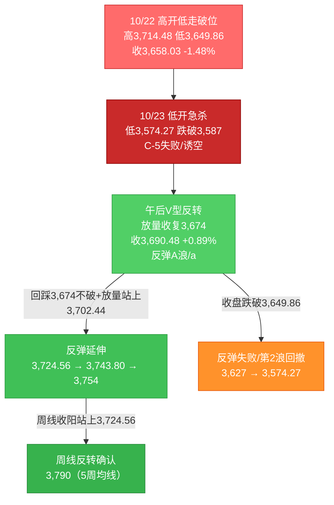
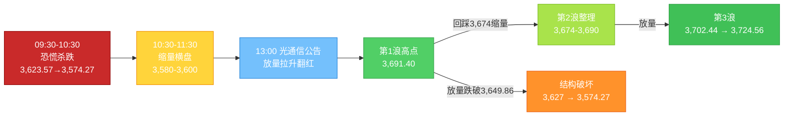

# A股晨报 - 2026年10月26日

> 数据截止时间：2026年10月26日 09:10（北京时间）；A股为10月23日（周五）收盘数据，美股/欧股为10月23日（周五）收盘（隔夜），亚太为10月23日收盘，大宗商品/汇率为10月23日纽约尾盘至10月25日周末报价
> 报告性质：**第44周（10/26-10/30）首个交易日、"事件验证周"开局日**；以10/23晚报（**"放量V型反转+0.89%收复3,674中线生死线、主力资金终结12日净流出"**）+ **第43周运行规律分析（第44周区间3,620-3,780、中性情景3,627-3,724）** + **隔夜道指-1.23%、布油116.72美元、美债10Y重回5.00%** + **二十届五中全会今日开幕** + **多周期波浪分析** 为基础
> **重要口径修正**：10/23晚报将"7,000亿元MLF"视为大额投放利好，但**10月MLF到期量为9,000亿元，本次续作实际净回笼2,000亿元**（缩量续作），流动性利好的权重须下调。

---

## 一、昨日晚报复盘要点回顾

### 1. 昨日判断回顾（10/23晨报 vs 实际）

| 维度 | 准确率 | 说明 |
|------|--------|------|
| 趋势判断 | **50%（0.5/1）** | 路径"低开探底→日内修复"完全正确，但收盘方向（小跌/平收）错误，实际**+0.89%**、创业板**+4.16%** |
| 点位预测 | **0%（0/5）** | 强支撑3,600✗、弱支撑3,627✗、强压力3,674✗、弱压力3,664✗、区间3,608-3,678✗ |
| 板块预判 | **31%（2.5/8）** | 石油石化✓（弱）、军工✓、煤炭△；银行✗、半导体✗、光通信✗、黄金✗、汽车/化工✗ |
| 成交量 | **0%（0/1）** | 预测缩量1.35-1.50万亿，实际**1.96万亿、放量4,276亿** |
| 综合准确率 | **约24%** | 趋势30%+点位30%+板块30%+量能10%加权（50%×30%+0%×30%+31%×30%+0%×10%） |

### 2. 关键偏差及原因（摘要）

- **偏差1（核心）：低估"恐慌一次性出清"后的放量V型反转**——未预判午间光通信企业集中公告（中际旭创/新易盛/天孚/联讯"订单强劲、产能充足"），把纳指-2.60%线性外推为A股补跌（**信息缺失+逻辑误判**）。
- **偏差2：支撑位"盘中假跌破"被误判为失效**——3,600/3,627盘中失守后收盘全部收回（**技术分析局限**）。
- **偏差3：压力位3,674"放量即失效"未被纳入基准情景**——收盘3,690.48有效站上（**逻辑误判**）。
- **偏差4：成交量方向完全反向**——早盘跌幅>2%的恐慌盘释放必然放量（**逻辑误判**）。
- **偏差5：板块"防御看涨、成长看跌"整体反向**——风险偏好修复日，银行/公用事业成为资金提款机（**逻辑误判+信息缺失**）。
- **偏差6：高位连板由"风险"转为"风向标"**——封板率升至80.77%，接力资金回归（**情绪面误读**）。

### 3. 沉淀的规则/检查项（本次直接调用）

- **规则A（趋势）**：破位次日若早盘跌幅>2%、跌停骤增，且出现"午间集中利好公告+成交同比显著放大"，应把"放量V型反转"设为主情景（10/23）。
- **规则B（点位）**：关键支撑须区分"盘中假跌破（<1%且收盘收回）"与"收盘有效跌破"（10/23）。
- **规则C（板块）**：风险偏好修复日（涨停>70只、封板率>75%），一律把"银行/公用/高股息"移出看涨清单（10/23）。
- **规则D（资金）**：主力资金"由连续净流出转单日净流入+特大单近百亿+放量>20%"= 增量资金入场确认，但**需连续2-3日验证**（10/23、10/25）。
- **规则E（波浪）**：C浪末段"跌破黄金分割延伸位后放量收回生死线"= C-5失败/诱空；反弹目标依次为三角下沿3,702.44→缺口3,724.56→原防线3,754，**3个交易日内不收复三角下沿则降级为弱反抽**（10/23、10/25）。
- **规则F（趋势）**：周线五连阴后"长下影小阴（锤头）+周五放量V反+主力转净流入+封板率>75%"= 周线止跌信号，**次周收阳概率60%-65%**，需放量收复缺口下沿/5周均线确认（10/25）。
- **规则G（板块）**："布油>116美元+黄金跌破4,000美元+美元走强"= **加息/强美元交易而非避险交易**，此时贵金属与高估值成长同受压，油气/煤炭/有色资源占优（10/25）。

### 4. 对今日分析的启示

- **今日是"验证日"而非"加速日"**：周五V反的有效性取决于①回踩3,674是否不破；②量能能否维持1.8万亿以上；③主力资金能否连续第2日净流入。三者缺一，"V反"降级为"反抽"。
- **流动性预期需下修**：MLF净回笼2,000亿元、两市融资余额10/23减少242.78亿元，**杠杆资金并未跟随指数转多**；真正托底的是ETF（近两日净流入超1,000亿元、9/28以来近3,200亿元）。
- **"政策窗口"与"利好兑现"并存**：五中全会（10/26-29）为本周最高级别事件，通常带来"预期稳定"，但**会议期间题材易"提前炒作、落地回落"**，不宜把会议当作追高理由。
- **油价是本日最强的外生变量**：布油116.72美元（+3.14%）、WTI 103.27美元（+3.82%），美股油气股大涨——按规则G，**资源/通胀端优先，贵金属与高估值成长受压**。

---

## 二、隔夜市场动态（10/23收盘至10/26早间）

### 1. 美股市场（10/23收盘）

| 指数 | 收盘点位 | 涨跌幅 | 解读 |
|------|---------|--------|------|
| 道琼斯工业指数 | **52,215.16** | **-1.23%（-652.82点）** | **由前一日+0.02%转为领跌**，价值/周期权重承压 |
| 标准普尔500指数 | **7,623.68** | **-0.52%（-39.75点）** | 连续第二日下跌，但跌幅收窄 |
| 纳斯达克综合指数 | **25,955.34** | **-0.21%（-53.52点）** | **较前一日-2.60%大幅收敛，科技股止跌迹象** |

**结构特征**：**"道指补跌、纳指止跌、油气股大涨"**——谷歌跌超1%，亚马逊、Meta跌近1%，SpaceX涨超1%；**存储板块走高（SK海力士上涨）**；**油气股大涨**（布油+3.14%驱动）。前一日暴跌的费城半导体指数（-6.72%、泛林-11%）在周五**未继续杀跌**。

**对A股映射判断**：①**纳指跌幅收敛+存储股回暖**，对A股半导体/存储/光通信的压制显著弱化，**不构成"二次杀跌"情景**；②**道指-1.23%+油气股大涨**，指向"利率上行+通胀交易"，利好A股石油石化/油服/油运、利空航空/化工中下游；③**科技链外盘映射由"利空"转为"中性"**，A股方向更多取决于内部政策与资金。

### 2. 欧洲市场（10/23收盘）

| 指数 | 收盘点位 | 涨跌幅 |
|------|---------|--------|
| 德国DAX | — | **-0.79%** |
| 英国富时100 | **10,690.36** | **-0.32%（-34.67点）** |
| 法国CAC40 | **7,782.82** | **-0.36%（-28.44点）** |
| 欧洲斯托克50 | — | **-0.36%** |
| 西班牙IBEX35 / 意大利富时MIB | — | **+0.43% / +0.33%** |

**判断**：欧洲"科技权重拖累+油价高企"下小幅收跌，但南欧市场逆势收涨，**属结构性调整而非系统性风险**；对A股开盘情绪影响有限。

### 3. 亚太市场（10/23收盘）

| 市场 | 收盘 | 涨跌幅 | 说明 |
|------|------|--------|------|
| 恒生指数 | **23,093.37** | **+0.69%** | 重返23,000点 |
| 恒生科技 | **3,871.66** | **+2.05%** | AI链、机器人、锂电反弹，与A股午后共振 |
| 日经225 | — | 弱势 | 半导体/出口链承压 |
| 韩国KOSPI | — | 盘中修复 | SK海力士转涨 |

### 4. 大宗商品与汇率利率

| 品种/指标 | 数值 | 变化 | 说明 |
|-----------|------|------|------|
| **布伦特原油（12月合约）** | **116.72美元/桶** | **+3.14%（+3.55美元）** | 中东供应扰动+地缘风险溢价，**突破116美元** |
| **WTI原油（12月合约）** | **103.27美元/桶** | **+3.82%（+3.80美元）** | **站上100美元后加速** |
| **COMEX黄金** | **4,007.91美元/盎司** | **-1.29%（-52.49美元）** | 10/23盘中跌破4,000（7月以来首次），10/26早间重回4,000上方 |
| 美元指数 | **98.953** | **+0.02%（10/24纽约尾市）** | 周内偏强，符合"强美元/加息交易" |
| 美国10年期国债收益率 | **5.00%** | **+4bp** | **重新站上5%**，前一日曾跌破 |
| 美国30年期 / 2年期 | **5.33% / 4.69%** | **+4bp / +4bp** | 全曲线小幅上行 |
| 人民币中间价（10/23） | **6.7180** | 上调15个基点 | 延续偏强 |
| 在岸人民币（10/23收盘） | **6.6711** | +16个基点 | 阶段新高 |
| 离岸人民币（CNH） | 约6.67附近 | 基本持平 | 周末波动有限 |

**核心解读**：**"油涨、金弱、美元偏强、美债重回5%"= 典型的"通胀—利率"负反馈组合**。按规则G，这不是"避险交易"，而是"加息/强美元交易"——**油气/资源占优，黄金与高估值成长同受压**。对A股的直接含义：①石油石化/油服/油运为今日最强外生驱动；②黄金股不宜抄底（商品与股票背离已在10/23出现）；③成长股估值端仍有约束，反弹高度受限。

### 5. 重要海外事件

- **本周"超级央行周"**：美联储（10/29 02:00北京时间公布）、欧央行、日央行、加拿大央行、新西兰联储集中决议；**市场预期美联储按兵不动概率约90%-92%，但12月加息概率约78%**，声明措辞与指引为关键。
- **美股财报季升温**：Alphabet、微软、亚马逊、英特尔，以及三星电子、SK海力士、日本铠侠将披露，**AI资本开支与存储景气为核心变量**。
- **美国财政部新版对外投资限制拟议规则**：商务部10/24表示"歧视性扩大对华投资限制范围"，中方坚决反对、保留采取措施权利——**中美经贸摩擦的边际扰动仍在**。
- **地缘**：伊朗局势、以色列大选、巴西大选（卢拉当选）——对油价形成持续风险溢价。

---

## 三、今日关注事项

### 1. 重要数据与事件（按时间排序）

| 时间 | 事项 | 预期/说明 |
|------|------|----------|
| **今日起** | **二十届五中全会（10/26-10/29，北京）** | **研究制定"十五五"规划建议**，本周最高级别会议，对市场中长期主线有顶层指引 |
| **今日** | **央行7,000亿元1年期MLF操作** | 固定数量、利率招标、多重价位中标；**10月到期9,000亿元→净回笼2,000亿元（缩量续作）** |
| **今日** | **上证指数/上证A股/上证流通/科创综指编制方案修订生效** | ①单样本权重上限15%；②风险警示证券剔除时点提前。**权重股（银行/茅台等）被动权重微降，科创权重微升** |
| 本周 | 中国9月工业企业利润、10月官方制造业PMI（10/31） | 验证"盈利修复"成色 |
| 10/28-10/30 | 美国Q3 GDP初值、9月PCE | 影响12月加息定价 |
| 10/29 24时 | 国内成品油调价窗口 | **布油自10/1累计涨约19.7%，上调概率高** |
| 10/31 | 三季报披露截止 | 业绩雷最后释放窗口 |

### 2. 政策/监管动态（周末）

- **国务院常务会议（10/23）**：研究统筹人口与经济社会发展，**加快建设生育友好型社会**，完善婚嫁、生育、养育、教育及财税/社保/住房支持，努力稳定新出生人口规模——利好生育服务、母婴、教育、辅助生殖。
- **国办印发《关于适应人工智能技术发展助力构建就业友好型发展方式的意见》**：6方面18项任务，拓展AI就业新空间、加快开发AI新职业，同时"减缓AI应用就业替代影响"——**AI应用/职业教育双向催化**。
- **住建部等6部门《关于推进老旧街区厂区改造提升的指导意见》**：支持改造项目发行基础设施REITs——利好**城市更新、产业园区、REITs**。
- **中央网信委《国家信息化"十五五"规划》**：2030年目标，"适时启动6G商用"、国家区块链网络基本建成、智能互联网加快布局——利好**通信设备、6G、算力/IDC、区块链**。
- **证监会**：《私募投资母基金管理规定（征求意见稿）》公开征求意见（23条）；**核准设立花旗证券（中国）**，成为第7家外资独资券商——**金融开放+券商集中度提升逻辑**。
- **资金借道ETF**：近两个交易日股票型ETF净流入**超1,000亿元**；9/28-10/23共15个交易日净流入**近3,200亿元**，宽基ETF（沪深300、科创50、创业板）为主力。

### 3. 公司公告与三季报

- **业绩超预期（周末披露）**：
  - **德明利**：Q3营收116.45亿元（+356.64%）、净利27.29亿元（**+2,902.75%**）；前三季净利87.46亿元、同比扭亏——**存储涨价弹性极致验证**。
  - **天齐锂业**：Q3营收60.37亿元（+135.40%）、净利13.60亿元（**+1,323.97%**）；前三季净利56.02亿元（+3,013.86%）——锂价周期反转。
  - **光迅科技**：Q3营收50.73亿元（+54.27%）、净利7.02亿元（**+102.62%**）——**光通信业绩兑现**。
  - 华盛锂电（Q3净利+800.58%）、新益昌（+311.61%）、天原股份（+305.80%）、九芝堂（+588.01%）。
- **重组/停牌**：科瑞思（收购宏钢光电100%，**今日复牌**）；高争民爆（收购西藏紫隆矿业/紫源铜业等，**今日起停牌**）；华鑫股份（控股股东筹划股份转让、可能导致实控人变更，**今日起停牌**）。
- **其他**：东山精密H股定价86.80港元、10/28在港交所上市；北路智控回购2,500万-3,000万元；豫能控股投建139.27亿元综合能源项目；华能水电87.01亿元收购控股股东清洁能源资产。
- **风险个案**：**华瓷股份8天4板，但Q3净利同比-43.60%、前三季-24.95%**——题材与业绩背离，警惕高位炸板；世茂集团遭清盘呈请、90.7亿美元离岸债务违约，地产链风险仍在出清。
- **三季报全景**：截至10/25 18时，**1,028家披露，548家净利同比增长（53.31%），176家增幅超100%**；**半导体、化工、玻纤、电池、电子元件**回暖明显。
- **本周重点披露**：贵州茅台、中际旭创、天孚通信、新易盛、宇树科技。

### 4. 其他

- **新股/解禁**：本周限售解禁约326.60亿元，环比-28%，压力可控；今日无主板/创业板新股申购。
- **机构观点**：十大券商多数认为"**A股急跌有望收尾、反弹修复或延续**"；中信建投建议聚焦"超跌+三季报强劲"、油价上游、保留红利底仓；浙商证券认为"**3,674失而复得，中期底部概率较大，反弹级别或类似8月**"；国际投行（瑞银、花旗）认为A股估值吸引力显现、配置窗口打开。
- **行业景气**：前三季中国新接船舶订单同比**+163.2%**、占全球份额超八成；野村称"**存储芯片短缺持续至2028年、板块估值严重低估**"，维持三星/SK海力士买入；中信证券称"**GPT-6 Astra进入机器人控制，物理AI迎来重大拐点**"；ESMO大会32项中国研究入选突破性摘要。

---

## 四、板块与个股分析

### 1. 基于昨日复盘的板块调整

| 10/23预判 | 实际 | 今日调整 |
|-----------|------|---------|
| 看涨 银行/公用事业 | -1.30%/-0.60% | **移出看涨清单，转为"中性偏弱"**（规则C：修复日防御=提款机） |
| 看跌 半导体/光通信 | +2.94%/+1.87% | **上调至"看涨/中性偏强"**（外盘纳指止跌+存储股回暖+光迅业绩+102.6%） |
| 看跌 黄金 | 板块V型收涨 | **维持看跌**（金价-1.29%破4,000、强美元、规则G），但承认"股票与商品背离"会削弱跌幅 |
| 看涨 石油石化 | +0.46% | **强化看涨**（布油116.72 +3.14%、WTI +3.82%、美股油气股大涨、10/29调价） |
| 风险 高位连板 | 成最强主线 | **风险提示降级为"结构性风险"**（封板率80.77%，但只做业绩+题材共振标的） |

### 2. 隔夜信息驱动的板块机会

**受益板块**：
1. **石油石化/油服/油运**（逻辑：布油116.72美元+3.14%、WTI 103.27美元+3.82%，中东风险溢价未消，美股油气股大涨，10/29国内成品油调价窗口打开；**上游勘探、油服、油运弹性大于炼化**）。
2. **存储芯片/半导体**（逻辑：野村"短缺持续至2028、估值严重低估"；德明利Q3净利+2,902.75%、天齐锂业+1,323.97%业绩背书；SK海力士周五上涨；**但高盛下调KOSPI目标构成分歧，须设止损**）。
3. **通信/6G/光通信**（逻辑：《国家信息化"十五五"规划》明确"适时启动6G商用"；光迅科技Q3净利+102.62%验证景气；中际旭创/天孚/新易盛本周披露三季报，**业绩为二次催化**）。
4. **机器人/具身智能**（逻辑：宇树科技获机构席位净买入2.41亿元、GPT-6 Astra进入机器人控制、具身智能技能大赛；**但宇树估值高企、周五已20cm首板，只做回调不追高**）。
5. **券商/金融开放**（逻辑：花旗证券（中国）获批、外资独资券商增至7家；成交额1.96万亿+两融余额2.39万亿，**业绩与主题双击**）。

**受损板块**：
1. **航空/航运（客运）/化工中下游**（逻辑：油价116美元抬升燃油与原料成本，化工品价差压缩）。
2. **黄金/贵金属**（逻辑：COMEX金-1.29%跌破4,000、美元偏强、美债5.00%，"加息交易"下贵金属承压）。
3. **房地产/地产链**（逻辑：世茂集团清盘呈请+90.7亿美元债务违约，风险出清未完；政策端仅有"老旧街区改造/REITs"的结构性支持）。
4. **高股息/银行/公用事业**（逻辑：高低切换未结束，MLF净回笼2,000亿元对银行是"量缩价稳"，资金仍偏好成长）。

### 3. 重点关注个股

| 个股 | 关注理由 | 技术位置/目标 |
|------|---------|--------------|
| **中国海油/中国石油** | 油价116.72美元、上游弹性最直接 | 沿5日线持有，回踩10日线低吸 |
| **德明利** | Q3净利+2,902.75%，存储涨价龙头 | 高位放量，回踩5日线不破可参与，跌破10日线止损 |
| **光迅科技** | Q3净利+102.62%，光通信业绩兑现 | 突破前高则打开空间，回踩20日线为支撑 |
| **中际旭创** | 本周三季报+10/23午间公告背书 | 关注业绩兑现，利好兑现日不追高 |
| **中信证券** | 花旗独资获批+成交额放大+两融2.39万亿 | 券商指数弹性标的，突破年线确认 |
| **中国船舶** | 前三季新接订单+163.2%、全球份额>80% | 中期趋势品种，回踩60日线布局 |
| **宇树科技** | 机构净买2.41亿+物理AI催化 | **估值过热，仅做回调，不追20cm首板** |

---

## 五、今日核心判断（结构化，用于晚报复盘）

### 1. 趋势判断
- 上证指数：**【看涨】（震荡上行，重心小幅上移）**
- 预测区间：**3,665点 - 3,725点**
- 核心逻辑：周五"放量V型反转+收复3,674+主力资金终结12日净流出+封板率80.77%"构成短线反转基础，叠加五中全会政策窗口、ETF两日净流入超1,000亿元、隔夜纳指止跌，指数有望"回踩3,674不破后震荡上行"；但**MLF净回笼2,000亿元、两融余额减少242.78亿、美债重回5.00%、布油116.72美元**共同压制上行斜率，**3,702-3,724为密集压力带，单日突破概率不高**。

### 2. 关键点位
- 强支撑位：**3,649.86点**（依据：10/22收盘价+10/23放量突破的实体中枢，跌破则V反结构受损）
- 弱支撑位：**3,674点**（依据：原"中线生死线"由压力转为支撑，10/23收盘3,690.48站上，回踩不破=强）
- 强压力位：**3,724.56点**（依据：10/15向下跳空缺口下沿，缺口未回补，为"转强确认位"）
- 弱压力位：**3,702.44点**（依据：原收敛三角下沿+5日均线3,706附近，双重压制）
- 下方失效线：**3,627点**（收盘有效跌破→V型反转失败，下看3,574.27）

### 3. 板块预判
- 看涨板块：
  （1）**石油石化/油服/油运**（逻辑：布油116.72 +3.14%、WTI 103.27 +3.82%、美股油气股大涨、10/29调价窗口）
  （2）**存储芯片/半导体**（逻辑：野村"短缺至2028+严重低估"、德明利Q3净利+2,902.75%、SK海力士回暖）
  （3）**通信/6G/光通信**（逻辑：《国家信息化"十五五"规划》6G商用+光迅Q3净利+102.62%）
- 看跌板块：
  （1）**黄金/贵金属**（逻辑：金价-1.29%破4,000、强美元、美债5.00%，规则G"加息交易"）
  （2）**银行/公用事业/高股息**（逻辑：高低切换延续、MLF缩量续作净回笼2,000亿、资金偏好成长）
  （3）**航空/化工中下游**（逻辑：油价116美元压缩成本端）
- 风险板块：**高位连板股（大业股份6连板、华瓷股份8天4板但Q3净利-43.60%、宇树科技20cm首板估值高企）**——封板率80.77%虽支持情绪，但"业绩与股价背离"个股炸板风险最大；**地产链**（世茂清盘）亦需回避。

### 4. 资金面判断
- 北向资金预期：**净额不可得**（交易所不再实时披露）；**成交额预计3,000-3,300亿元**（占两市成交约16%，与成交额预测挂钩）
- 成交量预期：**【平量至小幅放量】1.90-2.10万亿元**（依据：周五1.96万亿的高基数+上方套牢盘+五中全会首日观望；若早盘半小时同比放大>15%则上调至2.1万亿以上）
- 补充：**两融余额23,948.22亿元、10/23减少242.78亿元**——杠杆资金未跟随，ETF（近两日>1,000亿）为主要增量；**主力资金能否连续第2日净流入是核心验证信号**。

### 5. 风险预警（按优先级排序）
- **高风险**：**三季报密集披露期（10/26-10/31）业绩雷**——本周茅台、中际旭创、天孚通信、新易盛、宇树科技集中披露，**高位成长股"单季不及预期即闪崩"**；同时**五中全会"预期兑现"风险**，会议期间题材易冲高回落。
- **中风险**：**美债10Y重回5.00%+12月加息概率约78%**（FOMC 10/29 02:00），压制高估值成长与贵金属；**布油116.72美元**推升输入性通胀、压缩中下游毛利；**美方对外投资限制拟议规则**扰动中美科技链。
- **低风险**：本周解禁326.60亿元（环比-28%）压力可控；上证指数编制修订（权重上限15%）仅带来被动资金微调；巴西/以色列大选等地缘事件对A股直接影响有限。

### 6. 昨日复盘规则应用
- **应用规则A（V反确认）**：今日重点不是"是否涨"，而是"回踩3,674是否不破"。**若早盘回踩3,674缩量止跌→V反有效，可低吸；若放量跌破3,649.86→降级为弱反抽**。
- **应用规则C（防御板块）**：周五涨停84只、封板率80.77%，仍处"风险偏好修复"区间，**银行/公用事业继续排除在看涨清单外**，仅在指数跌破3,627时作为防御回补。
- **应用规则D（资金验证）**：需主力资金**连续第2日净流入**且电子/计算机延续净流入，方可确认"增量资金入场"；若今日转为净流出，则周五为"事件驱动单日脉冲"。
- **应用规则E（波浪目标）**：C-5失败后的反弹目标依次为3,702.44→3,724.56→3,754，**3个交易日内（至10/28）不收复3,702.44则降级为弱反抽**，需防二次探底。
- **应用规则F（周线确认）**：本周（第44周）需**收阳并站上3,724.56**，才能确认周线"长下影锤头"的底部反转；否则仍是"1-3周反弹后二次探底"。
- **应用规则G（通胀交易）**：油价116美元+金价破4,000+美元偏强，**资源/油气优先、贵金属与高估值成长降权**，不因"避险"逻辑看多黄金。

---

## 六、投资策略建议

### 1. 短线策略（1-3个交易日）
- 适用场景：基于日K线与60分钟K线的"V反确认"交易
- **短线仓位：25%-30%**
- **买入条件**：
  （1）**回踩3,674-3,690区间缩量止跌**（早盘半小时成交同比≤1.1倍）→ 低吸首批；
  （2）**放量站上3,702.44**（成交较周五同期放大）→ 加至30%上限；
  （3）**早盘直接冲高至3,715以上且量能萎缩 → 不追高**，等回踩。
- **卖出条件**：**3,715-3,724区间分批止盈**；若触及3,724.56后量能萎缩、涨停家数回落至50只以下，**全部止盈**。
- **止损位**：**收盘跌破3,649.86点**（或个股跌幅-5%）→ 短线降至10%以下。
- **短线标的**：
  （1）**中国海油/中国石油**（逻辑：油价116.72美元+3.14%，上游直接受益，形态沿5日线上行）
  （2）**德明利/兆易创新**（逻辑：存储涨价+Q3净利+2,902.75%业绩背书，资金主线）
  （3）**光迅科技**（逻辑：Q3净利+102.62%+6G政策，业绩与主题共振）
  （4）**中信证券**（逻辑：花旗独资获批+成交额1.96万亿，情绪修复日的护盘+弹性品种）

### 2. 中线策略（1-4周）
- 适用场景：基于周K线波浪与第43周运行规律分析
- **中线仓位：20%**（从15%-20%小幅上调，因3,674收复+周线锤头信号）
- **方向判断：**【持有/小幅加仓】
- **目标区间**：上证指数 **3,674点 - 3,754点**（第44周中性区间3,627-3,724，上沿确认位3,754）
- **中线布局板块**：
  （1）**存储/半导体**（逻辑：短缺至2028+三季报高增+国产替代，回撤即布局）
  （2）**石油石化/油运**（逻辑：油价中枢上移+地缘溢价，攻守兼备）
  （3）**机器人/具身智能**（逻辑：物理AI拐点+政策，**仓位不超过中线1/3**）
  （4）**军工/船舶**（逻辑：订单+163.2%、事件驱动，低相关性）
- **止盈条件**：指数到达**3,754点**（原防线）或波段涨幅达8%-10%
- **止损条件**：指数**收盘跌破3,574.27点**（周五V反最低点）→ 中线降至10%以下、确认趋势反转

### 3. 仓位分配总览

| 策略类型 | 仓位比例 | 方向 | 重点板块 |
|---------|---------|------|---------|
| 短线 | 25%-30% | 回踩低吸/冲高止盈 | 石油石化、存储、通信、券商 |
| 中线 | 20% | 持有/小幅加仓 | 存储半导体、油运、机器人、军工船舶 |
| 现金 | 50%-55% | — | — |

### 4. 与昨日策略对比

| 项目 | 10/23晚报建议 | 今日建议 | 调整原因 |
|------|--------------|---------|---------|
| 短线仓位 | 20%-30% | **25%-30%** | 3,674收复+周线锤头，但上方3,702-3,724压力密集，上限不提高 |
| 中线仓位 | 15%-20% | **20%** | 周线止跌信号+主力转净流入，小幅上调 |
| 现金 | 50%-65% | **50%-55%** | 结构上更积极，但保留五成现金应对FOMC与三季报 |
| 板块 | 增配光通信/机器人/半导体 | **增配存储、油运；机器人降为"回调参与"** | 油价+3.14%与野村"存储低估"为新增强逻辑；机器人估值过热 |
| 黄金 | 观察 | **明确看跌/回避** | 金价-1.29%破4,000+强美元+规则G |

---

## 七、波浪理论多周期分析

### 1. 月K线波浪分析
- **当前波浪位置**：大周期**第2浪C浪延伸末段的"C-5失败/诱空"待确认**。10/23盘中跌破3,587（黄金分割延伸位）后放量V型收回3,690.48，**C浪延伸的"最后一跌"大概率已在3,574.27完成**，但月线尚未确认。
- **浪型结构描述**：2024/9（2,689点）→2026/6（4,197点）为第1浪；此后第2浪ABC调整，C浪自3,842下方延伸；10月月K线目前为**"长下影中阴"**（开3,842.19→现3,690.48，约-3.95%），月内低点3,574.27、下影约116点，**收盘仍在20月均线3,800下方约110点**。
- **关键目标位**：下方3,627（反转失败线）→3,587（黄金分割延伸）→3,478（深度目标）；上方3,702.44（原三角下沿）→3,724.56（缺口）→3,754（原防线）→3,800（20月均线）。
- **验证条件**：**月收盘（10/30）站上3,674为"长下影有效"，站上3,724.56为强，站上3,754才谈"C浪结束"**；若月收盘重回3,627下方，则C-5延伸继续、下看3,478。

### 2. 周K线波浪分析
- **当前波浪位置**：第43周（10/19-10/23）收官，周线由"破位下行"转为**"长下影锤头（小阴）"**，**周线收复3,674**；第44周进入"底部信号确认周"。
- **浪型结构描述**：周线**五连阴**后收"长下影小阴"（开3,694.12、高3,743.80、低3,574.27、收3,690.48，-0.69%），下影约116点、实体约40点，下影≥实体2.9倍，接近锤头形态；**收盘仍在5周均线（约3,790）下方**。
- **关键目标位**：上方3,700（5日/10日线带）→3,724.56→3,743.80（上周高）→3,754→3,790（5周均线）；下方3,674（得失位）→3,627→3,574.27。
- **验证条件**：按规则F，"五连阴+长下影锤头+周五放量V反+主力转净流入+封板率>75%"，**本周收阳概率60%-65%**；**放量站稳3,724.56 = 周线底部反转确认**，可看3,754-3,790；**收盘跌破3,627 = 锤头信号失效**。

### 3. 日K线波浪分析（重点）
- **当前波浪位置**：**C-5失败后的"反弹A浪/a浪"初期**。10/23日K线为"低开长下影光头大阳线"（实体66.91点、下影49.30点、上影0.92点，振幅3.20%），**放量4,276亿元收复3,674**，属"恐慌性最后一跌+资金承接"的经典反转形态。
- **浪型结构描述**：10/15放量破位（低3,674.82）→10/16十字星→10/19-20低点抬升→10/21冲高回落→10/22高开低走跌破3,674（收3,658.03）→**10/23低开-0.94%、急杀3,574.27、午后V型反转收3,690.48（+0.89%）**；五浪下跌结构在3,574.27完成，当前为反弹第1浪（或A浪a）。
- **关键目标位**：上方3,691.40（周5高）→3,702.44→3,724.56→3,743.80→3,754；下方3,674（回踩支撑）→3,649.86→3,627→3,574.27（反转失败线）。
- **验证条件**：
  - **向上确认**：连续2-3日站稳3,674 + 放量站上3,702.44 + 收复3,724.56 + 主力资金连续净流入 → 反弹升级至日线级别。
  - **向下失效**：收盘跌破3,649.86 → 3,627 → 3,574.27 → 今日V型降级为"空头回补"。
  - **今日关键**：**回踩3,674不破 + 量能维持1.9万亿 = 反弹第1浪延伸；若跌破3,649.86则反弹第1浪结束、进入第2浪回撤**。

### 4. 60分钟K线波浪分析
- **当前波浪位置**：60分钟**"C-5末端失败→反弹第1浪"**，当前处于第1浪末段/第2浪回踩的临界点。
- **浪型结构描述**：10/23 09:30-10:30四根60分钟K线放量下杀（3,623.57→3,574.27），10:30-11:30缩量横盘（3,580-3,600），**13:00后光通信公告催化放量拉升**，连续突破3,649.86、3,674、3,691.40；**60分钟MACD零轴下方底背离后金叉、红柱放大**，KDJ回升至中位偏上（已接近超买）。
- **关键目标位**：上方3,702.44→3,724.56；下方3,674→3,649.86。
- **验证条件**：**首两小时回踩3,674不破（缩量）→ 第3浪上攻3,702-3,724**；若**放量跌破3,674并失守3,649.86**，则60分钟反弹结构破坏、转入第2浪回撤。

### 5. 30分钟K线波浪分析
- **当前波浪位置**：30分钟**五浪下跌完成（3,574.27）→三浪推动反弹后的高位整理**。
- **浪型结构描述**：早盘逐级降低高点+放量急杀，10:45后在3,574-3,590构筑双底/头肩底雏形；午后三波推动（3,590→3,649→3,674→3,691），**30分钟MACD底背离+金叉、红柱放大**，量能逐级放大；尾盘高位横盘，**短线指标进入超买区**。
- **关键目标位**：上方3,691.40→3,702.44；下方3,674→3,649.86。
- **验证条件**：**回踩3,674-3,680缩量 → 整理后再上攻3,702.44**；若放量跌破3,674，则30分钟转为"下跌中继"，需在3,649.86上方止跌才算有效。

### 6. 波浪图（Mermaid）

**日K线波浪结构图**：

**60分钟波浪结构图**：

### 7. 波浪理论综合判断

| 维度 | 判断 |
|------|------|
| **多周期共振状态** | **"大周期偏空、小周期转多"的背离状态**——月线/周线仍处C浪延伸（收盘在20月均线3,800、5周均线3,790下方），但日线/60分钟/30分钟均为"底背离+金叉+V型反转"，**属底部反转初期，尚未形成向上共振** |
| **当前操作级别** | **60分钟级别反弹**（1-3个交易日）；升级为日线级别需"站稳3,674+放量站上3,702.44+收复3,724.56"；周线/月线反转需站上3,754/3,800 |
| **后续演变路径** | **40%向上延伸**（回踩3,674不破→3,702.44→3,724.56，遇阻回踩）；**40%区间震荡**（3,674-3,724反复消化套牢盘）；**20%反弹失败**（跌破3,649.86→3,627→3,574.27） |
| **关键拐点信号** | 向上：**放量站上3,702.44 + 收复3,724.56 + 主力资金连续2日净流入 + 涨停>60只**；向下：**收盘跌破3,649.86 + 量能骤降至1.5万亿以下 + 主力资金重回净流出** |
| **风险提示** | ①**C-5失败尚未被周线/月线确认**，单日长下影后"次日回踩确认"概率约55%-60%；②月/周均线空头排列，3,724-3,790为密集套牢区，反弹空间约1%-2.7%；③**五中全会"预期兑现"+三季报业绩雷+FOMC鹰派**三重事件可能打断反弹；④波浪理论在"政策强力干预/流动性事件"下易失效（如五中全会期间的政策脉冲） |

**与第43周运行规律分析的衔接**：本周（第44周）报告给出区间**3,620-3,780点**，情景概率"上涨40%/震荡40%/下跌20%"，**关键分水岭为3,724.56（放量站稳=周线反转确认）与3,627（收盘跌破=V反失败）**；今日晨报的**3,665-3,725区间**即该框架下的"中性偏乐观"路径。

---

## 八、信息来源

1. **官方数据来源**：上海证券交易所（10/23上证收3,690.48、+0.89%、成交8,986.67亿元；10/26起指数编制修订生效）、深圳证券交易所（深成指11,673.83 +2.79%、创业板指2,684.10 +4.16%）、北京证券交易所（北证50 984.90 +1.88%）、中国人民银行（10/26 7,000亿元1年期MLF、10月到期9,000亿元）、中国外汇交易中心（中间价6.7180）、沪深交易所融资余额数据（10/23合计23,948.22亿元，减少242.78亿元）。
2. **权威财经媒体**：新华社/新华网（二十届五中全会10/26-29召开、国常会人口议题、国务院AI就业意见）、澎湃新闻（牛市早报10/26：指数编制修订、花旗证券获批）、证券时报/人民财讯（美股10/23收盘、油气股大涨、融资余额）、中国证券报/上海证券报（上证早知道10/26）、金融界（10/26财经早餐：MLF净回笼2,000亿、三季报1,028家）、经济参考报（7,000亿元MLF）、央视新闻（巴西大选）。
3. **数据平台**：东方财富、同花顺、Wind资讯、AP News（美股三大指数10/23收盘）、新浪财经（纽约黄金4,007.91 -1.29%）、格隆汇（美元指数98.953、美债收益率）、Euronext（CAC40 7,782.82）。
4. **研究机构/市场观点**：野村（存储短缺至2028、三星/SK海力士买入）、中信证券（GPT-6 Astra与物理AI拐点）、中信建投/浙商证券/国泰海通/长江证券（十大券商一周策略）、瑞银/花旗（A股配置窗口）。
5. **数据说明**：北向资金净额交易所已不实时披露，以成交额/占比口径跟踪；不同数据商成交额、涨停家数口径存在约1%-3%差异；美元指数与人民币汇率因数据商报价时点不同存在差异，本文以10/23收盘/10/24纽约尾市口径为准；**10/26为五中全会开幕日，会议期间政策信息以官方发布为准，本报告不预设会议结论**。

> 数据截止时间：2026年10月26日 09:10（北京时间）。美股/欧股为10月23日收盘；亚太为10月23日收盘；原油/黄金为10月23日收盘及10月25日周末报价；A股为10月23日收盘数据。**今日核心验证点：回踩3,674是否不破、量能能否维持1.9万亿、主力资金能否连续第2日净流入。**

---

*本晨报由AI代理自动生成，仅供参考，不构成投资建议。投资有风险，入市需谨慎。*
