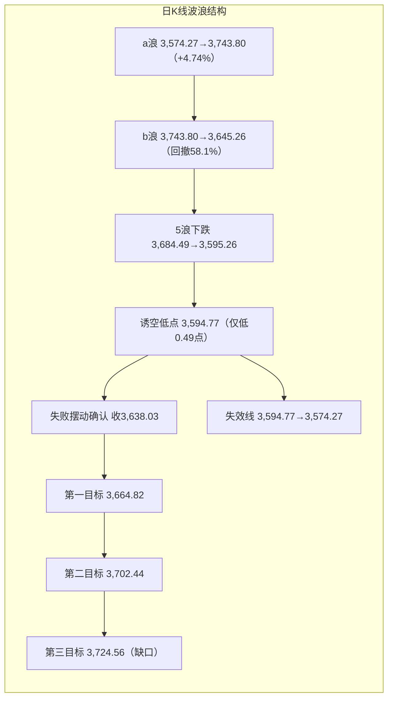
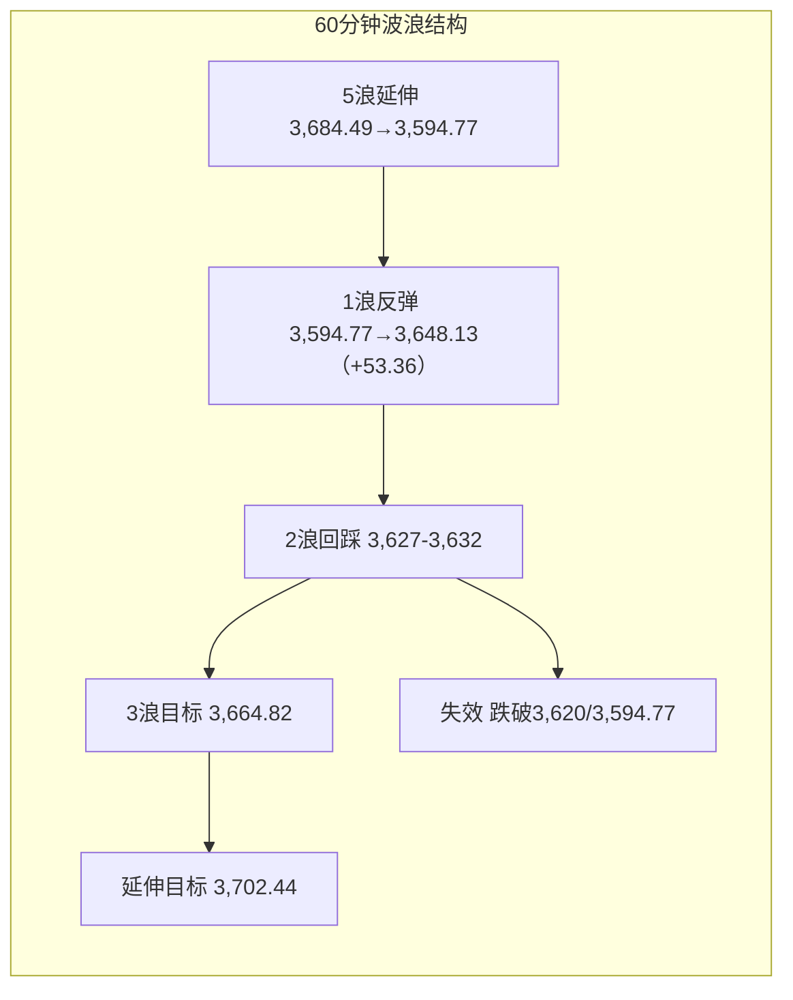

# A股晚报 - 2026年11月02日

> 数据截止时间：2026年11月02日 20:00（北京时间）
> 报告性质：**11月首个交易日、月初政策窗口开启日、10月PMI跌破荣枯线后的首个定价日**
> **一句话定性**：**"政策底接棒市场底——5浪失败诱空确认，指数收复V反失败线3,627"**。上证指数低开探底3,594.77（仅比10/30低点3,595.26低0.49点）后单边上行，收3,638.03点（+1.08%），**收盘站上3,627，日线"5浪失败/诱空"结构成立**；两市成交17,837亿（放量1,092亿），上涨家数4,678只（占比84.02%）、涨停132只，**量价齐升、普涨型反攻**。结构上"传媒+7.77%、计算机+4.96%、券商+4.61%"领涨，**红利（煤炭-1.33%、银行-0.84%、油气开采-1.22%）被抽血**，风格由防御切向进攻。**今日行情不是"外盘映射"，而是"政策会议（央行+证监会9时座谈、回购增持再贷款优化）+超卖+5浪衰竭"三重内因驱动**，与晨报"外冷内暖、震荡3,565-3,635"的判断出现方向性偏差。

---

## 一、市场回顾

### 1. 主要指数表现

| 指数 | 收盘 | 涨跌幅 | 开/高/低 | 备注 |
|------|------|--------|----------|------|
| **上证指数** | **3,638.03** | **+1.08%（+38.99点）** | 3,614.13 / **3,648.13** / **3,594.77** | 低开高走，收近全天高位，振幅1.48% |
| 深证成指 | **11,010.68** | **+1.63%** | — | 成长风格全面反攻 |
| 创业板指 | **2,458.70** | **+1.87%** | — | 收复2,450点 |
| 科创50 | **1,196.64** | **+3.11%** | — | **宽基最强，超跌修复** |
| 科创综指 | — | **+2.62%** | — | — |
| 沪深300 | **4,016.92** | **+0.79%** | — | 权重跟涨但弹性偏弱 |
| 上证50 | — | **+0.75%** | — | 权重搭台 |
| 北证50 | — | **+0.58%** | — | 相对滞后 |
| 中证1000 | — | **+2.73%** | — | 小盘强于大盘 |
| 中证2000 | — | **+2.47%** | — | — |
| 万得微盘股 | — | **+2.61%** | — | — |

> **结构特征**：**科创50（+3.11%）> 中证1000（+2.73%）> 创业板（+1.87%）> 深成指（+1.63%）> 上证（+1.08%）> 沪深300（+0.79%）> 上证50（+0.75%）**，呈"越小越强、科技最强、权重最弱"的典型超跌反弹结构；**全市场无一下跌宽基**。

### 2. 成交量能

| 项目 | 数值 | 变化 |
|------|------|------|
| **沪深两市成交额** | **17,837亿元** | **放量1,092亿元（+6.5%）** |
| 沪市 / 深市 | 8,474.59亿 / 9,362.31亿 | 深市成交首超沪市 |
| 万得全A成交额 | 17,951.88亿元 | +1,074.78亿（+6.37%），换手率1.64% |
| **主力资金** | **净流入53.82亿元** | 由10/30净流出转为净流入 |
| 分市场主力 | 创业板**+69.17亿**、沪深300**+15.71亿** | 成长与权重双流入 |
| 北向资金 | **成交2,977.61亿元、占两市16.69%** | 净额交易所不实时披露；成交占比创近期新高 |
| 北向个股成交前三 | 贵州茅台39.13亿、中微公司18.69亿、药明康德17.69亿 | 消费+半导体+医药 |
| 两融余额 | **约23,356.50亿元**（截至10/30） | 较前一周**-886.28亿**，杠杆去化显著 |

> **量能判断**：**17,837亿属"政策驱动+超卖反弹"的增量放量**，而非10/30的"月末换手型放量"。**放量>1,000亿 + 上涨家数>80% + 主力转净流入**三项同时出现，是10/23 V反以来第一次"量价共振"，量能质量优于10/28（当日放量1,675亿但上涨占比74.61%）。

### 3. 市场情绪

| 指标 | 数值 | 对比 |
|------|------|------|
| 上涨/下跌/平盘 | **4,678 / 817 / 78**（Wind） | 上涨占比**84.02%**，10/30为约29% |
| 涨停/跌停 | **132 / 11**（证券时报口径131/10） | 涨停为跌停的12倍，10/30为38/37 |
| 涨超5%个股 | **803只** | 赚钱效应显著 |
| 首板 / 2连板 | **115只 / 6只** | 首板较前日38只暴增3倍 |
| 昨日涨停股今日表现 | **平均+3.04%** | 接力效应恢复 |
| 封单超1亿个股 | 14只（高争民爆8.89亿、阳光照明5.64亿、劲旅环境4.18亿） | 资金抱团意愿强 |

> **情绪定性**：**从"冰点"直接跳到"过热"**——涨停132只、上涨占比84%，情绪修复速度超出晨报预期；但**首板115只、2连板仅6只**，说明**多为"一日游式"普涨，连板高度未打开**（最高青岛食品6连板），属"超跌修复"而非"新周期启动"。

---

## 二、热点板块与异动分析

### 1. 领涨板块及驱动因素

| 板块 | 涨跌幅 | 驱动因素 |
|------|--------|---------|
| **传媒** | **+7.77%（申万第一）** | 130只成分股中126只上涨；文化传媒+7.01%、成交470亿创20日新高；**AI视频/AIGC/短剧/出版**集体爆发，芒果超媒、中信出版、捷成股份、果麦文化、海看股份、华是科技20cm涨停，文投控股地天板 |
| **计算机** | **+4.96%** | AI应用+信创+数据要素共振；同花顺+8.82%、指南针+15.99%、银之杰+20% |
| **社会服务** | **+3.50%** | 消费复苏+教育（涨幅居前） |
| **非银金融** | **+3%以上** | **券商+4.61%（成交424亿、51家全涨）**，中信证券25.56元/+5.19%、东方财富+6.31%、国金证券/太平洋涨停；**央行+证监会9时座谈"推动资本市场工具使用"直接催化** |
| 商贸零售 | +3%以上 | 消费+政策预期 |
| 稀土永磁 | 涨幅居前 | 中国稀土停牌收购中稀（凉山）稀土股权，资产证券化提速 |
| 食品饮料/白酒 | 涨幅居前 | 贵州茅台1,439.10元/+3.38%，皇台酒业2连板，水井坊/金种子涨停 |
| 光伏/AI视频/AIGC | 涨幅居前 | 超跌+主题共振 |
| 军工电子 / 中证军工 | +2.57% / +2.25% | 超跌修复+事件余温 |

### 2. 领跌板块及原因

| 板块 | 涨跌幅 | 原因 |
|------|--------|------|
| **煤炭** | **-1.33%** | 红利资金被抽向成长；油价大跌压制能源链 |
| **银行** | **-0.84%** | 政策稳市日"红利抽血"；工行/建行前期新高后回吐 |
| **贵金属** | **-2.71%** | 现货金虽反弹+0.85%，但A股贵金属股补跌；山金国际-6.42%、赤峰黄金-5.85% |
| 油气开采 | -1.22% | **WTI跌破100（-4.03%）、布伦特-3.89%**，与晨报"油价+2.4%"预期反向 |
| 有色金属 | -0.40% | 贵金属拖累 |
| 光通信 | +0.67% | 虽收红但显著跑输指数，中际旭创成交188.83亿、新易盛162.36亿 |

> **关键背离**：**油价大跌4%（WTI 99.93）证伪了晨报"石油石化/油运/煤炭看涨"的核心逻辑**；同时**通信/存储并未跟随周五纳指-2.86%补跌，反而随科创50反弹**——"外盘→A股科技"的线性映射今日失效。

### 3. 个股异动复盘

- **券商链**：中信证券+5.19%、东方财富+6.31%、同花顺+8.82%、指南针+15.99%、银之杰+20%，国金证券/太平洋涨停，**板块51只成分股全涨**，为"政策工具使用"最直接受益方向。
- **传媒AI链**：芒果超媒、中信出版、捷成股份、果麦文化、海看股份、华是科技20cm涨停，文投控股"地天板"，**传媒成交470亿创20日新高**。
- **连板梯队**：青岛食品6连板、东方海洋5板、澳洋健康4连板；**首板115只但2连板仅6只，断层明显**。
- **贵金属杀跌**：山金国际-6.42%、赤峰黄金-5.85%，**商品反弹而股票补跌，属"股票端去泡沫"**。
- **停牌重组**：中国稀土、TCL中环停牌（发行股份收购资产），复牌高争民爆、协和电子。

---

## 三、关键数据与事件回顾

### 1. 国内经济数据

- **10月官方制造业PMI 49.3%**（环比-0.8pct、跌破荣枯线）、非制造业49.7%、综合49.7%，为周末已定价的利空；**今日市场选择"利空出尽"解读**。
- **10月财新制造业PMI**将于11/3上午公布，是明日第一个数据检验点。

### 2. 政策消息（今日核心变量）

1. **09:00 央行、证监会召集证券基金公司座谈"推动资本市场工具使用"**——直接点燃券商/大金融，是今日行情的"发令枪"。
2. **09:00 央行、金融监管总局、证监会召集银行"优化股票回购增持再贷款"**——利好破净央国企、银行，但今日银行反被抽血，说明**政策利好让位于风格切换**。
3. **央行政策利率"换锚"落地**：11/2起每个工作日开展隔夜逆回购（固定利率1.25%、数量招标），今日投放**5,410亿元**；7天期逆回购同步调整为固定利率数量招标。
4. **盘后（约17:00）央行宣布11/3开展第三次SFISF操作**：31家机构申报、额度超1,000亿元；同时**优化互换便利与股票回购增持再贷款**（放宽抵押品范围、下调费率）；传国有大行新增2,000亿元专项贷款额度。
5. **证监会表态"全力稳市场稳预期"**，与央行形成"政策组合拳"。

### 3. 公司公告/事件

- **停牌**：中国稀土（000831，拟发行股份收购中稀凉山稀土股权）、TCL中环（002129，拟收购中环领先剩余少数股权）。
- **复牌**：高争民爆（拟购西藏紫源铜业）、协和电子（实控人变更）。
- **盘后被立案**：万辰集团、ST合纵遭证监会立案调查，短线注意规避。
- **新股**：皇冠新材（001381）11/3深交所上市。
- **解禁**：11月解禁规模1,115.66亿元，环比-51.65%，压力显著缓解。

---

## 四、海外市场联动

### 1. 美股（10/30收盘，上周五）

| 指数 | 收盘 | 涨跌幅 |
|------|------|--------|
| 道琼斯 | 51,770.31 | **-1.09%** |
| 标普500 | 7,580.07 | **-1.82%** |
| 纳斯达克 | 25,437.00 | **-2.86%** |
| 费城半导体 | 约10,688 | 深度下跌（-7.2%） |

> 11/2盘前期货**全线转涨**：道指期货+0.61%、标普+0.54%、纳指+0.80%，**外部风险偏好盘中修复**，是A股午后走强的重要背景。

### 2. 欧洲/亚太（11/2）

| 市场 | 最新 | 涨跌幅 | 解读 |
|------|------|--------|------|
| **韩国KOSPI** | **5,859.07** | **+2.24%** | **低开5,616.50→高5,910.83，盘中V型反转，存储链修复** |
| 日经225 | 63,081.86 | -0.33% | 低开收窄，弱势但未恐慌 |
| 恒生指数 | 23,393.32 | +0.42% | 平稳 |
| **恒生科技** | **3,839.41** | **+2.25%** | 科技同步反攻 |
| 欧元区10月制造业PMI终值 | 52.7 | 预期52.4 | 上修，欧洲韧性 |
| 德国10月制造业PMI终值 | 54.2 | — | 扩张区间 |

> **关键**：**KOSPI盘中由-1.6%反转至+2.24%，是"A股科技不补跌"的同步验证**；晨报仅参考日经/KOSPI开盘价（-0.50%/-1.62%），**未跟踪盘中反转**，构成板块误判的信息缺口。

### 3. 大宗商品

| 品种 | 最新 | 涨跌幅 | 映射 |
|------|------|--------|------|
| **WTI原油（12月）** | **99.93美元/桶** | **-4.03%** | **跌破100，直接击穿"石油石化看涨"逻辑** |
| **布伦特原油（12月）** | **109.02美元/桶** | **-3.89%** | 同步大跌 |
| 伦敦现货黄金 | 3,909美元/盎司 | **+0.85%** | 反弹但仍处弱势 |
| 伦敦现货白银 | 重回50上方 | 反弹 | 商品反弹、股票补跌 |

---

## 五、汇率与利率

| 项目 | 数值 | 变化 |
|------|------|------|
| 人民币中间价 | **6.7146** | 调降8bp（小幅走弱） |
| 在岸人民币 | **6.6458** | 较上一交易日升值约99bp |
| 离岸人民币 | 6.65附近 | 强势震荡 |
| Shibor隔夜 | **1.2860%** | +0.3bp |
| Shibor 1周 | **1.3630%** | 小幅上行 |
| 央行公开市场 | **隔夜逆回购5,410亿元（1.25%）** | 换锚首日大额投放，流动性充裕 |

> **判断**：**"人民币在岸升值+隔夜逆回购大额投放+SFISF加码"构成流动性三重支撑**；短端利率平稳，不构成反弹的流动性约束。本周有17,490亿元逆回购到期，需关注续作节奏。

---

## 六、收盘后重要信息

### 1. 盘后公告/政策

1. **央行：11/3开展第三次SFISF操作**，31家机构申报、额度超1,000亿元；同步优化互换便利与回购增持再贷款（放宽抵押品、下调费率）。
2. **传国有大行向国新、诚通各新增千亿级专项贷款**（待正式确认）。
3. **万辰集团、ST合纵被证监会立案**。
4. **中国稀土、TCL中环停牌重组**，复牌时间待定（不超过10个交易日披露方案）。

### 2. 夜盘/外盘

- 美股期货维持上涨（纳指期货+0.80%），欧洲PMI上修，**外部环境边际转暖**。
- 原油大跌后关注是否止跌于100美元下方；贵金属技术性反弹。

### 3. 次日关注（11/3）

| 时间 | 事项 | 影响 |
|------|------|------|
| **全天** | **美国中期选举** | 风险偏好/关税预期 |
| **09:45** | **10月财新制造业PMI** | 内需二次检验 |
| **盘中** | **央行第三次SFISF招标** | 券商/大金融/流动性 |
| 09:30 | 皇冠新材上市 | 新股情绪 |
| **11/4凌晨** | **苹果FY26 Q4财报** | 果链/消费电子 |
| 11/6 21:30 | 美国10月非农 | 美联储路径 |

---

## 七、波浪理论多周期分析

### 1. 月K线波浪分析

- **当前波浪位置**：大级别第2浪（C浪）延伸段；**11月月K首日开3,614.13、收3,638.03，重新收复0.382回撤位3,621**。
- **浪型结构描述**：6月高点4,197→10/23低点3,574.27为C浪主跌段（-14.85%）；10/30收3,599.02跌破3,621，但**11月首日即收复**，月线"破位"尚未确认。10月月K为"近乎光头中阴"（-6.33%），本月首日为中阳反抽。
- **关键目标位**：上方**3,664.82（前低/第一修复位）→3,724.56（缺口下沿/月线修复确认）→3,785（20月均线）**；下方**3,621（0.382，失而复得）→3,574.27（月线生死线）→3,478→3,443**。
- **验证条件**：**11月月K收盘站上3,724.56 → 月线修复启动**；**月K收盘跌破3,574.27 → C浪延伸确认**。当前处于"下未破、上未复"的月线临界状态。

### 2. 周K线波浪分析

- **当前波浪位置**：周线六连阴后的**第45周首日反抽**，属"下跌推动浪末端修复"。
- **浪型结构描述**：第44周（10/26-10/30）收"带上影中阴、几无下影"（周跌2.48%，收3,599.02），低点3,595.26高于前周低点3,574.27，呈"内包线/尽头线"衰竭结构。本周首日开3,614.13、收3,638.03（+1.08%），**已收复上周失守的3,621**。
- **关键目标位**：上方**3,664.82→3,708.20（上周高）→3,724.56（缺口/5周均线3,732附近）**；下方**3,621→3,595.26→3,574.27**。
- **验证条件**：**本周五收盘站上3,664.82 → 周线"二次探底成立"**；**收盘跌破3,595.26 → 周线下降通道延续**。周线规律分析（第44周）给出的次周收阳概率55%-60%、反弹止步3,724-3,732，今日走势与该推演一致。

### 3. 日K线波浪分析

- **当前波浪位置**：**下跌推动浪第5浪"失败/诱空"确认，日线转多**。
- **浪型结构描述**：3,684.49（10/28）→3,595.26（10/30）为第5浪；今日最低**3,594.77，仅比前低低0.49点即V型反转**，收3,638.03、**站上原强压力3,627**，构成标准的"failure swing（失败摆动）"——**空头未能续创新低，反被多头夺回关键位**。今日K线为"低开长下影中阳"（实体23.90点、下影19.36点、上影10.10点）。
- **关键目标位**：第一目标**3,664.82**（10/26低点/前一波段0.618附近）、第二目标**3,702.44**（等长目标/10/20低点）、第三目标**3,724.56**（缺口下沿）；回踩支撑**3,627（原压力转支撑）→3,620→3,595.26/3,594.77**。
- **验证条件**：**收盘站稳3,627即为多头确认（已满足）**；**跌破3,594.77 → 5浪失败证伪，重回下跌推动浪**，下看3,574.27/3,478。均线：MA5约3,643.65、MA10约3,671.27、MA20约3,712、MA60约3,815，**收盘仍低于MA5/MA10，属"突破压力但未收复均线"的初期修复**。

### 4. 60分钟K线波浪分析

- **当前波浪位置**：5浪失败后的**新反弹浪第1浪末端/第2浪回踩前**。
- **浪型结构描述**：3,594.77→3,648.13为反弹1浪（+53.36点、+1.48%），午后高位横盘至收盘3,638.03，**1浪尚未确认结束**；MACD零轴下金叉、红柱放大，KDJ由超卖区快速回升至中性偏强。
- **关键目标位**：若回踩**3,627-3,632**不破，则2浪结束、3浪上看**3,664.82→3,702.44**；若直接突破3,648.13，则1浪延伸至3,664.82附近再回踩。
- **验证条件**：**60分钟连续3根K线站稳3,627 → 反弹结构有效**；**跌破3,620 → 回踩加深至3,600-3,595**；跌破3,594.77则反弹失败。

### 5. 30分钟K线波浪分析

- **当前波浪位置**：底背离确认后的**首段5子浪上攻**。
- **浪型结构描述**：10/30尾盘至今日早盘在3,594.77-3,595.26形成**双底+MACD底背离**，随后放量拉起，30分钟走出清晰5子浪；尾盘量能未明显萎缩，属"强势收盘"。
- **关键目标位**：上方**3,648.13→3,664.82**；下方**3,632→3,627→3,620**。
- **验证条件**：**30分钟不破3,627且MACD红柱维持 → 上攻延续**；**跌破3,620且MACD死叉 → 短线反弹结束**。

### 6. 波浪结构示意图（Mermaid）





### 7. 波浪理论综合判断

- **多周期共振状态**：**月线偏空（C浪未破、3,621失而复得）→ 周线偏空但首日转强（六连阴后反抽）→ 日线转多（5浪失败确认）→ 60分钟多（1浪上攻）→ 30分钟多（底背离+5子浪）**。呈**"大周期偏空、中小周期转多"的背离结构**，与10/23 V反当日的周期组合高度相似，但**本次量能质量更好（放量+普涨+主力净流入）**。
- **当前操作级别**：**日线定方向（3,627为多空分界）、60/30分钟做回踩低吸、周线未站上3,664.82前不加中线大仓**。
- **后续演变路径**：
  - **主路径（约50%）**：明日回踩3,620-3,632不破 → 上攻3,664.82 → 收3,650-3,680；
  - **偏多路径（约25%）**：放量直接突破3,664.82 → 3,702.44-3,724.56（需SFISF落地+成交维持1.7万亿以上）；
  - **偏空路径（约25%）**：冲高回落跌破3,627 → 回踩3,595-3,600 → 若失守3,594.77则5浪失败证伪，看3,574.27。
- **关键拐点信号**：
  - **向上**：站稳3,627 + 回踩缩量 + 主力连续2日净流入 + 券商/科技同步；
  - **向下**：收盘跌破3,627（尤其3,595.26）+ 涨停家数骤降<50 + 主力重新净流出>100亿。
- **风险提示**：波浪计数在"失败摆动"后存在两种替代（新1浪 vs 大B浪反弹），**3,664.82未破前只能定性为"修复反弹"，不能定性为"反转"**；本周美国中期选举（11/3）、苹果财报（11/4凌晨）、非农（11/6）三重事件，事件风险高于技术风险。

---

## 八、晨报复盘

### 1. 核心判断回顾

| 判断项目 | 晨报预测 | 实际结果 | 准确度 | 备注 |
|---------|---------|---------|-------|------|
| 上证指数趋势 | **震荡** | **涨（+1.08%）** | **✗** | 政策会议日给中性震荡，方向性误判 |
| 上证指数区间 | **3,565 - 3,635** | **3,594.77 - 3,648.13** | **✗** | 上沿被突破13.13点，未覆盖实际高点 |
| 强支撑位 | 3,574.27 | 最低3,594.77 | **✓** | 未触及，支撑有效 |
| 弱支撑位 | 3,587 | 最低3,594.77 | **✓** | 未触及 |
| 强压力位 | 3,627 | 最高3,648.13 | **✗** | 被有效突破21.13点 |
| 弱压力位 | 3,620 | 最高3,648.13 | **✗** | 开盘即站上，压力失效 |
| 北向资金 | 预计净流入10-30亿（不作硬指标） | 净额未披露，成交2,977.61亿/占16.69% | —（不计分） | 口径不可验证 |
| 成交量 | **平量15,800-16,800亿** | **17,837亿（放量1,092亿）** | **✗** | 政策放量情景缺失 |
| 主情景收盘 | 3,590-3,615 | **3,638.03** | **✗** | 高于主情景上限23.03点 |

> **点位准确率**：强支撑✓、弱支撑✓、强压力✗、弱压力✗、区间✗ = **2/5 = 40%**。

### 2. 板块预判回顾

| 板块 | 预判方向 | 实际涨跌幅 | 准确度 | 原因分析 |
|-----|---------|-----------|-------|---------|
| 券商/大金融 | 看涨 | 券商**+4.61%**、非银+3%以上 | **✓** | 9时政策座谈直接催化，51家券商全涨 |
| 石油石化/油运/煤炭 | 看涨 | 煤炭**-1.33%**、油气开采**-1.22%** | **✗** | **WTI-4.03%跌破100，油价逻辑反转** |
| 稀土永磁 | 看涨 | 涨幅居前 | **✓** | 中国稀土停牌重组，事件驱动 |
| 银行/破净央国企 | 看涨 | 银行**-0.84%** | **✗** | 稳市日红利被抽血，政策利好让位风格切换 |
| 黄金/白银/贵金属 | 看跌 | 贵金属**-2.71%** | **✓** | 金价虽反弹，股票端继续去泡沫 |
| 光模块/CPO/通信 | 看跌 | 光通信**+0.67%**（跑输指数） | **✗** | 未补跌，随科创50修复 |
| 存储/半导体设备 | 看跌 | 科创50**+3.11%**、半导体走强 | **✗** | KOSPI盘中V反转，外盘映射失效 |

> **板块准确率**：**3/7 = 43%**。

### 3. 准确率量化评估

- **趋势判断准确率：0%（0/1）**
- **点位预测准确率：40%（2/5）**
- **板块预判准确率：43%（3/7）**
- **成交量准确率：0%（0/1）**
- **综合准确率：约25%**（30%×0% + 30%×40% + 30%×43% + 10%×0% = **24.9%**）

> 这是10/30（67%）之后的大幅回落，也是10/23以来单日最低；**但"低准确率"的根源是"低估政策"，而非数据缺失**，属可改进的逻辑偏差。

### 4. 偏差根因分析

**【偏差1】趋势判断偏差：预测"震荡"，实际单边上涨+1.08%**
- **偏差描述**：晨报给出"低开→探底→政策反抽→尾盘回落，收3,590-3,615"，实际"低开探底3,594.77→单边上行→收3,638.03"。
- **根本原因**：**逻辑误判——政策权重严重不足**。9:00央行+证监会双会已明确在日程内，却仍按"外盘弱+PMI弱"给中性震荡；同时低估了"利空出尽"（PMI 49.3%已在周末充分定价）。
- **信息缺口**：未跟踪KOSPI盘中由-1.62%反转至+2.24%、美股期货盘前转涨；未把"央行盘后第三次SFISF"作为盘中预期（虽盘后公布，但政策连续性可推演）。
- **逻辑缺陷**：把"政策底≠市场底"的审慎表述，误用为"政策日不给方向"；实际上**政策会议日在关键支撑上方，最低应给"震荡偏强"**。
- **改进措施**：政策会议（央行/证监会/国常会）在开盘前召开 + 指数处于关键支撑上方 → **趋势判断下限为"震荡偏强"，禁止给中性"震荡"**；把政策会议权重设为≥30%。

**【偏差2】区间与压力位偏差：上沿3,635/强压力3,627被突破**
- **偏差描述**：预测区间3,565-3,635、强压力3,627，实际最高3,648.13。
- **根本原因**：**技术分析局限 + 情景缺失**——把"V反失败线3,627"当作硬压力，未设"突破情景"；且区间上沿3,635与强压力3,627仅差8点，**压力与区间上沿几乎重合，一旦突破即全线失效**。
- **信息缺口**：未计算"5浪失败后的反身性"——原强压力被收复后会转为强支撑，压力位应上移至3,648.13/3,664.82。
- **逻辑缺陷**：单情景思维，未按"政策催化日"设置突破路径。
- **改进措施**：**强压力与区间上沿距离<15点且当日有政策催化时，必须单列"突破情景"，区间上沿上移至下一压力位**（本次应为3,664.82）。

**【偏差3】板块偏差：石油石化/煤炭、银行、通信/存储三项方向错误**
- **偏差描述**：看涨石油石化/煤炭（实际-1.22%/-1.33%）、看涨银行（实际-0.84%）、看跌通信/存储（实际光通信+0.67%、科创50+3.11%）。
- **根本原因**：**外盘线性映射 + 忽视商品与风格切换**。①油价在晨报引用"周五+2.4%"，但亚洲时段WTI已转跌并最终-4.03%，未做盘中跟踪；②"政策稳市+超跌反弹"日，资金必然从红利抽向成长，银行/煤炭是资金来源而非受益者；③把周五纳指-2.86%机械映射到A股科技，忽视KOSPI盘中V反转与"科创50超跌"。
- **信息缺口**：缺少油价亚洲盘实时报价、KOSPI盘中走势、科创50超跌幅度（月内-23%）的弹性测算。
- **逻辑缺陷**：**"防御=看涨"的惯性**在风格切换日失效；**"外盘跌=科技跌"的映射**在亚太反转日失效。
- **改进措施**：①"政策稳市+超跌反弹"日，红利（银行/煤炭/石油石化）由"看涨"下调为"中性/资金流出"；②外盘科技大跌但亚太盘中反转、A股半导体高开时，撤销"外盘映射看跌"；③商品板块必须以**当日亚洲盘实时价**为准，不得引用前一日收盘。

**【偏差4】量能偏差：预测平量15,800-16,800亿，实际17,837亿**
- **偏差描述**：预测平量（较10/30小幅缩量），实际放量1,092亿（+6.5%）。
- **根本原因**：**逻辑误判——把"政策会议日"当普通震荡日**，未设"政策放量"情景；同时10/30的"换手型放量"经验被过度外推。
- **信息缺口**：未预估"上涨家数>80% + 首板115只"的情绪修复强度。
- **逻辑缺陷**：量能预测只给单一区间，未按情景分档。
- **改进措施**：**政策会议日+超卖反弹日，成交量预测下限上调至"前日+5%"，并单列"政策放量"情景**；放量>1,000亿+上涨家数>80%定义为"增量资金入场"，而非换手。

### 5. 分析检查清单

☐ **趋势判断前是否检查**：
- [x] 隔夜外盘走势（已做，但仅用收盘价）
- [ ] **亚太盘中实时走势（KOSPI/日经/港股）** ← 本次缺失
- [x] 北向资金流向（成交口径）
- [x] 技术指标状态（MACD/KDJ/均线）
- [x] 重大政策/事件（已列日程，但权重不足）
- [ ] **政策会议"方向性定价"权重（≥30%）** ← 本次缺失

☐ **点位计算是否考虑**：
- [x] 前期高低点（3,574.27/3,595.26）
- [x] 均线支撑/压力（MA5/10/20）
- [x] 整数关口心理影响（3,600/3,650）
- [x] 成交密集区
- [ ] **压力位与区间上沿的距离校验（<15点须设突破情景）** ← 本次缺失
- [ ] **"失败摆动"后压力转支撑的反身性** ← 本次缺失

☐ **板块分析是否覆盖**：
- [x] 行业基本面变化
- [x] 资金流向数据
- [x] 政策催化因素
- [x] 技术形态位置
- [ ] **商品价格亚洲盘实时跟踪** ← 本次缺失
- [ ] **风格切换（红利 vs 成长）的资金来源判定** ← 本次缺失

☐ **风险提示是否充分**：
- [x] 宏观风险（PMI、海外事件）
- [x] 行业风险（贵金属、科技链）
- [x] 个股风险（停牌、立案）
- [x] 流动性风险（两融去化、逆回购到期）
- [ ] **"低估政策"的反向风险（踏空）** ← 本次缺失

☐ **波浪分析检查**：
- [x] 月/周/日/60/30分钟五周期
- [x] 关键点位与验证条件
- [ ] **"仅破前低不足1点即反转"的失败摆动预案** ← 本次缺失

### 6. 本次复盘发现的新规则

- **规则1（趋势）**：政策会议（央行/证监会）在开盘前召开 + 外部利空已在周末充分定价 + 指数处于关键支撑上方，三者同时出现时，趋势判断最低为"震荡偏强"，不得给中性"震荡"；政策会议权重≥30%。
- **规则2（点位）**：强压力与区间上沿距离<15点且当日有政策催化时，必须单列"突破情景"，区间上沿上移至下一压力位。
- **规则3（板块）**："政策稳市+超跌反弹"日，红利（银行/煤炭/石油石化）必被抽血，防御板块应由"看涨"下调为"中性/资金流出"。
- **规则4（板块）**：外盘科技大跌但亚太（KOSPI/日经）盘中反转、A股半导体高开时，必须撤销"外盘映射看跌"，AI硬件/存储不得机械看跌。
- **规则5（资金）**：政策会议日+超卖反弹日，成交量预测下限应上调至"前日+5%"，单列"政策放量"情景；放量>1,000亿+上涨家数>80%属增量资金入场。
- **规则6（波浪）**：下跌推动浪末端"仅破前低0.49点即反转"属"5浪失败/诱空"，当日收盘站上原强压力（3,627）即确认，目标按前一波段0.618/1.0延伸（3,664.82/3,702.44）。

### 7. 规则库更新

```
###趋势分析 政策会议（央行/证监会）在开盘前召开+外部利空已在周末充分定价+指数处于关键支撑上方，三者同时出现时，趋势判断最低为"震荡偏强"，不得给中性"震荡"；政策会议权重≥30%
###点位计算 强压力与区间上沿距离<15点且当日有政策催化时，必须单列"突破情景"，区间上沿上移至下一压力位
###板块选择 "政策稳市+超跌反弹"日，红利（银行/煤炭/石油石化）必被抽血，防御板块应由"看涨"下调为"中性/资金流出"
###板块选择 外盘科技大跌但亚太（KOSPI/日经）盘中反转、A股半导体高开时，必须撤销"外盘映射看跌"，AI硬件/存储不得机械看跌
###资金面分析 政策会议日+超卖反弹日，成交量预测下限应上调至"前日+5%"，单列"政策放量"情景；放量>1,000亿+上涨家数>80%属增量资金入场
###波浪分析 下跌推动浪末端"仅破前低0.49点即反转"属"5浪失败/诱空"，当日收盘站上原强压力（3,627）即确认，目标按前一波段0.618/1.0延伸（3,664.82/3,702.44）
```

---

## 九、策略回顾与调整

### 1. 短线策略回顾

| 策略项目 | 晨报建议 | 今日实际 | 执行效果 | 备注 |
|---------|---------|---------|---------|------|
| 短线仓位 | 10% | 建议10% | ✓ | 保守但方向正确 |
| 买入条件 | 回踩3,587-3,595企稳、30分钟不创新低、跌停<40只、券商放量翻红（三选二） | **最低3,594.77（触及区间）、跌停11只、券商+4.61%** | **✓** | 三项条件全部满足，3,595附近是理想买点 |
| 卖出条件 | 反抽3,620-3,627受阻且缩量 | **未受阻，直接突破并收3,638.03** | ✓（未触发卖出） | 持仓过夜正确 |
| 止损位 | 收盘跌破3,574.27 | 最低3,594.77，未破 | ✓（未触发） | — |
| 短线标的1 | 券商ETF | 券商+4.61% | **✓** | 政策座谈直接受益 |
| 短线标的2 | 石油石化/油运ETF | 油气开采-1.22%、油运走弱 | **✗** | 油价-4%击穿逻辑 |
| 短线标的3 | 沪深300ETF | +0.79% | **✓** | 权重跟涨，弹性偏弱 |

> **执行评价**：**买点条件与止损设置均正确（3,594.77精准落在3,587-3,595区间），但仓位仅10%且油价标的选错**，整体收益有限；若按"券商ETF+300ETF"组合，日内收益约+2.5%-3%。

### 2. 中线策略调整

- **当前中线方向**：**【持有偏加】**（由"持有/观望"上调）
- **方向调整原因**：日线5浪失败/诱空确认、收盘站上3,627、量价齐升+主力转净流入，**中期底部结构由"未确认"转为"初步确认"**；但周线未站上3,664.82、月线未收复3,724.56，只能"偏加"不能"重仓"。
- **中线仓位建议**：**15%（从10%上调5个百分点）**。原因：技术确认+政策加码（SFISF第三次操作），但本周三大事件（中期选举/苹果财报/非农）限制上限。
- **中线目标区间**：上证 **3,620 - 3,724.56点**（下沿为原压力转支撑，上沿为缺口下沿/5周均线压力带）。
- **中线止损位**：**收盘跌破3,594.77**（5浪失败失效）→ 降至5%；**跌破3,574.27** → 清零。
- **中线布局板块调整**：
  - **增**：券商（底仓由3%提至5%，政策工具+SFISF受益）；
  - **增**：科创50/半导体ETF（超跌修复+亚太科技反转，但仅ETF不选个股）；
  - **减**：石油石化/油运（油价跌破100，逻辑反转，降至观察）；
  - **持**：白酒/食品饮料（库存出清+机构低配）、红利（银行/煤炭，等回踩后再配）；
  - **回避**：贵金属股（商品反弹但股票去泡沫）、高位连板题材（首板115只、2连板仅6只，持续性差）。

### 3. 明日策略要点

- **短线**：**【持有/回踩加仓】**，关注**3,627**（多空分界）和**3,664.82**（第一目标）。
  - 加仓条件：回踩3,627-3,632不破、30分钟不创新低、跌停<40只；
  - 减仓条件：冲高3,664.82受阻且成交萎缩至1.6万亿以下，或收盘跌破3,620；
  - 止损：收盘跌破3,594.77。
- **中线**：**【持有偏加】**，关注**3,664.82**（周线二次探底确认）和**3,724.56**（月线修复确认）。
  - 站上3,664.82且成交维持1.7万亿以上 → 中线加至20%；
  - 跌破3,594.77 → 中线降至5%。
- **仓位分配**：**短线15% + 中线15% + 现金70%**。

### 4. 策略复盘规则输出

```
###趋势分析 关键支撑上方出现"政策会议+超卖+失败摆动"三重共振时，短线买点应前移至"前低附近"而非等待二次确认，仓位可由10%提至15%
###点位计算 失败摆动确认后，原强压力（3,627）转为第一支撑，回踩不破即可加仓；第一目标取"前一波段0.618/前低"（3,664.82），第二目标取"等长"（3,702.44）
```

---

## 十、风险提示

### 1. 市场系统性风险

- **反弹性质风险**：今日为"政策+超跌"驱动的修复反弹，**首板115只、2连板仅6只**，连板断层说明持续性不足；若明日缩量冲高回落，易形成"一日游"。
- **事件密集风险**：**11/3美国中期选举、11/4凌晨苹果FY26Q4财报、11/6美国10月非农**，三大事件集中于本周，外部波动率上升。
- **均线压制风险**：收盘3,638.03仍低于MA5（3,643.65）、MA10（3,671.27），**"突破压力但未收复均线"**，若3,664.82附近受阻，反弹可能止步。

### 2. 个股/板块风险

- **贵金属股**：商品反弹而股票补跌（山金国际-6.42%、赤峰黄金-5.85%），**股票端去泡沫未结束**，不接刀。
- **石油石化/油运**：WTI跌破100（-4.03%），若油价继续下行，板块盈利预期将下修。
- **高位连板**：青岛食品6连板、东方海洋5板，**情绪高位股在普涨日加速，退潮日风险最大**。
- **立案个股**：万辰集团、ST合纵被证监会立案，规避。

### 3. 政策不确定性

- **SFISF与回购增持再贷款的落地节奏**：11/3招标额度是否超预期、费率下调幅度，直接影响券商/银行的持续性。
- **政策"仅表态"风险**：若后续无增量工具，今日涨幅可能回吐；关注11/3财新PMI与政策组合的"接力"。
- **两融去化**：余额约23,356.50亿（周降886.28亿），杠杆资金仍在离场，**压制反弹高度**。

---

## 十一、信息来源

1. **官方数据**：中国人民银行公开市场业务公告（11/2隔夜逆回购5,410亿元、1.25%；11/3第三次SFISF操作、31家申报、额度超1,000亿；优化互换便利与回购增持再贷款）；中国外汇交易中心（中间价6.7146、在岸6.6458）；国家统计局（10月制造业PMI 49.3%、非制造业49.7%、综合49.7%）；证监会公开表态。
2. **权威财经媒体**：证券时报（涨停132只/跌停11只、券商板块51家全涨、成交数据）；上海证券报·中国证券网（收盘行情、主力资金、北向成交）；财联社（央行/证监会9时座谈、SFISF、国有大行2,000亿专项贷款、美股期货、KOSPI盘中反转）；新华社（美股10/30收盘）；第一财经（停牌/复牌、皇冠新材上市、财新PMI日程）。
3. **数据平台**：Wind（涨跌家数4,678/817/78、万得全A成交17,951.88亿、换手1.64%、两融23,356.50亿）；东方财富（板块涨跌幅、个股成交额）；同花顺7x24（盘中异动、连板梯队）。
4. **内部资料**：`report/20261102/morning_report_20261102.md`（晨报核心判断）、`report/20261030/evening_report_20261030.md`（复盘67%、6条规则）、`report/monthly/202610_monthly_report.md`、`analysis/pattern_analysis_202644.md`（第44周规律分析：次周收阳概率55%-60%、反弹止步3,724-3,732）、`rules.md`。

> **数据口径说明**：北向资金净额交易所不实时披露，本报告以"北向成交额+占比"替代；主力资金为Wind口径；两融余额为10/30数据（T+1披露）；黄金/白银为11/2盘中/收盘参考价；美股为10/30收盘、亚太为11/2收盘、美股期货为11/2晚间。**截止时间2026-11-02 20:00**。

---

## 十二、文档更新检查

### AGENTS.md检查
- 晨报/晚报流程与实际执行一致（步骤0-10均已执行）。
- 输出格式要求与 `evening_report_prompt.txt` 一致，本次晚报十二章结构完整。
- 无需更新。

### README.md检查
- 文件结构描述与实际一致（`report/YYYYMMDD/`、`report/monthly/`、`report/yearly/`、`report/history/YYYY/MM/`）。
- 功能说明无需变更。

### 输出格式
```
## 文档更新建议

### AGENTS.md更新
无需更新

### README.md更新
无需更新

### 无需更新
两个文档均无需更新
```
</content>
