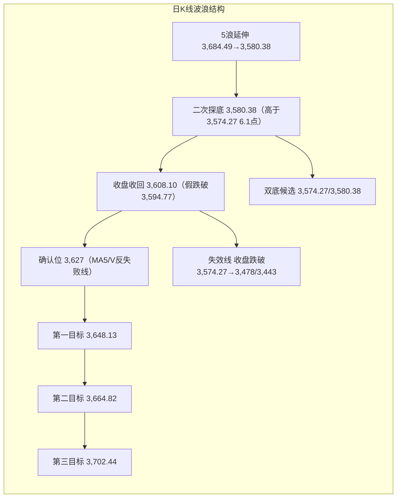
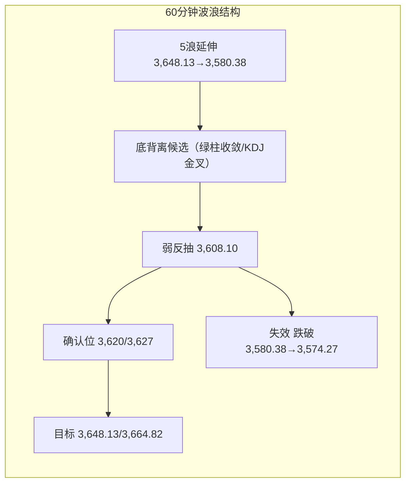

# A股晚报 - 2026年11月03日

> 数据截止时间：2026年11月03日 20:00（北京时间）
> 报告性质：**11月第二个交易日、5浪失败后的二次探底验证日、科技链二次杀跌日**
> **一句话定性**：**"政策托而不举、科技再杀、防御抱团"——沪指低开单边下行至3,580.38，收盘3,608.10收回3,594.77，3,574.27生死线未破，但3,627未收复，反转仍未确认**。

---

## 一、市场回顾

### 1. 主要指数表现

| 指数 | 收盘 | 涨跌幅 | 开盘 | 最高 | 最低 | 成交额 |
|------|------|--------|------|------|------|--------|
| **上证指数** | **3,608.10** | **-0.82%** | 3,624.58 | 3,624.58 | **3,580.38** | 8,108.29亿 |
| **深证成指** | **10,876.99** | **-1.21%** | — | — | — | 8,926.05亿 |
| **创业板指** | **2,391.65** | **-2.73%** | — | — | — | 4,464.56亿 |
| **科创50** | **1,151.28** | **-3.81%** | — | — | — | — |
| 沪深300 | 4,008.87 | -0.20% | — | — | — | — |
| 上证50 | — | +0.21% | — | — | — | — |
| 中证A50 | — | +0.77% | — | — | — | — |
| 中证500 | — | -1.45% | — | — | — | — |
| 北证50 | 855.06 | -4.02% | — | — | — | — |

> **结构特征**：**"权重稳、成长杀"**——上证50、中证A50逆势收红，沪深300仅跌0.20%，成分股上涨率约70%；而创业板指跌破2,400点（收2,391.65）、科创50跌3.81%、北证50跌4.02%，小盘与高β全线承压。沪指开盘3,624.58即为全天最高，早盘9:34即跌破3,600（报3,601.28），午后最低3,580.38，尾盘小幅收回至3,608.10，**全天单边下行、无有效反抽**。

### 2. 成交量能

| 项目 | 今日 | 变化 |
|------|------|------|
| **两市成交额** | **17,034.34亿元** | **-802.59亿元（-4.50%）**，由此前17,837亿缩量 |
| 沪市 / 深市 | 8,108.29亿 / 8,926.05亿 | 深市成交仍大于沪市 |
| **北向资金** | 成交**2,757.24亿元、占两市16.19%** | 前值2,977.61亿、占16.69%，**成交额与占比双降** |
| **主力资金** | **净流出483.98亿元** | 前值净流入53.82亿，单日反转 |
| 创业板 / 科创板主力 | -125.62亿 / -101.37亿 | 成长端集中减仓 |
| 沪深300主力 | -177.26亿 | 权重端亦有流出 |

> **资金结构**：全市场仅**4个行业主力净流入**，电力设备（+36.22亿）、电池（+24.21亿）、锂电（+9.79亿）居前；流出端**电子-186.23亿、半导体-106.47亿、通信-82.16亿、通信设备-80.34亿、数字芯片设计-72.36亿、元件-51.24亿**——科技链合计流出超250亿，属"集中减仓"而非"缩量观望"。个股方面，宁德时代主力净买入11.68亿居首，N皇冠、阳光电源、贵州茅台净流入居前；长鑫科技净卖出超24亿、中际旭创超25亿、寒武纪超12亿。

### 3. 市场情绪

| 指标 | 数据 | 解读 |
|------|------|------|
| 上涨 / 下跌 / 平盘 | **2,104 / 3,308 / 153** | 下跌占比约59.5%，宽度明显恶化 |
| 涨停 / 跌停 | **52只 / 22只** | 涨停较昨日132只腰斩，跌停翻倍 |
| 炸板 / 封板率 | 38只 / **57.78%** | 封板率跌破60%，情绪偏冷 |
| 连板股 / 晋级率 | 15只 / **27.27%** | 连板高度降至**4板**，退潮延续 |
| 涨超7% / 跌超7% | 35只 / 274只 | 跌幅端显著占优 |

> **情绪判断**：昨日"普涨+首板115只"未能延续，今日直接进入**"缩量分化+科技退潮"**；连板高度由6板降至4板、晋级率不足三成，青岛食品、澳洋健康双双断板，大业股份2连跌停，**退潮结构确认**。

---

## 二、热点板块与异动分析

### 1. 当日领涨板块及驱动因素

| 板块 | 表现 | 驱动因素 |
|------|------|---------|
| **保险** | 涨幅居前（盘中一度+2%） | 长端利率企稳、权益仓位改善预期；中国太保+3.06%、新华保险走强；防御资金抱团 |
| **食品饮料 / 酒类** | 食品饮料**+2.12%** | 油价回落压低通胀预期、人民币升值、外资偏好回流；白酒创近期新高 |
| **农林牧渔** | **+2.45%（申万第一）** | 养殖业领涨、猪价预期+防御属性；"羊"字辈玄学炒作扩散（百洋股份18天10板） |
| **非银金融 / 券商** | 非银**+1.62%** | 央行SFISF第三批1,000亿落地、中标费率10bp；9家券商确认中标 |
| **机场航运 / 航空** | 涨幅居前 | 航油成本较上周高位回落、人民币在岸升破6.65 |
| **贵金属** | 涨幅居前 | 世界黄金协会Q3全球央行净增321吨；但现货金午后跳水，**股票端与现货背离** |
| **石油化工** | 上涨 | WTI亚洲盘转涨+0.9%、布油+1.2%至104.81，上游盈利预期修复 |
| **中船系** | **+4.02%** | 订单/军工事件共振，昆船智能+18.08%（盘中涨停打开、振幅23.89%）、久之洋+7% |

### 2. 当日领跌板块及原因分析

| 板块 | 表现 | 原因 |
|------|------|------|
| **通信** | **-6.83%（申万跌幅第一）** | 摩根士丹利将2027年全球高速光模块需求增速由**62%下调至48%**；KOSPI-3.59%、SK海力士/三星跌超4%；光模块/CPO/光通信集体重挫 |
| **电子** | **-4.92%（跌幅第二）** | 半导体全线杀跌：寒武纪-10.81%（市值跌破5,000亿）、京仪装备-11.43%、芯源微/思瑞浦/炬光科技/君正股份跌超10%、金海通跌停、晶华微-20.02% |
| **元件 / 电子化学品** | 跌幅居前 | PCB/覆铜板补跌，生益科技跌停（-10%）、成交77.1亿，机构净卖出8.55亿 |
| **医疗服务 / 生物科技** | 下跌 | 前期涨幅兑现、风险偏好回落 |
| **有色金属 / 电力设备 / 医药生物** | 下跌 | 高位赛道补跌，资金转向低估值防御 |
| **海运 / 建材 / 能源设备** | 下跌 | 油价反弹未能传导至航运；地产链预期偏弱 |

> **核心矛盾**：**外部AI硬件杀估值（KOSPI-3.59%）+ 产业预期下修（大摩下调光模块增速）+ 苹果大中华区不及预期/存储成本警告**三重共振，通信、电子成为绝对减仓方向；而**油价反弹+人民币升值+政策工具落地**支撑保险、食品、航空、券商等低估值防御。市场呈典型**"高低切换+防御抱团"**。

### 3. 个股异动复盘

- **涨停梯队**：52只涨停（非ST口径48只），连板15只、晋级率27.27%、高度降至4板。**东方海洋10天6板、百洋股份18天10板、阳光照明9天5板、文投控股10天6板**；"羊"字辈玄学炒作尾盘分歧，海阳科技、天洋新材、大洋电机、华阳国际集体炸板。
- **断板/杀跌**：青岛食品、澳洋健康双双断板；大业股份2连跌停；高位连板退潮明确。
- **科技龙头**：寒武纪-10.81%（市值跌破5,000亿）、长鑫科技-6%+、中际旭创/新易盛/天孚通信/光库科技集体下挫；生益科技跌停，机构净卖8.55亿但北向净买4.45亿，**内外资分歧**。
- **逆势方向**：宁德时代获主力净买入11.68亿；N皇冠（皇冠新材）上市首日主力净流入居前；中船系昆船智能+18.08%。

---

## 三、关键数据与事件回顾

### 1. 国内重要经济数据

- **10月官方制造业PMI 49.3%**（环比-0.8pct，重回收缩区间），非制造业49.7%、综合49.7%；结构上**高技术制造业51.3%、装备制造业50.6%**，仍处扩张。
- **10月财新制造业PMI媒体口径约52.0%**（前值52.1%，连续11个月扩张），与官方49.3%延续**显著背离**——中小/民营/出口链韧性强于大型国企，但今日被科技杀跌掩盖，未形成指数级支撑。

### 2. 政策与监管动态

1. **央行完成第三次SFISF操作**：操作金额**1,000亿元**，31家证券、基金公司参与投标，**中标费率10bp**；国泰海通、东方、东吴、国联民生、招商等9家券商确认中标，表态"尽快全部投入使用"。
2. **央行公开市场**：开展**6,210亿元隔夜逆回购**（利率1.25%），对冲4,120亿7天+5,410亿1天到期，**净回笼3,320亿元**；隔夜Shibor 1.286%（-0.3bp），短端流动性仍稳。
3. **美国中期选举**（11/3）全天投票，结果影响关税/财政/AI监管预期，为今晚海外定价主线。
4. **产业预期下修**：摩根士丹利下调2027年全球高速光模块需求增速（62%→48%），高盛提示关键零部件供给紧张，直接触发通信/光模块杀跌。

### 3. 公司公告与产业事件

- **大华股份（002236）**：子公司华启智慧中标中国移动2026-2027年AI超节点设备集采，金额约**26.3亿元（含税）**，超此前董事会预计上限；11/3董事会审议通过关联交易。
- **苹果FY26 Q4财报**：营收**1,144.77亿美元（+11.7%）**、EPS 2.10美元均超预期，但**大中华区营收不及预期**；CEO称存储芯片价格走势"史无前例"，内存成本或进一步挤压利润率，**盘后/盘前股价跌超2%**。
- **停牌重组**：中国稀土、TCL中环继续停牌，复牌待定。
- **立案个股**：晶华微今日**-20.02%**，科力远、万辰集团、ST合纵等风险仍在。

---

## 四、海外市场联动

### 1. 美股（11月2日收盘 + 11月3日盘前）

| 指数 | 收盘 | 涨跌幅 | 特征 |
|------|------|--------|------|
| **道琼斯** | 51,983.98 | **+0.41%** | 权重/价值股支撑，续创新高 |
| **标普500** | 7,541.40 | **-0.51%** | 盘中由涨转跌 |
| **纳斯达克** | 25,164.32 | **-1.07%** | 科技股再遭抛售 |
| 费城半导体 | — | **约-3%** | 存储/光通信/半导体设备领跌 |

> **11/3盘前**：市场等待美国中期选举结果，三大期指窄幅波动；**苹果跌超2%**（大中华区不及预期+存储成本警告）、Palantir跌超4%（Q3营收翻倍但估值承压）。**美股尚未收盘，今晚选举结果与苹果财报发酵将决定11/4 A股科技链开盘方向**。

### 2. 欧洲与亚太

| 市场 | 收盘 | 涨跌幅 | 解读 |
|------|------|--------|------|
| 德国DAX | 25,981.09（11/2） | +0.63% | 欧股回暖 |
| 法国CAC40 | 8,047.69（11/2） | +0.98% | 奢侈品/工业反弹 |
| 英国富时100 | 10,761.33（11/2） | +0.29% | 能源权重拖累 |
| **韩国KOSPI** | **5,648.79** | **-3.59%** | **SK海力士/三星跌超4%，存储/光模块链二次杀跌** |
| 日经225 | 休市 | — | 日本文化日休市 |
| **恒生指数** | **23,525.97** | **+0.57%** | 港股逆势收红，南向净买入超130亿港元 |
| 国企指数 | — | +0.47% | 内资定价偏稳 |

> **关键**：**KOSPI-3.59%是今日A股科技链杀跌的直接映射**；但港股收涨、南向净买入超130亿，说明**外资/内资对A股与港股的风险定价分化**，A股更多是"科技链集中减仓+政策兑现"的内生调整。

### 3. 大宗商品与美元

| 品种 | 最新 | 涨跌幅 | 解读 |
|------|------|--------|------|
| **WTI原油** | 约97.3美元/桶 | **+0.9%** | 亚洲盘自96.46反弹，高盛提示供应中断风险 |
| **布伦特原油** | **104.81美元/桶** | **+1.2%** | 同步反弹 |
| **现货黄金** | **3,906.71美元/盎司**（16:02） | **-1.01%** | 17:05 further跌破3,900至3,897.80 |
| **现货白银** | **48.61美元/盎司** | **约-4%** | 跌破50，跌幅远超黄金 |
| 美元指数 | 约101.8 | 持平 | 等待中期选举/非农 |
| 美债10Y | 约4.91%-4.92% | 小幅上行 | 欧债/美债收益率同步走高 |

> **商品矛盾**：**油价反弹**修复石油石化盈利预期，却削弱航空/化工"成本红利"逻辑；**黄金现货跳水但A股贵金属上涨**，属"央行购金321吨"的中期逻辑与短期获利回吐的背离，**股票端不宜追高**。

---

## 五、汇率与利率

| 项目 | 数值 | 变化 |
|------|------|------|
| 人民币中间价 | **6.7150** | 调降4bp（前值6.7146） |
| 在岸人民币（16:30） | **6.6458** | 较前值6.6557**升值约0.15%** |
| 在岸夜盘 | 6.6482 | 小幅回吐 |
| 离岸人民币 | 约6.65 | 强势震荡 |
| Shibor隔夜 / 7天 | **1.286% / 1.363%** | -0.3bp / -2.9bp |
| 10年期国债 | **1.61%** | -1.05bp |
| 30年期国债 | **2.0520%** | -1.8bp |
| 10年期国开债 | 1.6565% | -1.2bp |

> **判断**：人民币在岸升破6.65、短端利率稳中略降、长端国债收益率下行，**内部流动性环境偏松**；但A股仍下跌，说明**今日矛盾在"科技产业预期+风险偏好"，而非利率/流动性**。央行净回笼3,320亿属对冲到期，不改隔夜1.25%的政策利率锚。

---

## 六、收盘后重要信息

### 1. 盘后公告

- **美的集团（000333）**：截至10/31累计回购1.45亿股（占总股本1.89%），支付**117.57亿元**，回购股份将全部注销。
- **东山精密（002384）**：控股股东提议2026年度股东回报总额**不低于10亿元**。
- **国家电投集团**：拟自11/3起6个月内增持公司股份，金额**不低于2亿元、不超过3亿元**。
- **交控科技（688015）**：中标黄山旅游T1线一期工程信号系统设备采购项目。
- **东方海洋（002086）**：发布股票交易异常波动公告（11/2、11/3连续两日涨幅偏离值累计超20%）。
- **百通能源（001376）**：约2.46亿股首发前限售股**11/4上市流通**，占总股本50.33%。

### 2. 夜盘与海外盘后

- **苹果**盘后/盘前跌超2%，存储成本警告利空果链/消费电子。
- **现货黄金**跌破3,900美元（3,897.80），白银跌近4%，**贵金属股票端次日面临回吐压力**。
- **原油**维持反弹，WTI约97.3、布油104.81，**石油石化/油服相对受益、航空/化工成本红利减弱**。
- **美国中期选举**结果陆续出炉；**美债收益率与欧债同步上行**，市场等待11/4 ADP、ISM及11/6非农。

### 3. 次日关注

| 时间 | 事件 | 影响 |
|------|------|------|
| 11/4 | **美国10月ADP、ISM非制造业（前值54.9）、欧元区10月CPI初值** | 就业/通胀验证，影响加息预期 |
| 11/4 | **A股9家公司解禁，合计3,224.5万股、市值17.4亿元** | 解禁压力小（瑞迈特、亿能电力、英搏尔居前） |
| 11/4 | **美国中期选举结果** | 关税/AI监管/财政预期 |
| 11/5-11/10 | **第九届进博会** | 内需/消费主题催化 |
| 11/5 | **英国央行决议、日央行纪要** | 全球央行"是否集体转鹰" |
| 11/6 21:30 | **美国10月非农**（预期+5.6万，前值2.9万） | 全周压轴，美联储路径 |
| 11/6-11/8 | **中国智能机器人大会** | 机器人主题事件催化 |

---

## 七、波浪理论多周期分析

### 1. 月K线波浪分析

- **当前波浪位置**：**大级别第2浪（C浪）延伸段**，11月月K暂为"低开、冲高回落的中阴"（11/2收3,638.03、11/3收3,608.10）。
- **浪型结构描述**：6月高点4,197→10/23低点3,574.27为C浪主跌段（-14.85%）；10月月K"近乎光头中阴"（-6.33%，收3,599.02），**收盘跌破0.382回撤位3,621**；11/2一度收复3,621，但11/3收3,608.10**得而复失**，月线仍处"下未破、上未复"的偏空临界状态。
- **关键目标位**：上方 **3,621（0.382，失而复得）→3,664.82→3,724.56（缺口下沿/月线修复确认）→3,785（20月均线）**；下方 **3,574.27（月线生死线）→3,478→3,443**。
- **验证条件**：11月月K收盘站上**3,724.56**→月线修复启动；月K收盘跌破**3,574.27**→C浪延伸确认，下看3,478/3,443；收在3,574.27-3,621之间→月线级别宽幅震荡（3,574-3,880）。

### 2. 周K线波浪分析

- **当前波浪位置**：周线六连阴后的**第45周弱反抽**（11/2-11/6），属"下跌推动浪末端的修复尝试"。
- **浪型结构描述**：第44周（10/26-10/30）收"带上影中阴、几无下影"（-2.48%，收3,599.02），低点3,595.26高于前周低点3,574.27，呈"内包线/尽头线"衰竭结构；本周首日+1.08%、次日-0.82%，**周内高点3,648.13低于上周高3,708.20，周内低点3,580.38低于上周低3,595.26**——"高点下移、低点下移"，反抽力度弱于"二次探底成立"所需。
- **关键目标位**：上方 **3,627（V反失败线）→3,648.13（本周高）→3,664.82（周线二次探底确认）→3,708.20（上周高）/5周均线约3,732**；下方 **3,580.38（本周低）→3,574.27（月/周生死线）**。
- **验证条件**：本周五收盘站上**3,664.82**→周线"二次探底成立"；收盘跌破**3,574.27**→周线下降通道延续，下看3,478；收在3,580-3,627之间→周线"弱反抽/震荡"。

### 3. 日K线波浪分析

- **当前波浪位置**：**下跌推动浪第5浪延伸末端的"二次探底/双底候选"**。11/2的"5浪失败/诱空"（3,594.77）在11/3盘中被跌破至**3,580.38**，但收盘3,608.10重新收回3,594.77，且3,580.38仍高于月线生死线3,574.27（高6.11点）。
- **浪型结构描述**：3,684.49（10/28）→3,595.26（10/30）为第5浪；11/2最低3,594.77（仅低0.49点）V型反转至3,648.13；11/3回踩至3,580.38，**跌破11/2低点但收盘收回**，构成"二次诱空/双底候选"。按严格波浪规则，2浪回踩不得跌破1浪起点（3,594.77），故11/2-11/3的反弹应降级为**"a-b-c复杂调整"**：a=3,594.77→3,648.13、b=3,648.13→3,580.38、c待启动；若c不能站上3,627，则仍属"下跌中继"。
- **关键目标位**：第一确认位 **3,627（V反失败线/MA5约3,626）**，第二目标 **3,648.13（11/2高）**，第三目标 **3,664.82（10/26低/0.618）→3,702.44（等长）→3,724.56（缺口下沿）**；下方失效线 **3,580.38→3,574.27**，跌破3,574.27则看3,478/3,443。
- **验证条件**：**收盘站上3,627且成交≥1.75万亿**→双底/复杂调整完成，恢复"反弹"计数；**收盘跌破3,574.27**→5浪失败/双底证伪，重回下跌推动浪；均线：MA5约3,626、MA10约3,660、MA20约3,705、MA60约3,812，**收盘仍低于全部均线，属"止跌未反转"的初期**。

### 4. 60分钟K线波浪分析

- **当前波浪位置**：**5浪延伸后的"底背离候选"+弱反抽**。
- **浪型结构描述**：11/2 3,594.77→3,648.13为反弹段；11/3 3,648.13→3,580.38单边下行，**跌破反弹起点3,594.77**，1-2浪计数作废，改按"5浪延伸"处理；3,580.38后午后回升至3,608.10，60分钟MACD在零轴下方绿柱收敛、KDJ由超卖区金叉，**底背离雏形但未确认**。
- **关键目标位**：上方 **3,612→3,620→3,627**；下方 **3,590→3,580.38→3,574.27**。
- **验证条件**：60分钟连续3根K线站稳**3,620**且MACD金叉→底背离确认，上看3,648.13/3,664.82；**跌破3,580.38**→底背离失败，下看3,574.27。

### 5. 30分钟K线波浪分析

- **当前波浪位置**：早盘单边下行的**5子浪末端**，午后进入**弱反抽（a浪或1浪）**。
- **浪型结构描述**：早盘3,624.58→3,580.38走出清晰的5子浪下跌（跌幅44.20点、-1.22%），9:34跌破3,600后无抵抗；午后3,580.38→3,608.10反弹约27.72点（收复跌幅的62.7%），30分钟MACD底背离、KDJ金叉，但**量能未同步放大**，属"技术性反抽"而非"反转"。
- **关键目标位**：上方 **3,612→3,620→3,624.58（今日开盘/最高）**；下方 **3,590→3,580.38**。
- **验证条件**：30分钟站上**3,620**且MACD红柱持续→反抽升级为反弹；**跌破3,590/3,580.38**→弱反抽结束，下一目标3,574.27。

### 6. 波浪结构示意图（Mermaid）





### 7. 波浪理论综合判断

- **多周期共振状态**：**月线偏空（3,621得而复失、C浪延伸未排除）→ 周线偏空（高点/低点均下移、5周均线3,732压制）→ 日线"双底候选/止跌未确认"（3,580.38高于3,574.27、收盘收回3,594.77）→ 60分钟底背离候选→30分钟弱反抽**。呈**"大周期空、小周期止跌、向上未共振"**结构。
- **当前操作级别**：**日线定方向（3,574.27生死线、3,627反转确认），60分钟等右侧（站稳3,620），30分钟不追高**；周线未站上3,664.82前，中线不加仓。
- **后续演变路径**：
  - **主路径（约45%）**：3,585-3,620区间震荡，回踩3,590-3,600不破后再试3,620/3,627，收3,600-3,625；
  - **偏多路径（约25%）**：放量站上3,627→3,648.13→3,664.82，收3,630-3,665；
  - **偏空路径（约30%）**：跌破3,580.38→3,574.27；若收盘失守3,574.27，则双底证伪，下看3,520/3,478。
- **关键拐点信号**：
  - **向上**：收盘站上3,627 + 成交≥1.75万亿 + 跌停<15只 + 通信/电子止跌翻红；
  - **向下**：收盘跌破3,574.27 + 跌停>40只 + 主力净流出>500亿 + 通信继续领跌。
- **风险提示**：波浪计数在"失败摆动"后存在两种替代（**双底/复杂调整** vs **下跌推动浪延伸**），**3,627未收复前只能定性为"止跌候选"，不能定性为"反转"**；3,574.27为全部多头逻辑的失效线；外盘（中期选举、苹果、11/6非农）与通信/电子权重是最大证伪风险。

---

## 八、晨报复盘

### 1. 核心判断回顾

| 判断项目 | 晨报预测 | 实际结果 | 准确度 | 备注 |
|---------|---------|---------|-------|------|
| 上证指数趋势 | 震荡（偏弱，防科技补跌） | 跌0.82%（3,608.10） | **✓** | 方向一致，防御/科技分化亦验证 |
| 上证指数区间 | 3,598-3,662点（主情景收盘3,615-3,645） | 3,580.38-3,624.58，收3,608.10 | **✗** | 最低跌破下沿17.62点；收盘在主区间内，但低于主情景下沿 |
| 强支撑位 | 3,594.77点 | 最低3,580.38点（收盘3,608.10收回） | **✗（盘中）** | 盘中破14.39点（-0.40%），收盘收回=假跌破；按收盘口径可记✓ |
| 弱支撑位 | 3,620点 | 最低3,580.38点，收3,608.10 | **✗** | 3,620失守，收盘低于弱支撑 |
| 强压力位 | 3,664.82点 | 最高3,624.58点 | **✗** | 未触及，差40.24点 |
| 弱压力位 | 3,648.13点 | 最高3,624.58点 | **✗** | 开盘即最高，未触及 |
| 北向资金 | 净流出20-50亿元 | 净额不披露；成交2,757.24亿/占16.19%（前值2,977.61/16.69%） | **—（弱✓）** | 成交额与占比双降，方向偏流出，不可量化打分 |
| 成交量 | 平量，16,800-18,200亿元 | 17,034.34亿元（-802.59亿） | **✓** | 处平量区间 |

### 2. 板块预判回顾

| 板块 | 预判方向 | 实际涨跌幅/表现 | 准确度 | 原因分析 |
|-----|---------|-----------|-------|---------|
| 航空/机场 | 看涨 | 机场航运涨幅居前 | **✓** | 航油成本回落+人民币升值 |
| 化工中下游/轮胎/化纤 | 看涨 | 未进入领涨序列（仅石油化工上游上涨） | **✗** | WTI亚洲盘由跌转涨+0.9%，成本红利弱化 |
| 券商/非银 | 看涨 | 非银+1.62%、券商上涨 | **✓** | SFISF 1,000亿/10bp落地，保险更强 |
| 消费/食品饮料 | 看涨 | 食品饮料+2.12%、农林牧渔+2.45% | **✓** | 油价回落+通胀预期降+防御抱团 |
| 石油石化/油服/煤炭 | 看跌 | 石油化工上涨、板块涨幅居前 | **✗** | 油价反弹证伪"崩塌"逻辑，上游盈利修复 |
| 半导体/存储/光模块/CPO | 看跌 | 通信-6.83%、电子-4.92%，半导体重挫 | **✓** | KOSPI-3.59%+大摩下调光模块增速62%→48% |
| 高位连板题材 | 看跌 | 涨停52/跌停22，高度4板，晋级率27.27%，炸板38 | **✓** | 退潮延续，青岛食品/澳洋健康断板 |

> 风险板块验证：立案股（晶华微-20.02%）✓、纯AI算力高位股（寒武纪-10.81%）✓、出口链/果链（苹果大中华区不及预期）✓。

### 3. 准确率量化评估

- **趋势判断准确率：100%（1/1）**
- **点位预测准确率：20%（1/5）**（按"收盘有效"口径，强支撑3,594.77收盘守住记✓；若按盘中口径为0/5）
- **板块预判准确率：71.4%（5/7）**
- **成交量准确率：100%（1/1）**
- **综合准确率：约67%**（30%×100% + 30%×20% + 30%×71.4% + 10%×100% = 67.4%）

> 北向资金因交易所不披露净额，未纳入加权（若强行按"方向偏流出"记✓，综合准确率约70%）。

### 4. 偏差根因分析

**【偏差1】区间/强支撑盘中失守**
- 偏差描述：预测区间3,598-3,662、强支撑3,594.77，实际最低3,580.38。
- 根本原因：**逻辑误判 + 技术分析局限**——把11/2"5浪失败/诱空"当作已确认反转，只设"回踩3,620-3,627"路径，未并列"二次探底至3,574.27"的等价路径。
- 信息缺口：开盘前已知KOSPI-3.29%、费半-3%，但未把"KOSPI收盘-3.59%+大摩下调光模块增速"纳入开盘后情景。
- 逻辑缺陷：失败摆动确认后，仍以"1浪起点不可破"作为硬约束，忽视了"二次诱空/双底"在A股的常见性。
- 改进措施：失败摆动确认后的次日，区间下沿直接取"月线生死线"（本次3,574.27）而非强支撑；并单列"盘中破失败低点、收盘收回"情景。

**【偏差2】全部压力位未触及**
- 偏差描述：预测弱压力3,648.13、强压力3,664.82，实际最高3,624.58（开盘即最高）。
- 根本原因：**情绪面误读**——高估SFISF落地的做多持续性，把"政策工具落地"当买点，未设"利好兑现=卖点"。
- 信息缺口：9:25竞价/开盘30分钟未验证"高开或低开后能否站上3,620"。
- 逻辑缺陷：政策利好落地日+科技链外盘杀跌，开盘方向应由KOSPI/竞价决定；政策只托底、不托价。
- 改进措施：政策工具落地日，若开盘30分钟不能站上"前一日弱支撑"且通信/电子跌幅>3%，直接按"利好兑现"处理，压力位下移至开盘价/MA5。

**【偏差3】化工与石油石化方向错误**
- 偏差描述：预测化工中下游看涨、石油石化看跌；实际石油化工上涨、化工中下游未领涨。
- 根本原因：**信息缺失**——只用隔夜WTI-7.36%静态推导，未跟踪亚洲盘油价由跌转涨+0.9%、布油+1.2%。
- 信息缺口：9:20/10:30实时油价、高盛供应中断报告。
- 逻辑缺陷：把"单日油价暴跌"线性外推为"成本红利持续"，忽视油价高波动下的均值回归。
- 改进措施：商品相关板块必须在9:20、10:30两次复核实时油价；油价单日振幅>3%时，取消"成本红利"单向判断，改为"上游/下游"分情景。

**【偏差4】北向资金不可验证**
- 偏差描述：预测净流出20-50亿，交易所不披露净额，仅能看成交2,757.24亿/占16.19%。
- 根本原因：**信息缺失**（制度性）。
- 改进措施：北向改为"成交占比变化+十大成交股结构"跟踪，不把净额作为可打分项；占比由16.69%降至16.19%，记"偏流出"即可。

### 5. 分析检查清单

- [x] 隔夜外盘走势（纳指-1.07%、费半-3%）
- [x] 亚太开盘方向（KOSPI-3.59%，收盘确认）
- [x] 北向资金结构（成交占比16.19%，下降）
- [x] 技术指标状态（MA5/3,627、MACD底背离候选）
- [x] 重大政策/事件（SFISF 1,000亿、中期选举、苹果财报）
- [x] 前期高低点（3,574.27/3,580.38/3,594.77/3,648.13）
- [x] 均线支撑压力（MA5约3,626、MA10约3,660）
- [x] 整数关口（3,600失而复得）
- [x] 成交密集区（3,600-3,627）
- [x] 行业基本面（油价反弹、光模块预期下修）
- [x] 资金流向（主力-483.98亿、电子/通信集中流出）
- [x] 政策催化（SFISF落地但未能托价）
- [x] 技术形态（日线双底候选、60分钟底背离）
- [x] 宏观/行业/个股/流动性风险
- [x] 波浪分析（月/周/日/60/30分钟五周期）

### 6. 本次复盘发现的新规则

- **规则1（波浪）**：前一日"5浪失败/诱空"确认后，次日跌破该失败低点但**收盘收回**、且低点仍高于月线生死线，属"二次诱空/双底候选"，不改"反转候选"；确认须**收盘站上V反失败线/MA5**。
- **规则2（趋势）**：政策工具落地日（SFISF/降准等）若指数**开盘30分钟不能站上前一日弱支撑**且科技链跌幅>3%，按"利好兑现"处理，趋势维持"震荡偏弱"，不得因政策加码看涨。
- **规则3（板块）**：商品板块必须盘中复核实时油价；油价单日振幅>3%时，取消"成本红利"单向判断，改为"上游受益/下游受损"分情景。
- **规则4（板块）**：外盘科技链二次杀跌+产业预期下修（如大摩下调光模块增速）叠加时，A股通信/电子当日跌幅可达5%-7%，反弹需"外盘止跌+产业预期修正"双确认。
- **规则5（点位）**：强支撑盘中跌破<0.5%且收盘收回=假跌破，支撑有效性不变；但若**开盘即最高、全天单边下行**，说明反抽乏力，次日仍需回踩确认。
- **规则6（资金）**：主力净流出>450亿+创业板/科创板均净流出>100亿+通信电子合计流出>250亿，属"科技链集中减仓"，次日反弹默认"弱反抽"，除非通信/电子"低开高走+资金转净流入"。

### 7. 规则库更新

```
###趋势分析 政策工具落地日（SFISF/降准等）若指数开盘30分钟不能站上前一日弱支撑且科技链跌幅>3%，按"利好兑现"处理，趋势维持"震荡偏弱"，不得因政策加码看涨
###点位计算 强支撑盘中跌破<0.5%且收盘收回=假跌破，支撑有效性不变；但若开盘即最高、全天单边下行，说明反抽乏力，次日仍需回踩确认
###板块选择 商品板块必须盘中复核实时油价；油价单日振幅>3%时，取消"成本红利"单向判断，改为"上游受益/下游受损"分情景
###板块选择 外盘科技链二次杀跌+产业预期下修（如大摩下调光模块增速）叠加时，A股通信/电子当日跌幅可达5%-7%，反弹需"外盘止跌+产业预期修正"双确认
###资金面分析 主力净流出>450亿+创业板/科创板均净流出>100亿+通信电子合计流出>250亿，属"科技链集中减仓"，次日反弹默认"弱反抽"，除非通信/电子"低开高走+资金转净流入"
###波浪分析 前一日"5浪失败/诱空"确认后，次日跌破该失败低点但收盘收回、且低点仍高于月线生死线，属"二次诱空/双底候选"，不改"反转候选"；确认须收盘站上V反失败线/MA5
```

---

## 九、策略回顾与调整

### 1. 短线策略回顾

| 策略项目 | 晨报建议 | 今日实际 | 执行效果 | 备注 |
|---------|---------|---------|---------|------|
| 短线仓位 | 15% | 维持15% | ✓ | 未追高，仓位可控 |
| 买入条件 | 回踩3,620-3,627企稳+跌停<40+券商/航空翻红 | 直接跌破3,620，最低3,580.38；跌停22<40；券商/航空红 | **✗** | 买点未触发，未加仓（执行正确） |
| 卖出条件 | 冲高3,664.82受阻且成交<1.6万亿；或收盘跌破3,620 | 未冲高；收盘3,608.10<3,620 | **✓（触发）** | 按纪律应减短线仓位 |
| 止损位 | 收盘跌破3,594.77 | 收盘3,608.10，未触发 | ✓ | 盘中3,580.38但收盘收回 |
| 短线标的 | 券商ETF、航空ETF、化工/消费ETF | 券商✓、航空✓、消费✓、化工✗ | **3/4** | 2-3项正收益，化工拖累 |

### 2. 中线策略调整

- **当前中线方向：【持有】**（维持，不加仓）
- **方向调整原因**：日线"双底候选"但未收复3,627，周线高点/低点均下移，3,574.27生死线未破；在"科技链集中减仓+外盘事件窗口"下，中线以持有底仓、等待右侧确认为主。
- **中线仓位建议：15%**（维持15%；若收盘跌破3,594.77降至5%，跌破3,574.27清零）
- **中线目标区间**：上证指数 **3,580 - 3,664.82点**（下沿下移至本周低点3,580.38，上沿维持3,664.82）
- **中线止损位**：**3,574.27点**（收盘有效跌破则清零）
- **中线布局板块调整**：
  - 维持：券商底仓5%、消费/食品饮料、红利（银行/公用事业）；
  - 增配：航空/机场（成本改善+人民币升值）；
  - 不补：半导体/科创50（等KOSPI企稳、通信/电子资金转净流入）；
  - 不追：石油石化/煤炭（油价高波动）、贵金属（现货跳水）。

### 3. 明日策略要点

- **短线：【减仓/观望】**，关注**3,580.38**（今日低点）和**3,620**（弱支撑/反抽确认）；收盘站上3,627且放量再考虑回补。
- **中线：【持有】**，关注**3,574.27**（生死线）和**3,627**（反转确认）。
- **仓位分配：短线10% + 中线15% + 现金75%**。

### 4. 策略复盘规则输出

```
###趋势分析 政策兑现日的短线仓位应与"前一日弱支撑得失"绑定：开盘30分钟失守则短线降至10%，不等收盘
###点位计算 失败摆动后的二次探底，区间下沿取"月线生死线"而非前一日强支撑；盘中假跌破<0.5%不改支撑有效性
```

---

## 十、风险提示

1. **市场系统性风险**：通信-6.83%、电子-4.92%集中杀跌，创业板跌破2,400、科创50-3.81%、北证50-4.02%，成长风格二次探底；**3,574.27为月/周最后防线，收盘失守将打开3,478/3,443**。
2. **个股风险事件**：晶华微-20.02%（立案）、生益科技跌停（机构净卖8.55亿）、寒武纪-10.81%（市值跌破5,000亿）、高位连板断板（青岛食品/澳洋健康）、大业股份2连跌停。
3. **政策不确定性**：SFISF 1,000亿落地但"托而不举"，若后续无增量工具，政策底逻辑弱化；美国中期选举结果、关税/AI监管预期、苹果存储成本警告、11/6非农均可能改变风险偏好。
4. **外盘传导**：KOSPI-3.59%后，若11/4美股科技链续跌、苹果跌势扩大，A股通信/电子将面临第三轮杀跌。
5. **商品波动**：油价单日振幅>3%、黄金跌破3,900、白银-4%，资源/贵金属股票端与现货背离，追高易回吐。

---

## 十一、信息来源

1. **官方数据**：中国人民银行（11/3第三次SFISF操作1,000亿、31家投标、中标费率10bp；6,210亿隔夜逆回购、净回笼3,320亿）；国家统计局（10月制造业PMI 49.3%、非制造业49.7%、综合49.7%）；中国外汇交易中心（中间价6.7150、在岸6.6458）；上交所/深交所行情。
2. **权威财经媒体**：新华社（11/3收评：沪指3,608.10、深成指10,876.99）；央视财经/央广网（SFISF操作）；证券时报（收评、涨停复盘、主力资金、行业涨跌幅）；上海证券报·中国证券网（开盘/板块、SFISF）；第一财经（早盘、解禁）；财联社（KOSPI收盘、连板分析、黄金白银、苹果盘前）；新浪财经（收评、板块、北向）；东方财富Choice（涨停52只、封板率57.78%）；每日经济新闻（美股盘前/苹果财报）。
3. **数据平台**：Wind（指数/成交/涨跌家数/两融/行业）、同花顺（亚太股指）、金融界（板块资金流）、中证指数（债券估值）。
4. **内部资料**：`report/20261103/morning_report_20261103.md`（晨报核心判断）、`report/20261102/evening_report_20261102.md`（复盘25%、6条规则）、`report/monthly/202611_monthly_report.md`、`analysis/pattern_analysis_202644.md`（第44周规律分析）、`rules.md`。

> **数据口径说明**：北向资金净额交易所不实时披露，本报告以"成交额+占比+十大成交股"替代并给出方向性判断；主力资金为Wind/证券时报口径；两融为T+1披露；美股为11/2收盘+11/3盘前，欧股为11/2收盘，亚太为11/3收盘，商品/黄金为11/3盘中（16:02-17:05），汇率为11/3在岸16:30/夜盘；财新PMI为媒体口径。**截止时间2026-11-03 20:00**。

---

## 十二、文档更新检查

```
## 文档更新建议

### AGENTS.md更新
无需更新。晨报/晚报流程、输出格式、复盘与规则输出要求均与实际执行一致。

### README.md更新
无需更新。文件结构与功能说明未发生变化。

### 无需更新
AGENTS.md 与 README.md 均无需更新。
```
