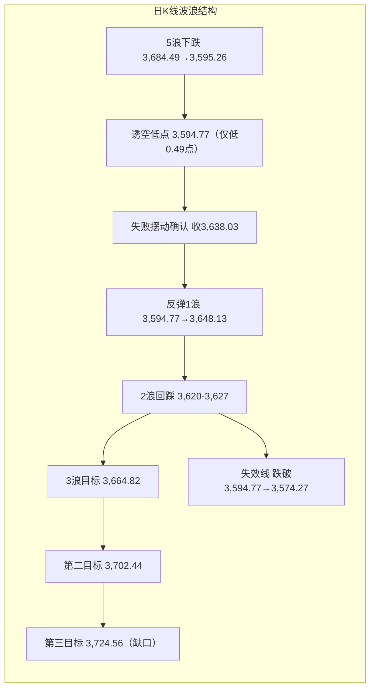
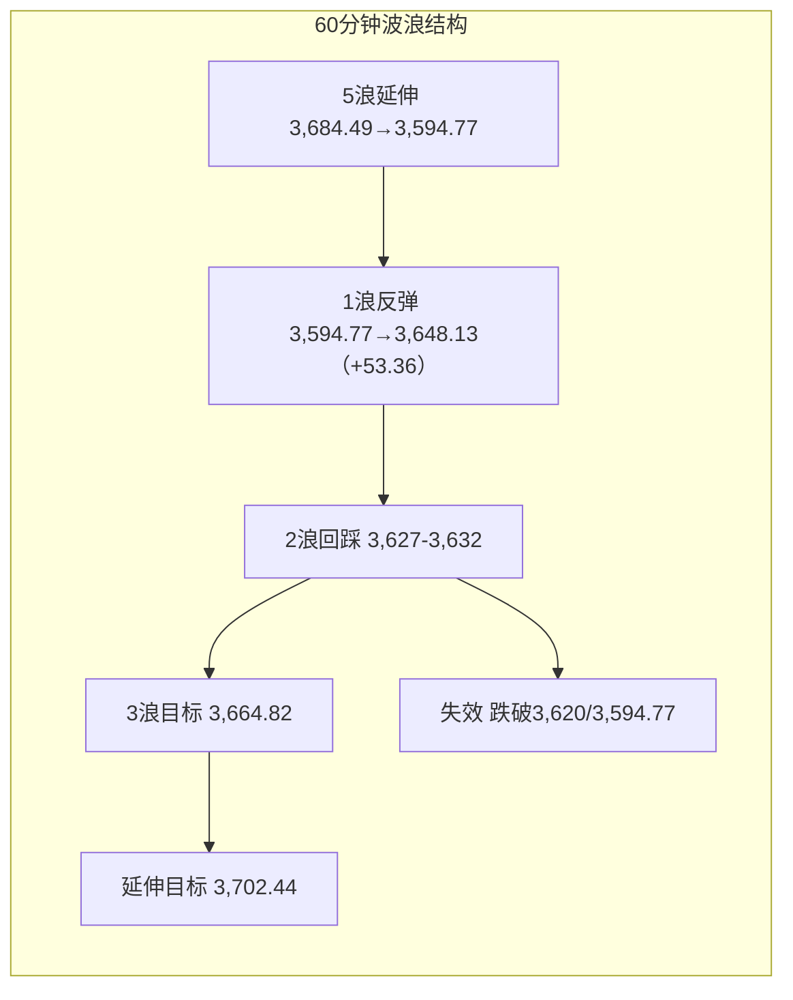

# A股晨报 - 2026年11月03日

> 数据截止时间：2026年11月03日 09:10（北京时间）
> 报告性质：**11月第二个交易日、5浪失败/诱空确认后的回踩验证日、亚太科技链二次杀跌日**
> **一句话定性**：**"油价崩、科技杀、政策托"——上证低开回踩3,620-3,627，守则2浪结束再攻3,664.82，失守3,594.77则诱空证伪**。

---

## 一、昨日晚报复盘要点回顾

### 1. 昨日判断回顾

| 项目 | 准确率 | 说明 |
|------|--------|------|
| 趋势判断 | **0%（0/1）** | 晨报"震荡"，实际+1.08% |
| 点位预测 | **40%（2/5）** | 强支撑✓、弱支撑✓；强压力3,627✗（实际高3,648.13）、弱压力3,620✗、区间✗ |
| 板块预判 | **43%（3/7）** | 券商✓、稀土✓、贵金属✓；石油石化/煤炭✗、银行✗、通信✗、存储✗ |
| 成交量 | **0%（0/1）** | 预测平量15,800-16,800亿，实际17,837亿 |
| **综合准确率** | **约25%** | 30%×0 + 30%×40% + 30%×43% + 10%×0 = 24.9% |

### 2. 关键偏差及原因

- **偏差1｜低估政策**：9:00央行+证监会双会已在日程内，仍给中性"震荡"；政策会议日+关键支撑上方，最低应给"震荡偏强"。
- **偏差2｜压力位无突破情景**：强压力3,627与区间上沿3,635仅差8点，未设突破路径，实际高3,648.13；失败摆动后原压力转支撑。
- **偏差3｜板块三项方向错误**：①WTI亚洲盘转跌-4.03%，击穿石油石化/煤炭逻辑；②稳市日红利被抽血，银行-0.84%；③KOSPI盘中由-1.62%反转至+2.24%，通信/存储不补跌反涨。
- **偏差4｜量能单一情景**：把政策会议日当普通震荡日，未设"政策放量"情景。

### 3. 沉淀的规则/检查项

1. 政策会议开盘前召开+利空已充分定价+指数在关键支撑上方 → 趋势下限"震荡偏强"，政策权重≥30%。
2. 强压力与区间上沿距离<15点且有政策催化 → 必须单列"突破情景"，上沿上移至下一压力位。
3. "政策稳市+超跌反弹"日，红利（银行/煤炭/石油石化）必被抽血，防御板块下调为"中性/资金流出"。
4. 外盘科技大跌但亚太盘中反转、A股半导体高开 → 撤销"外盘映射看跌"；反之亚太续跌则映射有效。
5. 政策会议日+超卖反弹日，成交量下限上调至"前日+5%"，单列"政策放量"情景。
6. 下跌推动浪末端仅破前低不足1点即反转="5浪失败/诱空"，收盘站上原强压力即确认。

### 4. 对今日分析的启示

- **需要关注的风险点**：昨日普涨为"政策+超跌"驱动的修复反弹，首板115只、2连板仅6只，连板断层明显，持续性未验证；今日若缩量冲高回落，易形成"一日游"。
- **需要调整的分析逻辑**：今日必须把"亚太开盘方向"置于隔夜欧美收盘之上（韩国KOSPI低开-2.46%、盘中-3.29%）；商品板块必须以亚洲盘实时价为准；政策会议日不再给中性震荡。
- **技术核心**：昨日收盘3,638.03站上3,627，5浪失败确认，今日进入"2浪回踩验证"，3,620-3,627为多头第一道防线。

---

## 二、隔夜市场动态（11月2日收盘后至今）

### 1. 美股市场（11月2日收盘）

| 指数 | 收盘 | 涨跌幅 | 特征 |
|------|------|--------|------|
| **道琼斯** | **51,983.98** | **+0.41%** | 权重/价值股支撑，续创新高 |
| **标普500** | **7,541.40** | **-0.51%** | 盘中由涨转跌 |
| **纳斯达克** | **25,164.32** | **-1.07%** | 科技股再遭抛售 |
| 费城半导体 | — | **约-3%** | 存储/光通信/半导体设备领跌 |

> **个股**：英特尔 **-8.8%**、甲骨文 **-9%**、迈威尔科技 **-12.72%**、Okta **-11.22%**、10x Genomics **-12.10%**。**AI资本开支可持续性质疑+存储/光通信下挫**是纳指走弱主因；道指靠金融/工业/消费撑住，呈"科技杀、价值稳"分化。

### 2. 欧洲/亚太市场

| 市场 | 收盘/最新 | 涨跌幅 | 解读 |
|------|-----------|--------|------|
| 德国DAX | 25,981.09 | **+0.63%** | 欧股全线回暖 |
| 法国CAC40 | 8,047.69 | **+0.98%** | 奢侈品/工业反弹 |
| 英国富时100 | 10,761.33 | **+0.29%** | 能源权重拖累涨幅 |
| **韩国KOSPI（今日开盘）** | **5,715.19** | **-2.46%** | **08:13跌幅扩大至-3.29%（5,666.26），SK海力士-5%、三星电子-4%** |
| 日经225 | 休市 | — | 日本文化日休市 |
| 恒生指数（今日开盘） | 23,301.74 | **约-0.39%** | 小幅低开 |
| 富时中国A50期货 | — | **-0.39%**（09:03） | 夜盘收跌0.40%，低开定调 |

> **关键**：**亚太科技链二次杀跌**——KOSPI低开-2.46%后迅速扩大至-3.29%，SK海力士/三星跌4%-5%，与隔夜费半-3%、迈威尔-12.72%形成"欧美→亚太"的完整传导链。按规则4，**本次外盘映射看跌有效**，A股半导体/存储/光模块今日补跌风险高。日本休市使亚太流动性更薄，波动易放大。

### 3. 大宗商品

| 品种 | 最新 | 涨跌幅 | 映射 |
|------|------|--------|------|
| **WTI原油（12月）** | **96.46美元/桶** | **-7.36%（-7.66美元）** | **美伊谈判取得积极进展，油价崩塌，跌破100** |
| **布伦特原油（1月）** | **104.77美元/桶** | **-7.63%（-8.66美元）** | 同步暴跌 |
| **伦敦现货黄金** | **3,946.50美元/盎司** | **+1.84%** | 美元走弱+避险，一度逼近4,000 |
| **伦敦现货白银** | **50.641美元/盎司** | **+3.12%** | 强反弹 |
| COMEX黄金 | 3,956.60美元/盎司 | +1.48% | 期货同步 |
| COMEX白银 | 50.71美元/盎司 | +2.91% | — |

> **核心变量**：**油价单日-7.36%**为今日最大边际变化。利好航空/机场、化工中下游、轮胎/化纤、交运物流（成本端大幅改善），利空石油石化/油服/煤炭/油气开采；同时降低通胀预期，边际利好消费与成长估值（但科技正被外盘杀估值对冲）。

### 4. 汇率与利率

| 项目 | 数值 | 变化 |
|------|------|------|
| 美元指数 | **101.80** | **-0.17%** |
| 人民币中间价 | **6.7146** | 调贬8bp |
| 在岸人民币 | **6.6557**（夜盘6.6558） | 小幅升值 |
| 离岸人民币 | 约6.65 | 强势震荡 |
| 美债10年期 | **4.913%** | **-1.23bp** |
| 美债2年期 | 4.596% | +1.23bp |

> **判断**：美元走弱+美债长端回落，外部流动性边际转松，但科技股杀估值与利率下行背离，说明**本轮下跌是"AI资本开支逻辑"而非"利率逻辑"**，对A股映射应落在半导体/AI硬件，而非全面风险偏好。

### 5. 重要海外事件

- **美伊谈判取得一定积极进展** → 国际油价单日暴跌7%+，为今日全球资产定价主线。
- **美国中期选举（11月3日）** 全天进行，结果影响关税/财政预期。
- **苹果FY26 Q4财报**：11月4日凌晨（北京时间）公布，果链/消费电子事件窗口。
- **美国10月非农**：11月6日21:30，美联储路径关键数据。

---

## 三、今日关注事项

### 1. 重要数据发布（按时间排序）

| 时间（北京） | 数据/事件 | 预期/前值 | 影响 |
|-------------|-----------|-----------|------|
| 08:00-09:00 | 韩国KOSPI开盘 | 实际-2.46%，盘中-3.29% | **A股科技链开盘定价** |
| 09:03 | 富时中国A50期货 | -0.39% | 低开定调 |
| **09:30** | **皇冠新材（001381）深交所上市** | — | 新股情绪 |
| **09:45** | **10月财新制造业PMI** | **媒体口径52.0，前值52.1** | **中小制造业韧性，与官方49.3背离** |
| **全天** | **美国中期选举** | — | 关税/风险偏好 |
| **盘中** | **央行第三次SFISF招标** | 31家申报、额度超1,000亿、费率有望下调 | **券商/非银/流动性** |
| 11/4 05:00 | 苹果FY26 Q4财报 | — | 果链/消费电子 |
| 11/6 21:30 | 美国10月非农 | — | 美联储路径 |

> **数据解读**：10月官方制造业PMI 49.3%（环比-0.8pct、跌破荣枯线）与财新/RatingDog口径 **52.0%**（环比-0.1pct、连续11个月扩张）形成**显著背离**。官方样本偏重大中型/国企，财新偏中小/民营/出口，说明**中小制造业与出口链韧性优于大盘蓝筹**，边际利好中证1000/2000与出口链，但对指数权重拉动有限。

### 2. 政策/监管动态

1. **央行11月3日开展第三次SFISF操作**：31家证券、基金公司申报，申请额度超1,000亿元，较前两批（20家）显著扩容，互换费率有望进一步降低；资金定向用于股票/场内交易。
2. **回购增持再贷款政策优化**：由阶段性政策转为常态化工具，放宽抵押品范围、下调费率。
3. **证监会"稳市组合拳"**：延续10/2座谈基调，"全力稳市场稳预期"。
4. **监管立案**：晶华微、科力远因涉嫌信息披露违法违规被证监会立案；万辰集团、ST合纵此前亦被立案。

### 3. 公司公告

- **中标**：大华股份子公司中标中国移动AI超节点设备集采，金额约 **26.3亿元（含税）**，超上次董事会授权。
- **停牌重组**：中国稀土（拟发行股份收购中稀凉山稀土股权）、TCL中环（拟收购中环领先少数股权），复牌待定。
- **上市**：皇冠新材今日深交所上市。
- **解禁**：今日仅 **富特科技、柏楚电子** 2家公司解禁，合计158.82万股、市值 **8,264.41万元**，压力极小（11月全月解禁1,115.66亿、环比-51.65%）。

### 4. 其他关注

- **新股**：皇冠新材（001381）上市首日。
- **会议**：美国中期选举投票日；央行SFISF招标。
- **事件**：苹果财报（11/4凌晨）、非农（11/6）。

---

## 四、板块与个股分析（结合昨日复盘）

### 1. 基于昨日复盘结论的板块调整

- **昨日看涨板块今日预期**：
  - **券商/大金融**：昨日+4.61%后，今日SFISF招标落地是"利好兑现"还是"二次催化"取决于额度与费率；**高开不追、回踩不破可持**。
  - **稀土永磁**：事件驱动（中国稀土停牌重组），今日进入分化，**仅留底仓**。
  - **银行/破净央国企**：昨日被抽血-0.84%，今日若科技补跌，红利可能获"跷跷板"回流，**中性偏稳**。
  - **石油石化/煤炭**：**昨日已证伪，今日油价再-7.36%，逻辑彻底反转，清零回避**。
- **昨日看跌板块今日预期**：
  - **黄金/贵金属**：金价+1.84%、白银+3.12%、美元走弱，**今日有交易性反弹**，但昨日股票端"去泡沫"（山金国际-6.42%），**只做超短、不追高**。
  - **光模块/CPO/通信、存储/半导体设备**：KOSPI-3.29%、SK海力士-5%、费半-3%，**今日补跌概率高**，昨日的"不补跌"经验不可外推。
- **昨日偏差板块修正**：石油石化由"看涨"改为"看跌"；通信/存储由"看跌"维持"看跌"；银行由"看涨"改为"中性"。

### 2. 隔夜信息驱动的板块机会

- **受益板块**：
  1. **航空/机场**（逻辑：WTI-7.36%至96.46，航油成本占营业成本30%-40%，油价每跌10%对应成本端显著改善；人民币稳）；
  2. **化工中下游/轮胎/化纤/改性塑料**（逻辑：原料成本下降、价差修复；油价下跌利好中下游加工利润）；
  3. **券商/非银**（逻辑：SFISF第三次招标31家、超1,000亿、费率下调，增量资金直达股市）；
  4. **消费/食品饮料**（逻辑：油价降通胀、美元弱、人民币稳，外资偏好回流）；
  5. **黄金股（仅交易性）**（逻辑：金价+1.84%、银+3.12%，但昨日股票端补跌，需低开确认）。
- **受损板块**：
  1. **石油石化/油服/油气开采/煤炭**（逻辑：WTI-7.36%、布伦特-7.63%，盈利预期下修）；
  2. **半导体/存储/光模块/CPO/AI硬件**（逻辑：KOSPI-3.29%、SK海力士-5%、三星-4%、费半-3%、迈威尔-12.72%，外盘映射有效）；
  3. **出口链/果链**（逻辑：美国中期选举关税预期+苹果财报前观望）。

### 3. 重点关注个股（仅观察，不作推荐）

- **大华股份（002236）**：子公司中标中国移动AI超节点26.3亿元，事件催化；技术位置需观察能否放量突破前高，谨防"利好高开回落"。
- **中信证券（600030）/东方财富（300059）**：SFISF招标直接受益，昨日+5.19%/+6.31%，今日看回踩5日线承接。
- **中国稀土（000831）/TCL中环（002129）**：停牌重组，复牌前不参与。
- **山金国际/赤峰黄金**：金价反弹但股票端去泡沫，仅超短。
- **规避**：晶华微、科力远、万辰集团、ST合纵（立案）；青岛食品（6连板高位）。

---

## 五、今日核心判断（结构化，用于晚报复盘）

### 1. 趋势判断
- **上证指数：震荡（偏弱，防科技补跌）**
- **预测区间：3,598点 - 3,662点**，主情景收盘 **3,615-3,645点**
- **核心逻辑**：昨日5浪失败/诱空确认+SFISF今日招标，内部结构偏多；但隔夜纳指-1.07%、费半-3%、今日KOSPI-3.29%、A50期货-0.39%，外盘科技链二次杀跌压制开盘，叠加WTI-7.36%拖累能源权重。**低开回踩3,620-3,627是主路径，守住则2浪结束、午后反抽3,648-3,664.82；若KOSPI跌幅扩大传导，跌破3,620则下探3,600/3,594.77。**

### 2. 关键点位
- **强支撑位：3,594.77点**（依据：昨日5浪失败/诱空低点，跌破则"失败摆动"证伪，重回下跌推动浪）
- **弱支撑位：3,620点**（依据：原V反失败线3,627下沿+60分钟2浪回踩区+整数关口）
- **弱压力位：3,648.13点**（依据：昨日最高点，短线套牢盘/日内第一压力）
- **强压力位：3,664.82点**（依据：10/26低点+前一波段0.618+日线第一目标，突破则打开3,702.44）

### 3. 板块预判
- **看涨板块**：
  1. **航空/机场**（逻辑：油价-7.36%，成本端大幅改善；人民币稳）
  2. **化工中下游/轮胎/化纤**（逻辑：原料成本下降、价差修复）
  3. **券商/非银**（逻辑：SFISF第三次招标31家、超1,000亿、费率下调）
  4. **消费/食品饮料**（逻辑：油价降通胀+外资偏好回流）
- **看跌板块**：
  1. **石油石化/油服/煤炭**（逻辑：WTI-7.36%、布伦特-7.63%，逻辑反转）
  2. **半导体/存储/光模块/CPO**（逻辑：KOSPI-3.29%、SK海力士-5%、费半-3%，外盘映射有效）
  3. **高位连板题材**（逻辑：首板115只→2连板仅6只，连板断层，退潮风险）
- **风险板块（回避）**：
  - **立案个股**（晶华微、科力远、万辰集团、ST合纵）；
  - **纯AI算力高位股**（外盘AI资本开支质疑+获利盘）；
  - **出口链/果链**（美国中期选举关税预期+苹果财报前观望）。

### 4. 资金面判断
- **北向资金预期：净流出20-50亿元**（科技链承压、外资观望中期选举；交易所不实时披露净额，以成交占比跟踪，不作硬指标）
- **成交量预期：平量，16,800-18,200亿元**（昨日17,837亿；今日日股休市、事件密集，观望情绪上升；若科技跌停潮出现则放量至18,500亿+）

### 5. 风险预警（按优先级排序）
- **高风险**：**韩国KOSPI开盘-2.46%、盘中-3.29%，SK海力士-5%、三星-4%**，A股半导体/存储/光模块补跌，科创50昨日+3.11%后回吐压力大；**美国中期选举（11/3）+苹果财报（11/4凌晨）**事件窗口。
- **中风险**：**WTI-7.36%至96.46**，石油石化/煤炭/油服盈利预期下修，能源权重拖累上证；高位连板断层（首板115→2连板6）退潮；立案股杀跌。
- **低风险**：今日解禁仅8,264.41万元、11月解禁环比-51.65%；人民币在岸6.6557偏强；财新PMI 52.0连续11个月扩张。

### 6. 昨日复盘规则应用
- **应用规则1（政策权重≥30%）**：今日SFISF招标在盘中落地，政策权重上调至30%，但开盘方向由KOSPI/A50决定，**政策只托底、不逆势**。
- **应用规则2（亚太开盘优先级高于隔夜欧美）**：KOSPI-3.29%、A50-0.39%，外盘科技映射有效，**半导体/存储由"不追"升级为"看跌"**。
- **应用规则3（红利抽血/回流的对称性）**：昨日稳市日红利被抽血，今日科技补跌，**红利（银行/公用事业）可能获跷跷板回流，但石油/煤炭因油价崩不参与**。
- **应用规则4（压力位与区间上沿距离<15点设突破情景）**：弱压力3,648.13与区间上沿3,662距离14点，**已单列"站上3,648→3,664.82"突破情景**。
- **应用规则5（政策日量能下限前日+5%）**：昨日已放量至17,837亿，今日为"验证日"而非"启动日"，**量能按平量16,800-18,200亿**。

---

## 六、波浪理论多周期分析

### 1. 月K线波浪分析
- **当前波浪位置**：大级别第2浪（C浪）延伸段；11月月K首日开3,614.13、收3,638.03，**重新收复0.382回撤位3,621**，月线"破位"尚未确认。
- **浪型结构描述**：6月高点4,197→10/23低点3,574.27为C浪主跌段（-14.85%）；10月月K"近乎光头中阴"（-6.33%），11月首日为中阳反抽，当前处"下未破、上未复"的临界状态。
- **关键目标位**：上方 **3,664.82→3,724.56（缺口下沿/月线修复确认）→3,785（20月均线）**；下方 **3,621（0.382，失而复得）→3,574.27（月线生死线）→3,478→3,443**。
- **验证条件**：11月月K收盘站上3,724.56 → 月线修复启动；月K收盘跌破3,574.27 → C浪延伸确认。

### 2. 周K线波浪分析
- **当前波浪位置**：周线六连阴后的**第45周反抽**，属"下跌推动浪末端修复"。
- **浪型结构描述**：第44周（10/26-10/30）收"带上影中阴、几无下影"（-2.48%，收3,599.02），低点3,595.26高于前周低点3,574.27，呈"内包线/尽头线"衰竭结构；本周首日已收复3,621。
- **关键目标位**：上方 **3,664.82→3,708.20（上周高）→3,724.56（缺口/5周均线3,732附近）**；下方 **3,621→3,595.26→3,574.27**。
- **验证条件**：本周五收盘站上3,664.82 → 周线"二次探底成立"；收盘跌破3,595.26 → 周线下降通道延续。

### 3. 日K线波浪分析
- **当前波浪位置**：**下跌推动浪第5浪"失败/诱空"确认后的反弹浪**；今日处于**反弹1浪后的2浪回踩**。
- **浪型结构描述**：3,684.49（10/28）→3,595.26（10/30）为第5浪；11/2最低3,594.77仅低0.49点即V型反转，收3,638.03站上原强压力3,627，构成标准failure swing。今日若回踩3,620-3,627不破，则2浪结束、3浪上攻；若跌破3,620，则2浪延伸至3,600/3,594.77。
- **关键目标位**：第一目标 **3,664.82**（10/26低点/0.618）、第二目标 **3,702.44**（等长）、第三目标 **3,724.56**（缺口下沿）；回踩支撑 **3,627→3,620→3,594.77**。
- **验证条件**：收盘站稳3,627=多头确认（已满足一次）；**跌破3,594.77 → 5浪失败证伪**，下看3,574.27/3,478。均线：MA5约3,643.65、MA10约3,671.27、MA20约3,712、MA60约3,815，**收盘仍低于MA5，属"突破压力但未收复均线"的初期修复**。

### 4. 60分钟K线波浪分析
- **当前波浪位置**：5浪失败后的**反弹1浪末端/2浪回踩前**。
- **浪型结构描述**：3,594.77→3,648.13为反弹1浪（+53.36点、+1.48%），午后高位横盘至3,638.03，1浪尚未确认结束；MACD零轴下金叉、红柱放大，KDJ由超卖区回升至中性偏强。今日受KOSPI拖累，**2浪回踩概率大**。
- **关键目标位**：回踩 **3,627-3,632** 不破 → 3浪上看3,664.82→3,702.44；若直接突破3,648.13，则1浪延伸至3,664.82再回踩。
- **验证条件**：60分钟连续3根K线站稳3,627 → 反弹结构有效；**跌破3,620 → 回踩加深至3,600-3,595**；跌破3,594.77则反弹失败。

### 5. 30分钟K线波浪分析
- **当前波浪位置**：底背离确认后的**首段5子浪上攻末端**。
- **浪型结构描述**：10/30尾盘至11/2早盘在3,594.77-3,595.26形成**双底+MACD底背离**，随后放量拉起，30分钟走出清晰5子浪；尾盘量能未明显萎缩。当前MACD红柱高位、KDJ超买，**存在顶背离/短线回落风险**。
- **关键目标位**：上方 **3,648.13→3,664.82**；下方 **3,632→3,627→3,620**。
- **验证条件**：30分钟不破3,627且MACD红柱维持 → 上攻延续；**跌破3,620且MACD死叉 → 短线反弹结束**。

### 6. 波浪结构示意图（Mermaid）

### 7. 波浪理论综合判断
- **多周期共振状态**：**月线偏空（C浪未破、3,621失而复得）→ 周线偏空但首日转强 → 日线转多（5浪失败确认）→ 60分钟多但面临2浪回踩 → 30分钟高位（5子浪末端+顶背离风险）**。呈"大周期偏空、中小周期偏多、超短周期超买"结构。
- **当前操作级别**：**日线定方向（3,627多空分界、3,594.77失效线）、60分钟等回踩低吸、30分钟不追高**；周线未站上3,664.82前不加中线大仓。
- **后续演变路径**：
  - **主路径（约50%）**：低开回踩3,620-3,627不破 → 午后反抽3,648.13 → 收3,625-3,645；
  - **偏多路径（约20%）**：SFISF招标超预期+券商/航空带动，放量站上3,648.13 → 3,664.82，收3,650-3,670；
  - **偏空路径（约30%）**：KOSPI跌幅扩大至-4%以上、A股半导体跌停潮，跌破3,620 → 3,600/3,594.77；若失守3,594.77则5浪失败证伪，看3,574.27。
- **关键拐点信号**：
  - **向上**：站稳3,627 + 跌停<40只 + 券商/航空同步翻红 + 成交维持1.7万亿以上；
  - **向下**：跌破3,620 + 涨停家数<50 + 半导体跌停潮 + 主力净流出>200亿。
- **风险提示**：波浪计数在"失败摆动"后存在两种替代（新1浪 vs 大B浪反弹），**3,664.82未破前只能定性为"修复反弹"，不能定性为"反转"**；今日外盘科技二次杀跌是最大证伪风险，**3,594.77为全部多头逻辑的失效线**。

---

## 七、投资策略建议（分短线+中线）

### 1. 短线策略（1-3个交易日）
- **适用场景**：日K线+60分钟技术信号
- **短线仓位：15%**（与昨日持平，不追高、只低吸）
- **买入条件**（三选二）：
  1. 指数回踩 **3,620-3,627** 区间企稳，30分钟不创新低；
  2. 跌停家数 **<40只**，涨停家数 **>60只**；
  3. 券商/航空板块放量翻红，成交额维持 **1.7万亿以上**。
- **卖出条件**：冲高 **3,664.82** 受阻且成交萎缩至 **1.6万亿以下**；或收盘跌破3,620。
- **止损位**：**收盘跌破3,594.77**（5浪失败失效线）或个股跌幅 **-7%**。
- **短线标的**：
  1. **券商ETF**（逻辑：SFISF第三次招标31家、超1,000亿、费率下调；昨日+4.61%后回踩承接）；
  2. **航空ETF/机场**（逻辑：WTI-7.36%，航油成本大幅改善；人民币稳）；
  3. **化工ETF/消费ETF**（逻辑：油价下跌成本端改善、通胀预期回落）；
  4. **不追** 半导体/存储/光模块（外盘映射看跌）。

### 2. 中线策略（1-4周）
- **适用场景**：周K线波浪+运行规律
- **中线仓位：15%**（与昨日持平，暂缓加仓）
- **方向判断：【持有】**（昨日为"持有偏加"，因今日外盘科技二次杀跌+中期选举事件，**暂缓加仓**）
- **目标区间**：上证 **3,620 - 3,724.56点**
- **中线布局板块**：
  1. **券商**（底仓5%不变；政策工具+SFISF受益，回踩不破3,620持有）；
  2. **科创50/半导体ETF**（由"增"改为"持有不追"，等KOSPI企稳、科创50回踩3,600附近再补）；
  3. **消费/白酒**（库存出清+机构低配+油价降通胀）；
  4. **红利（银行/公用事业）**（等回踩后再配；**石油/煤炭不配**）。
- **止盈条件**：指数到达 **3,724.56** 或波段涨幅达 **8%**。
- **止损条件**：**收盘跌破3,594.77** → 中线降至5%；**跌破3,574.27** → 清零。

### 3. 仓位分配总览

| 策略类型 | 仓位比例 | 方向 | 重点板块 |
|---------|---------|------|---------|
| 短线 | **15%** | 持有/回踩低吸 | 券商、航空、化工、消费 |
| 中线 | **15%** | 持有（暂缓加仓） | 券商、科创50ETF、消费、红利 |
| 现金 | **70%** | — | — |

### 4. 与昨日策略对比

- **短线仓位**：维持 **15%**（昨日建议"持有/回踩加仓"；今日维持，但买入条件更严，防科技补跌）。
- **中线仓位**：维持 **15%**（昨日"持有偏加"；今日因外盘科技二次杀跌+中期选举，**暂缓加仓**，站上3,664.82且成交≥1.7万亿再加至20%）。
- **板块调整**：
  - **清零**：石油石化/油运/煤炭（WTI-7.36%，逻辑彻底反转）；
  - **新增**：航空/机场、化工中下游（油价成本红利）；
  - **下调**：半导体ETF由"增"改为"持有不追"；
  - **维持**：券商底仓5%、消费/白酒、红利（不含石油/煤炭）。

---

## 八、信息来源

1. **官方数据**：中国人民银行公开市场业务公告（11/3第三次SFISF操作、31家申报、额度超1,000亿、费率下调）；国家统计局（10月制造业PMI 49.3%、非制造业49.7%、综合49.7%）；中国外汇交易中心（中间价6.7146、在岸6.6557）；证监会公开表态。
2. **权威财经媒体**：新华社（伦敦股市11/2收涨、美股收盘）、央视新闻（国际油价11/2大跌）、证券时报（涨停/跌停、券商板块、解禁数据）、上海证券报·中国证券网（收盘行情、主力资金、北向成交）、财联社（KOSPI开盘-2.46%、央行SFISF、美股期货）、第一财经（盘前必读、政策组合拳）、新华财经（五大信披媒体精华）。
3. **数据平台**：Wind（美股/欧股收盘、黄金白银、美元指数、美债收益率、涨跌家数、成交额、两融）；东方财富（板块涨跌幅、个股成交额、全球财经快讯）；同花顺7x24（盘中异动、连板梯队）；S&P Global/RatingDog（财新10月制造业PMI 52.0）。
4. **内部资料**：`report/20261102/morning_report_20261102.md`（晨报核心判断）、`report/20261102/evening_report_20261102.md`（复盘25%、6条规则）、`report/monthly/202610_monthly_report.md`、`analysis/pattern_analysis_202644.md`（第44周规律分析）、`rules.md`。

> **数据口径说明**：北向资金净额交易所不实时披露，本报告以"成交额+占比"替代并给出方向性预期；主力资金为Wind口径；两融余额为10/30数据（T+1披露）；美股为11/2收盘、欧股为11/2收盘、亚太为11/3开盘/盘中、商品为11/2收盘、汇率利率为11/2纽约尾盘；财新PMI为媒体口径（官方09:45公布）。**截止时间2026-11-03 09:10**。
