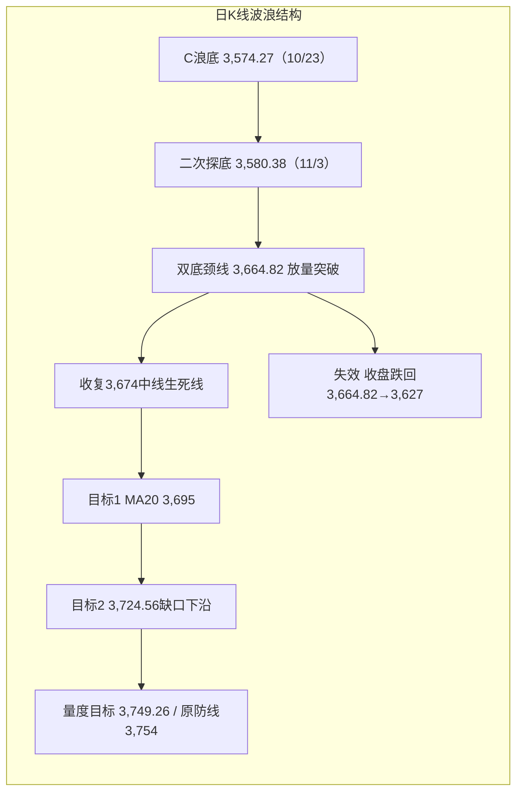
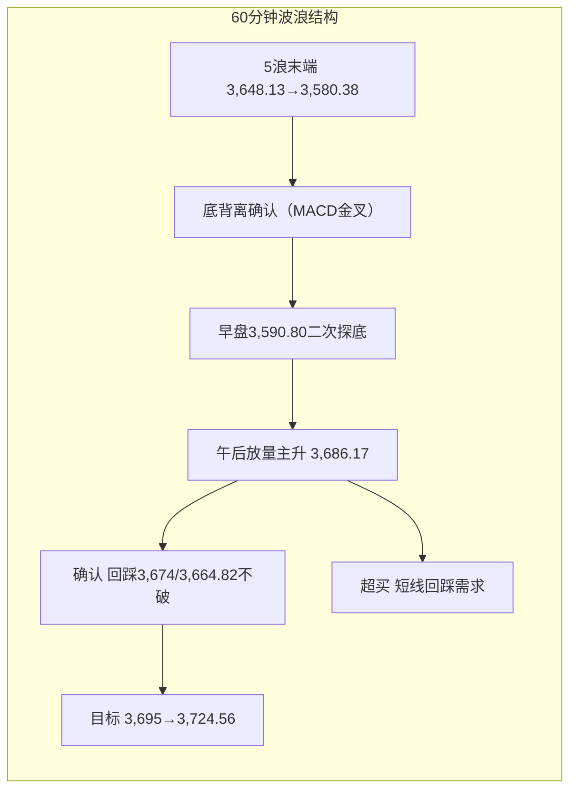

# A股晚报 - 2026年11月4日

> 数据截止时间：2026年11月4日 19:50（北京时间）
> 报告性质：**11月第3个交易日、午后放量长阳、科创50单日涨近10%、两市成交重回2万亿**
> **一句话定性**：**"政策组合拳+外部利空落地+超跌双底"三重共振，A股午后V型反攻——上证收3,686.17点（+2.16%）、收于全天最高，放量突破3,664.82/3,674双底颈线与中线生死线；22个交易日来首次重回2万亿成交，主力净流入521亿、上涨占比83.76%，由"修复反抽"升级为"增量资金入场/日线级别反转确认"，但周线确认（3,732）与MA20（3,695）尚未完成，明日起进入"回踩验证"阶段。**

---

## 一、市场回顾

### 1. 主要指数表现

| 指数 | 收盘点位 | 涨跌幅 | 开盘 | 最高 | 最低 | 成交额 |
|------|---------|--------|------|------|------|--------|
| **上证指数** | **3,686.17** | **+2.16%（+78.08点）** | 3,605.39 | **3,686.17（收于最高）** | 3,590.80 | 9,532.65亿 |
| **深证成指** | **11,335.69** | **+4.22%** | — | — | — | 10,844.27亿 |
| **创业板指** | **2,544.73** | **+6.40%** | — | — | — | 5,470.99亿 |
| **科创50** | **约1,265点** | **+9.92%（7月21日以来最大单日涨幅）** | — | 盘中涨超10% | — | — |
| **北证50** | **894.08** | **+4.56%** | — | — | — | — |

> 结构：**"深强沪弱、小盘强于大盘、科技强于价值"**。上证涨2.16%，而创业板+6.40%、科创50+9.92%，成长指数涨幅约为上证的3-4.6倍，属典型**"超跌成长修复+风格切换"**而非流动性普涨。

### 2. 成交量能

- **两市成交20,377亿元**，较前一交易日17,034亿元**放量3,343亿元（+19.6%）**，**为10月以来首次重回2万亿上方**；其中沪市9,533亿（前日8,108亿）、深市10,844亿。
- **主力资金净流入521.02亿元**（终结此前连续净流出）：创业板**+167.99亿**、科创板**+109.69亿**、沪深300**+190.69亿**。
- **行业资金结构**：申万一级26涨5跌；**电子获主力净流入589亿元**（居首），机械设备、有色金属、电力设备、通信均超100亿，医药生物+97亿、计算机+72亿、传媒+56亿；**仅石油石化、美容护理、房地产小幅净流出**。
- **北向资金**：交易所仍未披露净额；**成交3,391.81亿元，占两市成交16.65%**（前日2,757.24亿/16.19%，成交额与占比双升）；沪股通成交前三为贵州茅台30.10亿、寒武纪26.47亿、招商银行20.91亿。
- **两融**：融资余额已连续4个交易日下降（杠杆资金尚未跟进本轮回升），本轮反弹主要由**ETF与机构资金**推动。

### 3. 市场情绪

| 指标 | 数值 | 对比前日 |
|------|------|---------|
| 上涨家数 | **4,665-4,667只（占比83.76%）** | 前日2,104只（约37%） |
| 下跌家数 | 777-779只 | 前日3,308只 |
| 平盘 | 132只 | 153只 |
| 涨停 | **121只**（另有口径118只） | 前日52只 |
| 跌停 | **10-11只** | 前日22只 |
| 封板率 | **76.10%**（38股炸板） | 前日57.78% |
| 连板股 | 12只，**最高3板**，晋级率40% | 前日15只、最高4板、27.27% |
| 涨超9%个股 | **438只** | 前日不足50只 |
| 跌超9%个股 | 20只 | 前日约30只 |

> **情绪定性**：**宽度从"冰点"直接跳升到"普涨+高封板率"**，跌停仅10只、涨停121只，封板率76.10%达到"情绪风向标"阈值；但**连板高度由4板降至3板、晋级率仅40%**，说明**资金选择"低位超跌首板"而非"高位接力"**，属"高低切换"的健康结构，而非纯题材炒作。

---

## 二、热点板块与异动分析

### 1. 领涨板块及驱动因素

| 板块 | 涨幅/表现 | 驱动因素 |
|------|----------|---------|
| **半导体** | Wind二级行业**+11.26%** | 费半前夜+2.63%、KOSPI存储链修复；国产替代加速；半导体ETF集体涨停 |
| **电子** | **+9.74%**，主力净流入589亿 | 存储涨价（DDR短缺至少3年）、光模块订单澄清、AI算力资本开支上修 |
| **存储芯片** | **+9.24%~+9.51%** | 长鑫科技+13.63%（总市值2.99万亿）、国科微/协创数据涨价传导 |
| **通信设备/光模块** | 大涨，主力净流入超100亿 | Fabrinet+14%、中际旭创澄清客户未下修订单、新易盛4亿回购 |
| **机械设备/机器人** | 近50股涨停或涨超10% | 高盛上调2030年数据中心容量至273GW；11/6中国智能机器人大会临近 |
| **有色金属/贵金属** | 超10股涨停 | **伦敦金现+2.65%报4,038.55美元**、COMEX金+2.73%报4,047.50美元，弱美元+避险 |
| **非银金融** | **+3.18%**，主力+44.05亿 | 回购增持再贷款利率降至1%+长期制度化；第三批SFISF超600亿落地；东方财富+7.74%、主力+24.85亿 |
| **创新药** | 午后走强，药明康德/凯莱英/昭衍新药涨停 | 超跌修复+医药生物主力净流入97亿 |

**核心个股异动**：
- **半导体设备涨停潮**：京仪装备、芯源微、拓荆科技、中科飞测、华峰测控、富创精密、江丰电子**20CM涨停**；北方华创、通富微电、金海通、大族激光、快克智能**10CM涨停**。
- **算力/存储**：长鑫科技+13.63%、寒武纪+10%以上、海光信息+10%以上。
- **半导体ETF**：博时半导体ETF、招商半导体设备ETF等涨停；科创半导体ETF华夏+20.03%，逾90只科创/半导体主题ETF涨超10%。

### 2. 领跌板块及原因

| 板块 | 表现 | 原因 |
|------|------|------|
| **银行** | 农行、工行**跌超2%**；邮储、中行、交行、建行跌超1% | 风险偏好回升，防御红利被抽血；资金转向高弹性成长 |
| **食品饮料/白酒** | 逆势下挫，泉阳泉、阳光乳业**跌停**，皇台酒业跌超4% | 高低切换；前期防御抱团资金撤离 |
| **煤炭** | 中国神华、陕西煤业、兖矿能源等跌超1%，午后跌幅扩大 | 红利板块集体走弱；煤价与风格双重压制 |
| **房地产** | 主力小幅净流出，板块下跌 | 政策预期未超预期；资金转向科技 |
| **高位连板/玄学题材** | "羊"字辈集体调整，百洋股份、澳洋健康、泉阳泉、海阳科技、阳光乳业、华阳国际**悉数跌停** | 连板高度降至3板，退潮延续；资金弃高就低 |

### 3. 成交与结构特征

- **午后V型反转**：早盘三大指数涨跌互现、震荡调整，**午间上证报3,604.37点（-0.10%）**，午后快速大幅上攻、尾盘涨幅进一步扩大，**收盘即全天最高**，属"尾盘抢筹型长阳"。
- **"指数涨、结构换"**：26个申万一级行业上涨、5个下跌，**跌幅榜全部为前期防御方向（银行/食品饮料/煤炭/房地产/石油石化）**，验证"政策稳市+超跌反弹日红利必被抽血"的规则。

---

## 三、关键数据与事件回顾

### 1. 五重催化共振（今日大涨的核心解释）

1. **央行政策组合拳同步发力**：11/4起**股票回购增持再贷款利率下调0.25个百分点至1%**，并由"阶段性应急安排"转为**长期制度性安排**；银行已报送额度申请**超2,000亿元**；**第三批SFISF（互换便利）落地超600亿元**。两项工具形成"券商/机构加杠杆"合力。
2. **外部不确定性落地**：**美国中期选举结果明朗（民主党拿下两院、共和党遭"横扫"）**，市场将此前担忧的"政策不确定性/关税/地缘"定价为**利空出尽**，全球风险偏好同步修复。
3. **全球资产同步转向**：美元走弱、美债收益率下行（避险买盘+选举落地）、**黄金直线拉升超2.6%重回4,000美元上方**，亚太股市午后集体回暖。
4. **资金面实质改善**：主力净流入521亿、电子单行业+589亿，ETF与机构资金持续净申购。
5. **技术面双底+超跌**：3,574.27/3,580.38双底，3,664.82颈线放量突破；沪深300周线12连跌后的极端超卖修复。

### 2. 政策与数据

- **发改委11/4"夯实发展支撑"新闻发布会**：稳增长、新兴产业表述偏积极。
- **央行公开市场**：今日1,510亿元7天期逆回购到期，流动性维持偏松（DR001在1.25%-1.30%区间）。
- **海外数据**：美国10月ADP、ISM非制造业、欧元区10月CPI初值于今晚公布（详见第六部分）。

### 3. 公司公告

- **江苏雷利、鼎智科技**同日公告：**实际控制人苏达因涉嫌信息披露、减持违法违规被证监会立案**（盘后重大风险事件）。
- 中际旭创（300308）：电话会澄清绝大部分客户未下修需求或订单。
- 新易盛（300502）：11/2-11/3累计耗资约4亿元回购213.91万股。
- 协创数据（300857）：DDR非常短缺，未来至少3年涨价趋势不变，报价已提高30%并被接受。
- 国科微（300672）：11月起对合封KGD存储产品调价。

---

## 四、海外市场联动

### 1. 美股（11/3收盘，A股收盘前最后一个完整交易日）

| 指数 | 收盘 | 涨跌幅 |
|------|------|--------|
| 道琼斯 | 51,786.72 | -0.38% |
| 标普500 | 7,568.92 | +0.36% |
| 纳斯达克 | 25,372.01 | +0.83% |
| 费城半导体 | — | **+2.63%** |

### 2. 11月4日全球盘面（北京时间16:40-19:50）

| 品种 | 最新 | 变化 | 解读 |
|------|------|------|------|
| **美股期货（纳指100）** | 由盘中最深**-2%**收窄并翻红 | **+0.23%** | 选举落地后风险偏好修复 |
| 道指期货 | — | +0.45% | 同步转强 |
| 标普500期货 | — | +0.19% | — |
| **伦敦金现** | **4,038.55美元/盎司** | **+2.65%** | 弱美元+避险+超跌反弹 |
| **COMEX黄金（12月）** | **4,047.50美元/盎司** | **+2.73%** | 重回4,000美元上方 |
| **布伦特原油基准价** | **104.77美元/桶**（生意社） | **较月初110.80美元-5.44%** | 油价延续回落，成本压力缓解 |
| WTI原油 | 约96美元/桶（11/3收96.09） | 弱势 | 需求担忧+地缘溢价回落 |
| 美元指数 | 走弱 | 下行 | 选举落地后美元回落 |
| 美债10年期 | 收益率**下行** | — | 资金涌向美债避险+降息预期 |

### 3. 亚太与欧洲

- **港股**：11/4主要指数**涨超1%**，跟随A股午后走强。
- **韩国KOSPI**：盘中一度**跌超4%**（三星-4%、SK海力士-5.5%），**收盘转涨+0.62%**，日内振幅超4.6%，呈现"深V"。
- **日经225**：**-2.1%**（盘中最大跌幅超4%，软银、铠侠跌超5%），与A股、港股背离。
- **欧洲**：11/3主要指数收跌（DAX -0.45%、CAC40 -0.34%、富时100 -1.14%），11/4盘初随全球风险偏好修复回升。

> **关键背离**：**A股/港股午后走强，而日经仍跌2.1%、KOSPI早盘一度跌4%**——本轮反弹的**内部政策与资金属性强于外部映射**，并非单纯"外盘带动"。

---

## 五、汇率与利率

| 项目 | 数值 | 变化 |
|------|------|------|
| **人民币中间价** | **6.7180** | 调降30bp |
| **在岸人民币（16:30）** | **6.6770** | 较前一交易日基本持平（微跌5点） |
| 离岸人民币 | 约6.67-6.68 | 小幅波动 |
| 美元指数 | 走弱 | 选举落地后回落 |
| 美债10年期 | 收益率下行 | 避险买盘 |
| 中国10年期国债 | 约1.60%-1.61% | 内部流动性偏松 |
| DR001 | 约1.25%-1.30% | 隔夜逆回购常态化后稳定 |

> **判断**：人民币在6.67-6.68区间稳定，**美元走弱+美债收益率下行**，外部流动性压制边际缓解；国内DR001稳定在1.25%-1.30%，**内部流动性偏松**，为风险偏好修复提供环境。

---

## 六、收盘后重要信息

### 1. 盘后公告

- **江苏雷利（300660）、鼎智科技（873593）**：实控人苏达被证监会立案（涉嫌信息披露、减持违法违规）——明日机器人/工控链条情绪或有扰动。
- 三季报后首日，暂无其他重大重组/业绩快报。

### 2. 夜盘与外围

- 美股期货翻红，纳指100期货+0.23%；黄金维持4,000美元上方；油价弱势。

### 3. 次日（11月5日）关注

| 时间 | 事件 | 影响 |
|------|------|------|
| 全天 | **第九届中国国际进口博览会开幕（11/5-11/10）** | 内需/消费/进口链主题催化 |
| 全天 | **第九届虹桥国际经济论坛** | 对外开放表述 |
| — | **英国央行利率决议** | 全球央行"是否集体转鹰"信号 |
| 20:30 | **美国上周首次申请失业救济人数** | 就业边际变化 |
| — | **1,150亿元7天逆回购 + 5,000亿元3个月买断式逆回购到期** | 关注续作与净投放 |
| 11/5起 | 国内航线燃油附加费上调 | 航空成本端 |
| 11/6 21:30 | **美国10月非农**（ADP连续两月为负，非农或因政府停摆延迟） | 全周压轴 |

> 今晚（11/4）美国10月ADP、ISM非制造业PMI、欧元区10月CPI初值将公布，**为明日开盘前最重要的外部变量**。

---

## 七、波浪理论多周期分析

### 1. 月K线波浪分析

- **当前波浪位置**：**大级别第2浪（C浪）延伸段结束、B浪/新1浪反弹初期**。11月月K由"低开冲高回落小阴"转为**"带长下影反包中阳"**（月内开3,614.13、低3,580.38、高3,686.17、现收3,686.17），月内累计**+2.42%**（相对10月收盘3,599.02）。
- **浪型结构描述**：6月高点4,197→10/23低点3,574.27为C浪主跌段（-14.85%）；10月月K"近乎光头中阴"（-6.33%）；11月首周在3,580.38完成**二次探底**后放量反包，**月线收复0.382回撤位3,621与3,674平台高点**，月线"下未破、上已复"，由偏空临界转为**修复**。
- **关键目标位**：上方 **3,724.56（缺口下沿/月线修复确认）→3,785（20月均线）→3,880（5月均线）**；下方 **3,664.82（双底颈线/回踩确认）→3,621（0.382，已收复转支撑）→3,574.27（月线生死线）**。
- **验证条件**：11月月K收盘站上**3,724.56**→月线修复正式确认；月K收盘跌破**3,574.27**→C浪延伸重启，下看3,478/3,443；收在3,621-3,724.56之间→月线级别宽幅震荡（3,574-3,880）。

### 2. 周K线波浪分析

- **当前波浪位置**：周线**六连阴后的第45周"长下影反包阳"**，属"下跌推动浪末端—反转确认"的关键周。
- **浪型结构描述**：本周（11/2-11/6）**周内低3,580.38低于上周低3,595.26，周内高3,686.17仍低于上周高3,708.20**，但周三收盘3,686.17**已站上上周实体中点与双底颈线3,664.82**；形态为"低点下移后V型反包、长下影"，与上周"内包线/尽头线"形成**"衰竭→反转"组合**。5周均线约**3,732**仍在上方。
- **关键目标位**：上方 **3,702.44（三角下沿）→3,708.20（上周高）→3,724.56（缺口下沿）→3,732（5周均线）**；下方 **3,664.82（颈线/本周突破位）→3,627（V反失败线）→3,580.38（本周低）**。
- **验证条件**：**本周五收盘站上3,664.82且周成交≥8万亿**→周线"二次探底成立/六连阴终结"；收盘跌破3,627→反包失败、重回弱反抽；收盘跌破3,580.38→周线下降通道延续。

### 3. 日K线波浪分析

- **当前波浪位置**：**双底（3,574.27/3,580.38）完成后的"第1浪/3浪启动"**。今日放量长阳**收盘突破颈线3,664.82与中线生死线3,674**，收于全天最高3,686.17。
- **浪型结构描述**：3,684.49（10/28）→3,580.38（11/3）为5浪延伸末端；3,580.38→3,686.17为**新的上升推动段（+105.79点、+2.95%）**，一举收复3,627（V反失败线）、3,648.13、3,664.82、3,674**四道压力**，且**成交2.05万亿配合**，量价共振。
- **关键目标位**：**双底量度目标 = 颈线3,664.82 + 底部高度（3,664.82-3,580.38=84.44点）= 3,749.26**，与"被跌破的原防线3,754"高度重合；上方依次 **3,695（MA20）→3,702.44→3,724.56→3,749-3,754**；下方 **3,674（已收复转支撑）→3,664.82（颈线，回踩不破为加仓点）→3,648.13→3,627（短线止损）**。
- **验证条件**：**回踩3,664.82-3,674不破且缩量**→突破有效，上看3,749；**收盘重新跌破3,664.82**→假突破，退回3,627-3,664震荡；均线：MA5约3,626、MA10约3,650**已收复**，MA20约**3,695**、MA60约3,808仍在上方，**明日首要任务是站上MA20（3,695）**。

### 4. 60分钟K线波浪分析

- **当前波浪位置**：**5浪下跌结束→底背离确认→新1浪/3浪推动**。
- **浪型结构描述**：11/3 3,648.13→3,580.38完成5浪延伸；11/4早盘3,605.39开盘、下探3,590.80后，午后放量拉升，60分钟连续收出**放量长阳**，MACD零轴下方**金叉并快速上穿**、KDJ由超卖区金叉后进入强势区，**底背离已完成确认**。
- **关键目标位**：上方 **3,695→3,702.44→3,724.56**；下方 **3,664.82→3,648.13→3,627**。
- **验证条件**：60分钟回踩**3,674/3,664.82**不破且缩量→推动浪延续；跌破3,648.13→60分钟转为调整；跌破3,627→底背离失败。

### 5. 30分钟K线波浪分析

- **当前波浪位置**：**午后3浪主升，收盘处于3浪末端/4浪待启**。
- **浪型结构描述**：早盘3,590.80→3,604横盘震荡，午后**连续放量拉升约95点**，30分钟K线呈"台阶式上攻、尾盘加速"，**收盘即最高、无上影线**，MACD红柱持续放大、KDJ进入超买区（J>100）。**短线超买，明日早盘有技术性回踩需求**。
- **关键目标位**：上方 **3,695→3,702.44**；下方 **3,674→3,664.82**。
- **验证条件**：30分钟回踩**3,674**不破且量能萎缩→4浪调整后5浪再上；直接放量突破3,695→延伸至3,724.56；跌破3,664.82→30分钟转弱。

### 6. 波浪结构示意图（Mermaid）





### 7. 波浪理论综合判断

- **多周期共振状态**：**月线（修复，收复3,621/3,674）→周线（反包阳，待周五确认3,664.82）→日线（双底突破，明确转多）→60分钟（底背离确认+推动浪）→30分钟（主升超买）**。此前"月/周/日/60分钟向下共振"的格局被**日线放量突破打破**，形成"**大周期修复、小周期超买**"的新结构，**共振方向已由空转多，但30分钟超买意味着"多周期共振"需一次回踩洗盘来完成**。
- **当前操作级别**：**日线级别为主要操作级别**（双底突破+放量确认）；**60分钟等回踩3,674/3,664.82右侧加仓**；**30分钟不追高**。周线确认位3,724.56/3,732未收复前，中线仅"小幅加仓"而非"重仓"。
- **后续演变路径**：
  - **主路径（约50%）**：明日高开或平开，回踩**3,674-3,664.82**不破（缩量），再上攻3,695（MA20）、3,702.44，收3,680-3,710；
  - **偏强路径（约30%）**：直接放量站上3,695→3,702.44→3,724.56，挑战3,749-3,754，收3,710-3,740；
  - **偏弱路径（约20%）**：冲高回落跌破3,664.82，回踩3,648.13/3,627，收3,640-3,670，**属突破后的正常回抽，不改变日线转多**。
- **关键拐点信号**：
  - **向上**：站上MA20 3,695 + 成交维持≥1.9万亿 + 主力连续2日净流入 + 跌停<20只；
  - **向下**：收盘跌回3,664.82下方 + 主力单日净流出>200亿 + 涨停数腰斩至<60只 + 连板高度降至2板。
- **风险提示**：**单日涨幅过大（科创50+9.92%、创业板+6.40%），30分钟超买，明日早盘回踩概率高**；双底量度目标3,749-3,754与"被跌破的原防线"重合，**首次触及易受阻**；波浪计数在"V型单日反转"后仍有"假突破（B浪诱多）"的替代可能，**确认条件是回踩3,664.82不破**，失效条件是收盘重回3,627下方；周线5周均线3,732与MA20 3,695构成"3,695-3,732"压力带。

---

## 八、晨报复盘

### 1. 核心判断回顾

| 判断项目 | 晨报预测 | 实际结果 | 准确度 | 备注 |
|---------|---------|---------|-------|------|
| 上证指数趋势 | **看涨（超跌修复反弹，偏强震荡）** | **+2.16%（大涨）** | **✓** | 方向正确，但低估了涨幅（定性"修复"而非"反转"） |
| 上证指数区间 | 3,600-3,665点 | **3,590.80-3,686.17点** | **✗** | 下沿破9.2点、上沿破21.17点，区间偏窄 |
| 强支撑位 | 3,580.38点 | 最低3,590.80点 | **✓** | 支撑未触及，有效 |
| 强压力位 | 3,664.82点 | 最高3,686.17点 | **✗** | 放量突破21.35点，压力位严重低估 |
| 北向资金 | 净流入20-50亿元 | 净额不披露；成交3,391.81亿/占16.65% | **—** | 不可量化验证 |
| 成交量 | 放量17,500-19,000亿 | **20,377亿（+19.6%）** | **✓**（幅度低估） | 超上沿1,377亿，突破2万亿 |

### 2. 板块预判回顾

| 板块 | 预判方向 | 实际涨跌幅 | 准确度 | 原因分析 |
|-----|---------|-----------|-------|---------|
| 半导体/存储 | 看涨 | 半导体+11.26%、存储+9.24%~9.51% | **✓** | 费半+2.63%、DDR涨价、国产替代共振 |
| 光模块/CPO/光通信 | 看涨 | 通信设备大涨、主力净流入超100亿 | **✓** | 中际旭创澄清+新易盛回购+外盘光通信反弹 |
| 券商/非银 | 看涨 | 非银+3.18%、东方财富+7.74% | **✓** | 再贷款利率降至1%+SFISF第三批600亿 |
| 半导体设备/先进封装 | 看涨 | 京仪装备/芯源微/拓荆/中科飞测等20CM涨停 | **✓** | 封测年会+国产替代 |
| 机器人/端侧AI | 看涨 | 机械设备近50股涨停或涨超10% | **✓** | 高盛上调DC容量+11/6机器人大会 |
| 银行/煤炭/公用事业 | 看跌 | 农行、工行跌超2%；煤炭跌超1% | **✓** | 风险偏好回升，防御被抽血 |
| **贵金属** | **看跌** | **伦敦金现+2.65%，晓程科技20%、山东黄金等涨停** | **✗** | **严重偏差：只看隔夜金价-0.42%，未跟踪亚洲盘** |
| 高位连板/玄学题材 | 看跌 | 连板高度降至3板，"羊"字辈悉数跌停 | **✓** | 退潮延续 |
| 苹果链/消费电子 | 看跌 | 消费电子随电子板块大涨 | **✗** | 把"存储成本压制"线性外推，低估AI硬件全面进攻 |

### 3. 准确率量化评估

- **趋势判断准确率：100%（1/1）**
- **点位预测准确率：50%**（强支撑✓、强压力✗、区间✗、成交量✓）
- **板块预判准确率：77.8%（7/9）**
- **成交量准确率：100%（1/1，方向命中，幅度低估）**
- **综合准确率：约78%**（30%×100% + 30%×50% + 30%×77.8% + 10%×100% = 78.3%）

### 4. 偏差根因分析

**【偏差1】强压力位3,664.82与区间上沿双双被突破**
- **偏差描述**：预测强压力3,664.82、区间上沿3,665，实际收3,686.17（收于最高）。
- **根本原因**：**逻辑误判（框架自我限制）**。将"修复反弹"上限机械设在"周线二次探底确认位"，且**区间上沿3,665与强压力3,664.82仅差0.18点**，却未按规则单列"突破情景"。
- **信息缺口**：晨报未充分定价"中期选举结果落地=外部不确定性出清"这一**事件性利好**，仅当作"不确定性"处理。
- **逻辑缺陷**：把"3,627未收复前不定性反转"的纪律，错误延伸为"3,664.82不可突破"；**纪律应限制仓位，不应限制价格目标**。
- **改进措施**：强压力与区间上沿距离<15点且当日有政策/事件催化时，**必须单列"突破情景"并将上沿上移至下一压力位**（本次应上移至3,702.44/3,724.56）；趋势判断中"修复"与"反转"应给出**明确的升级触发条件**（本次为"放量站上3,664.82+主力净流入>300亿"）。

**【偏差2】贵金属判断方向错误**
- **偏差描述**：预测贵金属看跌（依据隔夜现货金-0.42%、COMEX-0.74%、美元101.86），实际伦敦金现+2.65%、A股贵金属涨停潮。
- **根本原因**：**信息缺失+静态推导**。仅用隔夜收盘价，未跟踪11/4亚洲盘金价由跌转涨、午后直线拉升重回4,000美元。
- **信息缺口**：未获取"中期选举落地→美元走弱→美债收益率下行→黄金反弹"的传导链。
- **逻辑缺陷**：把"美元强+美债高"的隔夜结论线性外推，忽略**事件落地当日美元往往回落**的规律。
- **改进措施**：**贵金属判断必须以亚洲盘16:00-19:00实时金价为准**，隔夜收盘跌≠次日看跌；金价单日反弹>2%时，贵金属由"看跌"直接上调为"看涨"。

**【偏差3】苹果链/消费电子看跌错误**
- **偏差描述**：预测苹果链/消费电子看跌（苹果跌超1%+存储成本警告），实际消费电子随电子板块大涨。
- **根本原因**：**技术分析局限+板块颗粒度不足**。将"存储涨价=成本上升=消费电子利空"单向推导，忽略"AI硬件全面进攻时，消费电子作为电子子板块被资金整体抬升"。
- **信息缺口**：未跟踪"半导体ETF涨停潮+电子主力净流入589亿"的板块内资金外溢。
- **改进措施**：**大盘放量普涨日（上涨占比>80%），板块方向应服从"资金总攻"而非个股基本面细节**；仅对"高位、高拥挤、业绩已兑现"的细分保持看跌。

**【偏差4】区间与量能幅度低估**
- **偏差描述**：预测区间3,600-3,665、成交17,500-19,000亿，实际3,590.80-3,686.17、20,377亿。
- **根本原因**：**低估"政策组合拳+外部利空落地+ETF增量"三重共振的量级**；量能规则虽已包含"政策放量"情景，但上限仅设19,000亿。
- **改进措施**：**当"政策工具落地+外部事件落地+超跌双底"三者同向时，成交上限应直接上调至"前日+20%"（本次约20,400亿）**，并单列"2万亿突破"情景。

### 5. 分析检查清单

☐ 趋势判断前是否检查：
- [x] 隔夜外盘走势（费半+2.63%、纳指+0.83%）
- [x] 北向资金流向（成交占比16.65%，净额不可得）
- [x] 技术指标状态（双底、底背离、均线）
- [x] 重大政策/事件（再贷款降息、SFISF第三批、中期选举）
- [ ] **事件性利好的"利空出尽"属性是否单独评估（本次缺失）**

☐ 点位计算是否考虑：
- [x] 前期高低点（3,574.27/3,580.38）
- [x] 均线支撑/压力（MA5/MA10/MA20）
- [x] 整数关口心理影响（3,600/3,700）
- [x] 成交密集区（3,664.82/3,674）
- [ ] **强压力与区间上沿距离<15点时是否单列突破情景（本次违反）**

☐ 板块分析是否覆盖：
- [x] 行业基本面变化（DDR涨价、订单澄清）
- [x] 资金流向数据（电子+589亿）
- [x] 政策催化因素（再贷款、SFISF）
- [x] 技术形态位置（超跌）
- [ ] **商品/贵金属是否复核亚洲盘实时价格（本次缺失）**

☐ 风险提示是否充分：
- [x] 宏观风险（ADP/ISM/非农、美债）
- [x] 行业风险（光模块预期、存储成本）
- [x] 个股风险（立案、解禁）
- [x] 流动性风险（两融连续4日下降）
- [ ] **单日暴涨后的次日回踩风险是否前置提示（本次未提示"涨太多"）**

☐ 波浪分析检查项：
- [x] 多周期浪型一致性
- [x] 颈线/失效线明确
- [x] 量度目标测算
- [x] 假突破替代情景
- [ ] **"利空落地"是否构成浪型升级（B浪→1浪）的催化（本次未明确）**

### 6. 本次复盘发现的新规则

- **规则1**：**政策工具落地+外部不确定性落地+超跌双底三者同向共振时，趋势应直接给"看涨（突破）"，不得以"修复反弹"自我限制**；单日主力净流入>500亿+上涨占比>80%+成交>2万亿，为"增量资金入场"确认。
- **规则2**：**强压力位与区间上沿距离<15点时，必须单列"突破情景"并把上沿上移至下一压力位**（继11/2后第二次违反，本次3,664.82 vs 3,665仅差0.18点）。
- **规则3**：**贵金属判断必须以亚洲盘实时金价为准，隔夜收盘跌≠次日看跌**；金价单日反弹>2%时，贵金属由"看跌"直接上调为"看涨"。
- **规则4**：**放量普涨日（上涨占比>80%、成交>2万亿），板块方向服从"资金总攻"**，不因单一子板块成本/个股基本面细节而看跌；只有"高位、高拥挤、业绩已兑现"细分可保持看跌。
- **规则5**：**双底颈线被放量收盘突破后，量度目标=颈线+底部高度**；本次3,664.82+84.44=3,749.26，与被跌破的原防线3,754重合，首次触及易受阻。

### 7. 规则库更新

```
###趋势分析 政策工具落地+外部不确定性落地（选举/关税）+超跌双底三者同向共振时，趋势应直接给"看涨（突破）"，不得以"修复反弹"自我限制；单日主力净流入>500亿+上涨占比>80%+成交>2万亿为增量资金入场确认（2026-11-04）
###点位计算 强压力位与区间上沿距离<15点时，必须单列"突破情景"并把上沿上移至下一压力位（2026-11-04：3,664.82 vs 3,665仅差0.18点，实际收3,686.17）
###板块选择 贵金属判断必须以亚洲盘实时金价为准，隔夜收盘跌不等于次日看跌；金价单日反弹>2%时，贵金属由"看跌"直接上调"看涨"（2026-11-04：伦敦金现+2.65%重回4,000美元、A股贵金属涨停潮）
###板块选择 放量普涨日（上涨占比>80%、成交>2万亿），板块方向服从"资金总攻"，不因单一子板块成本/个股基本面细节而看跌；仅"高位、高拥挤、业绩已兑现"细分可保持看跌（2026-11-04）
###资金面分析 成交>2万亿（较前日+19.6%）+主力净流入>500亿+上涨占比>83%+封板率>75%，为"增量资金入场"确认；需次日回踩不破突破位+主力连续2日净流入确认趋势（2026-11-04）
###波浪分析 双底颈线被放量收盘突破后，量度目标=颈线+底部高度（本次3,664.82+84.44=3,749.26，与原防线3,754重合，首次触及易受阻，失效条件为收盘跌回3,664.82）（2026-11-04）
###风险识别 中期选举/关税等外部不确定性"利空落地"后，若全球风险资产同步反弹+美元走弱+美债收益率下行，A股风险偏好修复弹性大于国内政策托底，不得按"利好兑现"处理（2026-11-04）
```

---

## 九、策略回顾与调整

### 1. 短线策略回顾

| 策略项目 | 晨报建议 | 今日实际 | 执行效果 | 备注 |
|---------|---------|---------|---------|------|
| 短线仓位 | 20% | 建议执行20% | ✓ | 方向正确，但仓位偏低 |
| 买入条件 | 开盘30分钟站上3,620且成交同比+10% | 开盘3,605.39未站上3,620，午后放量突破 | 部分✓ | 早盘未触发，午后错过第一买点 |
| 卖出条件 | 3,648.13/3,664.82受阻且成交<1.8万亿减仓 | 放量突破3,664.82，未触发 | ✓ | 条件未触发，持有正确 |
| 止损位 | 收盘跌破3,580.38 | 最低3,590.80，未破 | ✓ | 未触发 |
| 短线标的 | 存储/光模块、券商ETF、半导体设备、机器人 | 半导体+11.26%、非银+3.18%、机械设备涨停潮 | ✓ | 四项全部命中 |

> **执行反思**：晨报买入条件"开盘30分钟站上3,620"过于依赖早盘，**午后V型反转的机会被条件过滤**。应按规则补充"午后放量突破前一日弱压力且主力转净流入"的**第二买点**。

### 2. 中线策略调整

- **当前中线方向：【持有→小幅加仓】**
- **方向调整原因**：日线双底颈线3,664.82放量突破、主力净流入521亿、成交重回2万亿，**日线级别反转确认**；但周线确认位3,724.56/5周线3,732未收复、MA20 3,695未站上，故仅小幅加仓而非重仓。
- **中线仓位建议：15%→20%**（加仓5个百分点，原因：双底突破+增量资金确认）
- **中线目标区间：上证指数 3,674 - 3,749点**
- **中线止损位：3,627点**（收盘跌破V反失败线/短线转弱；中线总止损3,574.27）
- **中线布局板块调整**：**增配半导体设备/存储、光通信**（日线突破+资金主攻）；**维持券商/非银**（政策制度化）；**下调银行/煤炭/白酒等防御至"中性"**；**贵金属由"回避"上调"中性偏多"**（金价重回4,000美元）。

### 3. 明日策略要点

- **短线：【持有/回踩加仓】**，关注**3,695（MA20）**和**3,664.82（颈线回踩）**；回踩3,674-3,664.82不破且缩量可加至30%，跌破3,648.13降至20%，收盘跌破3,627降至10%。
- **中线：【小幅加仓/持有】**，关注**3,702.44**和**3,724.56**；站上3,724.56可再加至25%。
- **仓位分配：短线30% + 中线20% + 现金50%**（较晨报的20%/15%/65%整体上调15个百分点，但保留50%现金应对"单日暴涨后的回踩"与11/6非农）。

### 4. 策略复盘规则输出

```
###趋势分析 单日V型反转+放量突破关键颈线后，次日策略应以"回踩突破位不破"为加仓条件，而非"高开追涨"；早盘买入条件应增设"午后放量突破前一日弱压力+主力转净流入"的第二买点（2026-11-04）
###点位计算 突破日收盘即全天最高且无上影线时，次日早盘大概率回踩，回踩目标为"突破位/前一日压力位"（本次3,674/3,664.82），回踩不破即为右侧买点（2026-11-04）
```

---

## 十、风险提示

1. **市场系统性风险**：**单日涨幅过大（科创50+9.92%、创业板+6.40%）、30分钟超买，明日早盘回踩概率高**；双底量度目标3,749-3,754与原防线重合，首次触及易受阻；**今晚美国ADP/ISM、11/6非农**若超预期，将重新强化"高利率"交易，压制高估值成长。
2. **个股风险事件**：**江苏雷利、鼎智科技实控人被证监会立案**；高位连板（"羊"字辈）集体跌停，退潮尚未结束；三季报后"业绩兑现"个股仍有补跌风险。
3. **政策不确定性**：中期选举后政策路径（关税、AI监管、财政）仍需观察；国内政策进入"落地观察期"，若后续无增量工具，需防"利好兑现"。
4. **结构与资金风险**：**连板高度仅3板、晋级率40%**，说明本轮是"指数强、题材弱"；**融资余额连续4日下降**，杠杆资金未跟进，反弹主要由ETF/机构推动，持续性需观察；银行/白酒/煤炭等防御板块持续失血，若指数回落，防御未必能提供缓冲。
5. **外部风险**：日经-2.1%、KOSPI盘中一度-4%，**亚太分化明显**，若美股今晚转弱，A股突破可能变为"假突破"。

---

## 十一、信息来源

1. **官方数据**：上海证券交易所（上证指数开3,605.39/高3,686.17/低3,590.80/成交9,532.65亿）；深圳证券交易所；中国人民银行（11/4起回购增持再贷款利率降至1%、长期制度化、2,000亿额度申请、第三批SFISF超600亿）；中国外汇交易中心（中间价6.7180、在岸6.6765/6.6770）。
2. **权威财经媒体**：财联社（收评、五重催化、连板股分析、投资日历）；上海证券报·中国证券网（成交额超2万亿、盘中数据）；证券时报·数据宝（涨停121只/跌停10只/封板率76.10%）；央广网/中国新闻网（收盘数据、科创50+9.92%）；新华社（国际油价）；央视财经（国际金价）。
3. **数据平台**：Wind（申万行业/主力资金/涨跌家数）；东方财富（板块与个股、北向成交3,391.81亿/16.65%）；同花顺；大智慧（438只涨超9%、20只跌超9%）。
4. **内部资料**：`report/20261104/morning_report_20261104.md`（复盘78%、7条新规则）、`report/20261103/evening_report_20261103.md`、`report/monthly/202611_monthly_report.md`、`analysis/pattern_analysis_202644.md`、`rules.md`。

> **数据口径说明**：A股为11/4收盘；美股为11/3收盘，美股期货/黄金为11/4北京时间16:40-19:50；港股/日韩为11/4收盘；油价为生意社11/4基准价+11/3收盘；汇率为11/4中间价与16:30在岸收盘；北向资金净额交易所不披露，以成交额/占比替代。**截止时间2026-11-04 19:50**。

---

## 十二、文档更新检查

## 文档更新建议

### AGENTS.md更新
无需更新。晨报/晚报流程、输出格式与本日实际执行一致。

### README.md更新
无需更新。文件结构与功能说明与实际一致（report/、analysis/、prompt/、script/、config/）。

### 无需更新
两个文档均无需更新。
