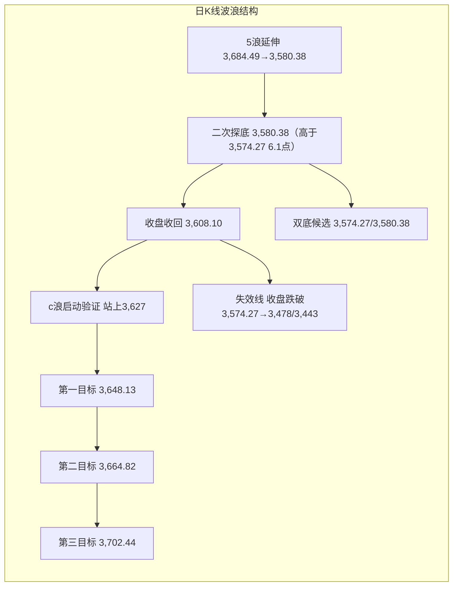
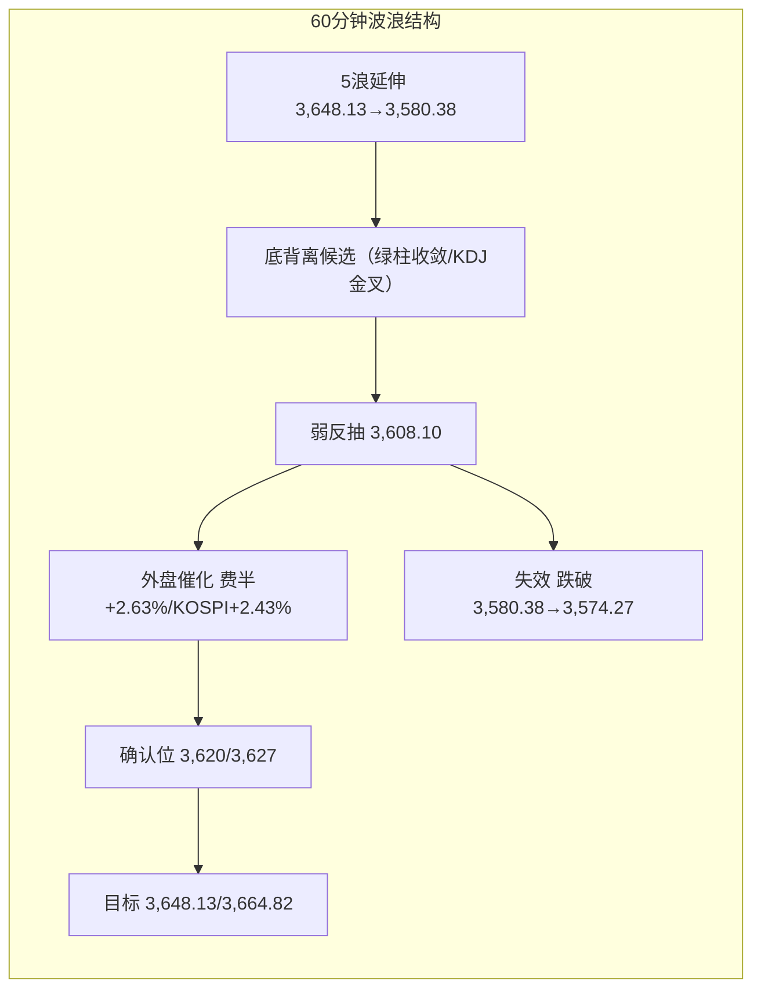

# A股晨报 - 2026年11月04日

> 数据截止时间：2026年11月04日 09:10（北京时间）
> 报告性质：**11月第三个交易日、科技链外盘止跌反弹日、回购增持再贷款降息落地日**
> **一句话定性**：**"外盘科技回血、政策再加码、A股修复待确认"——隔夜费半+2.63%、KOSPI开盘+2.43%、央行盘前将回购增持再贷款利率降至1%，3,580.38双底候选迎来向上验证窗口；站上3,627则修复升级，失守3,580.38则二次探底延续**。

---

## 一、昨日晚报复盘要点回顾

### 1. 昨日判断回顾

| 项目 | 准确率 | 说明 |
|------|--------|------|
| 趋势判断 | **100%（1/1）** | 晨报"震荡（偏弱，防科技补跌）"，实际-0.82%，方向一致 |
| 点位预测 | **20%（1/5）** | 强支撑3,594.77收盘守住记✓（盘中最低3,580.38为假跌破）；区间、弱支撑3,620、弱压力3,648.13、强压力3,664.82均未命中 |
| 板块预判 | **71.4%（5/7）** | 航空✓、券商✓、消费✓、半导体/光模块✓、高位连板✓；化工✗、石油石化✗ |
| 成交量 | **100%（1/1）** | 预测平量16,800-18,200亿，实际17,034.34亿 |
| **综合准确率** | **约67%** | 30%×100% + 30%×20% + 30%×71.4% + 10%×100% = 67.4% |

### 2. 关键偏差及原因

- **偏差1｜区间与强支撑盘中失守**：预测区间3,598-3,662、强支撑3,594.77，实际最低3,580.38。根因是把11/2"5浪失败/诱空"当作已确认反转，未并列"二次探底至3,574.27"的等价路径；失败摆动后的区间下沿应直接取月线生死线。
- **偏差2｜全部压力位未触及**：预测弱压力3,648.13、强压力3,664.82，实际最高3,624.58（开盘即最高）。根因是政策工具落地日高估做多持续性，未设"利好兑现=卖点"。
- **偏差3｜化工与石油石化方向错误**：只用隔夜WTI-7.36%静态推导，未跟踪亚洲盘油价由跌转涨+0.9%、布油+1.2%。
- **偏差4｜北向资金不可验证**：交易所不披露净额，仅能跟踪成交额2,757.24亿、占16.19%（前值2,977.61亿/16.69%），方向偏流出但不可量化打分。

### 3. 沉淀的规则/检查项

1. **趋势**：政策工具落地日（SFISF/降准等）若指数开盘30分钟不能站上前一日弱支撑且科技链跌幅>3%，按"利好兑现"处理，趋势维持"震荡偏弱"，不得因政策加码看涨。
2. **点位**：强支撑盘中跌破<0.5%且收盘收回=假跌破，支撑有效性不变；但若开盘即最高、全天单边下行，说明反抽乏力，次日仍需回踩确认。
3. **板块**：商品板块必须盘中复核实时油价；油价单日振幅>3%时，取消"成本红利"单向判断，改为"上游受益/下游受损"分情景。
4. **板块**：外盘科技链二次杀跌+产业预期下修（如大摩下调光模块增速）叠加时，A股通信/电子当日跌幅可达5%-7%，反弹需"外盘止跌+产业预期修正"双确认。
5. **资金**：主力净流出>450亿+创业板/科创板均净流出>100亿+通信电子合计流出>250亿，属"科技链集中减仓"，次日反弹默认"弱反抽"，除非通信/电子"低开高走+资金转净流入"。
6. **波浪**：前一日"5浪失败/诱空"确认后，次日跌破该失败低点但收盘收回、且低点仍高于月线生死线，属"二次诱空/双底候选"，不改"反转候选"；确认须收盘站上V反失败线/MA5。

### 4. 对今日分析的启示

- **需要关注的风险点**：昨日主力净流出483.98亿、通信-6.83%、电子-4.92%，属"科技链集中减仓"而非"缩量观望"；按规则5，今日反弹默认只能定性为"修复反弹"，除非通信/电子低开高走且资金转净流入。
- **需要关注的机会点**：隔夜费城半导体+2.63%、纳指+0.83%、KOSPI开盘+2.43%（SK海力士+4.8%），外盘科技链止跌反弹，昨日被错杀的存储/光模块存在修复窗口。
- **需要调整的分析逻辑**：今日有"外盘科技反弹+央行回购增持再贷款降息"双催化，不能再机械套用"政策只托底不托价"；应以"开盘30分钟能否站上3,620、成交能否放大"作为政策与反弹有效性的试金石。
- **技术核心**：3,580.38为双底第二底（高于月线生死线3,574.27仅6.11点），3,627为V反失败线/MA5第一确认位，3,574.27为全部多头逻辑失效线。

---

## 二、隔夜市场动态（11月3日收盘后至今）

### 1. 美股市场（11月3日收盘）

| 指数 | 收盘 | 涨跌幅 | 特征 |
|------|------|--------|------|
| **道琼斯** | **51,786.72** | **-0.38%** | 权重/价值股回调，止步连涨 |
| **标普500** | **7,568.92** | **+0.36%** | 止步三连跌，科技权重带动 |
| **纳斯达克** | **25,372.01** | **+0.83%** | 科技股反弹，半导体领涨 |
| **费城半导体** | — | **+2.63%** | 存储/光通信/半导体设备全面回暖 |

> **结构**：**"科技回血、价值休整"**——芯片股走高，闪迪涨超4%，博通、AMD涨超3%，西部数据、ARM、恩智浦、希捷科技涨超2%；光通信股反弹，Fabrinet绩后大涨超14%、Astera Labs涨超7%、Ciena涨近6%；大型科技股多数上涨，微软、Meta、英伟达、亚马逊涨超2%，苹果、特斯拉跌超1%。**AMD盘后涨超9%**，高通将于今日公布FY26 Q4业绩。
> **驱动**：美国中期选举日市场等待结果，但AI硬件板块在连续杀跌后出现"超跌+产业预期修复"式反弹；存储涨价（DDR缺货）、光模块龙头电话会澄清需求未下修，共同修复情绪。

### 2. 欧洲/亚太市场

| 市场 | 收盘/最新 | 涨跌幅 | 解读 |
|------|-----------|--------|------|
| 德国DAX | 25,864.62 | **-0.45%** | 欧股普跌，化工/工业拖累 |
| 法国CAC40 | 8,020.31 | **-0.34%** | 奢侈品/工业偏弱 |
| 英国富时100 | 10,638.43 | **-1.14%** | 能源与银行权重拖累 |
| 欧洲斯托克50 | 6,144.56 | **-0.51%** | 风险偏好谨慎 |
| **韩国KOSPI（11/4开盘）** | **5,786.13** | **+2.43%** | **SK海力士+4.8%、三星电子+3.6%，存储链强势修复** |
| 日经225（11/4开盘） | 62,973.16 | **-0.17%** | 小幅低开，等待方向 |
| **恒生指数（11/3）** | **23,525.97** | **+0.57%** | 港股逆势收红，南向净买入超130亿港元 |
| 恒生科技（11/3） | 3,867.73 | **+0.74%** | 科技股相对抗跌 |

> **关键**：**KOSPI开盘+2.43%、SK海力士+4.8%**，是对昨日A股通信/电子杀跌最直接的反向映射；叠加费半+2.63%，A股存储/光模块/半导体今日具备"低开修复/高开延续"的外部条件。但日经低开、A50期货仅+0.15%，说明外资对A股的风险偏好修复仍偏谨慎，需开盘量能验证。

### 3. 大宗商品

| 品种 | 最新 | 涨跌幅 | 解读 |
|------|------|--------|------|
| **WTI原油** | 96.09美元/桶（11/3收盘） | **-0.38%** | 11/4亚洲盘反弹+1%至97.06美元 |
| **布伦特原油** | 104.40美元/桶（11/3收盘） | **-0.34%** | 11/4亚洲盘+1%至104.73美元 |
| **现货黄金** | 3,930.21美元/盎司 | **-0.42%** | 美元/美债偏强，金价承压 |
| COMEX黄金 | 3,940.20美元/盎司 | **-0.74%** | 连续两日回落 |
| **伦铜** | 14,034.50美元/吨 | **-2.03%** | 工业金属走弱，需求担忧 |
| 伦铝 | 3,040.50美元/吨 | **-1.82%** | 同步回调 |

> **商品矛盾**：**油价亚洲盘反弹+1%**，对石油石化/油服偏正面，但会削弱航空/化工"成本红利"逻辑；**黄金连续回落、伦铜-2.03%**，贵金属与工业金属股票端今日偏承压。沙特阿美Q3净利润+34.6%，中东地缘与沙特能源设施遇袭仍支撑油价高位波动。

### 4. 汇率与利率

| 项目 | 数值 | 变化 |
|------|------|------|
| **美元指数** | **101.86** | +0.10% |
| 人民币中间价 | **6.7146** | 调降4bp |
| 在岸人民币 | **6.6720** | 较前值上行238基点 |
| 离岸人民币 | **6.6745** | 较前值上行218基点 |
| **美债10年期** | **4.966%** | 上行约5bp，逼近5%关口 |
| 美债30年期 | 5.334% | 上行约4bp |
| 中国10年期国债 | **1.611%** | 下行1.47bp |
| Shibor隔夜 / 7天 | **1.2891% / 1.3420%** | +0.31bp / -2.10bp |

> **判断**：美债10Y 4.966%逼近5%，仍是高估值成长股的估值压制项；但人民币在岸/离岸稳定在6.67附近，国内10Y国债下行至1.611%，**内部流动性偏松**，为政策驱动的修复反弹提供环境。

### 5. 重要海外事件

1. **美国中期选举**（11/3）投票结束，结果陆续出炉，影响关税/财政/AI监管预期。
2. **美国9月JOLTS职位空缺752.3万人**，高于预期，就业韧性仍在。
3. **美国10月ADP、ISM非制造业、欧元区10月CPI初值**将于今日公布；**11/6美国10月非农**为全周压轴。
4. **沙特阿美Q3净利润大增34.6%**，中东局势与能源设施遇袭持续扰动油价。
5. **美伊预计36小时内回应卡塔尔斡旋方新提案**；美俄乌下周谈判。

---

## 三、今日关注事项

### 1. 重要数据发布（按时间排序）

| 时间 | 数据/事件 | 预期/前值 | 影响 |
|------|----------|----------|------|
| 09:30 | A股开盘、集合竞价 | — | 验证3,620/3,627得失 |
| 盘中 | **国家发改委新闻发布会**（夯实发展支撑有关情况） | — | 稳增长/新兴产业政策预期 |
| 20:15 | **美国10月ADP就业人数** | 前值待核 | 就业韧性，影响加息预期 |
| 23:00 | **美国10月ISM非制造业PMI** | 前值54.9 | 服务业景气验证 |
| 18:00 | **欧元区10月CPI初值** | — | 欧央行路径 |
| 盘后 | **高通FY26 Q4及全年业绩** | — | 消费电子/端侧AI情绪 |
| 11/6 21:30 | **美国10月非农** | 预期+5.6万，前值2.9万 | 全周压轴 |

### 2. 政策/监管动态

1. **央行盘前加力实施股票回购增持再贷款政策（11/4起）**：再贷款利率**下调0.25个百分点至1%**，由阶段性安排转为**长期制度性安排**；支持对象为21家全国性银行和5家系统重要性城商行，支持比例100%、期限1年可展期。11/2座谈会后，银行已报送额度申请**超过2,000亿元**。**这是今日最重要的政策催化，直接利好低估值、有回购/增持能力的蓝筹与券商。**
2. **发改委11/4举行新闻发布会**，主题"夯实发展支撑"，关注稳增长、新兴产业、新材料等表述。
3. 央行公开市场今日有**1,510亿元7天期逆回购到期**，关注续作与净投放。

### 3. 公司公告/产业事件

- **中际旭创（300308）**：11/3晚电话会表示，**绝大部分客户未下修需求或订单**，部分物料供应偏紧但不意味所有物料价格均上涨——直接缓解"大摩下调光模块增速"的悲观预期。
- **新易盛（300502）**：11/2-11/3累计耗资约**4亿元**回购213.91万股，成交价172.05-199.75元——龙头回购提振光模块情绪。
- **协创数据（300857）**：DDR非常短缺，**未来至少3年涨价趋势不变**，最近报价已提高30%且被接受；HDD稳定偏强。
- **国科微（300672）**：受DDR存储芯片紧缺与涨价影响，11月起对合封KGD存储产品调价。
- **东山精密（002384）**：控股股东提议2026年度股东回报总额不低于10亿元。
- **高盛**：大幅上调全球数据中心容量预测，**2030年或达273GW**，利好AI算力/光通信/电力设备。

### 4. 其他关注

- **今日暂无新股申购**。
- **限售解禁**：6家公司合计解禁2.87亿股，按最新收盘价市值**36.56亿元**（爱柯迪21.65万股等），压力可控。
- **华为中国政企全光产业峰会2026**（11/4-5）：光通信/全光网络主题催化。
- **第七届中国新材料产业发展大会**（11/4-8）。
- **第二十四届中国半导体封装测试技术与市场年会**（11/4-6，南京）：先进封装/半导体设备主题催化。
- **第九届进博会**（11/5-11/10）临近，内需/消费主题预热。

---

## 四、板块与个股分析（结合昨日复盘）

### 1. 基于昨日复盘结论的板块调整

- **昨日看涨板块（航空/券商/消费/保险）**：航空/机场今日面临油价亚洲盘+1%的成本端反抽，**由"看涨"下调为"中性"**；券商受回购增持再贷款降息直接利好，**维持看涨并上调优先级**；消费/食品饮料在风险偏好回升日易被抽血，**由"看涨"下调为"中性"**。
- **昨日看跌板块（半导体/存储/光模块/通信）**：外盘费半+2.63%、KOSPI+2.43%、SK海力士+4.8%，叠加中际旭创澄清、新易盛回购、DDR涨价，**由"看跌"直接上调为"看涨（修复反弹）"**。
- **昨日偏差板块（化工/石油石化）**：油价亚洲盘反弹+1%，**石油石化由"看跌"上调为"中性偏多"**；化工中下游成本红利减弱，**维持"中性"**，不追。

### 2. 隔夜信息驱动的板块机会

- **受益板块**：
  1. **半导体/存储**（逻辑：费半+2.63%、SK海力士+4.8%、DDR短缺至少3年、国科微/协创数据涨价；昨日电子-4.92%后超跌修复）
  2. **光模块/CPO/光通信**（逻辑：Fabrinet+14%、Astera+7%、Ciena+6%；中际旭创澄清客户未下修订单；新易盛4亿回购；华为全光峰会）
  3. **券商/非银**（逻辑：回购增持再贷款利率降至1%且长期制度化，2,000亿额度申请；SFISF已落地）
  4. **半导体设备/先进封装**（逻辑：第24届封测年会+国产替代；费半设备股回暖）
  5. **机器人/端侧AI**（逻辑：高盛上调2030年数据中心容量至273GW；高通财报；产业主题轮动）
- **受损板块**：
  1. **银行/煤炭/公用事业/石油石化（防御红利）**（逻辑：风险偏好回升+科技进攻，防御易被抽血；油价反弹对石油石化有支撑，列"中性"而非看跌）
  2. **贵金属**（逻辑：现货黄金-0.42%、COMEX-0.74%、美元101.86、美债4.966%，连续两日回落）
  3. **苹果链/消费电子**（逻辑：苹果跌超1%，存储成本警告仍在）
  4. **高位连板/玄学题材**（逻辑：封板率57.78%、连板高度4板、晋级率27.27%，退潮延续）

### 3. 重点关注个股

| 个股 | 关注理由 | 技术位置 | 目标/风险 |
|------|---------|---------|----------|
| **中际旭创（300308）** | 光模块龙头，电话会澄清客户未下修订单；外盘光通信反弹 | 昨日大跌后处超跌区，关注能否收复5日线 | 目标：修复至昨日开盘价附近；风险：高开低走 |
| **新易盛（300502）** | 4亿元回购+光模块龙头，外盘映射 | 172.05-199.75元回购价构成参考支撑 | 目标：跟随板块修复；风险：回购利好兑现 |
| **寒武纪（688256）** | 昨日-10.81%杀跌，超跌反弹弹性大 | 市值跌破5,000亿后技术性反抽 | 目标：超跌修复；风险：纯AI算力高位股，不追高 |
| **东方财富（300059）** | 券商+回购增持再贷款降息受益 | 低位区间，政策敏感 | 目标：板块β修复；风险：成交不放量 |
| **宁德时代（300750）** | 昨日主力净买入11.68亿，逆势资金锚 | 昨日逆势抗跌 | 目标：稳指数；风险：创业板整体拖累 |

> 注：个股仅为分析示例，不构成投资建议；高位科技股一律"不追高、只低吸"。

---

## 五、今日核心判断（结构化，用于晚报复盘）

### 1. 趋势判断
- **上证指数：【看涨】（超跌修复反弹，偏强震荡）**
- **预测区间：3,600点 - 3,665点**，主情景收盘 **3,620-3,655点**
- **核心逻辑**：隔夜费半+2.63%、纳指+0.83%、KOSPI开盘+2.43%（SK海力士+4.8%），外盘科技链止跌反弹；央行盘前将回购增持再贷款利率降至1%并长期制度化、银行申请额度超2,000亿，政策再度加码；昨日科技链集中减仓483.98亿、通信-6.83%后存在修复动能。**但3,627未收复、周线仍处六连阴后的弱反抽、美债10Y 4.966%逼近5%，因此今日定性为"修复反弹"，而非趋势反转；若开盘30分钟不能站上3,620且科技高开低走，则降级为"高开冲高回落"。**

### 2. 关键点位
- **强支撑位：3,580.38点**（依据：昨日最低点/双底第二底，高于月线生死线3,574.27仅6.11点；收盘跌破则二次探底延续）
- **弱支撑位：3,600点**（依据：整数关口+昨日3,594.77假跌破位，盘中失守则反弹弱化）
- **弱压力位：3,627点**（依据：V反失败线/MA5约3,626，收盘站上=双底/复杂调整确认，上看3,648.13）
- **强压力位：3,664.82点**（依据：10/26低点/0.618+周线二次探底确认位，放量站上才打开3,702.44）

### 3. 板块预判
- **看涨板块**：
  1. **半导体/存储**（逻辑：费半+2.63%、SK海力士+4.8%、DDR短缺至少3年、国科微/协创数据涨价）
  2. **光模块/CPO/光通信**（逻辑：Fabrinet+14%、中际旭创澄清需求未下修、新易盛4亿回购、华为全光峰会）
  3. **券商/非银**（逻辑：回购增持再贷款利率降至1%+长期制度化+2,000亿额度）
  4. **半导体设备/先进封装**（逻辑：封测年会+国产替代+费半设备股回暖）
- **看跌板块**：
  1. **银行/煤炭/公用事业（防御红利）**（逻辑：风险偏好回升，进攻端抽血防御；但若成交不放量则转为抗跌，不作单向看跌）
  2. **贵金属**（逻辑：黄金-0.42%、美元101.86、美债4.966%，连续两日回落）
  3. **高位连板/玄学题材**（逻辑：封板率57.78%、高度4板、晋级率27.27%，退潮延续）
  4. **苹果链/消费电子**（逻辑：苹果跌超1%+存储成本警告）
- **风险板块（回避）**：
  - **立案个股**（晶华微、科力远、万辰集团、ST合纵）；
  - **今日解禁个股**（6家、36.56亿元市值，爱柯迪等）；
  - **纯AI算力高位股**（外盘反弹但估值高、拥挤度高，只做低吸不追高）；
  - **出口链**（美国中期选举结果与关税预期仍不确定）。

### 4. 资金面判断
- **北向资金预期：【净流入】20-50亿元**（风险偏好回升+人民币稳定+外盘科技反弹；交易所不实时披露净额，以成交占比与十大成交股跟踪，不作硬指标）
- **成交量预期：【放量】17,500-19,000亿元**（昨日17,034亿；外盘科技+2%~+4%映射，按规则放量5%-10%；若开盘30分钟同比+10%以上则上沿看19,000亿）

### 5. 风险预警（按优先级排序）
- **高风险**：**开盘30分钟不能站上3,620且通信/电子高开低走**，则"政策利好兑现"重演，指数可能高开冲高回落至3,600下方；**美债10Y 4.966%逼近5%**，压制高估值成长；**今晚美国ADP、ISM及11/6非农**，数据超预期将强化加息/高利率交易。
- **中风险**：**3,627未收复前反弹只是"修复"**，周线六连阴+5周均线3,732压制未解除；油价亚洲盘+1%带来航空/化工成本逻辑反复；**6家公司解禁36.56亿元**；高通财报若不及预期将拖累消费电子。
- **低风险**：人民币在岸6.6720/离岸6.6745基本稳定；隔夜Shibor 1.2891%、国内10Y国债1.611%，内部流动性偏松；央行2,000亿回购增持额度申请提供政策底。

### 6. 昨日复盘规则应用
- **应用规则1（政策权重≥30%+开盘30分钟试金石）**：央行盘前降息属重大政策催化，趋势下限上调为"震荡偏强"；但必须用"开盘30分钟站上3,620+成交同比+10%"验证，否则按"利好兑现"降级。
- **应用规则2（外盘科技回暖→进攻端优先、防御抽血）**：费半+2.63%、KOSPI+2.43%，资金主线偏半导体/光模块/券商，银行/煤炭/公用事业下调为"中性/流出"。
- **应用规则3（科技链集中减仓后的反弹默认弱反抽）**：昨日主力-483.98亿、通信电子合计流出超250亿，今日反弹先按"修复反弹"而非"反转"，只有通信/电子"低开高走+资金转净流入"才升级。
- **应用规则4（3,627未收复前不定性反转）**：日线双底候选的确认位是3,627，周线确认位是3,664.82；在两者未收复前，仓位提升幅度受限，禁止追高。
- **应用规则5（商品板块盘中复核油价）**：WTI亚洲盘+1%，石油石化由"看跌"改"中性偏多"，航空由"看涨"改"中性"；9:20/10:30复核油价。

---

## 六、波浪理论多周期分析

### 1. 月K线波浪分析

- **当前波浪位置**：**大级别第2浪（C浪）延伸段**，11月月K暂为"低开、冲高回落的中阴"（11/2收3,638.03、11/3收3,608.10）。
- **浪型结构描述**：6月高点4,197→10/23低点3,574.27为C浪主跌段（-14.85%）；10月月K"近乎光头中阴"（-6.33%，收3,599.02），收盘跌破0.382回撤位3,621；11/2一度收复3,621，11/3收3,608.10得而复失，月线仍处"下未破、上未复"的偏空临界状态。
- **关键目标位**：上方 **3,621（0.382，失而复得）→3,664.82→3,724.56（缺口下沿/月线修复确认）→3,785（20月均线）**；下方 **3,574.27（月线生死线）→3,478→3,443**。
- **验证条件**：11月月K收盘站上**3,724.56**→月线修复启动；月K收盘跌破**3,574.27**→C浪延伸确认，下看3,478/3,443；收在3,574.27-3,621之间→月线级别宽幅震荡（3,574-3,880）。

### 2. 周K线波浪分析

- **当前波浪位置**：周线六连阴后的**第45周弱反抽**（11/2-11/6），属"下跌推动浪末端的修复尝试"。
- **浪型结构描述**：第44周（10/26-10/30）收"带上影中阴、几无下影"（-2.48%，收3,599.02），低点3,595.26高于前周低点3,574.27，呈"内包线/尽头线"衰竭结构；本周首日+1.08%、次日-0.82%，周内高点3,648.13低于上周高3,708.20，周内低点3,580.38低于上周低3,595.26——"高点下移、低点下移"，反抽力度弱于"二次探底成立"所需。
- **关键目标位**：上方 **3,627（V反失败线）→3,648.13（本周高）→3,664.82（周线二次探底确认）→3,708.20（上周高）/5周均线约3,732**；下方 **3,580.38（本周低）→3,574.27（月/周生死线）**。
- **验证条件**：本周五收盘站上**3,664.82**→周线"二次探底成立"；收盘跌破**3,574.27**→周线下降通道延续，下看3,478；收在3,580-3,627之间→周线"弱反抽/震荡"。

### 3. 日K线波浪分析

- **当前波浪位置**：**下跌推动浪第5浪延伸末端的"二次探底/双底候选"**。11/2的"5浪失败/诱空"（3,594.77）在11/3盘中被跌破至**3,580.38**，但收盘3,608.10重新收回3,594.77，且3,580.38仍高于月线生死线3,574.27（高6.11点）。
- **浪型结构描述**：3,684.49（10/28）→3,595.26（10/30）为第5浪；11/2最低3,594.77（仅低0.49点）V型反转至3,648.13；11/3回踩至3,580.38，跌破11/2低点但收盘收回，构成"二次诱空/双底候选"。按严格波浪规则，2浪回踩不得跌破1浪起点（3,594.77），故11/2-11/3的反弹应降级为**"a-b-c复杂调整"**：a=3,594.77→3,648.13、b=3,648.13→3,580.38、c待启动；**今日为c浪启动验证日，c浪第一目标3,648.13、第二目标3,664.82。**
- **关键目标位**：第一确认位 **3,627（V反失败线/MA5约3,626）**，第二目标 **3,648.13（本周高）**，第三目标 **3,664.82（10/26低/0.618）→3,702.44（等长）→3,724.56（缺口下沿）**；下方失效线 **3,580.38→3,574.27**，跌破3,574.27则看3,478/3,443。
- **验证条件**：**收盘站上3,627且成交≥1.8万亿**→双底/复杂调整完成，恢复"反弹"计数；**收盘跌破3,574.27**→5浪失败/双底证伪，重回下跌推动浪；均线：MA5约3,626、MA10约3,650、MA20约3,695、MA60约3,808，**昨日收盘仍低于全部均线，今日首要任务是收复MA5（3,626）**。

### 4. 60分钟K线波浪分析

- **当前波浪位置**：**5浪延伸后的"底背离候选"+弱反抽**。
- **浪型结构描述**：11/2 3,594.77→3,648.13为反弹段；11/3 3,648.13→3,580.38单边下行，跌破反弹起点3,594.77，1-2浪计数作废，改按"5浪延伸"处理；3,580.38后午后回升至3,608.10，60分钟MACD在零轴下方绿柱收敛、KDJ由超卖区金叉，**底背离雏形但未确认**。今日外盘科技反弹+KOSPI高开，60分钟有形成"底背离+向上突破"的条件。
- **关键目标位**：上方 **3,612→3,620→3,627**；下方 **3,590→3,580.38→3,574.27**。
- **验证条件**：60分钟连续3根K线站稳**3,620**且MACD金叉→底背离确认，上看3,648.13/3,664.82；**跌破3,580.38**→底背离失败，下看3,574.27。

### 5. 30分钟K线波浪分析

- **当前波浪位置**：早盘单边下行的**5子浪末端**，午后进入**弱反抽（a浪或1浪）**。
- **浪型结构描述**：早盘3,624.58→3,580.38走出清晰的5子浪下跌（跌幅44.20点、-1.22%），9:34跌破3,600后无抵抗；午后3,580.38→3,608.10反弹约27.72点（收复跌幅的62.7%），30分钟MACD底背离、KDJ金叉，但**量能未同步放大**，属"技术性反抽"而非"反转"。今日若高开，30分钟需防"高开冲高回落"。
- **关键目标位**：上方 **3,612→3,620→3,624.58（昨日开盘/最高）**；下方 **3,590→3,580.38**。
- **验证条件**：30分钟站上**3,620**且MACD红柱持续→反抽升级为反弹；**跌破3,590/3,580.38**→弱反抽结束，下一目标3,574.27。

### 6. 波浪结构示意图（Mermaid）

### 7. 波浪理论综合判断

- **多周期共振状态**：**月线偏空（3,621得而复失、C浪延伸未排除）→ 周线偏空（高点/低点均下移、5周均线3,732压制）→ 日线"双底候选"（3,580.38高于3,574.27、收盘收回3,594.77）→ 60分钟底背离候选→30分钟弱反抽**。今日外盘科技反弹+政策降息，形成"**大周期空、小周期止跌、向上共振尝试**"结构，但共振尚未完成。
- **当前操作级别**：**日线定方向（3,574.27生死线、3,627反转确认），60分钟等右侧（站稳3,620），30分钟不追高**；周线未站上3,664.82前，中线不加仓。
- **后续演变路径**：
  - **主路径（约45%）**：高开于3,615-3,625，开盘30分钟站上3,620，回踩不破3,600后再试3,627/3,648.13，收3,620-3,655；
  - **偏多路径（约25%）**：放量站上3,627→3,648.13→3,664.82，收3,650-3,670；
  - **偏空路径（约30%）**：高开冲高回落，跌破3,600→3,580.38；若收盘失守3,574.27，则双底证伪，下看3,520/3,478。
- **关键拐点信号**：
  - **向上**：收盘站上3,627 + 成交≥1.8万亿 + 跌停<15只 + 通信/电子高开高走且主力转净流入；
  - **向下**：跌破3,600 + 跌停>30只 + 主力净流出>200亿 + 通信/电子高开低走翻绿。
- **风险提示**：波浪计数在"失败摆动"后存在两种替代（**双底/复杂调整** vs **下跌推动浪延伸**），**3,627未收复前只能定性为"修复反弹"，不能定性为"反转"**；3,574.27为全部多头逻辑的失效线；外盘（中期选举、ADP/ISM、11/6非农）与美债4.966%是最大证伪风险。

---

## 七、投资策略建议（分短线+中线）

### 1. 短线策略（1-3个交易日）
- **适用场景**：基于日K线和60分钟K线技术信号
- **短线仓位：20%**（总资金中用于短线操作的比例，较昨日10%上调10个百分点）
- **买入条件**：（1）开盘30分钟站上**3,620**且成交同比+10%以上，可加至25%；（2）回踩**3,600-3,605**不破且跌停<15只，可低吸；（3）通信/电子低开高走、主力资金转净流入，优先加科技。
- **卖出条件**：（1）冲高**3,648.13/3,664.82**受阻且成交<1.8万亿，减仓；（2）收盘跌破**3,600**，短线降至10%；（3）科技高开低走、通信/电子翻绿，止盈离场。
- **止损位**：**收盘跌破3,580.38**或个股跌幅**5%**。
- **短线标的**：（1）**存储/光模块龙头**（中际旭创、新易盛；逻辑：外盘映射+订单澄清+回购）（2）**券商ETF**（逻辑：回购增持再贷款降息+低位）（3）**半导体设备ETF/先进封装**（逻辑：封测年会+国产替代）（4）**机器人/端侧AI**（逻辑：高盛DC预测+华为全光峰会）。

### 2. 中线策略（1-4周）
- **适用场景**：基于周K线波浪分析和运行规律分析结论
- **中线仓位：15%**（维持）
- **方向判断：【持有】**（不加仓，等待周线确认）
- **目标区间**：上证指数 **3,580 - 3,664.82点**
- **中线布局板块**：（1）**券商/非银**（逻辑：政策制度化+低估值，底仓5%）（2）**消费/食品饮料、红利（银行/公用事业）**（逻辑：防御底仓，但今日风险偏好回升阶段可暂缓加仓）（3）**航空/机场**（逻辑：人民币稳定+成本中期改善，油价反弹日不追）。
- **止盈条件**：指数到达**3,664.82点**或波段涨幅达到**8%**。
- **止损条件**：指数**收盘跌破3,574.27点**或趋势确认反转（清中线仓）。

### 3. 仓位分配总览

| 策略类型 | 仓位比例 | 方向 | 重点板块 |
|---------|---------|------|---------|
| 短线 | **20%** | 低吸/不追高 | 存储/光模块、券商、半导体设备、机器人 |
| 中线 | **15%** | 持有 | 券商、消费/红利、航空 |
| 现金 | **65%** | — | — |

### 4. 与昨日策略对比

- **短线仓位调整**：从**10%上调至20%**（原因：外盘科技止跌反弹+央行回购增持再贷款降息双催化，昨日科技链集中减仓后存在修复窗口；但保留65%现金，防止"利好兑现"）。
- **中线仓位调整**：维持**15%**（原因：3,627/3,664.82未收复、周线仍空，中线不因单日反弹加仓）。
- **板块调整**：**增配**半导体/存储、光模块/CPO、券商、半导体设备；**下调**航空/机场、消费/食品饮料至"中性"；**回避**银行/煤炭/公用事业（进攻日易抽血）、贵金属、高位连板。

---

## 八、信息来源

1. **官方数据**：中国人民银行（11/4起股票回购增持再贷款利率下调0.25个百分点至1%、长期制度化、银行申请额度超2,000亿；11/2座谈会）；国家发改委（11/4"夯实发展支撑"新闻发布会）；上交所/深交所行情；中国外汇交易中心（中间价6.7146、在岸6.6720、离岸6.6745）。
2. **权威财经媒体**：上海证券报·中国证券网（美股11/3收盘、三大指数涨跌不一）；新华社/中国金融信息网（原油收盘、布油）；证券时报（光通信价值链、KOSPI开盘）；财联社（11/4投资日历、A50期货、WTI/布油亚洲盘、回购增持再贷款、限售解禁）；新浪财经（美股收盘、欧股收盘、韩股盘初、美债收益率）；东方财富（国际金融要情11/4、隔夜外盘、热点扫描）；第一财经/国际金融报（全球市场、汇率、大宗商品）。
3. **数据平台**：Wind（指数/成交/涨跌家数/解禁）、同花顺（亚太股指）、东方财富Choice（美股/欧股/商品）、中证指数（债券估值）。
4. **内部资料**：`report/20261103/evening_report_20261103.md`（复盘67%、6条新规则）、`report/20261103/morning_report_20261103.md`、`report/monthly/202611_monthly_report.md`、`analysis/pattern_analysis_202644.md`、`rules.md`。

> **数据口径说明**：美股为11/3收盘；欧股为11/3收盘；日韩为11/4开盘；A50期货为11/4 09:00；商品为11/3收盘+11/4亚洲盘；汇率为11/3在岸/离岸收盘；美债为11/3收盘；北向资金净额交易所不实时披露，以成交占比/十大成交股替代。**截止时间2026-11-04 09:10**。
