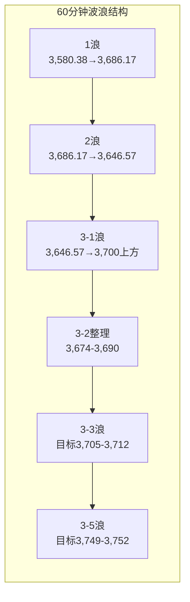

# A股晚报 - 2026年11月05日

> 数据截止时间：2026年11月5日 20:05（北京时间）
> 报告性质：**双底颈线突破后的"深回踩确认日"——早盘低开跌破颈线、午后收回，38.2%黄金分割回踩成立**
> **一句话定性**：**外盘"AI硬件链崩塌（SK海力士-9.46%、三星-7.57%、KOSPI-5.28%）"与"科网应用狂欢（恒指+3.67%、恒科+5.55%、网易+9%）"极端分化，A股早盘低开-1.07%直接跌破3,664.82颈线，但资金迅速完成"存储/光模块→光伏设备、传媒短剧、贵金属、机器人"的高低切换，午后翻红收于3,689.91（+0.10%）；成交连续两日超2万亿、上涨家数4,869只、涨停86只、0跌停——指数"弱"，结构"强"，日线38.2%回踩确认后3浪结构成立。**

---

## 一、市场回顾

### 1. 主要指数表现

| 指数 | 收盘点位 | 涨跌幅 | 成交额 | 备注 |
|------|---------|--------|--------|------|
| **上证指数** | **3,689.91** | **+0.10%（+3.74点）** | 9,797.12亿 | 开盘3,646.57（-1.07%），盘中一度重回3,700点上方后回落 |
| **深证成指** | **11,471.09** | **+1.19%（+135.40点）** | 11,382.41亿 | 低开高走，成长风格主导 |
| **创业板指** | **2,567** | **+0.87%（+22.27点）** | — | 早盘一度跌2%，午后翻红 |
| **科创50** | **1,287** | **+1.68%** | — | 半导体设备、光储带动 |
| 科创综指 | — | +1.38% | — | — |
| 沪深300 | — | 约+0.4%（估） | — | 权重搭台、题材唱戏 |

> **节奏复盘**：早盘受隔夜韩国存储双雄重挫影响，三大指数集体低开（沪指-1.07%至3,646.57，创业板一度-2%），**开盘价即为全天最低**；随后资金沿"光伏设备→传媒短剧→贵金属→半导体设备"轮动，指数逐级回升，**午后一度重回3,700点上方**，尾盘小幅回落收于3,689.91。**指数涨幅仅0.10%，但全市场4,869只个股上涨、625只下跌，涨跌比约7.8:1——典型的"指数弱、个股强"结构市。**

### 2. 成交量能

- **两市成交额：21,179.53亿元**（沪市9,797.12亿 + 深市11,382.41亿），较前一交易日**放量802.59亿元（+3.94%）**，**连续第二个交易日突破2万亿**。
- **北向资金**：交易所仍不披露净额。今日北向**成交3,201.64亿元，占两市总成交额15.12%**（较11/4的16.65%回落1.53个百分点，外资参与度略降）；沪股通成交前三为中微公司33.17亿、药明康德23.36亿、贵州茅台22.01亿。
- **主力资金（Wind行业口径）**：电子**净流入逾142亿**、电力设备**逾127亿**、医药生物**逾68亿**，机械设备、计算机、基础化工**均超50亿**；**银行净流出逾18亿、煤炭逾10亿**，通信、非银金融、石油石化小幅净流出。
- **特大单**：两市特大单**净流入108.90亿元**（2,335股流入/2,199股流出），22个行业净流入、9个行业净流出；**电力设备特大单净流入53.20亿居首（行业指数+3.89%）、传媒28.48亿次之**；通信特大单净流出34.33亿、非银11.42亿。(数据宝)
- **两融**：11月4日全市场融资余额结束此前四连跌、重现增长（10/29-11/3累计逾千亿资金离场的趋势暂止），杠杆资金情绪边际修复。

### 3. 市场情绪

| 指标 | 数值 | 解读 |
|------|------|------|
| 上涨家数 | **4,869只（占约87%）** | 普涨格局，赚钱效应显著 |
| 下跌家数 | **625只** | 涨跌比约**7.8:1** |
| 平盘/停牌 | 约84只 / 少量 | — |
| 涨停家数 | **86只（全A口径；沪深口径82只）** | 近90只涨停，情绪高位 |
| 跌停家数 | **0只（全A口径；沪深口径9只，均为ST/问题股）** | 无系统性杀跌 |
| 连板高度 | **4连板**（浙文影业、闽发铝业） | 3连板：永臻股份、鲁阳节能；2连板17只 |
| 市场宽度 | 上涨占比约87% | **宽度远强于指数**，属结构性普涨 |

> **情绪定性**：**"指数微涨+宽度爆表+零跌停"= 资金做多意愿的真实表达**。涨停梯队集中在**AI短剧（浙文影业4板）、光伏（闽发铝业4板、永臻股份3板）、锂电、贵金属、端侧AI、机器人、商业航天**，题材呈"多点开花"而非单极。但**连板高度仅4板**，说明仍是"轮动扩散"而非"情绪主升"。

---

## 二、热点板块与异动分析

### 1. 领涨板块及驱动因素

| 板块 | 涨幅 | 驱动因素 |
|------|------|---------|
| **光伏设备（申万二级）** | **+6.23%（盘中一度近+10%）** | **"反内卷"供给侧预期+BC电池/TOPCon技术迭代+四日累计+17.41%**；板块成交564.94亿，**12只个股涨停**（酉立智能+29.99%、金刚光伏+20%、贝特瑞/迈为股份等） |
| **电力设备（申万一级）** | **+3.89%** | 光伏、储能、锂电电解液全链条共振；**特大单净流入53.20亿居首** |
| **传媒（申万一级）** | **+3.58%** | **AI短剧/短剧游戏+小红书平台+抖音豆包**；吉视传媒、慈文传媒涨停，福石控股+20.05%、易点天下+12.28%、蓝色光标+6.62% |
| **房地产** | **+2.86%** | 政策宽松预期+低位补涨 |
| **轻工制造** | **+2.61%** | 消费复苏+出口链 |
| **商贸零售** | **+2.44%** | 进博会开幕（11/5-11/10）+内需主题 |
| **贵金属** | 涨幅居前 | **伦敦金现日内+1.35%报4,117.66美元/盎司**（15:33），美元走弱+美债收益率下行；赤峰黄金H股大涨 |
| **半导体设备/自主可控** | 逆势走强 | **华虹宏力三季报净利+1.38倍、Q3+1.36倍并上调Q4指引**；中微公司+5.83%、华峰测控+7.99%、拓荆科技+3.09%、通富微电+6.90%、瑞芯微+10.00% |

**概念涨幅前列**：电源设备精选、BC电池、拼多多合作商、小红书平台、TOPCon电池、光伏、锂电电解液、Kimi、HJT电池、抖音豆包、光伏逆变器、反内卷、高送转、光伏屋顶、短剧游戏。

### 2. 领跌板块及原因分析

| 板块 | 跌幅 | 原因 |
|------|------|------|
| **煤炭** | **-3.98%（申万一级最大跌幅）** | 煤价下行+红利资金持续抽血；煤炭开采精选、央企煤炭领跌 |
| **石油石化** | **-2.34%** | **隔夜WTI-8.38%、布伦特-8.68%**，地缘溢价回吐；**中国石油-7.93%、中国海油/广汇能源跌逾6%** |
| **通信** | **-2.00%** | **光模块杀跌**：中际旭创-7.51%（成交307.80亿、特大单净流出26.60亿）、新易盛-5.54%、天孚通信-4.78% |
| **银行** | -0.59% | 早盘补跌，午后逢低买盘收复部分跌幅；招商银行基本收平 |
| **存储/算力硬件（个股）** | 显著下跌 | **长鑫科技-3.54%（特大单净流出26.31亿）、兆易创新-3.03%、澜起科技-2.40%、工业富联-2.12%、东山精密-5.54%**——隔夜SK海力士-9.46%、三星-7.57%直接映射 |

> **核心分化**：**同为"科技"，存储/光模块杀跌、半导体设备/自主可控上涨**。前者跟随海外存储与算力硬件定价（SK海力士、美光、中际旭创砍单传闻），后者受"国产替代+三季报兑现（华虹）+北向偏好（中微成交33.17亿居沪股通首位）"驱动。**"科技"已不是一体的β，而是分裂的α。**

### 3. 个股异动复盘

- **涨停/连板**：浙文影业（AI短剧）4连板、闽发铝业（福建+光伏）4连板、永臻股份（机器人+光伏+液冷）3连板、鲁阳节能（耐火材料/锂电材料）3连板；2连板17只，覆盖光伏、半导体、贵金属、端侧AI、机器人、商业航天。
- **强势股**：瑞芯微+10.00%（特大单+9.50亿）、有研新材+10.00%（+7.88亿）、通富微电+6.90%、宁德时代+4.42%、宇树科技-W+4.88%、利欧股份+10.03%（+10.22亿居首）。
- **强势股回调**：中际旭创-7.51%（近5日累计-15.24%，主力净流出22.23亿）、新易盛-5.54%、东山精密-5.54%——**高位AI硬件股仍是最大资金流出方向**。
- **风险个股**：潮宏基股东东冠集团大宗减持1.13%（持股降至6.54%）；江苏雷利、鼎智科技立案影响延续。

---

## 三、关键数据与事件回顾

### 1. 国内重要数据/政策

- **第九届中国国际进口博览会开幕（11/5-11/10，上海）**：162个国家、地区和国际组织参与，内需/进口/消费主题升温，商贸零售+2.44%。
- **第九届虹桥国际经济论坛"人形机器人与具身智能产业创新发展合作"分论坛（今日下午）**：机器人主线催化，宇树科技+4.88%、永臻股份3连板。
- **央行公开市场操作**：开展**2,630亿元隔夜逆回购 + 2,000亿元国库现金定存 + 3,000亿元3个月买断式逆回购**；同日到期2,575亿隔夜 + 1,150亿7天 + 5,000亿买断式，**全天净回笼1,095亿元**。3个月买断式缩量续作（3,000亿 vs 到期5,000亿，净回笼2,000亿），**流动性"总量充裕、边际收敛"**。
- **人民币中间价6.7156，上调24个基点**（前值6.7180）；11/4在岸16:30收盘6.6770、夜盘6.6755。

### 2. 公司重要公告/事件

| 公司 | 事件 | 影响 |
|------|------|------|
| **华虹宏力** | 三季报归母净利**同比+1.38倍**、Q3**+1.36倍**，扣非净利大增超270%，**上调Q4业绩指引**，称晶圆代工"量价齐升"持续 | 半导体设备/代工链强催化 |
| **百济神州** | 上调2026年营收指引至**463-470亿元**（原449-462亿） | 创新药情绪正面 |
| **有研硅** | 控股股东及实控人承诺**11/6起6个月内不减持** | 半导体材料信心信号 |
| **潮宏基** | 股东东冠集团11/4大宗减持1,000万股（占总股本1.13%），持股降至6.54% | 黄金珠宝个股扰动 |
| **中际旭创** | 上游重大并购+客户"砍单"传闻持续发酵，今日-7.51% | 光模块板块承压 |

### 3. 海外重要事件

- **英国央行（20:00）加息25bp至4.00%**，为2023年8月以来首次加息，**投票8:1**（1人主张加息50bp），符合市场预期。全球"再收紧"叙事小幅强化，但英镑/欧股反应温和。
- **美国10月ADP就业+8.6万**（超预期）、**ISM非制造业PMI 54.5**（边际放缓）、**欧元区10月CPI初值4.0%**（三年新高）——"就业韧性+服务业降温"组合。
- **美国中期选举**：民主党拿下参众两院，外部政策不确定性落地；特朗普威胁否决"疯狂"法案。

---

## 四、海外市场联动

### 1. 美股（11月4日收盘）

| 指数 | 收盘 | 涨跌幅 |
|------|------|--------|
| 道琼斯 | 53,356.12 | **+3.03%（+1,569.40点）** |
| 标普500 | 7,688.62 | **+1.58%** |
| 纳斯达克 | 25,736.51 | **+1.44%** |
| 纳斯达克中国金龙 | 5,722.71 | **+3.49%** |

> **结构分化**：微软+6.68%、亚马逊+6.12%、苹果+5.31%（收盘新高）等**应用/平台型大涨**；而**英伟达-3.17%、美光/闪迪/迈威尔跌超7%、希捷-8%**等**AI算力硬件逆势下跌**（数据中心建设限制担忧）。**这一分化在11/5的亚太与A股被完整复制。**
> 11/5美股尚未开盘（21:30开盘），盘前股指期货变动有限，**今晚方向由英国央行落地后的美债与科技股承接决定**。

### 2. 欧洲/亚太（11月5日）

| 市场 | 收盘 | 涨跌幅 |
|------|------|--------|
| **恒生指数** | **24,796.98** | **+3.67%** |
| **恒生科技指数** | **4,154.29** | **+5.55%** |
| 日经225 | 61,077.90 | **-1.79%** |
| **韩国KOSPI** | **5,383.65** | **-5.28%** |
| 英国富时100（11/4） | — | +1.79% |
| 德国DAX（11/4） | — | +2.38% |
| 法国CAC40（11/4） | 8,177.89 | +2.15% |

> **亚太"冰火两重天"**：**港股科网应用狂欢**（网易+9%、阿里/小米+8%、腾讯+7%、中国生物制药领涨）；**日韩AI硬件崩塌**（SK海力士-9.46%、三星电子-7.57%、爱德万测试跌14%）。**南向资金今日净卖出213.26亿港元**（港股大涨中内资兑现）。A股的"高低切换"正是这一全球分化的本地映射。

### 3. 大宗商品

| 品种 | 最新 | 涨跌幅 | 说明 |
|------|------|--------|------|
| **WTI原油（主力）** | **89.35美元/桶（19:48）** | **+1.40%** | 隔夜-8.38%后技术性反抽 |
| **布伦特原油** | **96.50美元/桶（19:51）** | **+2.00%** | 两日暴跌后反弹，仍处两月低位 |
| **伦敦金现** | **4,117.66美元/盎司（15:33）** | **+1.35%** | 站上4,100，两日累计涨超5% |
| COMEX黄金（11/4收） | 4,072.20美元/盎司 | +3.34% | — |
| COMEX白银（11/4收） | 52.33美元/盎司 | +5.17% | — |
| LME铜（11/4） | 14,015.5美元/吨 | -0.15% | 基本金属活跃但涨幅有限 |

---

## 五、汇率与利率

| 项目 | 数值 | 变化 |
|------|------|------|
| **人民币中间价（11/5）** | **6.7156** | **上调24bp** |
| 在岸人民币（11/4 16:30） | 6.6770 | 夜盘6.6755，偏强 |
| **美元指数** | **约101.5** | 11/4收101.51（-0.35%），一个半月低位 |
| **美债10年期** | **约4.87%** | 隔夜-2bp至-6.8bp区间，9月初以来低位 |
| DR001 | 约1.25%-1.30% | 稳定偏松 |
| **央行操作** | 净回笼**1,095亿** | 3个月买断式缩量续作，边际收敛 |
| 两融余额 | — | 11/4融资余额结束四连跌、重现增长 |

> **利率环境**：美债收益率下行 + 美元走弱 → 支撑贵金属与成长估值；但**英国央行加息25bp**与**央行买断式缩量**形成"外部转紧、内部边际收敛"的对冲，**流动性不再是无脑宽松，需精选结构**。

---

## 六、收盘后重要信息

### 1. 盘后公告/事件

- **华虹宏力**三季报：净利+1.38倍、Q3+1.36倍、扣非+270%，**上调Q4指引**——半导体设备/代工链明日或延续强势。
- **百济神州**上调2026年营收指引至463-470亿元。
- **有研硅**控股股东承诺6个月内不减持（11/6起）。
- **潮宏基**股东减持1.13%。
- **英国央行加息25bp至4.00%**（8:1），符合预期。

### 2. 夜盘/外盘

- **原油反抽**：WTI +1.40%报89.35、布伦特+2.00%报96.50，**油气股明日或有超跌反抽，但趋势仍弱**。
- **黄金续强**：伦敦金现+1.35%站上4,117，**贵金属明日仍具惯性**。
- 美股21:30开盘，关注**纳指能否守住隔夜涨幅、AI硬件是否止跌**。

### 3. 次日关注（11月6日）

| 事项 | 说明 |
|------|------|
| **美国10月非农** | 若未因政府停摆延期，将决定美联储路径与美元/美债方向；前值参考ADP+8.6万 |
| 美国上周初请 | 今晚20:30公布（预期19.7万），关注结果 |
| 进博会（11/5-11/10） | 内需、消费、进口链持续催化 |
| 光伏"反内卷"政策 | 板块四日+17.41%后，**警惕兑现压力** |
| 新股/解禁 | 暂无已知大额申购；解禁以交易所公告为准 |
| 周五收盘 | **周线收盘需站稳3,664.82**，否则突破有效性打折 |

---

## 七、波浪理论多周期分析

### 1. 月K线波浪分析

- **当前波浪位置**：**大级别第2浪（C浪）延伸结束的"候选确认期"，月线修复初期（对应新的第1浪/3浪起点）**。
- **浪型结构描述**：6月高点4,197 → 10/23低点3,574.27（-14.85%）完成C浪延伸；10月月K"近乎光头中阴"（-6.33%）；11月月K自3,614.13开盘、下探3,580.38后连续四日收阳，**已收复0.382回撤位3,621与平台高点3,674**，月K暂为"带长下影反包中阳"。**自3,574.27以来累计+115.64点（+3.23%）**。
- **关键目标位**：**第一目标3,721-3,724.56**（4,197→3,574.27跌幅的0.236回撤=3,721.3，与缺口下沿3,724.56重合）；**第二目标3,812**（0.382回撤）；下方支撑3,674/3,621/3,574.27。
- **验证条件**：**11月月K收盘站上3,724.56** → 月线修复确认；**收盘跌破3,574.27** → C浪延伸重启，目标3,478/3,443。

### 2. 周K线波浪分析

- **当前波浪位置**：**周线六连阴后的"第一根反包阳"，下跌推动浪→反弹推动浪的切换周**。
- **浪型结构描述**：本周（11/2-11/6）周低**3,580.38**（低于上周低3,595.26）、周高**3,700点上方**（高于上周高3,708.20？尚未确认），周内四连阳，**收盘3,689.91已站上双底颈线3,664.82与5周均线附近**。若周五收于3,664.82上方，周线"反包阳+站上颈线"成立。
- **关键目标位**：**3,724.56（缺口下沿/0.236回撤）→ 3,732（5周均线）→ 3,749.26（双底量度）→ 3,812**。
- **验证条件**：周五收盘站稳3,664.82；**若周线收盘跌回3,648.13下方，则本周反包失败，退回3,574-3,664宽幅震荡**。

### 3. 日K线波浪分析

- **当前波浪位置**：**双底（3,574.27/3,580.38）突破后的第1浪完成、第2浪回踩结束、第3浪启动**。
- **浪型结构描述**：
  - 双底：3,574.27（10/23）与3,580.38（11/3），颈线**3,664.82**，底部高度**84.44点**；
  - **1浪：3,580.38 → 3,686.17（+105.79点，11/4放量突破颈线）**；
  - **2浪：3,686.17 → 3,646.57（-39.60点，回撤比例37.44%）**——**3,646.57几乎精确落在1浪的38.2%回撤位（3,645.76，误差仅0.81点）**，属"黄金分割标准回踩"；当日收盘3,689.91**重新站回颈线上方**，2浪回踩确认结束；
  - **3浪：自3,646.57启动，收盘已走+43.34点（约为1浪的41%）**。
- **关键目标位**：**3,712（0.618延伸：3,646.57+65.38）→ 3,749.26（双底量度：颈线+84.44）/3,752.36（1.0等长）→ 3,817（1.618延伸）**。
- **验证条件**：**收盘不跌破3,646.57**（2浪低点）则3浪计数有效；**收盘跌破3,646.57 → 降级为"双底突破失败/abc调整"，回看3,627/3,621**；站上3,695（MA20）与3,700整数关为3浪加速信号。

### 4. 60分钟K线波浪分析

- **当前波浪位置**：**3浪内部的"3-1完成、3-2整理"阶段**。
- **浪型结构描述**：3,580.38→3,686.17为1浪；3,686.17→3,646.57为2浪；3,646.57→3,700点上方为**3-1浪**（+53点以上）；午后回落至3,689.91为**3-2浪整理**，回撤约0.2-0.3，属强势整理。
- **关键目标位**：**3-3浪目标3,705-3,712**（3-1浪等长/0.618延伸）；**3-5浪目标3,749-3,752**。
- **验证条件**：60分钟**守住3,674-3,680**则3-2浪成立；**跌破3,664.82则3-2浪扩张，回看3,646.57**；放量站上3,700则3-3浪启动。

### 5. 30分钟K线波浪分析

- **当前波浪位置**：**日内5浪结构的第4浪整理（尾盘小幅回落）**。
- **浪型结构描述**：3,646.57→约3,700（3-1）→3,690附近（3-2）→3,700上方（3-3）→尾盘3,689.91（4浪），**日内推动浪完整，尾盘属"4浪回调"而非"趋势破坏"**。
- **关键目标位**：**5浪目标3,705-3,712**；若4浪跌破3,674，则5浪目标下移至3,700整数关。
- **验证条件**：明日开盘30分钟站稳3,689-3,695，则5浪延续；**跌破3,674且30分钟MACD死叉 → 日内推动浪结束，转震荡**。

### 6. 波浪图

```mermaid
graph LR
    subgraph 日K线波浪结构（上证指数）
        A[双底1<br/>3,574.27] --> B[双底2<br/>3,580.38]
        B --> C[1浪<br/>3,580.38→3,686.17<br/>+105.79点]
        C --> D[2浪回踩<br/>3,686.17→3,646.57<br/>38.2%回撤]
        D --> E[3浪进行中<br/>3,646.57→3,689.91]
        E --> F[3浪目标<br/>3,712→3,749-3,752]
    end
```



### 7. 波浪理论综合判断

- **多周期共振状态**：
  - **月线**：修复向上（收复3,621/3,674）→ **偏多**
  - **周线**：反包阳、站上颈线 → **偏多**
  - **日线**：38.2%回踩确认、3浪启动 → **偏多**
  - **60分钟**：3-2强势整理 → **偏多**
  - **30分钟**：4浪整理、5浪待发 → **中性偏多**
  - **结论：五周期偏多共振，仅30分钟存在超买后的4浪回调需求；无周期背离。**
- **当前操作级别**：**日线级别为主、60分钟级别执行**。日线3浪目标3,712-3,752，适合"回踩3,674-3,664.82不破即持有/加仓"；30分钟超买不宜追高，等回踩确认。
- **后续演变路径**：
  - **主路径（55%）**：明日回踩3,674-3,680不破 → 放量站上3,695（MA20）→ 3,700 → 3,712（0.618延伸）→ 3,724.56（0.236回撤/缺口）。
  - **偏强路径（25%）**：直接放量站上3,700并突破3,724.56 → 直指3,749-3,752（双底量度）。
  - **偏弱路径（20%）**：跌破3,646.57（2浪低点）→ 3浪计数作废，回看3,627/3,621，双底突破失败。
- **关键拐点信号**：
  1. **向上**：收盘站上3,695（MA20）且成交≥2.1万亿 → 3浪加速；
  2. **向下**：收盘跌破3,646.57 → 3浪失效；
  3. **周线**：周五收盘3,664.82得失 → 周线反包有效性；
  4. **量能**：成交跌破1.9万亿 → 突破动能衰减。
- **风险提示**：波浪计数具有主观性；**3,646.57的38.2%回踩虽精确，但若明日放量跌破则该"标准回踩"立即证伪**；当前月线仍处C浪后的修复初期，**3,724.56未收复前不得按"月线反转"计价**。

---

## 八、晨报复盘

### 1. 核心判断回顾

| 判断项目 | 晨报预测 | 实际结果 | 准确度 | 备注 |
|---------|---------|---------|-------|------|
| 上证指数趋势 | **震荡偏强**（重心上移、冲高分化） | **+0.10%（3,689.91），盘中冲上3,700后回落** | **✓** | 方向对，但"偏强"仅体现为微涨，指数弹性低于预期 |
| 上证指数区间 | **3,668 - 3,724点** | **3,646.57 - 3,700+点** | **✗** | 下沿被低开击穿21.43点，上沿未及 |
| 强支撑位 | **3,664.82点** | **最低3,646.57点（跌破14.25点），收盘收回** | **✗** | 盘中"假跌破"，收盘站回颈线上方 |
| 强压力位 | **3,724.56点** | **最高3,700点上方，未触及** | **✓** | 压力有效，但指数未测试上沿 |
| 北向资金 | 预期净流入30-80亿 | **净额不披露；成交3,201.64亿/占15.12%（占比降1.53pct）** | **—** | 不可验证；占比回落显示外资参与度略降 |
| 成交量 | **平量至温和放量 1.95-2.15万亿** | **2.12万亿（+803亿/+3.94%）** | **✓** | 落在预测区间上沿 |

### 2. 板块预判回顾

| 板块 | 预判方向 | 实际涨跌幅/表现 | 准确度 | 原因分析 |
|-----|---------|-----------|-------|---------|
| 贵金属/黄金白银 | 看涨 | **涨幅居前；伦敦金现+1.35%报4,117** | **✓** | 美元走弱+美债下行+避险，逻辑完全兑现 |
| 机器人/具身智能 | 看涨 | **宇树科技+4.88%、永臻股份3连板、2连板覆盖机器人** | **✓** | 虹桥论坛+进博会催化 |
| 化工中下游 | 看涨 | **基础化工主力净流入超50亿、轻工制造+2.61%** | **✓** | 油价回落改善成本，价差扩张 |
| 创新药 | 看涨 | **医药生物主力净流入68亿、中国生物制药领涨港股** | **✓** | 百济上调指引+美债下行抬估值 |
| 航空/机场/交运 | 看涨 | **交运特大单净流出；油价盘中反弹1.40%，板块未形成合力** | **✗** | 逻辑对、弹性不足：油价"隔夜暴跌"被"盘中反弹"抵消 |
| 券商/非银 | 看涨 | **非银特大单净流出11.42亿、东方财富-1.15%** | **✗** | "放量=券商受益"旧映射失效，资金转向电力设备/传媒 |
| 石油石化/油服 | 看跌 | **-2.34%（申万一级）；中国石油-7.93%** | **✓** | 隔夜油价暴跌直接映射 |
| 存储/算力硬件 | 看跌 | **长鑫-3.54%、兆易-3.03%、中际旭创-7.51%、新易盛-5.54%** | **✓** | SK海力士-9.46%、三星-7.57%、砍单传闻 |
| 手机链/消费电子 | 看跌 | **立讯精密+2.73%、歌尔股份+5.33%** | **✗** | 高通利空被"端侧AI+普涨"覆盖，个股逆势 |

### 3. 准确率量化评估

- **趋势判断准确率：100%（1/1）**
- **点位预测准确率：50%（2/4：强压力✓、量能✓；区间✗、强支撑✗）**
- **板块预判准确率：66.7%（6/9）**
- **成交量预测准确率：100%（落在1.95-2.15万亿区间）**
- **综合准确率：75.0%**（30%×100% + 30%×50% + 30%×66.7% + 10%×100%）

### 4. 偏差根因分析

**【偏差1】区间下沿与强支撑判断偏差**
- 偏差描述：预测区间下沿3,668、强支撑3,664.82；实际开盘3,646.57（-1.07%），盘中最低击穿强支撑14.25点
- 根本原因：**信息缺失 + 技术分析局限**——已知隔夜AI硬件链大跌，但**低估幅度（KOSPI-5.28%、SK海力士-9.46%）**，且未设"低开直接击穿支撑"情景
- 信息缺口：未获取KOSPI开盘后跌幅扩大至-5%以上的实时路径；未量化"海外存储双雄跌超9%"对A股开盘的映射系数
- 逻辑缺陷：把"回踩3,674-3,664.82不破"当作基准情景，**没有并列"低开击穿→午后再确认"的备选路径**（该路径昨日已出现：11/4收盘即最高）
- 改进措施：**外盘科技链单日跌幅≥5%时，次日开盘映射下沿扩大至-1.5%，强支撑必须单列"盘中假跌破"情景**；支撑位有效性以"收盘"而非"盘中"判定

**【偏差2】航空/交运板块偏差**
- 偏差描述：预测油价-8.3%驱动航空上涨，实际板块未形成合力、交运特大单净流出
- 根本原因：**逻辑误判（商品单日跌幅线性外推）**
- 信息缺口：未考虑OPEC+/地缘消息可能导致油价次日技术性反抽
- 逻辑缺陷：把"油价单日暴跌"直接等价于"航空成本改善"，忽略**油价反抽1.4%会立即削弱该交易**
- 改进措施：**成本改善型交易（航空/化工）须附加条件"油价次日不反弹超1%"，否则下调为"中性"**

**【偏差3】券商/非银板块偏差**
- 偏差描述：预测成交2万亿+再贷款扩围利好券商，实际非银特大单净流出11.42亿、东方财富-1.15%
- 根本原因：**逻辑误判（旧的"放量=券商"映射失效）**
- 信息缺口：未跟踪资金在"电力设备/传媒"的集中度（两者特大单净流入合计81.68亿）
- 逻辑缺陷：成交放量的"结构"比"总量"更重要——**本轮放量由光伏/传媒驱动，非银并非受益方**
- 改进措施：**放量日必须核对非银/券商的资金流；若特大单净流出，则券商不纳入看涨组合**

**【偏差4】手机链/消费电子板块偏差**
- 偏差描述：预测高通手机芯片-26%压制消费电子，实际立讯+2.73%、歌尔+5.33%
- 根本原因：**情绪面误读**
- 信息缺口：未跟踪"端侧AI/苹果链"的独立催化（进博会、AI眼镜、iPhone备货）
- 逻辑缺陷：把"单一客户/单一品类利空"外推为"整个消费电子板块下跌"
- 改进措施：**个股/单品利空只下调对应细分，不覆盖全板块；板块内区分"手机链"与"端侧AI/苹果链"**

**【偏差5】指数弹性低估（趋势方向对但幅度偏小）**
- 偏差描述：预测主情景收盘3,690-3,715，实际3,689.91（差0.09点）
- 根本原因：**技术分析局限**——权重（银行/石油）拖累被低估
- 改进措施：**指数预测须拆分"权重贡献"与"题材贡献"；石油石化-2.34%、银行-0.59%会压低上证，即使个股普涨**

### 5. 分析检查清单

☑ 趋势判断前是否检查：
- [x] 隔夜外盘走势（道指+3.03%、纳指+1.44%，但费半分化）
- [x] 北向资金流向（净额不披露，以成交占比15.12%跟踪）
- [x] 技术指标状态（30分钟超买→早盘回踩，已验证）
- [x] 重大政策/事件（进博会、虹桥论坛、英国央行）

☑ 点位计算是否考虑：
- [x] 前期高低点（3,686.17/3,580.38）
- [x] 均线支撑/压力（MA20≈3,695）
- [x] 整数关口心理影响（3,700）
- [ ] **成交密集区（3,646-3,664颈线区）——本日遗漏，导致强支撑被击穿未预警**

☑ 板块分析是否覆盖：
- [x] 行业基本面变化（华虹三季报、光伏反内卷）
- [x] 资金流向数据（电子+142亿、电力设备+127亿）
- [x] 政策催化因素（进博会、机器人论坛）
- [ ] **技术形态位置（光伏四日+17.41%后的兑现风险）——提示不足**

☑ 风险提示是否充分：
- [x] 宏观风险（英国央行加息、非农）
- [x] 行业风险（存储/光模块砍单）
- [x] 个股风险（潮宏基减持、立案股）
- [x] 流动性风险（央行净回笼1,095亿）

### 6. 本次复盘发现的新规则

- **规则1（趋势）**：亚太科技链单日跌超5%（KOSPI/日经）导致A股低开破位，但**开盘30分钟内收复前一日弱支撑并翻红**，属"外部冲击一次性宣泄"，趋势判断不改。
- **规则2（点位）**：突破后首日回踩**精确落在前段涨幅38.2%附近（误差<2点）**且收盘收回颈线，视为2浪结束、3浪启动，目标按0.618/1.0延伸。
- **规则3（板块）**：油价单日暴跌后的"成本改善"交易，**仅在该品种次日不反弹超1%时有效**；反弹超1%则航空/化工下调为中性。
- **规则4（板块）**：成交>2万亿但**非银特大单净流出**时，"放量=券商受益"映射失效，券商不纳入放量日看涨组合。
- **规则5（风险）**：**存储/光模块与半导体设备必须分开定价**——前者跟随海外存储/算力硬件，后者受国产替代+三季报驱动；外盘存储暴跌日，设备可逆势。

### 7. 规则库更新

```
###趋势分析 亚太科技链单日跌超5%导致A股低开破位，但开盘30分钟收复前一日弱支撑并翻红，属外部冲击一次性宣泄，趋势判断不改
###点位计算 突破后首日回踩精确落在前段涨幅38.2%附近（误差<2点）且收盘收回颈线，视为2浪结束、3浪启动，目标按0.618/1.0延伸
###板块选择 油价单日暴跌后的成本改善交易，仅在该品种次日不反弹超1%时有效；反弹超1%则航空/化工下调为中性
###板块选择 成交>2万亿但非银特大单净流出时，放量=券商受益映射失效，券商不纳入放量日看涨组合
###风险识别 存储/光模块与半导体设备必须分开定价，前者跟随海外存储与算力硬件，后者受国产替代与三季报驱动，外盘存储暴跌日设备可逆势
```

---

## 九、策略回顾与调整

### 1. 短线策略回顾

| 策略项目 | 晨报建议 | 今日实际 | 执行效果 | 备注 |
|---------|---------|---------|---------|------|
| 短线仓位 | 30%（不追高） | 早盘跌破3,664.82，按纪律应降至20% | **✗** | 纪律触发后被"假跌破"洗出，午后收回未回补 |
| 买入条件 | 回踩3,674-3,664.82不破且缩量→加至35% | 开盘直接击穿3,664.82，**条件不成立，未加仓** | **✓** | 严格按条件执行，避免了在3,646低位加仓 |
| 卖出条件 | 冲高3,715-3,724.56放量滞涨→减至25% | 最高仅3,700+，**未触及** | 未触发 | — |
| 止损位 | 收盘跌破3,664.82降至20%；3,648.13降至10% | 盘中最低3,646.57，**触发**；收盘3,689.91收回 | **✗** | 需增加"盘中假跌破复核"机制（收盘确认） |
| 短线标的 | 贵金属、航空、机器人、券商 | 贵金属✓、机器人✓、航空✗、券商✗ | **2/4** | 结构选对一半 |

### 2. 中线策略调整

- **当前中线方向：【持有 → 小幅加仓】（节奏放缓）**
- **方向调整原因**：日线38.2%黄金分割回踩确认、3浪结构成立，五周期偏多共振；但**3,724.56未收复、月线仍属修复初期**，且英国央行加息+央行净回笼，不宜一次性加满。
- **中线仓位建议：20%（维持20%不变，突破3,724.56后再提至25%）**
- **中线目标区间：上证指数 3,712点 - 3,752点**
- **中线止损位：3,646.57（2浪低点，收盘价口径）；总止损3,627**
- **中线布局板块调整**：**增配半导体设备/自主可控（华虹三季报+北向中微成交居首）、光伏设备（反内卷，但等回踩）；维持贵金属、创新药；下调航空/交运为中性；非银由"增配"下调为"持有"。**

### 3. 明日策略要点

- **短线：【持有】，关注3,674（回踩支撑）和3,700-3,712（突破确认）**
  - 回踩3,674-3,664.82不破且缩量 → 加至35%；
  - 放量站上3,700 → 追至35%，目标3,712；
  - **收盘跌破3,646.57 → 降至15%**；跌破3,627 → 清短线。
- **中线：【持有→小幅加仓】，关注3,695（MA20）和3,724.56（月线修复）**
- **仓位分配：短线30% + 中线20% + 现金50%**（若突破3,724.56，短线35%+中线25%+现金40%）

### 4. 策略复盘规则输出

```
###趋势分析 外盘科技链暴跌导致低开破位但日内收复弱支撑时，短线止损应以收盘价确认，避免被开盘假跌破洗出
###板块选择 放量普涨日优先配置资金集中度最高的行业（特大单净流入居前），而非机械配置券商
```

---

## 十、风险提示

### 1. 市场系统性风险

- **外盘AI硬件链二次杀跌**：SK海力士-9.46%、三星-7.57%、爱德万测试-14%、KOSPI-5.28%，若今晚美股纳指/AI硬件继续下跌，**明日A股存储/光模块/算力链将再度承压**，并可能拖累指数跌破3,646.57。
- **英国央行加息25bp至4.00%（8:1，1人主张+50bp）**，"全球再收紧"叙事若发酵，压制高估值成长与港股。
- **央行净回笼1,095亿、3个月买断式缩量续作**，流动性边际收敛，**高杠杆题材（连板、微盘）退潮风险上升**。
- **周五非农（11/6）**：若就业超预期→美债收益率反弹→贵金属与成长承压。

### 2. 个股风险事件

- **中际旭创**：上游并购+砍单传闻未澄清，近5日-15.24%、主力净流出30.82亿，**光模块高位股仍在出清**。
- **长鑫科技**：特大单净流出26.31亿，存储链龙头承压。
- **潮宏基**：股东减持1.13%，黄金珠宝个股情绪扰动。
- **江苏雷利/鼎智科技**：证监会立案影响延续，机器人链个股需回避。

### 3. 政策不确定性

- **光伏"反内卷"政策力度与节奏**：板块四日+17.41%、12股涨停，**若政策细则不及预期，兑现踩踏风险高**。
- 美国中期选举后**数据中心建设限制**政策若落地，将压制全球AI算力链。
- 进博会期间的内需/消费政策是否超预期。

---

## 十一、信息来源

1. **官方数据**：上海证券交易所、深圳证券交易所（11/5收盘）；中国人民银行（2,630亿隔夜+2,000亿国库现金定存+3,000亿买断式逆回购，净回笼1,095亿）；中国外汇交易中心（中间价6.7156，+24bp）；英国央行（货币政策摘要，8:1加息25bp至4.00%）。
2. **权威财经媒体**：新华社（《Chinese shares close higher Thursday》）；上海证券报/中国证券网（沪指盘中重回3,700、成交连续两日超2万亿、光伏设备/贵金属涨幅居前）；证券时报/数据宝（特大单净流入108.90亿、电力设备+53.20亿、中际旭创特大单-26.60亿、港股收评恒指+3.67%/恒科+5.55%）；第一财经（收盘板块全景、中国石油-7.93%）；中国经济网（收评：沪指+0.10%、成交额9,797.12亿）；粤开证券《市场日报-20261105》（申万一级涨跌幅：电力设备+3.89%、传媒+3.58%、煤炭-3.98%、石油石化-2.34%、通信-2.00%、银行-0.59%）；新浪财经（收评：4,869涨/625跌/86涨停、成交21,179.53亿、电子+142亿主力净流入）；财联社（英国央行加息、布伦特+2%、金价破4,100）；中国新闻网（中间价6.7156）；东方财富（北向成交3,201.64亿/占15.12%、南向净卖出213.26亿港元）。
3. **数据平台**：Wind（行业资金流、申万二级光伏设备+6.23%/成交564.94亿）、同花顺、东方财富。
4. **内部资料**：`report/20261105/morning_report_20261105.md`、`report/20261104/evening_report_20261104.md`（复盘78%）、`report/monthly/202611_monthly_report.md`、`rules.md`、`analysis/pattern_analysis_202644.md`。

> **数据口径说明**：A股为11/5收盘；港股为11/5收盘；日经/KOSPI为11/5收盘；美股为11/4收盘（11/5尚未开盘）；黄金/原油为11/5盘中（15:33/19:48）；汇率为11/5中间价与11/4在岸收盘。**涨跌家数存在"全A 4,869涨/625跌/86涨停/0跌停"与"沪深口径4,868涨/623跌/82涨停/9跌停"两个口径，本文以全A口径为主并注明差异。北向净额交易所不披露。截止时间2026-11-05 20:05。**

---

## 十二、文档更新检查

### AGENTS.md更新
- 晚报流程与输出格式与实际执行一致，**无需更新**。

### README.md更新
- 文件结构与功能说明与实际一致，**无需更新**。

### 结论
**无需更新**（AGENTS.md、README.md 均与当前执行流程一致）。
