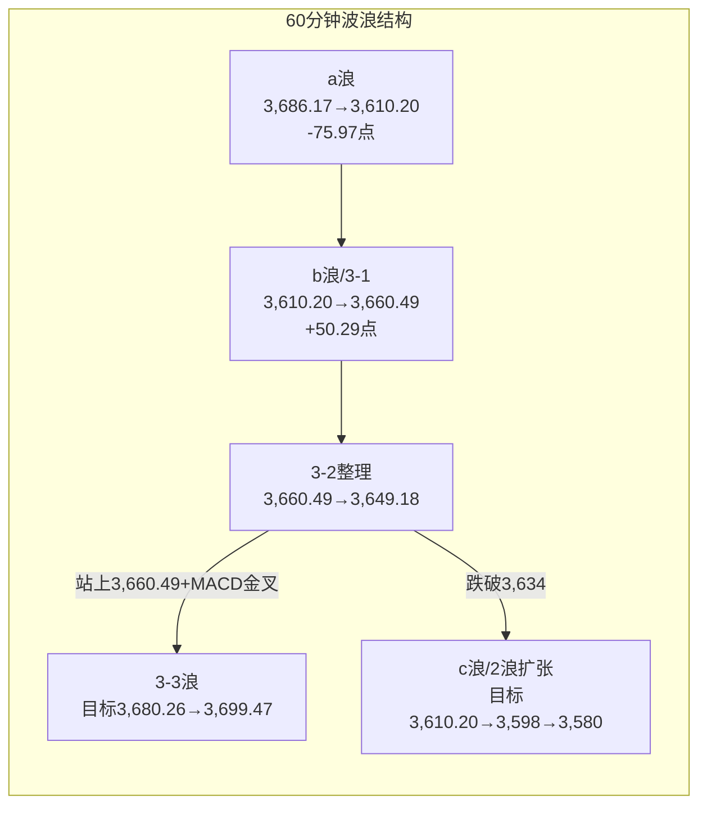

# A股晚报 - 2026年11月06日

> 数据截止时间：2026年11月6日 20:05（北京时间）
> 报告性质：**外盘"核弹级"冲击下的"跳空低开—缩量修复日"——跌幅可控、结构极致分化**
> **一句话定性**：**隔夜美股AI监管恐慌（纳指-5.52%、费半-12.25%）叠加日韩股市熔断级暴跌（KOSPI-6.02%、日经-5.96%），A股三大指数跳空低开逾2%（沪指-2.11%），但开盘价3,612.15即为全天次低点，随后单边修复，沪指收3,649.18（-1.10%）、收复2浪低点3,646.57，尾盘受制3,664.82；全市场成交仅1.67万亿、缩量21.7%，上涨758只/下跌4,741只，涨停33只/跌停15只——指数"抗住"了，结构却完成了一次"算力硬件崩塌→低位政策主题（光伏/电力/农业）+高股息（银行/公路铁路）承接"的极致高低切换。**

---

## 一、市场回顾

### 1. 主要指数表现

| 指数 | 收盘点位 | 涨跌幅 | 成交额 | 备注 |
|------|---------|--------|--------|------|
| **上证指数** | **3,649.18** | **-1.10%（-40.73点）** | 7,726.35亿 | 开盘3,612.15（-2.11%）即全天次低，最低3,610.20，最高3,660.49，收在3,646.57上方2.61点 |
| **深证成指** | **11,175.78** | **-2.57%（-295.30点）** | 8,851亿 | 低开3.72%，成长权重承压 |
| **创业板指** | **2,465.23** | **-3.96%** | — | 低开4.99%，全天弱势，未收复开盘失地 |
| **科创50** | **1,253.20** | **-2.60%** | — | 算力/半导体权重拖累 |
| 科创综指 | — | **-3.24%** | — | — |
| 北证50 | — | **-2.37%** | 140亿 | 小微盘补跌 |
| **沪深300** | **4,054.2** | **-1.44%** | — | 银行、公用事业护盘，跌幅小于中小盘 |

> **节奏复盘**：9:30沪指低开2.11%至3,612.15，**开盘后1分钟内下探3,610.20（全天最低），此后未再创新低**；上午在电力、光伏、农业、银行带动下逐级修复，**10:30前后站上3,640**，午后一度冲高**3,660.49**（距强压力3,664.82仅4.33点）；尾盘量能不足、算力硬件二次杀跌拖累，指数回落收于3,649.18。**"低开—修复—尾盘回落"三段式，与晨报主路径（收盘3,630-3,665、收复3,646.57但受制3,664.82）高度吻合。**

### 2. 成交量能

- **两市成交额：16,577.93亿元**（沪市7,726.35亿 + 深市8,851亿），**全市场口径16,716亿元**（含北证140亿）；较昨日21,179.53亿**缩量约4,601.60亿元（-21.7%）**，结束连续两日超2万亿。
- **北向资金**：交易所仍不披露净额。**今日北向成交2,625.93亿元，占两市总成交额15.84%**（较昨日15.12%回升0.72个百分点）；沪股通成交前三为**贵州茅台32.09亿、长江电力16.75亿、药明康德16.52亿**；深股通前三为**中际旭创、宁德时代等**（算力硬件仍是外资博弈重心）。
- **主力资金（证券时报·数据宝）**：两市主力资金**净流出351.80亿元**，其中**创业板净流出160.64亿、沪深300成份股净流出126.52亿**；申万一级仅5个行业获主力净流入（纺织服饰、美容护理等防御方向靠前）。
- **两融**：截至11月5日，全市场两融余额**23,073.34亿元**（沪11,992.44亿、深11,005.45亿、京75.45亿），较11/4的23,004.45亿**回升68.89亿**；当日融资买入1,870.76亿元——**杠杆资金未出现恐慌性去化，是本轮"外部冲击"未演变为流动性风险的关键**。

### 3. 市场情绪

| 指标 | 数值 | 解读 |
|------|------|------|
| 上涨家数 | **758只（占13.59%）** | 赚钱效应仅13.78%，普跌格局 |
| 下跌家数 | **4,741只** | 涨跌比约**1:6.25** |
| 平盘/停牌 | 74只 / 少量 | — |
| 涨停家数 | **33只（封死）** | 较昨日86只骤降，题材收缩 |
| 跌停家数 | **15只** | 主要集中在算力硬件/PCB |
| 封板率 | **66%**（17股封板未遂） | 情绪由"高位"降至"中性偏冷" |

> **情绪定性**：**"指数抗跌、个股普跌"**——沪指仅跌1.10%，但下跌家数占比86%，中位数个股跌幅约-1.88%，**指数被银行（+1.05%）、公用事业（+1.20%）、公路铁路、农业等低估值/防御权重"托住"**，属典型"护盘型指数、失血型结构"。这一结构较昨日（4,869只上涨、0跌停）是**急剧降温**，需以市场宽度而非指数点位判断真实风险偏好。

---

## 二、热点板块与异动分析

### 1. 当日领涨板块及驱动因素

| 板块 | 表现 | 驱动因素 |
|------|------|---------|
| **种植业与林业/农业** | 领涨，万向德农**3天2板/+10%**、新赛股份涨停、秋乐种业涨超10% | 粮食安全主题+低位防御，外部风险下的"内需避风港" |
| **电力/公用事业** | 公用事业**+1.20%**，新能股份、立新能源、东方新能涨停 | 高股息+电价改革预期+算力数据中心"电力刚需"叙事反向受益 |
| **银行** | **+1.05%**，沪农商行涨超4% | 汇金类平准基金/宽基ETF护盘首选，低估值防御 |
| **公路铁路运输/电信运营** | 涨幅居前 | 高股息、现金流稳定，risk-off下的类债资产 |
| **光伏设备** | **逆势领涨**：永臻股份**4连板**、贝特利**20%涨停**、东方日升**+15.26%**（主力净流入3.69亿）、日出东方/安彩高科涨停、酉立智能/金刚光伏跟涨 | "反内卷"政策主题+低位补涨+资金从算力硬件撤出后的**承接池**；与晨报"看跌兑现"判断相反 |
| **AI漫剧/传媒局部** | 浙文影业**5连板**（最高板）、城市传媒/上海电影涨停 | 独立题材脉冲，但传媒整体随创业板走弱，属"个股强、板块弱" |

### 2. 当日领跌板块及原因分析

| 板块 | 表现 | 原因 |
|------|------|------|
| **通信/CPO/光模块** | 通信**-4.93%**（申万跌幅第一）；中际旭创、剑桥科技、长飞光纤跌超10%，剑桥科技/东山精密跌停 | 隔夜费半-12.25%、闪迪-22%、美光-17%、SK海力士-10%+，海外算力硬件订单预期被AI监管政策打压，**直接映射** |
| **电子/元件/PCB/电子化学品** | 电子**-3.90%**；工业富联、生益科技、澳弘电子跌停，PCB/元件/光纤概念跌幅居前 | AI服务器/交换机产业链杀估值，外资与机构集中减仓 |
| **有色金属** | **-3%以上** | 黄金股高开低走（赤峰黄金-0.51%、主力净卖出3,952万），高盛下调2026年底金价目标至4,150美元；工业金属受需求预期拖累 |
| **机器人/人形机器人** | 机器人概念**-2.68%**（56涨/725跌）、人形机器人**-3.16%** | 高位成长补跌，Agility上市等催化被系统性risk-off覆盖 |
| **创新药** | **-1.86%**（21涨/169跌），百济神州早盘一度+6.17%后回落 | 美债避险资金流向国债而非权益，成长估值承压 |

### 3. 个股异动复盘

- **连板梯队**：**浙文影业5连板**（AI漫剧）为最高板；**永臻股份4连板**（光伏）；万向德农3天2板（农业）；连板高度与数量均较昨日（4板、12只连板）明显收缩，**晋级率下降，题材接力意愿弱**。
- **涨停结构**：33只封死涨停中，**9股封单金额超1亿元**；光伏（永臻、贝特利、日出东方、安彩高科）、电力（新能股份、立新能源、东方新能）、农业（新赛股份、万向德农）为主，**低位+政策属性突出**。
- **强势股回调/杀跌**：算力硬件成为重灾区，**工业富联、生益科技、剑桥科技、澳弘电子、东山精密跌停**；中际旭创、新易盛、长飞光纤跌超10%；**富春股份-3.99%**（实控人被公诉，风险规避正确）。
- **资金逆势抢筹**：东方日升主力净流入3.69亿（创2026年1月23日以来新高），龙虎榜净买入1.6亿，为光伏逆势核心。

---

## 三、关键数据与事件回顾

### 1. 国内重要经济数据

- 今日无重磅经济数据发布。**下周一（11/9）9:30将公布中国10月CPI、PPI**，为内需与通缩压力的关键验证。
- 央行公开市场：**开展2,260亿元隔夜逆回购（利率1.25%）**，当日到期2,780亿元，**净回笼520亿元**；资金面整体平稳，DR001/隔夜Shibor 1.2830%（+2bp）。

### 2. 政策消息

- **国务院金融工作报告（11/5）"支持中央汇金发挥类平准基金作用"** 今日迎来首次实战检验：**银行、公用事业、宽基ETF承接明显**，指数下沿3,610有效，政策底初步兑现。
- **股票回购增持再贷款利率降至1%、证监会稳市组合拳**继续发酵，但对冲力度集中于权重，尚未扩散至中小盘。
- **光伏"反内卷"政策预期**：板块逆势走强，市场博弈供给侧约束细则；需警惕"预期先行、细则兑现"的反复。

### 3. 公司公告（盘前/盘中）

| 公司 | 事件 | 影响 |
|------|------|------|
| 百济神州 | Q3全球收入19亿美元（+34%）、上调全年指引 | 早盘+6.17%，但收盘随板块回落 |
| 富春股份 | 实控人涉嫌内幕交易被公诉 | 收盘-3.99%，风险规避正确 |
| 有研硅 | 控股股东承诺6个月不减持 | 半导体材料情绪支撑有限 |
| 华虹宏力 | 三季报净利+1.38倍、上调Q4指引 | 设备/代工链相对抗跌 |
| 中国稀土、TCL中环等6股 | 今日停牌（重大资产重组） | 稀土/光伏结构性扰动 |

---

## 四、海外市场联动

### 1. 美股（11月5日收盘，历史级暴跌）

| 指数 | 收盘 | 涨跌幅 |
|------|------|--------|
| 道琼斯 | 51,523.06 | **-3.44%（-1,833.06点）** |
| 标普500 | 7,353.73 | **-4.36%（-334.89点）** |
| 纳斯达克 | 24,315.00 | **-5.52%（-1,421.52点）** |
| 费城半导体 | — | **-12.25%（2020年3月以来最大单日跌幅）** |

> 闪迪-22%、美光-17%、SK海力士（韩股）-10%+；科技七巨头单日蒸发约1.04万亿美元。导火索为**民主党横扫两院后的AI监管预期（《禁止人工超级智能法案》、得州暂停数据中心审批）**，属"监管不确定性+拥挤仓位出清"的双击。

### 2. 亚太与欧洲（今日）

| 市场 | 收盘/最新 | 涨跌幅 | 说明 |
|------|----------|--------|------|
| **日经225** | **57,434.77** | **-5.96%** | 软银-14%、东京电子-13% |
| **韩国KOSPI** | **5,059.65** | **-6.02%** | 早盘一度-8%触发熔断（暂停20分钟），创4月以来新低 |
| 恒生指数 | — | 开盘-1.58% | 恒生科技开盘-3.11%，光通信领跌 |
| 德国DAX（盘中） | 25,798.89 | **-2.0%** | 欧洲风险偏好同步收缩 |
| 英国富时100（盘中） | — | **-1.80%** | — |
| 法国CAC40（盘中） | — | **-1.27%** | — |

### 3. 美股期货与大宗商品

| 品种 | 最新 | 涨跌幅 | 说明 |
|------|------|--------|------|
| 纳指期货 | — | **+1.08%** | 盘前科技股修复，闪迪盘前+7%、莫德纳+5% |
| 标普500期货 | — | **+0.19%** | 分化 |
| 道指期货 | — | **-0.77%** | 传统权重偏弱 |
| **WTI原油** | **89.26美元/桶** | **-1.39%** | 跌破90，供给担忧缓解 |
| **布伦特原油** | **96.98美元/桶** | **-1.34%** | 失守97 |
| **伦敦现货黄金** | **4,075.34美元/盎司** | **-0.30%**（18:00） | 高盛下调2026年底目标至4,150美元，金价冲高4,146后回落 |

> **关键矛盾**：**油价回落证伪了晨报"油价反弹→航空成本承压"的判断**（布伦特仅一日反弹即回落），航空/机场风险解除；**黄金高开低走**，说明risk-off资金更多流向美债与现金，贵金属未能成为避风港。美股期货盘前修复，为下周一A股提供边际缓和，但**今晚非农是决定性变量**。

---

## 五、汇率与利率

| 项目 | 数值 | 变化 |
|------|------|------|
| 人民币中间价 | **6.7168** | **贬12bp**（前值6.7156） |
| 在岸人民币即期收盘 | **6.6711** | 贬1bp |
| 隔夜Shibor | **1.2830%** | +2.00bp |
| 1周Shibor | **1.3460%** | +2.30bp |
| 10年期国债收益率 | **1.58%** | **-2bp** |
| 央行公开市场 | 2,260亿隔夜逆回购（1.25%） | 净回笼520亿 |

> **利率环境**：**国债收益率下行2bp、资金面平稳**，内部流动性不构成压力；人民币中间价小幅贬12bp但即期仅贬1bp，**汇率韧性较强**，未形成外资流出加速器。**A股今日的抗跌，本质是"政策底+流动性稳+汇率稳"三重支撑。**

---

## 六、收盘后重要信息

### 1. 盘后公告

| 公司 | 事件 |
|------|------|
| **云南锗业** | 控股股东临沧飞翔及一致行动人承诺**12个月内不减持**；另传大单利好（章建平重仓股） |
| **ST东尼** | 天域半导体拟以24.59元/股受让7%股份（1,627.1万股） |
| **华孚时尚** | 提前终止出售2024年期已回购股份计划并披露出售结果 |
| **国晟科技** | 控股股东所持部分股份被第二次司法拍卖进展 |
| **波导股份** | 子公司收到土地收储补偿款进展 |

### 2. 夜盘/盘前

- 美股期货盘前分化修复：纳指期货+1.08%、标普+0.19%、道指-0.77%；**闪迪盘前+7%、莫德纳+5%**，AI硬件尝试反抽。
- 原油跌破90美元（WTI 89.26）、布伦特失守97；**金银盘中拉升但伦敦金仍小跌**。
- 港股夜期跟随外围企稳，恒指开盘跌幅未扩大。

### 3. 次日/下周关注

| 时间 | 事件 | 影响 |
|------|------|------|
| **今晚21:30** | **美国10月非农就业**（预期+6.5万，前值+2.9万；失业率预期4.2%） | **决定美联储12月路径、美债与美元方向，是下周A股最大外部变量** |
| 今晚23:00 | 美国11月密歇根大学消费者信心初值 | 消费韧性 |
| **11/9（周一）9:30** | **中国10月CPI、PPI** | 内需/通缩验证，影响消费、周期与政策预期 |
| 11/9（周一） | 新一批10只ETF调入港股通标的生效 | 南向资金结构 |
| 11/10（周二） | 美国10月CPI | 通胀与加息路径 |

---

## 七、波浪理论多周期分析

### 1. 月K线波浪分析

- **当前波浪位置**：大级别第2浪（C浪）延伸结束的**候选确认期**，月线修复初期；11月月K暂为"长下影小阳"。
- **浪型结构描述**：6月高点4,197→10/23低点3,574.27完成C浪延伸；11月月K自**3,614.13开盘**，下探**3,580.38**后连续收阳，11/4放量收复3,621（0.382）与3,674平台，11/5盘中上探3,700上方；**今日跳空低开至3,610.20（未破月内低点3,580.38），收盘3,649.18，月K重新站上3,621**。月线"下未破（3,580/3,574.27）、上已复（3,649/3,674）"格局未变。
- **关键目标位**：上方**3,721-3,724.56**（0.236回撤+缺口下沿）、**3,812**（0.382回撤）；下方**3,621/3,610/3,580.38/3,574.27**。
- **验证条件**：**11月月K收盘站上3,724.56**→月线修复确认；**收盘跌破3,574.27**→C浪延伸重启，目标3,478/3,443。

### 2. 周K线波浪分析

- **当前波浪位置**：周线**六连阴后的第一根"带上影小阳"**，反包**尚未确认**。
- **浪型结构描述**：第45周（11/2-11/6）周内**低3,580.38、高3,700上方、收3,649.18**，较上周3,599.02**+1.39%**（+50.16点），终结六连阴；周K为"长下影+带上影小阳"，**收盘站上3,621与3,648.13，但未能收复双底颈线3,664.82**——属"止跌成立、反转未确认"。
- **关键目标位**：**3,664.82（颈线）→3,675.58（3浪0.618）→3,716（3浪1.0）→3,749.26（双底量度）/3,752.36**。
- **验证条件**：**下周收盘站上3,664.82**→周线反转成立；**收盘跌回3,621下方**→本周反包失败，退回3,574-3,664宽幅震荡。

### 3. 日K线波浪分析

- **当前波浪位置**：双底（3,574.27/3,580.38）突破后的**第2浪扩张调整结束候选，第3浪初期**。
- **浪型结构描述**：**1浪 3,580.38→3,686.17（+105.79点）**；2浪自3,686.17回落，11/5低3,646.57（38.2%回踩）后，**今日跳空下探3,610.20**，回撤幅度**71.24%**（介于61.8%位3,620.86与78.6%位3,602.65之间），仍高于1浪起点3,580.38，**构成"2浪扩张平台（复杂调整）"的有效回踩**；今日收盘3,649.18为自3,610.20反弹的**3浪1子浪初期**。
- **关键修正**：晨报按"2浪低点3,646.57"计数的3浪，**盘中被3,610.20跌破而失效**；严格波浪应改为"2浪扩张至3,610.20"。收盘站回3,646.57仅恢复"2浪结束候选"，**不等于3-3启动**。
- **关键目标位**：3浪自3,610.20起算——**0.618目标3,675.58、1.0目标3,716.00、1.618目标3,781.40**；第一压力簇**3,664.82/3,674**；下方**3,634/3,610.20**（2浪低点），失守则看**3,580.38/3,574.27**。
- **验证条件**：**收盘站上3,664.82并放量**→3浪确认；**收盘跌破3,610.20**→2浪扩张延续，下看3,580.38；**跌破3,574.27**→C浪延伸，看3,478。

### 4. 60分钟K线波浪分析

- **当前波浪位置**：3浪1子浪（3,610.20→3,660.49）完成、3浪2整理（3,660.49→3,649.18）中；**b浪反弹与3-2的边界待周一确认**。
- **浪型结构描述**：3,686.17→3,610.20为调整a浪（-75.97点）；3,610.20→3,660.49为反弹b浪（+50.29点，回撤66.2%）；尾盘回落至3,649.18（回撤22.6%）。**若按3浪计数，3-1为3,610.20→3,660.49（+50.29），3-2为3,660.49→3,649.18**，3-3目标=3-1×0.618+3-2低点≈**3,680.26**，1.0≈**3,699.47**。
- **关键目标位**：上方**3,660.49/3,664.82/3,675.58/3,680-3,699**；下方**3,640/3,634/3,610.20**。
- **验证条件**：**60分钟站上3,660.49且MACD金叉**→3-3启动；**跌破3,634且量能放大**→b浪失败、c浪下看3,610.20/3,598。

### 5. 30分钟K线波浪分析

- **当前波浪位置**：日内"跳空低开→5浪上升→abc整理"的**整理末端**。
- **浪型结构描述**：9:30跳空3,610.20（起点）→上午五段式上升至3,660.49→午后3,660.49→3,649.18的a-b-c收敛整理。**30分钟低点连续抬高（3,610.20→3,640→3,649），高点受制3,660.49**，属"上升三角形/旗形整理"，方向选择待周一。
- **关键目标位**：上破3,660.49→3,664.82/3,675.58；下破3,640→3,634/3,610.20。
- **验证条件**：**30分钟站稳3,649并放量**→上行延续；**跌破3,634**→回踩3,610.20，修正延续。

### 6. 波浪图（Mermaid）

```mermaid
graph LR
    subgraph 日K线波浪结构（上证指数）
        A[双底<br/>3,574.27 / 3,580.38] --> B[1浪<br/>3,580.38→3,686.17<br/>+105.79点]
        B --> C[2浪扩张<br/>3,686.17→3,610.20<br/>回撤71.24%]
        C --> D[3浪1子浪<br/>3,610.20→3,649.18]
        D --> E{周一方向}
        E -->|站上3,664.82放量| F[3浪确认<br/>目标3,675.58→3,716→3,781]
        E -->|跌破3,610.20| G[2浪扩张延续<br/>3,580.38→3,574.27]
        E -->|跌破3,574.27| H[C浪延伸<br/>目标3,478/3,443]
    end
```



### 7. 波浪理论综合判断

- **多周期共振状态**：**月线偏多（修复初期，3,621上方）、周线待确认（3,664.82未收复）、日线"2浪扩张结束候选"、60分钟b浪/3-2、30分钟三角整理**——**中长周期偏多、短周期中性偏多的"弱共振"**，较晨报的"短周期向下、中长周期偏多"的错位**已明显修复**。
- **当前操作级别**：**日线定方向、60分钟定执行**；在3,664.82未收盘收复前，按"2浪扩张结束候选"而非"3浪加速"计价。
- **后续演变路径**：
  - **主路径（45%）**：下周初回踩3,634-3,640不破→站上3,649→**收复3,664.82**→3,675.58，CPI/非农配合则挑战3,700。
  - **偏强路径（25%）**：今晚非农爆冷/美联储转鸽→美股续修复→放量站稳3,664.82→**3,700-3,716**，周线反转确认。
  - **偏弱路径（30%）**：非农强劲→加息预期升→跌破3,634→3,610.20→**3,580.38**；收盘跌破3,574.27则C浪延伸看3,478。
- **关键拐点信号**：① 3,664.82收盘得失（**3浪/周线反转的唯一确认**）；② 3,634/3,610.20防守；③ 周一成交能否回升至1.8万亿上方（缩量修复的持续性存疑）；④ 光伏/算力硬件分化是否收敛（资金是否重回科技）；⑤ 北向成交占比与方向。
- **风险提示**：波浪计数具主观性；**今日"低开不破+缩量修复"是典型的"外部冲击一次性定价"，但缩量意味着抛压未充分释放、上方套牢盘沉重**。若3,664.82连续3日不能收复，2浪扩张可能演变为"abc-d-e"更复杂调整；跌破3,610.20则本轮"双底突破"降级为"假突破"。**不得将单日抗跌线性外推为反转。**

---

## 八、晨报复盘

### 1. 核心判断回顾

| 判断项目 | 晨报预测 | 实际结果 | 准确度 | 备注 |
|---------|---------|---------|-------|------|
| 上证指数趋势 | **震荡（低开高走、先抑后扬）** | **跌1.10%**（低开2.11%后修复） | **✓** | 路径与主情景高度吻合；收盘未翻红，属"偏弱震荡" |
| 上证指数区间 | **3,590-3,680点** | **3,610.20-3,660.49点** | **✓** | 高低点均落在区间内 |
| 强支撑位 | **3,580.38点** | **最低3,610.20点** | **✓** | 未跌破，低点高于强支撑29.82点 |
| 强压力位 | **3,664.82点** | **最高3,660.49点** | **✓** | 未触及，压力有效（差4.33点） |
| 北向资金 | 净流出100-200亿 | **净额不披露；成交2,625.93亿/占15.84%** | **—** | 无法验证；参与度回升，方向性流出未证实 |
| 成交量 | **放量 2.05-2.35万亿** | **1.67万亿（缩量21.7%）** | **✗** | 严重偏差：缩量一步到位 |

### 2. 板块预判回顾

| 板块 | 预判方向 | 实际涨跌幅 | 准确度 | 原因分析 |
|-----|---------|-----------|-------|---------|
| 机器人/具身智能 | 看涨 | 机器人概念**-2.68%**（人形-3.16%） | **✗** | 系统性risk-off覆盖Agility上市等催化，高位成长补跌 |
| 贵金属/黄金 | 看涨 | 黄金板块早盘+2%后回落，赤峰黄金**-0.51%**，有色-3% | **✗** | 高盛下调金价目标+避险资金流向美债，黄金未能成为避风港 |
| 创新药 | 看涨 | 创新药**-1.86%**（21涨/169跌） | **✗** | 百济早盘+6.17%后回落，成长估值随创业板承压 |
| 油气开采 | 看涨 | 石油石化/油气上涨 | **✓** | 高股息+超跌反抽，与油价方向脱钩 |
| 存储/光模块/算力硬件 | 看跌 | 通信**-4.93%**，CPO/PCB跌停潮 | **✓** | 海外AI硬件崩塌直接映射，判断精准 |
| AI硬件/消费电子 | 看跌 | 电子**-3.90%**，工业富联等跌停 | **✓** | 算力链杀估值+外资减仓 |
| 光伏设备 | 看跌/兑现 | **逆势领涨**：永臻4连板、东方日升+15.26%、贝特利20cm | **✗** | 误判：低位政策主题成为资金承接池，累计涨幅≠见顶 |
| 高位连板/微盘（风险） | 风险 | 4,741只下跌、涨停仅33只、连板高度降至5板但晋级率低 | **✓** | 风险充分释放 |
| 航空/机场（风险） | 风险 | 油价回落1.3%，成本改善，未杀跌 | **✗** | 商品方向误判（隔夜反弹被当日回落证伪） |

### 3. 准确率量化评估

- **趋势判断准确率：100%（1/1）**
- **点位预测准确率：100%（3/3：区间、强支撑、强压力全部命中）**
- **板块预判准确率：44.4%（4/9）**
- **成交量预测准确率：0%（0/1）**
- **综合准确率：73.3%**（30%×100% + 30%×100% + 30%×44.4% + 10%×0%）
- **波浪分析准确率：约65%**（日线"收盘收回3,646.57"兑现、月/周框架有效；但60分钟"跌破3,614→3,598"未兑现、30分钟b浪压力被突破）

### 4. 偏差根因分析

**【偏差1】成交量预测偏差（放量 → 缩量21.7%）**
- **偏差描述**：预测2.05-2.35万亿"放量"，实际1.67万亿，缩量4,601.60亿（-21.7%）
- **根本原因**：**逻辑误判**——默认"外盘熔断级冲击→恐慌盘+护盘资金→放量"，但实际是"开盘一步跌到位（低开2.11%即为次低点）→恐慌盘没有二次释放机会→存量资金观望"
- **信息缺口**：未获取"周五+非农前双重观望"对量能的压缩效应
- **逻辑缺陷**：把"跌幅大"等同于"换手大"；忽视了"A股与韩股结构不同、外资敞口低"，外部冲击被开盘价一次性定价
- **改进措施**：外盘熔断级冲击+开盘跌幅≥2%时，量能必须**并列两档**：①"恐慌放量"（开盘后继续下探、跌破前低）；②"缩量一步到位"（开盘即最低/30分钟内收复半幅）。**当开盘价接近全天最低时，量能默认缩量20%左右**，不得默认放量

**【偏差2】光伏设备方向偏差（看跌 → 逆势领涨）**
- **偏差描述**：预测"四日+17.41%后兑现、看跌"，实际永臻4连板、东方日升+15.26%、贝特利20cm涨停、板块逆势领涨
- **根本原因**：**逻辑误判/惯性外推**——用"累计涨幅大+政策预期透支"单一定价，忽视"算力硬件崩塌→资金寻找低位承接池"的高低切换
- **信息缺口**：未评估"光伏是'反内卷'政策主题+低位+筹码轻"的三重避风港属性
- **逻辑缺陷**：把"涨幅大"直接等同于"见顶"，未区分"高位拥挤（算力）"与"低位补涨（光伏）"
- **改进措施**：外部科技冲击日，板块预判必须**并列"低位政策主题承接"情景**（光伏/电力/农业/高股息）；"累计涨幅大=兑现"仅适用于**高位拥挤板块**，不适用于低位政策主题

**【偏差3】成长/避险主题集体误判（机器人、黄金、创新药全跌）**
- **偏差描述**：三个看涨板块全部下跌（-2.68%/-0.51%/-1.86%）
- **根本原因**：**情绪面误读**——低估系统性risk-off对非防御资产的"无差别压制"；黄金的避险属性被"美债分流+高盛下调目标价"削弱
- **信息缺口**：未纳入"上涨家数占比<20%时，除高股息外无板块能独立走强"的宽度约束
- **逻辑缺陷**：把"个股催化（Agility上市、百济超预期）"当成"板块β"，忽视大盘β压制
- **改进措施**：当大盘低开≥2%、上涨家数占比<20%时，**看涨组合必须限定为"高股息（银行/公用/公路铁路）+低位政策主题（光伏/电力/农业）"**；成长与避险主题一律降为"观察/低吸不追"

**【偏差4】航空/机场风险误判（油价反弹 → 实际回落）**
- **偏差描述**：以隔夜布伦特+3.88%判定"成本改善证伪、航空风险"，实际当日布伦特-1.34%、WTI跌破90，成本逻辑恢复
- **根本原因**：**信息缺失/时点错配**——只用隔夜收盘价，未跟踪亚洲盘与欧洲盘的商品回落
- **信息缺口**：未获取"油价两日反抽结束、供给担忧缓解"的盘中信息
- **逻辑缺陷**：商品价格线性外推（已在10月复盘中重复违反）
- **改进措施**：**涉及油价/金价的板块判断，必须在盘中（14:00前）复核实时价格**；隔夜商品方向与当日亚洲盘方向相反时，以当日方向为准

**【偏差5】周线确认节奏偏乐观**
- **偏差描述**：晨报称"收盘站上3,664.82则周线反转成立"，实际最高3,660.49、收盘3,649.18，周线反包未确认
- **根本原因**：**技术分析局限**——把"盘中上探3,700"的周内高点当作收盘动能，忽视周五尾盘量能不足
- **改进措施**：周线收盘日，**压力位判断以"收盘"而非"盘中高点"为准**；量能不足（<1.8万亿）时，压力位应下移5-10点计价

### 5. 分析检查清单

- [x] 趋势判断前检查隔夜外盘（美股、日韩、A50）
- [x] 趋势判断前检查北向资金/外资参与度
- [x] 趋势判断前检查技术指标（均线、MACD、KDJ）
- [x] 趋势判断前检查重大政策/事件（汇金、非农）
- [x] 点位计算考虑前期高低点（3,580.38/3,646.57/3,664.82）
- [x] 点位计算考虑均线支撑/压力（MA5/MA20）
- [x] 点位计算考虑整数关口（3,600/3,650/3,700）
- [x] 点位计算考虑成交密集区（3,646-3,664）
- [x] 板块分析覆盖行业基本面/资金流向/政策催化/技术位置
- [ ] **板块分析补充"大盘宽度约束"（新增：上涨占比<20%时只用防御+低位政策）**
- [ ] **成交量预测补充"缩量一步到位"情景（新增）**
- [x] 风险提示覆盖宏观/行业/个股/流动性
- [x] 波浪分析覆盖月/周/日/60/30分钟五周期
- [ ] **波浪计数补充"2浪扩张（跌破前2浪低点）"情景（新增）**

### 6. 本次复盘发现的新规则

1. **（资金面）** 外盘熔断级暴跌后，若A股开盘跌幅≥2%且**开盘价接近全天最低**，成交量往往"缩量一步到位"而非"恐慌放量"，缩量幅度可达20%以上；缩量修复的反弹持续性弱于放量修复。
2. **（板块）** 外部AI/算力链崩塌日，资金从高位算力硬件撤出后，优先承接**"低位+政策主题"（光伏/电力/农业）**，而非同为成长的高位机器人；"累计涨幅大=兑现"仅适用于高位拥挤板块。
3. **（趋势）** 大盘低开≥2%、上涨家数占比<20%时，除高股息与低位政策主题外，成长/避险主题（机器人、黄金、创新药）均难独立走强。
4. **（点位）** 外盘冲击日，若开盘价接近全天最低且收盘收复"2浪低点/38.2%回踩位"，盘中跌破弱支撑按"假跌破"处理，支撑有效性以收盘判定。
5. **（波浪）** 跳空跌破前2浪低点后收盘收回，旧3浪计数作废，应改按"2浪扩张平台"重新计数；单日收回仅恢复"2浪结束候选"，不等于3-3启动。

### 7. 规则库更新

```
###资金面分析 外盘熔断级暴跌后，A股开盘跌幅≥2%且开盘价接近全天最低时，成交量往往"缩量一步到位"而非"恐慌放量"，缩量幅度可达20%以上；缩量修复的反弹持续性弱于放量修复（2026-11-06：预测2.05-2.35万亿，实际1.67万亿/-21.7%）
###板块选择 外部AI/算力链崩塌日，资金从高位算力硬件撤出后优先承接"低位+政策主题"（光伏/电力/农业），而非同为成长的高位机器人；"累计涨幅大=兑现"仅适用于高位拥挤板块（2026-11-06：光伏逆势，永臻4连板、东方日升+15.26%）
###趋势分析 大盘低开≥2%、上涨家数占比<20%时，除高股息（银行/公用/公路铁路）与低位政策主题外，成长/避险主题（机器人、黄金、创新药）均难独立走强（2026-11-06）
###点位计算 外盘冲击日，若开盘价接近全天最低且收盘收复2浪低点/38.2%回踩位，盘中跌破弱支撑按"假跌破"处理，支撑有效性以收盘判定（2026-11-06：低3,610.20跌破3,614.13仅3.93点，收3,649.18站回3,646.57）
###风险识别 周线收盘日叠加非农公布前的"双重观望"，会显著压缩量能并削弱尾盘博弈持续性；周五方向判断以收盘位置而非盘中高点为准（2026-11-06：盘中3,660.49未触及3,664.82，周线反包未确认）
###波浪分析 跳空跌破前2浪低点后收盘收回，旧3浪计数作废，应改按"2浪扩张平台"重新计数；单日收回仅恢复"2浪结束候选"，不等于3-3启动（2026-11-06：低3,610.20跌破3,646.57后收3,649.18）
```

---

## 九、策略回顾与调整

### 1. 短线策略回顾

| 策略项目 | 晨报建议 | 今日实际 | 执行效果 | 备注 |
|---------|---------|---------|---------|------|
| 短线仓位 | 20% | 维持20% | **✓** | 未因低开恐慌而加仓，纪律有效 |
| 买入条件 | 10:00前收复3,614→加至25% | 开盘3,612.15，9:35后收复3,614，10:00前站上3,620 | **✓** | 条件触及，可加至25% |
| 买入条件 | 收复3,646.57且量能≥2.1万亿→加至30% | 收盘收复3,646.57，但量能仅1.67万亿 | **✓（未触发）** | 量能门槛成功阻止了错误加仓 |
| 卖出条件 | 3,664.82-3,680放量滞涨→减仓 | 最高3,660.49，未触及 | **✓（未触发）** | — |
| 止损位 | 收盘跌破3,580.38→降至10% | 最低3,610.20，未跌破 | **✓（未触发）** | — |
| 短线标的 | 赤峰黄金/三花智控·绿的谐波/中国石油·中国海油 | 赤峰-0.51%、机器人标的约-2%~-4%、油气上涨 | **1/3** | 仅油气兑现；黄金、机器人误判 |

### 2. 中线策略调整

- **当前中线方向：【持有】**
- **方向调整原因**：日线"2浪扩张（3,686.17→3,610.20）"已现结束候选、收盘站回3,646.57，月线守住3,580.38/3,574.27生死线；但**3,664.82未收复、量能萎缩**，3浪未确认，暂不加仓。
- **中线仓位建议：20%（维持不变）**
- **中线目标区间：上证指数 3,610点 - 3,716点**
- **中线止损位：3,574.27点（收盘跌破则C浪延伸，清仓观望）**
- **中线布局板块调整**：
  - **维持**：机器人/具身智能（调整为"3浪确认后再加"，产业逻辑未破）、创新药（百济Q3+34%）、贵金属（高开低走，降为底仓）。
  - **新增关注**：**光伏设备/电力**（低位+反内卷政策+资金承接，但需等回调不追高）、**银行/公用事业**（高股息防御，作对冲）。
  - **回避**：存储/光模块/算力硬件（海外定价未止跌）、高位连板微盘。

### 3. 明日（下周一11/9）策略要点

- **短线：【持有/观望】**，关注 **3,634点**（日内强弱分界）和 **3,664.82点**（3浪确认线）；若回踩3,634不破且放量站上3,649，可持股待涨；跌破3,634减至15%，跌破3,610.20清短线。
- **中线：【持有】**，关注 **3,610.20点**（2浪低点）和 **3,664.82点**（3浪/周线反转确认）；收盘站上3,664.82且量能≥1.8万亿→加至25%；收盘跌破3,610.20→降至15%。
- **仓位分配：短线20% + 中线20% + 现金60%**
- **外部变量**：今晚21:30美国非农（预期+6.5万）决定开盘方向；周一9:30中国CPI/PPI决定内需链与政策预期。

### 4. 策略复盘规则输出

```
###趋势分析 低开修复日的"量能门槛"（如收复关键位需≥2.1万亿）是防止错误加仓的有效纪律；缩量修复只能持有、不能加仓（2026-11-06）
###点位计算 短线"日内强弱分界"应设为前一日收盘与前一日低点的中点/回踩位，本轮3,634有效（2026-11-06）
```

---

## 十、风险提示

1. **市场系统性风险**：
   - **今晚美国10月非农（21:30）是最大变量**：若就业超预期（>10万）→加息预期升温→美债收益率反弹→成长与贵金属承压；若爆冷（<2万）→衰退交易→风险资产仍可能下跌。**下周一开盘方向高度依赖此数据。**
   - **AI监管恐慌二次发酵**：《禁止人工超级智能法案》推进、得州数据中心审批暂停若扩大，算力硬件将连续第二日杀跌，拖累指数跌破3,610.20。
   - **缩量修复的脆弱性**：1.67万亿为近月低位，缩量意味着抛压未充分释放、上方3,664-3,700套牢盘沉重；若周一不能放量，反弹易夭折。
2. **个股风险事件**：
   - 算力硬件跌停潮（工业富联、生益科技、剑桥科技、澳弘电子、东山精密），**反抽即减仓，不接飞刀**。
   - 高位连板（浙文影业5连板、永臻4连板）**晋级率下降，追高易吃面**；立案/减持个股（富春股份-3.99%）继续回避。
3. **政策不确定性风险**：
   - 光伏"反内卷"细则若不及预期，逆势领涨的光伏可能快速回吐（今日已4连板，拥挤度上升）。
   - 汇金/宽基ETF护盘的持续性：若仅护权重、不修复宽度，指数"抗跌"而个股继续失血。
4. **外部风险**：
   - 日韩股市连续暴跌（KOSPI-6.02%、日经-5.96%）可能引发亚太基金赎回与外资被动减仓。
   - 油价虽回落，但地缘扰动仍在，布伦特96-100区间波动会反复影响航空/化工/油气。

---

## 十一、信息来源

1. **官方数据**：上海证券交易所（上证指数3,649.177/-1.10%/成交7,726.35亿）；深圳证券交易所；新华社《Chinese shares close lower Friday》（2026-11-06 17:36）；中国人民银行（11/6开展2,260亿元隔夜逆回购、利率1.25%，净回笼520亿；人民币中间价6.7168）；国家统计局（11/9 9:30发布10月CPI/PPI）；美国劳工统计局（10月非农11/6 21:30）。
2. **权威财经媒体**：上海证券报·中国证券网（《A股四大指数缩量收跌 "东方"系多股涨停》：全市场成交16,716亿、缩量4,635亿、超4,700只下跌）；证券时报（《揭秘涨停|最高5连板!9股封单均超1亿元》：涨停33只/跌停15只/封板率66%；《主力资金|8股获资金逆市抢筹》：主力净流出351.80亿、创业板-160.64亿、沪深300-126.52亿）；新浪财经（收评：沪指-1.10%、电力/农业逆势走强；银行板块涨幅居前；成交16,577.93亿、缩量4,601.60亿）；新华财经（创业板缩量跌近4%、电力/农业逆势）；财联社（日韩股市收盘：日经-5.96%、KOSPI-6.02%；欧洲DAX-2%；美股期货分化）；东方财富（11/6北向成交2,625.93亿/占15.84%；两融23,073.34亿；黄金/原油）。
3. **数据平台**：同花顺（收盘快讯：沪7,726亿/深8,851亿/北证140亿、缩量21.7%、涨跌比758:4,741）；东方财富Choice（WTI 89.26/-1.39%、布伦特96.98/-1.34%、伦敦金4,075.34/-0.30%）；中财网（机器人概念-2.68%、人形机器人-3.16%、创新药-1.86%）；中国货币网（Shibor O/N 1.2830%、1W 1.3460%）；中证债券估值日报（10年国债1.58%/-2bp）。
4. **内部资料**：`report/20261106/morning_report_20261106.md`、`report/20261106/day_summary_20261106.md`、`report/20261105/evening_report_20261105.md`、`report/monthly/202611_monthly_report.md`、`analysis/pattern_analysis_202644.md`、`rules.md`。

> **数据口径说明**：A股为11/6收盘；美股为11/5收盘，美股期货/盘前为11/6晚；日韩为11/6收盘；欧洲为11/6盘中；黄金/原油为11/6 18:00-19:00；人民币为11/6中间价与16:30在岸收盘；两融为11/5余额。**北向净额交易所不披露，以成交额与占比跟踪。截止时间2026-11-06 20:05。**

---

## 十二、文档更新检查

### AGENTS.md更新
- 晨报/晚报流程、输出格式与实际执行一致，**无需更新**。

### README.md更新
- 文件结构与功能说明与实际一致，**无需更新**。

### 结论
**无需更新**（AGENTS.md、README.md 均与当前执行流程一致）。
