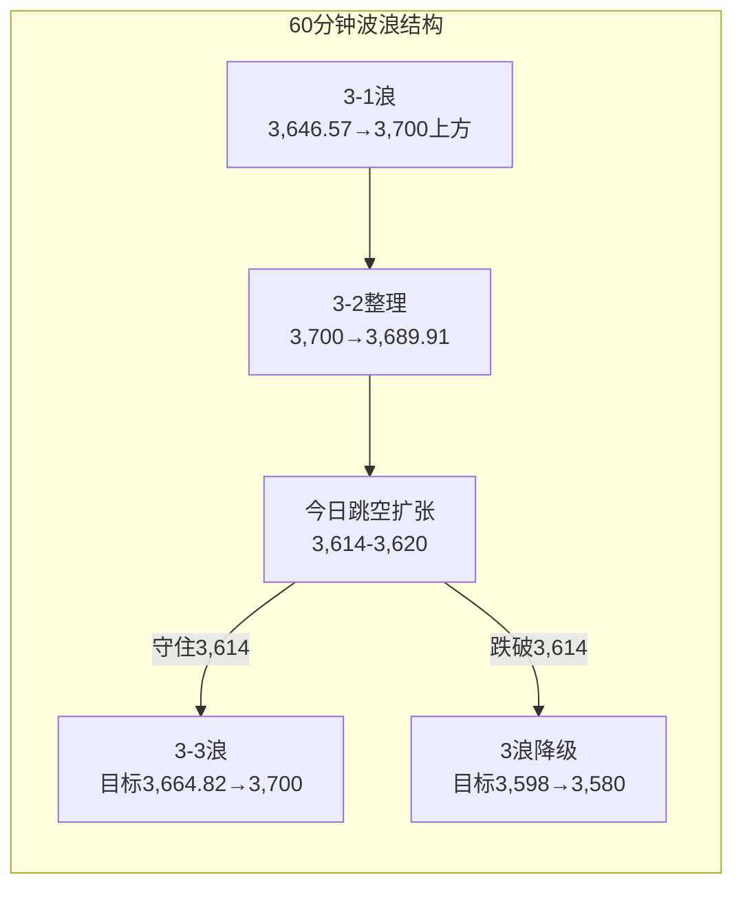

# A股晨报 - 2026年11月06日

> 数据截止时间：2026年11月6日 09:10（北京时间）
> 报告性质：**外部AI监管冲击引发的"跳空低开压力测试日"——政策底对冲估值底**
> **一句话定性**：**隔夜"民主党横扫两院+AI监管恐慌"引爆美股历史级暴跌（纳指-5.52%、费城半导体-12.25%创2020年以来最大跌幅、闪迪-22%、美光-17%、七巨头单日蒸发约1.04万亿美元），今晨韩国KOSPI跌超8%触发熔断、日经跌逾3.7%、富时A50期货-2.0%；A股大概率跳空低开至3,610-3,620，存储/光模块/算力硬件承压，但"国务院金融工作报告支持中央汇金发挥类平准基金作用+股票回购增持再贷款利率降至1%"构成政策底对冲，主情景为"低开→护盘/超跌修复"，多空决战3,580.38双底与3,646.57（2浪低点）。**

---

## 一、昨日晚报复盘要点回顾（2026-11-05晚报）

### 1. 昨日判断回顾

| 项目 | 晚报复盘结果 | 准确率 |
|------|------------|--------|
| 趋势判断 | 晨报"震荡偏强" vs 实际+0.10%（3,689.91） | **100%（1/1）** |
| 点位预测 | 强压力✓、量能✓；区间✗、强支撑✗ | **50%（2/4）** |
| 板块预判 | 看涨4/6、看跌2/3，合计6/9 | **66.7%** |
| 成交量预测 | 2.12万亿，落在1.95-2.15万亿区间 | **100%** |
| **综合准确率** | — | **75.0%** |

> **核心结论**：方向判断正确，但**指数弹性被权重（石油石化-2.34%、银行-0.59%）压制**，且**低估了隔夜亚太科技链暴跌对开盘下沿的冲击**——开盘3,646.57直接击穿强支撑3,664.82达14.25点，收盘收回。

### 2. 关键偏差及原因

- **偏差1（区间下沿/强支撑）**：已知SK海力士-9.46%、KOSPI-5.28%，仍把"回踩3,674-3,664.82不破"作为基准情景，未并列"低开击穿→午后再确认"路径。改进：**外盘科技链单日跌幅≥5%时，次日开盘映射下沿扩大至-1.5%，强支撑单列"盘中假跌破"情景，支撑有效性以收盘判定**。
- **偏差2（航空/交运）**：油价单日-8.38%被线性外推为"成本改善"，但油价盘中技术性反抽+1.40%即削弱逻辑。改进：**成本改善型交易须附加"油价次日不反弹超1%"条件**。
- **偏差3（券商/非银）**：成交连续2万亿，但非银特大单净流出11.42亿，"放量=券商受益"旧映射失效。改进：**放量日必须核对非银资金流，特大单净流出则不纳入看涨组合**。
- **偏差4（手机链）**：高通利空被"端侧AI+普涨"覆盖，立讯+2.73%、歌尔+5.33%。改进：**单一客户/单品利空只下调对应细分，不覆盖全板块**。
- **偏差5（指数弹性）**：预测主情景收盘3,690-3,715，实际3,689.91，方向对但幅度偏小。改进：**指数预测拆分"权重贡献"与"题材贡献"**。

### 3. 沉淀的规则/检查项

1. **（趋势）** 亚太科技链单日跌超5%导致A股低开破位，但**开盘30分钟内收复前一日弱支撑并翻红**，属"外部冲击一次性宣泄"，趋势判断不改。
2. **（点位）** 突破后首日回踩**精确落在前段涨幅38.2%附近（误差<2点）**且收盘收回颈线，视为2浪结束、3浪启动，目标按0.618/1.0延伸。
3. **（板块）** 油价单日暴跌后的"成本改善"交易，**仅在该品种次日不反弹超1%时有效**；反弹超1%则航空/化工下调为中性。
4. **（板块）** 成交>2万亿但**非银特大单净流出**时，"放量=券商受益"映射失效。
5. **（风险）** **存储/光模块与半导体设备必须分开定价**——前者跟随海外存储/算力硬件，后者受国产替代+三季报驱动；外盘存储暴跌日，设备可逆势。

### 4. 对今日分析的启示

- **警惕"一致性外推"**：昨日"低开破位后收红"的成功经验，不能简单套用于今日——今日外盘冲击级别（费半-12.25%）**远大于昨日（SK海力士-9.46%、KOSPI-5.28%）**，且今日是**周线收盘日**，尾盘博弈更复杂。
- **必须并列三种开盘路径**：低开修复（主）、低开续跌（次）、低开强反包（尾部），不可只给单一乐观情景。
- **政策变量权重上调**：昨日报告已记录"国务院金融工作报告支持汇金类平准基金"，今日是**该政策面对抗外部冲击的首次实战检验**。
- **板块分层**：存储/光模块/算力硬件（跟海外定价）与半导体设备/国产替代（政策+业绩）必须分开；油价反弹超1%则航空重回中性。

---

## 二、隔夜市场动态（11月5日收盘后至今）

### 1. 美股市场（11月5日收盘，历史级暴跌）

| 指数 | 收盘 | 涨跌幅 | 备注 |
|------|------|--------|------|
| **道琼斯** | **51,523.06** | **-3.44%（-1,833.06点）** | 单日点数跌幅创阶段纪录 |
| **标普500** | **7,353.73** | **-4.36%（-334.89点）** | 成分股单日市值蒸发约2.9万亿美元 |
| **纳斯达克** | **24,315.00** | **-5.52%（-1,421.52点）** | 科技股集中抛售 |
| 罗素2000 | — | 约-4.4%（-127.06点） | 小盘股同步杀跌 |
| **费城半导体指数** | — | **-12.25%** | **2020年以来最大单日跌幅** |

> **个股与结构**：**闪迪-22%、美光-17%、西部数据-17%、特斯拉-11%**；英伟达、Meta、亚马逊、苹果等**科技七巨头合计蒸发约1.04万亿美元**；AI硬件、存储、光通信、数据中心能源链全线重挫。
> **核心导火索**：**民主党在中期选举中横扫参众两院**，议员提出《禁止人工超级智能法案》，得州候任州长呼吁**立即暂停新建数据中心审批**——市场担忧AI算力资本开支与芯片/存储订单预期被政策"归零"，叠加AI股拥挤仓位，形成"多杀多"。**这不是基本面证伪，而是监管不确定性与仓位出清的双击。**

### 2. 欧洲/亚太市场

| 市场 | 收盘/最新 | 涨跌幅 | 说明 |
|------|----------|--------|------|
| 英国富时100（11/5） | 10,797.08 | **-0.30%** | 尾盘随美股期货走弱 |
| 德国DAX（11/5） | 26,376.34 | **-0.39%** | — |
| 法国CAC40（11/5） | 8,205.37 | **+0.34%** | 欧股分化，跌幅有限 |
| 欧洲斯托克50（11/5） | 6,247.85 | **-0.29%** | — |
| **韩国KOSPI（11/6早盘）** | **跌破5,000** | **一度-8%+，触发熔断** | 交易暂停20分钟；SK海力士-13%、三星电子-10% |
| **日经225（11/6早盘）** | — | 开盘-1.21%，盘中-3.78%以上 | AI/半导体板块遭抛售 |
| **富时中国A50期货** | — | **-2.0%**（夜盘-1.85%） | 外资对A股开盘的直接定价 |
| **MSCI亚太指数** | 243.23 | **-4.8%** | 09:07数据 |

> **亚太定性**：**韩国"存储双雄"再遭13%/10%级杀跌并触发熔断，是昨夜美股AI硬件链崩塌的二次映射**。A50期货-2%指向A股开盘约3,615-3,620；但**A股与韩股结构不同**——A股存储/光模块权重与外资敞口低于韩国，且政策对冲工具更充分，**不宜将KOSPI-8%线性外推为A股-8%**。

### 3. 大宗商品

| 品种 | 最新 | 涨跌幅 | 说明 |
|------|------|--------|------|
| **WTI原油（12月合约）** | **90.52美元/桶** | **+2.72%（+2.40美元）** | 两日暴跌后连续反抽，地缘扰动再起 |
| **布伦特原油（1月合约）** | **98.29美元/桶** | **+3.88%（+3.67美元）** | 盘中一度触及99.5，逼近100关口 |
| **COMEX黄金（12月合约）** | **4,098.10美元/盎司** | **+0.62%（+25.10美元）** | 避险+美元走弱，稳守4,090 |
| COMEX白银 | — | 跟随黄金偏强 | — |
| LME铜 | — | 偏弱 | 工业需求预期受AI监管冲击 |

> **关键矛盾**：**油价大幅反弹（布伦特+3.88%）对航空/化工的"成本改善"交易构成直接证伪**（昨日规则3），同时利好油气开采；**黄金在风险资产暴跌中仅+0.62%**，说明避险资金更多流向美债而非黄金，贵金属今日的弹性可能弱于昨日。

### 4. 汇率与利率

| 项目 | 数值 | 变化 |
|------|------|------|
| **美元指数** | **101.546** | **-0.02%**（弱势企稳） |
| **美债10年期收益率** | **4.830%** | **-5.5bp**（避险买盘） |
| 人民币中间价（11/5） | 6.7156 | +24bp（偏强） |
| 在岸人民币（11/4） | 6.6770 | 夜盘6.6755 |
| 英国央行 | **4.00%** | 11/5加息25bp（8:1） |

> **利率环境**：美债收益率下行+美元走弱，理论上利好成长估值；**但今日主导变量是"监管风险溢价"而非"无风险利率"**，利率利好被风险偏好收缩覆盖。

### 5. 重要海外事件

- **美国中期选举**：民主党夺回参众两院，政策重心转向AI监管；《禁止人工超级智能法案》进入讨论、得州暂停数据中心审批表态——**全球AI算力链的"政策折价"开始定价**。
- **英国央行11/5加息25bp至4.00%**（8:1），为2023年8月以来首次加息，"全球再收紧"叙事延续。
- **Agility Robotics（AGLT）11/5在纳斯达克挂牌**，成为美国首家人形机器人上市公司，估值约25亿美元，融资约4.65亿美元——**机器人/物理AI的独立催化**。
- **软银收购ABB机器人部门受挫**：中国外商投资安全审查办公室已禁止其收购ABB在华机器人业务——**利好国产机器人替代逻辑**。
- **今晚21:30美国10月非农**：预期+6.5万（前值+2.9万），失业率预期4.2%。

---

## 三、今日关注事项

### 1. 重要数据发布（北京时间）

| 时间 | 数据/事件 | 预期/前值 | 影响 |
|------|----------|----------|------|
| 15:00 | 德国9月季调后工业产出月率 | — | 欧元区需求 |
| 15:00 | 英国10月Halifax房价指数 | — | 英国利率路径 |
| **21:30** | **美国10月非农就业报告** | **预期+6.5万，前值+2.9万；失业率预期4.2%** | **决定美联储路径、美债与美元方向，为今日最大外部变量** |
| 23:00 | 美国11月密歇根大学消费者信心初值 | — | 消费韧性 |
| 次日02:00 | 美国当周石油钻井数 | — | 油价供给 |

### 2. 政策/监管动态

- **国务院关于金融工作情况的报告（11/5）**：提出"**实施好支持资本市场的货币政策工具，支持中央汇金公司发挥类平准基金作用**，拓宽中长期资金来源、渠道和入市方式，巩固完善资本市场稳市机制；维护股票、债券、外汇等金融市场平稳运行"。
- **央行11/4下调股票回购增持再贷款利率25bp至1%**；**证监会联合有关部门出台稳市场稳预期组合拳**：加力实施两项结构性货币政策工具、优化上市公司股份回购规则、股票回购增持再贷款转为长期制度性安排、"护盘式回购"拟新增破发触发情形、设立回购专项基金。
- **政策定性**：**"政策底"已从"阶段性应对"升级为"长期制度安排"**，今日是政策工具对抗外部冲击的首次实战；**汇金是否盘中出手，是判断指数下沿是否有效的核心观察点**。

### 3. 公司公告

| 公司 | 事件 | 影响 |
|------|------|------|
| **百济神州** | Q3全球总收入19亿美元（+34%），泽布替尼14亿美元（+34%）；**全年收入指引上调至69-70亿美元**（原约66-67亿） | 创新药情绪正面，防御性成长 |
| **富春股份** | 实际控制人缪品章因**涉嫌内幕交易罪被提起公诉**（取保候审，待一审判决）；公司拟回购1,000-2,000万元并注销 | 个股风险，传媒板块情绪扰动 |
| **有研硅** | 控股股东及实控人承诺**11/6起6个月内不减持** | 半导体材料信心信号 |
| **华虹宏力** | 三季报净利+1.38倍、Q3+1.36倍、扣非+270%，**上调Q4指引** | 半导体设备/代工链支撑 |
| **亚玛顿** | 筹划控制权变更，**继续停牌**（不超过3个交易日） | 光伏辅材个股 |
| **中国稀土、TCL中环等6股** | **11/6停牌**；中国稀土/TCL中环筹划重大资产重组（11/2起停牌） | 稀土/光伏板块结构性扰动 |

### 4. 其他关注

- **第九届进博会（11/5-11/10，上海）**：内需、消费、进口链持续催化。
- **新股申购/解禁**：以交易所公告为准；今日6股停牌（亚玛顿、中国稀土、TCL中环等）。
- **周线收盘日**：周五收盘位置决定周线"反包阳"是否成立，**3,664.82为核心**。

---

## 四、板块与个股分析（结合昨日复盘）

### 1. 基于昨日复盘结论的板块调整

| 昨日板块 | 昨日收盘表现 | 今日预期调整 | 依据 |
|---------|------------|------------|------|
| 贵金属/黄金 | 涨幅居前，伦敦金+1.35% | **维持看涨，但弹性下调** | 今日COMEX金仅+0.62%，避险资金流向美债 |
| 机器人/具身智能 | 宇树+4.88%、永臻3连板 | **上调为看涨首选** | Agility纳斯达克上市+Optimus Gen3预热+软银ABB受阻 |
| 半导体设备/自主可控 | 中微+5.83%、华峰测控+7.99% | **由"看涨"降为"分化/低开修复"** | 费半-12.25%系统性冲击，设备难完全独立 |
| 光伏设备 | +6.23%，四日+17.41% | **由"看涨"降为"看跌/兑现"** | 累计涨幅过大+TCL中环停牌+政策预期兑现 |
| 航空/交运 | 未形成合力 | **下调为中性** | 布伦特+3.88%反弹超1%，成本改善交易失效（规则3） |
| 券商/非银 | 特大单净流出11.42亿 | **维持中性，不纳入看涨** | 规则4：放量≠券商受益 |
| 创新药 | 医药生物主力+68亿 | **维持看涨** | 百济Q3超预期+上调指引，防御属性 |

### 2. 隔夜信息驱动的板块机会

- **受益板块**：
  1. **机器人/具身智能**（Agility AGLT上市确立"物理AI"独立赛道；软银收购ABB在华业务被否→国产替代；12月Optimus Gen3首秀预期）。
  2. **贵金属/黄金**（美债收益率-5.5bp、美元101.5弱势、风险资产暴跌下的避险底仓）。
  3. **油气开采/油服**（布伦特+3.88%逼近100美元，超跌反抽+地缘溢价）。
  4. **创新药**（百济神州Q3收入+34%、上调全年指引；美债下行抬估值）。
  5. **内需/消费/进博链**（进博会+政策稳增长，防御性配置）。
- **受损板块**：
  1. **存储/光模块/算力硬件**（闪迪-22%、美光-17%、SK海力士-13%、三星-10%；中际旭创、新易盛、长鑫、兆易、澜起、工业富联）。
  2. **AI硬件/消费电子/数据中心能源**（特斯拉-11%、七巨头-1.04万亿美元、得州暂停数据中心审批）。
  3. **光伏设备**（四日+17.41%后兑现+TCL中环停牌）。
  4. **航空/机场**（油价反弹+3.88%，成本逻辑逆转）。

### 3. 重点关注个股

| 个股 | 关注理由 | 技术位置/操作 |
|------|---------|-------------|
| **山东黄金/赤峰黄金** | 金价4,098守住、美债下行、避险底仓 | 昨日强势，回踩5日线可低吸，不追高 |
| **三花智控/绿的谐波** | 机器人催化（Agility上市+国产替代） | 昨日已涨，等低开企稳后右侧 |
| **百济神州** | Q3收入+34%、全年指引上调 | 创新药龙头，回调至20日线关注 |
| **中国石油/中国海油** | 布伦特+3.88%，油气超跌反抽 | 昨日大跌后的修复，反弹兑现不追 |
| **华虹宏力/中微公司** | 三季报兑现+北向偏好 | **仅在大盘企稳、费半止跌后参与**，不接飞刀 |
| **中际旭创/新易盛/长鑫科技** | 海外存储/光模块崩塌直接映射 | **回避**，反抽即减仓 |
| **富春股份** | 实控人被公诉 | **回避**，情绪+法律风险 |

---

## 五、今日核心判断（结构化，用于晚报复盘）

### 1. 趋势判断

- **上证指数：【震荡】（低开高走、先抑后扬为主情景）**
- **预测区间：3,590点 - 3,680点**
- **核心逻辑**：隔夜美股AI监管冲击+今晨KOSPI熔断导致**跳空低开约1.5%-2.0%（对应3,615-3,620）**；但"汇金类平准基金+回购再贷款利率降至1%+证监会组合拳"的政策底构成强对冲，且A股存储/光模块权重与外资敞口小于韩股，**开盘一次性宣泄后大概率进入"护盘/超跌修复"**；上方3,646.57（2浪低点）与3,664.82（颈线）构成反压，**周线收盘能否站回3,664.82决定反弹级别**。

### 2. 关键点位

- **强支撑位：3,580.38点**（依据：11/3双底第二低点，亦是周线反包阳的生命线；跌破则双底结构失败）
- **弱支撑位：3,614.13点**（依据：11月月K开盘价+整数关口3,600上方；A50-2%对应的开盘中枢）
- **弱压力位：3,646.57点**（依据：昨日2浪低点/38.2%回踩位，收复则3浪计数恢复）
- **强压力位：3,664.82点**（依据：双底颈线+周线反包确认位；收盘站上则周线反转成立）
- 补充：3,689.91（昨收）/3,695（MA20）为第二反压带。

### 3. 板块预判

- **看涨板块**：
  1. **机器人/具身智能**（逻辑：Agility纳斯达克上市+软银ABB受阻→国产替代+Optimus Gen3预期）
  2. **贵金属/黄金**（逻辑：美债-5.5bp、美元101.5弱势、风险对冲）
  3. **创新药**（逻辑：百济Q3+34%并上调指引，防御性成长）
  4. **油气开采**（逻辑：布伦特+3.88%逼近100美元，超跌反抽）
- **看跌板块**：
  1. **存储/光模块/算力硬件**（逻辑：闪迪-22%、美光-17%、SK海力士-13%，订单预期被AI监管政策打压）
  2. **AI硬件/消费电子**（逻辑：特斯拉-11%、七巨头蒸发1.04万亿美元、数据中心审批暂停）
  3. **光伏设备**（逻辑：四日+17.41%后兑现+TCL中环停牌+反内卷政策预期透支）
- **风险板块**：**高位连板/微盘题材股**（流动性边际收敛+风险偏好收缩，易补跌）；**立案/减持个股**（富春股份实控人被公诉、潮宏基减持）；**航空/机场**（油价反弹证伪成本改善）。

### 4. 资金面判断

- **北向资金预期：【净流出】100-200亿元**（风险偏好收缩+亚太risk-off；净额交易所仍不披露，以成交占比跟踪）
- **成交量预期：【放量】2.05-2.35万亿元**（恐慌盘+护盘资金对冲，量能大概率高于昨日2.12万亿）
- **两融**：杠杆资金在外部冲击下易被动降杠杆，关注是否出现单日大幅减少。
- **护盘观察**：**汇金/宽基ETF是否在3,600-3,614区间承接**，是判断下沿有效性的核心。

### 5. 风险预警（按优先级排序）

- **高风险**：
  1. **AI监管恐慌二次发酵**：若今晚美股AI硬件继续下跌、或《禁止人工超级智能法案》推进超预期，A股存储/光模块/算力链将连续第二日杀跌，可能拖累指数跌破3,580.38。
  2. **韩国KOSPI熔断的传染效应**：若韩股收盘跌幅扩大至-10%以上，亚太risk-off将压制A股午后反弹。
- **中风险**：
  1. **今晚21:30美国10月非农**：若就业超预期（>10万）→美债收益率反弹→贵金属与成长承压；若爆冷（<2万）→衰退交易，风险资产仍承压。
  2. **光伏"反内卷"政策兑现**：板块四日+17.41%，政策细则不及预期则踩踏。
  3. **油价飙升**：布伦特逼近100美元，输入性通胀+航空/化工成本压力。
- **低风险**：
  1. 人民币中间价6.7156偏强、美元101.5弱势，汇率对A股不构成额外压力。
  2. 央行流动性总量充裕，DR001稳定。

### 6. 昨日复盘规则应用

- **应用规则1（趋势）**：昨日"外部冲击一次性宣泄、开盘30分钟收复弱支撑则趋势不改"——**今日检验点为10:00前能否收复3,614并翻红**；若10:00仍低于3,600，则按"破位"而非"宣泄"处理。
- **应用规则2（点位）**：昨日38.2%回踩确认的3浪起点3,646.57，**今日若收盘跌破则3浪计数作废**，降级为"双底回踩/abc调整"，下看3,614/3,580。
- **应用规则3（板块）**：布伦特+3.88%反弹超1%，**航空/化工成本改善交易下调为中性**，油气开采反向受益。
- **应用规则4（板块）**：昨日非银特大单净流出，**券商不纳入今日看涨组合**。
- **应用规则5（风险）**：存储/光模块与半导体设备分开——**今日存储/光模块坚决回避，半导体设备仅在费半止跌+大盘企稳后做修复**。

### 7. 波浪理论参考（多周期）

#### （1）月K线

- **当前波浪位置**：大级别第2浪（C浪）延伸结束的"候选确认期"，月线修复初期。
- **浪型结构**：6月高点4,197→10/23低点3,574.27完成C浪延伸；11月月K自3,614.13开盘、下探3,580.38后连续四日收阳，已收复0.382回撤3,621与平台高点3,674；**今日跳空低开将重新测试3,614/3,580**。
- **关键目标位**：上方3,721-3,724.56（0.236回撤+缺口下沿）、3,812（0.382回撤）；下方3,614.13/3,580.38/3,574.27。
- **验证条件**：**月K收盘站上3,724.56**→月线修复确认；**收盘跌破3,574.27**→C浪延伸重启，目标3,478/3,443。

#### （2）周K线

- **当前波浪位置**：周线六连阴后的"第一根反包阳"切换周，今日为**周线收盘定生死**。
- **浪型结构**：本周低3,580.38、高3,700上方，周内四连阳后周五遭遇外部冲击；**收盘3,664.82得失决定"反包阳+站上颈线"是否成立**。
- **关键目标位**：3,664.82（颈线）→3,724.56（缺口/0.236）→3,749.26（双底量度）→3,812。
- **验证条件**：**周五收盘站上3,664.82**→周线反转成立；**收盘跌回3,648.13下方**→本周反包失败，退回3,574-3,664宽幅震荡。

#### （3）日K线

- **当前波浪位置**：双底（3,574.27/3,580.38）突破后的第1浪完成、第2浪回踩结束、第3浪启动——**今日面临"3浪证伪/确认"考验**。
- **浪型结构**：1浪3,580.38→3,686.17（+105.79点）；2浪3,686.17→3,646.57（-39.60点，回撤37.44%，精确落在38.2%位3,645.76）；3浪自3,646.57启动，昨收3,689.91（+43.34点）。**今日若跳空跌破3,646.57且收盘不能收回，3浪计数作废**。
- **关键目标位**：3浪目标3,712（0.618延伸）→3,749.26（双底量度）/3,752.36（1.0等长）；失效后下看3,614.13→3,580.38→3,574.27。
- **验证条件**：**收盘站回3,646.57**→3浪有效；**收盘跌破3,580.38**→双底突破失败/abc调整，下看3,574.27；**收盘跌破3,574.27**→C浪延伸，看3,478。

#### （4）60分钟K线

- **当前波浪位置**：3浪内部"3-1完成（3,700上方）、3-2整理（3,689.91）"——**今日跳空使3-2扩张**。
- **浪型结构**：3,646.57→3,700上方为3-1；3,700→3,689.91为3-2；今日低开若落在3,614-3,620，则3-2回撤扩大至0.6-0.7，**接近3浪的61.8%回撤极限（3,619）**。
- **关键目标位**：守住3,614-3,619→3-3目标3,664.82/3,700；跌破3,614→3-3假设失效，下看3,598/3,580。
- **验证条件**：**60分钟站回3,646.57且MACD金叉**→3-3启动；**跌破3,614且量能放大**→3浪降级。

#### （5）30分钟K线

- **当前波浪位置**：昨日日内5浪结构的"5浪失败/延伸"——今日低开属**新下跌子浪**。
- **浪型结构**：昨日3,646.57→3,700（3-1）→3,690（3-2）→3,700上方（3-3）→3,689.91（4浪）；今日跳空低开直接破坏5浪结构，**30分钟进入"a-b-c修正"**。
- **关键目标位**：反抽3,634-3,646.57为b浪压力；若不能过3,646.57，则c浪看3,600-3,580。
- **验证条件**：**30分钟站稳3,634并放量**→修正结束；**30分钟MACD死叉+跌破3,614**→修正延续。

#### （6）波浪图（Mermaid）

```mermaid
graph LR
    subgraph 日K线波浪结构（上证指数）
        A[双底1<br/>3,574.27] --> B[双底2<br/>3,580.38]
        B --> C[1浪<br/>3,580.38→3,686.17<br/>+105.79点]
        C --> D[2浪回踩<br/>3,686.17→3,646.57<br/>38.2%回撤]
        D --> E[3浪启动<br/>3,646.57→3,689.91]
        E --> F{今日跳空}
        F -->|收盘收回3,646.57| G[3浪延续<br/>目标3,712→3,749]
        F -->|收盘跌破3,580.38| H[双底失败/abc<br/>目标3,574→3,478]
    end
```



#### （7）综合判断

- **多周期共振状态**：月线偏多（修复初期）、周线待定（今日收盘定生死）、日线偏多但面临证伪、60分钟转空、30分钟转空——**短周期向下、中长周期偏多的"周期错位"**。
- **当前操作级别**：**日线定方向、30/60分钟定执行**；今日不宜按"趋势加仓"，应按"支撑位博弈+收盘确认"。
- **后续演变路径**：
  - **主路径（50%）**：低开3,610-3,620→政策护盘/超跌修复→收盘3,630-3,665，收复3,646.57但受制3,664.82。
  - **偏强路径（25%）**：汇金盘中出手+KOSPI收窄→收复3,664.82→收盘3,680-3,700，周线反包成立。
  - **偏弱路径（25%）**：AI监管恐慌发酵+韩股跌幅扩大→跌破3,580.38→收盘3,550-3,580，双底失败。
- **关键拐点信号**：① 10:00前能否收复3,614；② 3,646.57收盘得失；③ 3,664.82周线确认；④ 成交额是否>2.05万亿；⑤ 汇金/宽基ETF是否承接。
- **风险提示**：波浪计数具有主观性，今日跳空使"3浪"面临直接证伪；**在3,646.57未收盘收复前，不得按"3浪加速"计价**；若跌破3,574.27，则月线C浪延伸情景重启。

---

## 六、投资策略建议（分短线+中线）

### 1. 短线策略（1-3个交易日）

- **短线仓位：20%**（较昨日30%下调10个百分点，防御外部冲击）
- **买入条件**：
  1. **不追跌开**：开盘30分钟内不急于抄底，等待9:45-10:30的30分钟企稳信号；
  2. **右侧加仓**：若10:00前收复3,614且成交额同比未失控（≤2.4万亿）→加至25%；若收复3,646.57且量能≥2.1万亿→加至30%；
  3. 汇金/宽基ETF明确承接3,600-3,614→可提前加5%。
- **卖出条件**：反抽3,664.82-3,680放量滞涨→减至15%；冲高3,689.91未站稳→减至10%。
- **止损位**：**收盘跌破3,580.38→降至10%；收盘跌破3,574.27→清短线**；个股跌幅>7%无条件止损。
- **短线标的**：
  1. **山东黄金/赤峰黄金**（避险+金价4,098企稳，回踩5日线低吸）
  2. **三花智控/绿的谐波**（机器人催化，低开企稳后右侧）
  3. **中国石油/中国海油**（布伦特+3.88%，超跌反抽，快进快出）

### 2. 中线策略（1-4周）

- **中线仓位：20%**（维持不变）
- **方向判断：【持有】**（**暂不加仓**，等待收盘站回3,664.82）
- **目标区间：上证指数 3,646点 - 3,712点**
- **中线布局板块**：
  1. **机器人/具身智能**（Agility上市+国产替代+Optimus Gen3预期，产业趋势独立于AI算力监管）
  2. **创新药**（百济Q3+34%、上调指引，防御+成长双击）
  3. **半导体设备/国产替代**（华虹三季报+有研硅不减持，**但须等费半止跌后再加**）
  4. **贵金属**（美债下行+美元弱势，底仓）
- **止盈条件**：指数到达3,712点或波段涨幅达8%-10%
- **止损条件**：**收盘跌破3,574.27**（月线生死线）或趋势确认反转

### 3. 仓位分配总览

| 策略类型 | 仓位比例 | 方向 | 重点板块 |
|---------|---------|------|---------|
| 短线 | **20%** | 防守/右侧 | 贵金属、机器人、油气 |
| 中线 | **20%** | 持有（暂不加仓） | 机器人、创新药、半导体设备、贵金属 |
| 现金 | **60%** | — | — |

### 4. 与昨日策略对比

- **短线仓位**：由30%下调至20%（原因：费半-12.25%冲击级别远超昨日，且今日为周线收盘日，先保留子弹）。
- **中线仓位**：维持20%（原因：政策底强化，但3,664.82未确认前不加仓）。
- **板块调整**：**增配机器人/具身智能（上调为首选）、油气开采；维持贵金属、创新药；半导体设备由"增配"降为"等待企稳"；下调航空/交运为中性；回避存储/光模块/算力硬件、光伏设备**。

---

## 七、信息来源

1. **官方数据**：上海证券交易所、深圳证券交易所（11/5收盘）；新华社（《纽约股市三大股指5日大幅下跌》：道指51,523.06/-3.44%、标普7,353.73/-4.36%、纳指24,315.00/-5.52%；《韩国股市暴跌触发熔断机制》11/6 08:20）；中国人民银行（11/4股票回购增持再贷款利率下调25bp至1%）；国务院关于金融工作情况的报告（11/5，支持中央汇金发挥类平准基金作用）；美国劳工统计局（10月非农11/6 21:30公布）。
2. **权威财经媒体**：证券时报（《国务院关于金融工作情况的报告》稳市机制、华泰证券张继强解读千亿增量资金）；央广财经（11/6盘前速递：富春股份实控人被公诉、百济神州Q3收入19亿美元+34%、非农时间）；财联社（11/6 09:00 A50期货-2.0%、MSCI亚太-4.8%、费半-12.25%）；新华财经（黄金4,098.1/+0.62%、美元指数101.546/-0.02%、WTI 90.52/+2.72%、布伦特98.29/+3.88%、美债10Y 4.830%）；界面新闻/每日经济新闻（11.6盘前哨：AI监管恐慌、闪迪-22%、美光-17%、Agility上市）；第一财经（11/6 6股停牌：亚玛顿、中国稀土、TCL中环等）；中国网（纳指重挫逾5.5%、民主党夺回两院）。
3. **数据平台**：Wind（停复牌、行业资金流）、同花顺、东方财富、汇通财经（欧洲股指收盘）。
4. **内部资料**：`report/20261105/evening_report_20261105.md`（复盘75%）、`report/20261105/morning_report_20261105.md`、`report/monthly/202611_monthly_report.md`、`rules.md`。

> **数据口径说明**：A股为11/5收盘；美股为11/5收盘；欧洲为11/5收盘；日韩为11/6早盘（KOSPI 08:20熔断、日经早盘）；黄金/原油/美债/美元为11/5纽约收盘；A50期货为11/6 09:00；人民币为11/5中间价。**北向净额交易所不披露。截止时间2026-11-06 09:10。**

---

## 八、文档更新检查

### AGENTS.md更新
- 晨报流程与输出格式与实际执行一致，**无需更新**。

### README.md更新
- 文件结构与功能说明与实际一致，**无需更新**。

### 结论
**无需更新**（AGENTS.md、README.md 均与当前执行流程一致）。
