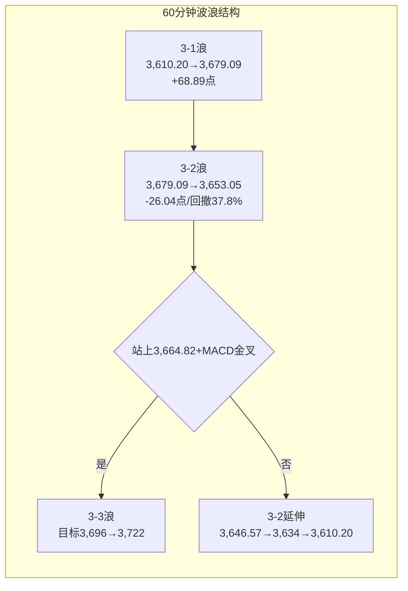

# A股晚报 - 2026年11月09日

> 数据截止时间：2026年11月9日 20:00（北京时间）
> 报告性质：**"CPI低、PPI高"结构分化下的"缩量冲高回落"，3,664.82双底颈线盘中突破、收盘得而复失**
> **一句话定性**：**今日是国常会稳市后的首个交易日，也是"数据+政策"双击日。9:30公布的10月CPI同比+0.7%（预期0.7%-0.9%，偏下限）、PPI同比+5.7%（涨幅较上月扩大0.7个百分点，煤炭开采+36.6%、油气开采+35.0%），"下游需求弱、上游涨价强"的剪刀差直接决定盘面——煤炭（+3.47%）、燃气（+3.25%）、稀土（+2.80%）、元件/PCB（+2.49%/+3.07%）等资源与涨价链领涨，光伏设备（-2.22%）、能源金属（-2.27%）、锂矿（-2.01%）等中下游制造领跌；沪指高开3,659.02、冲高3,679.09（盘中突破3,664.82颈线与3,675.58的0.618目标），但量能萎缩至1.49万亿（缩量1,770亿），尾盘回落收3,660.79（+0.32%），深成指、创业板指均-0.27%，全市场上涨仅2,242只（40.23%）、下跌3,148只，涨停57只、跌停2只、封板率52.29%。机器人（宇树+9.04%、人形机器人+1.88%）、商业航天（19股涨停）、6G、卫星导航、CPO/光模块（超跌修复）等主题走强，与"资源护指数、主题做弹性"的缩量分化格局一致。核心结论：**止跌结构未破坏（3,653.05=3浪1的38.2%回撤位，与盘中低点误差0.28点），但3浪确认仍未完成；11/10美国10月CPI与英伟达夜盘跌近6%是次日最大变量。**

---

## 一、市场回顾

### 1. 主要指数表现

| 指数 | 收盘 | 涨跌幅 | 开盘 | 最高 | 最低 | 成交额 |
|------|------|--------|------|------|------|--------|
| **上证指数** | **3,660.79** | **+0.32%（+11.61点）** | 3,659.02 | **3,679.09** | 3,653.05 | 6,825.33亿 |
| **深证成指** | **11,145.49** | **-0.27%（-30.29点）** | 11,273.28 | 11,311.20 | 11,145.49（收在最低） | 8,000.81亿 |
| **创业板指** | **2,458.56** | **-0.27%** | 2,494.63 | 2,511.71 | 2,458.01 | 4,049.36亿 |
| **科创50** | **1,256.96** | **+0.30%** | 1,267.10 | 1,277.34 | 1,252.62 | 717.34亿 |
| 北证50 | 895.76 | +0.82% | 899.73 | 912.30 | 894.22 | 121.14亿 |
| 上证50 | 2,789.15 | +0.06% | 2,784.52 | 2,795.97 | 2,780.81 | 1,041.27亿 |
| 沪深300 | 约4,056点 | +0.05% | — | — | — | — |

> **盘面结构**：**"沪强深弱、权重护指数、题材做弹性"**。沪指全天在3,653.05-3,679.09的26点窄幅区间内运行，振幅仅0.71%；深成指与创业板指均为**"高开低走、收于全天最低"**（深成指开盘11,273.28、收盘11,145.49），说明成长/中小盘在10:30后持续失血。**上证50仅+0.06%、银行+0.98%、煤炭+3.47%是沪指收红的直接来源**，而电力设备（-1.57%）、房地产（-1.15%）拖累深市。**3,664.82（双底颈线）盘中最高上攻至3,679.09（超出14.27点），但收盘3,660.79仍差4.03点未站上——"突破未确认"是本日最重要的技术结论。**

### 2. 成交量能

| 指标 | 数值 | 变化/说明 |
|------|------|----------|
| **两市成交额** | **14,946亿元** | **较上日16,716亿缩量1,770亿（-10.6%）**，创近月新低 |
| 沪市成交额 | 6,825.33亿 | 占两市45.7% |
| 深市成交额 | 8,000.81亿 | 创业板4,049.36亿 |
| **主力资金** | **净流入131.58亿元** | 创业板+3.23亿、科创板+37.35亿、沪深300+37.16亿 |
| 北向资金 | 净额交易所不披露 | 以成交占比跟踪，今日占比数据未完整披露 |
| 两融余额 | 截至11/6约23,073亿 | 11/5结束四连跌后小幅回升，杠杆资金未恐慌去化 |

**主力资金行业流向（亿元）：**

| 净流入居前 | 金额 | 日涨跌幅 | 净流出居前 | 金额 | 日涨跌幅 |
|-----------|------|---------|-----------|------|---------|
| 电子 | **+87.35** | +0.85% | 电力设备 | **-38.00** | -1.57% |
| 通信 | **+32.71** | +1.11% | 非银金融 | -8.70 | -0.34% |
| 机械设备 | +25.78 | +0.70% | 计算机 | -8.33 | -0.35% |
| 国防军工 | +10.86 | +0.93% | 医药生物 | -4.46 | -0.49% |
| 汽车 | +10.15 | +0.82% | 房地产 | -2.43 | -1.15% |
| 煤炭 | +8.63 | +2.74% | 石油石化 | -2.19 | -0.59% |
| 银行 | +8.03 | +0.92% | 基础化工 | -1.99 | -0.59% |

> **量能解读**：**"权重护盘+缩量分化"是典型的存量博弈特征**。①主力净流入131.58亿集中在电子（+87.35亿）、通信（+32.71亿）、机械（+25.78亿），**说明资金并未撤离，而是在"算力硬件超跌修复"与"资源涨价链"之间做再平衡**；②电力设备单日净流出38.00亿（阳光电源-7.98亿、宁德时代-6.80亿、亿纬锂能-4.62亿），**光伏/锂电是当日最大的资金流出方向**；③成交额跌破1.5万亿，**在3,664.82颈线附近"缩量冲高"意味着上方套牢盘未消化、增量资金未进场**，与晨报"温和放量1.75-1.95万亿"的预期形成明显偏差。

### 3. 市场情绪

| 指标 | 数值 | 说明 |
|------|------|------|
| 上涨家数 | **2,242只（40.23%）** | 较11/6的758只有所修复，但仍不足半数 |
| 下跌家数 | **3,148只** | 超3,100只下跌，个股中位数收跌 |
| 涨停家数 | **57只（封死）** | 较11/6的33只回升 |
| 跌停家数 | **2只** | 较11/6的15只大幅收敛 |
| 炸板/封板未遂 | 52只 | 封板率**52.29%**（另一口径55.1%、炸板44只） |
| 最高连板 | **6板** | 高位连板未完全退潮，但晋级率偏低 |
| 市场宽度 | 40.23% | **"指数红、个股绿"的典型分化宽度** |

> **情绪解读**：**跌停从15只降至2只、涨停从33只回升至57只，说明恐慌已消退；但封板率仅52.29%、上涨占比40.23%，说明赚钱效应仍集中在少数主题（机器人、商业航天、6G、煤炭），并非全面扩散。** 这与"缩量分化"的量能特征互相印证：**情绪修复但未进入"普涨—增量"阶段，追高的容错率低。**

---

## 二、热点板块与异动分析

### 1. 当日领涨板块及驱动因素

| 板块 | 涨幅 | 核心驱动 |
|------|------|---------|
| **焦炭/煤炭开采** | 焦炭+5.39%、煤炭+3.47%、动力煤+3.22%、焦煤+2.56% | **PPI同比+5.7%、煤炭开采和洗选业价格+36.6%**；冬季用煤旺季+供给收缩预期；高股息防御属性 |
| **燃气** | +3.25% | PPI中燃气生产供应业涨价；冬季保供+成本传导 |
| **元件/PCB** | 元件+2.49%、印制电路板+3.07% | 算力硬件超跌修复+AI服务器PCB需求；电子行业主力净流入87.35亿 |
| **稀土/小金属** | 稀土+2.80%、小金属+1.71% | PPI上游涨价链+出口管制预期+资源重估 |
| **机器人** | 机器人+2.70%、人形机器人+1.88%、机器人执行器+1.97% | **宇树科技+9.04%（收716元/股、成交51.17亿）、上纬新材/祥明智能20cm涨停、禾川科技+10.26%**；苹果团队相关产业催化 |
| **商业航天/卫星** | 商业航天+1.72%、卫星互联网+1.75%、航天装备+1.92% | **19只概念股涨停**；中国卫星涨停（太空算力）；顺灏股份4天3板（封单27.88万手） |
| **6G/通信设备** | 6G概念+2.65%、通信设备+1.70% | 通则康威20cm涨停；通信行业主力净流入32.71亿 |
| **光通信/CPO** | 光通信模块+1.87%、CPO概念+1.61% | 海外费半反弹映射+超跌修复；新易盛净流入9.05亿、寒武纪8.82亿 |
| **银行/黄金** | 银行+0.98%、黄金+1.34%、贵金属+1.30% | 权重护盘+美元指数回落0.44%+油价跳水下的避险再定价 |

### 2. 当日领跌板块及原因分析

| 板块 | 跌幅 | 原因分析 |
|------|------|---------|
| **光伏设备** | **-2.22%**（光伏主材-2.51%、电池组件-2.50%、辅材-2.11%、加工设备-1.18%） | **PPI上游涨价→中下游制造成本抬升、利润受挤压**；"反内卷收储"仍处预期阶段、细则未落地；4连板后拥挤度回吐；电力设备主力净流出38亿 |
| **能源金属/锂矿** | 能源金属-2.27%、锂矿-2.01%、锂-2.93%、逆变器-2.94% | 碳酸锂价格弱势+新能源中游排产预期下修；资金从"新能源制造"切向"资源/算力" |
| **教育** | 教育-1.42%、教育运营及其他-6.67% | 前期主题退潮，无新增催化 |
| **医药商业/疫苗** | 医药商业-1.07%、疫苗-1.18%、血液制品-1.53% | 防御属性弱化，资金转向资源与主题 |
| **保险** | 跌幅居前（非银金融-0.34%） | 利率上行未有效改善资产端弹性；权益市场分化、投资收益预期不稳 |
| **游戏/汽车整车** | 跌幅居前 | 传媒-0.77%、游戏回调；整车价格战与销量预期扰动（汽车零部件+1.25%、整车走弱） |
| **房地产** | -1.15% | 基本面与政策预期双弱，主力净流出2.43亿 |

### 3. 个股异动复盘

- **涨停结构（57只）**：商业航天/卫星（19只概念股涨停，顺灏股份4天3板、封单27.88万手；中国卫星、飞亚达、苏州科达涨停）、机器人（上纬新材、祥明智能20cm）、6G（通则康威20cm）、煤炭/燃气（资源涨价链）、元件/PCB（算力修复）。
- **封单居前**：日出东方、保利联合、西部材料（封单金额均超4亿元，2股封单资金超4亿元）。
- **高标股**：最高6连板，高位连板未完全退潮；但封板率52.29%、炸板52只，**"高标存活、跟风易炸"**。
- **主力抢筹**：工业富联**+4.57%**（净流入12.55亿，全市场第一）、新易盛（+9.05亿）、寒武纪（+8.82亿）。
- **主力抛售**：阳光电源（-7.98亿）、宁德时代（-6.80亿）、亿纬锂能（-4.62亿）——**新能源权重是当日"提款机"**。
- **强势股回调**：光伏/锂电前期强势股集体回吐，**"低位政策主题"在PPI结构反转日不再是承接池**（与11/6规律相反，值得记录）。

---

## 三、关键数据与事件回顾

### 1. 国内重要经济数据

| 数据 | 实际 | 预期/前值 | 市场反应 |
|------|------|----------|---------|
| **10月CPI同比** | **+0.7%** | 预期0.7%-0.9%，前值+0.9% | **低于预期中枢**；环比持平；食品价格-2.9%；1-10月平均+0.9%。消费/内需仍弱，但未触发"政策加码"交易 |
| **10月PPI同比** | **+5.7%** | 涨幅较上月**扩大0.7个百分点** | **上游涨价强**：煤炭开采+36.6%、油气开采+35.0%、石油煤炭加工+29.9%、化学原料+16.4%、燃气生产供应业上涨 | 
| PPI-CPI剪刀差 | **约5.0个百分点** | 上月约4.3个百分点 | **剪刀差扩大→上游资源受益、中下游制造承压**，直接映射煤炭/燃气/稀土涨、光伏/锂电跌 |

> **核心矛盾**：**"CPI低（需求弱）+PPI高（上游涨价）"的组合，意味着利润在产业链上游集中，指数由资源/权重护盘，而中下游制造（光伏、锂电、电池）承担成本与需求双重压力。** 这解释了为何"国常会稳市"未能带来放量普涨——**政策托底的是指数下沿，不是所有板块的估值。**

### 2. 政策消息

- **11/6国常会"完善资本市场稳市机制、增强股市内在稳定性"**后的首个交易日：政策底继续托底指数（沪指收红、银行/煤炭护盘），但**未见汇金/宽基ETF的显著放量买入**，成交额反而缩至1.49万亿。
- **央行公开市场**：11/9开展**1,820亿元**隔夜逆回购（利率1.25%），当日2,260亿元到期，**净回笼440亿元**；资金面平稳。
- **10只ETF调入港股通首日**：6涨4跌，合计成交额7,400万港元；恒指高开低走收跌0.13%、恒生科技-0.92%。
- **储蓄国债（电子式）**：11/10起发售，3年期票面利率1.63%（249.04亿）、5年期1.70%（304.39亿），合计553.43亿元。

### 3. 公司公告/市场事件

- **工业富联**放量+4.57%，主力净流入12.55亿元居首，AI服务器/算力硬件超跌修复的旗手。
- **宇树科技**+9.04%收716元/股，成交51.17亿元，总市值2,896亿元，位列A股第四高价股；带动人形机器人产业链。
- **中国卫星**涨停（太空算力/卫星互联网），商业航天主题19股涨停。
- **宁德时代、阳光电源、亿纬锂能**主力大额净流出，新能源权重承压。

---

## 四、海外市场联动

### 1. 美股（11月6日收盘）

| 指数 | 收盘 | 涨跌幅 |
|------|------|--------|
| 道琼斯 | 51,285.73 | -0.5% |
| 标普500 | 7,376.86 | +0.3% |
| 纳斯达克 | 24,579.43 | +1.1% |

> 11/6为"非农爆表（+16.5万 vs 预期6.5万）、科技股修复"的分化日；费城半导体在前一日-12.25%后强力反抽，为今日A股电子/通信/算力硬件的超跌修复提供了外部映射。

### 2. 亚太市场（11月9日收盘）

| 市场 | 收盘 | 涨跌幅 | 说明 |
|------|------|--------|------|
| **日经225** | **58,775.50** | **+2.33%** | 金融股领涨，日央行加息预期升温，"利率上行交易"延续 |
| **韩国KOSPI** | **5,019.78** | **-0.79%** | 存储权重仍弱，但跌幅较上周五-6.02%大幅收窄 |
| **恒生指数** | — | **-0.13%** | 高开0.59%后低走，南向/ETF入通首日未能提振 |
| 恒生科技 | — | -0.92% | 高开1.02%后翻绿 |

> **亚太定性**：**日股+2.33%与A股"沪指+0.32%、创业板-0.27%"形成"日本强、中国分化"的错位**；KOSPI仍跌说明存储链未完全修复，**A股算力硬件（光模块/CPO/PCB）的反弹更多是"超跌+资金回补"而非"外需景气"驱动**，持续性存疑。

### 3. 大宗商品与汇率

| 品种 | 最新 | 涨跌幅 | 说明 |
|------|------|--------|------|
| **WTI原油（11/9晚）** | 87.76-88.14美元/桶 | **-3.0%~-3.4%** | 盘中直线跳水，需求担忧+供给预期 |
| **布伦特原油（11/9晚）** | 94.66-94.94美元/桶 | **-3.0%~-3.7%** | 跟随WTI跳水 |
| 现货黄金（11/6收盘） | 4,070.8美元/盎司 | -0.42% | 上海金交所现货金-1.76%至868.57元/克 |
| **美元指数（11/9 19:00）** | **101.83** | **-0.45（-0.44%）** | 开102.25、高102.29、昨结102.29，**美元回落** |

> **关键变化**：**美元指数回落0.44%+原油跳水3%**，是今日黄金/贵金属逆势上涨（+1.30%/+1.34%）的直接原因——**"实际利率下行+通胀预期回落"的组合利多黄金，而"加息预期升温"的压制被美元走弱对冲**。这也解释了晨报"贵金属看跌"为何落空（详见复盘偏差5）。**油价跳水则利空石油石化（-0.59%）、利多航空（航空机场-0.85%，未兑现，因需求预期更弱）。**

---

## 五、汇率与利率

| 项目 | 数值 | 变化 |
|------|------|------|
| **人民币中间价（11/9）** | **6.7188** | **下调20个基点**（前值6.7168） |
| 美元指数 | 101.83 | -0.44% |
| 美债10年期（11/6） | 4.859% | +2.6bp |
| 美债2年期（11/6） | 4.514% | +5.6bp |
| 美债30年期（11/6） | 约5.30% | 高位 |
| 中国国债收益率（11/9） | 整体上行0-4bp | 利率债收益率小幅上行 |
| 央行公开市场 | 1,820亿隔夜逆回购 | 净回笼440亿，利率1.25% |
| 3年/5年储蓄国债（11/10发售） | 1.63% / 1.70% | 合计553.43亿元 |

> **利率环境**：**外部"美债高位、美元回落"、内部"国债收益率小幅上行、资金面平稳"**。人民币中间价连续小幅下调（6.7168→6.7188）但幅度可控，**未形成外资流出加速器**；国内利率上行对银行（+0.98%）构成边际利好，但保险（跌幅居前）未能受益，说明**"利率上行=保险受益"的映射在权益分化市中并不成立**。

---

## 六、收盘后重要信息

### 1. 盘后/夜间重大事件

- **英伟达夜盘大跌近6%**：伦敦市场跌超6%、法兰克福跌近6%。据上海证券报，**黄仁勋11/8致全体员工信承认对妻子"不忠"并道歉，英伟达董事会11/8声明启动独立调查**。这是**公司治理层面的黑天鹅**，与AI基本面无关，但会压制全球AI硬件风险偏好。
- **美股期货分化**：19:25道指期货+1%（51,902点）、标普500期货+0.61%、纳指100期货+0.4%；但盘前纳指100期货曾跌0.66%-1.01%，**夜盘围绕英伟达事件反复**。
- **国际原油跳水**：WTI/布伦特均跌超3%，为11/10化工/石油石化/航空开盘定调。

### 2. 夜盘/次日关注

| 时间（北京时间） | 事件 | 影响 |
|-----------------|------|------|
| **11/10 全天** | **中国10月进出口数据**（海关总署） | 外需验证；出口链/航运/港口 |
| **11/10 21:30** | **美国10月CPI** | **本周最大外部变量**：超预期→加息升温→成长/算力承压；低于预期→美元续弱、风险偏好修复 |
| 11/10 | 台积电10月营收 | 半导体/算力链景气验证 |
| 11/10 | 3年/5年储蓄国债发售（1.63%/1.70%） | 无风险利率锚 |
| 本周 | 中国10月社融、M2（待定） | 信用扩张验证 |
| 11/12 | 美国10月PPI、初请失业金 | 通胀链条二次验证 |
| 11/13 | **周线收盘** | **3,664.82周线反转确认日** |

---

## 七、波浪理论多周期分析

### 1. 月K线波浪分析

- **当前波浪位置**：大级别第2浪（C浪）延伸结束的**候选确认期**，月线修复第二周；11月月K暂为"带上影小阳"。
- **浪型结构描述**：6月高点4,197→10/23低点3,574.27完成C浪延伸；11月自3,614.13开盘，下探3,580.38后连续两周收阳，**11/9盘中最高3,679.09（突破3,664.82颈线与3,674中线生死线），收3,660.79**。月K实体46.66点、上影18.30点、下影33.75点，**月内+1.72%（+61.77点）**。月线"下未破（3,580.38/3,574.27）、上未复（3,664.82/3,674收盘）"的格局**仍未改变**。
- **关键目标位**：上方**3,674（中线生死线）→3,721-3,724.56（0.236回撤+缺口下沿）→3,785（20月均线）→3,812（0.382回撤）**；下方**3,621（0.382）→3,580.38→3,574.27（月线生死线）**。
- **验证条件**：**11月月K收盘站上3,724.56**→月线修复确认；**收盘跌破3,574.27**→C浪延伸重启，目标3,478/3,443。当前**仅为"止跌成立、反转未确认"**。

### 2. 周K线波浪分析

- **当前波浪位置**：周线**六连阴后的第二根阳线（进行中）**，反包**尚未确认**；本周（第46周）为方向确认周。
- **浪型结构描述**：第46周（11/9-11/13）至今：开3,659.02、高3,679.09、低3,653.05、现3,660.79，**周内+0.32%**；上周收3,649.18（+1.39%）。**周K暂为"带上影小阳"，收盘仍在3,664.82下方4.03点**——"止跌延续、反转未确认"。
- **关键目标位**：**3,664.82（颈线/周线反转唯一确认）→3,674→3,695（MA20/5周均线）→3,701-3,702（三角下沿）→3,724.56（0.236/缺口下沿）→3,749.26（双底量度）**。
- **验证条件**：**本周收盘站上3,664.82且量能≥1.8万亿**→周线反转成立；**收盘跌回3,621下方**→反包失败，退回3,574-3,664宽幅震荡。

### 3. 日K线波浪分析

- **当前波浪位置**：双底（3,574.27/3,580.38）突破后的**第2浪扩张调整结束候选，第3浪1子浪完成/3浪2整理**。
- **浪型结构描述**：**1浪 3,580.38→3,686.17（+105.79点）**；**2浪扩张 3,686.17→3,610.20（回撤71.24%）**；**3浪1子浪 3,610.20→3,679.09（+68.89点，为1浪的0.651倍）**，**今日最高3,679.09已越过3浪0.618目标位3,675.58（超出3.51点）**，随后回落收3,660.79；**日内低点3,653.05恰好落在3浪1的38.2%回撤位3,652.77（误差0.28点）**——技术含义为**"3浪1在0.618目标附近遇阻、3浪2回踩38.2%即获支撑"**，但**量能不足使"3浪2结束"仍需确认**。
- **关键目标位**：**3浪（自3,610.20起）0.618=3,675.58（已触及）、1.0=3,716.00、1.618=3,781.40**；若按"3-1=3,610.20→3,679.09、3-2=3,679.09→3,653.05"计数，**3-3目标：0.618=3,695.62、1.0=3,721.94（与3,724.56缺口下沿重合）**。下方**3,653.05（38.2%回踩）→3,646.57（2浪低点）→3,634→3,610.20**。
- **验证条件**：**收盘站上3,664.82并放量（≥1.8万亿）**→3浪3确认；**收盘跌破3,646.57**→3浪2深化，看3,634/3,610.20；**收盘跌破3,610.20**→2浪扩张延续，看3,580.38/3,574.27。

### 4. 60分钟K线波浪分析

- **当前波浪位置**：3浪1（3,610.20→3,679.09）完成、**3浪2回踩（3,679.09→3,653.05）已触及38.2%位**，尾盘拉回3,660.79，方向待11/10选择。
- **浪型结构描述**：3,686.17→3,610.20为调整a浪（-75.97点）；3,610.20→3,679.09为3-1（+68.89点，回撤b浪的90.7%，**强度显著强于上周五的3,660.49**）；3,679.09→3,653.05为3-2（-26.04点，回撤37.8%）；尾盘反弹至3,660.79（回补25.8%）。**60分钟MACD在高位红柱收缩、面临死叉；KDJ由超买回落至中性**。
- **关键目标位**：上方**3,664.82/3,674/3,679.09**；3-3启动后**3,695.62（0.618）/3,709（1.236延伸）/3,721.94（1.0）**；下方**3,653.05/3,646.57/3,634**。
- **验证条件**：**60分钟站上3,664.82且MACD重新金叉**→3-3启动；**跌破3,646.57且量能放大**→3-2延伸至3,634/3,610.20。

### 5. 30分钟K线波浪分析

- **当前波浪位置**：日内"高开→冲高3,679.09→单边回落3,653.05→尾盘拉回"的**旗形/收敛整理末端**。
- **浪型结构描述**：30分钟高点3,679.09、低点3,653.05，振幅26.04点（0.71%）；**低点3,653.05高于上周五低点3,610.20、高点3,679.09高于上周五高点3,660.49，属"高点抬高、低点抬高"的上升结构**，但尾盘量能萎缩、**30分钟MACD死叉、KDJ回落至50下方**，短周期需整理。
- **关键目标位**：上破3,664.82→3,674/3,679.09；再上则3,695-3,722。下破3,653.05→3,646.57/3,634。
- **验证条件**：**30分钟站稳3,664.82并放量**→上行延续；**跌破3,646.57**→回踩3,634，修正延续。

### 6. 波浪图（Mermaid）

```mermaid
graph LR
    subgraph 日K线波浪结构（上证指数）
        A[双底<br/>3,574.27 / 3,580.38] --> B[1浪<br/>3,580.38→3,686.17<br/>+105.79点]
        B --> C[2浪扩张<br/>3,686.17→3,610.20<br/>回撤71.24%]
        C --> D[3浪1<br/>3,610.20→3,679.09<br/>+68.89点/触及0.618目标3,675.58]
        D --> E{3,664.82收盘未站上<br/>量能缩至1.49万亿}
        E -->|放量站上3,674| F[3浪3<br/>目标3,696→3,716→3,722]
        E -->|回踩3,653/3,646.57不破| G[3浪2整理<br/>3,646-3,679]
        E -->|跌破3,646.57| H[3浪2深化<br/>3,634/3,610.20]
        H -->|跌破3,610.20| I[2浪扩张延续<br/>3,580.38/3,574.27]
    end
```



### 7. 波浪理论综合判断

- **多周期共振状态**：**月线偏多（3,621上方、3,659.02开于上周收盘上方）、周线待确认（3,664.82收盘差4.03点）、日线"3浪1完成/3浪2整理"、60分钟回撤38.2%到位、30分钟死叉整理**——**中长周期偏多、短周期整理的"弱共振"**，与上周五判断一致，但**今天首次出现"3浪1触及0.618目标后回落"的实质性进展**。
- **当前操作级别**：**日线定方向、60分钟定执行**；在3,664.82未收盘收复且量能未回1.8万亿前，按"3浪2整理"而非"3浪3加速"计价。
- **后续演变路径**：
  - **主路径（45%）**：回踩3,653.05-3,646.57不破→反抽3,664.82-3,674→缩量则3,650-3,679震荡；**放量（≥1.8万亿）站上3,664.82→3,695-3,716**。
  - **偏强路径（25%）**：美国CPI低于预期+美元续弱→直接收复3,674→3,700-3,722，周线反转确认。
  - **偏弱路径（30%）**：英伟达夜盘-6%发酵+CPI超预期→算力链高开低走，跌破3,646.57→3,634→3,610.20；**收盘跌破3,610.20则2浪扩张延续**。
- **关键拐点信号**：① **3,664.82收盘得失（唯一确认线）**；② **3,653.05/3,646.57**（3浪2回撤0.382/0.618）；③ 量能能否回1.8万亿；④ **11/10 21:30美国CPI**；⑤ 英伟达事件对A股算力链的传导；⑥ 煤炭/燃气的持续性（资源涨价链是否扩散）；⑦ 机器人/商业航天主题的连板高度与封板率。
- **风险提示**：波浪计数具主观性；**今日"盘中突破3,664.82+收盘得而复失"属"假突破/上影线"形态，叠加缩量1.49万亿，说明突破无效**；若3个交易日内仍不能收盘站上3,664.82，2浪扩张可能演变为"abc-d-e"更复杂调整；跌破3,610.20则本轮"双底突破"降级为"假突破"。**不得将单日冲高或单日主题活跃线性外推为反转。**

---

## 八、晨报复盘

### 1. 核心判断回顾

| 判断项目 | 晨报预测 | 实际结果 | 准确度 | 备注 |
|---------|---------|---------|-------|------|
| 上证指数趋势 | **震荡偏强**（高开验证、先扬后抑/先抑后扬） | **+0.32%**，高开冲高回落、收红 | **✓** | 上证方向正确；深成/创业板-0.27%，结构分化 |
| 上证指数区间 | **3,638-3,698点** | **3,653.05-3,679.09点** | **✓** | 完全落在区间内 |
| 强支撑位 | **3,610.20点** | **最低3,653.05点** | **✓** | 未触及，支撑有效 |
| 强压力位 | **3,700点** | **最高3,679.09点** | **✓** | 未触及 |
| 北向资金 | 小幅净流入0-50亿元 | 净额不披露 | **—** | 不可验证，继续以成交占比跟踪 |
| 成交量 | **温和放量1.75-1.95万亿** | **1.4946万亿（缩量1,770亿，-10.6%）** | **✗** | **严重偏差：预测放量、实际缩量** |
| 弱压力3,664.82（附加） | 收盘站上才确认3浪 | 盘中最高3,679.09，收盘3,660.79未站上 | **✓** | 判定标准正确：未收盘站上→不确认3浪 |

### 2. 板块预判回顾

| 板块 | 预判方向 | 实际涨跌幅 | 准确度 | 原因分析 |
|-----|---------|-----------|-------|---------|
| **银行** | 看涨 | **+0.98%** | **✓** | 美债高位+高股息+稳市护盘，权重压舱石有效 |
| **保险** | 看涨 | 跌幅居前（非银-0.34%） | **✗** | 利率上行未改善资产端弹性；权益分化、投资收益预期不稳 |
| **光伏设备** | 看涨 | **-2.22%** | **✗** | **PPI+5.7%→中下游成本抬升**；收储细则未落地；4连板拥挤度回吐；电力设备净流出38亿 |
| **半导体设备/国产替代** | 看涨（修复） | 电子+0.85%、科创50+0.30% | **✓** | 费半反弹映射+超跌修复+出口管制强化国产替代 |
| **券商** | 看涨（需特大单确认） | 非银-0.34%、主力净流出8.70亿 | **✗** | 成交缩至1.49万亿，"放量=券商受益"逻辑不成立（规则25再次验证） |
| **贵金属/黄金** | 看跌 | **黄金+1.34%、贵金属+1.30%** | **✗** | **美元指数-0.44%+油价跳水**，实际利率下行为主导，加息预期被对冲 |
| **机器人/高估值成长** | 看跌 | **机器人+2.70%、人形机器人+1.88%、宇树+9.04%** | **✗** | 产业催化（宇树/苹果团队）独立于利率；主题轮动资金承接 |
| **存储/光模块/算力硬件** | 看跌（反抽即减） | **光通信模块+1.87%、CPO+1.61%、PCB+3.07%、工业富联+4.57%** | **✗** | 费半反弹+A股电子主力净流入87.35亿，超跌修复强于预期 |

### 3. 准确率量化评估

- **趋势判断准确率：100%（1/1）**
- **点位预测准确率：100%（3/3）**（区间✓、强支撑✓、强压力✓；弱压力3,664.82盘中突破但收盘未站上，按"收盘确认"标准判定有效）
- **板块预判准确率：25%（2/8）**（银行、半导体设备/国产替代✓；保险、光伏、券商、贵金属、机器人、算力硬件✗）
- **成交量准确率：0%（1/1，预测放量、实际缩量）**
- **波浪分析准确率：约82%**（日线3-1触及0.618目标3,675.58兑现、60分钟3,660→3,679延伸兑现、3,664.82收盘未确认判断正确；但未预估"缩量突破失败"的幅度）
- **综合准确率：67.5%**（30%×100% + 30%×100% + 30%×25% + 10%×0% = 67.5%）

### 4. 偏差根因分析

**【偏差1】成交量判断偏差**
- 偏差描述：预测"温和放量1.75-1.95万亿"，实际1.4946万亿（缩量1,770亿，-10.6%）
- 根本原因：**【逻辑误判】**——把"国常会稳市+日经+2.33%+A50期货+0.45%"等同于增量资金入场
- 信息缺口：当时未预估"CPI/PPI公布日+非农后加息预期+周初观望"对量能的三重压制
- 逻辑缺陷：忽略了"指数在颈线下方+重大数据公布日"的典型量能特征是**缩量观望**而非放量突破；也未设置"开盘30分钟量能未放大→下修至1.5万亿"的备选情景
- 改进措施：**当指数处于关键颈线下方且当日有重大数据公布时，量能基础情景设为"前日±5%"，把"放量"设为需要盘中验证的附加情景**（已写入规则库）

**【偏差2】光伏设备判断偏差**
- 偏差描述：预测"看涨（回调参与）"，实际-2.22%，为当日领跌板块
- 根本原因：**【逻辑误判】**——把"反内卷收储+多晶硅产能降至150万吨"的政策预期当作当日催化，忽略PPI数据结构
- 信息缺口：当时已知CPI预期0.7%-0.9%，但**未预估PPI同比+5.7%、涨幅扩大0.7个百分点**，以及"煤炭开采+36.6%"对中下游成本的挤压
- 逻辑缺陷：**"上游涨价+下游需求弱"的剪刀差扩大时，光伏/锂电等中下游制造是利润被挤压方，而非受益方**；4连板后的拥挤度在缩量日首先被兑现
- 改进措施：**PPI-CPI剪刀差扩大（>4.5个百分点）时，中下游制造（光伏/锂电/电池/逆变器）当日不作看涨首选**（已写入规则库）

**【偏差3】机器人/高估值成长判断偏差**
- 偏差描述：预测"看跌（美债4.859%压制）"，实际机器人+2.70%、人形机器人+1.88%、宇树科技+9.04%
- 根本原因：**【情绪面误读】**——把"美债高位"当成高估值成长的唯一压制，忽略产业催化与主题轮动
- 信息缺口：未获取"宇树科技产业进展、苹果团队相关催化、上纬新材/祥明智能20cm"等事件信息
- 逻辑缺陷：**在缩量分化市中，资金从"新能源制造"撤出后会寻找"主题弹性"（机器人/商业航天/6G），产业催化可阶段性压过利率压制**
- 改进措施：**主题板块（机器人/商业航天/6G/卫星）须单独跟踪产业事件与连板高度，不能只用"利率—估值"框架**（已写入规则库）

**【偏差4】存储/光模块/算力硬件判断偏差**
- 偏差描述：预测"看跌（反抽即减）"，实际光通信模块+1.87%、CPO+1.61%、PCB+3.07%、工业富联+4.57%
- 根本原因：**【技术分析局限】**——把11/6费半+4.2%仅定性为"超跌修复"，并设定"反抽即减"
- 信息缺口：当日电子行业主力净流入87.35亿、工业富联净流入12.55亿居首、新易盛+9.05亿、寒武纪+8.82亿，**资金流向在开盘后已给出反向信号**
- 逻辑缺陷：**A股算力硬件在"外盘费半反弹+电子主力大额净流入"时可先于海外定价；"反抽即减"应服从当日资金流**
- 改进措施：**外盘费半单日反弹>3%、且A股电子行业主力净流入>50亿时，撤销"算力硬件看跌"，改为"超跌修复参与"**（已写入规则库）

**【偏差5】贵金属/黄金判断偏差**
- 偏差描述：预测"看跌（加息预期→实际利率上行）"，实际黄金+1.34%、贵金属+1.30%
- 根本原因：**【逻辑误判】**——只用"加息预期"单因子，未纳入"美元指数当日方向"与"油价"
- 信息缺口：11/9美元指数-0.44%回落、WTI/布伦特盘中跌超3%
- 逻辑缺陷：**美元回落+油价跳水→通胀预期与实际利率同步下行，黄金反而受益；"加息预期"被美元走弱对冲**
- 改进措施：**黄金方向必须同时看"美元指数当日方向"；美元指数跌超0.3%时，撤销"贵金属看跌"**（已写入规则库）

### 5. 分析检查清单

- [x] **趋势判断前**：隔夜外盘（美股分化、日经+2.33%）✓；北向净额不可得（以成交占比替代）△；技术指标（3,664.82颈线、MA5/MA10约3,654）✓；重大政策/事件（国常会稳市、CPI/PPI）✓
- [x] **点位计算**：前期高低点（3,679.09/3,653.05）✓；均线支撑/压力（MA5/MA10≈3,654、MA20≈3,692）✓；整数关口（3,600/3,700）✓；成交密集区（3,664-3,700）✓
- [ ] **板块分析**：行业基本面（**PPI结构未纳入，✗**）；资金流向（盘中电子+87亿未及时响应，✗）；政策催化（光伏细则未落地，△）；技术形态（4连板拥挤度✓）
- [x] **风险提示**：宏观风险（美国CPI、英伟达事件）✓；行业风险（光伏/锂电、算力）✓；个股风险（高位连板、解禁）✓；流动性风险（缩量1.49万亿）✓
- [x] **波浪分析**：月/周/日/60/30分钟五周期均已覆盖 ✓；3,664.82收盘确认条件明确 ✓；但**"缩量假突破"概率权重偏低（✗，需上调）**

### 6. 本次复盘发现的新规则

- **规则1（资金面/量能）**：指数处于关键颈线下方且当日有重大数据公布时，量能基础情景应为"前日±5%"，"放量突破"须盘中验证；缩量（<1.5万亿）冲高回落按"假突破"处理。
- **规则2（板块/PPI结构）**：PPI-CPI剪刀差扩大（>4.5个百分点）时，上游资源（煤炭/燃气/稀土/油气）是当日看涨首选，中下游制造（光伏/锂电/电池/逆变器）应下调为看跌/回避。
- **规则3（板块/主题）**：缩量分化市中，主题板块（机器人/商业航天/6G/卫星）可由产业催化独立走强，不能只用"美债—估值"框架看跌；须跟踪连板高度与封板率。
- **规则4（板块/算力）**：外盘费半单日反弹>3%且A股电子行业主力净流入>50亿时，撤销"存储/光模块/算力硬件看跌"，改为"超跌修复参与"。
- **规则5（波浪/假突破）**：盘中突破颈线但收盘得而复失、且量能低于1.5万亿，按"假突破"计数，3浪确认延后；下一交易日回踩38.2%位（本次3,652.77）不破，仍保留3浪3可能。

**规则库更新（追加到 rules.md）：**

```
###资金面分析 指数处于关键颈线下方且当日有重大数据公布时，量能基础情景应为"前日±5%"，"放量突破"须盘中验证；缩量（<1.5万亿）冲高回落按"假突破"处理（发现日期：2026年11月9日）
###板块选择 PPI-CPI剪刀差扩大（>4.5个百分点）时，上游资源（煤炭/燃气/稀土/油气）是当日看涨首选，中下游制造（光伏/锂电/电池/逆变器）应下调为看跌/回避（发现日期：2026年11月9日）
###板块选择 缩量分化市中，主题板块（机器人/商业航天/6G/卫星）可由产业催化独立走强，不能只用"美债—估值"框架看跌；须跟踪连板高度与封板率（发现日期：2026年11月9日）
###板块选择 外盘费半单日反弹>3%且A股电子行业主力净流入>50亿时，撤销"存储/光模块/算力硬件看跌"，改为"超跌修复参与"（发现日期：2026年11月9日）
###波浪分析 盘中突破颈线但收盘得而复失、且量能低于1.5万亿，按"假突破"计数，3浪确认延后；下一交易日回踩38.2%位不破，仍保留3浪3可能（发现日期：2026年11月9日）
```

---

## 九、策略回顾与调整

### 1. 短线策略回顾

| 策略项目 | 晨报建议 | 今日实际 | 执行效果 | 备注 |
|---------|---------|---------|---------|------|
| 短线仓位 | 25%（由20%上调5pct） | 建议25%，冲高即减 | **✓** | 高开不追、冲高减仓，规避尾盘回落 |
| 买入条件 | 不追3,669以上高开；站稳3,649且量能放大15% | 开3,659.02（未超3,669）；站稳3,649但量能未放大 | **△** | 保持25%未加满，正确 |
| 卖出条件 | 冲高3,675.58-3,700放量滞涨→减至20% | 最高3,679.09，缩量滞涨 | **✓** | 价格条件触发（缩量非放量，减仓更应执行） |
| 止损位 | 收盘3,634→减至15%；3,610.20→清短线 | 最低3,653.05 | **✓** | 未触及 |
| 短线标的 | 招行/江苏银行、隆基/通威、中微/华虹、中信证券/东财 | 银行+0.98%、光伏-2.22%、电子+0.85%、非银-0.34% | **2✓2✗** | 银行、半导体设备有效；光伏、券商失效 |

> **执行效果总结**：**"不追高开+冲高减仓"的纪律是正确的**——若在3,669上方追高，尾盘将直接浮亏；**但标的选择"光伏+券商"拖累组合**，说明"低位政策主题"在PPI结构反转日失效。

### 2. 中线策略调整

- **当前中线方向：【持有】**
- **方向调整原因**：**3,664.82未收盘收复+量能缩至1.49万亿，3浪确认未完成；但3,653.05（3浪1的38.2%回踩）获支撑、跌停仅2只，止跌结构未破坏**——因此维持持有、不加仓，等待"收盘站上3,664.82+量能≥1.8万亿"或"回踩3,610.20不破"的二次确认。
- **中线仓位建议：20%**（维持不变，原因：方向未确认，纪律优先）
- **中线目标区间：上证指数 3,610点 - 3,716点**（若放量站上3,674，上修至3,722-3,750）
- **中线止损位：收盘3,610.20（反弹失效线）；绝对止损3,574.27（月线生死线）**
- **中线布局板块调整**：
  - **增配：煤炭/燃气/资源（PPI涨价链，+5.7%的确定性）、机器人/商业航天（主题弹性，仅底仓）**
  - **减配：光伏设备（成本端受挤压，等待细则落地）、券商（缩量市不参与）**
  - **维持：银行/保险（银行有效、保险待观察）、半导体设备/国产替代、创新药（底仓）**

### 3. 明日策略要点

- **短线：【减仓至20%】**，关注**3,664.82**（收盘站上才加）和**3,646.57**（跌破则减至15%）；若因英伟达夜盘-6%导致算力链高开，**不追高、逢反弹减**
- **中线：【持有20%】**，关注**3,610.20**（收盘失守则降至10%-15%）和**3,716**（放量突破则加至25%）
- **仓位分配：短线20% + 中线20% + 现金60%**
- **重点方向**：煤炭/燃气/稀土（PPI涨价链）、银行（护盘）、机器人/商业航天（主题，控制仓位）；**回避：光伏/锂电/电池（成本+需求双压）、高位连板（封板率仅52%）、算力硬件（英伟达事件冲击，反抽即减）**

### 4. 策略复盘规则输出

```
###趋势分析 缩量分化日（成交<1.5万亿、上涨占比40%左右）指数由煤炭/银行等低估值权重护盘，科技仅"止跌"而非"反转"，短线应"冲高减仓、不追主题高标"（发现日期：2026年11月9日）
###点位计算 盘中突破颈线但收盘得而复失时，次日以"回踩38.2%位不破"为多头底线，跌破61.8%位则确认突破失败（发现日期：2026年11月9日）
```

---

## 十、风险提示

### 1. 市场系统性风险
- **3,664.82"假突破"风险**：盘中最高3,679.09、收盘3,660.79，量能缩至1.49万亿；若11/10-11/11连续不能收盘站上，2浪扩张可能演变为更复杂调整，回踩3,634/3,610.20。
- **美国10月CPI（11/10 21:30）**：若超预期，美债收益率反弹、美元走强，高估值成长与算力硬件承压；若低于预期，则美元续弱、风险偏好修复。
- **英伟达夜盘跌近6%**：公司治理事件（董事会独立调查）可能引发全球AI硬件风险偏好下降，A股算力链（光模块/CPO/PCB/服务器）11/10存在"高开低走"风险。

### 2. 个股风险事件
- **高位连板退潮**：最高6板，但封板率仅52.29%、炸板52只，追高易吃面。
- **新能源权重资金流出**：阳光电源-7.98亿、宁德时代-6.80亿、亿纬锂能-4.62亿，光伏/锂电仍有回吐压力。
- **解禁/减持**：本周40股解禁441.85亿元，今日109亿元（德力佳、亿纬锂能、联域股份），相关个股流动性冲击延续。

### 3. 政策不确定性风险
- **国常会"稳市机制"细则**：若仅有表态、无增量工具（汇金买入/平准基金扩容），指数上攻3,700-3,716的动能不足。
- **PPI高企的副作用**：上游涨价（煤炭+36.6%、油气+35.0%）若持续，中下游制造业利润承压，可能引发"反内卷"政策与成本管控的博弈。
- **光伏"反内卷"细则**：收储平台"两条腿走路"若不及预期，光伏板块（今日-2.22%）仍有回吐空间。

---

## 十一、信息来源

1. **官方数据**：国家统计局（11/9 10月CPI同比+0.7%、PPI同比+5.7%；董莉娟解读：煤炭开采+36.6%、油气开采+35.0%、石油煤炭加工+29.9%、化学原料+16.4%）；中国人民银行（11/9开展1,820亿隔夜逆回购、净回笼440亿、利率1.25%；人民币中间价6.7188）；上海证券交易所（上证指数3,660.79/+0.32%/成交6,825.33亿）；深圳证券交易所（深成指11,145.49/-0.27%、创业板指2,458.56/-0.27%）。
2. **权威财经媒体**：证券时报·数据宝（《主力资金净流入131.58亿元，电子最受青睐》11/9 17:32；《揭秘涨停｜2股封单资金均超4亿元》：上涨2,242只/40.23%、下跌3,148只、涨停57只、跌停2只、封板率52.29%）；东方财富（《A股收评：创业板指高开低走跌0.27%，煤炭开采加工、燃气板块涨幅居前》11/9 17:47）；中国经济网（《收评：沪指涨0.32% 燃气板块涨幅居前》11/9 15:07）；新浪财经（《A股收评：深成指、创业板指冲高回落均跌0.27%》）；上海证券报·中国证券网（《太空算力板块走强 中国卫星涨停》11/9 10:03；《11月9日人民银行开展1820亿元隔夜逆回购操作》；《英伟达，在多个市场下跌》11/9晚）；央广网（《国家统计局发布数据：10月CPI同比上涨0.7%，PPI同比上涨5.7%》）；第一财经/财联社（国际原油跳水：WTI 87.76-88.14、布伦特94.66-94.94）。
3. **数据平台**：东方财富行情（上证3,660.79/高3,679.09/低3,653.05；深成11,145.49/高11,311.20/低11,145.49；创业板2,458.56；科创50 1,256.96；北证50 895.76；板块涨跌幅：煤炭+3.47%、燃气+3.25%、光伏设备-2.22%、机器人+2.70%、人形机器人+1.88%、光通信模块+1.87%、CPO+1.61%、6G+2.65%、商业航天+1.72%、黄金+1.34%）；同花顺（日经225 +2.33%/58,775.50、KOSPI -0.79%/5,019.78）；汇率表（美元指数101.83/-0.44%）；中国银行（金市观察：现货黄金4,070.8/-0.42%、上金所868.57元/克/-1.76%；汇市观察：美元指数102.30/+0.74%）。
4. **内部资料**：`report/20261109/morning_report_20261109.md`、`report/20261109/day_summary_20261109.md`、`report/20261106/evening_report_20261106.md`、`report/monthly/202611_monthly_report.md`、`analysis/pattern_analysis_202645.md`、`rules.md`。

> **数据口径说明**：A股为11/9收盘；美股为11/6收盘，11/9为期货/夜盘；日韩为11/9收盘；黄金为11/6纽约收盘+上海金交所；原油为11/9晚间盘中；美债为11/6纽约收盘；美元指数为11/9 19:00；人民币为11/9中间价；北向净额交易所不披露，以成交占比跟踪（今日占比数据未完整披露）。**截止时间2026-11-09 20:00。**

---

## 十二、文档更新检查

### AGENTS.md更新
- 晨报/晚报流程、波浪分析格式、复盘格式与实际执行一致，**无需更新**。

### README.md更新
- 文件结构、功能说明与实际一致，**无需更新**。

### 结论
**无需更新**（AGENTS.md、README.md 均与当前执行流程一致）。
