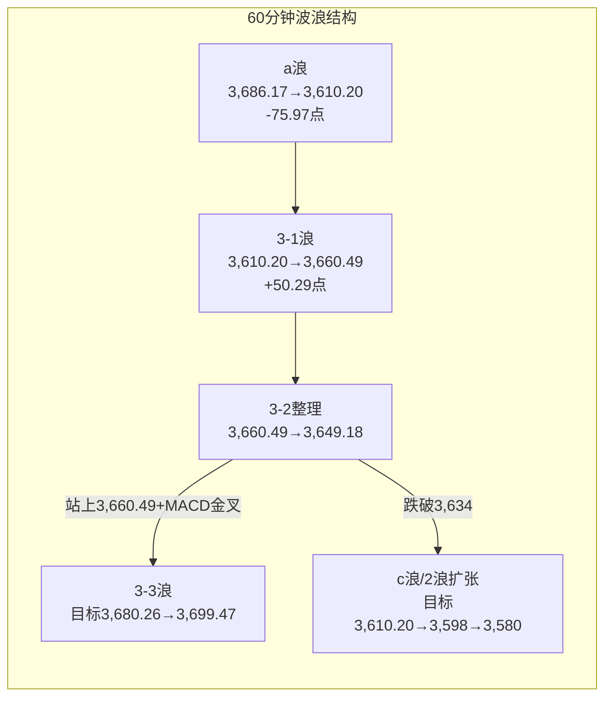

# A股晨报 - 2026年11月09日

> 数据截止时间：2026年11月9日 09:10（北京时间）
> 报告性质：**"非农爆表的外部紧缩"与"国常会首提稳市机制的内部托底"对冲下的"高开验证日"**
> **一句话定性**：**上周五晚美国10月非农新增16.5万（预期6.5万）、失业率降至4.1%，12月加息预期升温，美债10Y升至4.859%、美元强势反攻、现货黄金跳水；但美股走出"数据利空、科技股修复"的分化（纳指+1.1%、标普+0.3%、道指-0.5%），费城半导体强力反抽；周末国内政策面再迎重磅——11/6国常会首次提出"完善资本市场稳市机制，增强股市内在稳定性"。今晨日经高开高走涨逾2%（金融股领涨）、KOSPI小幅低开-0.5%、富时A50期货+0.45%，A股具备"温和高开"条件；9:30中国10月CPI/PPI是日内第一验证点，沪指能否放量收复3,664.82（双底颈线/3浪确认线）决定反弹能否升级，下方3,634/3,610.20为防守。**

---

## 一、昨日晚报复盘要点回顾（2026-11-06晚报）

### 1. 昨日判断回顾

| 项目 | 晚报复盘结果 | 准确率 |
|------|------------|--------|
| 趋势判断 | 晨报"震荡（低开高走、先抑后扬）" vs 实际-1.10%（低开2.11%后修复） | **100%（1/1）** |
| 点位预测 | 区间3,590-3,680✓、强支撑3,580.38✓、强压力3,664.82✓ | **100%（3/3）** |
| 板块预判 | 看涨0/4、看跌3/3、风险2/2，合计4/9 | **44.4%** |
| 成交量预测 | 预测放量2.05-2.35万亿，实际1.67万亿（-21.7%） | **0%** |
| **综合准确率** | 30%×100%+30%×100%+30%×44.4%+10%×0% | **73.3%** |
| 波浪分析 | 日线"收盘收回3,646.57"兑现、月/周框架有效；60分钟"跌破3,614→3,598"未兑现 | **约65%** |

> **核心结论**：**"指数点位"判断全对、"结构方向"判断大面积落空**。沪指以3,612.15低开（-2.11%）、开盘即全天次低3,610.20，随后单边修复收3,649.18（-1.10%），区间、强支撑、强压力三项全中；但机器人/黄金/创新药/光伏四个看涨或看跌判断被"系统性risk-off+高低切换"全面推翻，消费量能"放量"更是完全反向。

### 2. 关键偏差及原因

| 偏差 | 晨报预测 | 实际 | 根因 |
|------|---------|------|------|
| 成交量 | 放量2.05-2.35万亿 | 1.67万亿（缩量21.7%） | 把"跌幅大"等同于"换手大"；开盘一步跌到位→恐慌盘无二次释放 |
| 光伏设备 | 看跌/兑现 | 逆势领涨（永臻4连板、东方日升+15.26%、贝特利20cm） | 误用"涨幅大=见顶"，忽视算力崩塌后资金寻找"低位+政策主题"承接池 |
| 机器人/黄金/创新药 | 看涨 | 分别-2.68%/-0.51%/-1.86% | 低估系统性risk-off对非防御资产的"无差别压制"，把个股催化当板块β |
| 航空/机场 | 风险（油价反弹） | 当日布伦特-1.34%、WTI跌破90 | 只用隔夜商品价、未跟踪亚洲盘回落 |
| 周线确认 | 站上3,664.82则反转 | 最高3,660.49，未触及 | 把盘中3,700高点当收盘动能，忽视尾盘缩量 |

### 3. 沉淀的规则/检查项（今日直接调用）

1. **（资金面）** 外盘熔断级暴跌后，A股开盘跌幅≥2%且开盘价接近全天最低时，成交量往往"缩量一步到位"（缩量可达20%以上）；**缩量修复的反弹持续性弱于放量修复**。
2. **（板块）** 外部AI/算力链崩塌日，资金优先承接"低位+政策主题"（光伏/电力/农业），而非同为成长的高位机器人；"累计涨幅大=兑现"仅适用于**高位拥挤板块**。
3. **（趋势）** 大盘低开≥2%、上涨家数占比<20%时，除高股息与低位政策主题外，成长/避险主题均难独立走强。
4. **（点位）** 外盘冲击日，若开盘价接近全天最低且收盘收复2浪低点/38.2%回踩位，盘中跌破弱支撑按"假跌破"处理，**支撑有效性以收盘判定**。
5. **（波浪）** 跳空跌破前2浪低点后收盘收回，旧3浪计数作废，应改按"2浪扩张平台"重新计数；**单日收回仅恢复"2浪结束候选"，不等于3-3启动**。

### 4. 对今日分析的启示

- **不可把"周五抗跌"线性外推为"周一续涨"**：周五是缩量修复（1.67万亿），上方3,664-3,700套牢盘沉重，**必须放量才能确认**。
- **非农爆表改变外部利率环境**：12月加息预期升温、美债10Y 4.859%，对高估值成长与贵金属构成压制，**利好银行/保险等利率上行受益方向**。
- **国内政策权重上调**：国常会首次提出"完善资本市场稳市机制"，与汇金类平准基金、回购增持再贷款1%形成政策合力，**指数下沿3,610.20的政策托底属性增强**。
- **板块分层**：优先"高股息（银行/保险/电力）+低位政策主题（光伏）+超跌科技（半导体设备）"；**回避贵金属、高位机器人、存储/光模块**。

---

## 二、隔夜市场动态（11月6日收盘后至今）

### 1. 美股市场（11月6日收盘）

| 指数 | 收盘 | 涨跌幅 | 备注 |
|------|------|--------|------|
| **道琼斯** | **51,285.73** | **-0.5%** | 传统权重承压，金融股分化 |
| **标普500** | **7,376.86** | **+0.3%** | 科技权重修复带动翻红 |
| **纳斯达克** | **24,579.43** | **+1.1%** | 前一日-5.52%后强力反抽 |
| 罗素2000 | — | 小幅上涨 | 小盘跟随修复 |

> **结构性解读**：**这是典型的"数据利空、科技股修复"分化日**。10月非农16.5万远超预期，理论上利空权益估值，但纳斯达克在"AI监管恐慌一次性宣泄"后由芯片股领涨反抽（费城半导体强力反弹），说明**外部冲击已从"流动性危机"回到"结构性定价"**；道指下跌则反映利率上行对传统高负债/地产链的压制。**对A股的映射：科技链（半导体设备）情绪修复，但高久期成长仍受美债4.86%约束。**

### 2. 欧洲/亚太市场

| 市场 | 收盘/最新 | 涨跌幅 | 说明 |
|------|----------|--------|------|
| **日经225（11/9 09:08）** | **58,215.19** | **+1.36%（+780.42点）** | 开盘57,960.70（+0.92%），盘中一度触及59,000（+2.74%）；瑞穗金融+5%、三菱日联/三井住友+4% |
| 日本东证（11/9 09:07） | 3,819.23 | **+3.0%** | 金融股领涨，日央行加息预期升温 |
| **韩国KOSPI（11/9开盘）** | **5,034.20** | **-0.5%** | 存储权重仍弱，但跌幅较上周五-6.02%大幅收窄 |
| **富时中国A50期货（11/9 09:05）** | — | **+0.45%~+0.50%** | 夜盘收涨0.36%后高开，**指向A股温和高开** |
| 恒生指数（11/6收盘） | — | 小幅企稳 | 港股夜期随外围修复 |

> **亚太定性**：**日股"金融股领涨+指数涨逾2%"是明确的"利率上行交易"**（日央行加息预期），与美股"科技修复"共同构成"风险偏好未恶化"的信号；KOSPI仅-0.5%说明存储链抛压显著衰竭；A50期货+0.45%对应沪指高开约15-20点（3,664-3,669），**但该位置恰是双底颈线，高开即面临兑现压力**。

### 3. 大宗商品

| 品种 | 最新 | 涨跌幅 | 说明 |
|------|------|--------|------|
| **COMEX黄金（11/6收盘）** | **4,073.9美元/盎司** | **-0.9%** | 非农爆表→12月加息预期升温，金价跳水 |
| 现货黄金（11/9早盘） | 4,110美元/盎司上方 | **约+1.0%** | 亚洲盘技术性反抽，但未收复周五跌幅 |
| COMEX白银 | 51.96美元/盎司 | -0.8% | 跟随黄金走弱 |
| **WTI原油** | **约90-91美元/桶** | 基本持平 | 非农后变动有限，地缘溢价仍在 |
| LME铜 | — | 偏弱 | 美元走强+加息预期压制工业金属 |

> **关键矛盾**：**黄金"数据后跳水、亚洲盘反抽"说明其短期定价权已从"避险"切换到"实际利率"**——非农强→加息预期升→实际利率上行→金价承压。**今日贵金属不宜作为看涨方向**（周五复盘已证伪"避险=黄金"的惯性外推）。油价持平意味着航空/化工成本逻辑中性，**不构成新的交易主线**。

### 4. 汇率与利率

| 项目 | 数值 | 变化 |
|------|------|------|
| **美债10年期收益率** | **4.859%** | **+2.6bp** |
| 美债2年期收益率 | 4.514% | **+5.6bp**（加息预期升温更敏感） |
| 美债30年期收益率 | 约5.30% | 长端高位 |
| **美元指数** | — | **非农后强势反攻，非美货币普跌** |
| 中国10年期国债（11/6） | 1.5725% | 债市走强 |
| 中国30年期国债（11/6） | 2.034% | 长端下行 |
| 人民币中间价（11/6） | 6.7168 | 贬12bp |

> **利率环境**：**外部"美债上行+美元走强"与内部"国债收益率下行"形成背离**——外部压制成长估值与外资流入，内部流动性宽松支撑风险偏好。**这种背离下，A股更可能走"结构行情"而非"指数行情"**：银行/保险受益于利率上行，成长受制于美债，指数由权重护盘、题材轮动。

### 5. 重要海外事件

- **美国10月非农：+16.5万（预期+6.5万，前值+2.9万），失业率4.1%（预期4.2%）**——就业市场韧性超预期，**12月加息预期明显升温**，CME FedWatch隐含概率上修。
- **美股AI硬件反抽**：费城半导体在前一日-12.25%后强力反弹，闪迪、美光等盘前修复，**"AI监管恐慌"进入第二阶段的"分化定价"**（政策风险仍在，但仓位出清已部分完成）。
- **日央行加息预期升温**：植田和男近期表态偏鹰，日本金融股大涨，全球"再收紧"叙事延续。
- **本周关键数据**：11/10（周二）美国10月CPI；本周国内或公布10月社融/M2。

---

## 三、今日关注事项

### 1. 重要数据发布（北京时间）

| 时间 | 数据/事件 | 预期/前值 | 影响 |
|------|----------|----------|------|
| **09:30** | **中国10月CPI、PPI** | CPI预期0.7%-0.9%（中金0.9%、招商0.7%、浙商0.8%、华创0.7%、民生0.8%），前值+0.9%；PPI延续温和回升 | **日内第一验证点**：CPI回升→消费/内需修复；低于预期→政策加码预期升温 |
| 全天 | 新一批10只ETF调入港股通标的生效 | — | 南向资金结构 |
| 本周 | 中国10月社融、M2（待定） | — | 信用扩张验证 |
| 11/10（周二） | 美国10月CPI | — | 美联储12月路径 |

### 2. 政策/监管动态

- **11月6日国务院常务会议首次提出"完善资本市场稳市机制，增强股市内在稳定性，促进资本市场平稳健康发展"**——这是国常会层面**首次**就资本市场稳市机制作出部署，标志"政策底"由部门级（央行/证监会）升级为**国务院级制度安排**。
- **政策脉络**：11/2央行+金融监管总局+证监会座谈会（用好两项结构性货币政策工具）→ 11/4股票回购增持再贷款利率降至1%并长期制度化 → 11/5国务院金融工作报告"支持中央汇金发挥类平准基金作用" → **11/6国常会"完善稳市机制"**，政策合力持续强化。
- **光伏"反内卷"再进一步**：收储平台"两条腿走路"（弹性封存压产能+收购关停），规划将多晶硅产能降至150万吨（现有约350万吨），**全产业链下调开工率**；工信部同步完善光伏、新型储能产能监测预警机制。
- **商务部/科技部**：《中国禁止出口限制出口技术目录》拟增列AI、生物医药、光伏共40项技术（征求意见阶段），**强化国产替代与光伏技术壁垒逻辑**。

### 3. 公司公告/市场事件

| 事件 | 内容 | 影响 |
|------|------|------|
| **本周解禁** | 40股解禁，合计441.85亿元；电投水电解禁120.34亿元居首 | 结构性扰动 |
| **今日解禁** | 8家公司解禁2.61亿股、市值109.0亿元；德力佳、亿纬锂能、联域股份居前 | 相关个股承压 |
| 光伏产业链 | 收储平台下调开工率、多晶硅产能目标150万吨 | 光伏供给收缩预期强化 |
| 半导体 | 华虹宏力三季报净利+1.38倍、上调Q4指引（延续） | 设备/代工链支撑 |

### 4. 其他关注

- **第九届进博会（11/5-11/10）**：内需、消费、进口链持续催化。
- **本周40股解禁441.85亿元**，其中今日109亿元，注意解禁个股的流动性冲击。
- **周一为"数据+政策"双击日**：9:30 CPI/PPI + 周末国常会稳市，方向选择集中在早盘半小时。

---

## 四、板块与个股分析（结合昨日复盘）

### 1. 基于昨日复盘结论的板块调整

| 周五板块 | 周五收盘表现 | 今日预期调整 | 依据 |
|---------|------------|------------|------|
| 光伏设备 | 逆势领涨（永臻4连板、东方日升+15.26%） | **维持看涨，但由"追涨"转"回调参与"** | 收储平台+开工率下调是**实质供给收缩**，非单纯情绪；但4连板后拥挤度上升 |
| 银行/公用事业 | +1.05%/+1.20% | **上调为看涨首选** | 美债上行+国内稳市+高股息，三重受益 |
| 机器人/具身智能 | -2.68%（人形-3.16%） | **维持"观察/低吸不追"** | 美债4.86%压制高估值成长，周五规则3仍适用 |
| 贵金属/黄金 | 赤峰-0.51%、有色-3% | **由"看涨底仓"下调为"看跌/回避"** | 非农爆表→12月加息预期→实际利率上行，金价-0.9% |
| 创新药 | -1.86% | **降为"中性/分化"** | 百济催化已被消化，成长估值受美债压制 |
| 存储/光模块/算力硬件 | 通信-4.93%、PCB跌停潮 | **维持看跌（反抽即减）** | 海外AI监管未消，费半反抽仅为技术修复 |
| 半导体设备/国产替代 | 相对抗跌（华虹业绩支撑） | **由"等待企稳"上调为"看涨（修复）"** | 纳指+1.1%、费半反抽+出口管制强化国产替代 |
| 油气开采 | 上涨 | **下调为"中性"** | 油价90-91基本持平，无新增催化 |

### 2. 隔夜信息驱动的板块机会

- **受益板块**：
  1. **银行/保险**（逻辑：美债10Y 4.859%+2Y 4.514%上行→利率上行交易；国常会稳市机制+汇金类平准基金→权重护盘首选；高股息防御）。
  2. **光伏设备**（逻辑：收储平台"两条腿走路"+多晶硅产能降至150万吨+全产业链下调开工率，**供给侧收缩从预期走向落地**；低位+政策主题，符合周五复盘新规则2）。
  3. **半导体设备/国产替代**（逻辑：纳指+1.1%、费半反抽修复情绪；出口管制目录增列AI/光伏技术→国产替代强化；华虹三季报兑现）。
  4. **券商**（逻辑：国常会首提稳市机制+摩根大通转向"边际更积极"+A/H券商2026财年PB仅0.9/0.7倍，估值低位；**但须核对特大单资金流，避免"放量≠券商受益"旧陷阱**）。
- **受损板块**：
  1. **贵金属/黄金**（逻辑：非农超预期→12月加息预期升温→实际利率上行→金价-0.9%，避险属性让位于利率属性）。
  2. **高估值成长/机器人**（逻辑：美债4.859%压制高久期资产；周五已补跌，反弹缺乏增量资金）。
  3. **存储/光模块/算力硬件**（逻辑：海外AI监管不确定性未消除，费半反抽属超跌修复，A股相关标的反抽即减）。

### 3. 重点关注个股

| 个股 | 关注理由 | 技术位置/操作 |
|------|---------|-------------|
| **招商银行/江苏银行** | 利率上行+高股息+汇金护盘首选 | 回踩5日线低吸，不追高 |
| **中国平安/中国太保** | 利率上行改善利差+权益弹性 | 突破平台可跟，止损前低 |
| **隆基绿能/通威股份** | 光伏收储+开工率下调，供给收缩 | 回调至10日线分批，不追4连板 |
| **中微公司/华虹宏力** | 费半反抽+国产替代+业绩兑现 | 仅在大盘站稳3,649后参与 |
| **中信证券/东方财富** | 国常会稳市+估值低位 | 需特大单净流入确认，否则观察 |
| **赤峰黄金/山东黄金** | 金价跳水+加息预期 | **回避**，反抽即减 |
| **德力佳/亿纬锂能/联域股份** | 今日解禁109亿 | **回避**短期解禁压力 |

---

## 五、今日核心判断（结构化，用于晚报复盘）

### 1. 趋势判断

- **上证指数：【震荡偏强】（高开验证、先扬后抑或先抑后扬）**
- **预测区间：3,638点 - 3,698点**
- **核心逻辑**：外部"非农爆表→加息预期升温→美债4.859%/美元走强"构成压制，但美股科技股反抽（纳指+1.1%）+日经涨逾2%+A50期货+0.45%显示风险偏好未恶化；国内国常会首提"完善资本市场稳市机制"提供制度级托底。**主情景为"温和高开后围绕3,664.82反复争夺"**：放量站上则打开3,675.58-3,700空间，缩量滞涨则回落3,634-3,649震荡。9:30 CPI/PPI是日内方向的第一触发器。

### 2. 关键点位

- **强支撑位：3,610.20点**（依据：11/6跳空低点=2浪扩张低点；跌破则2浪扩张延续，下看3,580.38）
- **弱支撑位：3,634点**（依据：周五日内强弱分界+30分钟三角下沿；跌破则回踩3,610.20）
- **弱压力位：3,664.82点**（依据：双底颈线+周线反包确认位+3浪确认线；**收盘站上才确认3浪**）
- **强压力位：3,700点**（依据：11/5盘中高点+整数关口；上破则看3,716/3,724.56）
- 补充：**5日均线约3,654**（短期第一道压力）、**3,675.58**（3浪0.618目标）、**3,716**（3浪1.0目标）。

### 3. 板块预判

- **看涨板块**：
  1. **银行/保险**（逻辑：美债10Y 4.859%上行→利率上行交易；国常会稳市+汇金类平准基金护盘；高股息防御）
  2. **光伏设备**（逻辑：收储平台+多晶硅产能降至150万吨+全产业链下调开工率，供给收缩实质化；低位政策主题）
  3. **半导体设备/国产替代**（逻辑：纳指+1.1%/费半反抽修复情绪；出口管制强化国产替代；华虹业绩兑现）
  4. **券商**（逻辑：国常会首提稳市机制+摩根大通转积极+估值PB 0.9/0.7倍，**需特大单净流入确认**）
- **看跌板块**：
  1. **贵金属/黄金**（逻辑：非农超预期→12月加息预期→实际利率上行→金价-0.9%，避险让位利率）
  2. **机器人/高估值成长**（逻辑：美债4.859%压制高久期资产，周五已补跌、反弹缺增量资金）
  3. **存储/光模块/算力硬件**（逻辑：海外AI监管未消，费半反抽仅为超跌修复，反抽即减）
- **风险板块**：**高位连板/微盘题材**（缩量修复+晋级率下降，追高易吃面）；**今日解禁股**（德力佳、亿纬锂能、联域股份，109亿）；**立案/减持个股**（延续回避）。

### 4. 资金面判断

- **北向资金预期：【小幅净流入】0-50亿元**（A50期货+0.45%+国常会稳市+日股走强指向外资风险偏好回暖；净额交易所不披露，以成交占比跟踪，11/6为15.84%）
- **成交量预期：【温和放量】1.75-1.95万亿元**（较周五1.67万亿回升，但难回2万亿；**若开盘30分钟量能同比放大15%以上，则上修至2.0万亿**）
- **两融**：截至11/6上交所融资余额11,688.37亿元，11/5全市场两融23,073.34亿元（回升68.89亿），杠杆资金未恐慌去化。
- **护盘观察**：**汇金/宽基ETF是否在3,634-3,649区间承接**，是判断政策底有效性的核心；国常会后首个交易日，权重护盘意愿预计增强。

### 5. 风险预警（按优先级排序）

- **高风险**：
  1. **非农爆表→12月加息预期升温**：美债10Y 4.859%、2Y 4.514%，若本周美国10月CPI再超预期，将强化"higher for longer"，压制成长与外资流入，A股上攻3,700失败。
  2. **3,664.82久攻不下**：缩量修复（1.67万亿）上方套牢盘沉重，若连续3日不能收盘收复，2浪扩张可能演变为更复杂调整，且"双底突破"降级为"假突破"。
- **中风险**：
  1. **9:30 CPI/PPI不及预期**：若CPI低于0.7%，内需/通缩担忧升温，消费/周期承压（但会强化政策加码预期，属"利空出尽"式博弈）。
  2. **光伏政策"预期先行、细则兑现"反复**：4连板后拥挤度上升，细则不及预期易快速回吐。
  3. **今日解禁109亿**（德力佳、亿纬锂能、联域股份）+ 本周441.85亿，相关个股流动性冲击。
  4. **AI监管二次发酵**：若《禁止人工超级智能法案》推进超预期，A股算力硬件将再度杀跌。
- **低风险**：
  1. 国内流动性宽松（10年国债1.5725%、30年2.034%），资金面不构成压力。
  2. 人民币中间价6.7168小幅贬值但即期韧性较强，未形成外资流出加速器。

### 6. 昨日复盘规则应用

- **应用规则1（资金面/量能）**：周五"缩量修复"持续性弱——**今日必须放量（≥1.90万亿）站上3,664.82才算有效突破**；若缩量高开滞涨于3,664.82，按"冲高回落"处理，不追高。
- **应用规则2（板块/低位政策主题）**：周五"算力崩塌→低位政策主题承接"在今日延续——**光伏设备是首选的低位政策主题**（收储+开工率下调），但须等回调、不追4连板。
- **应用规则3（趋势/宽度约束）**：若今日高开后上涨家数占比<40%（宽度不足），则**看涨组合限定为银行/保险/电力+光伏**，机器人/创新药降为观察。
- **应用规则4（点位/收盘判定）**：3,664.82与3,610.20的得失**以收盘为准**，盘中假突破/假跌破不作为加减仓依据。
- **应用规则5（波浪/2浪扩张）**：当前按"2浪扩张结束候选+3浪1子浪"计价，**收盘站上3,664.82前不得按"3浪加速"操作**；跌破3,610.20则2浪扩张延续。

### 7. 波浪理论参考（多周期）

#### （1）月K线波浪分析

- **当前波浪位置**：大级别第2浪（C浪）延伸结束的**候选确认期**，月线修复初期；11月月K为"带长下影小阳"。
- **浪型结构描述**：6月高点4,197→10/23低点3,574.27完成C浪延伸；11月自3,614.13开盘、下探3,580.38后连续收阳，11/4放量收复3,621（0.382）与3,674平台；11/6跳空低开3,610.20（未破月内低点3,580.38），收3,649.18，**月K重新站上3,621**。月线"下未破（3,580/3,574.27）、上未复（3,664.82/3,674）"格局未变。
- **关键目标位**：上方**3,721-3,724.56**（0.236回撤+缺口下沿）、**3,812**（0.382回撤）；下方**3,621/3,610/3,580.38/3,574.27**。
- **验证条件**：**11月月K收盘站上3,724.56**→月线修复确认；**收盘跌破3,574.27**→C浪延伸重启，目标3,478/3,443。

#### （2）周K线波浪分析

- **当前波浪位置**：周线**六连阴后的第一根"带上影小阳"**，反包**尚未确认**；本周（第46周）为方向确认周。
- **浪型结构描述**：第45周（11/2-11/6）低3,580.38、高3,700上方、收3,649.18（+1.39%），终结六连阴；周K为"长下影+带上影小阳"，**收盘站上3,621与3,648.13，但未收复双底颈线3,664.82**——"止跌成立、反转未确认"。
- **关键目标位**：**3,664.82（颈线）→3,675.58（3浪0.618）→3,716（3浪1.0）→3,749.26（双底量度）/3,752.36**。
- **验证条件**：**本周收盘站上3,664.82**→周线反转成立；**收盘跌回3,621下方**→反包失败，退回3,574-3,664宽幅震荡。

#### （3）日K线波浪分析

- **当前波浪位置**：双底（3,574.27/3,580.38）突破后的**第2浪扩张调整结束候选，第3浪1子浪初期**。
- **浪型结构描述**：**1浪 3,580.38→3,686.17（+105.79点）**；2浪自3,686.17回落，11/5低3,646.57后，11/6跳空下探3,610.20，回撤**71.24%**（介于61.8%位3,620.86与78.6%位3,602.65之间），仍高于1浪起点3,580.38，**构成"2浪扩张平台"的有效回踩**；周五收盘3,649.18为自3,610.20反弹的**3浪1子浪初期**。
- **关键目标位**：3浪自3,610.20起算——**0.618目标3,675.58、1.0目标3,716.00、1.618目标3,781.40**；第一压力簇**3,654（MA5）/3,664.82/3,674**；下方**3,634/3,610.20**（2浪低点），失守则看**3,580.38/3,574.27**。
- **验证条件**：**收盘站上3,664.82并放量（≥1.9万亿）**→3浪确认；**收盘跌破3,610.20**→2浪扩张延续，下看3,580.38；**跌破3,574.27**→C浪延伸，看3,478。

#### （4）60分钟K线波浪分析

- **当前波浪位置**：3浪1子浪（3,610.20→3,660.49）完成、**3浪2整理（3,660.49→3,649.18）末端**，方向待周一选择。
- **浪型结构描述**：3,686.17→3,610.20为调整a浪（-75.97点）；3,610.20→3,660.49为反弹b浪/3-1（+50.29点，回撤66.2%）；尾盘回落至3,649.18（回撤22.6%）。**若按3浪计数，3-1为3,610.20→3,660.49（+50.29），3-2为3,660.49→3,649.18**，3-3目标≈**3,680.26**（0.618）、**3,699.47**（1.0）。
- **关键目标位**：上方**3,654/3,660.49/3,664.82/3,680-3,699**；下方**3,640/3,634/3,610.20**。
- **验证条件**：**60分钟站上3,660.49且MACD金叉**→3-3启动；**跌破3,634且量能放大**→b浪失败、c浪下看3,610.20/3,598。

#### （5）30分钟K线波浪分析

- **当前波浪位置**：日内"跳空低开→5浪上升→abc整理"的**整理末端**，上升三角形待突破。
- **浪型结构描述**：9:30跳空3,610.20（起点）→上午五段式上升至3,660.49→午后3,660.49→3,649.18的a-b-c收敛整理。**30分钟低点连续抬高（3,610.20→3,640→3,649），高点受制3,660.49**，属"上升三角形/旗形整理"。
- **关键目标位**：上破3,660.49→3,664.82/3,675.58；下破3,640→3,634/3,610.20。
- **验证条件**：**30分钟站稳3,654并放量**→上行延续；**跌破3,634**→回踩3,610.20，修正延续。

#### （6）波浪图（Mermaid）

```mermaid
graph LR
    subgraph 日K线波浪结构（上证指数）
        A[双底<br/>3,574.27 / 3,580.38] --> B[1浪<br/>3,580.38→3,686.17<br/>+105.79点]
        B --> C[2浪扩张<br/>3,686.17→3,610.20<br/>回撤71.24%]
        C --> D[3浪1子浪<br/>3,610.20→3,649.18]
        D --> E{周一：CPI/PPI+放量验证}
        E -->|放量站上3,664.82| F[3浪确认<br/>目标3,675.58→3,716→3,781]
        E -->|缩量滞涨于3,664.82| G[震荡回落<br/>3,649→3,634]
        E -->|收盘跌破3,610.20| H[2浪扩张延续<br/>3,580.38→3,574.27]
        H -->|跌破3,574.27| I[C浪延伸<br/>目标3,478/3,443]
    end
```



#### （7）波浪理论综合判断

- **多周期共振状态**：**月线偏多（修复初期，3,621上方）、周线待确认（3,664.82未收复）、日线"2浪扩张结束候选"、60分钟3-2整理、30分钟三角整理**——**中长周期偏多、短周期中性偏多的"弱共振"**，与周五晚报一致。
- **当前操作级别**：**日线定方向、60分钟定执行**；在3,664.82未收盘收复且未放量前，按"2浪扩张结束候选"而非"3浪加速"计价。
- **后续演变路径**：
  - **主路径（45%）**：高开3,660-3,669→CPI落地后回踩3,649-3,654→放量（≥1.9万亿）收复3,664.82→3,675.58，收盘3,665-3,690。
  - **偏强路径（25%）**：CPI回升+国常会稳市发酵+日股带动→放量突破3,675.58→3,700-3,716，周线反转确认。
  - **偏弱路径（30%）**：CPI低于0.7%+美债续升→高开低走跌破3,634→3,610.20；收盘跌破3,610.20则2浪扩张延续看3,580.38/3,574.27。
- **关键拐点信号**：① **9:30 CPI/PPI落地后的方向**；② **3,664.82收盘得失（3浪/周线反转唯一确认）**；③ 3,634/3,610.20防守；④ 成交能否回升至1.9万亿上方；⑤ 银行/保险与光伏能否形成"权重+主题"共振；⑥ 北向成交占比与方向。
- **风险提示**：波浪计数具主观性；周五"低开不破+缩量修复"是"外部冲击一次性定价"，但**缩量意味着抛压未充分释放、上方3,664-3,700套牢盘沉重**。若3,664.82连续3日不能收复，2浪扩张可能演变为"abc-d-e"更复杂调整；跌破3,610.20则本轮"双底突破"降级为"假突破"。**不得将单日抗跌或单日高开线性外推为反转。**

---

## 六、投资策略建议（分短线+中线）

### 1. 短线策略（1-3个交易日）

- **适用场景**：基于日K线与60分钟K线技术信号，政策+数据双击日
- **短线仓位：25%**（较周五20%上调5个百分点，国常会稳市+日股/A50走强提供胜率，但保留75%仓位应对CPI与加息预期的不确定性）
- **买入条件**：
  1. **不追高开**：9:30-10:00观察CPI/PPI落地与开盘30分钟量能，**不追3,669以上高开**；
  2. **右侧加仓**：若10:00前站稳3,649且量能同比放大15%→加至25%；**放量（≥1.9万亿）收盘站上3,664.82→加至30%**；
  3. **回踩低吸**：回踩3,634-3,640不破且分时企稳→可加5%；汇金/宽基ETF明确承接3,634-3,649→可提前加5%。
- **卖出条件**：冲高3,675.58-3,700放量滞涨→减至20%；触及3,700未站稳→减至15%。
- **止损位**：**收盘跌破3,634→减至15%；收盘跌破3,610.20→清短线**；个股跌幅>7%无条件止损。
- **短线标的**：
  1. **招商银行/江苏银行**（利率上行+高股息+汇金护盘，回踩5日线低吸）
  2. **隆基绿能/通威股份**（光伏收储+开工率下调，回调分批，不追4连板）
  3. **中微公司/华虹宏力**（费半反抽+国产替代，仅在站稳3,649后右侧）
  4. **中信证券/东方财富**（国常会稳市+估值低位，需特大单净流入确认）

### 2. 中线策略（1-4周）

- **适用场景**：基于周K线波浪分析与运行规律分析结论
- **中线仓位：20%**（维持不变）
- **方向判断：【持有】**（**暂不加仓**，等待收盘站上3,664.82且放量确认）
- **目标区间：上证指数 3,610点 - 3,716点**
- **中线布局板块**：
  1. **银行/保险**（利率上行+高股息+稳市机制受益，作组合压舱石）
  2. **光伏设备**（反内卷收储+开工率下调，供给收缩的中期逻辑）
  3. **半导体设备/国产替代**（出口管制+业绩兑现，等待费半止跌确认）
  4. **创新药**（百济Q3+34%，防御性成长，降为底仓）
- **止盈条件**：指数到达3,716点或波段涨幅达8%-10%
- **止损条件**：**收盘跌破3,574.27**（月线生死线）或趋势确认反转

### 3. 仓位分配总览

| 策略类型 | 仓位比例 | 方向 | 重点板块 |
|---------|---------|------|---------|
| 短线 | **25%** | 右侧验证/防守反击 | 银行、光伏、半导体设备、券商 |
| 中线 | **20%** | 持有（暂不加仓） | 银行/保险、光伏、半导体设备、创新药 |
| 现金 | **55%** | — | — |

### 4. 与上周五策略对比

- **短线仓位**：由20%上调至25%（原因：国常会首提稳市机制+A50期货+0.45%+日经涨逾2%，外部风险偏好回暖；但非农爆表与CPI未落地，故仅加5pct、不重仓）。
- **中线仓位**：维持20%（原因：3,664.82未收盘收复前不加仓，纪律不变）。
- **板块调整**：**增配银行/保险（利率上行+稳市）、券商（估值低位）；维持光伏（低位政策主题首选）；半导体设备由"等待"上调为"修复参与"；下调贵金属为"看跌/回避"、机器人/创新药为"观察"；继续回避存储/光模块/算力硬件与今日解禁股**。

---

## 七、信息来源

1. **官方数据**：国家统计局（11/9 09:30发布10月CPI/PPI；9月CPI同比+0.9%）；上海证券交易所（11/6上证指数3,649.18/-1.10%/成交7,726.35亿；11/6融资余额11,688.37亿）；中国人民银行（11/6人民币中间价6.7168）；美国劳工统计局（10月非农+16.5万、失业率4.1%，11/6 21:30）；国务院（11/6国常会"完善资本市场稳市机制"）；上交所/深交所（2026年交易日安排）。
2. **权威财经媒体**：上海证券报·中国证券网（《国常会：完善资本市场稳市机制，增强股市内在稳定性》2026-11-06 22:19）；证券时报（国常会部署、稳市组合拳）；财联社（11/9 09:00 A50期货+0.43%、09:07日经触及59,000、11/9解禁109亿）；新浪财经（《日韩股市开盘涨跌互现 韩国KOSPI开盘下跌0.5%》11/9 08:03；《国际金融市场早知道11月9日》美债2Y 4.514%/10Y 4.859%）；金融界（《美国10月非农远超预期！12月加息预期上升，现货黄金跌超1%》11/6 21:37）；中国网财经（《前瞻：食品价格走低、能源价格上行 10月CPI同比涨幅或保持平稳》，机构预期0.7%-0.9%）；每日经济新闻（KOSPI开盘-0.5%、日经开盘+0.6%）；腾讯新闻（《本周40股将解禁》441.85亿元）。
3. **数据平台**：东方财富（11/9解禁8家2.61亿股/109.0亿元；日经/KOSPI开盘）；同花顺（现货黄金站上4,110美元/盎司，日内+0.99%；富时A50期指+0.50%）；FRED（美债10Y 2026-11-05 4.84%）；中国货币网（国债收益率）。
4. **内部资料**：`report/20261106/evening_report_20261106.md`（复盘73.3%）、`report/20261106/morning_report_20261106.md`、`report/20261106/day_summary_20261106.md`、`report/monthly/202611_monthly_report.md`、`rules.md`。

> **数据口径说明**：A股为11/6收盘；美股为11/6收盘；日韩为11/9早盘（日经09:08、KOSPI开盘）；A50期货为11/9 09:05；黄金为11/6纽约收盘+11/9亚洲盘；原油为11/6收盘附近；美债为11/6纽约收盘；人民币为11/6中间价；两融为11/5-11/6。**北向净额交易所不披露，以成交额与占比跟踪。截止时间2026-11-09 09:10。**

---

## 八、文档更新检查

### AGENTS.md更新
- 晨报流程与输出格式与实际执行一致，**无需更新**。

### README.md更新
- 文件结构与功能说明与实际一致，**无需更新**。

### 结论
**无需更新**（AGENTS.md、README.md 均与当前执行流程一致）。
