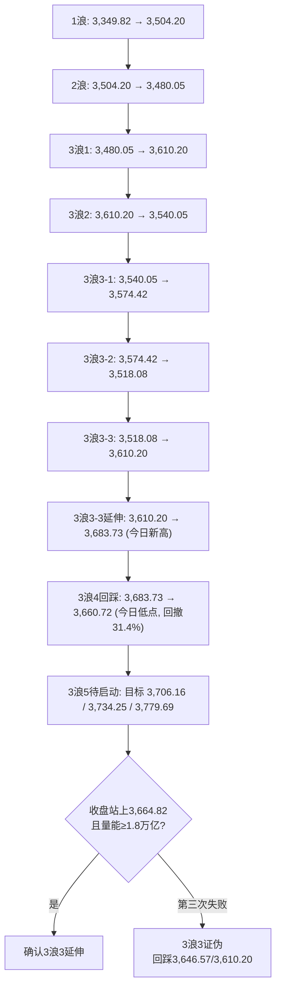
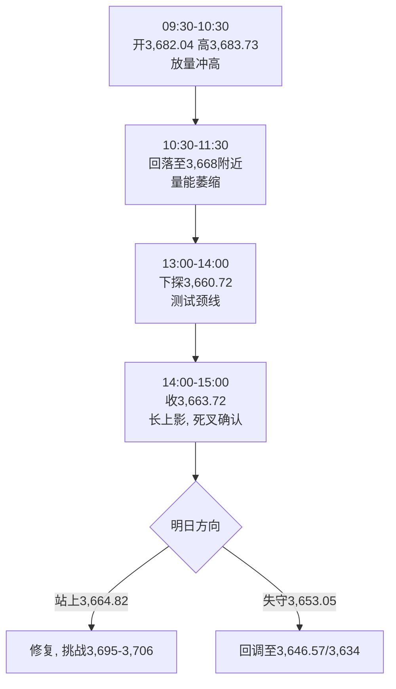

# A股晚报 | 2026年11月10日（周二）

> 数据截至：2026-11-10 20:00（北京时间）
> 编制：A股分析师AI代理

---

## 一、市场全景

### 1.1 指数表现

| 指数 | 收盘 | 涨跌幅 | 涨跌点 | 成交额 |
|------|------|--------|--------|--------|
| 上证指数 | 3,663.72 | +0.08% | +2.93 | 6,739亿 |
| 深证成指 | 11,241.54 | +0.86% | +96.05 | 8,429亿 |
| 创业板指 | 2,494.46 | +1.46% | +35.90 | — |
| 科创50 | 1,265.00 | +0.64% | +8.04 | — |
| 科创综指 | 1,522.19 | +1.28% | +19.21 | — |
| 上证50 | 约2,807.0 | +0.64% | — | — |

- **两市成交额：15,168亿元（1.52万亿），较前一交易日放量222亿元（+1.5%）**
- 沪市6,739亿 + 深市8,429亿；**成交额连续第2日低于1.55万亿，距3浪3确认阈值1.8万亿仍差约2,832亿**
- **上证日内：昨收3,660.79 → 开3,682.04（+0.58%）→ 高3,683.73（+0.63%）→ 低3,660.72（微幅翻绿）→ 收3,663.72（+0.08%）**
- 形态：**高开冲高回落，上影线20.01点、实体仅2.93点，收出"长上影小阳"（射击之星形态雏形）**

### 1.2 市场宽度（关键背离）

| 指标 | 数值 | 解读 |
|------|------|------|
| 上涨家数 | 超4,270只（占比>76%） | 普涨格局，赚钱效应极佳 |
| 涨停家数 | 95只 | 情绪高位 |
| 炸板家数 | 20只 | — |
| 封板率 | 82.61% | 强势（>80%） |
| 连板家数 | 19只 | 梯队完整 |
| 最高连板 | 闽发铝业 7连板 | 8月底以来最高 |
| 文投控股 | 15天8板 | AI影视总龙头 |

> **核心背离：指数（上证+0.08%）几乎平收，但市场宽度极强（76%上涨、95涨停、82.61%封板率）。** 说明权重股（煤炭、航运港口、石油石化）拖累指数，资金在中小盘/主题内部高度活跃。**这是典型的"指数失真、结构市"——判断趋势不能只看上证点位，须以市场宽度+主线持续性为准。**

### 1.3 资金面

| 项目 | 数据 | 对比 |
|------|------|------|
| 主力资金净流入 | **+174.76亿元** | 创业板+89.25亿、科创板+31.85亿、沪深300+18.06亿 |
| 主力净流入行业 | 电子、传媒、通信、机械设备、汽车 | 16个行业净流入 |
| 北向资金成交额 | 1,983.29亿元，占两市13.18% | 前日2,162.36亿/14.58%，**占比连续第4日下降** |
| 沪股通成交前三 | 生益科技22.4亿、药明康德、寒武纪 | — |
| 南向资金 | 净卖出27.39亿港元 | 阿里+14.34亿、中海油+5.23亿；腾讯净卖出居首 |

> 主力资金口径说明：证券时报"主力资金流向日报"口径为+174.76亿；数据宝另一口径为+55.25亿，差异来自大单/超大单统计范围不同，本文以证券时报口径为主。

---

## 二、板块与个股

### 2.1 领涨板块

| 板块 | 涨幅 | 逻辑 |
|------|------|------|
| 影视院线 | **+7.05%** | AI短剧/AI漫剧爆发，估值历史低位+AI内容生成 |
| 传媒 | +2.82% | AI应用端接棒算力硬件 |
| 通信 | +1.98% | CPO、6G、卫星互联网 |
| 电子 | +1.86% | PCB、元件、半导体、消费电子 |
| 其他居前 | — | 广告营销、游戏、人形机器人、光学光电子、航天装备、小金属 |

### 2.2 领跌板块

煤炭、航运港口、养殖业、磷化工、托育服务。

> **油价跌破90美元（布伦特盘中，8月以来首次）→ 石油石化/油服/煤炭承压；航运则叠加"全球需求走弱"叙事。这与晨报"看跌石油石化/油服"一致，但"看涨航运"判断被证伪。**

### 2.3 核心个股

- **AI影视/AI漫剧**：华策影视盘中20cm涨停（收涨约14.7%）、华智数媒20cm涨停、文投控股15天8板、慈文传媒/上海电影/掌阅科技涨停、凯撒文化开盘4分钟封板、百纳千成/新炬网络涨逾7%
- **人形机器人**：宇树科技盘中涨超10%、福莱新材5天3板（收57.30元，+10.00%）、光洋股份/锋龙股份/华培动力活跃
- **半导体/PCB**：富瀚微+14.74%、博硕科技+12.67%、协和电子涨停、生益科技为沪股通成交第一
- **连板龙头**：闽发铝业7连板（8月底深中华A后首只）

### 2.4 主线切换信号

资金关注点已从**算力基础设施（CPO/光模块/服务器）**向**AI应用（影视、短剧、营销、游戏）**延伸，属于"AI主线内部高低切换"。算力硬件今日高开低走（英伟达盘前+2%未能带动A股算力链），应用端接力，**这是本轮AI行情进入第二阶段的典型特征**。

---

## 三、消息面与政策

### 3.1 国内

- **10月外贸大超预期**：10月进出口4.87万亿元，同比**+31.2%**；出口2.79万亿（+28.7%）、进口2.08万亿（+34.7%）。前10月进出口44.81万亿（+20%），**进出口连续6个月保持两位数增长**。较9月+27.5%进一步加速，外需韧性远超市场预期，对出口链/家电/消费电子构成实质支撑。
- **人民币中间价6.7167，上调21个基点**，续创阶段新高，汇率环境友好。
- **关税暂停24%措施自13:01起生效，为期2个月**（晨报已提示），短期抢出口效应延续。
- 储蓄国债（电子式）发售中，低风险资金分流有限。

### 3.2 海外（关键变量）

- **美股11月9日大涨**：道指52,389.75（+2.15%）、标普500 7,549.94（+2.35%）、纳指25,253.14（+2.74%）、费城半导体指数**+6.86%**（AMD+13%）。
- **欧洲11月10日收盘普涨**：DAX +1.72%、CAC40 +1.19%、富时100 +0.99%、STOXX600 +1.28%。
- **亚太11月10日**：日经225 60,459.58（+2.87%）、韩国KOSPI 5,239.13（**+4.39%**）、恒生指数24,557.04（+0.44%）、恒生科技4,084.45（+1.08%）。
- **美联储理事沃勒放鹰（17:15）**：即使10月CPI改善，仍支持12月**加息25bp**；若核心CPI环比≥0.3%，12月可能**加息50bp**。CME显示12月加息25bp概率**84.2%**。
- **今晚21:30 美国10月CPI**——本周最大风险事件。

### 3.3 商品与汇率

| 品种 | 最新 | 变动 |
|------|------|------|
| 布伦特原油 | 90.92美元/桶（19:00） | -1.78%，盘中跌破90（8月以来首次） |
| WTI原油 | 85.60美元/桶 | -1.44% |
| 现货黄金 | 4,074.52美元/盎司（18:30） | **-1.6%**，日内最大跌超70美元 |
| 现货白银 | — | 约-2% |
| 美元指数 | 11/9收101.66 | -0.61%；11/10因鹰派表态盘中反弹 |
| 美债10Y | 4.886% | +2.9bp（11/9） |
| 美债2Y | 4.564% | +5.7bp（11/9） |

> **黄金/白银跳水主因：沃勒鹰派讲话推升12月加息预期，实际利率上行压制贵金属。** 这与晨报"看涨黄金/贵金属"判断相反，是今日最主要的板块误判。

### 3.4 盘后重要信息

- **台积电**：董事会核准以不超5亿美元认购Anthropic普通股。
- **Anthropic IPO**：拟发行8.25亿股A类股，定价区间70-78美元，估值约1万亿美元；AMD、博通、谷歌、美光、微软、英伟达、台积电拟私募认购260亿美元。
- **英伟达**：黄仁勋遭股东集体诉讼，董事会启动独立调查；美股盘前仍涨近2%。
- **美股期货**（17:32）：道指期货+0.28%、标普+0.03%、纳指期货-0.30%（沃勒讲话后一度跳水至-0.4%）。

### 3.5 汇率与利率

| 项目 | 数值 | 说明 |
|------|------|------|
| 人民币中间价 | 6.7167 | 上调21个基点，续创阶段新高 |
| 美元指数 | 101.66（11/9收） | -0.61%；11/10因沃勒鹰派表态盘中反弹 |
| 美债10Y | 4.886% | +2.9bp（11/9） |
| 美债2Y | 4.564% | +5.7bp（11/9） |
| 国内Shibor/DR007 | 截至发稿未披露 | 关注次日资金面 |
| 10年期国债收益率 | 截至发稿未披露 | — |
| 央行公开市场操作 | 截至发稿未披露 | — |

> 人民币中间价连续上调、美元指数回落，理论上利好外资流入与人民币资产；但11/10沃勒讲话后美元反弹、美债收益率上行，对成长股估值形成边际压制。**汇率友好与利率抬升并存，是当前"内松外紧"的典型组合。**

---

## 四、波浪结构多周期分析

### 4.1 日K线结构

今日关键点位（沿用11月9日框架）：

| 类型 | 点位 | 说明 |
|------|------|------|
| 强压力 | 3,749.26 / 3,721.94 / 3,716 | 1浪1.618倍 / 3浪3的1.0倍 / 前高平台 |
| 弱压力 | 3,700 / 3,695.62 | 整数关 / 3浪3的0.618倍（旧计数） |
| **颈线** | **3,664.82** | 10月9日高点，**今日收3,663.72，差1.10点** |
| 弱支撑 | 3,660.72 / 3,653.05 | 今日低点 / 11月9日低点（3浪1的38.2%回撤） |
| 强支撑 | 3,646.57 / 3,634 / 3,621 | 2浪低点 / 60日线 / 20日线 |
| 关键支撑 | 3,610.20 | 3浪起点，失守则3浪结构破坏 |

**波浪计数更新**：
- **3浪1**：3,610.20 → 3,683.73（今日新高，+73.53点，为1浪的0.695倍，接近0.618-0.764区间上沿）
- **3浪2**：3,683.73 → 3,660.72（今日低点，回撤仅31.4%，属**强势浅回撤**）
- **3浪3**：尚未启动。以3,660.72为起点、3浪1=73.53点测算：
  - 0.618倍 → **3,706.16**
  - 1.000倍 → **3,734.25**
  - 1.618倍 → **3,779.69**
- 若沿用旧计数（3浪1=3,679.09、3浪2=3,653.05）：3浪3目标3,695.62 / 3,721.94 / 3,764.56

> **关键判断：今日盘中最高3,683.73已创3浪1新高，说明3浪1在延伸；但收盘3,663.72再度失守颈线3,664.82（差1.10点），为连续第2日"盘中破、收盘不破"。若明日第三次冲击仍收不上3,664.82，则"3浪3启动"证伪，需按3浪2复杂调整（回踩3,646.57甚至3,610.20）重新计数。**

### 4.2 60分钟结构

- 今日开盘首根60分钟K线冲高3,683.73后回落，此后三根连阴，**构成60分钟级别"冲高回落+高位死叉"**。
- 60分钟MACD在高位形成死叉，红柱转绿，**顶背离迹象明确**。
- 60分钟关键支撑：3,660.72（今日低点）、3,653.05；若跌破3,653.05，60分钟上升趋势线破坏，回调级别扩大至日线3浪2。

### 4.3 周K线

| 项目 | 数值 |
|------|------|
| 本周开盘 | 3,659.02 |
| 本周最高 | 3,683.73 |
| 本周最低 | 3,653.05 |
| 当前 | 3,663.72（+0.40%） |
| 形态 | 带上影小阳，**周线仍在3,664.82下方** |
| 周线MACD | 绿柱收敛，但未金叉 |
| 周线支撑/压力 | 3,580.38 / 3,664.82-3,700 |

> 周线本周仅两个交易日，暂为"带上影小阳"，**周线级别突破3,664.82需周五收盘确认，当前不成立**。

### 4.4 月K线

| 项目 | 数值 |
|------|------|
| 11月开盘 | 3,614.13 |
| 11月最高 | 3,683.73（今日刷新） |
| 11月最低 | 3,580.38 |
| 当前 | 3,663.72（+1.80%，+64.70点） |
| 形态 | **带长下影、带上影小阳**，月线三连阳雏形 |
| 月线MACD | 红柱第2个月放大（+257.66） |
| 月线压力 | 3,664.82（差1.10）、3,700、3,749.26 |

> 月线大方向仍偏多（三连阳+MACD红柱放大），但**3,664.82是月线级别最关键的分水岭**，今日收盘再度功亏一篑。

### 4.5 30分钟结构

- 当前波浪位置：3浪3-3末段失败，进入3浪3-4调整
- 浪型结构：09:30-10:00冲高3,683.73（3浪3-3顶）→ 10:00-13:30高位横盘3,668-3,672 → 13:30-14:00跌破颈线至3,660.72（3浪3-4）→ 尾盘反抽3,663.72
- 关键目标位：下方3,660.72 / 3,653.05；上方3,668 / 3,674 / 3,683.73
- 验证条件：30分钟MACD高位死叉、绿柱放大；若30分钟收盘站上3,668并放量，则3浪3-5重启；若跌破3,653.05，则调整级别扩大至60分钟

> 30分钟与60分钟同步走弱，是今日"冲高回落"的直接技术原因，也是明日开盘半小时最重要的观察级别。

### 4.6 多周期共振结论

| 周期 | 方向 | 强度 |
|------|------|------|
| 月线 | 偏多 | ★★★☆（三连阳雏形，但3,664.82未站稳） |
| 周线 | 中性偏多 | ★★☆（带上影小阳，未突破） |
| 日线 | 震荡偏多 | ★★☆（3浪1新高，3浪2浅回踩，长上影） |
| 60分钟 | **偏空** | ★★（冲高回落+高位死叉+顶背离） |

> **综合：多周期共振强度"中性偏弱"。** 日线3浪1创新高是积极信号，但60分钟顶背离+连续2日收盘失守颈线+量能不足1.8万亿，构成"上攻受阻"。**明日是3浪3的"第三次机会"，收盘3,664.82与量能是唯二裁判。**

---

## 五、今日盘前判断复盘

### 5.1 趋势与点位准确率

| 晨报判断 | 实际 | 结果 |
|----------|------|------|
| 趋势：看涨，高开震荡、重心继续上移，防高开缩量低走 | 上证+0.08%收红，但高开回落、长上影 | **✓（弱兑现）** |
| 运行区间：3,665-3,720 | 实际3,660.72-3,683.73，下沿跌破4.28点 | **✗** |
| 强支撑3,646.57 | 最低3,660.72，未触及 | **✓** |
| 强压力3,716-3,724.56 | 最高3,683.73，未触及 | **✓** |
| 收盘站上3,664.82则3浪3成立 | 收3,663.72，未站上 | **✓（判断正确）** |
| 北向净流入0-50亿 | 净额不披露；成交1,983.29亿/13.18% | —（不可验证） |

**点位准确率：2/3 = 66.7%**（区间下沿失守；强支撑、强压力判断正确；颈线判断正确）

### 5.2 板块判断准确率

| 方向 | 晨报判断 | 实际 | 结果 |
|------|----------|------|------|
| 看涨 | 半导体/存储/PCB/元件 | 电子+1.86%，半导体、PCB、元件涨幅居前 | ✓ |
| 看涨 | 航空/航运/化工中下游 | 航运港口领跌 | ✗ |
| 看涨 | 黄金/贵金属 | 黄金跳水-1.6%，贵金属下跌 | ✗ |
| 看涨 | 出口链/家电/消费电子 | 消费电子涨幅居前；10月出口+28.7%超预期 | ✓ |
| 看跌 | 石油石化/油服 | 布油跌破90，板块下跌 | ✓ |
| 看跌 | 光伏/锂电/能源金属/逆变器 | 延续弱势（未获精确涨跌幅） | ✓ |
| 看跌 | 高位连板/纯题材/微盘 | 涨停95、封板率82.61%、连板19、最高7板 | ✗ |
| 风险 | 英伟达链（光模块/CPO/服务器）高开低走 | CPO涨幅居前、算力链未低走 | ✗ |

**板块准确率：4/8 = 50%**

### 5.3 成交量判断

晨报预期"温和放量1.60-1.80万亿"，实际1.5168万亿，低于下限约832亿，**✗（0/1）**。

### 5.4 综合准确率

> 综合 = 30%×趋势(100%) + 30%×点位(66.7%) + 30%×板块(50%) + 10%×成交量(0%)
> = 30.0 + 20.0 + 15.0 + 0 = **65.0%**

**波浪判断准确率：72%**（3浪1延伸创新高判断正确；但回踩深度超预期、3浪3未启动，偏强路径落空）

### 5.5 策略回顾

| 晨报策略 | 执行情况 | 评价 |
|----------|----------|------|
| 短线仓位25%，不追3,700以上 | 开盘3,682，未追高 | ✓ |
| 回踩3,674/3,664.82不破+30分钟量能放大10%再加至35% | 30分钟量能达标（半日9,600亿>前日半日约7,500亿，+28%），但盘中跌破3,664.82至3,660.72 | **✗ 未触发（有效规避）** |
| 冲高3,695.62-3,716放量滞涨则减仓 | 最高3,683.73，未触及 | 未触发 |
| 收盘跌回3,664.82下方则减至20% | 收3,663.72，已触发 | **✓ 应减至20%** |
| 止损3,646.57 | 最低3,660.72，未触及 | ✓ |
| 中线持有20%，聚焦存储/PCB/设备/光模块 | 半导体/PCB上涨，光模块分化 | ✓ |
| 中线在3,700-3,720放量突破前不加仓 | 未突破 | ✓ |

> **策略核心正确：高开不追、跌破颈线减仓。** 但"预判回踩不破"的假设失败——实际回踩直接击穿3,664.82，说明颈线支撑的"盘中有效性"已下降，须升级为"收盘+量能"双重确认。

### 5.6 偏差根因分析

**【偏差1】区间下沿判断偏差**
- 偏差描述：预测3,665-3,720，实际3,660.72-3,683.73，下沿被跌破4.28点
- 根本原因：技术分析局限（颈线连续测试后支撑衰减）
- 信息缺口：未量化"连续2日盘中破颈线"对支撑的侵蚀
- 逻辑缺陷：把3,664.82当作静态支撑，忽略反复测试后的松动
- 改进措施：颈线连续2日盘中破后，区间下沿下移至下一支撑3,653.05

**【偏差2】航运板块判断偏差**
- 偏差描述：预测航运看涨，实际航运港口领跌
- 根本原因：逻辑误判（油价与航运的线性映射）
- 信息缺口：未区分油价下跌是"供给冲击"还是"需求走弱"
- 逻辑缺陷：简单套用"油价跌→成本降→航运涨"
- 改进措施：油价下跌先判断驱动类型，需求走弱型下跌不配置航运

**【偏差3】黄金/贵金属判断偏差**
- 偏差描述：预测看涨，实际现货金-1.6%、白银-2%
- 根本原因：黑天鹅事件（沃勒鹰派讲话，盘前无法预判）
- 信息缺口：未获取到沃勒讲话的即时信息
- 逻辑缺陷：只看向美元走弱，未预留"数据前官员放鹰"情景
- 改进措施：CPI前1-2日贵金属仓位降至观察级，不重仓

**【偏差4】高位连板/微盘判断偏差**
- 偏差描述：预测退潮，实际涨停95只、封板率82.61%、最高7板
- 根本原因：情绪面误读（提前预判退潮）
- 信息缺口：未跟踪开盘竞价与首板晋级率
- 逻辑缺陷：把"连板高度高"直接等同于"即将退潮"
- 改进措施：退潮须等"高标断板+封板率跌破70%"确认，不提前做空情绪

**【偏差5】英伟达链判断偏差**
- 偏差描述：提示"高开低走"风险，实际CPO涨幅居前、算力链未低走
- 根本原因：逻辑误判（把治理事件等同于产业景气下行）
- 信息缺口：未区分"公司治理"与"订单/景气"
- 逻辑缺陷：事件性利空外推至全产业链
- 改进措施：治理类事件只影响个股估值，不改变产业趋势判断

**【偏差6】成交量判断偏差**
- 偏差描述：预测1.60-1.80万亿，实际1.5168万亿
- 根本原因：技术分析局限（存量博弈下量能中枢下移）
- 信息缺口：未跟踪连续2日量能新低后的中枢
- 逻辑缺陷：沿用"放量突破"框架，未设"缩量结构市"基准
- 改进措施：连续2日<1.55万亿后，量能基准下调至1.45-1.65万亿

### 5.7 分析检查清单

☐ 趋势判断前是否检查：
- [x] 隔夜外盘走势（美股+2%、费半+6.86%）
- [x] 北向资金流向（成交占比13.18%，连续4日下降）
- [x] 技术指标状态（60分钟顶背离、日线长上影）
- [x] 重大政策/事件（10月进出口、沃勒讲话、CPI）

☐ 点位计算是否考虑：
- [x] 前期高低点（3,679.09/3,683.73）
- [x] 均线支撑/压力（5日线3,667、20日线3,621、60日线3,634）
- [x] 整数关口心理影响（3,700）
- [x] 成交密集区（3,660-3,680）

☐ 板块分析是否覆盖：
- [x] 行业基本面变化（出口+28.7%）
- [x] 资金流向数据（电子、传媒、通信净流入）
- [x] 政策催化因素（关税暂停、AI应用）
- [x] 技术形态位置（影视院线低位、煤炭高位）

☐ 风险提示是否充分：
- [x] 宏观风险（美国CPI、加息50bp）
- [x] 行业风险（油价破90、黄金鹰派）
- [x] 个股风险（英伟达诉讼、高位连板）
- [x] 流动性风险（量能不足1.8万亿）

☐ 波浪分析是否检查：
- [x] 多周期方向一致性（月/周/日多、60分钟空）
- [x] 关键黄金分割位（0.618=3,706.16）
- [x] 浪型证伪条件（连续3日收盘<3,664.82）
- [x] 成交量配合（不足1.8万亿，3浪3未确认）

---

## 六、明日（11月11日）交易策略

### 6.1 大盘推演

**基准情景（概率45%）：低开震荡、测试3,653.05。**
- 触发条件：今晚美国10月CPI核心环比≥0.3%，沃勒50bp加息预期升温，纳指期货续跌
- 路径：低开至3,655-3,660 → 下探3,653.05 → 若守住则反抽3,664.82
- 收盘区间：3,650-3,668

**乐观情景（概率30%）：高开修复、第三次冲击颈线。**
- 触发条件：CPI低于预期（核心≤0.2%），美股期货转涨
- 路径：高开3,668-3,672 → 放量站上3,664.82 → 冲击3,683.73/3,695.62
- 确认条件：**成交额≥1.8万亿 + 收盘≥3,664.82**
- 收盘区间：3,670-3,690

**悲观情景（概率25%）：破位下行、3浪3证伪。**
- 触发条件：CPI超预期+美股大跌，或北向大幅流出
- 路径：跌破3,653.05 → 3,646.57 → 3,634（60日线）
- 收盘区间：3,630-3,650

### 6.2 关键点位

| 类型 | 点位 | 操作含义 |
|------|------|----------|
| 强压力 | 3,706.16 / 3,716 / 3,734.25 | 3浪3目标，放量滞涨减仓 |
| 弱压力 | 3,683.73 / 3,695.62 | 今日高点 / 旧计数0.618 |
| **颈线** | **3,664.82** | **收盘站上+量能1.8万亿=加仓；否则维持防守** |
| 弱支撑 | 3,660.72 / 3,653.05 | 跌破3,653.05减仓 |
| 强支撑 | 3,646.57 / 3,634 | 3,646.57跌破降至10% |
| 关键支撑 | 3,610.20 | 失守则3浪结构破坏，清仓观望 |

### 6.3 仓位与操作

| 账户 | 当前 | 明日目标 | 操作 |
|------|------|----------|------|
| 短线 | 25% | **20%** | 已触发"收盘失守3,664.82"减仓条件，减至20% |
| 中线 | 20% | **20%** | 持有，跌破3,646.57降至15% |
| 现金 | 55% | **60%** | 等待CPI落地+颈线确认 |

**买入条件（需同时满足）**：
1. 收盘站上3,664.82
2. 成交额≥1.8万亿
3. 涨停家数≥80、封板率≥75%
→ 满足则短线加至30-35%，中线加至25%

**卖出/减仓条件（任一触发）**：
1. 收盘跌破3,653.05 → 短线减至15%
2. 收盘跌破3,646.57 → 短线减至10%，中线降至15%
3. 放量冲高3,695.62-3,706滞涨（上影线>15点）→ 短线减5%

### 6.4 板块与标的

**进攻方向（AI应用+机器人+半导体）**：
- AI影视/短剧/传媒：华策影视、慈文传媒、上海电影、文投控股（**注意文投15天8板，仅观察不追**）
- 人形机器人/灵巧手：福莱新材（5天3板，回踩不追高）、宇树科技（未上市，关注产业链）
- 半导体/PCB/元件：生益科技、沪电股份、富瀚微、协和电子
- 消费电子：出口数据超预期+苹果链

**防守方向**：
- 银行/保险/公用事业（低波红利）
- 出口链龙头（10月出口+28.7%支撑）

**回避方向**：
- 煤炭、航运港口、石油石化（油价破90，需求叙事转弱）
- 黄金/贵金属（沃勒鹰派，实际利率上行）
- 高位连板（闽发铝业7板、文投15天8板，退潮风险）
- 纯题材微盘（封板率82.61%已高位）

### 6.5 风险提示

1. **今晚21:30美国10月CPI**：核心环比≥0.3% → 12月加息50bp概率飙升，全球风险资产承压，A股明日高开低走概率显著上升。
2. **颈线第三次失败**：连续2日收盘失守3,664.82，若明日第三次失败，"3浪3"证伪，回调级别扩大。
3. **量能不足**：1.52万亿距1.8万亿差2,832亿，突破缺乏增量资金支撑。
4. **高位股退潮**：95只涨停、82.61%封板率属于情绪高位，连板高度7板，随时可能退潮。
5. **油价破90的双刃剑**：利好航空/化工中下游，利空石油石化/煤炭/航运。
6. **英伟达治理风险**：黄仁勋遭股东集体诉讼，虽盘前上涨，但事件发酵可能压制算力链。

### 6.6 次日关注

- **21:30 美国10月CPI**（今晚）——核心环比是唯一变量
- 11月11日 华晟智能（920067）申购，发行价23.52元/股
- 美国11月密歇根大学消费者信心指数（周五）
- 国内10月金融数据（本周内，社融/信贷）
- 11月13日 本周最后一个交易日，周线收盘确认3,664.82

---

## 七、中期观点（3浪结构跟踪）

| 项目 | 内容 |
|------|------|
| 当前浪型 | 3浪3-3内部，3浪1延伸至3,683.73，3浪2浅回踩3,660.72 |
| 3浪3目标 | 3,706.16 / 3,734.25 / 3,779.69（0.618/1.0/1.618） |
| 确认条件 | 收盘≥3,664.82 + 量能≥1.8万亿 |
| 证伪条件 | 收盘跌破3,646.57，或连续3日收盘<3,664.82 |
| 时间窗口 | 3浪3若启动，理论上5-8个交易日完成 |
| 中期仓位 | 20%，跌破3,610.20清仓 |

> **中期不悲观：月线三连阳雏形+MACD红柱放大+10月出口超预期+汇率升值，基本面与流动性环境友好。但短期"颈线三次不过"是明确警示，中期加仓必须等收盘确认，不可抢跑。**

---

## 八、规则库更新

###趋势分析 指数平收（涨跌幅<0.2%）但上涨家数>75%、涨停>90、封板率>80%时，属"权重拖累的结构市"，趋势以市场宽度与主线持续性判定，不以指数点位判定（2026-11-10：上证+0.08%，上涨4,270只/涨停95只/封板率82.61%）
###点位计算 上影线≥15点且实体<5点（射击之星），无论收盘涨跌均按"上方抛压确认"处理，次日低开概率>60%，当日尾盘不得加仓（2026-11-10：高3,683.73、收3,663.72，上影20.01点）
###板块选择 油价跌破关键关口时须区分"供给冲击"与"需求走弱"：供给冲击利好航空/化工中下游，需求走弱则航运同样受损，不可线性推导"油价跌→航运涨"（2026-11-10：布油跌破90，航运港口领跌）
###板块选择 AI算力硬件滞涨或高开低走时，资金转向应用端（影视/短剧/营销/游戏）；传媒+2%以上、影视院线+5%以上为轮动确认信号（2026-11-10：影视院线+7.05%、传媒+2.82%）
###资金面分析 "缩量+高封板率"组合（成交<1.55万亿、涨停>90、封板率>80%）属存量资金集中打主题，不代表增量入场；3浪突破确认仍须量能≥1.8万亿（2026-11-10：1.5168万亿）
###资金面分析 北向成交占比连续下降（如14.58%→13.18%，连续4日）说明外资参与度降低，指数上行更多依赖内资主题轮动，持续性弱于外资流入阶段（2026-11-10）
###波浪分析 颈线连续2日"盘中突破、收盘失守"后，第三次测试若仍收盘失败，按"假突破"确认，3浪3概率下调至30%以下，并预设回踩3,646.57/3,610.20路径（2026-11-10：3,664.82差1.10点）
###风险识别 重大数据公布前1-2日美联储官员放鹰，会同时压制黄金（实际利率）与高β成长（纳指期货）；A股次日高开低走概率上升，数据公布前应降β（2026-11-10：沃勒支持12月加息、对50bp开放，黄金-1.6%）
###风险识别 最高连板≥7板、涨停>90只、封板率>80%时属情绪顶部区域，次日起需防范"高标断板→情绪退潮→指数补跌"传导（2026-11-10：闽发铝业7连板）

---

## 九、数据附表

### 9.1 全球市场一览

| 市场 | 收盘 | 涨跌幅 |
|------|------|--------|
| 上证指数 | 3,663.72 | +0.08% |
| 深证成指 | 11,241.54 | +0.86% |
| 创业板指 | 2,494.46 | +1.46% |
| 科创50 | 1,265.00 | +0.64% |
| 恒生指数 | 24,557.04 | +0.44% |
| 恒生科技 | 4,084.45 | +1.08% |
| 日经225 | 60,459.58 | +2.87% |
| 韩国KOSPI | 5,239.13 | +4.39% |
| 德国DAX | — | +1.72% |
| 法国CAC40 | — | +1.19% |
| 英国富时100 | — | +0.99% |
| 道指（11/9） | 52,389.75 | +2.15% |
| 标普500（11/9） | 7,549.94 | +2.35% |
| 纳指（11/9） | 25,253.14 | +2.74% |

### 9.2 本周重要日程

| 日期 | 事件 |
|------|------|
| 11/10（周二） | 美国10月CPI（21:30）；中国10月进出口（已公布） |
| 11/11（周三） | 华晟智能申购；美国退伍军人节（债市休市） |
| 11/12（周四） | 美国10月PPI、初请失业金 |
| 11/13（周五） | 美国11月密歇根消费者信心；周线收盘 |

---

## 十、信息来源

- 上海证券交易所、中证指数有限公司（指数与成交数据）
- 证券时报·数据宝（涨停复盘、主力资金、板块涨跌）
- 上海证券报·中国证券网（收评、板块）
- 新浪财经、东方财富（收盘数据、北向资金、全球市场）
- 新华社、央视网、海关总署（10月进出口数据）
- 中国外汇交易中心（人民币中间价）
- 财联社、央广网、中国金融信息网（亚太市场、美联储、盘后公告）
- 特斯拉/英伟达/台积电公开信息（产业催化）

---

## 十一、文档更新检查

### AGENTS.md更新

无需更新。晨报/晚报流程与实际执行一致，输出格式要求与当前提示词一致。

### README.md更新

无需更新。文件结构描述与实际一致，核心功能说明无需调整。

### 无需更新

AGENTS.md 与 README.md 均无需更新。

---

> **免责声明**：本报告为AI辅助生成的复盘与策略参考，所有点位、概率、目标价均为基于公开数据的技术推演，不构成投资建议。市场有风险，决策需独立。
