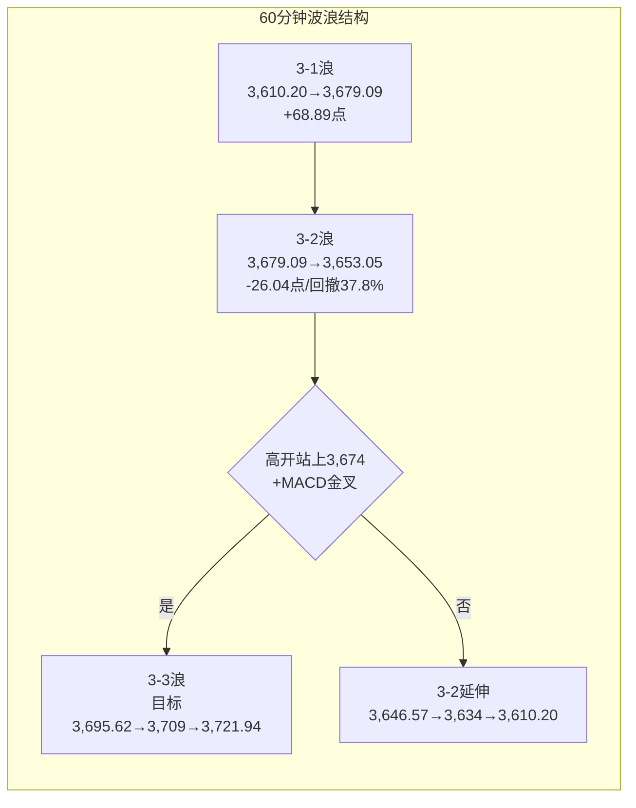

# A股晨报 - 2026年11月10日

> 数据截止时间：2026年11月10日 09:00（北京时间）
> 报告性质：**隔夜全球风险偏好"暴力修复"后的高开验证日**
> **一句话定性**：隔夜美股三大指数全线上涨超2%（道指+2.15%、标普+2.35%、纳指+2.74%）、费城半导体指数+6.85%（AMD+13%）、欧洲主要指数涨1%-2%；今晨日经225涨2.79%站上60,000点、韩国KOSPI涨超5%触发Sidecar（SK海力士+7%、三星电子+5%）、富时A50期货+0.95%。叠加油价暴跌（WTI -4.38%、布伦特-5.85%）压低通胀预期、中美自今日13:01起继续暂停24%对美加征关税2个月——**外部条件全面转暖，A股大概率高开于3,674-3,695区间**。但昨日"盘中突破3,664.82、收盘得而复失"且量能仅1.49万亿，今日核心矛盾不是"是否高开"，而是**"高开后能否放量站稳3,674、收盘收在3,664.82上方"**；若再现"高开缩量"，则3浪3确认继续延后，"假突破"风险上升。

---

## 一、昨日晚报复盘要点回顾（2026-11-09晚报）

### 1. 昨日判断回顾

| 维度 | 准确率 | 说明 |
|------|--------|------|
| **趋势判断** | **100%（1/1）** | 晨报"震荡偏强、高开验证"正确，上证+0.32%收红 |
| **点位预测** | **100%（3/3）** | 区间3,638-3,698✓（实际3,653.05-3,679.09）、强支撑3,610.20✓（未触及）、强压力3,700✓（未触及） |
| **板块预判** | **25%（2/8）** | 银行、半导体设备/国产替代✓；保险、光伏、券商、贵金属、机器人、算力硬件✗ |
| **成交量** | **0%（0/1）** | 预测1.75-1.95万亿，实际1.4946万亿（缩量1,770亿/-10.6%） |
| **波浪分析** | **约82%** | 日线3-1触及0.618目标3,675.58兑现；3,664.82收盘未确认判断正确；未预估"缩量假突破"幅度 |
| **综合准确率** | **67.5%** | 30%×100%+30%×100%+30%×25%+10%×0% |

### 2. 关键偏差及原因（昨日复盘结论）

- **偏差1（成交量）**：把"国常会稳市+日经+2.33%+A50+0.45%"等同于增量资金入场，忽略"关键颈线下方+重大数据公布日"的典型缩量观望特征。
- **偏差2（光伏设备）**：把"反内卷收储"政策预期当作当日催化，忽略PPI同比+5.7%、剪刀差扩大至约5.0个百分点对中下游制造利润的挤压，光伏-2.22%领跌。
- **偏差3（机器人）**：只用"美债—估值"框架看跌，忽略宇树科技+9.04%等产业催化，机器人+2.70%。
- **偏差4（算力硬件）**：低估"费半反弹+电子主力净流入87.35亿"的修复力度，光通信模块+1.87%、CPO+1.61%、PCB+3.07%、工业富联+4.57%。
- **偏差5（黄金）**：只看"加息预期"单因子，未纳入美元指数-0.44%、油价跳水3%的组合，黄金+1.34%、贵金属+1.30%。

### 3. 沉淀的规则/检查项（今日直接调用）

- **规则1（资金面/量能）**：指数处于关键颈线下方且当日有重大数据公布时，量能基础情景为"前日±5%"，"放量突破"须盘中验证；缩量（<1.5万亿）冲高回落按"假突破"处理。
- **规则2（板块/PPI结构）**：PPI-CPI剪刀差扩大（>4.5个百分点）时，上游资源（煤炭/燃气/稀土/油气）是当日看涨首选，中下游制造（光伏/锂电/电池/逆变器）下调为看跌/回避。
- **规则3（板块/主题）**：缩量分化市中，主题板块（机器人/商业航天/6G/卫星）可由产业催化独立走强，不能只用"美债—估值"框架看跌；须跟踪连板高度与封板率。
- **规则4（板块/算力）**：外盘费半单日反弹>3%且A股电子行业主力净流入>50亿时，撤销"存储/光模块/算力硬件看跌"，改为"超跌修复参与"。
- **规则5（波浪/假突破）**：盘中突破颈线但收盘得而复失、且量能低于1.5万亿，按"假突破"计数，3浪确认延后；下一交易日回踩38.2%位不破，仍保留3浪3可能。
- **规则6（风险/黑天鹅）**：龙头公司治理黑天鹅（如英伟达CEO事件）在夜盘发酵时，次日A股对应产业链按"高开低走"预案处理，以开盘30分钟定价，不追反弹。

### 4. 对今日分析的启示

1. **量能纪律优先**：今日外盘极强、高开确定，但"高开缩量"是最大陷阱；**开盘30分钟量能同比是否放大10%以上**，比开盘涨幅更重要。
2. **PPI剪刀差仍有效**：光伏/锂电/电池/逆变器继续回避，不因高开而追。
3. **算力硬件分化而非齐涨**：费半+6.85%、存储链（海力士+7%）强，但英伟达-4.27%创7个月新低；**选存储/PCB/设备，回避英伟达直接产业链（光模块/CPO/服务器）的高开**。
4. **3,664.82仍是唯一确认线**：盘中突破无效，必须"收盘站上+量能≥1.8万亿"双确认；今日若收盘跌回3,664.82下方，则连续第二日"假突破"，需下调3浪3概率。
5. **主题不追高**：昨日封板率仅52.29%、炸板52只，今日高开环境更易"高标一字/跟风炸板"，机器人/商业航天只做底仓、不追连板。

---

## 二、隔夜市场动态（11月9日收盘后至今）

### 1. 美股市场（11月9日收盘）

| 指数 | 收盘 | 涨跌幅 | 说明 |
|------|------|--------|------|
| **道琼斯工业指数** | **52,389.75** | **+2.15%（+约1,104点）** | 单日拉升逾1,100点，收复上周大部分跌幅 |
| **标普500指数** | **7,549.94** | **+2.35%** | 11大板块普涨，科技与可选消费领涨 |
| **纳斯达克综合指数** | **25,253.14** | **+2.74%** | 大型科技股普涨：特斯拉/Meta+5%、苹果/微软/亚马逊+2% |
| **费城半导体指数** | — | **+6.85%** | **全市场最强主线**；AMD+13%领涨，存储芯片强劲反弹 |
| **英伟达（NVDA）** | — | **-4.27%** | **创近7个月收盘新低**；董事会就CEO相关事项启动独立调查 |

> **美股定性**：**"油价暴跌→通胀担忧缓解→风险偏好修复"是主逻辑，半导体是弹性最大的方向。** 但内部分化剧烈：**AMD+13%、费半+6.85%与英伟达-4.27%并存**，说明资金是在"AI算力总贝塔"内部做"去英伟达化"再平衡，而非无差别买入。对A股的映射是：**存储/PCB/半导体设备受益于费半与韩系存储暴涨；光模块/CPO/服务器等英伟达直接产业链面临"高开低走"压力。**

### 2. 欧洲/亚太市场

**欧洲（11月9日收盘）**

| 指数 | 收盘 | 涨跌幅 |
|------|------|--------|
| 德国DAX | 26,267.19 | **+1.73%** |
| 法国CAC40 | 8,233.30 | **+1.16%** |
| 英国富时100 | 10,782.87 | **+1.02%** |
| 欧洲斯托克50 | 6,297.65 | **+2.06%** |

**亚太（11月10日早盘，北京时间08:10-09:00）**

| 市场 | 最新 | 涨跌幅 | 说明 |
|------|------|--------|------|
| **日经225** | **60,354.44（08:10）** | **+2.79%** | **站上60,000点**；日本央行会议摘要偏鹰、加息预期升温，金融股领涨 |
| **韩国KOSPI** | — | **+5.14%** | **触发Sidecar（暂停程序化买入）**；SK海力士+7%、三星电子+5%，存储链暴涨 |
| **富时中国A50期货** | — | **+0.95%（09:00）** | 隔夜夜盘已收涨1.06%，今晨低开后仍涨0.95% |
| 恒生指数 | 未开盘 | — | 09:30开盘，预计跟随外围高开 |

> **亚太定性**：**日韩"科技+存储"双引擎暴涨，是A股今日高开的最直接外部支撑。** 韩国KOSPI单日+5%并触发Sidecar属极端强势，**存储链（海力士/三星）的映射强于英伟达链**；但需警惕"日韩高开高走、A股高开低走"的既往错位——**若A股半导体高开后30分钟不能放量，说明内资在借外盘利好兑现。**

### 3. 大宗商品

| 品种 | 最新 | 涨跌幅 | 说明 |
|------|------|--------|------|
| **WTI原油（12月合约）** | **86.85美元/桶** | **-4.38%（-3.98美元）** | 美伊外交谈判乐观预期，盘中一度跌4.5% |
| **布伦特原油（1月合约）** | **92.57美元/桶** | **-5.85%（-5.75美元）** | 盘中跌超5%，领跌大宗 |
| **COMEX黄金（12月）** | **4,114.50美元/盎司** | **+0.97%** | 油价回落缓解通胀担忧+美元走软，金价收复4,100 |
| COMEX白银（12月） | 52.693美元/盎司 | +1.45% | 跟随黄金走强 |
| **LME期铜** | **13,888.5美元/吨** | **+0.88%** | 中东局势边际降温，铜价企稳；锌+0.89%、铝+0.64% |

> **商品定性**：**"油跌、金涨、铜稳"的组合，本质是"通胀预期回落+美元走弱"，而非"需求崩塌"。** 对A股：**航空/航运/化工中下游/化纤是明确成本受益方；石油石化/油服承压；黄金股受益；铜等工业金属中性偏多。** 但油价单日-4%~-6%也会强化"全球需求走弱"叙事，**资源股内部将分化：贵金属>工业金属>能源。**

### 4. 汇率与利率

| 项目 | 数值 | 变化 |
|------|------|------|
| **美元指数** | **101.66** | **-0.61%** |
| 欧元/美元 | 1.1224 | +0.76% |
| 英镑/美元 | 1.3442 | +0.68% |
| 美元/日元 | 157.91 | -0.37% |
| **美债10年期收益率** | **4.886%** | **+2.9bp** |
| 美债2年期收益率 | 4.564% | +5.7bp |
| 人民币中间价（11/9） | 6.7188 | 下调20个基点 |
| 在岸人民币（11/9 16:30） | 6.6735 | 下跌24点 |
| 央行公开市场（11/9） | 1,820亿隔夜逆回购 | 净回笼440亿，利率1.25% |

> **汇率利率定性**：**美元回落0.61%、人民币即期6.6735保持强势，外部流动性环境边际改善。** 但美债2年期+5.7bp、10年期+2.9bp，说明"12月加息预期"并未因油价下跌而完全消退——**这正是今晚21:30美国CPI的核心看点：若核心CPI环比≥0.3%，美债利率可能再度上行，压制高估值成长；若≤0.2%，则"油价跌+加息预期降"双击，成长股弹性打开。**

### 5. 重要海外事件

- **油价暴跌**：受外交谈判解决美伊冲突的乐观预期影响，WTI/布伦特单日跌4.38%/5.85%，为全球风险资产提供"通胀减压"逻辑。
- **英伟达治理黑天鹅**：董事会就CEO黄仁勋相关事项启动独立调查，英伟达收跌4.27%、创近7个月新低；公司称黄仁勋将继续履职、不中断经营。**事件本身不影响AI基本面，但压制英伟达链风险偏好。**
- **半导体"去英伟达化"反弹**：AMD+13%、费半+6.85%、存储芯片强劲反弹，资金从"英伟达单一贝塔"转向"半导体全行业+存储涨价"。
- **美联储12月议息（北京时间12月10日03:00）**：今晚CPI是会议前最后一份通胀数据；市场普遍预期10月整体与核心CPI环比均+0.3%，若明显低于预期，12月加息概率下降。
- **日本央行鹰派信号**：会议摘要显示委员认为"需加快加息至中性水平"，日经仍涨2.79%，说明"利率上行+风险偏好回升"可并存。

---

## 三、今日关注事项

### 1. 重要数据发布（北京时间）

| 时间 | 数据/事件 | 预期/前值 | 影响 |
|------|----------|----------|------|
| **上午（待定）** | **中国10月进出口数据（海关总署）** | 前值：9月进出口5.16万亿元、同比+27.5%；前三季度+18.8% | **外需验证**；出口链/航运/港口/家电；若出口增速回落，内需政策预期升温 |
| **21:30** | **美国10月CPI** | 整体/核心环比预期均**+0.3%**；因政府停摆无同比数据；核心同比私人预测约2.8% | **本周最大外部变量**；决定12月加息路径与成长股估值 |
| 待定 | 台积电10月营收 | — | 半导体/算力链景气验证 |
| 11/12 | 美国10月PPI、初请失业金 | — | 通胀链条二次验证 |
| **11/13** | **周线收盘** | — | **3,664.82周线反转确认日** |

### 2. 政策/监管动态

- **关税延期（重大利好）**：国务院关税税则委员会公告，为落实中美两国元首华盛顿会晤成果共识，**自2026年11月10日13:01起，在2个月内继续暂停实施24%的对美加征关税税率，保留10%**。
- **非关税措施同步延期**：商务部宣布，自11月10日起继续暂停2025年4月4日公告的不可靠实体清单相关措施2个月；继续暂停2025年第21号公告的出口管制管控名单相关措施2个月。**中美经贸阶段性缓和延续，利好出口链、消费电子、航运与风险偏好。**
- **储蓄国债发售**：11月10日起发售3年期（票面1.63%，249.04亿）、5年期（1.70%，304.39亿），合计553.43亿元，无风险利率锚稳定。
- **国常会稳市机制（11/6）**：细则仍待落地，市场关注汇金/宽基ETF是否在关键点位承接。

### 3. 公司公告/市场事件

- **亚玛顿（002623）**：控股股东拟变更为骑形网络，**股票11月10日复牌**，关注复牌后波动对光伏板块情绪的扰动。
- **限售股解禁**：11月10日共**11家公司解禁，合计11.66亿股、解禁市值85.26亿元**；**芯联集成-U、千岸科技**等解禁量居前，相关个股短期流动性压力。
- **新股**：今日**无新股申购**；**钶锐锶（688827）上市**，关注其对科创板次新情绪的带动。
- **本周解禁**：本周40股解禁合计441.85亿元，今日85.26亿元，压力较昨日109亿元略减。

### 4. 其他关注

- **第108届中国电子展（CEF）**：11月10日-12日在上海举办，电子元器件/半导体/PCB/存储链条存在事件催化。
- **第二十一届花旗中国峰会**：11月10日-13日举办，外资对中国资产定调窗口。
- **台积电10月营收**：验证AI/先进制程景气，影响A股半导体设备与算力链。
- **日韩存储链暴涨的持续性**：若SK海力士/三星电子全天维持强势，A股存储/PCB的映射更强；若冲高回落，A股半导体高开低走概率上升。

---

## 四、板块与个股分析（结合昨日复盘）

### 1. 基于昨日复盘结论的板块调整

| 昨日板块 | 昨日实际表现 | 今日预期调整 | 依据 |
|---------|------------|------------|------|
| **煤炭/燃气/稀土** | 煤炭+3.47%、燃气+3.25%、稀土+2.80% | **维持看涨，但由"追涨"转"持有/回调低吸"** | PPI+5.7%、煤炭开采+36.6%的涨价链仍有效；但油价暴跌可能压制能源整体情绪，且昨日已大涨 |
| **光伏设备** | **-2.22%**（领跌） | **维持看跌/回避** | PPI-CPI剪刀差扩大→中下游成本挤压；收储细则未落地；4连板后拥挤度回吐（规则2） |
| **银行** | +0.98% | **维持看涨（底仓）** | 高股息+稳市护盘+美债高位；但今日高开成长风格占优，银行可能相对跑输 |
| **机器人/商业航天** | 机器人+2.70%、商业航天+1.72% | **维持"主题底仓、不追高"** | 产业催化独立，但封板率仅52.29%、炸板52只；今日高开更易兑现（规则3） |
| **存储/光模块/算力硬件** | 光通信+1.87%、CPO+1.61%、PCB+3.07% | **由"反抽即减"上调为"分化参与"**：存储/PCB/设备看涨，光模块/CPO/服务器谨慎 | 费半+6.85%、AMD+13%、海力士+7%→规则4触发；但英伟达-4.27%→规则6约束英伟达链 |
| **贵金属/黄金** | 黄金+1.34%、贵金属+1.30% | **由"看跌"上调为"看涨"** | 金价+0.97%收复4,100、美元-0.61%；规则：黄金方向必须看美元当日方向 |
| **券商** | 非银-0.34% | **维持"观察/不追"** | 昨日成交缩至1.49万亿；今日若放量≥1.8万亿，券商才有交易性机会，需盘中确认 |

### 2. 隔夜信息驱动的板块机会

**受益板块：**

1. **半导体/存储/PCB/元件**（逻辑：费半+6.85%、AMD+13%、SK海力士+7%、三星+5%，全球半导体风险偏好暴力修复；存储涨价+国产替代+中国电子展催化；**优先存储、PCB、半导体设备，回避英伟达直接链**）。
2. **航空/航运/化工中下游/化纤**（逻辑：WTI -4.38%、布伦特-5.85%，燃油成本显著下降；航空盈利弹性最大，化工中下游成本压力缓解；关税暂停2个月利好出口链与航运需求）。
3. **黄金/贵金属**（逻辑：金价+0.97%至4,114.50美元、美元指数-0.61%、油价跌压低实际利率；黄金股与金价背离后有修复动力）。
4. **出口链/家电/消费电子**（逻辑：中美继续暂停24%关税2个月+人民币即期6.6735偏强；关税不确定性下降，出口链估值修复）。
5. **券商（条件性）**（逻辑：若今日成交额≥1.8万亿且高开高走，券商有补涨；但若缩量，则继续观察，不追）。

**受损板块：**

1. **石油石化/油服/油气开采**（逻辑：WTI -4.38%、布伦特-5.85%，直接压缩上游盈利；昨日已因油价跳水承压，今日低开概率大）。
2. **光伏设备/锂电/能源金属/逆变器**（逻辑：PPI-CPI剪刀差仍约5.0个百分点，中下游制造成本压力未解；高开是减仓机会而非买点）。
3. **英伟达直接产业链：光模块/CPO/服务器**（逻辑：英伟达-4.27%创7个月新低、董事会调查未落地；A股相关标的高开易低走，按规则6"开盘30分钟定价、不追反弹"）。
4. **高位连板/纯题材/微盘**（逻辑：昨日封板率52.29%、炸板52只；今日高开环境利于兑现，追高容错率低）。

### 3. 重点关注个股

| 个股 | 关注理由 | 技术位置/操作 |
|------|---------|-------------|
| **兆易创新/北京君正** | 存储涨价+海力士/三星暴涨映射 | 高开不追，回踩5日线低吸；跌破昨日低点止损 |
| **生益科技/沪电股份** | PCB/覆铜板，AI服务器+费半反弹 | 昨日已强势，今日高开冲高不追，等回踩 |
| **中微公司/北方华创** | 半导体设备/国产替代，费半+6.85% | 大盘站稳3,674后参与，止损前低 |
| **中国国航/春秋航空** | 油价暴跌4%-6%，燃油成本下降 | 高开2%以内可参与，冲高5%以上不追 |
| **紫金矿业/山东黄金** | 金价+0.97%、美元-0.61% | 回踩5日线低吸，不追高开 |
| **美的集团/海尔智家** | 关税暂停2个月+出口链修复 | 低吸为主，关注人民币汇率 |
| **招商银行** | 高股息+稳市护盘 | 底仓持有，不追高 |
| **中国神华** | PPI涨价链+冬季用煤+高股息 | 持有/回调低吸；油价大跌可能压制能源情绪 |
| **中国石油/中海油** | 油价暴跌直接受损 | **回避/反抽减仓** |
| **隆基绿能/通威股份/宁德时代** | PPI剪刀差+成本压力 | **回避**，高开是减仓机会 |
| **中际旭创/新易盛** | 英伟达链，NVDA -4.27% | **不追高开**，按开盘30分钟定价，反抽减 |

> 注：个股仅作板块观察与策略示例，不构成投资建议；实际操作需结合开盘量能、板块宽度与个人风险承受能力。

---

## 五、今日核心判断（结构化，用于晚报复盘）

### 1. 趋势判断

- **上证指数：【看涨】（高开震荡、重心上移；防"高开缩量低走"）**
- **预测区间：3,665点 - 3,720点**
- **核心逻辑**：隔夜美股涨超2%、费半+6.85%、日韩今晨暴涨（日经+2.79%、KOSPI+5%）、A50期货+0.95%，外部风险偏好全面修复；油价暴跌4%-6%压低通胀预期、中美关税暂停24%再加征2个月，内部风险偏好亦获支撑。**主情景为"高开3,680-3,695→回踩3,674不破→震荡上行至3,700-3,716"**；但昨日量能仅1.49万亿、"假突破"阴影未消，**若开盘30分钟量能未同比放大10%以上，则可能重演"高开冲高回落"，收盘跌回3,664.82下方则判断降级为"震荡"。**

### 2. 关键点位

- **强支撑位：3,646.57点**（依据：11/6 2浪扩张低点+3浪2回撤61.8%位；**收盘跌破则3浪3假设失效，下看3,634/3,610.20**）
- **弱支撑位：3,674点**（依据：昨日盘中颈线上沿+中线生死线；**今日高开后由压力转第一支撑，回踩不破则强势**）
- **弱压力位：3,700点**（依据：11/5盘中高点+整数关口；突破则打开3,716-3,724.56）
- **强压力位：3,716-3,724.56点**（依据：3浪1.0目标3,716.00+0.236回撤/缺口下沿3,724.56；**放量站上则周线反转确认**）
- 补充：**3,664.82**（双底颈线/唯一收盘确认线）、**3,695.62**（3-3的0.618目标）、**3,721.94**（3-3的1.0目标）、**3,749.26**（双底量度目标）。

### 3. 板块预判

- **看涨板块**：
  1. **半导体/存储/PCB/元件**（逻辑：费半+6.85%、AMD+13%、海力士+7%、三星+5%，存储涨价+中国电子展催化；**选存储/PCB/设备，回避英伟达链**）
  2. **航空/航运/化工中下游**（逻辑：油价暴跌4%-6%→燃油与原料成本下降；关税暂停→出口链需求改善）
  3. **黄金/贵金属**（逻辑：金价+0.97%、美元-0.61%、实际利率下行）
  4. **出口链/家电/消费电子**（逻辑：中美继续暂停24%关税2个月，不确定性下降）
- **看跌板块**：
  1. **石油石化/油服/油气开采**（逻辑：WTI -4.38%、布伦特-5.85%，上游盈利直接压缩）
  2. **光伏设备/锂电/能源金属/逆变器**（逻辑：PPI-CPI剪刀差约5.0个百分点，中下游成本压力未解）
  3. **高位连板/纯题材/微盘**（逻辑：封板率52.29%、炸板52只，高开兑现压力大）
- **风险板块**：**英伟达直接产业链（光模块/CPO/服务器）**（NVDA -4.27%、治理调查未落地，高开低走风险）；**今日解禁股**（芯联集成-U、千岸科技等，85.26亿）；**亚玛顿复牌**（控制权变更，波动可能扰动光伏情绪）。

### 4. 资金面判断

- **北向资金预期：【小幅净流入】0-50亿元**（隔夜外围暴涨+A50+0.95%+关税暂停指向外资风险偏好回暖；北向净额交易所不披露，以成交占比跟踪，11/9北向成交2,162.36亿元、占两市14.58%，较前日下降17.65%、连续3日下降，**今日关注占比能否回升至15%以上**）。
- **成交量预期：【温和放量】1.60-1.80万亿元**（基础情景按规则1取"前日±5%"上沿1.50-1.65万亿；若开盘30分钟量能同比放大10%以上，上修至1.75-1.85万亿；**≥1.8万亿是3浪3确认的必要条件，<1.5万亿则按"高开缩量假突破"处理**）。
- **两融**：截至11/6全市场两融约23,073亿元，杠杆资金未恐慌去化。
- **护盘观察**：高开环境下，**汇金/宽基ETF是否在3,674-3,664.82区间承接回踩**，是判断"高开不低走"的关键。

### 5. 风险预警（按优先级排序）

- **高风险**：
  1. **美国10月CPI（21:30）**：整体/核心环比预期均+0.3%，若核心≥0.3%→美债利率上行、12月加息强化，压制成长与外资；若≤0.2%→"油价跌+加息预期降"双击，A股次日再上台阶。**今日A股收盘前无法验证，属"隔夜风险"。**
  2. **英伟达治理黑天鹅**：NVDA -4.27%创7个月新低、董事会独立调查未落地；A股光模块/CPO/服务器存在"高开低走"传导风险（规则6）。
  3. **高开缩量假突破**：若成交额<1.5万亿且收盘跌回3,664.82下方，则连续第二日"盘中突破、收盘失败"，3浪3概率下调，回踩3,646.57/3,634。
- **中风险**：
  1. **中国10月进出口数据不及预期**：若出口增速较9月（+27.5%）明显回落，出口链/航运高开低走，并强化"内需政策加码"博弈。
  2. **日韩暴涨后的"高开兑现"**：KOSPI+5%触发Sidecar属极端情绪，A股半导体若开盘30分钟不能放量，易复制"外强内弱"。
  3. **高位连板退潮**：昨日封板率52.29%、炸板52只，今日高开环境利于兑现，追高易吃面。
  4. **今日解禁85.26亿元**（芯联集成-U、千岸科技等），相关个股流动性冲击。
- **低风险**：
  1. 油价暴跌→化工/航空成本下降，但强化"全球需求走弱"叙事，属"结构利好、总量中性"。
  2. 人民币即期6.6735偏强、美元指数回落0.61%，外资流出压力不大。
  3. 储蓄国债发售（1.63%/1.70%）稳定无风险利率锚，流动性不构成压力。

### 6. 昨日复盘规则应用

- **应用规则1（量能）**：今日虽外盘极强，仍按"前日±5%"设基础量能1.50-1.65万亿；**只有开盘30分钟同比放大10%以上，才上修至1.75-1.85万亿**；若收盘<1.5万亿且指数收在3,664.82下方，按"假突破"计入复盘。
- **应用规则2（PPI剪刀差）**：光伏/锂电/电池/逆变器继续看跌/回避；**高开是减仓机会，不是买点**。
- **应用规则3（主题）**：机器人/商业航天仅底仓，**不追高开、不追连板**；跟踪封板率能否回升至60%以上。
- **应用规则4（算力）**：费半+6.85%>3%、昨日电子主力净流入87.35亿>50亿→**撤销"算力硬件看跌"，改为"存储/PCB/设备超跌修复参与"**；但英伟达-4.27%→**光模块/CPO/服务器仍按"高开不追"**。
- **应用规则5（假突破）**：昨日盘中突破3,664.82、收盘得而复失且量能<1.5万亿→按"假突破"计数；**今日必须"收盘站上3,664.82+量能≥1.8万亿"双确认，才升级为3浪3**；回踩3,653.05/3,646.57不破，仍保留3浪3可能。
- **应用规则6（黑天鹅）**：英伟达事件→A股英伟达链"以开盘30分钟定价、不追反弹"；**若开盘30分钟光模块/CPO放量下跌，则全天回避**。

### 7. 波浪理论参考（多周期）

#### （1）月K线波浪分析

- **当前波浪位置**：大级别第2浪（C浪）延伸结束的**候选确认期**，月线修复第二周；11月月K暂为"带上影小阳"。
- **浪型结构描述**：6月高点4,197→10/23低点3,574.27完成C浪延伸；11月自3,614.13开盘，下探3,580.38后连续两周收阳，11/9盘中最高3,679.09、收3,660.79。**今日高开若落在3,680-3,695，月K将首次收盘/盘中同时站上3,664.82与3,674**，月线"下未破（3,580.38/3,574.27）、上未复（3,664.82/3,674）"的格局有望被打破。
- **关键目标位**：上方**3,674（中线生死线）→3,721-3,724.56（0.236回撤+缺口下沿）→3,785（20月均线）→3,812（0.382回撤）**；下方**3,621（0.382）→3,580.38→3,574.27（月线生死线）**。
- **验证条件**：**11月月K收盘站上3,724.56**→月线修复确认；**收盘跌破3,574.27**→C浪延伸重启，目标3,478/3,443。当前仍属"止跌成立、反转待确认"。

#### （2）周K线波浪分析

- **当前波浪位置**：周线**六连阴后的第二根阳线（进行中）**，反包**尚未确认**；本周（第46周）为方向确认周。
- **浪型结构描述**：第46周（11/9-11/13）至今：开3,659.02、高3,679.09、低3,653.05、现3,660.79，周内+0.32%；上周收3,649.18（+1.39%）。**今日高开将直接挑战3,664.82颈线与3,674中线生死线**；若收盘站上3,664.82，周K将由"带上影小阳"转为"突破阳线"。
- **关键目标位**：**3,664.82（颈线/周线反转唯一确认）→3,674→3,695（MA20/5周均线）→3,701-3,702（三角下沿）→3,724.56（0.236/缺口下沿）→3,749.26（双底量度）**。
- **验证条件**：**本周收盘站上3,664.82且量能≥1.8万亿**→周线反转成立；**收盘跌回3,621下方**→反包失败，退回3,574-3,664宽幅震荡。

#### （3）日K线波浪分析

- **当前波浪位置**：双底（3,574.27/3,580.38）突破后的**第2浪扩张调整结束候选，3浪1完成/3浪2整理末端**。
- **浪型结构描述**：**1浪 3,580.38→3,686.17（+105.79点）**；**2浪扩张 3,686.17→3,610.20（回撤71.24%）**；**3浪1 3,610.20→3,679.09（+68.89点，为1浪的0.651倍）**，已越过3浪0.618目标3,675.58；**3浪2 3,679.09→3,653.05（-26.04点，回撤37.8%，接近38.2%位3,652.77，误差0.28点）**。今日高开将直接进入"3浪3启动验证"。
- **关键目标位**：**3浪3目标：0.618=3,695.62、1.0=3,721.94（与3,724.56缺口下沿重合）、1.618=3,764.56**；3浪整体（自3,610.20）1.0=3,716.00、1.618=3,781.40。下方**3,653.05（38.2%）→3,646.57（2浪低点/61.8%）→3,634→3,610.20**。
- **验证条件**：**收盘站上3,664.82并放量（≥1.8万亿）**→3浪3确认；**收盘跌破3,646.57**→3浪2深化，看3,634/3,610.20；**收盘跌破3,610.20**→2浪扩张延续，看3,580.38/3,574.27。

#### （4）60分钟K线波浪分析

- **当前波浪位置**：3浪1（3,610.20→3,679.09）完成、**3浪2回踩（3,679.09→3,653.05）已触及38.2%位**，尾盘拉回3,660.79；今晨A50+0.95%，60分钟将直接跳空进入"3-3验证"。
- **浪型结构描述**：3,686.17→3,610.20为调整a浪（-75.97点）；3,610.20→3,679.09为3-1（+68.89点，回撤b浪的90.7%）；3,679.09→3,653.05为3-2（-26.04点，回撤37.8%）；尾盘反弹至3,660.79（回补25.8%）。**60分钟MACD高位红柱收缩、面临死叉；KDJ由超买回落至中性——高开若放量，MACD将重新金叉。**
- **关键目标位**：上方**3,664.82/3,674/3,679.09**；3-3启动后**3,695.62（0.618）/3,709（1.236延伸）/3,721.94（1.0）**；下方**3,653.05/3,646.57/3,634**。
- **验证条件**：**60分钟站上3,674且MACD重新金叉**→3-3启动；**跌破3,646.57且量能放大**→3-2延伸至3,634/3,610.20。

#### （5）30分钟K线波浪分析

- **当前波浪位置**：日内"高开→冲高3,679.09→单边回落3,653.05→尾盘拉回"的**旗形/收敛整理末端**，今晨跳空高开将选择方向。
- **浪型结构描述**：30分钟高点3,679.09、低点3,653.05，振幅26.04点（0.71%）；**低点3,653.05高于上周五低点3,610.20、高点3,679.09高于上周五高点3,660.49，属"高点抬高、低点抬高"的上升结构**；但尾盘量能萎缩、30分钟MACD死叉、KDJ回落至50下方。**今日高开若直接越过3,679.09，30分钟将形成"跳空+过顶"的强势结构；若高开回补缺口并跌破3,664.82，则30分钟转弱。**
- **关键目标位**：上破3,679.09→3,695.62/3,700/3,721.94；下破3,664.82→3,653.05/3,646.57/3,634。
- **验证条件**：**30分钟站稳3,674并放量**→上行延续；**跌破3,646.57**→回踩3,634，修正延续。

#### （6）波浪图（Mermaid）

```mermaid
graph LR
    subgraph 日K线波浪结构（上证指数）
        A[双底<br/>3,574.27 / 3,580.38] --> B[1浪<br/>3,580.38→3,686.17<br/>+105.79点]
        B --> C[2浪扩张<br/>3,686.17→3,610.20<br/>回撤71.24%]
        C --> D[3浪1<br/>3,610.20→3,679.09<br/>+68.89点/触及0.618目标3,675.58]
        D --> E[3浪2<br/>3,679.09→3,653.05<br/>回撤37.8%]
        E --> F{11/10高开能否<br/>放量站稳3,674}
        F -->|收盘>3,664.82<br/>量能≥1.8万亿| G[3浪3<br/>目标3,695.62→3,721.94→3,749.26]
        F -->|高开缩量<br/>收盘<3,664.82| H[3浪2延伸<br/>3,646.57/3,634]
        H -->|收盘<3,610.20| I[2浪扩张延续<br/>3,580.38/3,574.27]
    end
```



#### （7）波浪理论综合判断

- **多周期共振状态**：**月线偏多（3,621上方、月K有望首次收复3,674）、周线待确认（3,664.82差4.03点）、日线"3浪2整理末端"、60分钟回撤38.2%到位、30分钟收敛待突破**——**中长周期偏多、短周期待确认的"弱共振"**；今日高开若放量，将升级为"多周期向上共振"。
- **当前操作级别**：**日线定方向、60分钟定执行**；在3,664.82未收盘收复且量能未回1.8万亿前，按"3浪3待确认"而非"3浪3加速"计价。
- **后续演变路径**：
  - **主路径（50%）**：高开3,680-3,695→回踩3,674/3,664.82不破→震荡上行3,695-3,716；收盘站上3,664.82、量能1.65-1.8万亿。
  - **偏强路径（25%）**：半导体/存储放量领涨+成交≥1.85万亿→直接突破3,700→3,721.94/3,724.56，周线反转确认。
  - **偏弱路径（25%）**：高开3,690+后30分钟量能不足→回补缺口、跌破3,664.82→3,646.57/3,634；**收盘跌破3,646.57则3浪3证伪**，回踩3,610.20。
- **关键拐点信号**：① **3,664.82收盘得失（唯一确认线）**；② **3,674/3,695.62**（第一/第二压力）；③ **开盘30分钟量能同比是否放大10%以上**；④ **中国10月进出口数据**；⑤ **今晚21:30美国CPI**；⑥ 英伟达-4.27%对A股光模块/CPO的传导；⑦ 存储/PCB能否接棒煤炭/燃气成为新主线；⑧ 封板率能否回升至60%以上。
- **风险提示**：波浪计数具主观性；**今日"高开"是外盘驱动的情绪修复，不是内资增量入场的证明**——若量能<1.5万亿，高开即为"兑现窗口"，收盘跌回3,664.82下方则构成连续第二日"假突破"，3浪3概率下调；**跌破3,646.57则3浪2深化，跌破3,610.20则2浪扩张延续**。不得将单日高开或单日主题活跃线性外推为反转。

---

## 六、投资策略建议（分短线+中线）

### 1. 短线策略（1-3个交易日）

- **适用场景**：基于日K线和60分钟K线技术信号；今日为"外盘驱动的高开验证日"。
- **短线仓位：25%**（由昨日晚报的20%上调5个百分点；**高开不追、回踩确认再加**）。
- **买入条件**：
  1. **不追3,700以上高开**；若开盘3,680-3,695，等待10:00前回踩3,674/3,664.82不破且30分钟量能同比放大10%以上，方可加至25%-30%。
  2. 若高开直接突破3,700且成交额30分钟同比放大15%以上，可跟随至30%，但**只买存储/PCB/航空/黄金，不买英伟达链**。
  3. 若开盘后跌破3,664.82并回补缺口，**保持20%不加仓**，等3,646.57企稳信号。
- **卖出条件**：
  1. 冲高3,695.62-3,716放量滞涨（30分钟量能萎缩、上涨家数<50%）→减至20%。
  2. 收盘跌回3,664.82下方→减至20%；收盘跌破3,646.57→减至15%；收盘跌破3,634→减至10%。
- **止损位：收盘3,646.57点**（3浪2回撤61.8%+2浪低点）；个股止损-5%至-7%。
- **短线标的**：
  1. **兆易创新/北京君正**（逻辑：存储涨价+海力士/三星暴涨映射，技术形态超跌修复）。
  2. **生益科技/沪电股份**（逻辑：PCB/覆铜板，AI服务器+费半反弹，昨日已放量）。
  3. **中国国航/春秋航空**（逻辑：油价暴跌4%-6%，燃油成本下降，事件驱动）。
  4. **紫金矿业/山东黄金**（逻辑：金价+0.97%、美元-0.61%，避险+实际利率下行）。

### 2. 中线策略（1-4周）

- **适用场景**：基于周K线波浪分析和运行规律分析结论。
- **中线仓位：20%**（维持不变；方向未确认前不加仓）。
- **方向判断：【持有】**（若今日收盘站上3,664.82且量能≥1.8万亿，上调为"加仓"至25%）。
- **目标区间：上证指数 3,646点 - 3,750点**（若放量站上3,724.56，上修至3,750-3,785）。
- **中线布局板块**：
  1. **半导体设备/存储/PCB**（逻辑：费半+6.85%、存储涨价、国产替代；行业景气+技术位置）。
  2. **煤炭/黄金**（逻辑：PPI涨价链+冬季用煤+高股息；金价+美元回落）。
  3. **银行**（逻辑：稳市护盘+高股息，底仓）。
  4. **机器人/商业航天**（逻辑：产业催化独立，仅底仓，控制仓位）。
  5. **出口链/家电**（逻辑：关税暂停2个月+人民币偏强）。
- **止盈条件**：指数到达3,750点或波段涨幅达到8%-10%。
- **止损条件**：指数收盘跌破3,610.20（3浪2失效线）；绝对止损3,574.27（月线生死线）。

### 3. 仓位分配总览

| 策略类型 | 仓位比例 | 方向 | 重点板块 |
|---------|---------|------|---------|
| 短线 | **25%** | 高开不追、回踩确认 | 存储/PCB、航空、黄金、出口链 |
| 中线 | **20%** | 持有（站上3,664.82+量能≥1.8万亿加至25%） | 半导体设备/存储、煤炭/黄金、银行 |
| 现金 | **55%** | — | — |

### 4. 与昨日策略对比

- **短线仓位调整**：从20%上调至25%（原因：隔夜美股+2%、费半+6.85%、日韩暴涨、A50+0.95%，外部条件显著改善；但仅上调5pct，保留"高开缩量"应对空间）。
- **中线仓位调整**：维持20%（原因：3,664.82仍未收盘确认，纪律优先；站上3,664.82+量能≥1.8万亿再加至25%）。
- **板块调整**：
  - **增配**：半导体存储/PCB/设备（费半+6.85%、海力士+7%）、航空（油价暴跌）、黄金（金价+0.97%）、出口链/家电（关税暂停）。
  - **减配**：石油石化/油服（油价暴跌）、英伟达链光模块/CPO（NVDA -4.27%，高开不追）。
  - **维持**：煤炭/燃气（PPI涨价链，但由追涨转持有）、银行（底仓）、机器人/商业航天（底仓）、光伏/锂电（回避）。

---

## 七、信息来源

1. **官方数据**：海关总署（11月10日发布10月进出口数据；前三季度进出口同比+18.8%、9月5.16万亿元/+27.5%）；国务院关税税则委员会（11月9日公告：自11月10日13:01起2个月内继续暂停24%对美加征关税、保留10%，[mof.gov.cn](https://gss.mof.gov.cn/gzdt/zhengcefabu/202611/t20261109_4004260.htm)）；商务部（11月9日：自11月10日起继续暂停不可靠实体清单措施2个月、出口管制管控名单措施2个月，[央视网](https://news.cctv.com/2026/11/09/ARTI1LUSDtPLzWuGezW3uLX3261109.shtml)）；国家统计局（11/9 10月CPI +0.7%、PPI +5.7%）。
2. **权威财经媒体**：东方财富（《美股三大指数全线收涨：半导体、存储芯片强劲反弹，英伟达跌超4%》，道指52,389.75/+2.15%、标普7,549.94/+2.35%、纳指25,253.14/+2.74%，[eastmoney.com](https://finance.eastmoney.com/a/202611103926901510.html)）；新华网（《国际油价显著下跌》，WTI 86.85/-4.38%、布伦特92.57/-5.85%）；凤凰网（《昨夜，全线大涨！道指狂飙超1100点》，欧洲DAX 26,267.19/+1.73%、CAC 8,233.30/+1.16%、富时100 10,782.87/+1.02%，[ifeng.com](https://finance.ifeng.com/c/8xvpgfLdsR6)）；上海证券报（《日经225指数涨近3% 韩国综合指数涨超5%》，[cnstock.com](http://www.cnstock.com/commonDetail/826397)）；财联社（11月10日09:00 A50期货+0.95%，[cls.cn](https://www.cls.cn/detail/2529692)；《A股限售股解禁一览：85.26亿元市值限售股今日解禁》，[sina.com](https://finance.sina.com.cn/roll/2026-11-10/doc-iniyexvm2854375.shtml)）；新浪财经（《美国10月CPI前瞻：增速或明显放缓，美联储加息路径生变数？》，[sina.com](https://finance.sina.com.cn/roll/2026-11-10/doc-iniyexvm2865272.shtml)；《油价暴跌金价涨了》，COMEX黄金4,114.50/+0.97%，[sina.com](https://finance.sina.com.cn/jjxw/2026-11-10/doc-iniyfech2761669.shtml)）；东方财富（《11月9日北向资金最新动向》，成交2,162.36亿元、占比14.58%，[eastmoney.com](https://finance.eastmoney.com/a/202611093926331130.html)）。
3. **数据平台**：东方财富行情（上证3,660.79/+0.32%/高3,679.09/低3,653.05/成交6,825.33亿；深成11,145.49/-0.27%；创业板2,458.56/-0.27%；科创50 1,256.96/+0.30%；两市成交14,946亿；板块：煤炭+3.47%、燃气+3.25%、光伏设备-2.22%、机器人+2.70%、光通信模块+1.87%、CPO+1.61%、PCB+3.07%、黄金+1.34%）；同花顺/Choice（日经60,354.44/+2.79%、KOSPI +5.14%、SK海力士+7%、三星+5%、LME铜13,888.5/+0.88%、美元指数101.66/-0.61%、美债10Y 4.886%/+2.9bp、2Y 4.564%/+5.7bp）。
4. **内部资料**：`report/20261109/morning_report_20261109.md`、`report/20261109/evening_report_20261109.md`、`report/20261109/day_summary_20261109.md`、`rules.md`。

> **数据口径说明**：A股为11/9收盘；美股为11/9收盘；欧洲为11/9收盘；日韩为11/10早盘08:10-09:00；黄金为11/9纽约收盘；原油为11/9收盘；美债为11/9纽约收盘；美元指数为11/9纽约尾盘；人民币为11/9中间价与16:30在岸收盘；北向净额交易所不披露，以成交占比跟踪（11/9为14.58%）。**截止时间2026-11-10 09:00（北京时间）。**

---

## 八、文档更新检查

### AGENTS.md更新
- 晨报流程、波浪分析格式、复盘格式与实际执行一致，**无需更新**。

### README.md更新
- 项目功能与目录结构无变化，**无需更新**。

### 结论
- 本次晨报无需修改 AGENTS.md 与 README.md；规则库无新增（今日为晨报，不追加规则）。
