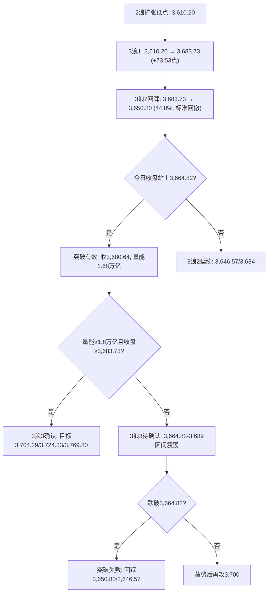
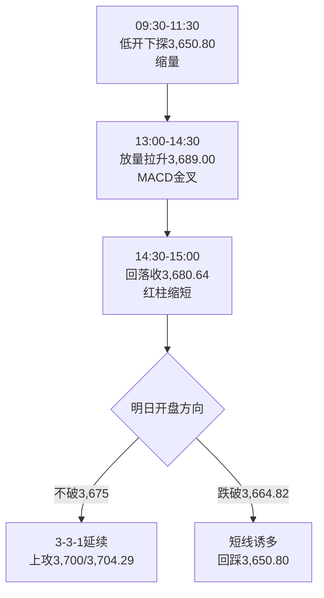

# A股晚报 - 2026年11月11日

> 数据截至：2026-11-11 20:00（北京时间）
> 编制：A股分析师AI代理

---

## 一、市场回顾

### 1.1 主要指数表现

| 指数 | 收盘 | 涨跌幅 | 涨跌点 | 成交额 |
|------|------|--------|--------|--------|
| 上证指数 | **3,680.64** | **+0.46%** | +16.92 | 7,361.55亿 |
| 深证成指 | **11,389.74** | **+1.32%** | +148.20 | 9,401.22亿 |
| 创业板指 | **2,572.07** | **+3.11%** | +77.67 | 约4,805亿 |
| 科创50 | **1,300.38** | **+2.80%** | +35.38 | — |
| 科创综指 | 约1,563 | +2.7% | — | — |
| 北证50 | — | **+2.30%** | — | — |

- **两市成交额：16,763亿元（1.68万亿），较昨日放量1,719亿元（+11.30%）**；沪市7,361.55亿 + 深市9,401.22亿
- **上证日内：低开3,655.00（-0.22%）→ 最低3,650.80 → 最高3,689.00 → 收3,680.64**
- 形态：**低开探底、午后增量资金拉升、尾盘小幅回落，收"带上影小阳"（上影8.36点、实体25.64点）**
- **结构特征：上午缩量下跌（半日跌0.24%、缩量约320亿）→ 下午首小时放量1,271亿 → 全天放量1,719亿**，属"前缩后放"的增量资金主动进攻，而非存量博弈

### 1.2 成交量能

| 项目 | 数据 | 对比 |
|------|------|------|
| 两市成交额 | **16,763亿** | 较11/10的15,168亿放量**+1,719亿（+11.30%）** |
| 主力资金 | **净流入141.32亿** | 15个行业净流入；通信、电子、机械设备居前 |
| 特大单 | **净流入236.15亿** | 中际旭创单只特大单净流入23.97亿 |
| 北向资金 | 净额交易所不披露 | 参与度维持低位，方向无法验证 |
| 南向资金 | **净买入45.72亿港元** | 阿里+12.04亿、中芯国际+9.35亿、盈富基金+9.26亿 |

### 1.3 市场情绪

| 指标 | 数值 | 解读 |
|------|------|------|
| 上涨家数 | **3,538只（63.47%）** | 普涨但不如11/10的76% |
| 下跌家数 | 1,827只 | — |
| 涨停家数 | **85只** | 较昨日95只回落 |
| 跌停家数 | 1-3只（口径差异） | 低位 |
| 炸板/封板未遂 | 25只 | — |
| 封板率 | **77.27%（证券时报）/ 82%（财联社，剔除ST）** | 仍属强势区间 |
| 连板家数 | 19只 | 梯队完整 |
| 最高连板 | **文投控股 16天9板** | 光洋股份13天7板、日出东方4连板 |

> **今日是"指数温和上涨、结构极致进攻"**：上证仅+0.46%，但创业板+3.11%、科创50+2.80%，成长弹性远大于权重；涨停85只、封板率>77%，说明主题资金未退潮，仅从"高位AI应用"切向"算力硬件+机器人"。

---

## 二、热点板块与异动分析

### 2.1 领涨板块

| 板块 | 涨幅 | 驱动因素 |
|------|------|----------|
| **通信** | **+7.99%** | CPO/光模块/光芯片全面爆发；"易中天"（新易盛、中际旭创、天孚通信）集体涨超10%，源杰科技20CM涨停，剑桥科技、日海智能、华脉科技等涨停 |
| **电子** | **+3.56%** | 元件、半导体、消费电子、电子化学品；PCB龙头东山精密、沪电股份、深南电路、景旺电子、奥士康涨停，胜宏科技+9.92% |
| **机械设备** | **+2.04%** | 人形机器人涨停潮，17只个股涨停；瑞迪智驱20CM涨停，锋龙股份、光洋股份连板 |
| 其他居前 | — | 自动化设备、游戏、玻璃玻纤、建材、林木、燃气、汽车零部件 |

**核心驱动**：
1. **美股AI交易回归**：北京时间11/11晚间纳指100期货涨2.00%、标普500期货涨0.92%，CoreWeave财报超预期盘前涨超15%，AI概念股集体走强，情绪传导至A股算力硬件；
2. **亚太半导体共振**：日经225 +1.31%（爱德万测试+5.89%、铠侠+5.55%、东京电子+2.95%）、韩国KOSPI +2.60%，存储与设备链修复；
3. **超跌反弹+资金回补**：通信/电子连续多日被杀跌（11/6通信-4.93%、电子-3.90%），今日主力资金集中回补，属"跌深反弹+叙事修复"双击。

### 2.2 领跌板块

| 板块 | 跌幅 | 原因 |
|------|------|------|
| **食品饮料** | **-2.22%** | 白酒大跌，CPI低+消费需求偏弱，资金从防御切向成长 |
| **农林牧渔** | -0.88% | 前期强势板块获利回吐 |
| **非银金融** | -0.86% | 保险领跌，市场风险偏好回升但成交量未达2万亿，券商未受益 |
| 机场航运 | 跌幅居前 | 油价盘中反弹超2%，成本改善逻辑逆转 |
| 贵金属 | 偏弱 | 中金黄金-2.37%，高盛下调2026年底金价目标至4,150美元 |

> **风格切换明确**：资金从"白酒/保险/黄金"等防御与避险资产撤出，转向"通信/电子/机器人"高弹性成长。银行+0.35%仍小幅收红，说明红利未被完全抛弃，属"防御内部缩圈"。

### 2.3 个股异动

- **算力硬件**：中际旭创+15.07%（542.00元，特大单净流入23.97亿）、新易盛/天孚通信涨超10%、源杰科技20CM涨停、光智科技/杰普特/联讯仪器大涨
- **PCB**：东山精密涨停（92.06元，成交126.54亿，机构净买入4.70亿、深股通净买入1.50亿）、沪电股份涨停，两只市值重回1,700亿上方；深南电路、景旺电子、奥士康涨停
- **机器人**：瑞迪智驱20CM涨停，锋龙股份、光洋股份（13天7板，换手17.25%创历史新高）、日发精机、赛福天涨停
- **连板龙头**：文投控股16天9板（AI短剧总龙头），日出东方4连板
- **高位股风险**：连续大涨后尾盘指数从3,689回落至3,680，3,700上方套牢盘与获利盘抛压显现

---

## 三、关键数据与事件回顾

### 3.1 国内经济数据

- **10月金融数据明日（11/12）公布**：市场预期新增人民币贷款中值约**-1,500亿元**（或再现负值）、新增社融中值约**1.5万亿元**（同比多增约6,800亿）、M1/M2同比或小幅回落
- 10月CPI +0.7%、PPI +5.7%（已公布），"CPI低、PPI高"剪刀差约5.0个百分点延续
- 10月进出口+31.2%、出口+28.7%、进口+34.7%（已公布），外需韧性延续

### 3.2 政策消息

- **央行公开市场**：开展1,870亿元隔夜逆回购（利率1.25%），当日到期1,900亿元，**净回笼30亿元**，资金面维持平稳
- **人民币中间价6.7191，调贬24个基点**（前值6.7167），此前连续上调后小幅回吐
- 关税暂停24%措施（11/10 13:01起、为期2个月）继续生效，抢出口效应延续

### 3.3 公司公告

- **珠免集团（600185）**：筹划发行股份及支付现金购买珠海免税26%+23%股权并募集配套资金，交易后免税公司将成为全资子公司，**11月12日起停牌**
- **东易日盛（002713）**：股东天津晨尚9/29-11/10累计减持0.9988%，持股降至5.9991%
- **德龙汇能（000593）**：董事长王新杰因未督促捷荣技术披露，收到证监会广东监管局《行政处罚事先告知书》，拟罚70万元
- **龙虎榜**：东山精密机构净买入4.70亿元

---

## 四、海外市场联动

### 4.1 美股（11月10日收盘，隔夜）

| 指数 | 收盘 | 涨跌幅 |
|------|------|--------|
| 道琼斯工业指数 | 52,231.89 | -0.30% |
| 标普500 | 7,520.93 | -0.38% |
| 纳斯达克综合指数 | 25,065.87 | -0.74% |

- **美国10月CPI全面超预期**：整体环比+0.4%（预期+0.3%）、核心环比+0.3%（预期+0.2%），12月加息25bp概率升至100%
- **11/11晚间美股期货大幅反弹**：纳指100期货+2.00%、标普500期货+0.92%、道指期货+0.22%；CoreWeave财报超预期盘前涨超15%，AI交易卷土重来

### 4.2 欧洲与亚太

| 市场 | 收盘 | 涨跌幅 |
|------|------|--------|
| 日经225 | 61,248.59 | **+1.31%** |
| 韩国KOSPI | 5,375.36 | **+2.60%** |
| 恒生指数 | 24,315.92 | **-0.98%** |
| 恒生科技 | 4,027.06 | **-1.41%** |
| 德国DAX（11/10） | 26,347.45 | +0.31% |
| 法国CAC40（11/10） | 8,278.59 | +0.55% |

> **亚太与港股分化**：日韩半导体链大涨，带动A股算力硬件；港股受科网与黄金股拖累下跌，恒生科技-1.41%。A股午后走强更多由"日韩半导体+美股AI期货"驱动，而非港股映射。

### 4.3 大宗商品与汇率

| 品种 | 最新（20:00） | 变动 |
|------|--------------|------|
| 布伦特原油 | 93.54美元/桶 | **+2%以上** |
| WTI原油 | 87.36美元/桶 | +1.53% |
| 现货黄金 | 约4,060美元/盎司 | 盘中一度跌近3%，午后反弹转涨（13:08 +0.70%报4,060.87） |
| 现货白银 | 52.91美元/盎司 | +2.70% |
| 美元指数 | 高位企稳 | CPI后反弹 |
| 美债10Y | 4.952%（11/10） | +9.03bp |
| 人民币中间价 | 6.7191 | 调贬24bp |

> 油价盘中反弹超2%，主因俄美乌阿布扎比会谈与供给扰动；黄金日内"先跌后涨"，高盛下调2026年底金价目标至4,150美元，机构分歧加大。

---

## 五、汇率与利率

1. **人民币汇率**：中间价6.7191（调贬24bp），在岸即期跟随小幅走弱；10月出口+28.7%形成结汇支撑，贬值空间有限
2. **国内利率**：隔夜逆回购利率1.25%，DR001/隔夜Shibor维持1.28%附近，资金面平稳；国债收益率窄幅波动
3. **央行操作**：1,870亿隔夜逆回购、到期1,900亿，**净回笼30亿**，连续小额净回笼但流动性充裕
4. **海外利率**：美债10Y 4.952%逼近5%，对高估值成长仍构成中期压制；但今日A股成长由"产业叙事+超跌"驱动，短期压过利率压制

---

## 六、收盘后重要信息

### 6.1 盘后公告

- 珠免集团筹划重大资产重组，11/12起停牌
- 东易日盛股东减持至5.9991%
- 德龙汇能董事长拟被罚70万元
- 龙虎榜：东山精密获机构净买入4.70亿元、深股通净买入1.50亿元

### 6.2 夜盘与外围

- 美股期货全线上涨，纳指100期货+2.00%，AI概念股盘前集体走强
- 布伦特原油涨超2%至93.54美元，WTI +1.53%至87.36美元
- 现货黄金日内先跌近3%后反弹，13:08报4,060.87（+0.70%）；白银+2.70%

### 6.3 次日关注（11月12日，周四）

- **中国10月M1/M2、社融、新增信贷**（市场预期新增信贷中值-1,500亿、社融中值1.5万亿）
- **美国11月7日当周初请失业金人数**
- 商务部召开11月第2次例行新闻发布会
- 国内成品油开启新一轮调价窗口
- 百度世界2026在北京举行
- 11/13 美国10月PPI、11/14 美国11月密歇根消费者信心

---

## 七、波浪理论多周期分析

### 1. 月K线波浪分析

- **当前波浪位置**：大级别第3浪启动初期（月线三连阳雏形，首次收盘站上3,664.82）
- **浪型结构描述**：11月开3,614.13 → 低3,580.38 → 高3,689.00（今日刷新）→ 现3,680.64（月内+2.27%）；月K为"带长下影、带上影小阳"，实体扩大，上影收窄
- **关键目标位**：3,700（整数关）→ 3,704.29（3浪3的0.618）→ 3,724.56（月线确认位/缺口下沿）→ 3,749.26（量度目标）
- **验证条件**：月线收在3,664.82上方且月线MACD红柱第2个月继续放大（+257.66）；若月K收盘站上3,724.56，月线级别修复确认

### 2. 周K线波浪分析

- **当前波浪位置**：周线六连阴后反弹第2周，**首次收盘站上3,664.82，周线反转进入"确认待放量"阶段**
- **浪型结构描述**：本周（第46周）开3,659.02 → 低3,650.80 → 高3,689.00 → 现3,680.64（周内+0.46%）；5周均线约3,698，尚未收复
- **关键目标位**：上方3,689.00 / 3,698（5周均线）→ 3,700 → 3,724.56；下方3,664.82（颈线，转支撑）/ 3,650.80 / 3,646.57
- **验证条件**：**周五（11/13）收盘站稳3,664.82且周成交额≥9万亿（日均1.8万亿）→ 周线反转确认**；若周五回落至3,664.82下方，则按"假突破"处理，重回3,634-3,664震荡

### 3. 日K线波浪分析

- **当前波浪位置**：**3浪2调整结束（回撤44.8%），3浪3启动待确认**
- **浪型结构描述**：3浪1 3,610.20→3,683.73（+73.53点）→ 3浪2 回踩3,650.80（回撤32.93点，**44.8%**，介于38.2%-50%之间，属标准回撤）→ 今日放量收复颈线收3,680.64
- **关键目标位**：3浪3（自3,650.80起算）目标 **3,704.29（0.618）/ 3,724.33（1.0）/ 3,769.80（1.618）**；若跌破3,650.80则3浪2扩张，下看3,646.57 / 3,634 / 3,610.20
- **验证条件**：**3浪3确认须同时满足"收盘≥3,683.73 + 成交额≥1.8万亿"**；今日仅满足"收盘≥3,664.82"，量能1.68万亿不足，故为**"突破有效、级别待确认"**；收盘跌破3,664.82则突破失败

### 4. 60分钟K线波浪分析

- **当前波浪位置**：3浪3的第1子浪（3-3-1）进行中，午后放量突破
- **浪型结构描述**：上午3,650.80见底后，60分钟连续4根阳线，MACD零轴上方金叉、红柱放大，成交量下午首小时放大1,271亿；尾盘3,689.00小幅回落至3,680.64
- **关键目标位**：上方3,689.00 / 3,700 / 3,704.29；下方3,664.82（颈线回踩）/ 3,660 / 3,650.80
- **验证条件**：回踩3,664.82不破且60分钟MACD红柱不放量缩短 → 3-3-1延续；若放量跌破3,664.82，则午后拉升为"诱多"，回调级别扩大至日线

### 5. 30分钟K线波浪分析

- **当前波浪位置**：3浪3初段，尾盘出现小幅顶背离迹象
- **浪型结构描述**：13:30-14:30快速拉升3,689.00，30分钟MACD高位，尾盘两根30分钟K线小幅回落，红柱缩短
- **关键目标位**：上方3,689.00 / 3,700；下方3,675 / 3,664.82
- **验证条件**：明日开盘30分钟不破3,675且量能环比不减 → 3浪3延续；若跌破3,664.82且30分钟放量 → 短线见顶，回踩3,650.80

### 6. 波浪图（Mermaid绘制）

**日K线波浪结构图**



**60分钟波浪结构图**



### 7. 波浪理论综合判断

- **多周期共振状态**：月线偏多（★★★★）、周线偏多（★★★☆，首次收盘站上颈线）、日线转多（★★★☆）、60分钟偏多（★★★）、30分钟偏多但顶背离（★★☆）——**"中长多+短多"的共振格局初步形成**，较昨日的"中长偏多、短周期偏空"背离明显改善
- **当前操作级别**：日线3浪3待确认级别，**以日线持仓、60分钟择时**；量能未达1.8万亿前不追高
- **后续演变路径**：主路径（50%）明日3,670-3,690震荡整固，量能维持1.6-1.75万亿，周五再攻3,700；偏强路径（30%）量能放大至1.8万亿以上，直接突破3,689→3,704-3,724；偏弱路径（20%）量能萎缩至1.5万亿以下，回落3,664.82→3,650.80
- **关键拐点信号**：**转强确认=收盘≥3,683.73+成交≥1.8万亿**；**转弱信号=收盘<3,664.82**；短线警戒=跌破3,675
- **风险提示**：3,700上方套牢盘与获利盘抛压沉重（尾盘已从3,689回落）、量能1.68万亿仍差3浪3确认阈值1,322亿、美债10Y 4.952%对高估值成长构成中期压制；波浪计数存在"3浪2未结束"的备选可能，跌破3,650.80即证伪

---

## 八、晨报复盘

### 1. 核心判断回顾

| 判断项目 | 晨报预测 | 实际结果 | 准确度 | 备注 |
|---------|---------|---------|-------|------|
| 上证指数趋势 | 【震荡偏弱】（低开、弱反抽、防冲高回落） | **低开高走，收涨+0.46%** | ✗ | 低开方向正确，但"弱反抽"误判为午后放量拉升 |
| 上证指数区间 | 3,638-3,675点 | **3,650.80-3,689.00点** | ✗ | 上沿被突破14点，下沿未触及 |
| 强支撑位 | 3,646.57点 | 最低3,650.80点（未触及） | ✓ | 支撑有效，差4.23点 |
| 强压力位 | 3,683.73点 | 最高3,689.00点（突破5.27点） | ✗ | 压力位被突破，未单列突破情景 |
| 北向资金 | 净流出20-50亿 | 净额未披露（成交占比低位） | — | 无法验证，不计入 |
| 成交量 | 平量至小幅缩量1.45-1.60万亿 | **1.6763万亿** | ✗ | 高于上限763亿，连续第3日低估 |

### 2. 板块预判回顾

| 板块 | 预判方向 | 实际涨跌幅 | 准确度 | 原因分析 |
|-----|---------|-----------|-------|---------|
| 银行/公用事业/公路铁路 | 看涨 | 银行+0.35% | ✓ | 防御相对收益兑现，但弹性有限 |
| 半导体设备/材料 | 看涨 | 电子+3.56%、半导体大涨 | ✓ | 国产替代+日韩半导体共振 |
| 出口链/家电/消费电子 | 看涨 | 消费电子/元件上涨 | ✓ | 10月出口+28.7%支撑 |
| 存储/光模块/CPO/算力硬件 | 看跌 | **通信+7.99%、CPO爆发** | ✗ | 最大误判：英伟达大跌被线性外推，忽视AI叙事回归 |
| 黄金/贵金属 | 看跌 | 中金黄金-2.37%、港股金股下跌 | ✓ | 高盛下调金价目标，A股金股偏弱（现货金午后反弹） |
| 高位连板/纯题材微盘 | 看跌 | 涨停85只、封板率82%、文投16天9板 | ✗ | 宽度仍强，退潮未发生（规则27再次违反） |

### 3. 准确率量化评估

- **趋势判断准确率：0%（0/1）**——预测"震荡偏弱"，实际低开高走收涨
- **点位预测准确率：33.3%（1/3）**——强支撑✓；区间✗、强压力✗
- **板块预判准确率：66.7%（4/6）**——银行✓、半导体设备✓、出口链✓、黄金✓；算力硬件✗、高位连板✗
- **综合准确率：30.0%**（30%×0 + 30%×33.3 + 30%×66.7 + 10%×0）
- **波浪分析准确率：约65%**——3浪2回撤44.8%落在38.2%-50%区间✓；"第三次颈线测试失败"判断✗；"量能未达1.8万亿"条件✓

### 4. 偏差根因分析

**【偏差1】趋势判断偏差（震荡偏弱 → 低开高走收涨）**
- 偏差描述：预测"低开概率大、弱反抽、防冲高回落"，实际低开0.22%后午后放量拉升，收+0.46%
- 根本原因：**信息缺失 + 逻辑误判**
- 信息缺口：晨报仅采信隔夜美股下跌（纳指-0.74%、英伟达-5.53%），**未纳入盘前/亚洲时段的关键反向信号**——日经225 +1.31%、韩国KOSPI +2.60%、A50期货仅-0.12%、美股期货晚间+2.00%
- 逻辑缺陷：把"英伟达个股利空"线性外推为"A股算力硬件补跌"，忽视了"超跌+AI叙事回归"的反向力量
- 改进措施：晨报必须并列"亚太早盘方向+美股期货"作为A股开盘后修正变量；当亚太半导体收涨>1%且A50跌幅<0.3%时，趋势下限上调为"震荡"，不得直接给"偏弱"

**【偏差2】强压力位3,683.73被突破（最高3,689.00）**
- 偏差描述：把昨日高点3,683.73设为强压力，实际突破5.27点
- 根本原因：**技术分析局限 + 规则执行缺失**
- 逻辑缺陷：强压力位与预测区间上沿（3,675）距离仅8.73点，**本月第3次违反"压力位与区间上沿距离<15点须单列突破情景"规则**（11/2、11/4已两次违反）
- 改进措施：将"突破情景"设为强制项写入模板；成交额环比放量>10%时，压力位自动上移至下一整数关（今日应为3,700）

**【偏差3】成交量低估（预测1.45-1.60万亿 → 实际1.6763万亿）**
- 偏差描述：上限低估763亿，连续第3个交易日低估
- 根本原因：**逻辑误判**——只考虑"CPI落地后内资观望"，未预判"上午缩量、下午放量"的日内结构
- 信息缺口：未获取午后增量资金进场的实时信号（下午首小时放量1,271亿）
- 改进措施：当亚太半导体大涨+美股期货走强时，量能基准由"前日±5%"上调为"前日×1.10-1.15"；日内"前缩后放"结构出现后，次日量能预测不得低于当日

**【偏差4】算力硬件/CPO看跌被完全证伪（通信+7.99%）**
- 偏差描述：预测"存储/光模块/CPO/算力硬件补跌"，实际通信板块暴涨7.99%、中际旭创+15.07%
- 根本原因：**逻辑误判**——规则36明确"外盘费半单日反弹>3%且A股电子主力净流入>50亿时撤销看跌"，今日电子/通信主力净流入居前（全市场+141.32亿、特大单+236.15亿），**规则已触发但未执行**
- 信息缺口：未实时跟踪亚太半导体与美股AI期货
- 改进措施：将规则36升级为**盘前强制检查项**：日经/韩国半导体涨>1% + 美股AI期货涨>1% → 直接撤销"算力硬件看跌"

**【偏差5】高位连板退潮判断再次落空**
- 偏差描述：预测"高位连板/纯题材微盘看跌"，实际涨停85只、封板率82%、文投控股16天9板
- 根本原因：**情绪面误读**——在宽度极强（上涨63%、封板率>77%）时提前预判退潮，规则27（须等断板信号）连续第2日违反
- 改进措施：删除"高位连板看跌"作为独立预判项，改为"仅观察，断板/封板率<70%后再下调"

### 5. 分析检查清单

- [x] 隔夜外盘走势（美股三大指数、费半）
- [ ] **亚太早盘方向（日经/韩国）**——本次遗漏，导致趋势误判
- [ ] **美股期货/盘前AI股**——本次遗漏
- [x] 北向资金流向（净额不可得，已标注）
- [x] 技术指标状态（MACD、均线、颈线）
- [x] 重大政策/事件（CPI、加息预期）
- [x] 前期高低点、整数关口（3,700）
- [x] 均线支撑/压力（5周均线3,698）
- [ ] **压力位与区间上沿距离<15点→单列突破情景**——本次违反
- [x] 板块基本面、资金流向、政策催化
- [ ] **规则36（费半反弹+电子净流入→撤销算力看跌）**——本次未执行
- [x] 宏观/行业/个股/流动性风险
- [x] 颈线有效性以收盘+量能双确认

### 6. 本次复盘发现的新规则

- **规则1**：隔夜美股下跌但亚太（日经/韩国）收涨、A50期货跌幅<0.3%时，A股不可线性外推"低开低走"，午后增量资金可逆转趋势
- **规则2**：强压力位距前高<10点且当日放量>10%、亚太同步走强时，必须单列"突破情景"，压力上移至整数关
- **规则3**："上午缩量、下午首小时放量>1,000亿"的"前缩后放"结构 = 增量资金主动进攻，全天量能预测上限应上移至前日×1.15
- **规则4**：外盘AI硬件跌但亚太半导体涨>1%、美股AI期货涨>1%、A股电子/通信主力净流入>50亿 → 撤销"算力硬件看跌"
- **规则5**：颈线"第三次测试"在量能放大+亚太共振下成功率上升，不得机械套用"三次失败"；以"收盘+量能"双确认，今日为"突破有效、级别待确认"

### 7. 规则库更新

```
###趋势分析 隔夜美股下跌但亚太日经/韩国收涨、A50期货跌幅<0.3%时，A股不可线性外推低开低走，午后增量资金可逆转，趋势下限应为"震荡"而非"偏弱"
###点位计算 强压力位距前高<10点且当日成交额环比放量>10%、亚太同步走强时，必须单列"突破情景"，压力位上移至下一整数关
###板块选择 外盘AI硬件下跌但亚太半导体涨>1%、美股AI期货涨>1%、A股电子通信主力净流入>50亿时，撤销"存储/光模块/CPO看跌"，按超跌反弹参与
###资金面分析 上午缩量、下午首小时放量>1000亿的"前缩后放"结构=增量资金主动进攻，全天量能预测上限应上移至前日×1.15
###风险识别 颈线"第三次测试"在量能放大+亚太共振背景下成功率上升，不得机械套用"三次失败"规则，须以收盘+量能双确认
###波浪分析 3浪2回撤落在38.2%-50%区间后放量收复颈线，3浪3进入"待确认"而非"证伪"；目标自回撤低点起算0.618/1.0/1.618
```

---

## 九、策略回顾与调整

### 1. 短线策略回顾

| 策略项目 | 晨报建议 | 今日实际 | 执行效果 | 备注 |
|---------|---------|---------|---------|------|
| 短线仓位 | 15% | 维持15% | ✓ | 仓位偏低，踏空午后拉升 |
| 买入条件 | 回踩3,646.57-3,653.05 + 3根30分钟不创新低+缩量 | 最低3,650.80触及区间，但午后直接拉升 | ✗ | 条件未完整触发，错过买点 |
| 卖出条件 | 反抽3,664.82-3,675放量滞涨减5% | 直接突破3,675，无滞涨信号 | ✓ | 未误减仓 |
| 止损位 | 3,646.57 | 最低3,650.80 | ✓ | 未触发 |
| 短线标的 | 北方华创/中微、美的/海尔、招行/工行 | 半导体设备、家电、银行均上涨 | ✓ | 标的方向正确，但仓位过低 |

### 2. 中线策略调整

- **当前中线方向：【持有】→【持有偏加仓】**
- 方向调整原因：日线收盘首次站上3,664.82颈线，3浪2回撤44.8%后放量收复，波浪结构转好；但量能1.68万亿未达1.8万亿确认阈值，暂不追高，等回踩确认后加仓
- **中线仓位建议：20% → 25%**（收盘站稳3,664.82且3浪2结束，加5个百分点；若收盘跌破3,664.82则退回20%）
- 中线目标区间：上证指数 **3,700 - 3,724点**（3浪3的0.618/1.0目标）
- 中线止损位：**3,646.57**（收盘价）；3,610.20为结构失效线
- 中线布局板块调整：**增配半导体设备/材料、PCB/元件、AI算力硬件（由看跌转为回踩参与）**；维持出口链/家电；减配白酒/保险/贵金属

### 3. 明日策略要点

- **短线：【持有/回踩低吸】**，关注 **3,675**（短线警戒）和 **3,689**（突破确认）；回踩3,664.82-3,670不破可低吸，突破3,689且量能≥1.8万亿可加仓
- **中线：【持有偏加仓】**，关注 **3,664.82**（颈线支撑）和 **3,700**（整数关压力）；跌破3,664.82收盘则中线退回20%
- **仓位分配：短线20% + 中线25% + 现金55%**（短线由15%上调5pct，中线由20%上调5pct，现金65%→55%）
- 关注板块：通信/CPO（回踩不追高）、半导体设备、PCB、机器人、出口链；回避白酒、保险、贵金属、高位连板追涨

---

## 十、风险提示

1. **市场系统性风险**：量能1.68万亿仍未达3浪3确认阈值1.8万亿，突破有效性存疑；3,700上方套牢盘与获利盘抛压沉重（尾盘已从3,689回落9点）；若明日量能萎缩至1.5万亿以下，今日突破可能演变为"假突破"
2. **个股风险事件**：文投控股16天9板、光洋股份13天7板等高位连板随时可能断板；珠免集团重组停牌；东易日盛减持；德龙汇能董事长被罚
3. **政策不确定性**：11/12中国10月金融数据（新增信贷预期-1,500亿）若大幅低于预期，将压制银行/地产链；美国10月PPI（11/13）若超预期，加息50bp讨论升温将压制高β成长
4. **海外风险**：美债10Y 4.952%逼近5%，对高估值成长构成中期压制；俄美乌会谈与油价波动；美股AI交易情绪若逆转，A股算力硬件将再次承压
5. **技术风险**：今日尾盘30分钟已现顶背离迹象，若明日开盘跌破3,675且量能萎缩，短线需防"冲高回落"

---

## 十一、信息来源

1. **官方数据来源**：上交所/深交所/北交所（成交与公告）、中国人民银行（中间价、公开市场操作）、国家统计局、海关总署、美国劳工部（10月CPI）
2. **权威财经媒体**：新华社（A股收盘、港股收盘）、中国证券报·中证网、上海证券报·中国证券网、证券时报（涨停复盘、主力资金、龙虎榜、央行操作）、中国经济网、央广网
3. **数据平台**：东方财富（Choice数据、板块资金）、同花顺、新浪财经（全球行情）、财联社（涨停分析、亚太市场）、Wind
4. **研究机构**：粤开证券（市场日报）、高盛（金价目标下调）、CME FedWatch（加息概率）
5. **数据截止时间**：**2026-11-11 20:00（北京时间）**；美股为11月10日收盘价，美股期货/大宗商品为11月11日20:00最新价

---

## 十二、文档更新检查

### AGENTS.md更新

无需更新。晨报/晚报流程、波浪分析格式、复盘格式均与实际执行一致。

### README.md更新

无需更新。文件结构与功能说明与实际一致。

### 无需更新

AGENTS.md 与 README.md 均无需更新。

---

> **免责声明**：本报告为AI辅助生成的收盘后复盘分析，所有点位、概率、目标价均为基于公开数据的技术推演，不构成投资建议。市场有风险，决策需独立。
