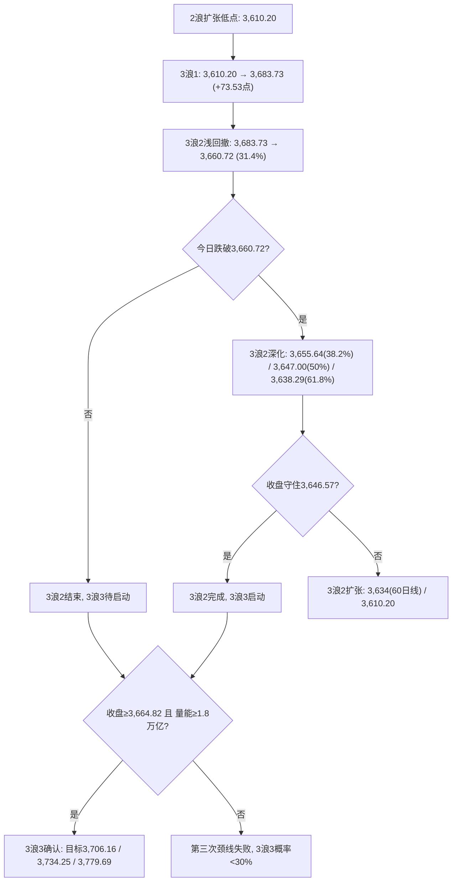
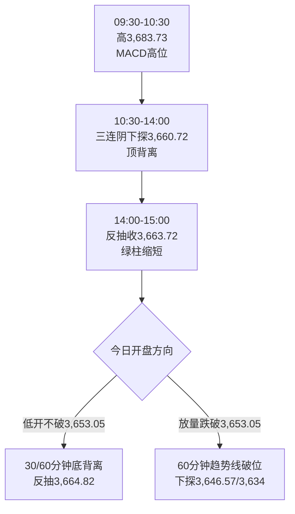

# A股晨报 - 2026年11月11日

> 数据截至：2026-11-11 09:00（北京时间）
> 编制：A股分析师AI代理

---

## 一、昨日晚报复盘要点回顾

### 1. 昨日判断回顾

| 维度 | 准确率 | 说明 |
|------|--------|------|
| 趋势 | **100%** | 看涨，三大指数收红（上证+0.08%弱兑现） |
| 点位 | **66.7%** | 区间下沿3,665被跌破4.28点（✗）；强支撑3,646.57未触及（✓）；强压力3,716-3,724.56未触及（✓） |
| 板块 | **50%** | 半导体/PCB✓、出口链✓、石油石化✓、光伏锂电✓；航运✗、黄金✗、高位连板✗、英伟达链✗ |
| 成交量 | **0%** | 预期1.60-1.80万亿，实际1.5168万亿 |
| **综合** | **65.0%** | 30%×100 + 30%×66.7 + 30%×50 + 10%×0 |
| 波浪 | **72%** | 3浪1延伸创新高✓；3浪3未启动、回踩深度超预期 |

### 2. 关键偏差及原因

- **偏差1（区间下沿）**：预测3,665-3,720，实际3,660.72-3,683.73。颈线连续2日"盘中破、收盘失守"后支撑衰减，静态把3,664.82当支撑。
- **偏差2（黄金/贵金属）**：看涨，实际现货金-1.6%。沃勒盘前放鹰，实际利率上行压制贵金属。
- **偏差3（航运）**：看涨，实际航运港口领跌。油价下跌属"需求走弱型"，不适用"油价跌→成本降→航运涨"。
- **偏差4（高位连板）**：预判退潮，实际涨停95只、封板率82.61%、最高7板。宽度极强时不能提前做空情绪。
- **偏差5（成交量）**：连续第2日低于下限，存量博弈下1.5万亿已成常态。

### 3. 沉淀的规则/检查项（已写入 rules.md）

- **射击之星**：上影≥15点且实体<5点（昨日上影20.01点、实体2.93点），次日低开概率>60%，当日尾盘不得加仓。
- **颈线三次失败**：3,664.82连续2日收盘失守后，第三次测试若仍收盘失败，按"假突破"确认，3浪3概率下调至30%以下。
- **AI主线高低切换**：算力硬件滞涨→应用端（影视/短剧/营销）接棒，传媒+2%、影视院线+5%为确认信号。
- **缩量+高封板率**：成交<1.55万亿、涨停>90、封板率>80%，属存量资金集中打主题，不等于增量入场。
- **数据前放鹰**：重大数据公布前1-2日官员放鹰，同时压制黄金与高β成长，数据公布前应降β。

### 4. 对今日分析的启示

- **不再预设"回踩不破"**：颈线有效性一律以"收盘+量能"双确认，盘中不构成买点。
- **贵金属连续降级**：CPI落地且超预期，实际利率上行，黄金由"看涨"改为"看跌/回避"。
- **降低β**：外盘科技走弱（英伟达-5.53%），高β成长与算力硬件不参与，优先防御相对收益。
- **不抢跑退潮**：高位连板仅观察，等"高标断板+封板率<70%"确认。

---

## 二、隔夜市场动态（11月10日收盘至11月11日09:00）

### 1. 美股市场（11月10日收盘）

| 指数 | 收盘 | 涨跌幅 | 涨跌点 |
|------|------|--------|--------|
| 道琼斯工业指数 | 52,231.89 | **-0.30%** | -157.86 |
| 标普500 | 7,520.93 | **-0.38%** | -29.01 |
| 纳斯达克综合指数 | 25,065.87 | **-0.74%** | -187.26 |

- **美国10月CPI全面超预期**：整体环比**+0.4%**（预期+0.3%，前值+0.6%）；核心环比**+0.3%**（预期+0.2%，前值+0.3%）。因去年联邦政府停摆缺少2025年10月样本，劳工部**未公布同比数据**。
- **加息预期陡升**：CME显示12月8-9日FOMC加息25bp概率升至**100%**；沃勒称"核心CPI≥0.3%应考虑12月加息50bp"，花旗认为50bp门槛仍高。
- **科技股承压**：英伟达**再跌5.53%**（连续第2日大跌），存储芯片股走弱，纳指跌幅显著大于道指。
- 美债收益率全线大涨：**10年期升至4.952%（+9.03bp）**；美元指数反弹走高（前收101.66）。

### 2. 欧洲/亚太市场

| 市场 | 收盘/最新 | 涨跌幅 |
|------|-----------|--------|
| 德国DAX | 26,347.45 | +0.31% |
| 法国CAC40 | 8,278.59 | +0.55% |
| 英国富时100 | 10,751.59 | -0.29% |
| 日经225（11/11 08:20） | — | -0.12%（高开低走） |
| 韩国KOSPI（11/11 08:20） | — | -0.19% |
| 富时中国A50期货 | 夜盘-0.29%，09:00 | **-0.12%**（低开后小幅回升） |

- 韩国存储双雄走弱：**SK海力士-1.5%、三星电子-1%**；韩美半导体、东部高科技涨超2%（设备与存储分化）。
- **A50期货仅小幅下跌（-0.12%）**，显著强于纳指-0.74%，说明外资对A股的定价未按外盘科技跌幅线性外推。

### 3. 大宗商品

| 品种 | 收盘 | 涨跌幅 |
|------|------|--------|
| COMEX黄金（12月） | 4,030.20美元/盎司 | **-2.05%** |
| 现货黄金 | 4,032.03美元/盎司 | **-2.61%**（盘中最低4,013.2） |
| COMEX白银（12月） | 51.225美元/盎司 | **-2.79%** |
| WTI原油（12月） | 86.04美元/桶 | -0.93% |
| 布伦特原油（1月） | 91.49美元/桶 | -1.17% |

> **贵金属连续第2日大跌**：CPI超预期→美元与美债收益率双升→实际利率上行，压制金价；白银跌幅更大，属典型"加息/强美元交易"而非避险交易。油价盘中一度跌破90美元后收回，全天小幅收跌。

### 4. 汇率与利率

| 项目 | 数值 | 说明 |
|------|------|------|
| 美元指数 | 走高（前收101.66） | CPI超预期推动反弹 |
| 美债10Y | 4.952% | +9.03bp，逼近5%关口 |
| 人民币中间价 | 6.7167（11/10） | 上调21bp，续创阶段新高；今日9:15公布 |
| 今日美债 | **休市** | 美国退伍军人节，债市休市、美股正常交易 |

### 5. 重要海外事件

- **新一轮俄美乌三方会谈**11月10日在阿布扎比举行（地缘变量，关注能源与避险情绪）。
- 美联储官员继续释放"加快升息"信号，市场对12月加息50bp的讨论升温。
- Anthropic IPO、台积电认购等AI产业事件延续（对算力链属中期逻辑，非当日驱动）。

---

## 三、今日关注事项

### 1. 重要数据发布（按时间排序）

| 时间 | 数据/事件 | 预期/前值 |
|------|-----------|-----------|
| 09:15 | 人民币兑美元中间价 | 前值6.7167 |
| 全天 | 美国退伍军人节（美债休市） | 美股正常交易 |
| 本周内 | 中国10月金融数据（社融/新增信贷） | 待公布 |
| 11/12 | 美国10月PPI、初请失业金 | — |
| 11/13 | 美国11月密歇根大学消费者信心 | — |

> 国内10月CPI同比+0.7%、PPI同比+5.7%（已公布）——**"CPI低、PPI高"的剪刀差格局延续**，上游资源相对占优、中下游制造承压。

### 2. 政策/监管动态

- **硬科技龙头密集回购增持**，产业资本以真金白银稳定市场预期；监管引导通过股权激励、分红回购提升公司价值。
- 关税暂停24%措施已自11月10日13:01起生效，为期2个月，抢出口效应延续。
- 修订后的《基金会管理条例》公布（2027年1月1日施行），对市场直接影响有限。

### 3. 公司公告

- **新股申购**：华晟智能（920067，北交所），发行价23.52元/股，发行市盈率13.88倍，发行约1,667万股，网上申购需全额缴付。
- 本月以来**793家上市公司获机构调研**，机构集中关注超跌科技、AI应用与创新药。
- 三季报披露已结束，业绩雷风险阶段性释放；后续进入"业绩真空+事件驱动"窗口。

### 4. 其他关注

- 两市融资余额**22,581.52亿元**，较前一交易日减少13.84亿元（基本持平，杠杆资金未明显加仓）。
- 俄美乌会谈进展、国际油价与贵金属盘中波动。
- 高位连板梯队（闽发铝业7板、文投控股15天8板）是否断板。

---

## 四、板块与个股分析（结合昨日复盘）

### 1. 基于昨日复盘结论的板块调整

- **昨日看涨的半导体/PCB/元件**：今日需拆分——"设备/材料"维持相对强势（国产替代独立逻辑），"存储/光模块/CPO"跟随外盘补跌（英伟达-5.53%、SK海力士-1.5%）。
- **昨日看涨的黄金/贵金属**：**下调为看跌/回避**，连续第2日实际利率交易，不抄底。
- **昨日看跌的煤炭/航运/石油石化**：油价小幅收跌但盘中收回，**维持中性偏弱**，不因油价跌看涨航运（需求走弱型下跌）。
- **昨日误判的高位连板**：不提前做空，但也不追高，等断板信号。

### 2. 隔夜信息驱动的板块机会

- **受益板块**：
  （1）**银行/公用事业/公路铁路**（逻辑：CPI超预期+加息预期升温压制高β，缩量弱市防御回归相对收益；融资余额平稳，红利资金稳定）。
  （2）**半导体设备/材料**（逻辑：国产替代与订单驱动，与外盘存储/算力硬件分开定价，外盘存储走弱日设备可逆势）。
  （3）**出口链/家电/消费电子**（逻辑：10月出口+28.7%、进口+34.7%，关税暂停2个月延续抢出口，基本面支撑明确）。
  （4）**AI应用/影视传媒**（逻辑：主线内部高低切换延续，但今日属"回踩观察"，不追高）。
- **受损板块**：
  （1）**存储/光模块/CPO/算力硬件**（逻辑：英伟达连续大跌、存储芯片股走弱，外盘映射补跌）。
  （2）**黄金/贵金属**（逻辑：美债10Y 4.952%、美元反弹，实际利率上行）。
  （3）**高β成长（创业板/科创50中的高估值品种）**（逻辑：纳指-0.74%、加息概率100%，估值端承压）。

### 3. 重点关注个股

| 标的 | 关注理由 | 技术位置 | 操作提示 |
|------|----------|----------|----------|
| 北方华创、中微公司 | 半导体设备国产替代，独立于存储周期 | 跟随大盘回踩，关注20日线 | 回踩不破可小幅参与 |
| 美的集团、海尔智家 | 出口+28.7%，关税暂停2个月 | 平台整理 | 防御+出口双属性 |
| 招商银行、工商银行 | 高股息防御，缩量弱市相对收益 | 均线多头 | 作为底仓防御 |
| 华策影视、慈文传媒 | AI影视主线，昨日影视院线+7.05% | 短线涨幅大 | 仅回踩不追高 |
| 生益科技、沪电股份 | PCB/覆铜板，AI算力需求 | 高位震荡 | 不追涨，跌破5日线减 |

> **注**：文投控股15天8板、闽发铝业7连板属情绪高标，**仅观察不参与**。

---

## 五、波浪结构多周期分析

### 1. 月K线波浪分析

- 当前波浪位置：大级别3浪启动初期（月线三连阳雏形）
- 浪型结构描述：11月开3,614.13 → 高3,683.73 → 低3,580.38 → 现3,663.72（+1.80%），带长下影、带上影小阳
- 关键目标位：3,664.82（月线分水岭）→ 3,700 → 3,749.26
- 验证条件：月线收在3,664.82上方且MACD红柱继续放大（当前红柱第2个月放大+257.66）

### 2. 周K线波浪分析

- 当前波浪位置：周线六连阴后反弹的第2周，1浪反弹内部
- 浪型结构描述：本周开3,659.02 → 高3,683.73 → 低3,653.05，周线仍在3,664.82下方，5周均线约3,698
- 关键目标位：上方3,683.73 / 3,698（5周均线）；下方3,646.57 / 3,634
- 验证条件：周五收盘站上3,664.82并放量，才确认周线反转；否则按"反弹后二次回踩"处理

### 3. 日K线波浪分析

- 当前波浪位置：3浪2调整（浅回撤31.4%后再度下探）
- 浪型结构描述：3浪1 3,610.20→3,683.73（+73.53点）→ 3浪2 回踩3,660.72（31.4%）。若今日跌破3,660.72，3浪2回撤目标为 **3,655.64（38.2%）/ 3,647.00（50%）/ 3,638.29（61.8%）**
- 关键目标位：3浪3（若启动）目标3,706.16 / 3,734.25 / 3,779.69；证伪后下看3,634 / 3,610.20
- 验证条件：**3浪3启动须同时满足"收盘≥3,664.82 + 成交额≥1.8万亿"**；收盘跌破3,646.57则3浪2扩张

### 4. 60分钟K线波浪分析

- 当前波浪位置：3浪2调整的c段，高位死叉后向下
- 浪型结构描述：昨日首根60分钟冲高3,683.73后三连阴，MACD高位死叉、顶背离确认；尾盘反抽3,663.72
- 关键目标位：下方3,660.72 / 3,653.05；上方3,664.82 / 3,668 / 3,674
- 验证条件：跌破3,653.05→60分钟上升趋势线破坏，回调级别扩大至日线3浪2；站上3,664.82并放量→3浪3重启

### 5. 30分钟K线波浪分析

- 当前波浪位置：3浪2末端，等待底背离确认
- 浪型结构描述：昨日13:30-14:00下探3,660.72后尾盘反抽3,663.72，30分钟绿柱缩短
- 关键目标位：下方3,653.05；上方3,664.82 / 3,668
- 验证条件：低开后连续3根30分钟K线不创新低+量能萎缩→30分钟底背离成立，可反抽3,664.82；若30分钟放量跌破3,653.05，则调整延续

### 6. 波浪图（Mermaid绘制）

**日K线波浪结构图**

**60分钟波浪结构图**

### 7. 波浪理论综合判断

- **多周期共振状态**：月线偏多（★★★☆）、周线中性偏多（★★☆）、日线震荡偏弱（★★）、60分钟偏空（★★）、30分钟待确认——**"中长偏多、短周期偏空"的背离格局**
- **当前操作级别**：日线3浪2调整级别，短线以防守为主，中线持有
- **后续演变路径**：主路径（55%）低开测试3,653.05→3,646.57附近获承接→弱反抽3,664.82→收盘在3,650-3,670；次路径（25%）直接跌破3,646.57→3,634→3,610.20；乐观路径（20%）低开高走站上3,664.82（需量能≥1.8万亿）
- **关键拐点信号**：收盘≥3,664.82+量能≥1.8万亿（转强）；收盘<3,646.57（3浪2扩张）
- **风险提示**：颈线第三次测试在"外盘鹰派+射击之星"背景下大概率失败，3浪3概率降至30%以下，不可抢跑

---

## 六、今日核心判断

### 1. 趋势判断

- 上证指数：**【震荡偏弱】**（低开概率大，弱反抽，防冲高回落）
- 预测区间：**3,638点 - 3,675点**
- 核心逻辑：美国10月CPI整体+0.4%、核心+0.3%双双超预期，12月加息25bp概率升至100%、50bp讨论升温，美债10Y升至4.952%、黄金-2.61%、英伟达-5.53%，隔夜风险资产全面承压；叠加昨日"射击之星"+颈线连续2日收盘失守，A股大概率低开。但10月出口+28.7%、人民币偏强、A50期货仅-0.12%、硬科技回购增持，跌幅可控，3,653.05/3,646.57为关键承接位。

### 2. 关键点位

| 类型 | 点位 | 依据 |
|------|------|------|
| 强压力 | **3,683.73** | 昨日最高点，射击之星实体上沿 |
| 弱压力 | **3,664.82** | 颈线（10月9日高点），连续2日收盘失守，第三次测试 |
| 弱支撑 | **3,653.05** | 11月9日低点，3浪1的38.2%回撤位（3,655.64）附近 |
| 强支撑 | **3,646.57** | 2浪低点，同时≈3浪1的50%回撤（3,647.00） |
| 次级支撑 | 3,638.29 / 3,634 | 3浪1的61.8%回撤 / 60日线 |
| 关键支撑 | **3,610.20** | 3浪起点，失守则3浪结构破坏 |

### 3. 板块预判

- **看涨板块**：
  （1）**银行/公用事业/公路铁路**（逻辑：CPI超预期压制高β，缩量弱市防御回归相对收益，融资余额平稳）
  （2）**半导体设备/材料**（逻辑：国产替代独立逻辑，外盘存储走弱日设备可逆势）
  （3）**出口链/家电/消费电子**（逻辑：10月出口+28.7%，关税暂停2个月延续抢出口）
- **看跌板块**：
  （1）**存储/光模块/CPO/算力硬件**（逻辑：英伟达-5.53%、存储芯片股走弱、SK海力士-1.5%）
  （2）**黄金/贵金属**（逻辑：现货金-2.61%、美债10Y 4.952%，实际利率上行）
  （3）**高位连板/纯题材微盘**（逻辑：7板高度+82.61%封板率处于情绪顶部区域）
- **风险板块**：高β成长（创业板/科创50中的高估值品种）、近期解禁/减持个股、航空（油价盘中反弹削弱成本改善逻辑）

### 4. 资金面判断

- 北向资金预期：**【净流出】20-50亿元**（成交占比或继续低于13.5%，外资参与度下降）
- 成交量预期：**【平量至小幅缩量】1.45-1.60万亿**（前值1.5168万亿；CPI落地但属外盘事件，内资观望）

### 5. 风险预警（按优先级排序）

- **高风险**：美国10月CPI全面超预期（整体+0.4% vs 预期+0.3%，核心+0.3% vs 预期+0.2%），12月加息25bp概率100%、50bp讨论升温；美债10Y升至4.952%（+9.03bp）；英伟达-5.53%拖累算力链。A股高β与成长估值承压，低开幅度可能超预期。
- **中风险**：颈线3,664.82第三次测试（连续2日收盘失守）；3,653.05若失守则3浪2深化至3,646.57/3,634；高位连板（7板）退潮风险；两市融资余额减少13.84亿，杠杆资金未加仓。
- **低风险**：华晟智能申购冻结资金有限；俄美乌阿布扎比会谈地缘扰动；今日美债休市，隔夜流动性下降、波幅或放大。

### 6. 昨日复盘规则应用

- **应用规则1（射击之星）**：昨日上影20.01点、实体2.93点，按"上方抛压确认"处理，今日低开概率>60%，**开盘不追高、尾盘不加仓**。
- **应用规则2（颈线三次失败）**：3,664.82连续2日收盘失守，今日为第三次测试，**3浪3概率下调至30%以下**，预设回踩3,646.57/3,610.20路径。
- **应用规则3（缩量+高封板率）**：1.5168万亿+封板率82.61%属存量博弈，**3浪确认仍须1.8万亿**，量能不足则按假突破处理。
- **应用规则4（数据前放鹰）**：CPI已落地且超预期，**黄金连续第2日降级、成长降β**，不抄底贵金属。
- **应用规则5（AI内部高低切换）**：算力硬件承压时资金转向应用端，但应用端昨日已大涨，**今日只做回踩不做追高**。

---

## 七、投资策略建议（分短线+中线）

### 1. 短线策略（1-3个交易日）

- 适用场景：基于日K线与60分钟K线技术信号
- **短线仓位：15%**（由20%下调5个百分点）
- **买入条件（需同时满足）**：
  1. 指数回踩3,646.57-3,653.05区间；
  2. 连续3根30分钟K线不创新低且量能环比萎缩；
  3. 收复3,653.05并站稳30分钟。
  → 满足后短线由15%加至20-25%（不满仓、不追高）
- **卖出条件（任一触发）**：
  1. 收盘跌破3,653.05 → 短线降至12%
  2. 收盘跌破3,646.57 → 短线降至10%
  3. 反抽3,664.82-3,675放量滞涨（上影>15点）→ 短线减5%
- **止损位：3,646.57（收盘价确认）**；个股跌幅>7%单独止损
- **短线标的**：
  （1）北方华创、中微公司（逻辑：半导体设备国产替代，独立于存储周期，回踩20日线附近）
  （2）美的集团、海尔智家（逻辑：出口+28.7%+关税暂停，防御与出口双属性）
  （3）招商银行、工商银行（逻辑：高股息防御，缩量弱市相对收益）

### 2. 中线策略（1-4周）

- 适用场景：基于周K线波浪分析与运行规律
- **中线仓位：20%**（维持不变）
- 方向判断：**【持有】**
- 目标区间：上证指数 **3,700点 - 3,720点**
- 中线布局板块：
  （1）半导体设备/材料（逻辑：国产替代+订单景气，技术位置在20日线上方）
  （2）出口链/家电/消费电子（逻辑：外需超预期+关税窗口，业绩确定性）
  （3）AI应用/传媒（逻辑：主线内部高低切换，中期景气延续，等待回踩）
- 止盈条件：指数到达3,700-3,720或波段涨幅达到8%
- 止损条件：指数收盘跌破3,610.20或3浪结构确认破坏

### 3. 仓位分配总览

| 策略类型 | 仓位比例 | 方向 | 重点板块 |
|---------|---------|------|---------|
| 短线 | **15%** | 防守/低吸 | 半导体设备、出口链、银行 |
| 中线 | **20%** | 持有 | 半导体设备/材料、出口链、AI应用 |
| 现金 | **65%** | — | — |

### 4. 与昨日策略对比

- **短线仓位调整**：20% → **15%**（原因：CPI超预期落地+外盘科技走弱+射击之星，降低β）
- **中线仓位调整**：20% → **20%**（维持，3,610.20未破，中期结构未破坏）
- **板块调整**：黄金/贵金属由"看涨"下调为"看跌/回避"；新增"银行/公用事业"防御方向；存储/光模块/CPO由"看涨"下调为"看跌"；半导体内部改为"设备/材料看涨、存储看跌"
- **现金调整**：60% → **65%**（等待3,646.57-3,653.05承接确认）

---

## 八、信息来源

1. 官方数据：美国劳工部（10月CPI）、国家统计局（10月CPI/PPI）、海关总署（10月进出口）、上交所/深交所/北交所（公告与成交）
2. 权威媒体：新华社（伦敦股市、东京股市）、中新社（美国CPI）、上海证券报·中国证券网（新股提示）、证券时报（融资余额、公告）
3. 数据平台：东方财富（全球期货、财经早餐）、新浪财经（美股收盘、贵金属、美债）、财联社（A50期货、盘前快讯）、Wind/同花顺（板块与资金）
4. 研究机构：花旗（12月加息路径）、CME FedWatch（加息概率）
5. 数据截止时间：**2026-11-11 09:00（北京时间）**；美股为11月10日收盘价，亚太为11月11日08:20-09:00最新价

---

> **免责声明**：本报告为AI辅助生成的开盘前分析，所有点位、概率、目标价均为基于公开数据的技术推演，不构成投资建议。市场有风险，决策需独立。
