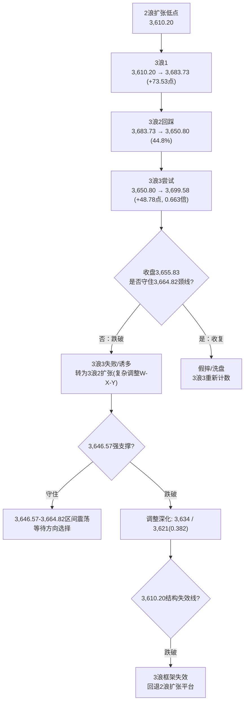
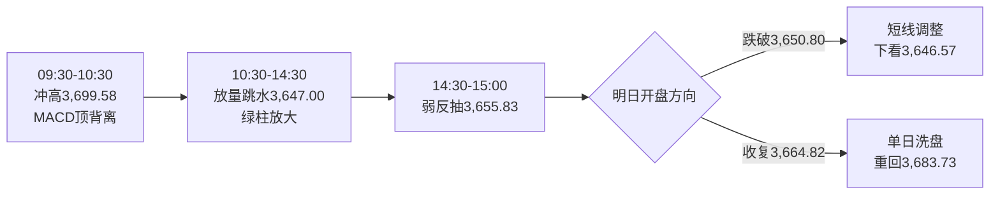

# A股晚报 - 2026年11月12日

> 数据截至：2026-11-12 20:00（北京时间）
> 编制：A股分析师AI代理

---

## 一、市场回顾

### 1.1 主要指数表现

| 指数 | 收盘 | 涨跌幅 | 涨跌点 | 成交额 |
|------|------|--------|--------|--------|
| 上证指数 | **3,655.83** | **-0.67%** | -24.81 | 8,795.37亿 |
| 深证成指 | **11,197.98** | **-1.68%** | -191.76 | 约10,525亿 |
| 创业板指 | **2,509.43** | **-2.44%** | -62.64 | 约4,700亿 |
| 科创50 | 约1,309.9 | **+0.73%（逆势）** | +9.5 | — |
| 沪深300 | 约4,470 | 约-0.6% | — | — |

- **两市成交额：19,321亿元（1.93万亿），较昨日16,763亿元放量2,558亿元（+15.26%）**；沪市8,795.37亿 + 深市约1.05万亿
- **上证日内：低开3,673.06（-0.21%）→ 冲高3,699.58（+0.52%，逼近3,700整数关）→ 午后跳水 → 最低3,647.00（-0.91%）→ 收3,655.83**
- 形态：**"高开冲高回落、放量收长上影中阴"**（上影26.52点、实体17.23点、下影8.83点），**一阴吞掉昨日小阳，收盘失守5日、20日均线与3,664.82颈线**
- 结构特征：早盘科技股带动冲高、10:30后主线兑现、午后空头发力"直线跳水"，尾盘略有回抽；**放量下跌=获利盘兑现而非增量撤离**，与昨日"放量上涨"形成"一日反转"

### 1.2 成交量能

| 项目 | 数据 | 对比 |
|------|------|------|
| 两市成交额 | **19,321亿** | 较11/11的16,763亿放量**2,558亿（+15.26%）** |
| 主力资金 | **净流出435.28亿** | 22个行业净流出；电子（-68.89亿）、通信（-65.86亿）、有色、电力设备、机械居前 |
| 净流入行业 | **9个** | 银行 **+5.43亿**、农林牧渔 **+4.86亿** 居前；食品饮料净流出仅0.83亿 |
| 南向资金 | **净买入58.47亿港元** | 加仓阿里、智谱，流出中际旭创 |
| 北向资金 | 净额交易所不披露 | 参与度维持低位，方向无法验证 |

### 1.3 市场情绪

| 指标 | 数值 | 解读 |
|------|------|------|
| 上涨家数 | **875只（约15.9%）** | 较昨日3,538只断崖式收缩 |
| 下跌家数 | **4,635只（约84.1%）** | 普跌，亏钱效应显著 |
| 涨停家数 | **37只** | 较昨日85只腰斩 |
| 跌停家数 | **5只** | 低位但较昨日抬升 |
| 炸板/封板未遂 | 35只 | — |
| 封板率 | **51%（不含ST）** | 由昨日77%-82%骤降至荣枯线下方 |
| 连板家数 | **11只** | 较昨日19只明显收缩 |
| 最高连板 | **东方海洋17天9板、大东方8天6板、龙江交通11天6板** | 高位股梯队断裂 |

> **今日是"指数小跌、结构重挫"**：上证仅-0.67%，但深成-1.68%、创业板-2.44%，成长杀跌远重于权重；涨停37只、封板率51%、上涨占比不足16%，**主题退潮信号明确**（与昨日"宽度极强"形成完整反转），仅食品饮料/农林牧渔/银行三个申万一级行业收红。

---

## 二、热点板块与异动分析

### 2.1 领涨板块

| 板块 | 涨幅 | 驱动因素 |
|------|------|----------|
| **农林牧渔** | **+0.45%** | 养殖业、水产盘中活跃；资金由高β切向低位防御 |
| **食品饮料** | **+0.38%** | **白酒逆势走强**，软饮料跟涨；CPI低位下的"低估值+防御"配置需求 |
| **银行** | **+0.36%** | 主力净流入5.43亿居首，红利底仓承接；避险情绪升温 |
| 其他逆势 | — | 半导体（科创50 +0.73%）、机场、燃气（盘中） |

**核心驱动**：**风格由"进攻"切向"防御"**。算力主线获利兑现后，资金未离场而是缩圈至"低估值+高股息+必选消费"，属"防御内部抱团"，而非全面撤退。

### 2.2 领跌板块

| 板块 | 跌幅 | 原因 |
|------|------|------|
| **传媒** | **-3.28%** | AI漫剧、影视院线前期热点集中回调，题材退潮 |
| **通信** | **-3.01%** | 昨日+7.99%后获利兑现；昨日通信设备单日净流入135.3亿，今日主力净流出65.86亿；中际旭创-6.11%（508.90元）、新易盛-4.38%（205.58元）、天孚通信-4%+ |
| **贵金属** | **重挫** | 现货黄金跌破4,000美元/盎司，美元指数走高；A股金股集体大跌 |
| 石油石化 | 跌幅居前 | 国际油价震荡回落，国内成品油24时起下调645/625元/吨 |
| 工程机械/汽车/软件/电工电网 | 跌幅居前 | 顺周期与高β成长同步承压 |
| 人形机器人 | 明显回调 | 昨日涨停潮后一日游，题材退潮 |

### 2.3 个股异动

- **算力链杀跌**：中际旭创-6.11%、新易盛-4.38%、天孚通信-4%+；昨日"易中天"集体涨超10%，今日集体回吐，**典型"单日暴涨→次日高开低走"**
- **国产算力芯片逆势**：早盘国产算力芯片密集上涨，半导体设备/材料相对抗跌，科创50逆势+0.73%
- **高位连板断裂**：涨停37只、封板率51%、连板11只；东方海洋17天9板、大东方8天6板、龙江交通11天6板勉强维持，**晋级率显著下降**
- **龙虎榜**：日海智能机构净卖出3,794.97万元；小米集团回购170万股B类股份（4,990万港元）

---

## 三、关键数据与事件回顾

### 3.1 国内经济数据

- **10月金融数据（M1/M2、社融、新增信贷）截至发稿仍未公布**（市场预期新增人民币贷款中值约-1,500亿元、新增社融中值约1.5万亿元），为明日（11/13）最重要的事件变量
- 10月CPI +0.7%、PPI +5.7%（已公布），"CPI低、PPI高"剪刀差约5.0个百分点延续
- 10月进出口+31.2%、出口+28.7%、进口+34.7%（已公布），外需韧性延续

### 3.2 政策消息

- **央行公开市场**：开展3,840亿元隔夜逆回购（利率1.25%），当日到期1,870亿元，**净投放1,970亿元**，为近期最大单日净投放，跨月后流动性呵护意图明确
- **人民币中间价6.7174，调升17个基点**（前值6.7191）；在岸16:30收盘6.6689，汇率延续韧性
- **成品油调价**：自11月12日24时起，汽、柴油（标准品）每吨分别下调645元、625元，折合92#汽油-0.51元/升、95#汽油-0.54元/升、0#柴油-0.54元/升

### 3.3 公司公告

- **珠免集团（600185）**：因筹划发行股份及支付现金购买珠海免税股权，**今日起停牌**
- **小米集团**：11/12回购170万股B类股份，涉资4,990万港元
- **日海智能**：龙虎榜机构净卖出3,794.97万元，主力资金净流出246.60万元
- 东易日盛股东减持至5.9991%、德龙汇能董事长拟被罚70万元（前日公告延续）

---

## 四、海外市场联动

### 4.1 美股（11月11日收盘，隔夜）

| 指数 | 收盘 | 涨跌幅 |
|------|------|--------|
| 道琼斯工业指数 | 52,486.49 | **+0.49%** |
| 标普500 | 7,619.41 | **+1.31%** |
| 纳斯达克综合指数 | 25,466.19 | **+1.60%** |
| 英伟达 | 173.73美元 | +2.87%（市值4.19万亿美元） |
| CoreWeave | — | **+24%**（财报超预期） |

- **隔夜美股AI交易全面回归**，但**11/12盘前英伟达跌超6%**：黄仁勋个人风波升级为"管理层更替"的实质性风险，**全球AI产业链信心受冲击**，是今日A股算力/光模块/存储杀跌的核心外部诱因
- **美联储理事沃勒**：12月或需加息50个基点，鹰派表态压制高估值成长与贵金属
- **美元指数走高，现货黄金跌破4,000美元/盎司**

### 4.2 欧洲与亚太

| 市场 | 收盘 | 涨跌幅 |
|------|------|--------|
| 日经225 | — | **-0.7%** |
| 韩国KOSPI | — | **-0.61%** |
| 恒生指数 | 约24,009 | **-1.26%（险守24,000点）** |
| 恒生科技 | — | 跌幅居前 |
| 德国DAX | — | 待披露 |
| 法国CAC40 | — | 待披露 |

> **亚太与港股同步走弱**：日韩半导体链回调、港股科技股下跌，A股失去昨日的"亚太共振"支撑；南向资金逆势净买入58.47亿港元，属"越跌越买"的配置行为，不构成短期方向指引。

### 4.3 大宗商品与汇率

| 品种 | 最新（20:00） | 变动 |
|------|--------------|------|
| 现货黄金 | **跌破4,000美元/盎司** | 美元走强+加息预期，单边下行 |
| 布伦特原油 | 震荡回落 | 国内成品油顺势下调 |
| WTI原油 | 震荡回落 | — |
| 美元指数 | **走高** | 压制风险资产与贵金属 |
| 美债10Y | 高位（约4.95%附近） | 对高估值成长构成中期压制 |
| 人民币中间价 | 6.7174 | **调升17bp** |

---

## 五、汇率与利率

1. **人民币汇率**：中间价6.7174（调升17bp），在岸即期收6.6689，**逆势偏强**；10月出口+28.7%形成结汇支撑，短期贬值空间有限
2. **国内利率**：隔夜逆回购利率1.25%，DR001/隔夜Shibor维持1.28%附近，资金面平稳偏松
3. **央行操作**：3,840亿隔夜逆回购、到期1,870亿，**净投放1,970亿**，为近期最大单日净投放
4. **海外利率**：美债10Y高位震荡，沃勒"50bp"表态使12月加息路径重新定价，压制全球高β资产估值

---

## 六、收盘后重要信息

### 6.1 盘后公告

- 珠免集团（600185）筹划重大资产重组，停牌中
- 小米集团回购170万股B类股份
- 日海智能龙虎榜机构净卖出3,794.97万元
- 国内成品油价格24时起下调（汽柴油每吨-645/-625元）

### 6.2 夜盘与外围

- **英伟达美股盘前跌超6%**，风波从"个人丑闻"向"管理层更替"演变，全球AI链风险偏好回落
- 美元指数走高、现货黄金跌破4,000美元
- 美股三大指数11/11收涨后，盘前期货转弱，隔夜情绪对明日A股偏空

### 6.3 次日关注（11月13日，周五）

- **中国10月M1/M2、社融、新增信贷**（若今日未公布，则明日为最关键变量；市场预期新增信贷中值-1,500亿、社融中值1.5万亿）
- **美国10月PPI**（若超预期，加息50bp讨论升温，压制高β成长）
- **周线收盘日**：本周（第46周）能否收在3,664.82上方，决定周线反转是否成立
- 英伟达盘前/隔夜走势对A股算力链的二次定价
- 高位连板股（东方海洋17天9板等）是否断板

---

## 七、波浪理论多周期分析

### 1. 月K线波浪分析

- **当前波浪位置**：大级别第3浪启动初期的**"回踩确认"阶段**，月线三连阳雏形受考验
- **浪型结构描述**：11月开3,614.13 → 低3,580.38 → 高**3,699.58（今日刷新月内新高）** → 现3,655.83（月内+1.15%）；月K为"带长下影、带上影小阳"（实体+41.70点、上影43.75点、下影33.75点），**上影线首次超过实体，显示3,700上方抛压确认**
- **关键目标位**：上方3,664.82（颈线，得而复失）→ 3,683.73（3浪1高点）→ 3,699.58 → 3,700（整数关）→ 3,704.29（3浪3的0.618）；下方3,646.57 → 3,634 → 3,621（0.382回撤）→ 3,610.20（结构失效线）
- **验证条件**：月线收在3,621上方则月线修复框架不变；**若11月月K收盘站上3,724.56（缺口下沿/0.236回撤），月线级别修复确认**；若跌破3,610.20，则月线"三连阳"证伪

### 2. 周K线波浪分析

- **当前波浪位置**：第46周（11/9-11/13）"周线反转确认"的**关键测试日失败**，重回颈线下方的"确认待续"
- **浪型结构描述**：本周开3,659.02 → 高3,699.58（今日）→ 低3,650.80 → 现3,655.83（周内-0.67%）；5周均线约3,690，**本周始终未收复5周均线**
- **关键目标位**：上方3,664.82（周线反转确认线）→ 3,683.73 → 3,699.58；下方3,650.80（本周低点）→ 3,646.57 → 3,634
- **验证条件**：**周五（11/13）收盘必须站上3,664.82，且全周成交≥9万亿（日均1.8万亿），周线反转才算确认**；今日收盘3,655.83已在确认线下方，**若周五不能收复，本周按"冲高回落的假突破周"定性，周线重回3,621-3,664震荡**

### 3. 日K线波浪分析

- **当前波浪位置**：**3浪3上攻失败（截断/诱多），转为3浪2扩张的复杂调整（W-X-Y）**
- **浪型结构描述**：3浪1 3,610.20→3,683.73（+73.53点）→ 3浪2 回踩3,650.80（回撤44.8%，标准）→ **3浪3尝试 3,650.80→3,699.58（+48.78点，仅达3浪1的0.663，未达0.618-1.0的强势延伸）→ 收盘3,655.83跌破颈线3,664.82，3浪3失败确认**
- **关键目标位**：下方 **3,650.80（3浪2低点，第一防线）/ 3,646.57（强支撑）/ 3,634 / 3,621（0.382回撤）/ 3,610.20（结构失效线）**；上方 3,664.82（颈线，反抽压力）→ 3,683.73 → 3,699.58
- **验证条件**：**若3个交易日内收盘重回3,664.82上方且量能≥1.8万亿，则本次为"假摔"，3浪3重新计数；若收盘跌破3,646.57，则3浪2扩张成立，按W-X-Y下看3,634/3,621；若收盘跌破3,610.20，则整个3浪框架失效，回退为"2浪扩张平台"**

### 4. 60分钟K线波浪分析

- **当前波浪位置**：3-3浪内部**"5子浪结构完成后的调整"**，短期下跌推动中
- **浪型结构描述**：早盘60分钟连续阳线冲高至3,699.58，**60分钟MACD顶背离确认**，随后连续阴线跳水至3,647.00，尾盘小幅回抽至3,655.83；**全天呈现"冲高—急跌—弱反抽"的abc调整结构**
- **关键目标位**：上方3,664.82（反抽第一压力）/ 3,673.06（今日开盘）/ 3,683.73；下方3,650.80 / 3,647.00（今日低点）/ 3,646.57
- **验证条件**：**60分钟反抽不能收复3,664.82且MACD零轴下方绿柱扩大 → 调整延续**；若放量收复3,664.82且MACD金叉，则今日下跌为"单日洗盘"

### 5. 30分钟K线波浪分析

- **当前波浪位置**：顶背离兑现后的**调整浪第3小浪**，尚未出现底背离
- **浪型结构描述**：13:30-14:30连续4根30分钟阴线杀跌至3,647.00，尾盘2根小阳回抽；30分钟MACD高位死叉、绿柱放大，**量能同步放大（放量下跌）**
- **关键目标位**：上方3,660 / 3,664.82；下方3,650.80 / 3,647.00 / 3,646.57
- **验证条件**：**明日开盘30分钟若不能站上3,655.83且跌破3,650.80 → 短线调整至3,646.57**；若开盘即站上3,664.82且量能配合，则30分钟底背离成立、短线修复

### 6. 波浪图（Mermaid绘制）

**日K线波浪结构图**



**60分钟波浪结构图**



### 7. 波浪理论综合判断

- **多周期共振状态**：月线偏多（★★★☆，上影超实体）、周线中性偏弱（★★，失守3,664.82）、日线转空（★★，3浪3失败）、60分钟空（★★，顶背离+下跌推动）、30分钟空（★★，无底背离）——**"中长偏多、短周期向下共振"的背离重新扩大**，较昨日的"中长多+短多"格局明显恶化
- **当前操作级别**：**日线级别防守、60分钟择时**；3浪3失败后不宜再按"主升浪"持仓，仓位回归中性偏低
- **后续演变路径**：基础路径（50%）明日3,645-3,660震荡，反抽3,664.82受阻，回踩3,646.57确认支撑；偏弱路径（30%）直接失守3,646.57，下探3,634/3,621；偏强路径（20%）隔夜外盘企稳，放量收复3,664.82→3,683.73，本次下跌定性为"单日洗盘"
- **关键拐点信号**：**修复信号=收盘≥3,664.82且成交≥1.8万亿**；**转弱升级=收盘<3,646.57**；**结构失效=收盘<3,610.20**；短线止跌=30分钟出现底背离+3,646.57不破
- **风险提示**：波浪计数存在主观性，3浪2扩张（W-X-Y）的Y浪低点无法精确预测，3,610.20仅是结构观察线而非必然止跌位；若外部AI链持续崩塌，波浪结构可能整体降级为"2浪大平台"，需以收盘价而非盘中价确认

---

## 八、晨报复盘

> **说明：今日（11/12）晨报未生成（`report/20261112/morning_report_20261112.md` 不存在），本节复盘以11/11晚报"明日策略要点"与"明日验证清单"为基准进行对照，并据实标注。**

### 1. 核心判断回顾

| 判断项目 | 11/11晚报预测 | 实际结果 | 准确度 | 备注 |
|---------|---------|---------|-------|------|
| 上证指数趋势 | 主路径"3,670-3,690震荡整固" | **冲高3,699.58后跳水，收-0.67%** | ✗ | 开盘3,673.06落在区间内，但收盘跌破转弱线 |
| 上证指数区间 | 3,670-3,690点 | **3,647.00-3,699.58点** | ✗ | 上下沿双双被突破（上破9.58点、下破23点） |
| 强支撑位 | 3,664.82点（颈线，转支撑） | 收盘3,655.83跌破 | ✗ | 收盘失守9点，突破失败 |
| 强压力位 | 3,700点（整数关） | 最高3,699.58点 | ✓ | 差0.42点未破，压力有效 |
| 北向资金 | 净额不披露（未设预期） | 净额仍不披露 | — | 无法验证，不计入 |
| 成交量 | 1.6-1.75万亿 | **1.9321万亿** | ✗ | 高于上限1,821亿，连续第4日低估 |

### 2. 板块预判回顾

| 板块 | 预判方向 | 实际涨跌幅 | 准确度 | 原因分析 |
|-----|---------|-----------|-------|---------|
| 通信/CPO | 回踩不追高 | 通信 **-3.01%** | ✓ | 昨日+7.99%后获利兑现，中际旭创-6.11% |
| 半导体设备/材料 | 看涨 | 科创50 **+0.73%**、半导体逆势 | ✓ | 国产算力芯片逆势，国产替代逻辑延续 |
| 电子/PCB/元件 | 增配 | 电子主力净流出68.89亿居首、板块下跌 | ✗ | 算力链普跌拖累PCB，未区分"半导体设备"与"PCB/光模块" |
| 机器人 | 关注 | 人形机器人明显回调 | ✗ | 昨日涨停潮一日游，题材退潮 |
| 回避贵金属 | 回避 | 贵金属**重挫**、黄金跌破4,000 | ✓ | 美元走高+沃勒鹰派，判断正确 |
| 回避高位连板 | 回避/不追涨 | 涨停37只、封板率51%、连板11只 | ✓ | 退潮信号明确，回避正确 |
| 回避白酒 | 回避 | 食品饮料+0.38%，白酒逆势走强 | ✗ | 防御风格切换，白酒成资金避风港 |

### 3. 准确率量化评估

- **趋势判断准确率：0%（0/1）**——预测"3,670-3,690震荡整固"，实际冲高回落收跌0.67%
- **点位预测准确率：33.3%（1/3）**——强压力3,700✓（最高3,699.58）；区间✗、强支撑3,664.82✗
- **板块预判准确率：57.1%（4/7）**——通信✓、半导体设备✓、贵金属✓、高位连板✓；电子/PCB✗、机器人✗、白酒✗
- **综合准确率：28.0%**（30%×0 + 30%×33.3 + 30%×57.1 + 10%×0）
- **波浪分析准确率：约55%**——"收盘<3,664.82则突破失败"的证伪条件✓（规则执行到位）；"3,650.80-3,664.82回踩"路径部分✓；量能1.6-1.75万亿✗；"3,670-3,690震荡"✗

### 4. 偏差根因分析

**【偏差1】趋势判断偏差（震荡整固 → 冲高回落收跌）**
- 偏差描述：预测"3,670-3,690震荡整固、周五再攻3,700"，实际早盘冲至3,699.58后午后跳水收3,655.83
- 根本原因：**信息缺失 + 逻辑误判**
- 信息缺口：晚报成稿时（11/11 20:00）尚未定价"英伟达盘前11/12再跌6%、风波升级为管理层更替"这一新增利空；亦未纳入"昨日通信单日净流入135.3亿"的获利兑现压力
- 逻辑缺陷：把"昨日放量突破颈线"线性外推为"震荡整固后再攻"，忽视了"单日暴涨7.99%后次日兑现"的高概率规律
- 改进措施：主线板块单日涨幅>7%时，次日趋势必须并列"高开低走兑现"情景，概率不低于35%

**【偏差2】强支撑3,664.82收盘失守**
- 偏差描述：把3,664.82设为"突破后的颈线支撑"，实际收盘3,655.83跌破9点
- 根本原因：**技术分析局限**——颈线突破仅1个交易日即回踩，缺乏"3日站稳"确认
- 逻辑缺陷：昨日收盘3,680.64距颈线仅15.82点（0.43%），**突破幅度不足1%的颈线突破本身可靠性低**，不应直接转为强支撑
- 改进措施：颈线突破幅度<1%时，支撑有效性须"3个交易日收盘站稳"确认，期间按"得而复失"处理

**【偏差3】成交量连续第4日低估**
- 偏差描述：预测1.6-1.75万亿，实际1.9321万亿，高于上限1,821亿
- 根本原因：**逻辑误判**——只按"震荡整固"给量能，未考虑"冲高兑现"会带来换手放量
- 改进措施：**放量下跌日的量能往往高于放量上涨日**（获利盘与承接盘双向换手）；当指数日内振幅>1.4%时，量能上限应上移至前日×1.18

**【偏差4】电子/PCB看涨被证伪（电子主力净流出68.89亿）**
- 偏差描述：把"半导体设备"与"PCB/元件/光模块"统一列为增配，实际后者随算力链杀跌
- 根本原因：**逻辑误判**——未执行规则26"存储/光模块与半导体设备必须分开定价"
- 改进措施：电子内部须拆分为"半导体设备（国产替代）"与"PCB/光模块/存储（跟随海外算力）"两条独立预判，不得合并

**【偏差5】白酒回避判断错误（食品饮料+0.38%）**
- 偏差描述：延续"回避白酒"，实际白酒逆势走强、食品饮料为三个收红行业之一
- 根本原因：**情绪面误读**——科技主线崩塌日，资金"防御内部抱团"，白酒是低位低估值避风港
- 改进措施：**主线（算力/科技）放量杀跌且上涨家数<20%时，必选消费（白酒/食品/农业）+银行应上调为"相对占优"**，不得沿用"回避白酒"

**【偏差6】当日晨报缺失（流程偏差）**
- 偏差描述：`morning_report_20261112.md` 未生成，交易日缺少盘前判断基准
- 根本原因：**流程执行缺失**（非分析误判）
- 改进措施：定时任务需校验"晨报文件存在"作为晚报前置条件，缺失时在晚报显著位置标注并以"上一交易日晚报策略"为复盘基准（本次已执行）

### 5. 分析检查清单

- [x] 隔夜外盘走势（美股三大指数+1.31%~+1.60%）
- [x] 亚太早盘方向（日经-0.7%、KOSPI-0.61%，方向一致偏弱）
- [x] 美股期货/盘前（英伟达盘前-6%，**已识别但晚报成稿时无法预知**）
- [x] 北向资金流向（净额不可得，已标注）
- [x] 技术指标状态（3,700整数关、5日/20日均线、颈线3,664.82）
- [x] 重大政策/事件（成品油调价、央行净投放1,970亿、沃勒鹰派）
- [x] 前期高低点、整数关口（3,699.58 vs 3,700）
- [ ] **主线板块单日涨幅>7% → 次日单列"高开低走兑现"情景**——本次遗漏
- [ ] **颈线突破幅度<1% → 按"得而复失"处理**——本次未执行
- [x] 板块内部拆分（半导体设备 vs PCB/光模块）——**部分执行，仍合并出错**
- [ ] **主线崩塌日必选消费/银行上调为相对占优**——本次遗漏
- [x] 宏观/行业/个股/流动性风险
- [x] 波浪失效条件以收盘价确认

### 6. 本次复盘发现的新规则

- **规则1**：主线板块（通信/光模块）单日涨幅>7%后，次日必须并列"高开低走获利兑现"情景（概率≥35%），不得直接外推"震荡后再攻"
- **规则2**：颈线突破幅度<1%（如3,680.64 vs 3,664.82，仅0.43%）时，支撑有效性须"3个交易日收盘站稳"确认，期间按"得而复失"预案处理
- **规则3**：指数日内振幅>1.4%时，无论涨跌，量能上限应上移至前日×1.18；"放量下跌"的换手强度不低于"放量上涨"
- **规则4**：主线放量杀跌且上涨家数占比<20%时，必选消费（白酒/食品/农业）+银行自动上调为"相对占优"，删除"回避白酒"预判
- **规则5**：海外AI龙头"治理风险升级为管理层更替"时，A股算力链按"反弹减仓"而非"超跌抄底"处理，直至事件明确落地

### 7. 规则库更新

```
###趋势分析 主线板块单日涨幅>7%后，次日必须并列"高开低走获利兑现"情景（概率≥35%），不得直接外推"震荡整固后再攻"
###点位计算 颈线突破幅度<1%时，支撑有效性须"3个交易日收盘站稳"确认，期间按"得而复失"预案处理，不得直接转强支撑
###板块选择 主线（算力/光模块/通信）放量杀跌且上涨家数占比<20%时，必选消费（白酒/食品/农业）与银行上调为"相对占优"，删除"回避白酒"
###风险识别 海外AI龙头治理风险升级为"管理层更替"实质性风险时，A股算力链按"反弹减仓"处理，不以超跌为由抄底，直至事件落地
###资金面分析 指数日内振幅>1.4%时，无论涨跌量能上限应上移至前日×1.18；"放量下跌"的换手强度不低于"放量上涨"
###波浪分析 3浪3自3浪2低点起算仅达3浪1的0.618-0.7且收盘跌回颈线下方，按"3浪3失败/截断"处理，转为3浪2扩张（W-X-Y），失效线为3浪2低点
```

---

## 九、策略回顾与调整

### 1. 短线策略回顾

| 策略项目 | 11/11晚报建议 | 今日实际 | 执行效果 | 备注 |
|---------|---------|---------|---------|------|
| 短线仓位 | 20% | 若执行则被套 | ✗ | 高位加仓方向错误 |
| 买入条件 | 回踩3,664.82-3,670不破可低吸 | 开盘3,673.06后冲高，午后跌破3,664.82 | ✗ | 若低吸即被套，条件未设"收盘确认" |
| 卖出/减仓条件 | 收盘跌破3,664.82则短线降仓 | **收盘3,655.83跌破，触发** | ✓ | 风控规则正确、可执行 |
| 止损位 | 中线止损3,646.57 | 最低3,647.00 | ✓ | 差0.43点未触发 |
| 短线标的 | 通信/CPO、半导体设备、PCB、机器人 | 通信-3.01%、半导体内部分化、机器人回调 | ✗ | 仅半导体设备相对抗跌 |
| 回避机构 | 白酒、保险、贵金属、高位连板追涨 | 白酒逆势+0.38%、贵金属重挫、连板退潮 | 3/4✓ | 白酒判断错误 |

### 2. 中线策略调整

- **当前中线方向：【持有】→【持有偏减仓】**
- 方向调整原因：日线3浪3上攻失败、收盘失守3,664.82颈线，短周期向下共振；但3,646.57强支撑未破、月线框架未坏，暂不趋势性看空，按"减仓、等确认"处理
- **中线仓位建议：25% → 20%**（昨日已明确"收盘跌破3,664.82则退回20%"，按规则执行；若收盘跌破3,646.57则降至15%）
- 中线目标区间：上证指数 **3,646 - 3,664点**（区间震荡，待方向选择）；收复3,664.82后上移3,683-3,700
- 中线止损位：**3,646.57（收盘价）**；3,610.20为结构失效线
- 中线布局板块调整：**减配PCB/光模块/存储（跟随海外算力，受英伟达事件拖累）**；维持半导体设备/材料（国产替代逻辑）；**增配银行、食品饮料、农林牧渔（防御+低位）**

### 3. 明日策略要点

- **短线：【观望/减仓】**，关注 **3,646.57**（强支撑）和 **3,664.82**（颈线反抽压力）；反抽3,664.82不放量不追，跌破3,646.57清短线；只有收盘站上3,664.82且量能≥1.8万亿，才可重新参与
- **中线：【持有偏减仓】**，关注 **3,646.57**（止损线）和 **3,664.82**（修复线）；跌破3,646.57收盘则降至15%
- **仓位分配：短线10% + 中线20% + 现金70%**（短线由20%下调10pct，中线由25%下调5pct，现金55%→70%）
- 关注板块：半导体设备/材料（国产替代）、银行、食品饮料、农林牧渔；回避PCB/光模块/存储、贵金属、高位连板、人形机器人追涨

### 4. 策略复盘规则输出

```
###趋势分析 主线单日暴涨后次日若高开低走并跌破前日突破位，应视为"一日反转"，短线仓位当日即降至半仓以下，不等收盘确认
###点位计算 颈线（3,664.82）失守后，其角色由"支撑"转为"反抽压力"，反弹至此位不放量即为二次卖点
```

---

## 十、风险提示

1. **市场系统性风险**：今日放量下跌（1.93万亿、+15.26%）但上涨仅875只，**属"高换手兑现"而非"增量出逃"**，但封板率51%、涨停37只显示主题承接力快速衰减；若明日量能不能维持1.8万亿以上，指数将回归3,621-3,664弱势震荡。3,700整数关两次冲关失败（11/5、11/12），上方套牢盘沉重。
2. **个股风险事件**：东方海洋17天9板、大东方8天6板、龙江交通11天6板等高位股随时断板；珠免集团重组停牌；日海智能机构净卖出；中际旭创等算力龙头两日振幅超20%。
3. **政策不确定性风险**：**10月金融数据仍未公布**，若新增信贷大幅低于预期的-1,500亿，将压制银行/地产链；美国10月PPI（11/13）若超预期，叠加沃勒"50bp"表态，加息预期升温将压制高β成长。
4. **海外风险**：**英伟达管理层更替风险**是当前最大外生变量，若美股AI链持续下跌，A股算力硬件（光模块/存储/PCB）将二次承压；美元指数走高、现货黄金跌破4,000，全球风险偏好回落；美债10Y高位对高估值成长构成中期压制。
5. **技术风险**：3浪3失败后按"3浪2扩张（W-X-Y）"处理，Y浪低点无法精确预测；若收盘跌破3,646.57，下看3,634/3,621；跌破3,610.20则整个3浪框架失效。

---

## 十一、信息来源

1. **官方数据来源**：上交所/深交所/北交所（成交与公告）、中国人民银行（中间价、公开市场操作）、国家发改委（成品油调价）、美国劳工部
2. **权威财经媒体**：新华社（A股收盘）、中国证券报·中证网、上海证券报·中国证券网、证券时报（资金流向、龙虎榜、行业涨跌）、证券日报、央广网
3. **数据平台**：东方财富（Choice数据、板块资金、涨停分析）、同花顺、新浪财经（全球行情）、财联社（涨停复盘、南向资金）、金融界（指数日内高低点）、Wind
4. **研究机构**：国泰海通（收市点评）、CME FedWatch（加息概率）
5. **数据截止时间**：**2026-11-12 20:00（北京时间）**；美股为11月11日收盘价，英伟达盘前为11月12日美股盘前；10月金融数据截至发稿未公布

---

## 十二、文档更新检查

### AGENTS.md更新

无需更新。晨报/晚报流程、波浪分析格式、复盘格式均与实际执行一致。

> **流程提示（不影响文档内容）**：本次执行发现 `report/20261112/morning_report_20261112.md` 缺失（当日晨报未生成），晚报已按"以上一交易日晚报策略为复盘基准"处理，建议在定时任务中增加"晨报文件存在性校验"。

### README.md更新

无需更新。文件结构与功能说明与实际一致。

### 无需更新

AGENTS.md 与 README.md 均无需更新。

---

> **免责声明**：本报告为AI辅助生成的收盘后复盘分析，所有点位、概率、目标价均为基于公开数据的技术推演，不构成投资建议。市场有风险，决策需独立。
