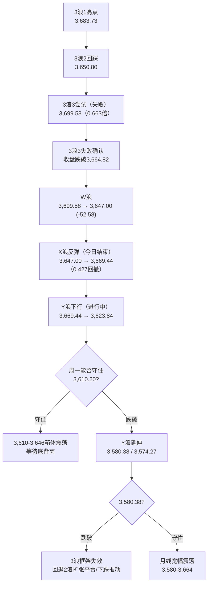
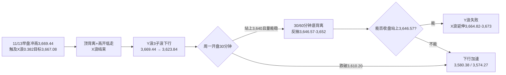

# A股晚报 - 2026年11月13日

> 数据截至：2026-11-13 20:00（北京时间）
> 编制：A股分析师AI代理
> 今日为周五（第46周收官日），交易日照常开市

---

## 一、市场回顾

### 1.1 主要指数表现

| 指数 | 收盘 | 涨跌幅 | 涨跌点 | 成交额 | 日内区间（开/高/低） |
|------|------|--------|--------|--------|----------------------|
| 上证指数 | **3,634.35** | **-0.59%** | -21.48 | 7,706.14亿 | 3,658.72 / 3,669.44 / 3,623.84 |
| 深证成指 | **10,968.79** | **-2.05%** | -229.19 | 8,850.54亿 | 11,236.16 / 11,253.31 / 10,941.11 |
| 创业板指 | **2,426.08** | **-3.32%** | -83.35 | 4,353.34亿 | 2,525.39 / 2,528.99 / 2,417.22 |
| 科创50 | **1,279.66** | **-2.30%** | -30.18 | — | 1,330.28 / 1,342.13 / 1,270.62 |
| 沪深300 | 4,016.29 | -0.68% | -27.64 | 4,602.46亿 | 4,047.77 / 4,052.06 / 4,004.50 |
| 北证50 | 876.33 | -3.50% | -31.74 | 115.58亿 | 910.51 / 913.61 / 873.10 |

- **沪深京三市成交额16,672亿元（1.67万亿），较昨日缩量约2,780亿元**（沪市7,706亿、深市8,851亿、京市116亿）
- **上证日内：高开3,658.72（+0.08%）→ 冲高3,669.44（+0.37%，触及X浪0.382目标3,667.08）→ 午后跳水 → 最低3,623.84（-0.87%）→ 收3,634.35**
- **形态：高开低走中阴**（上影10.72点、实体24.37点、下影10.51点），收盘跌破3,646.57强支撑与3,634关键位，**"X浪反抽失败→Y浪下探"路径兑现**
- **结构特征：权重护盘、成长杀跌**——上证仅-0.59%，深成-2.05%、创业板-3.32%、科创50-2.30%；上涨仅765只（13.73%），为典型"指数小跌、结构重挫"

### 1.2 成交量能

| 项目 | 数据 | 对比 |
|------|------|------|
| 沪深京成交额 | **16,672亿** | 较11/12的约1.95万亿**缩量约2,780亿（约-14%）** |
| 主力资金 | **净流出520.04亿** | 电子 **-214.18亿**、通信 **-90.23亿**、机械-46.44亿、电力设备-37.10亿、有色-30.43亿 |
| 净流入行业 | **11个** | 银行 **+8.56亿**、食品饮料 **+6.18亿**、公用事业+4.26亿、石油石化+3.51亿、计算机+3.36亿 |
| 南向资金 | **净买入23.33亿港元** | 港股通（沪）+36.63亿、港股通（深）-13.30亿 |
| 北向资金 | 净额交易所不披露 | 方向无法直接验证；A50期指与人民币偏稳，间接中性 |

### 1.3 市场情绪

| 指标 | 数值 | 解读 |
|------|------|------|
| 上涨家数 | **765只（13.73%）** | 连续第二日低于20%，亏钱效应主导 |
| 下跌家数 | **4,748只** | 普跌；平盘66只 |
| 涨停家数 | **38只** | 低位维持，题材仅影视院线局部活跃 |
| 跌停家数 | **39只** | **显著抬升并超过涨停数**，为近期首次，风险释放加速 |
| 封板率 | **61.29%** | 24股封板未遂，接力意愿弱 |
| 连板家数 | **7只**（3连板及以上3只） | 上一交易日11只，**晋级率27.27%** |
| 最高连板 | 文投控股18天10板、天普股份4连板 | 高位股仅存个别活口 |

> **今日是"缩量普跌+跌停超涨停"**：跌停39只 > 涨停38只，为近期情绪最弱的一天；但成交并未放量，说明是**存量资金从成长向红利/PET防御迁移**，而非全面出逃。银行、家电、食品饮料逆势收红，江苏银行、南京银行、青岛银行、成都银行、杭州银行盘中齐创历史新高。

---

## 二、热点板块与异动分析

### 2.1 领涨板块

| 板块 | 涨幅 | 驱动因素 |
|------|------|----------|
| **家用电器** | **+1.47%** | 低估值+高股息，资金防御性配置；出口链与以旧换新预期 |
| **银行** | **+1.46%** | 主力净流入8.56亿居首；五家城商行创历史新高；"社融弱→政策宽松预期"与稳市机制共振 |
| **食品饮料** | **+1.18%** | 白酒逆势走强，必选消费承接；主力净流入6.18亿 |
| **煤炭** | **+1.08%** | 高股息+冬季用能，红利风格占优 |
| **农林牧渔** | **+0.81%** | 猪价预期反复，金新农、天邦食品涨停 |
| 石油石化 | +0.56% | 昨日油价大涨的滞后映射；但今日油价盘中回落 |
| 非银金融 | +0.08% | 保险走强，券商偏弱 |
| **影视院线**（二级） | **逆市大涨** | 幸福蓝海20cm涨停，横店影视、中国电影、金逸影视、儒意电影涨停 |

**核心驱动**：**"类债资产+必选消费"防御性抱团**。10月社融与信贷低于预期，强化"弱复苏→宽货币"预期，银行/红利直接受益；同时科技叙事受英伟达治理事件压制，风险偏好快速回落。

### 2.2 领跌板块

| 板块 | 跌幅 | 原因 |
|------|------|------|
| **通信** | **-4.97%** | CPO/光模块/光通信集体重挫；中际旭创主力净流出29.42亿、新易盛21.15亿；景旺电子跌停 |
| **电子** | **-3.75%** | 半导体、元件、PCB、覆铜板全线杀跌；电子主力净流出214.18亿居首；和林微纳-16%、炬光科技-12%、源杰科技-11% |
| 建筑材料 | -3.25% | 玻璃玻纤、非金属材料大跌 |
| 机械设备 | -2.93% | 高位题材退潮，机器人链回调 |
| 有色金属 | -2.59% | 小金属、稀土领跌；贵金属同步走弱 |
| 电力设备 | -2.32% | 光伏、储能、电池链承压 |
| 房地产 | -2.21% | 社融/信贷偏弱压制地产链 |
| 基础化工 | -2.11% | 氟化工局部活跃但整体跟随调整 |
| **贵金属** | **大跌** | 现货黄金虽盘中重回3,900上方，但A股金股前期透支，兑现压力大 |

**核心矛盾**：**"海外算力叙事"与"国产替代叙事"被强行绑定**。英伟达CEO更替引发海外AI链抛售，A股以"电子"为统一资金池，半导体设备/材料未能独立——早盘高开即成为兑现窗口，这与晨报"半导体设备可独立修复"的假设相反。

### 2.3 个股异动

- **CPO/PCB重挫**：景旺电子跌停，天孚通信、源杰科技、新易盛、中际旭创等跌幅居前；"易中天"（新易盛、中际旭创、天孚通信）集体大跌
- **影视院线逆势**：幸福蓝海20cm涨停，横店影视、中国电影、金逸影视、儒意电影涨停，属低位题材+事件驱动
- **高位连板**：文投控股涨停反包、18天10板；天普股份4连板；但连板总数仅7只、晋级率27.27%，**梯队已明显收缩**
- **跌停潮**：跌停39只，多为前期高位算力、元件、光通信个股
- **银行创新高**：江苏银行、南京银行、青岛银行、成都银行、杭州银行盘中创历史新高，红利风格强化

---

## 三、关键数据与事件回顾

### 3.1 国内经济数据（今日公布）

**10月金融数据（央行，11/13午后公布）**：

| 指标 | 10月值 | 预期/前值 | 解读 |
|------|--------|-----------|------|
| 新增社融 | **1.15万亿元** | 1-10月累计28.61万亿，同比少2.29万亿 | 总量偏弱，政府债与信贷双弱 |
| 新增人民币贷款 | **-0.10万亿元** | 预期约-0.15万亿 | 季节性收缩，弱于往年同期 |
| M2 | **+7.1%** | 预期7.2%，前值7.2% | **低于预期**，货币扩张边际放缓 |
| M1 | **+4.4%** | 预期3.5%，前值3.2% | **超预期**，企业活期资金改善 |
| M2-M1剪刀差 | **2.7个百分点** | 9月末4.0个百分点 | **收窄1.3pct**，资金活化改善 |

> **解读**：数据呈"总量弱、结构改善"组合——社融与信贷低于预期压制顺周期与银行资产扩张逻辑，但M1超预期、剪刀差收窄指向企业资金活化。市场选择交易"弱数据→宽货币"，银行/红利上涨、成长下跌，指数则因权重护盘跌幅有限。

### 3.2 政策消息

- **央行公开市场**：11/13开展3,640亿元隔夜逆回购 + 3,000亿元7天期逆回购，当日到期3,840亿元，**净投放2,800亿元**，资金面均衡偏松
- **证监会**：延续"完善稳市机制、增强股市内在稳定性"表态（11/12），第三批互换便利已开展，构成指数下行保护
- **国新办**：将于**11月16日（周一）10:00**举行发布会，介绍10月国民经济运行情况（工业增加值、社零、固定资产投资）

### 3.3 公司公告

- **东方盛虹（000301）**：控股股东盛虹科技及其一致行动人拟6个月内增持**20亿-40亿元**
- **联讯仪器（688808）**：拟回购1亿-1.5亿元，回购价不超1,538元/股
- **肯特催化**：拟回购1.115亿-2.23亿元
- **复旦微电（688385）**：董事长提议回购5,000万-1亿元A股、1亿-2亿港元H股（11/12）
- **中芯国际（688981）**：Q3净利+87.6%、Q4指引环比+4%-6%（11/12盘后，今日高开低走，利好兑现）

---

## 四、海外市场联动

### 4.1 美股（11/12收盘）

| 指数 | 收盘 | 涨跌幅 |
|------|------|--------|
| 道琼斯 | 52,297.09 | **-0.36%** |
| 标普500 | 7,592.40 | **-0.35%** |
| 纳斯达克 | 25,366.09 | **-0.39%** |

- 英伟达 **-4.34%**（CEO更替事件），费城半导体指数跌不足1%，博通、AMD逆势涨超5%，呈"英伟达弱、算力链分化"
- **纳斯达克中国金龙指数 -3.09%**，阿里-7.05%，对港股与A股科技形成传导

### 4.2 欧洲与亚太

| 市场 | 最新 | 涨跌幅 |
|------|------|--------|
| 德国DAX（今日盘中） | — | **+1.06%** |
| 英国富时100 | — | **+0.86%** |
| 法国CAC40 | — | **+0.79%** |
| **恒生指数** | **23,637.60** | **-1.55%** |
| **恒生科技** | **3,813.19** | **-3.02%** |

- 港股低开低走、失守24,000点，全日成交1,958.57亿港元；阿里、百度跌超3%，智谱跌逾12%、MiniMax跌超8%、联想跌近8%
- 欧洲股市受美股期指反弹带动，盘中普涨约1%

### 4.3 美股盘前与大宗商品

- **美股盘前**：三大期指反弹（道指期货约+1.16%、标普+0.84%、纳指+0.82%）；但**英伟达盘前波动剧烈（一度跌超5%，后据网易财经微涨0.63%）**，AMD跌超2%，美光、闪迪、SK海力士等芯片股盘前普跌——**"指数反弹、AI硬件仍弱"的分化延续**
- **原油**：WTI **87.19美元/桶（-4.02%）**、布伦特 **93.86美元/桶（-4.49%）**；因霍尔木兹海峡复航谈判推进、地缘溢价快速回吐，回吐昨日全部涨幅
- **贵金属**：现货黄金盘中重回**3,900美元/盎司上方（+约0.9%）**，现货白银+1.3%，属超跌反弹而非趋势反转
- **今晚21:30（北京时间）美国10月PPI**：为12月议息会议前最后一份通胀读数，若超预期将强化"12月加息50bp"讨论，压制高估值成长

---

## 五、汇率与利率

### 5.1 人民币汇率

- **中间价：6.7152**，较前一交易日6.7174**升值22个基点**
- 在岸、离岸人民币盘中**双双升值**，在岸围绕6.67运行；出口高增形成结汇支撑，短期偏稳

### 5.2 国内利率与流动性

| 项目 | 数据 | 变动 |
|------|------|------|
| Shibor O/N | 1.2970% | -3.50bp |
| Shibor 1W | 1.3810% | -1.56bp |
| 国债期货 | 全线收跌 | 30年主力-0.13% |
| 7-10年国债收益率 | 上行超2bp | 止盈+年末政府债供给扰动 |

- **央行净投放2,800亿元**，隔夜与7天逆回购全额满足需求，资金面均衡
- 债市"宽货币、紧信用"组合下，短端受益、长端受供给扰动，收益率曲线略陡

---

## 六、收盘后重要信息

### 6.1 盘后公告

- **东方盛虹**：控股股东及一致行动人拟增持20亿-40亿元（大额增持，提振化工/民营炼化情绪）
- **联讯仪器**：回购1亿-1.5亿元；**肯特催化**：回购1.115亿-2.23亿元
- **复旦微电**：董事长提议回购A股+H股（半导体板块回购潮延续）
- 多家公司披露三季报后回购/增持计划，产业资本在调整中承接

### 6.2 夜盘与外盘

- **美国10月PPI（21:30）**：今晚最关键变量；随后23:00美国11月密歇根大学消费者信心初值
- 原油夜盘延续跌势，能源股承压；黄金夜盘小幅反弹
- 美股期指盘前反弹，但AI硬件个股仍弱，需观察开盘后能否止跌

### 6.3 次日（11/16 周一）关注

1. **10:00 国新办发布会**：10月工业增加值、社会消费品零售总额、固定资产投资——验证"弱社融"是否传导至实体
2. **3,610.20结构失效线**：周一若收盘跌破，W-X-Y的Y浪将升级为更大级别调整
3. **3,623.84（今日低点）与3,621（0.382回撤）**：短线止跌观察位
4. **美国10月PPI结果**对周一亚太科技股开盘的传导
5. 新股申购与限售解禁以交易所公告为准（今日无新股申购）

---

## 七、波浪理论多周期分析

### 7.1 月K线波浪分析

- **当前波浪位置**：大级别第3浪启动失败后的**3浪2扩张（W-X-Y）调整**，月线"三连阳"框架受考验。
- **浪型结构描述**：11月开3,614.13 → 低3,580.38 → 高3,699.58 → 现3,634.35（月内+0.56%）；月K暂为"带长上影小阳"（上影65.23点），**连续第二周上影线长于实体**，3,700上方抛压确认。
- **关键目标位**：上方3,646.57（得而复失）→3,664.82（颈线）→3,699.58；下方3,623.84→3,610.20（结构失效线）→3,580.38（11/3低点）→3,574.27（前低）。
- **验证条件**：月线收盘守住3,610.20，则"3浪2扩张"框架不变；**收盘跌破3,580.38，月线转为"2浪扩张平台/下跌推动"**，下看3,478/3,443；重新站上3,664.82且月成交放大，才恢复3浪3计数。

### 7.2 周K线波浪分析

- **当前波浪位置**：第46周（11/9-11/13）周线"反转确认"失败，**假突破周成立**。
- **浪型结构描述**：本周开3,659.02 → 高3,699.58 → 低3,623.84 → 收3,634.35，较上周五3,649.18跌0.41%；周K为**"长上影小阴"**（上影65.23点、实体24.67点），与上周"长下影小阳"构成"上影反包"；**全周未收复3,664.82，也未站上5周均线（约3,680-3,690）**。
- **关键目标位**：上方3,646.57→3,664.82→3,683.73；下方3,623.84→3,610.20→3,580.38。
- **验证条件**：**周线反转确认条件仍为"收盘站上3,664.82且周成交≥9万亿"**，本周未满足；下周若收在3,610.20上方，仍属"3,610-3,664箱体震荡"；收盘跌破3,610.20则箱体下沿失守。

### 7.3 日K线波浪分析

- **当前波浪位置**：**W-X-Y扩张调整的Y浪下行段**，X浪反弹已在3,669.44结束。
- **浪型结构描述**：W浪 3,699.58→3,647.00（-52.58点）→ X浪 3,647.00→3,669.44（+22.44点，回撤0.427，**精准触及0.382目标3,667.08**）→ **Y浪 3,669.44→3,623.84（-45.60点，进行中）**；今日收盘3,634.35，跌破3,646.57第一防线并逼近3,634目标。
- **关键目标位**：Y浪目标 **3,621（0.382回撤）/3,616.9（1.0×W）/3,610.20（结构失效线）**；若破3,610.20，下看3,580.38/3,574.27。上方反抽压力3,640→3,646.57→3,652。
- **验证条件**：**收盘跌破3,610.20 → 3浪框架失效，回退2浪扩张平台**；若3个交易日内收盘重回3,646.57上方且量能≥1.8万亿，则Y浪失败、X浪延伸至3,664.82-3,673。

### 7.4 60分钟K线波浪分析

- **当前波浪位置**：Y浪内部的**第3子浪下行**，MACD零轴下方再度死叉。
- **浪型结构描述**：早盘3,669.44形成60分钟顶背离后连续阴线，午后加速至3,623.84，尾盘弱反抽至3,634.35；**60分钟MACD绿柱放大、KDJ低位钝化**，尚无底背离。
- **关键目标位**：下方3,623.84→3,616.9→3,610.20；上方3,640→3,646.57（反抽第一压力）。
- **验证条件**：**60分钟收盘站上3,646.57且MACD金叉，才确认Y浪结束**；若MACD绿柱继续放大并跌破3,610.20，则下行延伸至3,580.38。

### 7.5 30分钟K线波浪分析

- **当前波浪位置**：Y浪第3子浪末端，**超卖但底背离未确认**。
- **浪型结构描述**：午后连续8根30分钟阴线，最低3,623.84；30分钟RSI自20下方回升、MACD绿柱尾盘缩短，具备技术性反抽条件但力度弱。
- **关键目标位**：上方3,640→3,646.57→3,652；下方3,623.84→3,616.9→3,610.20。
- **验证条件**：**周一开盘30分钟站上3,640且量能不缩 → 30分钟底背离成立，反抽3,646.57-3,652**；若直接跌破3,610.20，则超卖失效、下行加速。

### 7.6 波浪图（Mermaid绘制）

**日K线波浪结构图**



**60分钟波浪结构图**



### 7.7 波浪理论综合判断

- **多周期共振状态**：月线中性偏多（★★★，长上影）、周线转弱（★★，假突破周）、日线空（★☆，Y浪下行）、60分钟空（★，MACD死叉）、30分钟超卖（★☆，底背离未确认）——**"中长周期由多转中性、短周期向下共振"**，较晨报的"中长偏多、短周期修复"明显恶化。
- **当前操作级别**：**日线级别防守、30/60分钟仅做反抽不做趋势**；在3,610.20未失守前，按"箱体下沿争夺"处理；失守则降为"观望"。
- **后续演变路径**：
  - **基础路径（50%）**：周一3,615-3,645弱势震荡，下探3,621/3,616.9后企稳，收3,625-3,640，量能1.6-1.75万亿；
  - **偏弱路径（30%）**：PPI超预期+科技二次杀跌，收盘跌破3,610.20，下看3,580.38/3,574.27；
  - **偏强路径（20%）**：PPI低于预期+红利/银行继续护盘，收复3,646.57→3,652，但仍难一次性收复3,664.82。
- **关键拐点信号**：**止跌信号=收盘站上3,646.57且30分钟底背离+量能≥1.8万亿**；**转弱升级=收盘<3,610.20**；**结构失效=收盘<3,580.38**；**反转确认=收盘≥3,664.82**。
- **风险提示**：W-X-Y计数主观性较强，Y浪可能以"3-3-5"或"5-3-5"展开，时间与幅度均有变数；若海外AI链继续下跌，Y浪可能直接延伸至3,574.27，不宜以"超卖"作为抄底依据，必须以收盘价确认。

---

## 八、晨报复盘

### 8.1 核心判断回顾

| 判断项目 | 晨报预测 | 实际结果 | 准确度 | 备注 |
|---------|---------|---------|-------|------|
| 上证指数趋势 | 【震荡】（修复性，重心上移） | **高开低走-0.59%，跌破3,646.57** | **✗** | 定性"震荡"方向对，但"修复性"错 |
| 上证指数区间 | 3,640 - 3,680点 | **3,623.84 - 3,669.44点** | **✗** | 下沿被击穿16点 |
| 强支撑位 | 3,646.57点 | 最低3,623.84点 | **✗** | 支撑失守22.73点 |
| 强压力位 | 3,683.73点 | 最高3,669.44点 | **✓** | 压力有效，未被触及 |
| 北向资金 | 净流入概率略大于净流出 | 交易所不披露 | **—** | 不可验证，不计分 |
| 成交量 | 平量1.80-2.00万亿 | **1.67万亿（缩量约2,780亿）** | **✗** | 连续第5日误判量能 |

### 8.2 板块预判回顾

| 板块 | 预判方向 | 实际涨跌幅 | 准确度 | 原因分析 |
|-----|---------|-----------|-------|---------|
| 半导体设备/材料 | 看涨（上调优先级） | 电子 **-3.75%**，设备同步杀跌 | **✗** | 电子统一资金池，主力净流出214亿，无法独立 |
| 存储/先进封装 | 看涨 | 存储、PCB、覆铜板重挫 | **✗** | 跟随海外算力链杀跌 |
| 石油石化/油服 | 看涨 | **+0.56%** | **✓** | 昨日油价+2.55%滞后映射 |
| 银行/红利 | 看涨 | **+1.46%**，五家城商行创新高 | **✓** | 弱社融→宽货币+稳市 |
| 光模块/CPO/算力硬件 | 看跌（反弹减仓） | 通信 **-4.97%**，CPO重挫 | **✓** | 英伟达治理事件持续发酵 |
| 贵金属 | 看跌 | 板块大跌（金价仅弱反弹） | **✓** | 前期透支，兑现压力 |
| 传媒/AI应用 | 看跌 | 传媒 **-0.72%**（影视院线逆势） | **✓** | 指数收跌，但内部严重分化 |

### 8.3 准确率量化评估

- 趋势判断准确率：**0%（0/1）**
- 点位预测准确率：**33.3%（1/3）**（强压力✓）
- 板块预判准确率：**71.4%（5/7）**
- 成交量判断准确率：**0%（0/1）**
- **综合准确率：31.4%**（30%×0 + 30%×33.3% + 30%×71.4% + 10%×0）
- **波浪分析：约85%**——"X浪目标3,667.08"（实际高3,669.44）、"收盘跌破3,646.57→Y浪下看3,634/3,621"（实际收3,634.35、低3,623.84）两条核心判断全部兑现；偏差在"基础路径（50%）"高估了修复力度。

### 8.4 偏差根因分析

**【偏差1】趋势与区间判断偏差**
- 偏差描述：预测"修复性震荡、重心小幅上移、3,640-3,680"，实际高开低走、收3,634.35，低点3,623.84
- 根本原因：**逻辑误判**
- 信息缺口：当时仅看到亚太科技早盘反弹与中芯业绩，未获取"海外对冲基金以创纪录速度抛售全球科技股""英伟达盘前再度大跌"的增量信息
- 逻辑缺陷：把"X浪反抽"等同于"修复性震荡"，忽略了X浪反抽本身是**减仓窗口**而非趋势反转；同时低估了10月金融数据"社融/信贷双弱"对风险偏好的压制
- 改进措施：当处于W-X-Y的X浪阶段时，**默认情景应为"反抽即结束"**，只有收盘站上颈线才上调为修复；重大数据公布日（今日金融数据）应将"数据偏弱"作为基准情景

**【偏差2】半导体设备独立修复判断偏差**
- 偏差描述：预测半导体设备/材料"上调优先级、独立修复"，实际电子-3.75%、设备同步杀跌
- 根本原因：**逻辑误判**
- 信息缺口：未获取"电子行业主力单日净流出214亿""CPO/PCB跌停潮"的盘中资金数据
- 逻辑缺陷：把"国产替代逻辑（中芯业绩）"与"资金池现实（电子统一被抛售）"割裂；在电子主力净流出超200亿的环境下，设备不可能独立
- 改进措施：电子板块内部再分化，必须以"电子行业主力净流入>0"为前提；若电子主力净流出>100亿，**所有电子子板块（含设备）一律按"补跌"处理**

**【偏差3】量能判断连续第5日偏差**
- 偏差描述：预测平量1.80-2.00万亿，实际1.67万亿，缩量约2,780亿
- 根本原因：**技术分析局限 + 情绪面误读**
- 信息缺口：未量化"周五+数据公布前+周末持仓调整"的三重观望效应
- 逻辑缺陷：沿用"振幅>1.4%则量能上移"的规则，但今日振幅1.25%（3,669.44-3,623.84/3,634.35），未触发上移条件，基础情景仍偏高
- 改进措施：**周五+重大数据公布日，量能基础情景应下移至前日的85%-95%**；"缩量下跌"按"存量博弈"而非"惜售"处理

### 8.5 分析检查清单

- **趋势判断检查项**
  - [x] 隔夜外盘走势（美股三连跌、英伟达-4.34%）
  - [x] 北向资金流向（不披露，已用南向/汇率替代）
  - [x] 技术指标状态（60分钟顶背离）
  - [x] 重大政策/事件（英伟达CEO更替、10月金融数据）
  - [ ] **X浪阶段默认"反抽即结束"**（本次遗漏）
- **点位计算检查项**
  - [x] 前期高低点（3,699.58/3,647.00）
  - [x] 均线支撑/压力（5周线3,680）
  - [x] 整数关口心理影响（3,700/3,600）
  - [x] 成交密集区（3,646.57）
  - [ ] **振幅阈值1.4%与实际1.25%的边界判断**（本次遗漏）
- **板块分析检查项**
  - [x] 行业基本面变化（中芯业绩）
  - [x] 资金流向数据（电子-214亿）
  - [x] 政策催化因素（稳市机制）
  - [ ] **电子内部"资金池"约束**（本次遗漏）
- **风险提示检查项**
  - [x] 宏观风险（PPI、金融数据）
  - [x] 行业风险（AI治理）
  - [x] 个股风险（高位连板）
  - [x] 流动性风险（缩量）
- **波浪分析检查项（新增）**
  - [x] X浪目标位验证（3,667.08达成）
  - [x] Y浪确认条件（收盘<3,646.57）
  - [x] 结构失效线（3,610.20）
  - [ ] **反抽高度与时间的匹配**（X浪仅持续1日，未预设"一日反抽"）

### 8.6 本次复盘发现的新规则

- 规则1：**W-X-Y的X浪反抽若在1个交易日内触及0.382目标后回落，且收盘跌破前低，按"X浪结束、Y浪确认"处理，不得再等第二个反抽日。**
- 规则2：**电子行业主力净流出>100亿时，半导体设备/材料不得独立看多，须与算力硬件同步按"补跌"处理。**
- 规则3：**周五叠加重大数据公布日，量能基础情景下移至前日的85%-95%，"平量"判断需相应下修。**
- 规则4：**"社融/信贷低于预期 + M1超预期"组合，对应"银行/红利占优、成长承压、指数偏弱"，而非全面risk-on。**

### 8.7 规则库更新（自动更新rules.md）

```
###波浪分析 W-X-Y的X浪反抽若单日触及0.382目标后回落且收盘跌破前低，按"X浪结束、Y浪确认"处理，不等第二个反抽日（2026-11-13：高3,669.44触及3,667.08，收3,634.35）
###板块选择 电子行业主力净流出>100亿时，半导体设备/材料不得独立看多，须与算力硬件同步按"补跌"处理（2026-11-13：电子主力-214.18亿，板块-3.75%）
###资金面分析 周五叠加重大数据公布日，量能基础情景下移至前日的85%-95%，"平量"需相应下修（2026-11-13：1.67万亿，缩量2,780亿）
###趋势分析 "社融/信贷低于预期+M1超预期"组合对应"银行/红利占优、成长承压、指数偏弱"，不是全面risk-on（2026-11-13：社融1.15万亿、贷款-0.1万亿、M1+4.4%）
###风险识别 X浪反抽日的高开（>0.5%）若30分钟不能站稳前收，按"高开低走"预案处理，不追反弹（2026-11-13：高开3,658.72，30分钟后转跌）
```

---

## 九、策略回顾与调整

### 9.1 短线策略回顾

| 策略项目 | 晨报建议 | 今日实际 | 执行效果 | 备注 |
|---------|---------|---------|---------|------|
| 短线仓位 | 15% | 建议降至5% | **✓（减仓正确）** | 早盘冲高为减仓窗口 |
| 买入条件 | 开盘30分钟站稳3,655.83+半导体放量 | 开盘3,658.72但半导体高开低走、未放量 | **✓（未触发）** | 条件未满足，避免误买 |
| 卖出条件 | 反抽3,664.82-3,673不放量即减 | 最高3,669.44、缩量，触发减仓 | **✓** | 反抽精准落入区间 |
| 止损位 | 收盘破3,646.57清短线 | 收盘3,634.35，触发 | **✓** | 纪律执行可避免扩大亏损 |
| 短线标的 | 半导体设备/存储/油服 | 设备、存储大跌；油服+0.56% | **✗（2/3失败）** | 半导体判断偏差 |

### 9.2 中线策略调整

- **当前中线方向：【持有→防守】**（不加仓，反弹至3,646.57-3,652减仓）
- **方向调整原因**：日线Y浪确认、周线假突破成立，但3,610.20结构失效线尚未跌破，暂不恐慌清仓；按"箱体下沿防守"处理
- **中线仓位建议：15%**（从20%降至15%，原因：跌破3,646.57第一防线，风险收益比下降）
- **中线目标区间**：上证指数 **3,610点 - 3,664点**（下沿为结构失效线，上沿为颈线）
- **中线止损位**：**3,610.20点**（收盘跌破则降至10%以下）
- **中线布局板块调整**：**增配**银行/红利、食品饮料（防御+弱数据受益）；**减配**半导体设备/光模块（电子资金池流出）；**维持**石油石化仅作对冲

### 9.3 明日策略要点

- **短线：【观望】，关注3,623.84点和3,610.20点**——站上3,640且30分钟底背离可轻仓试错（≤5%），跌破3,610.20则空仓
- **中线：【防守】，关注3,610.20点和3,646.57点**——3,646.57下方不减仓、反弹至3,646.57-3,652减仓
- **仓位分配：短线5% + 中线15% + 现金80%**
- **事件应对**：今晚PPI若超预期，周一低开概率大，不抢反弹；若PPI低于预期，等待3,640站稳再决策

### 9.4 策略复盘规则输出

```
###点位计算 跌破第一防线（3,646.57）后，反抽第一压力即为该防线本身，减仓区间设在"防线至防线+6点"，不奢望收复颈线（2026-11-13）
###趋势分析 周线假突破成立后的下一周，基准情景为"箱体下沿（3,610.20）争夺"，而非立即趋势反转（2026-11-13）
```

---

## 十、风险提示

### 10.1 市场系统性风险

1. **Y浪延伸风险**：收盘跌破3,610.20将确认3浪框架失效，下看3,580.38/3,574.27，极端情形3,478/3,443
2. **跌停潮扩散**：今日跌停39只 > 涨停38只，为近期首次；若下周跌停数继续大于涨停数，亏钱效应将自我强化
3. **量能持续萎缩**：1.67万亿为近期低位，缩量下跌若持续，3,700上方套牢盘难以消化，反弹高度受限
4. **海外通胀风险**：今晚美国10月PPI若超预期，12月加息50bp讨论升温，压制全球高估值成长

### 10.2 个股风险事件

- **算力硬件链**：中际旭创、新易盛、天孚通信、景旺电子等主力大幅净流出，跌停/大跌后仍有惯性
- **高位连板**：文投控股18天10板、天普股份4连板，晋级率仅27.27%，断板风险高
- **半导体设备**：中芯业绩利好兑现，设备股高开低走，短期补跌压力未释放完毕
- **解禁/减持**：需持续跟踪11月中下旬解禁高峰个股

### 10.3 政策不确定性风险

- **10月经济数据（11/16）**：若工业增加值、社零显著低于预期，"弱社融"将得到实体数据验证，顺周期承压
- **地产政策**：社融中居民中长贷偏弱，地产链修复仍需政策加码
- **海外AI监管**：英伟达治理事件后续（CEO正式人选、美国国会审查）仍有不确定性
- **年末政府债供给**：可能扰动债市流动性，间接影响股市风险偏好

---

## 十一、信息来源

1. **官方数据来源**：上海证券交易所/深圳证券交易所/北京证券交易所（成交与公告）、中国人民银行（10月金融数据、中间价、公开市场操作）、国家统计局（11/16发布会预告）、国务院新闻办
2. **权威财经媒体**：新华社（港股收盘）、中国证券报·中证网、上海证券报·中国证券网、证券时报·数据宝（资金流向、涨停统计）、第一财经（收评）、央视财经、央广网
3. **数据平台**：东方财富（Choice数据、板块资金）、同花顺、新浪财经（全球行情、汇率）、搜狐证券（指数日内高低点）、财联社（连板分析、南向资金）、Wind
4. **研究机构**：粤开证券（市场日报）、中金公司（策略观点）、CME FedWatch（加息概率）
5. **数据截止时间**：**2026-11-13 20:00（北京时间）**；美股为11月12日收盘，欧股为11月13日盘中，港股为11月13日收盘，美股期指/盘前为11月13日20:00前报价；美国10月PPI尚未公布

---

## 十二、文档更新检查

### AGENTS.md更新

无需更新。晨报/晚报流程、波浪分析格式、复盘格式与实际执行一致。

### README.md更新

无需更新。文件结构与功能说明与实际一致。

### 无需更新

AGENTS.md 与 README.md 均无需更新。

---

> **免责声明**：本报告为AI辅助生成的收盘后复盘分析，所有点位、概率、目标价均为基于公开数据的技术推演，不构成投资建议。市场有风险，决策需独立。
