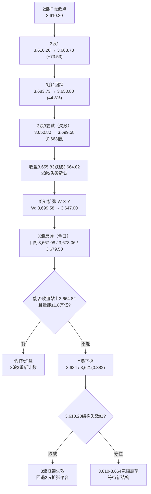
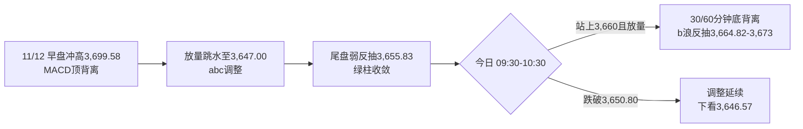

# A股晨报 - 2026年11月13日

> 数据截至：2026-11-13 09:15（北京时间）
> 编制：A股分析师AI代理
> 今日为周五（第46周收官日），交易日照常开市

---

## 一、昨日晚报复盘要点回顾

### 1. 昨日判断回顾（11/12晚报以11/11晚报策略为基准）

| 维度 | 准确率 | 说明 |
|------|--------|------|
| 趋势判断 | **0%（0/1）** | 预测"3,670-3,690震荡整固"，实际冲高3,699.58后跳水收-0.67% |
| 点位预测 | **33.3%（1/3）** | 强压力3,700✓（最高3,699.58）；区间✗；强支撑3,664.82✗ |
| 板块预判 | **57.1%（4/7）** | 通信✓、半导体设备✓、贵金属✓、高位连板✓；电子/PCB✗、机器人✗、白酒✗ |
| 成交量 | **0%** | 预测1.6-1.75万亿，实际1.9321万亿（高于上限1,821亿） |
| **综合** | **28.0%** | 30%×0 + 30%×33.3 + 30%×57.1 + 10%×0 |
| 波浪分析 | **约55%** | "收盘<3,664.82即突破失败"证伪条件✓；量能✗；震荡判断✗ |

### 2. 关键偏差及原因

- **偏差1（趋势）**：把"11/11放量突破颈线"线性外推为"整固后再攻3,700"，遗漏"通信单日+7.99%后次日获利兑现"与"英伟达盘前再跌6%"两大变量 → 高开低走。
- **偏差2（支撑）**：3,680.64距颈线3,664.82仅0.43%（<1%），突破幅度不足，直接设为强支撑；收盘3,655.83失守9点。
- **偏差3（量能）**：连续第4日低估；放量下跌（+15.26%）的换手强度高于放量上涨，未把"冲高兑现"的换手计入。
- **偏差4（电子内部）**：把"半导体设备（国产替代）"与"PCB/光模块/存储（跟随海外算力）"合并看涨，后者随算力链杀跌（电子主力净流出68.89亿居首）。
- **偏差5（白酒）**：主线崩塌日资金"防御内部抱团"，白酒逆势走强，未执行"必选消费上调为相对占优"。
- **偏差6（流程）**：11/12晨报缺失，复盘基准被动改为11/11晚报。

### 3. 沉淀的规则/检查项（今日必须应用）

1. **主线单日涨幅>7% → 次日必并列"高开低走兑现"情景（≥35%）**：11/11通信+7.99%后11/12即-3.01%，已兑现；今日通信/CPO若反抽，按"反弹减仓"处理。
2. **颈线突破幅度<1% → 支撑按"得而复失"处理**：3,664.82在未"3个交易日收盘站稳"前，不承认为支撑，只作为反抽压力。
3. **日内振幅>1.4% → 量能上限上移至前日×1.18**：今日上限约2.28万亿，不得机械套用"缩量"。
4. **主线放量杀跌+上涨家数<20% → 必选消费+银行上调为"相对占优"**：昨日上涨仅15.9%，银行/食品/农业维持相对占优。
5. **海外AI龙头治理风险升级为"管理层更替" → A股算力链"反弹减仓"，不超跌抄底**：昨夜英伟达董事会批准黄仁勋辞任CEO（CFO临时接任），事件已从"个人风波"升级为"治理更替"，完全命中该规则。
6. **3浪3自3浪2低点起算仅达0.618-0.7且收盘跌回颈线下方 → 按"3浪3失败/截断"，转3浪2扩张（W-X-Y）**：昨日已确认，今日按X浪反弹、非新主升处理。

### 4. 对今日分析的启示

- **风险点**：英伟达CEO更替是"实质性治理事件"而非情绪扰动，光模块/CPO/算力硬件即便反抽也属"逃命波"；周线收官若收在3,664.82下方，"假突破周"定性成立。
- **逻辑调整**：不再用"3浪3主升"框架推算目标位；改为"W-X-Y扩张：X浪反抽3,667-3,679 → Y浪下探3,634/3,621"，除非放量收复颈线才重新计数。
- **正向变量**：今晨亚太科技全线走强（KOSPI+2.05%、三星/SK海力士+3%、台指+2%、日经+0.66%），A50期指+0.24%，叠加中芯国际Q3净利+87.6%、Q4"淡季不淡"，半导体国产链具备独立修复动能。

---

## 二、隔夜市场动态（11月12日收盘至11月13日09:15）

### 1. 美股市场（11月12日收盘）

| 指数 | 收盘 | 涨跌幅 | 涨跌点 |
|------|------|--------|--------|
| 道琼斯工业指数 | 52,297.09 | **-0.36%** | -189.40 |
| 标普500 | 7,592.40 | **-0.35%** | -26.98 |
| 纳斯达克综合指数 | 25,366.09 | **-0.39%** | -100.10 |

- **芯片股领跌**：英伟达 **-4.34%**（市值蒸发约1,820亿美元）、闪迪-4.1%、应用材料/Cerebras跌超3%、SK海力士-3%+、奈飞/英特尔跌超2%；
- **但GPU替代逻辑逆势**：博通、AMD **涨超5%**，费城半导体指数跌幅不足1%，**"英伟达弱、算力链分化"**；
- **纳斯达克中国金龙指数 -3.09%**：阿里巴巴 **-7.05%**、蔚来-6.17%、理想-3.71%、哔哩哔哩-3.23%、百度-2.67%、京东-1.29%、拼多多-1.87%——中概科技全线走弱，对港股与A股科技情绪形成压制；
- **盘后**：思科上调2027财年指引，盘后一度+8%，科技硬件景气度仍有支撑。

### 2. 欧洲/亚太市场

| 市场 | 收盘/最新 | 涨跌幅 |
|------|-----------|--------|
| 德国DAX | 26,771.88 | **+0.41%** |
| 法国CAC40 | 8,361.36 | **+0.34%** |
| 英国富时100 | 10,863.09 | **+0.25%** |
| 恒生指数（11/12） | 24,008.55 | **-1.26%** |
| 恒生科技（11/12） | 3,931.93 | **-2.36%** |

**今晨亚太（11/13开盘）**：
- **韩国KOSPI +2.05%**，三星电子、SK海力士 **涨逾3%**；
- **日经225 +0.66%** 报61,223.41点；
- **台湾加权指数 +2%** 报43,972.22点；
- **富时中国A50期指**：夜盘收+0.08%，今晨高开，09:00 **+0.24%**。

> **亚太科技股今晨集体反攻**，是今日A股半导体链最重要的边际正向变量；但需注意"美股芯片跌、亚太芯片涨"的分歧，反映的是**"英伟达单一公司风险"与"存储/代工景气"的分离**，而非全行业risk-on。

### 3. 大宗商品

| 品种 | 收盘 | 涨跌幅 | 驱动 |
|------|------|--------|------|
| WTI原油（12月） | **88.74美元/桶** | **+2.55%** | 特朗普称"美国不需要与伊朗达成协议"、声称掌握霍尔木兹海峡，地缘溢价重启 |
| 布伦特原油（1月） | **95.82美元/桶** | **+3.30%** | 同上，单日涨幅为近期最大 |
| COMEX黄金（12月） | **3,885.30美元/盎司** | **-2.88%** | 美元走强+美债收益率上行+12月加息预期升温，连续跌破4,000、3,900两道关口 |
| COMEX白银（12月） | 50.065美元/盎司 | **-3.72%** | 贵金属系统性承压 |

### 4. 汇率与利率

- **美元指数**：走高（DXY上行），压制非美资产与贵金属；
- **美债10年期收益率**：上行，对高估值成长构成中期估值压制；
- **人民币**：11/12中间价6.7174（调升17bp），在岸收6.6689，出口高增形成结汇支撑，短期偏稳。

### 5. 重要海外事件

1. **英伟达董事会批准黄仁勋辞去总裁、CEO及董事职务**，现任执行副总裁兼CFO科莱特·克雷斯（Colette Kress）出任临时CEO；特朗普称"库克应接替黄仁勋担任英伟达CEO"——**全球AI算力链的治理不确定性实质性落地**。
2. **纽约联储行长威廉姆斯**："通胀太高，需进一步行动"，12月加息预期继续升温；**美联储取消2027年10月FOMC会议安排**。
3. **美国10月CPI已公布环比+0.4%**（11/10），**10月PPI将于今日（11/13）美国时段公布**，为12月8-9日议息会议前最后一份通胀读数。
4. **SpaceX与特斯拉合并谈判据悉推进**，最早12月宣布（对商业航天/特斯拉链有事件扰动）。
5. **商务部**：中美正就贸易、投资等领域关切保持密切沟通；就欧盟部分国家禁用中国企业设备，已表达严重关切。

---

## 三、今日关注事项

### 1. 重要数据发布（按时间排序）

| 时间（北京时间） | 数据/事件 | 预期/前值 |
|------------------|-----------|-----------|
| 全天（待定） | **中国10月M1/M2、社融、新增人民币贷款** | 截至09:15仍未公布；市场预期新增信贷中值约-1,500亿、社融中值约1.5万亿 |
| 21:30（美东08:30） | **美国10月PPI** | 前值待考；若超预期，12月加息50bp讨论升温 |
| 23:00 | 美国11月密歇根大学消费者信心初值 | — |
| 周末 | 本周第46周周线收盘 | 上证能否收在3,664.82上方 |

> **10月金融数据是今日最大的"靴子"**：若信贷、社融显著低于预期，将压制银行/地产链并压制指数反抽高度；若超预期，则与"稳市机制"表态形成共振。

### 2. 政策/监管动态

- **证监会**（11/12 上交所国际投资者大会）：将完善稳市机制、增强股市内在稳定性，用好用足两项结构性货币政策工具，证券基金公司已开展**第三批互换便利**——政策底继续加固，利好券商/大金融与指数下行保护。
- **上交所**分别向**日出东方、大东方**下发股价波动事项监管工作函——对高位题材股的监管降温信号明确。
- **国家发改委**：11/12 24时起汽、柴油每吨分别下调645元、625元（92#约-0.51元/升）。

### 3. 公司公告（11/12盘后至11/13早间）

- **中芯国际**：Q3营收219.83亿元（+28.1%）、归母净利28.47亿元（**+87.6%**）；Q3销售收入31.9亿美元（环比+6.1%），**Q4指引环比+4%-6%，"淡季不淡"**，AI配套芯片（BCD/专用存储/Control）需求超预期。
- **英力特**：拟购买宝丰光伏100%股权，构成重大资产重组，**停牌**；**珠免集团、艾为电子等8股今日停牌**。
- **恒逸石化**：拟12.01亿元收购绍兴恒鸣51%股权。
- **天赐材料**：子公司拟投资不超50亿元建设年产50万吨电解液及配套材料项目。
- **颀中科技**：拟募资不超20亿元用于多芯粒异构集成封测技术项目。
- **立新能源**：拟投资73.2亿元建设250万千瓦风电项目。
- **安集科技**：科创半导体ETF华夏增持至5%（1,141.78万股）。
- **华虹宏力**：拟3亿-5亿元回购用于注销；**天孚通信**：11/12首次回购10万股（1,454.34万元）。
- **产业信息**：电子布"常规布缺口+特种布严重缺货"双紧，预计价格短期继续上行（利好电子布/覆铜板上游）。

### 4. 其他关注

- **新股申购**：今日（11/13）**0只新股申购、0只新股上市**。
- **限售解禁**：15家公司合计1.02亿股、**29.46亿元**（规模温和，冲击有限）。
- **周线收官**：本周为第46周最后一个交易日，收盘位置决定周线"反转确认"或"假突破"定性。

---

## 四、板块与个股分析（结合昨日复盘）

### 1. 基于昨日复盘结论的板块调整

| 昨日预判 | 今日修正 | 依据 |
|----------|----------|------|
| 半导体设备/材料（看涨） | **维持看涨并上调优先级** | 中芯Q3净利+87.6%、Q4淡季不淡；上证报"每日研选"强调半导体设备"自主可控+扩产共振"；今晨三星/SK海力士+3% |
| PCB/光模块/存储（合并看涨，已证伪） | **一分为二**：存储/先进封装看涨（国产线），光模块/CPO看跌（跟随英伟达） | 执行规则26；英伟达治理事件对光模块为直接负面 |
| 银行/食品饮料/农林牧渔（防御占优） | **维持相对占优，但不上调为进攻** | 规则4延续；若今日科技修复，防御板块可能小幅回吐 |
| 贵金属（回避） | **维持回避** | 黄金-2.88%破3,900、白银-3.72%，美元与美债收益率双升 |
| 高位连板（回避） | **维持回避并加强** | 上交所对日出东方、大东方下发监管工作函，监管降温 |

### 2. 隔夜信息驱动的板块机会

**受益板块**：
1. **半导体设备/材料**（逻辑：中芯资本开支与扩产指引+国产替代+今晨亚太科技共振，前道设备中微/拓荆/盛美/华海清科/中科飞测受益）；
2. **存储/先进封装**（逻辑：中芯"专用存储"提拉、长江存储/长鑫IPO提速、颀中科技20亿先进封装募资）；
3. **石油石化/油服**（逻辑：WTI+2.55%、布伦特+3.30%，霍尔木兹地缘溢价，A股油气开采/油服直接映射）；
4. **电子布/覆铜板**（逻辑：常规布缺口+特种布严重缺货，涨价短期延续，属事件驱动型涨价链）；
5. **银行/红利**（逻辑：证监会稳市机制+第三批互换便利，指数下行保护）。

**受损板块**：
1. **光模块/CPO/算力硬件**（逻辑：英伟达CEO更替、中概金龙-3.09%、阿里-7.05%，海外算力叙事重构）；
2. **贵金属**（逻辑：实际利率上行+美元走强，金价两日连破整数关）；
3. **传媒/AI应用**（逻辑：中概互联网大跌传导，且昨日已-3.28%，退潮延续）；
4. **消费电子/手机链**（逻辑：中芯明确"手机部分消费类订单走弱"）；
5. **高位题材连板**（逻辑：监管工作函+退潮，晋级率下降）。

### 3. 重点关注个股（仅作跟踪，不构成推荐）

- **中芯国际（688981）**：Q3净利+87.6%、Q4环比+4%-6%，股价111.72元、市值9,566亿；关注能否放量站稳110元，若跳空高开>3%则不追。
- **北方华创/中微公司/拓荆科技/盛美上海**：半导体设备"自主可控+扩产"主线，昨日深度调整后具备修复空间；关注是否放量收复5日线。
- **兆易创新/江波龙/佰维存储**：存储涨价+国产存储IPO提速，弹性最大但波动高，只做龙头不做补涨。
- **中国石油/中海油服**：油价单日+2.55%，地缘溢价重启，属低估值+事件驱动组合。
- **中国巨石/宏和科技**：电子布涨价链，短线事件驱动，需防"一日游"。
- **天孚通信（300394）**：首次回购+昨日大跌4%+，反抽属"反弹减仓"对象，不宜抄底。

---

## 五、波浪结构多周期分析

### 1. 月K线波浪分析

- **当前波浪位置**：大级别第3浪启动初期的"回踩确认"阶段，月线三连阳雏形仍受考验。
- **浪型结构描述**：11月开3,614.13 → 低3,580.38 → 高3,699.58（月内新高）→ 现3,655.83（月内+1.15%）；月K为"带长上影、带下影小阳"（实体+41.70点、上影43.75点、下影33.75点），**上影线连续第二日超过实体**，3,700上方抛压确认。
- **关键目标位**：上方3,664.82（颈线，得而复失）→ 3,683.73 → 3,699.58 → 3,700（整数关）→ 3,724.56（缺口下沿/0.236回撤）；下方3,646.57 → 3,634 → 3,621（0.382回撤）→ 3,610.20（结构失效线）。
- **验证条件**：月线收在3,621上方则月线修复框架不变；**若11月月K收盘站上3,724.56，月线级别修复确认**；若跌破3,610.20，"三连阳"证伪。

### 2. 周K线波浪分析

- **当前波浪位置**：第46周（11/9-11/13）"周线反转确认"的关键测试日，**今日为最后定价日**。
- **浪型结构描述**：本周开3,659.02 → 高3,699.58 → 低3,650.80 → 现3,655.83（周内-0.67%）；5周均线约3,690，**本周始终未收复5周均线**；若今日收在3,664.82下方，周K将呈"长上影小阴"，与上周"长下影小阳"构成"上影反包"。
- **关键目标位**：上方3,664.82（周线反转确认线）→ 3,683.73 → 3,699.58；下方3,650.80（本周低点）→ 3,646.57 → 3,634。
- **验证条件**：**周五收盘必须站上3,664.82，且全周成交≥9万亿（日均1.8万亿），周线反转才算确认**；否则按"冲高回落的假突破周"定性，周线重回3,621-3,664震荡。

### 3. 日K线波浪分析

- **当前波浪位置**：**3浪3失败确认后，转入3浪2扩张（W-X-Y复杂调整）；今日处于X浪反弹段**。
- **浪型结构描述**：3浪1 3,610.20→3,683.73（+73.53）→ 3浪2回踩3,650.80（44.8%）→ 3浪3尝试3,650.80→3,699.58（仅0.663倍，未达0.618-1.0强势延伸）→ 收盘3,655.83跌破颈线，**3浪3失败（截断/诱多）**。W浪=3,699.58→3,647.00（-52.58点）已走完；**X浪反弹0.382-0.618目标=3,667.08-3,679.50**；其后Y浪下探3,634/3,621。
- **关键目标位**：上方X浪目标 **3,667.08（0.382）/3,673.06（0.5）/3,679.50（0.618）**，其中3,664.82与3,673.06构成"反抽压力带"；下方3,650.80 / 3,647.00 / 3,646.57（第一防线）/ 3,634 / 3,621（0.382）。
- **验证条件**：**若3个交易日内收盘重回3,664.82上方且量能≥1.8万亿，则本次为"假摔"，3浪3重新计数**；若收盘跌破3,646.57，3浪2扩张成立，下看3,634/3,621；若收盘跌破3,610.20，整个3浪框架失效，回退"2浪扩张平台"。

### 4. 60分钟K线波浪分析

- **当前波浪位置**：顶背离兑现后的**abc调整末端**，今日进入b浪反抽。
- **浪型结构描述**：11/12早盘冲高3,699.58形成60分钟MACD顶背离，随后连续阴线至3,647.00，尾盘小幅回抽3,655.83；**60分钟MACD绿柱开始收敛、KDJ低位拐头**，具备技术性反抽条件。
- **关键目标位**：上方3,660 / 3,664.82（反抽第一压力）/ 3,673.06；下方3,650.80 / 3,647.00 / 3,646.57。
- **验证条件**：**反抽不能收复3,664.82且MACD零轴下方绿柱再放大 → 调整延续至3,646.57**；若放量收复3,664.82且MACD金叉，则昨日下跌为"单日洗盘"，升级为b浪反抽至3,673-3,683。

### 5. 30分钟K线波浪分析

- **当前波浪位置**：调整浪第3小浪末端，**底背离待确认**。
- **浪型结构描述**：11/12 13:30-14:30连续4根30分钟阴线杀跌至3,647.00，尾盘2根小阳回抽；30分钟MACD高位死叉后绿柱放大，但尾盘绿柱缩短、RSI自30下方回升。
- **关键目标位**：上方3,660 / 3,664.82；下方3,650.80 / 3,647.00 / 3,646.57。
- **验证条件**：**今日开盘30分钟若站上3,660且量能同比不缩 → 30分钟底背离成立，短线修复至3,664.82-3,673**；若开盘跌破3,650.80且30分钟MACD再死叉，则调整延续。

### 6. 波浪图（Mermaid绘制）

**日K线波浪结构图**

**60分钟波浪结构图**

### 7. 波浪理论综合判断

- **多周期共振状态**：月线偏多（★★★☆，上影超实体）、周线中性偏弱（★★，失守3,664.82）、日线空（★★，3浪3失败）、60分钟空转中性（★★☆，绿柱收敛）、30分钟空转中性（★★☆，底背离待确认）——**"中长偏多、短周期由空转修复"**，较昨日的"短周期向下共振"边际改善，但仍未形成向上共振。
- **当前操作级别**：**日线级别防守、30/60分钟择时**；今日属"X浪反弹窗口"，只做反抽不做趋势。
- **后续演变路径**：
  - **基础路径（50%）**：3,648-3,676震荡修复，收3,655-3,668，X浪在3,664.82-3,673受阻，量能1.80-2.00万亿；
  - **偏强路径（25%）**：亚太科技共振+中芯催化，放量收复3,664.82→3,673.06→3,683.73，周线反转成立，量能≥2.0万亿；
  - **偏弱路径（25%）**：英伟达治理风险+中概金龙-3.09%压制，冲高回落跌破3,646.57，下探3,634/3,621。
- **关键拐点信号**：**修复信号=收盘≥3,664.82且成交≥1.8万亿**；**转弱升级=收盘<3,646.57**；**结构失效=收盘<3,610.20**；短线止跌=30分钟底背离+3,646.57不破。
- **风险提示**：W-X-Y计数具有主观性，X浪反弹高度可能仅及3,660附近；英伟达治理事件若引发美股AI链二次下跌，日线可能直接跳过X浪进入Y浪，需以收盘价而非盘中价确认。

---

## 六、今日核心判断

### 1. 趋势判断

- **上证指数：【震荡】（修复性震荡，重心小幅上移）**
- **预测区间：3,640点 - 3,680点**
- **核心逻辑**：隔夜美股小幅收跌、英伟达-4.34%且CEO更替落地，压制算力叙事；但今晨亚太科技全线反攻（KOSPI+2.05%、三星/SK海力士+3%、台指+2%）、A50期指+0.24%、中芯Q3净利+87.6%且Q4"淡季不淡"，半导体国产链具备独立修复动能。叠加证监会"完善稳市机制"表态，指数下有3,646.57强支撑、上有3,664.82颈线反抽压力，**周五周线收官以"震荡修复、收复与否见分晓"为主**。

### 2. 关键点位

- **强支撑位：3,646.57点**（依据：3浪2扩张第一防线+11/12盘中低点3,647.00邻近，收盘跌破则下看3,634/3,621）
- **弱支撑位：3,650.80点**（依据：本周低点、3浪2回踩低点，短线多空分水岭）
- **强压力位：3,683.73点**（依据：3浪1高点+20日均线附近+3,699.58下方密集成交区）
- **弱压力位：3,664.82点**（依据：颈线，得而复失后的反抽第一压力；收盘站上则周线反转成立）

### 3. 板块预判

- **看涨板块**：
  1. **半导体设备/材料**（逻辑：中芯Q3净利+87.6%、Q4环比+4%-6%"淡季不淡"，扩产+国产替代共振；今晨三星/SK海力士+3%、台指+2%）；
  2. **存储/先进封装**（逻辑：中芯"专用存储"需求提拉、长江存储/长鑫IPO提速、颀中科技20亿先进封装募资）；
  3. **石油石化/油服**（逻辑：WTI+2.55%、布伦特+3.30%，霍尔木兹地缘溢价重启）；
  4. **银行/红利**（逻辑：证监会稳市机制+第三批互换便利，指数下行保护）。
- **看跌板块**：
  1. **光模块/CPO/算力硬件**（逻辑：英伟达CEO更替、中概金龙-3.09%、阿里-7.05%，"反弹即减仓"）；
  2. **贵金属**（逻辑：黄金-2.88%破3,900、白银-3.72%，美元与美债收益率双升）；
  3. **传媒/AI应用**（逻辑：中概互联网大跌传导+昨日-3.28%退潮延续）。
- **风险板块**：**高位题材连板股**（上交所对日出东方、大东方下发监管工作函，断板风险）；**消费电子/手机链**（中芯明确手机订单走弱）。

### 4. 资金面判断

- **北向资金预期**：交易所净额不披露，无法直接验证；间接指标偏暖——A50期指+0.24%、亚太科技普涨，预计**外资情绪边际修复、净流入概率略大于净流出**（幅度不可量化）。
- **成交量预期：【平量】**，预计 **1.80-2.00万亿**（昨日1.93万亿）；若日内振幅>1.4%，按规则上限可上移至2.28万亿；周线收官+PPI待公布，大幅放量概率低。
- **补充**：11/12 ETF资金整体净赎回316.08亿元（股票型-248.34亿、宽基型-226.51亿），**被动资金在撤，修复需靠主动资金承接**；南向资金11/12净买入58.46亿港元，配置盘"越跌越买"延续。

### 5. 风险预警（按优先级排序）

- **高风险**：**英伟达治理事件实质性落地**（董事会批准黄仁勋辞任CEO、CFO临时接任，特朗普提名库克），全球AI算力链叙事重构，A股光模块/CPO/PCB即便反抽也难改"反弹减仓"属性；**美国10月PPI今夜公布**，若超预期，叠加威廉姆斯鹰派表态，12月加息50bp预期升温，压制高β成长。
- **中风险**：**10月金融数据随时公布**（预期新增信贷-1,500亿、社融1.5万亿），若显著低于预期将压制银行/地产与指数反抽高度；**周线收官若收于3,664.82下方，"假突破周"定性成立**，下周回踩3,621概率上升；**高位连板监管降温**（日出东方、大东方监管工作函）可能引发情绪二次退潮；**中概金龙-3.09%** 对港股科技与A股AI应用形成传导。
- **低风险**：解禁29.46亿元规模温和；成品油下调利好物流/出行/航空；证监会稳市表态构成下行保护；8股停牌（英力特重组等）属个股事件。

### 6. 昨日复盘规则应用

- **应用规则1（主线+7%后次日兑现）**：通信/CPO今日若反抽，视为减仓机会，不作为进攻方向。
- **应用规则2（颈线突破<1%按"得而复失"）**：3,664.82未"3日收盘站稳"，仍按反抽压力处理，不承认为支撑。
- **应用规则3（振幅>1.4%量能×1.18）**：今日基础量能1.80-2.00万亿，上限预留2.28万亿情景。
- **应用规则4（主线杀跌+宽度<20%→必选消费+银行占优）**：银行维持相对占优；若科技放量修复，食品/农业相对收益可能收敛。
- **应用规则5（海外AI治理风险→反弹减仓）**：光模块/CPO/存储硬件"反弹减仓"，仅半导体设备/国产存储可独立参与。
- **应用规则6（3浪3失败→W-X-Y）**：今日按X浪反弹处理，目标3,667-3,679，不按主升浪加仓。

---

## 七、投资策略建议（分短线+中线）

### 1. 短线策略（1-3个交易日）

- **适用场景**：日K线X浪反弹+60分钟abc调整末端，30/60分钟底背离待确认。
- **短线仓位：15%**（总资金中用于短线操作的比例）
- **买入条件**：
  1. 开盘30分钟上证站稳3,655.83且成交同比不缩量，同时半导体设备/存储出现**放量走强（板块涨幅>1.5%、主力净流入）**，可小仓位参与；
  2. 指数回踩3,650.80不破且30分钟MACD金叉，可低吸；
  3. **高开>0.8%不追**，等回踩确认。
- **卖出条件**：反抽3,664.82-3,673.06区间**不放量**（成交<1.8万亿）即减仓；触及3,673附近滞涨即止盈。
- **止损位**：**收盘跌破3,646.57**清短线；个股跌幅>5%止损。
- **短线标的**：
  1. **半导体设备**（北方华创/中微公司/拓荆科技，逻辑：中芯扩产+国产替代+亚太共振）；
  2. **存储/先进封装**（兆易创新/颀中科技，逻辑：专用存储提拉+先进封装募资）；
  3. **油服**（中海油服，逻辑：油价单日+2.55%+地缘溢价）。

### 2. 中线策略（1-4周）

- **适用场景**：周K线波浪"反转确认待定"，3浪2扩张（W-X-Y）进行中。
- **中线仓位：20%**
- **方向判断：【持有】（不加仓、不恐慌减仓）**
- **目标区间**：上证指数 **3,646点 - 3,700点**；收复3,664.82后上移3,683-3,700，跌破3,646.57下移3,621-3,634。
- **中线布局板块**：
  1. **半导体设备/材料**（逻辑：行业景气+国产替代+中芯资本开支，回调即布局）；
  2. **银行/红利**（逻辑：稳市政策+低估值+高股息，组合压舱石）；
  3. **石油石化**（逻辑：地缘溢价+低估值，但仅作对冲配置）。
- **止盈条件**：指数到达3,700点或波段涨幅达到8%。
- **止损条件**：**收盘跌破3,610.20（结构失效线）** 或趋势确认反转，则中线降至10%以下。

### 3. 仓位分配总览

| 策略类型 | 仓位比例 | 方向 | 重点板块 |
|---------|---------|------|---------|
| 短线 | 15% | 轻仓参与X浪反抽 | 半导体设备、存储/先进封装、油服 |
| 中线 | 20% | 持有 | 半导体设备/材料、银行红利、石油石化 |
| 现金 | 65% | — | — |

### 4. 与昨日策略对比

- **短线仓位调整**：从10%上调至15%（+5pct）。原因：亚太科技今晨共振+中芯业绩催化，X浪反抽窗口打开；但周五+PPI待公布，仅小幅加仓、不重仓。
- **中线仓位调整**：维持20%（不变）。原因：3,646.57未破、3,610.20结构未失效，但3浪3失败后不宜加仓。
- **板块调整**：
  - **增配**半导体设备/材料（中芯Q3+87.6%、Q4淡季不淡）、石油石化（油价+2.55%）；
  - **减配**光模块/CPO/算力硬件（英伟达治理事件，反弹减仓）；
  - **维持**银行/红利相对占优；**回避**贵金属、高位连板、传媒/AI应用。

---

## 八、信息来源

1. **官方数据来源**：上海证券交易所/深圳证券交易所（成交与公告）、中国人民银行（中间价、公开市场操作）、国家发改委（成品油调价）、中国证监会（稳市机制表态）、美国劳工部（CPI/PPI）
2. **权威财经媒体**：新华社（A股收盘）、中国证券报·中证网、上海证券报·中国证券网（每日研选、国际晨讯）、证券时报（南向资金）、第一财经、财联社（早间新闻精选、A50期指、亚太开盘）
3. **数据平台**：东方财富（Choice数据、板块资金、公告）、同花顺（新股申购）、新浪财经（全球行情）、Wind（解禁数据）
4. **研究机构**：国泰海通（收市点评）、CME FedWatch（加息概率）、纽约联储（威廉姆斯讲话）
5. **数据截止时间**：**2026-11-13 09:15（北京时间）**；美股为11月12日收盘价，欧股为11月12日收盘，亚太为11月13日开盘/早盘，A50期指为09:00报价；中国10月金融数据截至本报告发布时仍未公布

---

> **免责声明**：本报告为AI辅助生成的开盘前分析，所有点位、概率、目标价均为基于公开数据的技术推演，不构成投资建议。市场有风险，决策需独立。
