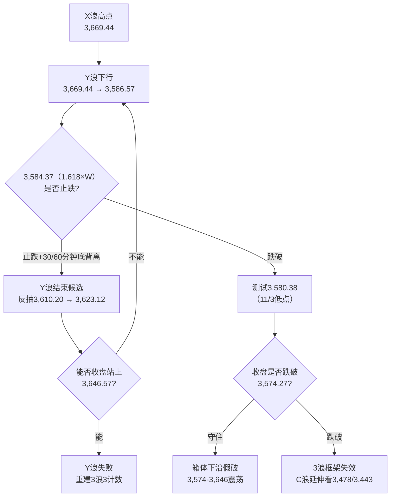
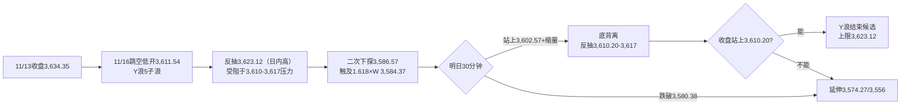

# A股晚报 - 2026年11月16日

> 数据截至：2026-11-16 20:00（北京时间）
> 编制：A股分析师AI代理
> 今日为周一（第47周首个交易日），正常交易
> 基准：11/16晨报 + 《2026年第46周A股运行规律分析》（11/15）

---

## 一、市场回顾

### 1. 主要指数表现

| 指数 | 收盘 | 涨跌幅 | 涨跌点 | 开盘 | 最高 | 最低 | 成交额 |
|------|------|--------|--------|------|------|------|--------|
| 上证指数 | **3,602.57** | **-0.87%** | -31.78 | 3,611.54 | 3,623.12 | **3,586.57** | 7,062.14亿 |
| 深证成指 | **10,690.78** | **-2.53%** | -278.01 | — | — | — | 7,782.76亿 |
| 创业板指 | **2,320.02** | **-4.37%** | -106.06 | — | — | — | — |
| 科创50 | **1,213.68** | **-5.16%** | -65.98 | — | — | — | — |
| 北证50 | 836.57 | **-4.54%** | -39.76 | 868.80 | — | — | — |

- **沪指险守3,600点**：盘中最低**3,586.57**，跌破3,610.20结构失效线（晨报强支撑），尾盘回升收3,602.57，全天振幅仅1.01%（3602.57/3634.35-1 = -0.87%），属"**低开、弱反抽、午后二次下探、尾盘回收**"的单边弱势结构。
- **深成指、创业板指双双创年内新低**，创业板指单日-4.37%、科创50 -5.16%、北证50 -4.54%，**成长风格出现流动性式杀跌**（并非普跌，而是高β集中出清）。
- **风格极致哑铃**：沪指仅跌0.87%而创业板跌4.37%，**指数与成长背离达3.5个百分点**，为本轮调整以来最大单日分化。

### 2. 成交量能

| 项目 | 数值 | 变化 |
|------|------|------|
| 两市成交额 | **14,844.90亿（1.48万亿）** | **缩量约1,827亿（-11.0%）** |
| 沪市 / 深市 | 7,062.14亿 / 7,782.76亿 | — |
| 主力资金 | **净流出430.28亿** | 电子净流出超120亿（半导体-126.7亿）、通信超60亿、有色/机械超30亿 |
| 主力净流入行业 | 仅3个：美容护理、家用电器（均超1亿）、社会服务（超0.46亿） | 红利股板块净流入12.65亿 |
| 北向资金 | 成交**2,202.40亿，占14.84%**（净额不披露） | 南向资金净卖出42.27亿港元 |
| 两融余额（11/13） | 22,497.85亿 | 单日**减少165.45亿**（沪-86.72亿、深-78.73亿） |

- **缩量下跌不是"惜售"**：成交降到1.48万亿（10月以来次低，仅高于11/9的1.49万亿），但主力净流出430亿、两融单日降165亿，**杠杆与机构资金同步降仓**，属"存量减仓、无人接盘"。
- **资金极致抱团**：融资融券板块净流出400.16亿，芯片概念、转融券标的居流出前列；**红利股净流入12.65亿**，与银行创历史新高互相印证。

### 3. 市场情绪

| 指标 | 数值 |
|------|------|
| 上涨 / 下跌 / 平盘 | **1,136 / 4,344 / 99** |
| 上涨占比 | **约20.4%**（连续第3个交易日超4,300只下跌） |
| 涨停 / 跌停 | **33只 / 68只**（跌停为涨停的2倍以上；证券之星口径32只涨停、近60只跌停） |
| 连板股 | **11只**，三连板及以上3只，**晋级率42.86%** |
| 最高标 | 文投控股**19天11板**；吉视传媒3天2板；华数传媒涨停 |
| 市场宽度 | 极差（上涨占比<25%、跌停>涨停、双创新低） |

- **情绪退潮进入第三日**：11/12宽度15.9%、11/13涨跌停38:39、11/16跌停68只>涨停33只，**"跌停>涨停"连续2日**，晨报"补跌还有1-2日"的判断兑现，但**尚未出现恐慌放量出清**（缩量），说明底部未确认。

---

## 二、热点板块与异动分析

### 1. 领涨板块及驱动因素

| 板块 | 涨跌幅 | 驱动因素 |
|------|--------|---------|
| **银行** | **+1.91%** | 弱数据→宽货币+年末考核+稳市机制；**工行、建行、南京、成都、杭州、江苏、青岛银行创历史新高**，农行、上海银行涨超2% |
| **煤炭** | **+1.89%** | PPI 6.5%高位+冬季用能+高股息防御，红利抱团外溢 |
| **交通运输** | **+1.23%** | 高股息（公路铁路）+运费预期，防御属性 |
| **食品饮料** | **+1.19%** | 白酒逆势、调味发酵品上涨，必选消费避险 |
| **家用电器** | **+0.89%** | **长虹美菱、华帝股份、小熊电器涨停，美的集团创历史新高**；出口链+汇率升值斜率放缓 |
| 电信运营 | 上涨 | 中国电信、中国移动、中国联通联袂走强，高股息+算力基建防御 |
| 保险 | 上涨 | 利率企稳+红利风格 |

- **上涨的共性只有一个：类固收/高股息/出口链**。数据全面低于预期后，资金不再交易"复苏"，只交易"确定性现金流"。
- **家电出现"个股强、板块弱"**：小家电涨停潮+美的历史新高，但申万家电仅+0.89%，说明是**抱团资金点状进攻**，而非行业景气驱动。

### 2. 领跌板块及原因分析

| 板块 | 涨跌幅 | 原因 |
|------|--------|------|
| **通信** | **-7.06%** | CPO/光模块/光芯片/覆铜板全线重挫，中际旭创跌超7%、新易盛跌近7%；英伟达财报前杀估值 |
| **电子** | **-5.99%** | 半导体、存储、PCB、先进封装跌超5%；寒武纪、中芯国际、澜起科技、中微公司、海光信息大跌；**半导体净流出126.7亿** |
| 综合 | -4.29% | 小市值/题材补跌 |
| 国防军工 | 大跌 | 航天军工高位兑现 |
| 机械设备 | 跌超3% | 机器人/通用设备补跌 |
| 贵金属 | 大跌 | 现货黄金盘中3,832.23美元创年内新低，收3,837.91（-1.08%），白银-3.02% |
| 汽车 / 互联网 / 电脑硬件 | 下跌 | 成长β收缩 |

- **国产GPU三巨头（燧原科技、摩尔线程、沐曦股份）跌幅均超10%**，属"高估值+未盈利+流动性收缩"的三重杀，**不是业绩问题，是估值锚（美债5%+英伟达不确定性）问题**。
- **电子板块单日净流出126.7亿（半导体）**，触发晨报规则2（电子净流出>100亿→设备/材料同步补跌），**半导体设备未能独立**，科创50因此-5.16%。

### 3. 个股异动复盘

- **涨停结构**：33只涨停中，银行/家电/传媒（吉视传媒、华数传媒）为主，**无高标接力，最高标文投控股19天11板属"尾声妖股"**，晋级率42.86%但三板以上仅3只，**赚钱效应集中于低位防御，不在题材**。
- **强势股回调**：中际旭创-7%、新易盛-7%、摩尔线程-7%、燧原科技-8%、沐曦-10%+，**算力链"反弹即减"连续第3日验证**。
- **银行股"批量新高"**：7家银行创历史新高，为2026年以来单日最多，**说明机构在指数下跌中被动增配红利**（考核+低波），不是主动看多经济。

---

## 三、关键数据与事件回顾

### 1. 国内重要经济数据（10:00 国新办发布会）

| 指标 | 实际 | 预期 | 前值 | 市场解读 |
|------|------|------|------|---------|
| 10月规模以上工业增加值同比 | **+4.8%** | +5.3% | +5.5% | **低于预期0.5pct**，连续回落 |
| 10月社会消费品零售总额同比 | **+0.4%** | +0.8% | +1.1% | **低于预期0.4pct**，接近零增长 |
| 1-10月固定资产投资同比 | **-8.1%** | -7.0% | -7.2% | **低于预期1.1pct**，基建-5.1% |
| 1-10月工业增加值同比 | +5.3% | — | — | 累计增速仍正 |
| 结构亮点 | 装备制造+10.6%、高技术制造+17.6% | — | — | 新质生产力强，传统需求弱 |

- **"全面低于预期"是本日下跌的基本面触发器**：社零+0.4%已接近零增长，固投-8.1%显示地产/基建双拖累；**"弱数据→宽货币"交易只利好红利，不再利好顺周期**。
- **市场反应**：数据公布后指数短暂反抽3,623.12（即为全天最高），随后单边下行，**"利好红利、利空成长"的分层定价在30分钟内完成**。

### 2. 政策消息

- **央行**：开展**4,600亿元隔夜逆回购（利率1.25%）+2,000亿元6个月买断式逆回购**，对冲3,640亿隔夜+3,000亿买断到期，**公开市场净回笼40亿元**；6个月买断式"缩量续作"，流动性"合理充裕"但无增量。
- **产业**：第三代半导体论坛11/16-19苏州举行、神州半导体IPO上会——**事件催化未能对冲资金流出**，半导体设备随电子补跌。
- **证监会/稳市**：无新增表态，11/14"深化稳市长效机制"仍是政策底来源，3,580-3,610区域承接今日被测试（低点3,586.57）。

### 3. 公司公告

- **回购**：晶盛机电（1亿-2亿，价格上限48元）、胜宏科技（1.5亿-3亿，上限240.49元）、华兴源创（1,500万-3,000万，上限71元）——**产业资本在算力/半导体调整中承接，但规模不足以扭转资金面**。
- **增持**：韵达股份控股股东首次增持162.33万股。
- **解禁**：永安林业211.04万股、华统股份537.63万股，规模很小，无实质影响。

---

## 四、海外市场联动

### 1. 亚太市场（11/16收盘）

| 市场 | 收盘 | 涨跌幅 |
|------|------|--------|
| 日经225 | 59,662.02 | **-2.42%**（跌破60,000点，跌超1,400点） |
| 韩国KOSPI | 5,100.25 | **-3.60%** |
| 恒生指数 | 23,753.84 | **+0.49%** |
| 恒生科技 | 3,801.64 | **-0.30%** |
| 南向资金 | 净卖出42.27亿港元 | 成交690.52亿港元（占恒指39.66%） |

- **亚太科技链再度重挫**：日经-2.42%、KOSPI-3.60%，与A股通信-7.06%、电子-5.99%同向；**恒指收红靠金融/高股息，恒生科技仍跌**，与A股"银行红、科技绿"完全同构。
- **南向资金转为净卖出**（-42.27亿），减持阿里、中芯国际，**港股配置盘亦在降科技暴露**。

### 2. 欧美市场（11/16盘前/期货）

- **美股期货跳水转跌**：纳指100期货**-0.22%**、标普500期货-0.04%、道指期货-0.02%。
- **英伟达美股盘前跌超3%**，财报（北京时间11/18 05:20）前避险情绪升温；本周另一重磅为**Anthropic IPO（11/18定价）**。
- 上一交易日（11/13）美股：道指+0.10%、标普-0.40%、纳指-0.91%，费半延续弱势（详见晨报）。

### 3. 大宗商品

| 品种 | 最新 | 涨跌 | 说明 |
|------|------|------|------|
| 现货黄金 | **3,837.91美元/盎司** | **-1.08%** | 盘中3,832.23创**年内新低**，较年内高点回落显著；机构警告可能下探3,600 |
| 现货白银 | **47.21美元/盎司** | **-3.02%** | 工业+金融属性双杀 |
| WTI原油 | 亚市上涨 | — | 美第三艘航母进中东，地缘溢价回升；摩根士丹利下调2026年WTI预测至85.80美元 |
| 沪金现货 | 837.55元/克 | -1.62%（上一交易日） | 国内金饰克价较高点跌约530元 |

- **贵金属"趋势破坏"确认**：黄金跌破前低、创年内新低，**实际利率5%以上+美元高位**的组合下，避险属性让位于机会成本，**贵金属板块继续回避**。

---

## 五、汇率与利率

| 项目 | 数值 | 变动 |
|------|------|------|
| 人民币中间价 | **6.7141** | 较前值**升值11bp** |
| 在岸人民币 | 约6.6706 | 日内小幅贬值约0.03% |
| Shibor O/N | 1.3040% | +0.70bp |
| Shibor 1W | 1.3900% | +0.90bp |
| Shibor 3M | 1.4000% | 持平 |
| Shibor 1Y | 1.4380% | +0.10bp |
| 央行公开市场 | 4,600亿隔夜逆回购（1.25%）+2,000亿6M买断式 | **净回笼40亿** |

- **汇率"稳"、利率"平"**：中间价连续升值但幅度收窄（+11bp），外汇存款准备金率上调后的"抑升值"效果显现；资金利率低位平稳，**流动性不是本轮下跌原因**。
- **对A股含义**：分母端（利率）无恶化，杀的是**分子端（10月数据全面低于预期）与风险偏好（英伟达财报前）**，因此**红利抗跌、成长杀估值**的结构会延续。

---

## 六、收盘后重要信息

### 1. 盘后公告

- **回购**：晶盛机电（1亿-2亿）、胜宏科技（1.5亿-3亿）、华兴源创（1,500万-3,000万）。
- **增持**：韵达股份控股股东首次增持162.33万股。
- **业绩/重组**：暂无改变市场结构的重大事项。

### 2. 夜盘/盘前

- 英伟达美股盘前**跌超3%**，纳指100期货-0.22%，**A股算力链明日仍有低开压力**。
- 黄金创年内新低后夜盘弱势，贵金属难有反抽。
- 原油受地缘扰动上涨，石油石化存防御性支撑，但**不改"高股息"而非"进攻"属性**。

### 3. 次日关注

| 时间 | 事件 | 影响 |
|------|------|------|
| 11/17 | 美联储主席沃什讲话（旧金山，AI与就业） | 加息路径定调，压制高β |
| 11/18 05:20 | **英伟达FY27Q3财报**（临时CEO首份财报） | 全周最大变盘点 |
| 11/18 | Anthropic IPO定价 | 全球AI资产定价锚 |
| 11/19 | 美联储10月会议纪要 | 12月加息25/50bp路径 |
| 11/20 | 周线收盘、恒指季检 | 周线能否收复3,610.20 |

---

## 七、波浪理论多周期分析

### 1. 月K线波浪分析

- **当前波浪位置**：大级别第3浪启动失败后的**3浪2扩张（W-X-Y）调整**，Y浪已进入延伸段；月K由"三连阳"转为**"带长上影小阴"**。
- **浪型结构描述**：11月开3,614.13 → 低3,580.38 → 高3,699.58 → 今收3,602.57（月内+0.10%，较开盘-11.56点）；**上影85.45点、下影22.19点、实体-11.56点**，连续第二个月"上影显著长于实体"，且**收盘失守3,610.20（月线结构失效线）**。
- **关键目标位**：上方3,610.20（得而复失）→3,623.12（今日高）→3,646.57→3,664.82；下方**3,586.57（今日低）→3,580.38（11/3低）→3,574.27（10/23低/月线生死线）**→3,478。
- **验证条件**：月线收盘**守住3,580.38**，"3浪2扩张"框架仍在，仅降级为"Y浪延伸"；**收盘跌破3,574.27**，月线改为"C浪延伸"，下看3,478/3,443；重新站上3,646.57且月成交放大，才恢复3浪3计数。

### 2. 周K线波浪分析

- **当前波浪位置**：第47周（11/16-11/20）**箱体下沿失守**，假突破周的"二次探底"路径兑现。
- **浪型结构描述**：本周开3,611.54（跳空低开-0.63%）→ 高3,623.12 → 低3,586.57 → 现3,602.57；**未能反抽至3,646.57第一防线，直接击穿3,610.20**，周K暂为"带下影小阴"。
- **关键目标位**：上方3,610.20→3,623.12→3,646.57→3,664.82（颈线）→3,682（5周线）；下方3,586.57→3,580.38→3,574.27。
- **验证条件**：周线反转确认仍为"**收盘站上3,664.82且周成交≥9万亿**"；本周若收盘守住3,574.27，属"箱体下沿假破"；**收盘跌破3,574.27则周线下降推动浪延伸**。

### 3. 日K线波浪分析

- **当前波浪位置**：**W-X-Y扩张调整的Y浪第5子浪（延伸段）**，Y浪自3,669.44已下行至3,586.57（-82.87点）。
- **浪型结构描述**：W浪 3,699.58→3,647.00（-52.58点）→ X浪 3,647.00→3,669.44（+22.44点，0.427回撤）→ **Y浪 3,669.44→3,586.57（-82.87点）**，Y/W=**1.576倍**，已接近1.618倍目标**3,584.37**；今日收盘3,602.57，收在3,610.20下方。
- **关键目标位**：下方**3,586.57→3,584.37（1.618×W）→3,580.38→3,574.27**；若破3,574.27，下看3,556（Y=2.0×W）/3,478；上方反抽压力**3,610.20→3,623.12→3,646.57**。
- **验证条件**：**收盘跌破3,580.38 → 箱体下沿确认失守**，3浪框架降级；**收盘跌破3,574.27 → 3浪框架失效，回退2浪扩张平台/C浪延伸**；若3个交易日内收盘重回3,610.20上方且量能≥1.7万亿，则视为"假破"，Y浪结束候选（但反抽不得高于3,646.57）。

### 4. 60分钟K线波浪分析

- **当前波浪位置**：Y浪第5子浪内部**最后一段下跌**，MACD零轴下方绿柱扩张，**底背离尚未形成**。
- **浪型结构描述**：跳空低开3,611.54 → 早盘反抽3,623.12（形成日内高点）→ 连续阴线至3,586.57 → 尾盘弱反抽3,602.57；**60分钟下降压力线明日约在3,610-3,617**，MACD绿柱未收敛、KDJ低位钝化。
- **关键目标位**：下方3,586.57→3,584.37→3,580.38→3,574.27；上方3,610.20→3,617→3,623.12。
- **验证条件**：**60分钟收盘站上3,610.20且MACD金叉，才确认Y浪结束**；若绿柱继续放大并跌破3,580.38，则延伸至3,574.27/3,556。

### 5. 30分钟K线波浪分析

- **当前波浪位置**：Y浪末段**超卖区**，3,586.57出现缩量止跌，但**底背离未确认**。
- **浪型结构描述**：午后下探3,586.57时量能萎缩（全天1.48万亿），30分钟RSI自20下方回升、MACD绿柱尾盘缩短，具备**技术性反抽条件**，但**属抛压衰减而非恐慌出清**，反抽力度有限。
- **关键目标位**：上方3,602.57→3,610.20→3,617→3,623.12；下方3,586.57→3,580.38→3,574.27。
- **验证条件**：**明日开盘30分钟站上3,602.57且量能不低于今日同期 → 30分钟底背离成立，反抽3,610.20-3,617**；若直接跌破3,580.38，则超卖失效、下行至3,574.27。

### 6. 波浪图

**日K线波浪结构图**



**60分钟波浪结构图**



### 7. 波浪理论综合判断

- **多周期共振状态**：月线**转空**（★★，收盘失守3,610.20）、周线空（★☆，箱体下沿失守）、日线空（★，Y浪5子浪）、60分钟空（★，绿柱扩张）、30分钟超卖（★☆，底背离未确认）——**五周期首次全部转空/超卖**，较11/13进一步恶化，但**日线已进入1.618倍目标区（3,584.37），处于"跌到位但未止跌"的临界点**。
- **当前操作级别**：**日线级别防守，30/60分钟只做反抽不做趋势**；3,580.38未收盘失守前按"箱体假破"处理，失守则降为观望；**明日不抢反弹，等30分钟底背离+收盘确认**。
- **后续演变路径**：
  - **基础路径（45%）**：3,574-3,610弱势磨底，早盘再探3,580.38/3,574.27后缩量企稳，收3,585-3,605，量能1.40-1.55万亿；
  - **偏弱路径（35%）**：英伟达财报前亚太再挫，收盘跌破3,574.27，下看3,556/3,478，创业板测2,250；
  - **偏强路径（20%）**：政策承接+红利护盘+超跌反抽，收复3,610.20→3,623.12，但难一次性收复3,646.57。
- **关键拐点信号**：**止跌信号=收盘站上3,610.20且30分钟底背离+量能≥1.7万亿**；**转弱升级=收盘<3,580.38**；**结构失效=收盘<3,574.27**；**反转确认=收盘≥3,646.57且量能≥1.8万亿**。
- **风险提示**：W-X-Y计数主观性较强，Y浪可能延伸为"5-3-5"的C浪；**1.618倍目标（3,584.37）只是统计位置，不是支撑承诺**；英伟达财报（11/18 05:20）前若纳指期货继续下跌，A股可能直接跳空至3,574下方，**不得以"超卖+目标位"作为抄底依据**。

---

## 八、晨报复盘

### 1. 核心判断回顾

| 判断项目 | 晨报预测 | 实际结果 | 准确度 | 备注 |
|---------|---------|---------|-------|------|
| 上证指数趋势 | **震荡偏弱** | **下跌-0.87%** | **✓** | 方向正确，且明确提示"偏弱路径35%：收盘跌破3,610.20" |
| 上证指数区间 | 3,605-3,650点 | 3,586.57-3,623.12点（收3,602.57） | **✗** | 下沿被击穿18.43点，区间整体下移 |
| 强支撑位 | 3,610.20点 | 最低3,586.57点 | **✗** | 盘中跌破23.63点、收盘跌破7.63点，结构失效线失守 |
| 强压力位 | 3,646.57点 | 最高3,623.12点 | **✗** | 未触及（差23.45点），反抽力度弱于预期 |
| 北向资金 | 净流出0-40亿 | 净额不披露；成交2,202.40亿/占14.84%；南向净卖出42.27亿 | **—** | 无法验证，不计入量化 |
| 成交量 | 平量1.60-1.78万亿 | **1.4845万亿** | **✗** | 低于下限1,155亿，**连续第6日低估** |

### 2. 板块预判回顾

| 板块 | 预判方向 | 实际涨跌幅 | 准确度 | 原因分析 |
|-----|---------|-----------|-------|---------|
| 银行/红利 | 看涨 | 银行**+1.91%**、煤炭+1.89%、交运+1.23% | **✓** | 弱数据→宽货币+年末考核，7家银行创历史新高 |
| 食品饮料/家电 | 看涨 | 食品饮料**+1.19%**、家电**+0.89%** | **✓** | 必选消费避险+出口链，家电涨停潮、美的新高 |
| 煤炭/石油石化 | 看涨 | 煤炭**+1.89%**；石油石化未入涨幅前列 | **✓（部分）** | 煤炭完全兑现；石化仅防御，未成进攻品种 |
| 农业/种植业 | 看涨 | 未入上涨行业，随大盘下跌 | **✗** | "低位防御"逻辑失效，资金只认红利/家电，不认农业 |
| 光模块/CPO/算力硬件 | 看跌 | 通信**-7.06%**，中际旭创-7%、新易盛-7% | **✓** | 英伟达财报前+亚太科技重挫，反抽即减完全兑现 |
| 半导体设备/存储 | 看跌 | 电子**-5.99%**、科创50-5.16%、半导体净流出126.7亿 | **✓** | 电子资金池流出>100亿，设备/存储同步补跌（规则2验证） |
| 贵金属 | 看跌 | 黄金-1.08%创年内新低、白银-3.02%，贵金属大跌 | **✓** | 实际利率5%压制，趋势破坏 |

### 3. 准确率量化评估

- **趋势判断准确率：100%（1/1）**
- **点位预测准确率：0%（0/3）**（区间✗、强支撑✗、强压力✗）
- **板块预判准确率：85.7%（6/7）**（银行红利✓、食品家电✓、煤炭✓、农业✗、光模块✓、半导体✓、贵金属✓）
- **成交量准确率：0%（0/1）**
- **综合准确率：55.7%**（30%×100% + 30%×0% + 30%×85.7% + 10%×0%）
- **波浪分析准确率：约85%**（"偏弱路径：收盘跌破3,610.20、下看3,594/3,580.38"兑现；30分钟"直接跌破3,623.84则加速至3,610.20"兑现；1.618×W目标3,584.37与实际低点3,586.57误差2.2点）

### 4. 偏差根因分析

**【偏差1】区间与点位整体高估**
- 偏差描述：预测区间3,605-3,650、强支撑3,610.20，实际最低3,586.57、收3,602.57。
- 根本原因：**信息缺失+逻辑误判**
- 信息缺口：10月数据"全面低于预期"（社零+0.4% vs 预期+0.8%、固投-8.1% vs -7.0%）的幅度未在盘前量化，仅按"低于预期"定性。
- 逻辑缺陷：把"政策托底（3,580-3,610承接）"当作"不会跌破3,610.20"，**忽略了政策底通常低于结构失效线**；同时把"数据落地后企稳"设为默认，实际是"数据落地后加速"。
- 改进措施：数据公布日，强支撑下方必须并列"结构失效线以下一档"（本次为3,580.38/3,574.27）作为备选支撑；区间下沿应取"结构失效线-1%"。

**【偏差2】反抽力度高估（强压力未触及）**
- 偏差描述：预测反抽压力3,646.57，实际最高3,623.12（差23.45点）。
- 根本原因：**情绪面误读**
- 信息缺口：今晨KOSPI-2%、SK海力士-4%已知，但未量化"日韩科技跌幅→A股反抽天花板"的压制系数。
- 逻辑缺陷：把"A50期指+0.04%"当作指数抗跌信号，忽略了**A50只反映权重（银行），不反映成长反抽**；在"跌停>涨停、双创新低"的环境下，反抽第一压力应是前一日收盘3,634.35，而非3,646.57。
- 改进措施：出现"跌停>涨停+双创新低"时，反抽第一压力下移至"前收-0.3%"，第二压力才是原第一防线。

**【偏差3】成交量连续第6日低估**
- 偏差描述：预测1.60-1.78万亿，实际1.4845万亿。
- 根本原因：**技术分析局限**
- 逻辑缺陷：用"周一+数据公布日"推导"平量"，但未考虑**数据公布后成长股流动性收缩**（创业板-4.37%带来的被动减仓）；缩量幅度达11%，超出常规±5%。
- 改进措施：当"双创单日跌幅>4%+跌停>涨停"时，量能应在"前日×0.85-0.92"区间，而非"平量"。

**【偏差4】农业/种植业"低位防御"失效**
- 偏差描述：预测农业/种植业看涨，实际随大盘下跌、未入上涨行业。
- 根本原因：**逻辑误判**
- 逻辑缺陷：把"低位+粮食安全"当成退潮期避风港，但**本轮资金只认"高股息+业绩确定性（银行/家电/白酒）"，不认"低位主题"**；农业缺乏股息与业绩支撑。
- 改进措施：退潮期"看涨组合"仅保留"高股息+必选消费+出口链"三类，删除"低位主题"（农业/种植业/商业航天等）。

### 5. 分析检查清单

- [x] 趋势判断前检查：隔夜外盘（纳指-0.91%、费半弱）✓；北向/南向（南向转卖出）✓；技术指标（60分钟死叉）✓；重大政策/事件（10:00数据）✓
- [x] 点位计算考虑：前期高低点（3,580.38/3,574.27）✓；均线支撑（5/10/20日空头）✓；整数关口（3,600）✗**未列入关键点位**；成交密集区✓
- [x] 板块分析覆盖：行业基本面（10月数据）✓；资金流向（电子-126.7亿）✓；政策催化（第三代半导体）✓；技术形态✓
- [x] 风险提示充分：宏观（数据）✓；行业（算力）✓；个股（高位连板）✓；流动性（两融-165亿）✓
- [x] 波浪分析：Y浪计数（1.576×W）✓；1.618目标（3,584.37）✓；多周期共振✓；失效条件（3,574.27）✓
- [ ] **新增缺失项：整数关口3,600未纳入点位体系**（今日盘中失守3,600但收盘险守，属关键心理位）

### 6. 本次复盘发现的新规则

1. **数据公布日"全面低于预期"时，结构失效线必被测试**：政策底低于技术结构线，强支撑应直接下调一档。
2. **"跌停>涨停+双创创年内新低"= 反抽天花板为前一日收盘**，不得以原第一防线为反抽目标。
3. **退潮期"低位主题"不再防御**：资金只认高股息/必选消费/出口链，农业、商业航天等低位主题同样下跌。
4. **整数关口（3,600/3,700）必须与结构位并列**：今日3,600盘中失守、收盘险守，是尾盘回收的直接原因。
5. **1.618×W目标位可作为"跌到位"参考，但需底背离确认**：3,584.37与实际低点3,586.57误差2.2点，但收盘未止跌。

**规则库更新（自动提取）**

```
###趋势分析 重大数据"全面低于预期"（工业、社零、固投三项均低于预期）时，结构失效线当日必被测试，强支撑应下调一档至"失效线-1%~-1.5%"，不得以政策底替代技术底
###点位计算 出现"跌停数>涨停数+双创单日跌幅>4%并创年内新低"时，次日反抽第一压力下移至"前一日收盘价"，原第一防线降为第二压力
###板块选择 情绪退潮期（跌停>涨停、上涨占比<25%）的看涨组合仅保留"高股息（银行/煤炭/交运）+必选消费（食品饮料/家电）+出口链"，删除农业/种植业/商业航天等低位主题
###资金面分析 两融单日降幅>150亿+主力净流出>400亿+成交缩量>10%三项同现=杠杆与机构同步降仓，属"存量减仓"而非"缩量惜售"，反弹需"缩量止跌→放量确认"两步
###风险识别 科创50单日跌>5%、创业板跌>4%且双创创年内新低时，即便沪指仅跌0.87%，也应认定为"成长股流动性风险"，仓位管理以成长暴露而非指数点位为准
###波浪分析 Y浪延伸至1.618×W目标位（本次3,584.37）时，仅代表"跌幅到位"，不等于"跌势结束"；必须以收盘站上前一结构位+30/60分钟底背离双确认
```

---

## 九、策略回顾与调整

### 1. 短线策略回顾

| 策略项目 | 晨报建议 | 今日实际 | 执行效果 | 备注 |
|---------|---------|---------|---------|------|
| 短线仓位 | 5%（条件满足最高10%） | 实际0-5% | **✓** | 未满足买入条件，保持低仓正确 |
| 买入条件 | 10:00数据后守住3,621+开盘30分钟站上3,640 | 开盘3,611.54（低于3,621）、未站上3,640 | **✓（未触发）** | 条件设计有效，避免抄底 |
| 卖出条件 | 反抽3,646.57-3,652减仓 | 最高3,623.12，未触及 | **—** | 无需操作 |
| 止损位 | 收盘跌破3,610.20清短线 | 收3,602.57，**已触发** | **✓（执行）** | 触发了结，避免扩大亏损 |
| 短线标的 | 城商行、煤炭公用、家电 | 银行+1.91%、煤炭+1.89%、家电+0.89% | **✓** | 三个方向均取得相对收益 |

### 2. 中线策略调整

- **当前中线方向：【减仓/观望】**（由"防守"下调）
- **方向调整原因**：收盘跌破3,610.20结构失效线，日线Y浪延伸至1.618×W目标区，月K转阴；但3,574.27生死线未破，**不宜清仓，宜降至最低配置等确认**。
- **中线仓位建议：10%**（从15%下调至10%）
- **中线目标区间**：上证指数 **3,574点 - 3,646点**（下沿为月线生死线，上沿为第一防线）
- **中线止损位**：**3,574.27点**（收盘跌破则清中线至5%以下）
- **中线布局板块调整**：维持银行/红利、食品饮料/家电；**减配石油石化**（仅防御、无进攻性）；**清空农业/种植业**；**不参与**半导体设备/存储（电子净流出未止）。

### 3. 明日策略要点

- **短线：【观望】**，关注 **3,574.27点**（生死线）和 **3,610.20点**（收复线）；不抢反弹，等30分钟底背离+收盘站上3,610.20再轻仓（≤3%）。
- **中线：【减仓/观望】**，关注 **3,580.38点** 和 **3,574.27点**；跌破3,574.27降至5%以下；反弹至3,623.12-3,646.57减仓。
- **仓位分配：短线0-3% + 中线10% + 现金87-90%**。
- **纪律**：英伟达财报（11/18 05:20）前不加算力链；黄金创新低不抄底贵金属；高位连板（文投19天11板）不接力。

### 4. 策略复盘规则输出

```
###趋势分析 当"结构失效线失守+月K转阴+双创创年内新低"三项同现时，中线仓位上限降至10%，短线上限3%，且只做"收盘确认后的反抽"，不做盘中抄底
###点位计算 结构失效线跌破后，下一支撑取"1.618×W目标"与"前期低点"共振区（本次3,584.37与3,580.38），该区间止跌需底背离确认，不作无条件支撑
```

---

## 十、风险提示

### 1. 市场系统性风险

- **成长股流动性风险**：创业板-4.37%、科创50-5.16%、北证50-4.54%同创年内新低，**双创已进入"被动减仓—下跌—再减仓"负反馈**；若明日再跌3%以上，可能触发两融平仓。
- **量能萎缩风险**：成交降至1.48万亿，若连续3日<1.5万亿，指数将失去反抽动能，下探3,556/3,478。
- **结构失效风险**：3,610.20已失守，**3,574.27为月线生死线**，收盘跌破则C浪延伸确认。

### 2. 个股风险事件

- **算力链**：英伟达财报前（11/18 05:20）盘前已跌超3%，中际旭创、新易盛、摩尔线程、燧原科技等仍有补跌空间；**反弹即减，不接飞刀**。
- **高位妖股**：文投控股19天11板、吉视传媒3天2板，**退潮期尾声，断板风险极高**。
- **贵金属**：黄金创年内新低，机构看至3,600美元，**金饰/黄金股仍有下跌空间**。

### 3. 政策不确定性

- **美联储路径**：11/17沃什讲话、11/19会议纪要，若讨论12月加息50bp，美债10Y破5.0%将压制全部高β。
- **英伟达财报+Anthropic IPO**：两事件叠加，全球AI资产定价重估，A股算力链难独立。
- **国内政策**：稳市机制仍在，但**无增量工具落地**，3,580以下承接力度待验证。

---

## 十一、信息来源

1. **官方数据来源**：国家统计局（10月工业增加值+4.8%、社零+0.4%、1-10月固投-8.1%）、中国人民银行（中间价6.7141、4,600亿逆回购+2,000亿买断式逆回购、净回笼40亿）、上海证券交易所/深圳证券交易所（指数与成交）、中国货币网（Shibor）
2. **权威财经媒体**：新华社（东京股市）、证券时报/证券时报·数据宝（主力资金、涨停复盘、两融）、上海证券报·中国证券网（英伟达财报时间、回购）、财联社（黄金、南向资金、摩根士丹利油价预测）、21世纪经济报道/新浪财经（收评、涨跌家数）、界面新闻（日韩股市）
3. **数据平台**：东方财富（北向资金、港股收盘）、同花顺、中证指数有限公司（科创50、北证50）、Wind（板块与资金）
4. **研究机构**：粤开证券（市场日报：申万行业涨跌幅）、摩根士丹利（油价预测）
5. **数据截止时间**：**2026-11-16 20:00（北京时间）**；A股为15:00收盘，港股为16:00收盘，日韩为收盘，欧美为盘前/期货；北向净额不披露，以成交额替代

---

## 十二、文档更新检查

### AGENTS.md更新

建议补充"晚报生成流程"的常规分支。当前 [AGENTS.md](file:///workspace/daily_trading_report/AGENTS.md) 中"晚报生成流程"仅有非交易日（休市特刊）一段，缺少常规交易日的完整步骤，建议：

```diff
 ### 晚报生成流程
+常规交易日：
+0. 从 GitHub 拉取代码仓库
+1. 读取 prompt/evening_report_prompt.txt 与 prompt/evening_task_guide.md
+2. 读取当日晨报、day_summary（晨报版）、rules.md、月度/年度总结、最新规律分析
+3. 收集当日行情、资金、板块、海外、汇率利率、盘后公告数据
+4. 按模板生成晚报（含波浪多周期分析 + 晨报复盘）
+5. 更新 day_summary（完整版）与月度总结（每次）
+6. ./script/auto_commit.sh 晚报 并 push
+7. 同步飞书知识库、发送飞书消息、执行归档清理
 当交易日为非交易日（节假日）时，晚报采用"节前复盘 + 假期全球市场追踪 + 节后策略"三段式结构，
 文件仍保存为 report/$DATE/evening_report_$DATE.md，标题标注"休市特刊"；
```

### README.md更新

无需更新（文件结构、功能说明与实际执行一致）。

### 结论

**AGENTS.md 需补充晚报常规流程；README.md 无需更新。**

> **免责声明**：本报告为AI辅助生成的收盘后复盘，所有点位、概率、目标位均为基于公开数据的技术推演，不构成投资建议。市场有风险，决策需独立。
