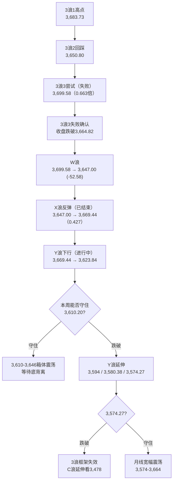
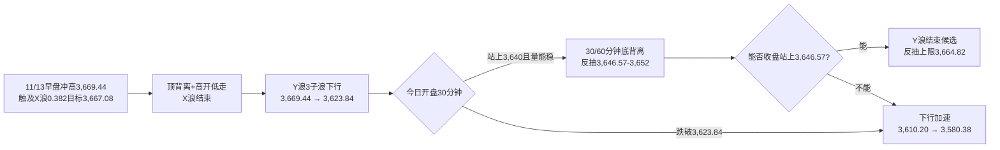

# A股晨报 - 2026年11月16日

> 数据截至：2026-11-16 09:15（北京时间）
> 编制：A股分析师AI代理
> 今日为周一（第47周首个交易日），交易日照常开市
> 基准：11/13晚报（复盘）+《2026年第46周A股运行规律分析》（11/15）

---

## 一、昨日晚报复盘要点回顾

### 1. 昨日判断回顾（11/13晚报，以11/13晨报为基准）

| 维度 | 准确率 | 说明 |
|------|--------|------|
| 趋势判断 | **0%（0/1）** | 预测"修复性震荡、重心上移"，实际高开低走-0.59%，跌破3,646.57 |
| 点位预测 | **33.3%（1/3）** | 强压力3,683.73✓（最高3,669.44未触及）；区间✗；强支撑3,646.57✗ |
| 板块预判 | **71.4%（5/7）** | 油服✓、银行红利✓、光模块CPO✓、贵金属✓、传媒✓；半导体设备✗、存储/先进封装✗ |
| 成交量 | **0%（0/1）** | 预测1.80-2.00万亿，实际1.67万亿（缩量约2,780亿） |
| **综合** | **31.4%** | 30%×0 + 30%×33.3 + 30%×71.4 + 10%×0 |
| 波浪分析 | **约85%** | "X浪0.382目标3,667.08"（实际高3,669.44）、"收盘破3,646.57→Y浪下看3,634/3,621"（实际收3,634.35、低3,623.84）均兑现 |

### 2. 关键偏差及原因

- **偏差1（趋势定性）**：把"X浪反抽"误判为"修复性震荡"，忽略X浪本身是减仓窗口；10月社融/信贷双弱对风险偏好的压制被低估。
- **偏差2（电子内部）**：把"中芯业绩+国产替代"与"电子统一资金池"割裂；电子主力净流出214.18亿、通信-4.97%，设备无法独立。
- **偏差3（量能）**：连续第5日误判；"周五+数据公布前"的三重观望未纳入，缩量2,780亿。
- **偏差4（板块内部）**：传媒定性"看跌"但影视院线逆势涨停潮，属"指数跌、题材脉冲"的宽度误读。

### 3. 沉淀的规则/检查项（今日必须应用）

1. **X浪单日触及0.382目标后回落且收盘破前低 → 按"X浪结束、Y浪确认"，不等第二个反抽日**（11/13已兑现）。
2. **电子行业主力净流出>100亿 → 半导体设备/材料不得独立看多，按"补跌"处理**（11/13：-214.18亿）。
3. **周五叠加数据公布日，量能下移至前日85%-95%**；"缩量下跌"按"存量博弈"而非"惜售"。
4. **"社融/信贷弱+M1超预期"→银行/红利占优、成长承压、指数偏弱**，非全面risk-on。
5. **假突破周后次周基准情景为"箱体下沿（3,610.20）争夺"**，反抽上限为被跌破的颈线3,664.82，不预设V型反转（第46周周报）。
6. **"跌停>涨停+封板率61%+宽度13.7%+连板高度下降"四项同现=情绪退潮确认，指数补跌通常还有1-2日**。

### 4. 对今日分析的启示

- **风险点**：英伟达FY27Q3财报（北京时间11/18 05:20）前，算力链难有趋势性行情；今晨韩国KOSPI跌超2%、SK海力士跌逾4%，**亚太科技再度领跌，A股半导体/存储开盘承压**。
- **逻辑调整**：由"X浪反弹"框架切换为"**Y浪下行未完成、箱体下沿防守**"；不再以"超卖"作为抄底依据，须以收盘价+量能确认。
- **正向变量**：A50期指今晨翻红（+0.04%）、央行11/16缩量续作6个月买断式逆回购、证监会"深化稳市长效机制"表态、银行/红利趋势未破——**指数下有政策承接，深跌空间受限**。

---

## 二、隔夜市场动态（11月13日收盘至11月16日09:15）

### 1. 美股市场（11月13日收盘）

| 指数 | 收盘 | 涨跌幅 | 涨跌点 |
|------|------|--------|--------|
| 道琼斯工业指数 | 52,347.55 | **+0.10%** | +50.46 |
| 标普500 | 7,561.67 | **-0.40%** | -30.73 |
| 纳斯达克综合指数 | 25,136.00 | **-0.91%** | -229.82 |

- **分化加剧**：道指靠权重收红，纳指连续走弱；**英伟达再跌超2%**（CEO更替事件后第二个交易日），闪迪跌超5%，特斯拉跌超1%，谷歌、亚马逊小幅下跌；Meta涨超2%，苹果、微软小幅上涨。
- **费城半导体指数延续弱势**，AI硬件"杀估值"未结束；中概股涨跌不一（爱奇艺跌超3%）。
- **周线维度**：美股三大指数上周整体收跌，**纳指跌幅居前**，"高估值+加息预期+AI治理"三重压制仍在。

### 2. 欧洲/亚太市场

| 市场 | 收盘/最新 | 涨跌幅 |
|------|-----------|--------|
| 德国DAX | —（周五收盘） | **+0.57%** |
| 法国CAC40 | 8,361附近 | **+0.43%** |
| 英国富时100 | 10,863.09 | **+0.25%** |
| 恒生指数（11/13） | 23,637.60 | **-1.55%** |
| 恒生科技（11/13） | 3,813.19 | **-3.02%** |

**今晨亚太（11/16开盘）**：
- **韩国KOSPI跌超2%**（报5,182.53点），**SK海力士跌逾4%、三星电子跌超2%**；
- **富时中国A50期指**：上一交易日夜盘收涨0.01%，今晨高开，09:00 **+0.04%**。

> **关键分歧**：A50期指平稳 vs 韩国科技股重挫。前者反映"政策托底+权重护盘"，后者反映"存储/算力链继续杀估值"。**A股今日大概率呈现"指数抗跌、科技补跌"的结构**，与11/13的"权重护盘、成长杀跌"同构。

### 3. 大宗商品

| 品种 | 收盘（11/13） | 日涨跌 | 周涨跌 |
|------|--------------|--------|--------|
| WTI原油（主力） | **88.92美元/桶** | **+0.20%** | **-2.10%** |
| 布伦特原油（主力） | **96.08美元/桶** | **+0.27%** | **-2.28%** |
| COMEX黄金（主力） | **3,887.6美元/盎司** | **+0.15%** | **-3.95%** |
| COMEX白银 | 弱势整理 | — | **-3.16%** |

- **原油**：周五小幅收涨但周线两连跌，霍尔木兹复航谈判推进使地缘溢价持续回吐；**A股石油石化仅具"低估值+高股息"防御属性，不再是地缘进攻品种**。
- **黄金**：周线暴跌近4%，美元与美债收益率双升压制；金价虽在3,900下方企稳，但**趋势未修复，贵金属板块继续回避**。
- **铜等工业金属**：未取得可靠收盘数据，暂不作方向判断；若今日盘中铜价走弱，将进一步压制有色。

### 4. 汇率与利率

| 项目 | 数值 | 变动/说明 |
|------|------|-----------|
| 美元指数 | 约103.4 | 接近19个月高位，压制非美资产 |
| 美债10年期收益率 | **5.103%** | 高位运行，对高估值成长构成中期压制 |
| 人民币中间价 | **6.7152**（11/13） | 较前值升值22bp |
| 在岸人民币 | 约6.67 | 出口高增形成结汇支撑 |

- **周末重磅**：**央行上调金融机构外汇存款准备金率2个百分点（4%→6%），11月15日起生效**。这是近五年首次上调该工具，属"前瞻性、逆周期预期管理"，意在**遏制人民币过快升值、防范单边一致性预期**，并非改变汇率方向。
- **传导**：外汇流动性收紧→人民币升值斜率放缓→**利好出口链（家电、机械、纺服）、利空人民币升值受益链（航空、造纸）**；对A股整体偏中性，但会削弱"外资单边流入"的预期。

### 5. 重要海外事件

1. **英伟达FY27Q3财报**：北京时间**11/18 05:20**公布，为全周最大变盘点；财报前算力链难有趋势性行情。
2. **美联储10月会议纪要**：11/19公布，12月加息25bp/50bp路径定调；当前10Y收益率5.10%已部分定价。
3. **美联储主席沃什**：11/17旧金山论坛讲话（AI与就业），关注对加息路径的表述。
4. **AI监管**：英伟达治理事件后续（临时CEO正式人选、美国国会审查）仍有不确定性。

---

## 三、今日关注事项

### 1. 重要数据发布（按时间排序）

| 时间（北京时间） | 数据/事件 | 预期 | 前值 |
|------------------|-----------|------|------|
| **10:00** | **10月规模以上工业增加值同比** | **+5.3%** | +5.5% |
| **10:00** | **10月社会消费品零售总额同比** | **+0.8%** | +1.1% |
| **10:00** | **1-10月固定资产投资同比** | **-7.0%** | -7.2% |
| 09:30 | 70城房价（10月） | — | — |
| 全天 | 央行6个月买断式逆回购续作（缩量） | — | — |

> **今日最重要的"靴子"是10:00国新办发布会**：市场预期工业增加值、社零双双回落（社零仅+0.8%），若数据**低于预期**，"弱数据→宽货币"交易将继续利好银行/红利、压制顺周期与成长；若**好于预期**，则顺周期（建材、家电、消费）存在修复窗口。**开盘半小时不宜重仓，等10:00数据落地后再决策**。

### 2. 政策/监管动态

- **央行**：外汇存款准备金率11/15起由4%上调至6%（逆周期稳汇率）；11/16缩量续作6个月买断式逆回购，流动性"合理充裕"基调未变。
- **证监会**：主席吴清11/14在2026中国资本市场学术年会表示，A股总市值突破100万亿元，将**"进一步深化市场稳定长效机制研究，系统构建稳的机制、稳的力量、稳的生态"**——政策底仍在，构成3,580-3,610区域承接。
- **产业**：**第三代半导体论坛11/16-19在苏州举行**；神州半导体IPO上会——半导体设备/材料存在事件催化，但需资金面配合。

### 3. 公司公告

- **回购/增持延续**：东方盛虹（20亿-40亿增持）、复旦微电（A+H回购）、联讯仪器、肯特催化等，产业资本在调整中承接。
- **限售解禁**：永安林业（000663）211.04万股、华统股份（002840）537.63万股于11/16解禁，**规模很小，对指数无实质影响**。
- **新股申购**：以交易所公告为准，今日无大规模申购。

### 4. 其他关注

- **本周日历**：11/17 沃什讲话；**11/18 05:20 英伟达财报**；11/19 美联储10月纪要；11/20 周线收盘+恒指季检。
- **券商策略**：十大券商一周策略主流观点为"**市场仍处反弹格局，把握国产替代窗口**"；中信证券提示"小微盘出清过程可能刚刚开始"——**与"回避高位微盘"的判断一致**。

---

## 四、板块与个股分析（结合昨日复盘）

### 1. 基于昨日复盘结论的板块调整

| 昨日判断 | 今日调整 | 依据 |
|---------|---------|------|
| 半导体设备/材料（看涨，已证伪） | **下调为"观察"，不主动加仓** | 规则2：电子主力净流出214亿，设备须同步补跌；今晨SK海力士-4% |
| 银行/红利（看涨） | **维持看涨，作为底仓** | 弱数据→宽货币+年末考核+稳市机制，五家城商行创新高 |
| 石油石化/油服（看涨） | **降级为"防御持有"** | 油价周线-2.10%，地缘溢价回吐，仅剩高股息逻辑 |
| 光模块/CPO/算力硬件（看跌） | **维持看跌，反弹减仓** | 英伟达财报前不确定性最大，今晨亚太科技再挫 |
| 贵金属（看跌） | **维持看跌** | 黄金周线-3.95%，实际利率5.10%压制 |
| 影视院线（昨日逆势） | **不追高** | 纯题材脉冲，退潮期持续性差 |

### 2. 隔夜信息驱动的板块机会

**受益板块**：
1. **银行/红利（公用事业、公路铁路）**：社融弱+M1改善+年底机构考核，"类固收"抱团首选；
2. **食品饮料/家电**：必选消费防御+出口链受益于"人民币升值斜率放缓"（外汇存款准备金率上调）；
3. **煤炭/石油石化**：PPI同比5.7%高位+冬季用能，高股息防御；
4. **农业/种植业**：低位+粮食安全，退潮期相对占优；
5. **出口链（家电、机械、纺服）**：汇率政策抑制单边升值，出口企业汇兑压力缓解。

**受损板块**：
1. **光模块/CPO/算力硬件**：英伟达财报前+今晨SK海力士-4%，反抽即减；
2. **半导体设备/存储**：电子资金池仍在流出，事件催化难敌资金面；
3. **贵金属**：金价周线大跌，趋势未修复；
4. **航空/造纸**：人民币升值预期降温，汇兑与进口成本逻辑弱化；
5. **高位连板/微盘**：退潮确认+中信提示"小微盘出清刚开始"。

### 3. 重点关注个股（仅作跟踪，不构成推荐）

- **江苏银行/南京银行/成都银行**：城商行龙头创历史新高，红利风格核心；回踩5日线可跟踪，不追高。
- **中国神华/陕西煤业**：高股息+冬季用能，防御属性强。
- **中芯国际（688981）**：Q3净利+87.6%但利好已兑现，关注110元得失；**电子主力未转净流入前不参与**。
- **北方华创/中微公司**：第三代半导体论坛催化，但须"电子板块主力净流入>0"才可试错。
- **中际旭创/新易盛/天孚通信**：反抽为减仓窗口，不作抄底标的。

---

## 五、波浪结构多周期分析

### 1. 月K线波浪分析

- **当前波浪位置**：大级别第3浪启动失败后的**3浪2扩张（W-X-Y）调整**，月线"三连阳"框架受考验。
- **浪型结构描述**：11月开3,614.13 → 低3,580.38 → 高3,699.58 → 现3,634.35（月内+0.98%）；月K暂为"带长上影小阳"，上影65.23点为实体的3.2倍，**连续第二个月"上影显著长于实体"**，3,700上方抛压确认。
- **关键目标位**：上方3,646.57（得而复失）→3,664.82（颈线）→3,699.58；下方3,623.84→3,621（0.382回撤）→3,610.20（结构失效线）→3,580.38→3,574.27。
- **验证条件**：月线收盘守住3,610.20，"3浪2扩张"框架不变；**收盘跌破3,580.38，月线转为"2浪扩张平台/下跌推动"**，下看3,478/3,443；重新站上3,664.82且月成交放大，才恢复3浪3计数。

### 2. 周K线波浪分析

- **当前波浪位置**：第46周（11/9-11/13）"反转确认"失败，**假突破周成立**；第47周进入"箱体下沿争夺"。
- **浪型结构描述**：上周开3,659.02 → 高3,699.58 → 低3,623.84 → 收3,634.35（周-0.41%），周K"长上影小阴"，与上周"长下影小阳"构成"上影反包"；全周未收复颈线3,664.82，也未站上5周均线（约3,682）。
- **关键目标位**：上方3,646.57→3,664.82→3,682（5周线）；下方3,623.84→3,621→3,610.20→3,580.38。
- **验证条件**：周线反转确认仍为"**收盘站上3,664.82且周成交≥9万亿**"；本周若收在3,610.20上方，仍属"3,610-3,664箱体震荡"；收盘跌破3,610.20则箱体下沿失守。

### 3. 日K线波浪分析

- **当前波浪位置**：**W-X-Y扩张调整的Y浪下行段**，X浪已在3,669.44结束，Y浪进行中。
- **浪型结构描述**：W浪 3,699.58→3,647.00（-52.58点）→ X浪 3,647.00→3,669.44（+22.44点，0.427回撤，触及0.382目标3,667.08）→ **Y浪 3,669.44→3,623.84（-45.60点，第3子浪）**；周五收3,634.35，已跌破3,646.57第一防线。
- **关键目标位**：Y浪目标 **3,621（0.618回撤）/3,616.9（1.0×W）/3,610.20（结构失效线）**；若破3,610.20，下看3,594（M头量度）/3,580.38/3,574.27；上方反抽压力3,640→3,646.57→3,652。
- **验证条件**：**收盘跌破3,610.20 → 3浪框架失效，回退2浪扩张平台**；若3个交易日内收盘重回3,646.57上方且量能≥1.8万亿，则Y浪失败、X浪延伸至3,664.82-3,673（但按规则，反抽不得高于X浪高点3,669.44）。

### 4. 60分钟K线波浪分析

- **当前波浪位置**：Y浪内部的**第3子浪末端**，MACD零轴下方死叉、绿柱放大。
- **浪型结构描述**：3,669.44形成60分钟顶背离后连续阴线，下探3,623.84，尾盘弱反抽3,634.35；**60分钟MACD绿柱未收敛、KDJ低位钝化（J<15），底背离尚未形成**。自11/12高点3,699.58起的下降压力线今日约在3,640-3,646。
- **关键目标位**：下方3,623.84→3,616.9→3,610.20；上方3,640→3,646.57（反抽第一压力）。
- **验证条件**：**60分钟收盘站上3,646.57且MACD金叉，才确认Y浪结束**；若绿柱继续放大并跌破3,610.20，则下行延伸至3,580.38。

### 5. 30分钟K线波浪分析

- **当前波浪位置**：Y浪第3子浪末端，**超卖但底背离未确认**。
- **浪型结构描述**：上周五午后连续8根30分钟阴线，最低3,623.84；30分钟RSI自20下方回升、MACD绿柱尾盘缩短，具备技术性反抽条件，但**周五缩量2,780亿，属抛压衰减而非恐慌出清**，反抽力度弱。
- **关键目标位**：上方3,640→3,646.57→3,652；下方3,623.84→3,616.9→3,610.20。
- **验证条件**：**今日开盘30分钟站上3,640且量能不低于上周五同期 → 30分钟底背离成立，反抽3,646.57-3,652**；若直接跌破3,623.84，则超卖失效、下行加速至3,610.20。

### 6. 波浪图（Mermaid绘制）

**日K线波浪结构图**

**60分钟波浪结构图**

### 7. 波浪理论综合判断

- **多周期共振状态**：月线中性偏多（★★★，长上影）、周线偏弱（★★，假突破周）、日线空（★☆，Y浪下行）、60分钟空（★，MACD死叉）、30分钟超卖（★☆，底背离未确认）——**"中长周期由多转中性、短周期向下共振"**，与11/13基本一致，尚无改善。
- **当前操作级别**：**日线级别防守、30/60分钟仅做反抽不做趋势**；3,610.20未失守前按"箱体下沿争夺"处理，失守则降为观望。
- **后续演变路径**：
  - **基础路径（45%）**：3,610-3,650弱势震荡，早盘下探3,621/3,616.9后企稳，收3,618-3,640，量能1.60-1.75万亿；
  - **偏弱路径（35%）**：数据不及预期+亚太科技二次杀跌，收盘跌破3,610.20，下看3,594/3,580.38；
  - **偏强路径（20%）**：数据超预期+红利护盘+电子资金回流，收复3,646.57→3,652，但难一次性收复3,664.82。
- **关键拐点信号**：**止跌信号=收盘站上3,646.57且30分钟底背离+量能≥1.8万亿**；**转弱升级=收盘<3,610.20**；**结构失效=收盘<3,580.38**；**反转确认=收盘≥3,664.82**。
- **风险提示**：W-X-Y计数主观性较强，Y浪可能以"3-3-5"或"5-3-5"展开；英伟达财报前若海外AI链继续下跌，Y浪可能直接延伸至3,574.27，**不宜以"超卖"作为抄底依据，必须以收盘价确认**。

---

## 六、今日核心判断

### 1. 趋势判断

- **上证指数：【震荡偏弱】**
- **预测区间：3,605点 - 3,650点**
- **核心逻辑**：周线假突破+日线Y浪下行+60分钟无底背离，技术面偏空；今晨韩国KOSPI跌超2%、SK海力士跌逾4%，算力链继续承压；但A50期指翻红、央行流动性呵护、证监会稳市表态，且银行/红利趋势未破，**指数呈"权重护盘、成长补跌、下探3,610-3,621后企稳"的箱体下沿争夺格局**。10:00经济数据是日内方向的关键变量。

### 2. 关键点位

- **强支撑位：3,610.20点**（依据：2浪扩张低点/结构失效线，收盘跌破则3浪框架失效，下看3,594/3,580.38）
- **弱支撑位：3,621点**（依据：月线0.382回撤+上周五低点3,623.84邻近，短线第一道防线）
- **强压力位：3,646.57点**（依据：被跌破的第一防线+11/12低点，反抽第一压力，收复需量能≥1.8万亿）
- **弱压力位：3,664.82点**（依据：双底颈线/周线反转确认线，本周得而复失，未"3日站稳"前只作压力）

### 3. 板块预判

- **看涨板块**：
  1. **银行/红利**（逻辑：弱数据→宽货币+年末考核+稳市机制，五家城商行创新高，趋势未破）；
  2. **食品饮料/家电**（逻辑：必选消费防御+汇率政策放缓升值利好出口链）；
  3. **煤炭/石油石化**（逻辑：PPI同比5.7%高位+冬季用能，高股息防御）；
  4. **农业/种植业**（逻辑：低位+粮食安全，退潮期相对占优）。
- **看跌板块**：
  1. **光模块/CPO/算力硬件**（逻辑：英伟达财报前+今晨SK海力士-4%，反抽即减）；
  2. **半导体设备/存储**（逻辑：电子主力连续净流出，事件催化难敌资金面）；
  3. **贵金属**（逻辑：黄金周线-3.95%，美债10Y 5.10%压制）。
- **风险板块**：**创业板高β（锂电/光伏/机器人）**——创业板指若失守2,391.65将指向2,350；**高位连板/微盘**——退潮确认+中信提示"小微盘出清刚开始"；**航空/造纸**——人民币升值预期降温。

### 4. 资金面判断

- **北向资金预期**：交易所净额不披露，无法直接验证；间接指标中性偏弱——美元指数103.4高位、外汇存款准备金率上调削弱单边升值预期，预计**净流出0-40亿元**（幅度不可量化）。
- **成交量预期：【平量】**，预计 **1.60-1.78万亿**（上周五1.67万亿）。周一+数据公布日，量能难以放大；若10:00数据超预期且顺周期放量，上限可看1.85万亿；若跌破3,610.20，恐慌盘或使量能放大至1.8万亿以上。
- **补充**：上周全周主力净流出507.66亿，"前流入后流出"结构说明周初流入为事件驱动而非趋势增量；**反抽确认须"单日主力净流入>200亿+成交≥1.8万亿"**。南向资金上周五净买入23.33亿港元，港股配置盘仍在。

### 5. 风险预警（按优先级排序）

- **高风险**：**英伟达FY27Q3财报（11/18 05:20）前的算力链二次杀跌**——今晨KOSPI跌超2%、SK海力士跌逾4%，A股光模块/CPO/存储开盘承压，且财报前无趋势性机会。
- **中风险**：**10:00 10月经济数据不及预期**（社零预期仅+0.8%、工业增加值+5.3%），若全面低于预期，"弱数据"交易可能从"宽货币利好红利"转为"衰退担忧"，顺周期与创业板承压；**外汇存款准备金率上调**引发人民币双向波动、外资流入预期降温；**量能连续3日<1.6万亿**则反弹夭折，下探3,580。
- **中风险**：**创业板2,391.65/科创50 1,250**若同步失守，成长风格二次探底，指数难独立。
- **低风险**：今日解禁规模很小（永安林业211万股、华统股份538万股）；央行流动性呵护、证监会稳市表态构成3,580-3,610区域承接。

### 6. 昨日复盘规则应用

- **应用规则1（X浪单日结束）**：不再期待"第二个反抽日"，反抽3,646.57-3,652即减仓，不按"V型反转"加仓。
- **应用规则2（电子净流出>100亿→设备补跌）**：半导体设备/材料今日不主动加仓，须等"电子行业主力净流入>0"。
- **应用规则3（周五+数据日量能85%-95%）**：本周一量能基准取上周五的95%-105%，即1.60-1.75万亿，不预设放量。
- **应用规则4（弱社融+M1改善）**：银行/红利/食品饮料维持相对占优，成长承压，不做全面risk-on。
- **应用规则5（假突破周→箱体下沿争夺）**：今日基准情景为"3,610-3,646箱体"，不预设V型反转，反抽上限3,664.82。
- **应用规则6（情绪退潮四项）**：跌停>涨停、封板率61%、宽度13.7%、连板仅7只，**指数补跌通常还有1-2日**，今日不抢反弹。

---

## 七、投资策略建议（分短线+中线）

### 1. 短线策略（1-3个交易日）

- **适用场景**：日K线Y浪下行+60分钟MACD死叉+30分钟超卖，属"下跌中继/箱体下沿"。
- **短线仓位：5%**（若条件全部满足，最高可至10%）
- **买入条件**：
  1. **10:00数据落地后**，上证守住3,621且**开盘30分钟站上3,640**、量能不低于上周五同期，可轻仓试错（≤5%）；
  2. 银行/红利放量走强（板块涨幅>1%、主力净流入），作为防御性参与；
  3. **低开>1%（跌破3,598）不抄底**；高开>0.8%不追。
- **卖出条件**：反抽至**3,646.57-3,652**不放量即减仓；触及3,652滞涨即止盈。
- **止损位**：**收盘跌破3,610.20**清短线；个股跌幅>5%止损。
- **短线标的**：
  1. **城商行/大行**（江苏银行、南京银行、工商银行，逻辑：红利抱团+稳市护盘）；
  2. **煤炭/公用事业**（中国神华、长江电力，逻辑：高股息防御+冬季用能）；
  3. **家电**（美的集团、海尔智家，逻辑：出口链+汇率政策放缓升值）。

### 2. 中线策略（1-4周）

- **适用场景**：周K线假突破后"箱体下沿争夺"，3浪2扩张（W-X-Y）的Y浪末段。
- **中线仓位：15%**
- **方向判断：【防守】**（不加仓，反弹至3,646.57-3,652减仓）
- **目标区间**：上证指数 **3,610点 - 3,664点**（下沿为结构失效线，上沿为颈线）
- **中线布局板块**：
  1. **银行/红利**（逻辑：弱数据+宽货币+年末考核，组合压舱石）；
  2. **食品饮料/家电**（逻辑：必选消费+出口链，防御属性）；
  3. **石油石化/煤炭**（逻辑：高股息+PPI高位，仅作对冲）。
- **止盈条件**：指数到达3,664点或波段涨幅达到5%。
- **止损条件**：**收盘跌破3,610.20**降至10%以下；**收盘跌破3,574.27**清短线、中线降至5%。

### 3. 仓位分配总览

| 策略类型 | 仓位比例 | 方向 | 重点板块 |
|---------|---------|------|---------|
| 短线 | 5% | 观望/轻仓试错 | 城商行、煤炭公用、家电 |
| 中线 | 15% | 防守 | 银行红利、食品饮料、石油石化 |
| 现金 | 80% | — | — |

### 4. 与昨日策略对比

- **短线仓位调整**：维持5%（不变）。原因：30分钟超卖但底背离未确认，且10:00数据公布前不宜提高仓位；条件满足时最高可至10%。
- **中线仓位调整**：维持15%（不变）。原因：3,610.20结构失效线尚未跌破，暂不恐慌清仓；但Y浪未完成，不加仓。
- **板块调整**：
  - **增配**煤炭/公用事业（高股息+冬季用能）、家电（汇率政策利好出口链）；
  - **减配**半导体设备（规则：电子主力净流出214亿，设备须补跌）、石油石化（油价周线-2.1%，降级为防御）；
  - **维持**银行/红利底仓；**回避**光模块/CPO/算力硬件、贵金属、高位连板、航空/造纸。

---

## 八、信息来源

1. **官方数据来源**：上海证券交易所/深圳证券交易所（成交与公告）、中国人民银行（中间价、公开市场操作、外汇存款准备金率）、国家统计局（10月经济数据发布会）、中国证监会（吴清讲话）、美国劳工统计局（10月PPI）、美国财政部（国债收益率）
2. **权威财经媒体**：新华社（美股收盘）、中国证券报·中证网、上海证券报·中国证券网（外汇存款准备金率、十大券商策略）、证券时报（A50期指、限售解禁）、第一财经、财联社（A50期指、韩国KOSPI）、央视财经
3. **数据平台**：东方财富（全球行情、板块资金）、同花顺（早盘视点）、新浪财经（黄金、油价、汇率）、Wind（解禁数据）
4. **研究机构**：十大券商一周策略（中信证券、招商证券等）、CME FedWatch（加息概率）、粤开证券（市场日报）
5. **数据截止时间**：**2026-11-16 09:15（北京时间）**；美股/欧股为11月13日收盘，亚太为11月16日开盘，A50期指为09:00报价；10月经济数据尚未公布，为市场预期值

---

> **免责声明**：本报告为AI辅助生成的开盘前分析，所有点位、概率、目标价均为基于公开数据的技术推演，不构成投资建议。市场有风险，决策需独立。
