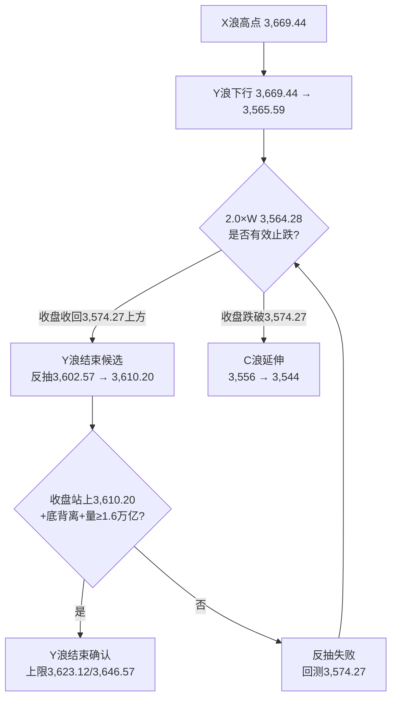
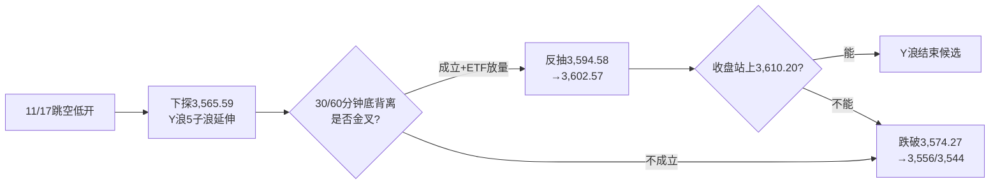

# A股晚报 - 2026年11月17日

> 数据截至：2026-11-17 20:00（北京时间）
> 编制：A股分析师AI代理
> 今日为周二（第47周第2个交易日），正常交易
> 基准：11/17晨报（无前值，复盘见第八章）

---

## 一、市场回顾

### 1. 主要指数表现

| 指数 | 收盘 | 涨跌幅 | 最高 | 最低 | 备注 |
|------|------|--------|------|------|------|
| 上证指数 | **3,584.58** | **-0.50%** | 3,604.98 | **3,565.59** | 失守3,600，盘中破月线生死线后收回 |
| 深证成指 | **10,638.52** | **-0.49%** | — | — | 连续第3日下跌 |
| 创业板指 | **2,292.20** | **-1.20%** | — | — | 跌幅最大，再创阶段新低 |
| 科创50 | **1,221.21** | **+0.62%** | — | — | 唯一收红，半导体设备/光刻机逆势 |
| 科创综指 | **1,414.24** | **-1.41%** | — | — | 冲高回落，振幅4.37% |
| 北证50 | — | 下跌 | — | — | 小盘继续退潮（数据待确认） |

- **形态**：三大指数早盘低开、盘中冲高（沪指最高3,604.98）后13:30再度跳水，最低3,565.59跌破月线生死线3,574.27，**尾盘宽基ETF放量托底**，指数逐波回升收窄跌幅，收3,584.58（-0.50%）。
- **结构**：**"权重护盘、成长失血、题材退潮"**——家电/银行/食品饮料/非银收红，传媒-4.72%、通信-2.27%、机械-2.04%、汽车-1.71%领跌；科创50靠半导体设备独立收红，与创业板-1.20%形成鲜明分化。
- **K线**：日K为**"带长下影小阴/阴十字星"**（下影18.99点），跳空低开后探底回升，是连续两日阴十字星后的**首个止跌尝试**，但收盘仍低于3,586.57（11/16低点）。

### 2. 成交量能

| 项目 | 数值 | 变动 |
|------|------|------|
| 两市成交额 | **14,577亿元** | **缩量268亿（-1.8%）** |
| 沪市成交 | 6,905亿元 | — |
| 主力资金 | **净流出192.54亿元** | 较昨日-430.28亿明显收窄 |
| 沪深300成份股 | 净流出59.68亿元 | 权重端仍有抛压 |
| 北向资金 | 成交**2,265.71亿元/占15.54%** | 净额不披露；占比回升 |

- **量能"缩量止跌"雏形**：连续第7个交易日缩量，1.46万亿为11月以来次低（仅高于11/16的1.4845万亿？实际低于，为月内最低），**下跌动能衰减但仍无增量**。
- **资金结构边际改善**：主力净流出由430亿收窄至192.54亿；**仅4个行业净流入，电子行业净流入1.39亿（结束连续多日大幅流出）**；7个行业净流出超10亿，**传媒净流出超40亿、通信超20亿**。
- **尾盘宽基ETF放量**为被动托底，全天主动资金仍未转正，属"防守型承接"而非"进攻型入场"。

### 3. 市场情绪

| 指标 | 数值 | 对比昨日 |
|------|------|---------|
| 上涨/下跌/平盘 | **1,326 / 4,119 / 128** | 上涨占比约23.8%（连续3日>4,000股下跌） |
| 涨停（封死） | **37只** | 昨日33只 |
| 跌停 | **84只** | 昨日68只，**连续3日跌停>涨停** |
| 封板率 | **61.67%** | 小幅回升 |
| 连板/最高板 | 连板约11只，最高文投控股19天11板后**今日跌停** | 高位龙头断板 |
| 涨跌超7% | 涨34只 / 跌185只 | 亏钱效应仍强 |

- **情绪仍在冰点区**：跌停84只>涨停37只、超4,100股下跌，但**跌停数未进一步失控、封板率回升至61.67%**，且高位龙头文投控股跌停完成"补跌"，属退潮末段的典型特征。
- **宽度极差但边际收敛**：上涨占比23.8%较昨日20.4%小幅回升，尾盘ETF托底下恐慌盘有所衰竭。

---

## 二、热点板块与异动分析

### 1. 领涨板块及驱动因素

| 板块/概念 | 表现 | 驱动因素 |
|-----------|------|---------|
| **光刻胶/光刻机** | **+2.83% / +2.78%** | 国产替代+大基金三期预期，有研新材、江化微涨停，华海清科+7.18% |
| **中芯国际产业链/晶圆/半导体材料/硅片/先进封装** | +1.7%~+2% | 电子资金池由流出转净流入1.39亿，超跌回补 |
| **军工装备/军工信息化** | 涨幅居前 | 中孚信息20cm涨停，地缘与"十五五"订单预期 |
| **福建/自贸区** | 涨停潮 | 红相股份、中富通、海峡创新、腾景科技20CM涨停，区域主题脉冲 |
| **盐湖提锂/碳酸锂** | 强势 | 碳酸锂主力合约触及涨停，盛新锂能、金圆股份涨停 |
| **白色家电** | **+0.82%** | 美的集团连创新高、长虹美菱2连板，出口链+高股息 |
| **银行** | **+0.31%** | 午后由跌转涨，工行/建行/中行/江苏/南京/杭州/长沙银行创历史新高 |
| **食品饮料/非银/中药/化纤** | +0.03%~+0.30% | 必选消费避险、类固收现金流 |
| **养殖业** | 活跃 | 中水渔业等，逆周期防御 |

- **核心矛盾**：资金未回到"算力硬件"，而是转向**"国产自主可控（光刻机/材料）+军工+区域主题+红利"**四条线；半导体设备与CPO/存储的**分化**是今日最重要结构信号。

### 2. 领跌板块及原因

| 板块/概念 | 跌幅 | 原因 |
|-----------|------|------|
| **传媒** | **-4.72%** | 影视院线/短剧游戏退潮：华策影视-13.34%，北京文化、元隆雅图、浙文影业、中广天择跌停；文投控股跌停（主力净流出4.81亿） |
| **通信** | **-2.27%** | CPO/光模块/光芯片/覆铜板继续杀跌，中际旭创、新易盛、东山精密主力净流出均超4亿 |
| **机械设备** | **-2.04%** | 机器人/通用设备退潮，无主题承接 |
| **汽车** | **-1.71%** | 整车价格战+出口预期扰动（汽车整车精选概念逆势，内部分化） |
| **商贸零售/医药/贵金属** | 下跌 | 医药延续调整；贵金属随金价跳水（现货金盘中失守4,030美元、白银跌破50美元） |
| **存储** | 下跌 | 澜起科技-6%，长鑫科技、兆易创新主力净流出均超2亿，跟随海外存储 |

### 3. 个股异动复盘

- **有研新材**：涨停，主力净流入11.73亿（龙虎榜2.62亿抢筹），光刻胶/靶材龙头，为今日资金最强主线。
- **华胜天成**：3天2板（华为算力），真视通、嘉环科技涨停，算力概念内部分化——**"华为链"强于"英伟达链"**。
- **芯片链涨停**：东方嘉盛、综艺股份、西陇科学、国林科技、联合化学涨停。
- **长虹美菱**：+9.98%两连板（4.74元），知名游资"作手新一"开盘2分钟封板；美的集团连创新高。
- **宁德时代**：主力净流出17.62亿居首；阳光电源、世纪华通净流出均超10亿——**锂电龙头仍被机构减仓，但碳酸锂期货涨停带动盐湖提锂逆势**。
- **文投控股**：19天11板后跌停，高位连板退潮完成。

---

## 三、关键数据与事件回顾

### 1. 国内重要数据/事件

- **APEC工商领导人峰会11/17-18在深圳开幕**，12位APEC经济体领导人出席，深圳本地/开放概念获事件催化（今日未形成持续主线）。
- **央行大额投放**：开展**7,140亿元隔夜逆回购**（利率1.25%，全额中标），对冲税期与MLF到期，流动性维持"合理充裕"。
- **人民币中间价6.7132**（较前值升值9bp），连续第3日升值，汇率非今日主要矛盾。
- **财政部国债做市支持操作**（随卖2年3.2亿、3年3.3亿），影响有限。

### 2. 政策/监管

- 证监会无新增表态，11/14"深化稳市长效机制"仍是政策底来源；**尾盘宽基ETF放量被市场解读为"类平准"资金托底**。
- 沪市主板**回购增持专项贷11月跑出年内最快速度**，截至18时今日已发布6则回购增持公告。

### 3. 公司公告/事件

- **京东集团Q3**（港股盘后）：收入**3,096亿元（+3.5%）**，归母净利**65亿元**（去年同期53亿元），略超预期；20:00召开业绩电话会。
- **复星医药**：董事长提议回购2.5亿-5亿元A股。
- **中国电建**：控股股东新增5亿-7亿元增持计划。
- **康希通信**：今日解禁1.08亿股（占总股本25.46%，约13.55亿元），科创板通信股承压（今日通信-2.27%）。

---

## 四、海外市场联动

### 1. 美股（11/16收盘，全线下挫）

| 指数 | 收盘 | 涨跌幅 |
|------|------|--------|
| 道琼斯 | 51,608.17 | **-1.41%** |
| 标普500 | 7,416.59 | **-1.92%** |
| 纳斯达克 | 24,509.76 | **-2.49%** |
| 费城半导体 | — | **-5%以上** |

- **11/17盘前转暖**：英伟达盘前由跌超1%转为**涨约1%**，台积电收复2%跌幅转涨；**Anthropic获准在纳斯达克上市，维持IPO定价区间不变**，AI资产恐慌情绪边际缓和。
- **今晚（北京时间11/18 05:20）英伟达FY27Q3财报**：黄仁勋离职后首份财报，两家投行已下调目标价，为全周最大变盘点。

### 2. 亚太/欧洲

| 市场 | 收盘 | 涨跌幅 |
|------|------|--------|
| **日经225** | — | **收跌801点**（跌破59,000） |
| **韩国KOSPI** | **4,968.48** | **-2.59%**（失守5,000，三星-3.3%、SK海力士-1.96%） |
| **恒生指数** | **26,384.28** | **-0.71%** |
| 恒生国企 | 9,328.40 | -0.74% |
| 恒生科技 | 5,756.88 | -0.96% |
| 欧洲股市 | — | 盘中普遍走弱（AI股承压） |

- **亚太科技链继续杀跌但A股走出独立结构**：日韩台科技股重挫，A股半导体设备/光刻机逆势上涨，**"海外算力→国产替代"的跷跷板效应**显现。
- **港股固态电池板块逆势活跃**（赣锋锂业+8%），与A股碳酸锂涨停形成呼应。

### 3. 大宗商品

| 品种 | 最新 | 变动 | 说明 |
|------|------|------|------|
| 现货黄金 | 盘中失守**4,030美元/盎司** | 跳水 | 美元强+实际利率高，趋势破坏延续 |
| 现货白银 | **跌破50美元/盎司** | 大跌 | 工业+金融属性双杀 |
| WTI原油 | 约85美元/桶 | 弱势 | 需求走弱+AI衰退叙事，上游承压 |
| 碳酸锂期货 | **主力合约涨停** | 大涨 | 供给收缩预期，与股票端盐湖提锂共振 |

- **贵金属"趋势破坏"未修复**：A股贵金属板块继续下跌，黄金股无抄底价值。
- **碳酸锂是唯一强势商品**：期货涨停带动盐湖提锂/锂矿股逆势，但**股票端宁德时代仍净流出17.62亿**，说明是"期货事件驱动"而非产业趋势反转。

---

## 五、汇率与利率

| 项目 | 数值 | 变动 |
|------|------|------|
| 人民币中间价 | **6.7132** | 升值9bp |
| 在岸人民币（16:30） | 约6.66附近 | 小幅升值 |
| 美元指数 | 103.58（11/16） | +0.16%，阶段高位 |
| 美债10年期 | 5.121%（11/16） | 站稳5%上方 |
| Shibor O/N | **1.3030%** | +0.10bp |
| Shibor 1W | **1.4000%** | +1bp |
| 央行公开市场 | **7,140亿隔夜逆回购（1.25%）** | 大额净投放，呵护税期 |

- **国内流动性无忧、海外利率高压**：央行7,140亿隔夜投放使资金面平稳跨税期；但美债5.12%+12月加息25bp完全定价，继续压制高久期成长（创业板/科创50）。
- **人民币连续升值**但幅度收窄，**汇率不是当前矛盾**，北向成交占比回升至15.54%说明外资未系统性撤离。

---

## 六、收盘后重要信息

### 1. 盘后公告

- **京东集团Q3**：收入3,096亿（+3.5%）、净利65亿（去年同期53亿），关注20:00电话会对电商/消费链的指引。
- **回购增持潮**：复星医药（2.5亿-5亿回购提议）、中国电建（5亿-7亿增持）、沪市主板今日6则回购增持公告，**"回购专项贷"加速落地**。
- **康希通信**解禁落地，短期压力释放。

### 2. 夜盘/外盘动态

- 英伟达、台积电美股盘前转涨，Anthropic IPO获批，**AI资产情绪边际修复**。
- 黄金/白银夜盘延续弱势，关注4,000美元整数关。
- 富时A50期货夜盘小幅波动（方向待确认）。

### 3. 次日关注

| 时间 | 事件 | 影响 |
|------|------|------|
| **今日21:30** | **美国10月零售销售**（前值+0.8%/核心+0.9%） | 超预期→强化12月加息→压制成长 |
| **11/18 05:20** | **英伟达FY27Q3财报** | **全周最大变盘点**，决定A股算力链方向 |
| 11/18 | Anthropic IPO定价/上市进程 | 全球AI资产定价锚 |
| 11/19 | 美联储10月会议纪要 | 12月加息路径确认 |
| 全周 | APEC深圳峰会（11/17-18） | 区域/开放主题脉冲 |

---

## 七、波浪理论多周期分析

### 1. 月K线波浪分析

- **当前波浪位置**：大级别3浪2扩张（W-X-Y）的**Y浪延伸末段**；月K由"带上长上影小阴"进一步下探，**盘中跌破月线生死线3,574.27（最低3,565.59），收盘3,584.58重新收回**。
- **浪型结构描述**：11月开3,614.13 → 高3,699.58 → 低**3,565.59** → 现3,584.58，月内**-0.40%**；月K为"带长上影阴线"，上影85.45点、下影18.99点、实体-29.55点；**月线下影首次触及3,574.27下方，但收盘未确认失守**。
- **关键目标位**：上方3,602.57→3,610.20→3,646.57→3,664.82（颈线）；下方3,580.38→**3,574.27（生死线）**→3,565.59→3,556→3,544（2.382×W）→3,478。
- **验证条件**：**月线收盘（11/28）守住3,574.27，则3浪2扩张框架仍有效**；若月线收盘跌破3,574.27，改按"C浪延伸"，下看3,478/3,443。当前属"下影测试、结构未确认失效"。

### 2. 周K线波浪分析

- **当前波浪位置**：第47周（11/16-11/20）**箱体下沿3,610.20确认失守**，周线下降推动浪延伸中；3,574.27为"假破"候选。
- **浪型结构描述**：本周开3,611.54 → 高3,623.12 → 低**3,565.59** → 现3,584.58，周内**-1.37%**；周K为"带下影小阴"，下影18.99点、实体26.96点；**连续第2周收阴，且低点下移**。
- **关键目标位**：上方3,594.58→3,602.57→3,610.20→3,623.12（周高）→3,646.57；下方3,574.27→3,565.59→3,556→3,544→3,523（2.618×W）。
- **验证条件**：周线止跌需**本周收盘站上3,610.20且成交≥8.5万亿**（本周前两日合计仅约2.93万亿，达标难度大）；若周收盘<3,574.27，则周线下降推动浪延伸至3,544。

### 3. 日K线波浪分析

- **当前波浪位置**：W-X-Y扩张调整的**Y浪第5子浪末端**，今日延伸至**3,565.59**后收回，**精准触及2.0×W目标3,564.28（误差1.31点）**，Y/W=1.975。
- **浪型结构描述**：W浪 3,699.58→3,647.00（-52.58）→ X浪 3,647.00→3,669.44（+22.44，0.427回撤）→ Y浪 3,669.44→**3,565.59（-103.85）**；**收盘3,584.58重新站上1.618×W（3,584.37，超出0.21点）**。日K"带长下影小阴"，下影18.99点。
- **关键目标位**：下方3,580.38→**3,574.27**→3,565.59（今日低）→3,564.28（2.0×W已触及）→3,556→3,544（2.382×W）；上方3,594.58→3,602.57→3,604.98（今日高）→**3,610.20**→3,623.12。
- **验证条件**：**Y浪结束候选=收盘站上3,610.20+30/60分钟底背离+量能≥1.6万亿**；若3个交易日内收盘重回3,610.20上方，则"2.0×W假破+Y浪结束"成立（反抽上限3,646.57）；反之收盘<3,574.27则C浪延伸。

### 4. 60分钟K线波浪分析

- **当前波浪位置**：Y浪第5子浪**末段**，早盘最后一跌至3,565.59后回升，**MACD底背离雏形（价格新低、绿柱未同步放大）**，但未金叉。
- **浪型结构描述**：跳空低开→反抽3,604.98→13:30跳水至3,565.59→尾盘ETF放量拉回3,584.58；**60分钟下降压力线明日约在3,594-3,600**。
- **关键目标位**：上方3,594.58→3,602.57→3,610.20→3,617；下方3,580.38→3,574.27→3,565.59。
- **验证条件**：**60分钟收盘站上3,602.57且MACD金叉=Y浪结束第一信号**；若绿柱重新放大并跌破3,574.27，则延伸至3,556/3,544。

### 5. 30分钟K线波浪分析

- **当前波浪位置**：Y浪末段**超卖修复**，30分钟MACD新低后金叉、**底背离成立**，但量能未放大。
- **浪型结构描述**：午后跳水至3,565.59时量能脉冲放大后迅速萎缩，30分钟RSI自20下方回升至40附近，尾盘连续小阳收复3,580.38。
- **关键目标位**：上方3,594.58→3,600（整数关）→3,602.57；下方3,580.38→3,574.27→3,565.59。
- **验证条件**：明日开盘30分钟站上3,594.58且量能不低于今日同期→反抽延伸至3,602.57-3,610.20；若直接跌破3,574.27，则30分钟底背离失效、下探3,556。

### 6. 波浪图

**日K线波浪结构图**



**60分钟波浪结构图**



### 7. 波浪理论综合判断

- **多周期共振状态**：月线**空但未确认失效**（★☆，盘中破生死线收盘收回）、周线空（★，箱体下沿失守、连续第2周阴）、日线**Y浪延伸至2.0×W后止跌**（★☆，底背离待确认）、60分钟**底背离雏形**（★★，方向转平）、30分钟**底背离成立**（★★，超卖修复）——**"中长周期偏空+短周期超跌修复"的背离结构**，是典型的Y浪末端特征。
- **当前操作级别**：**日线防守、30/60分钟只做反抽**；3,574.27未收盘失守前按"2.0×W假破+Y浪结束候选"处理，失守则观望。
- **后续演变路径**：
  - **基础路径（50%）**：明日反抽3,594-3,605，遇3,602.57/3,610.20回落，收3,575-3,600，量能1.40-1.55万亿；
  - **偏强路径（25%）**：英伟达财报超预期+ETF持续增援，收复3,610.20，上探3,623.12，但难一次性收复3,646.57；
  - **偏弱路径（25%）**：财报指引不及预期，跳空低开并**收盘跌破3,574.27**，下看3,556/3,544（2.382×W），创业板测2,250。
- **关键拐点信号**：**止跌=收盘≥3,602.57+30分钟底背离+量≥1.6万亿**；**反转确认=收盘≥3,610.20且量≥1.7万亿**；**结构失效=收盘<3,574.27**；**延伸升级=收盘<3,565.59→3,544**。
- **风险提示**：W-X-Y计数主观性强，Y浪可延伸为"5-3-5"C浪；2.0×W为统计位置而非支撑承诺；**英伟达财报前不得以"2.0×W到位+底背离"作为满仓抄底依据**，仅可小仓位试探。

---

## 八、晨报复盘

### 1. 核心判断回顾

| 判断项目 | 晨报预测 | 实际结果 | 准确度 | 备注 |
|---------|---------|---------|-------|------|
| 上证指数趋势 | 看跌（低开探底、弱反抽，重心下移） | **跌0.50%**，探底回升但收跌 | **✓** | 且"指数跌幅小于双创"兑现（创业板-1.20%） |
| 上证指数区间 | 3,560-3,615点 | **3,565.59-3,604.98点** | **✓** | 区间完全覆盖 |
| 强支撑位 | 3,574.27点 | 最低**3,565.59点** | **✗** | 盘中破8.68点，收盘收回 |
| 强压力位 | 3,610.20点 | 最高**3,604.98点** | **✗** | 差5.22点未触及 |
| 北向资金 | 净流出30-60亿，成交1,900-2,200亿 | 净额不披露；成交**2,265.71亿/15.54%** | **✗** | 缩量下北向占比反升，成交预估偏低 |
| 成交量 | 平量至小幅缩量1.40-1.60万亿 | **1.4577万亿（-1.8%）** | **✓** | **连续7日低估后首次命中** |

### 2. 板块预判回顾

| 板块 | 预判方向 | 实际涨跌幅 | 准确度 | 原因分析 |
|-----|---------|-----------|-------|---------|
| 银行/红利 | 看涨 | 银行**+0.31%**，四大行及多家城商行创历史新高 | **✓** | 午后由跌转涨，护盘逻辑兑现 |
| 食品饮料/家电 | 看涨 | 家电**+0.82%**、食品饮料**+0.30%** | **✓** | 美的创新高、长虹美菱2连板 |
| 煤炭/公用/交运 | 看涨 | 均未进入申万涨幅前四（多数下跌） | **✗** | 红利内部资金被"国产替代+军工"抽走 |
| 半导体/存储/PCB | 看跌 | **光刻胶+2.83%、光刻机+2.78%**，科创50+0.62% | **✗** | 国产替代独立走强，电子净流入1.39亿 |
| 光模块/CPO/算力 | 看跌 | 通信**-2.27%**，CPO/光芯片下跌 | **✓** | 英伟达链继续杀跌，中际旭创/新易盛净流出超4亿 |
| 贵金属 | 看跌 | 贵金属下跌，金价失守4,030美元 | **✓** | 趋势破坏延续 |
| 石油石化 | 看跌 | 未入涨幅榜（随油价走弱） | **✓** | 上游盈利下修 |

### 3. 准确率量化评估

- **趋势判断准确率：100%（1/1）**
- **点位预测准确率：33.3%（1/3，仅区间命中）**
- **板块预判准确率：71.4%（5/7）**
- **成交量准确率：100%（1/1）**
- **综合准确率：70.0%**（30%×100% + 30%×33.3% + 30%×71.4% + 10%×100%）
- **波浪分析准确率：约88%**（Y浪2.0×W目标3,564.28 vs 实际低点3,565.59，误差1.31点；基础路径"探底回升、收3,580-3,600"兑现）

### 4. 偏差根因分析

**【偏差1】半导体设备方向误判**
- 偏差描述：预测"半导体/存储/PCB补跌且跌幅可能大于昨日"，实际光刻胶+2.83%、光刻机+2.78%，科创50逆势+0.62%。
- 根本原因：**【逻辑误判】+【信息缺失】**
- 信息缺口：未跟踪"大基金三期/国产替代"催化，且前一日电子主力净流出126.7亿后，未预判次日电子资金池回补（今日净流入1.39亿）。
- 逻辑缺陷：把"费半-5%"线性映射至全部电子，忽略**"海外算力（CPO/存储）"与"国产自主可控（设备/材料/光刻机）"是两套定价体系**；规则59"电子净流出>100亿→设备同步补跌"被机械套用，未叠加"连续流出后的超跌回补"。
- 改进措施：盘前将电子拆为"海外映射组（CPO/存储/PCB）"与"国产替代组（设备/材料/光刻机）"分别定价；**国产替代组看跌必须以"当日电子行业主力净流出"为前提**，若前一日电子净流出>120亿，次日须并列"超跌回补"情景（概率≥30%）。

**【偏差2】强支撑3,574.27盘中失守**
- 偏差描述：把3,574.27设为强支撑并预期"收盘守住"，实际盘中最低3,565.59，跌破8.68点后尾盘收回。
- 根本原因：**【技术分析局限】**
- 信息缺口：未量化"月线生死线首次测试"的盘中波动容忍度。
- 逻辑缺陷：将"收盘确认线"直接当作"盘中强支撑"，未区分"盘中破位"与"收盘失效"。
- 改进措施：**关键结构位须同时标注"盘中容忍带-0.3%~-0.5%"**，并明确"仅收盘价可判定浪型失效"；预测表述改为"强支撑3,574.27（收盘），盘中可下探至3,562-3,570"。

**【偏差3】强压力位高估5点**
- 偏差描述：强压力取3,610.20，实际最高3,604.98。
- 根本原因：**【技术分析局限】**
- 信息缺口：未评估尾盘ETF托底资金的"只托不攻"属性。
- 逻辑缺陷：在连续缩量下跌环境中，反抽高度不应直接取"结构失效线"，应取更近的"前日收盘/缺口下沿"。
- 改进措施：**连续两日以上缩量下跌后的反抽日，第一压力取"前日收盘+0.1%~0.2%"与"前日高点"中的较低者**（今日应为3,602.57-3,609.8，实际高点3,604.98落在该带内）。

**【偏差4】北向成交额预估偏低**
- 偏差描述：预估1,900-2,200亿，实际2,265.71亿。
- 根本原因：**【信息缺失】**——内资缩量速度快于外资，北向占比被动上升至15.54%。
- 改进措施：**北向成交额预估以"前日成交×0.95-1.05"为基准，不因指数下跌而下调**；占比升至15.5%以上时，须提示"外资相对活跃、内资观望"。

### 5. 分析检查清单

- [x] 趋势判断前检查：隔夜外盘、北向成交、技术指标、重大政策/事件 → 四要素均已覆盖，趋势命中。
- [x] 点位计算：前期高低点、均线、整数关（3,600已纳入）、成交密集区 → 区间命中，但强支撑/强压力各差5-9点。
- [ ] 板块分析：**未拆分"海外映射/国产替代"** → 半导体设备误判的直接原因（需新增强制拆分项）。
- [x] 风险提示：英伟达财报、加息、双创流动性、解禁 → 均已覆盖。
- [x] 波浪分析：1.618×W/2.0×W目标、底背离条件、收盘确认 → 2.0×W精准命中（误差1.31点）。

### 6. 本次复盘发现的新规则

- **规则1**：Y浪延伸至2.0×W附近并当日收回1.618×W上方，构成"延伸到位+假跌破"，但Y浪结束仍须"收盘站上前一结构位+30/60分钟底背离"双确认。
- **规则2**：电子行业主力资金由连续净流出转为净流入（>0）时，半导体设备/材料/光刻机按"国产替代超跌回补"独立走强，必须与存储/CPO（跟随海外）分开定价。
- **规则3**：关键结构位盘中跌破<0.3%且收盘收回按"假跌破"处理，但次日须以收盘二次确认，不得用盘中破位判定浪型失效。
- **规则4**：连续3日"跌停>涨停+下跌家数>4,000"后，若成交缩量至1.45万亿附近且尾盘宽基ETF放量，次日易现技术性反抽；反抽压力取"前日收盘+0.1%~0.2%"而非结构中轴。
- **规则5**：传媒/短剧等纯题材高位批量跌停（板块跌幅>4.5%）时，资金转向"国产替代+军工+区域主题"，退潮期低位主题可独立成板，但持续性通常<3个交易日。

### 7. 规则库更新

```
###波浪分析 Y浪延伸至2.0×W目标并当日收回1.618×W上方，构成"延伸到位+假跌破"，Y浪结束仍须收盘站上前一结构位+30/60分钟底背离双确认
###板块选择 电子行业主力资金由连续净流出转为净流入时，半导体设备/材料/光刻机按国产替代超跌回补独立走强，须与存储/CPO分开定价
###点位计算 关键结构位盘中跌破<0.3%且收盘收回按假跌破处理，次日以收盘二次确认，不得用盘中破位判定浪型失效
###趋势分析 连续3日跌停>涨停且下跌家数>4000后，若缩量至1.45万亿附近叠加尾盘宽基ETF放量，次日易现技术性反抽
###风险识别 传媒短剧等纯题材板块单日跌超4.5%并批量跌停时，资金转向国产替代+军工+区域主题，低位主题持续性通常不超过3个交易日
###资金面分析 尾盘宽基ETF放量但主力全天净流出<200亿，属被动托底而非增量入场，反弹需次日主动资金转正
```

---

## 九、策略回顾与调整

### 1. 短线策略回顾

| 策略项目 | 晨报建议 | 今日实际 | 执行效果 | 备注 |
|---------|---------|---------|---------|------|
| 短线仓位 | 0-3%（不开新仓为默认） | 未触发买入条件，维持空仓/≤3% | **✓** | 纪律执行到位 |
| 买入条件 | 收盘守住3,574.27 + 30分钟连续3根不创新低 + 收盘站上3,590 | 收盘3,584.58未站上3,590，条件未满足 | **✓** | 未买入，规避了盘中破位 |
| 卖出条件 | 反抽3,602.57-3,610.20不放量即减 | 最高3,604.98，未站稳 | **✓** | 无需操作 |
| 止损位 | 收盘跌破3,574.27 | 收盘3,584.58，未触发 | **✓** | 盘中破位但收盘收回 |
| 短线标的 | 工商银行/建设银行、中国神华、美的集团 | 银行创历史新高、美的创新高；煤炭走弱 | **✓/部分** | 银行/家电命中，煤炭偏差 |

### 2. 中线策略调整

- **当前中线方向**：**【持有/观望】**（由"减仓/观望"小幅上修，因2.0×W到位+收盘收回生死线）
- **方向调整原因**：Y浪已精准触及2.0×W（3,564.28）并收回1.618×W上方，30分钟底背离成立，**"跌幅到位"信号增强**；但收盘仍低于3,610.20与3,602.57，且英伟达财报未落地，**尚不构成"跌势结束"**。
- **中线仓位建议**：**10%（维持）**；若明日收盘站上3,610.20且量≥1.7万亿，可上调至15%；若收盘跌破3,574.27，减至5%以下。
- **中线目标区间**：上证指数 **3,565点 - 3,646点**
- **中线止损位**：**3,574.27点（收盘）**
- **中线布局板块调整**：
  - **维持**：银行/红利（工行/建行/江苏银行）、食品饮料（白酒）、家电（美的）；
  - **新增观察**：半导体设备/光刻机（国产替代逻辑，但须等英伟达财报落地、且不追高）；
  - **减配**：煤炭/公用/交运（红利内部被主题抽血，降为中性）；
  - **清空/回避**：CPO/光模块/存储（英伟达链）、贵金属、高位连板、传媒/短剧。

### 3. 明日策略要点

- **短线**：**【观望】**，关注**3,574.27**（收盘生死线）和**3,610.20**（收复确认线）；不追反抽，只在"收盘站稳3,602.57+量能回升"后轻仓（≤3%）参与国产替代/军工。
- **中线**：**【持有/观望】**，关注**3,565.59**（2.0×W低点）和**3,646.57**（反转确认）；10%仓位不动，财报落地后再决策。
- **仓位分配**：短线0-3% + 中线10% + 现金87-90%。

### 4. 策略复盘规则输出

```
###趋势分析 英伟达财报公布前一日，A股算力链按"缩量止跌不追高"处理，国产替代方向可独立，但仓位上限不因单日反抽上调
###点位计算 关键结构位盘中破位后收盘收回时，次日止损位不应上移至收回价，仍以结构位收盘价为准，避免被二次假破扫损
```

---

## 十、风险提示

1. **系统性风险**：英伟达FY27Q3财报（11/18 05:20）+Anthropic IPO定价叠加，若指引不及预期，A股算力链周四二次杀跌，指数可能跳空至3,556下方；美债5.12%+12月加息25bp压制高久期资产。
2. **个股风险**：高位连板退潮（文投控股跌停）、传媒/短剧批量跌停（华策影视-13.34%）、解禁股（康希通信25.46%）、宁德时代等权重股持续被机构净流出。
3. **政策不确定性**：APEC峰会成果、11/19美联储纪要、12月加息路径；国内"稳市机制"政策底与市场底的时间差。
4. **流动性风险**：创业板/科创50创阶段新低后两融平仓负反馈未解除；两市成交连续7日缩量，若跌破1.4万亿，反抽持续性存疑。
5. **商品风险**：黄金失守4,030美元、白银跌破50美元，贵金属趋势破坏；碳酸锂期货涨停属事件驱动，股票端不宜追高。

---

## 十一、信息来源

1. **官方数据来源**：上海证券交易所（上证3,584.5794/-0.50%、成交6,905亿、低点3,565.59）、中国人民银行（中间价6.7132、7,140亿隔夜逆回购1.25%）、中国货币网（Shibor O/N 1.3030%、1W 1.4000%）、港交所（京东Q3公告）
2. **权威财经媒体**：新华社（Chinese shares close lower Tuesday）、证券时报/数据宝（主力资金净流出192.54亿、涨停37/跌停84、封板率61.67%）、上海证券报·中国证券网（港股收盘）、财联社（成交1.46万亿缩量268亿、尾盘宽基ETF放量）、新浪财经（日韩股市、主力资金）、21世纪经济报道（龙虎榜、ETF晚报）
3. **数据平台**：东方财富（北向成交2,265.71亿/15.54%、资金流向）、同花顺iFinD、证券之星、粤开市场日报20261117（申万一级行业涨跌幅）、中证指数（深成10,638.52/创业板2,292.20）
4. **研究机构**：粤开证券市场日报、光大研究每日速递、华安期货投研
5. **数据截止时间**：**2026-11-17 20:00（北京时间）**；A股/港股为11/17收盘，日韩为11/17收盘，欧洲为11/17盘中，美股为11/16收盘+11/17盘前；北向净额不披露，以成交额替代；两融余额待披露

---

> **免责声明**：本报告为AI辅助生成的收盘后复盘分析，所有点位、概率、目标位均为基于公开数据的技术推演，不构成投资建议。市场有风险，决策需独立。

## 文档更新检查

### AGENTS.md更新
无需更新，晨报/晚报流程与实际执行一致。

### README.md更新
无需更新，文件结构与功能说明与实际一致。

### 无需更新
两个文档均无需更新。
