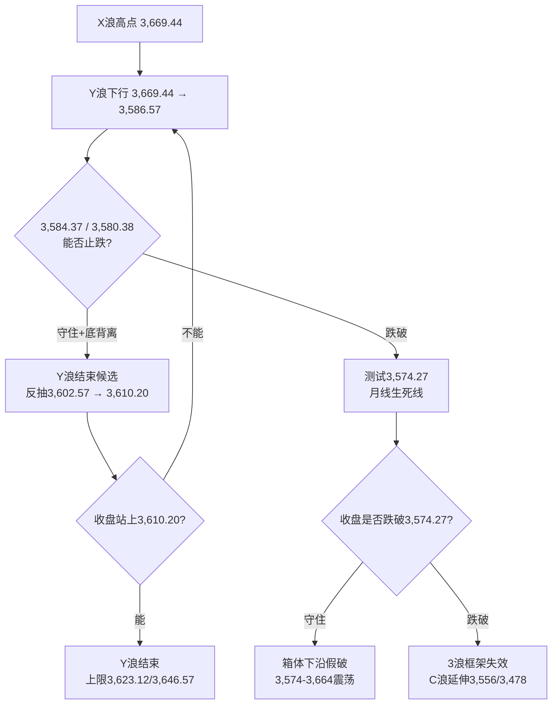
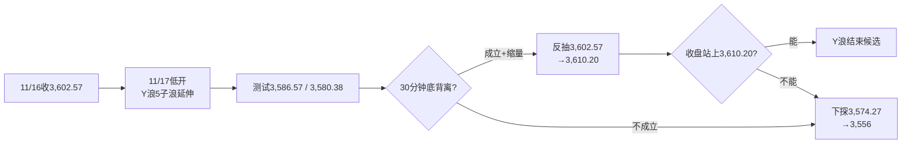

# A股晨报 - 2026年11月17日

> 数据截至：2026-11-17 09:15（北京时间）
> 编制：A股分析师AI代理
> 今日为周二（第47周第2个交易日），正常交易
> 基准：11/16晚报（复盘准确率55.7%、波浪85%）+《2026年第46周A股运行规律分析》（11/15）

---

## 一、昨日晚报复盘要点回顾

### 1. 昨日判断回顾

| 项目 | 准确率 | 说明 |
|------|--------|------|
| 趋势判断 | **100%（1/1）** | "震荡偏弱"兑现，且明确提示偏弱路径"收盘跌破3,610.20" |
| 点位预测 | **0%（0/3）** | 区间3,605-3,650✗（低3,586.57）、强支撑3,610.20✗、强压力3,646.57✗（高3,623.12） |
| 板块预判 | **85.7%（6/7）** | 银行红利✓、食品家电✓、煤炭✓、农业✗、光模块CPO✓、半导体设备✓、贵金属✓ |
| 成交量 | **0%（0/1）** | 预测1.60-1.78万亿，实际1.4845万亿（连续第6日低估） |
| 综合 | **55.7%** | 波浪分析约85%（1.618×W目标3,584.37 vs 实际低点3,586.57，误差2.2点） |

### 2. 关键偏差及原因

- **偏差1（点位整体高估）**：把"政策底3,580-3,610"当作"不会跌破3,610.20"，忽略**结构失效线通常先于政策底被测试**；10月数据"全面低于预期"的幅度盘前未量化。
- **偏差2（反抽力度高估）**：A50只反映权重（银行），不反映成长；"跌停>涨停+双创新低"环境下反抽天花板应为前收3,634.35，而非3,646.57。
- **偏差3（量能连续低估）**：双创跌超4%引发被动减仓，缩量11%超出"平量"框架，应按"前日×0.85-0.92"处理。

### 3. 沉淀的规则/检查项（今日直接启用）

1. **数据全面低于预期→结构失效线当日必被测试**，强支撑下调一档至"失效线-1%~-1.5%"。
2. **"跌停>涨停+双创单日跌>4%创年内新低"→次日反抽第一压力下移至前一日收盘价**（今日为3,602.57）。
3. **退潮期看涨组合只保留"高股息+必选消费+出口链"**，删除农业/种植业/商业航天等低位主题。
4. **两融单日降>150亿+主力净流出>400亿+缩量>10%三项同现=存量减仓**，反弹需"缩量止跌→放量确认"两步。
5. **结构失效线失守+月K转阴+双创创年内新低三项同现→中线上限10%、短线上限3%**，只做收盘确认后的反抽。
6. **Y浪达1.618×W仅代表"跌幅到位"，不等于"跌势结束"**，须收盘站上前一结构位+30/60分钟底背离双确认。

### 4. 对今日分析的启示

- **风险点**：外盘科技链昨夜再度重挫（费半-5%、存储-7%），A股算力链今日大概率补跌；3,574.27（月线生死线）进入射程。
- **调整逻辑**：不再以"超跌+目标位"作为抄底依据；今日核心变量是**3,574.27能否收盘守住**，而非是否低开。

---

## 二、隔夜市场动态（11/16收盘后至今）

### 1. 美股市场（11/16收盘，全线下挫）

| 指数 | 收盘 | 涨跌点 | 涨跌幅 |
|------|------|--------|--------|
| 道琼斯工业 | **51,608.17** | -739.38 | **-1.41%** |
| 标普500 | **7,416.59** | -145.08 | **-1.92%** |
| 纳斯达克综合 | **24,509.76** | -626.52 | **-2.49%** |
| 费城半导体 | — | — | **-5%以上** |

- **英伟达跌超4%、阿斯麦跌近6%，SK海力士/美光跌超7%**，苹果-0.98%、微软-1.12%、Meta-2.38%、特斯拉-2.69%，大型科技股全线收跌。
- **下跌三重触发**：（1）英伟达FY27Q3财报（北京时间11/18 05:20）前避险；（2）IMF总裁警告全球增长过度依赖AI、AI企业间循环融资规模已超1万亿美元；（3）美联储主席沃什讲话提出AI三种情景（生产率繁荣/大规模失业/技术泡沫破裂），市场解读为对AI泡沫的官方确认。
- **加息预期已拉满**：利率期货完全定价12月加息25bp，50bp概率约10%；克利夫兰联储主席哈马克称"倾向于稳步渐进加息，通胀顽固时可能更大幅度"。

### 2. 欧洲/亚太市场

| 市场 | 收盘/最新 | 涨跌幅 |
|------|-----------|--------|
| 英国富时100 | 10,892.93 | -0.09% |
| 德国DAX | 26,598.64 | -0.57% |
| 法国CAC40 | 8,352.00 | -0.20% |
| **日经225（今日开盘）** | **59,295.80** | **-0.61%**（夜盘期货59,200，-550） |
| **韩国KOSPI（今日开盘）** | **5,008.09** | **-1.81%**，盘中扩大至**-2.10%** |
| **台湾加权（今日盘中）** | 39,807.67 | **-3.00%** |
| **恒生指数（今日开盘）** | — | **+0.30%**（恒生科技+0.41%） |
| **富时A50期货** | — | **-0.38%**（夜盘收-0.28%后低开） |

- **亚太科技链继续杀跌，但与A股"同构分化"**：日韩台科技股重挫（三星电子跌近3%、SK海力士续跌），**港股靠科技/零售高开收红**（希音涨超3%、京东/百度涨超2%，但华虹宏力、紫金矿业、山东黄金跌超2%）。
- **A50仅跌0.38%**，说明外资对权重（银行/红利）定价未恐慌；**今日A股大概率"低开、成长补跌、权重护盘"**，指数跌幅小于双创。

### 3. 大宗商品

| 品种 | 最新 | 涨跌幅 | 说明 |
|------|------|--------|------|
| COMEX黄金 | **3,859.00美元/盎司** | **-0.70%** | 加息预期+美元高位压制，年内新低后弱反抽失败 |
| COMEX白银 | **46.91美元/盎司** | **-4.50%** | 工业+金融属性双杀，跌幅远大于黄金 |
| WTI原油 | **85.06美元/桶** | **-3.95%** | 需求走弱主导，地缘溢价回吐 |
| 布伦特原油 | **91.81美元/桶** | **-4.20%** | 同上，跌破92美元 |

- **贵金属"趋势破坏"延续**：白银单日-4.5%说明是**流动性/杠杆出清**而非单纯利率定价，黄金股与白银股今日仍有补跌压力。
- **原油大跌需区分性质**：本次为"需求走弱+AI衰退叙事"驱动，**利好航空/化工中下游成本端，利空石油石化上游**；不可线性推导"油价跌→航运涨"（需求走弱航运同样受损）。

### 4. 汇率与利率

| 项目 | 数值 | 变动 |
|------|------|------|
| 美元指数 | **103.58** | **+0.16%**，创2025年4月以来新高 |
| 在岸人民币（16:30） | 6.6678 | 升值29bp；夜盘6.6642 |
| 人民币中间价 | **6.7141** | 升值11bp |
| 美债2年期 | 4.823% | — |
| 美债10年期 | **5.121%** | **站稳5%上方** |
| 美债30年期 | 5.4666% | — |

- **"美元强+美债5.12%+加息定价"三高组合**对高久期资产（半导体、CPO、创新药、贵金属）形成持续估值压制，**红利/低波仍是唯一避风港**。
- 人民币中间价连续升值但幅度收窄（+11bp），**汇率不是今日主要矛盾**，不构成额外利空。

### 5. 重要海外事件

- **沃什讲话（01:00）**：通篇未提"通胀""利率"，但以"AI三种情景"框架表态，被市场解读为**官方承认AI泡沫风险**，成为美股跳水的直接催化剂。
- **IMF警告**：全球增长过度依赖AI，AI企业循环融资超1万亿美元，金融稳定风险上升。
- **Anthropic IPO（11/18定价）**：全球AI资产新的定价锚，与英伟达财报叠加，构成"AI资产重估周"。

---

## 三、今日关注事项

### 1. 重要数据/事件（按时间排序）

| 时间 | 事件 | 预期/前值 | 影响 |
|------|------|-----------|------|
| 全天（11/17-18） | **2026年APEC工商领导人峰会在深圳开幕**，12位APEC经济体领导人出席 | — | 深圳本地/开放概念事件催化；元首外交窗口 |
| 09:30 | A股开盘（预计低开0.4%-0.8%） | — | 关注开盘30分钟能否收复3,590 |
| 11:05-11:35 | 财政部国债做市支持操作（随卖，2年3.2亿、3年3.3亿） | — | 影响很小 |
| 18:00 | 欧元区11月ZEW经济景气指数 | 前值18.5 | 影响有限 |
| 20:00 | **京东集团Q3业绩电话会**（港股盘后披露） | — | 电商/消费链情绪 |
| 21:30 | **美国10月零售销售** | 前值+0.8%（核心+0.9%） | 若超预期→强化12月加息→压制成长 |
| **11/18 05:20** | **英伟达FY27Q3财报**（临时管理层首份） | — | **全周最大变盘点** |
| 11/18 | Anthropic IPO定价 | — | 全球AI资产定价锚 |

### 2. 政策/监管动态

- **国内**：11/16央行开展4,600亿隔夜逆回购（1.25%）+2,000亿6个月买断式，对冲后**净回笼40亿**，流动性"合理充裕但无增量"；证监会无新增表态，11/14"深化稳市长效机制"仍是政策底来源。
- **海外**：美联储12月加息25bp已被完全定价；哈马克鹰派表态；**11/19美联储10月会议纪要**为下一个路径确认点。

### 3. 公司公告/解禁

- **康希通信（688653）**：今日解禁**1.08亿股，占总股本25.46%，解禁市值约13.55亿元**，为当日最大，**科创板通信股压力**。
- **爱旭股份（600732）**：解禁161.57万股（约2,027.73万元），规模小。
- **菊乐股份（920309）**：今日北交所上市，发行价31.92元/股，发行市盈率11.99倍，募资约3.75亿元。
- **京东集团-SW**：今日港股盘后披露Q3业绩。

### 4. 其他关注

- **第九届国际光伏与储能产业大会**（11/17-20，成都）：隆基绿能、晶科能源、阳光电源、德业股份、宁德时代为关注标的；**事件催化难改板块下行趋势，警惕高开低走**。
- **无新股申购**，1只新股上市（菊乐股份）。

---

## 四、板块与个股分析（结合昨日复盘）

### 1. 基于昨日复盘结论的板块调整

- **昨日看涨板块（银行/煤炭/食品饮料/家电）今日预期**：仍是资金唯一避风港，但**银行已7家创历史新高、短期性价比下降**，今日更可能"高位横盘/小幅补涨"，而非继续领涨；煤炭、交运、公用事业接力概率更高。
- **昨日看跌板块（光模块/半导体/贵金属）今日预期**：外盘费半-5%、存储-7%、白银-4.5%，**今日补跌确认，且跌幅可能大于昨日**；不接飞刀。
- **昨日偏差板块（农业）修正**：继续剔除，不作"低位防御"配置。

### 2. 隔夜信息驱动的板块机会

- **受益板块**：
  （1）**银行/红利（工行、建行、农行、中国神华、长江电力）**——美元强+美债5.12%+风险偏好收缩，确定性现金流溢价；
  （2）**航空/化工中下游**——WTI-3.95%带来成本端改善，但需注意"需求走弱"属性，仅作短线事件；
  （3）**深圳本地/APEC概念**——APEC工商领导人峰会今日在深圳开幕，事件驱动，**只做情绪不做趋势**。
- **受损板块**：
  （1）**半导体/存储/PCB**——费半-5%、SK海力士/美光-7%，SK海力士、三星续跌；
  （2）**光模块/CPO/算力硬件**——英伟达-4%、财报前避险；
  （3）**贵金属**——黄金-0.70%、白银-4.50%，趋势破坏；
  （4）**石油石化**——原油-4%，上游盈利预期下修。

### 3. 重点关注个股

| 个股 | 关注理由 | 技术位置 | 操作 |
|------|---------|---------|------|
| 工商银行 | 红利核心，7家银行创新高后的补涨/护盘主力 | 历史新高附近 | 回踩5日线可持有，不追高 |
| 中国神华 | 煤炭+高股息，冬季用能，昨日煤炭+1.89% | 强势通道 | 持有，跌破10日线减 |
| 美的集团 | 家电出口链+历史新高，汇率升值斜率放缓 | 历史新高 | 持有，不追高 |
| 中际旭创/新易盛 | 算力链风向标 | 连续3日"反弹即减" | **回避**，等财报落地 |
| 康希通信 | 今日解禁25.46% | 科创板通信 | **回避** |

---

## 五、今日核心判断

### 1. 趋势判断

- 上证指数：**【看跌】**（低开探底、弱反抽，重心下移）
- 预测区间：**3,560点 - 3,615点**
- 核心逻辑：隔夜美股科技链重挫（纳指-2.49%、费半-5%）+IMF/沃什"AI泡沫"表态+美债5.12%，A股算力链大概率补跌；A50期货仅-0.38%、港股高开、银行红利护盘，指数跌幅将小于双创；**今日核心是3,574.27（月线生死线）的收盘得失**，而非低开幅度。

### 2. 关键点位

- **强支撑位：3,574.27点**（依据：10月低点/月线生死线；收盘跌破则3浪框架失效）
- **弱支撑位：3,580.38点**（依据：11/3低点）+ **3,586.57点**（11/16低点）
- **强压力位：3,610.20点**（依据：昨日失守的结构失效线，转化为反抽第一硬压力）
- **弱压力位：3,602.57点**（依据：昨日收盘价，按"跌停>涨停+双创新低"规则下移的第一反抽压力）
- **补充**：3,584.37（1.618×W，已触及）；下方3,556（2.0×W）、3,478（C浪延伸）。

### 3. 板块预判

- **看涨板块**：
  （1）**银行/红利**（逻辑：美元强+美债5.12%+年末考核，确定性现金流）；
  （2）**煤炭/公用事业/交运**（逻辑：冬季用能+高股息，昨日已启动的接力方向）；
  （3）**食品饮料/家电**（逻辑：必选消费避险+出口链，退潮期仅存的三类看涨之一）。
- **看跌板块**：
  （1）**半导体/存储/PCB**（逻辑：费半-5%、存储-7%，补跌未完成）；
  （2）**光模块/CPO/算力硬件**（逻辑：英伟达财报前避险，反弹即减）；
  （3）**贵金属**（逻辑：黄金-0.7%、白银-4.5%，趋势破坏）；
  （4）**石油石化**（逻辑：原油-4%，上游盈利下修）。
- **风险板块**：
  - **高位连板/微盘股**（文投控股19天11板，退潮期断板风险极高）；
  - **创业板高β（锂电/光伏/机器人）**（双创年内新低+两融降214亿，负反馈未止）；
  - **今日解禁股（康希通信25.46%）**；
  - **光伏**（大会催化易高开低走，板块趋势向下）。

### 4. 资金面判断

- **北向资金预期**：**净流出30-60亿元**（净额已不披露，以成交额替代；预计成交1,900-2,200亿，昨日2,202.40亿/占14.84%）
- **成交量预期**：**平量至小幅缩量，1.40-1.60万亿**（基础1.45-1.55万亿）；若盘中跌破3,574.27并放量，上限上修至1.65万亿
- **两融**：11/16两市余额22,283.75亿，单日**-214.1亿**（沪-94.51亿、深-119.59亿），杠杆连续两日大幅去化

### 5. 风险预警（按优先级排序）

- **高风险**：**英伟达FY27Q3财报（11/18 05:20）+Anthropic IPO定价**叠加，全球AI资产重估；若指引不及预期，A股算力链周四二次杀跌，指数直接跳空至3,556下方。
- **高风险**：**美债10年期5.121%+12月加息25bp完全定价**，高久期资产估值持续受压，创业板/科创50仍有下探空间。
- **中风险**：**3,574.27月线生死线**；收盘跌破则3浪框架失效，C浪延伸看3,556/3,478。
- **中风险**：**双创流动性负反馈**（创业板2,320.02、科创50 1,213.68创年内新低，两融单日-214亿），若再跌3%可能触发平仓。
- **中风险**：**康希通信解禁25.46%（13.55亿）**，科创板通信股情绪承压。
- **低风险**：菊乐股份北交所上市、光伏储能大会、APEC深圳峰会——事件性催化，不改趋势。

### 6. 昨日复盘规则应用

- **应用规则1（反抽压力下移）**：因昨日"跌停68>涨停33+双创跌超4%创年内新低"，今日反抽第一压力直接取昨收**3,602.57**，原第一防线3,610.20降为第二压力，不预设V型反转。
- **应用规则2（看涨组合收缩）**：看涨只保留"高股息（银行/煤炭/公用/交运）+必选消费（食品饮料/家电）+出口链"，**删除农业/种植业/商业航天**，不配低位主题。
- **应用规则3（结构失效+月K转阴+双创新低）**：中线仓位上限10%、短线上限3%，**只做收盘确认后的反抽**，不做盘中抄底。
- **应用规则4（Y浪1.618到位≠跌势结束）**：3,584.37已触及，但收盘未站上3,610.20、无30/60分钟底背离，**不构成Y浪结束**，继续按延伸段处理。

---

## 六、波浪理论参考

### 1. 月K线波浪分析

- **当前波浪位置**：大级别3浪2扩张（W-X-Y）的**Y浪延伸段**；月K由"三连阳"转为"带上长上影小阴"，收盘失守3,610.20（月线结构失效线）。
- **浪型结构**：11月开3,614.13 → 低3,580.38 → 高3,699.58 → 11/16收3,602.57（月内+0.10%），上影85.45点、下影22.19点、实体-11.56点。
- **关键目标位**：上方3,610.20→3,623.12→3,646.57；下方3,586.57→3,580.38→**3,574.27（月线生死线）**→3,478。
- **验证条件**：月线收盘守住3,574.27，仍是"Y浪延伸"；收盘跌破3,574.27，改按"C浪延伸"，下看3,478/3,443。

### 2. 周K线波浪分析

- **当前波浪位置**：第47周（11/16-11/20）**箱体下沿失守**，上周"长上影小阴/假突破周"的二次探底路径兑现。
- **浪型结构**：本周开3,611.54（跳空低开）→ 高3,623.12 → 低3,586.57 → 现3,602.57；周K暂为"带下影小阴"。
- **关键目标位**：上方3,610.20→3,623.12→3,646.57→3,664.82（颈线）→3,682（5周线）；下方3,586.57→3,580.38→3,574.27。
- **验证条件**：周线反转仍须"收盘站上3,664.82且周成交≥9万亿"；本周收盘守住3,574.27属"箱体下沿假破"，跌破则周线下降推动浪延伸。

### 3. 日K线波浪分析

- **当前波浪位置**：W-X-Y扩张调整的**Y浪第5子浪（延伸段）**，Y浪自3,669.44已下行至3,586.57（-82.87点），Y/W=1.576，**已触及1.618×W目标3,584.37**。
- **浪型结构**：W浪 3,699.58→3,647.00（-52.58）→ X浪 3,647.00→3,669.44（+22.44，0.427回撤）→ Y浪 3,669.44→3,586.57（-82.87）。
- **关键目标位**：下方3,586.57→3,584.37→3,580.38→**3,574.27**→3,556（2.0×W）→3,478；上方3,602.57→3,610.20→3,623.12。
- **验证条件**：收盘跌破3,574.27→3浪框架失效；若3个交易日内收盘重回3,610.20上方且量能≥1.7万亿，则"假破"成立、Y浪结束候选（反抽不得高于3,646.57）。

### 4. 60分钟K线波浪分析

- **当前波浪位置**：Y浪第5子浪末段，**MACD零轴下方绿柱未收敛，底背离尚未形成**。
- **浪型结构**：11/16跳空低开3,611.54→反抽3,623.12→连续阴线至3,586.57→尾盘弱反抽3,602.57；**60分钟下降压力线今日约在3,605-3,612**。
- **关键目标位**：下方3,586.57→3,580.38→3,574.27；上方3,602.57→3,610.20→3,617。
- **验证条件**：60分钟收盘站上3,610.20且MACD金叉，才确认Y浪结束；否则绿柱放大即延伸至3,574.27/3,556。

### 5. 30分钟K线波浪分析

- **当前波浪位置**：Y浪末段**超卖区**，11/16尾盘缩量止跌，但**底背离未确认**。
- **浪型结构**：午后下探3,586.57时量能萎缩，30分钟RSI自20下方回升、MACD绿柱尾盘缩短，具备技术性反抽条件，但属**抛压衰减而非恐慌出清**。
- **关键目标位**：上方3,602.57→3,610.20→3,617；下方3,586.57→3,580.38→3,574.27。
- **验证条件**：开盘30分钟站上3,590且量能不低于昨日同期→30分钟底背离成立，反抽3,602.57-3,610.20；若直接跌破3,580.38，超卖失效、下行至3,574.27。

### 6. 波浪图

**日K线波浪结构图**

**60分钟波浪结构图**

### 7. 波浪理论综合判断

- **多周期共振状态**：月线**转空**（★★，失守3,610.20）、周线空（★☆，箱体下沿失守）、日线空（★，Y浪5子浪）、60分钟空（★，绿柱未收敛）、30分钟超卖（★☆，底背离未确认）——**五周期全部偏空/超卖**。
- **当前操作级别**：**日线防守，30/60分钟只做反抽不做趋势**；3,574.27未收盘失守前按"箱体假破"处理，失守则观望。
- **后续演变路径**：
  - **基础路径（45%）**：低开0.4%-0.8%（3,570-3,585），测试3,580.38/3,574.27后缩量企稳，收3,580-3,600，量能1.40-1.55万亿；
  - **偏弱路径（35%）**：日韩台续跌带动A股科技链二次杀跌，收盘跌破3,574.27，下看3,556/3,478，创业板测2,250；
  - **偏强路径（20%）**：APEC/政策承接+红利护盘+港股收红，收复3,602.57→3,610.20，上限3,623.12。
- **关键拐点信号**：**止跌=收盘站上3,610.20+30分钟底背离+量能≥1.7万亿**；**转弱升级=收盘<3,580.38**；**结构失效=收盘<3,574.27**；**反转确认=收盘≥3,646.57且量能≥1.8万亿**。
- **风险提示**：W-X-Y计数主观性较强，Y浪可延伸为"5-3-5"C浪；1.618×W只是统计位置而非支撑承诺；**英伟达财报前不得以"超卖+目标位"作为抄底依据**。

---

## 七、投资策略建议

### 1. 短线策略（1-3个交易日）

- **适用场景**：日K线+60分钟技术信号，外盘冲击日
- **短线仓位：0-3%**（不开新仓为默认，最多3%试探）
- **买入条件**（须同时满足）：
  1. 收盘（或14:30后）**守住3,574.27**；
  2. 30分钟K线**连续3根不创新低**且量能环比萎缩；
  3. 收盘站上**3,590**。
  三条不同时满足则继续空仓。
- **卖出条件**：反抽至3,602.57-3,610.20不放量即减；触及3,610.20无量滞涨全部了结。
- **止损位**：**收盘跌破3,574.27**（或个股跌幅5%）
- **短线标的**：
  （1）**工商银行/建设银行**（逻辑：红利护盘+历史新高趋势，回踩5日线）；
  （2）**中国神华**（逻辑：煤炭+冬季用能，昨日板块+1.89%）；
  （3）**美的集团**（逻辑：出口链+历史新高，回踩不追高）。

### 2. 中线策略（1-4周）

- **适用场景**：周K线波浪+运行规律分析
- **中线仓位：10%**（维持，不加仓）
- **方向判断**：**【减仓/观望】**（维持）
- **目标区间**：上证指数 **3,556点 - 3,646点**
- **中线布局板块**：
  （1）**银行/红利**（逻辑：年末考核+低波+高股息，唯一确定性）；
  （2）**食品饮料/家电**（逻辑：必选消费+出口链，退潮期防御）；
  （3）**公用事业/交运**（逻辑：类固收现金流）。
  **减配**：石油石化（原油-4%，仅防御无进攻）；**清空**：农业/种植业/商业航天；**不参与**：半导体设备/存储/CPO（资金流出未止）。
- **止盈条件**：指数反抽至3,623.12-3,646.57分批减仓；或持仓波段涨幅达10%
- **止损条件**：**收盘跌破3,574.27**（清中线至5%以下）；或趋势确认反转

### 3. 仓位分配总览

| 策略类型 | 仓位比例 | 方向 | 重点板块 |
|---------|---------|------|---------|
| 短线 | 0-3% | 观望（条件触发才试探） | 银行、煤炭 |
| 中线 | 10% | 减仓/观望 | 银行/红利、食品饮料/家电、公用事业 |
| 现金 | 87-90% | — | — |

### 4. 与昨日策略对比

- **短线仓位**：维持0-3%（不因外盘下跌而抄底，也不因超卖而加仓；买入条件新增"收盘守住3,574.27"）。
- **中线仓位**：维持10%（3,574.27未收盘失守前不减至5%）。
- **板块调整**：**减配石油石化**（原油-4%），**新增航空为短线事件**（油价成本改善），维持"银行/红利+必选消费+公用交运"；**继续回避算力链/贵金属/高位连板**。
- **纪律**：英伟达财报（11/18 05:20）前不加算力链；黄金创新低不抄底贵金属；今日解禁股（康希通信）不参与。

---

## 八、信息来源

1. **官方数据来源**：中国人民银行（中间价6.7141、4,600亿隔夜逆回购+2,000亿6M买断式、净回笼40亿）、财政部（11/17国债做市支持操作）、上交所/深交所（融资余额22,283.75亿、指数成交）、国家统计局（10月工业增加值+4.8%、社零+0.4%、1-10月固投-8.1%）
2. **权威财经媒体**：新华社（纽约股市三大股指16日下跌、伦敦股市）、央广财经早报（11/17）、证券时报/中国证券网（新股、解禁）、上海证券报（沃什讲话、加息预期）、财联社（美股收盘、A50期货、台股）、每日经济新闻（A50期货开盘）、界面新闻（KOSPI开盘）、Korea Herald（首尔股市）
3. **数据平台**：东方财富（欧洲市场）、新浪财经（美债收益率、人民币汇率、美股收盘）、同花顺iFinD（沃什讲话、IMF警告）、KGI/ET Net（港股开盘）、大阪交易所（日经期货）
4. **研究机构**：华安期货投研（11/17早盘速览：黄金3,859、白银46.91、WTI 85.06、布油91.81、美元指数103.58）、光大研究（每日速递20261117）
5. **数据截止时间**：**2026-11-17 09:15（北京时间）**；美股为11/16收盘，欧洲为11/16收盘，日韩台为11/17开盘/盘中，港股为11/17开盘，A股为11/16收盘；北向净额不披露，以成交额替代，净流出为估算值

---

> **免责声明**：本报告为AI辅助生成的开盘前分析，所有点位、概率、目标位均为基于公开数据的技术推演，不构成投资建议。市场有风险，决策需独立。
