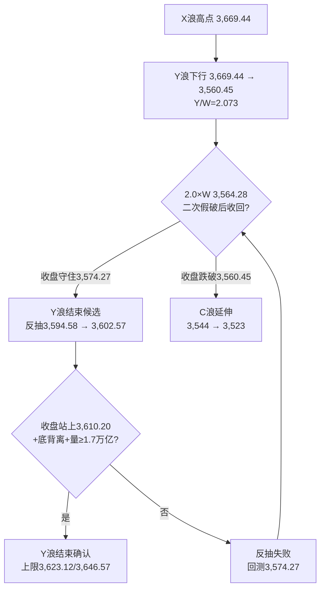
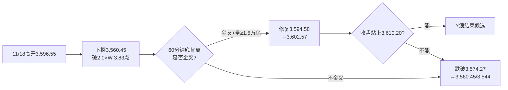

# A股晚报 - 2026年11月18日

> 数据截止时间：2026年11月18日 20:00（北京时间）
> 今日为交易日（周三），A股正常开市。本报告含波浪理论多周期分析与晨报复盘闭环。

---

## 一、市场回顾

### 1. 主要指数表现

| 指数 | 收盘 | 涨跌幅 | 最高 | 最低 | 成交额 |
|------|------|--------|------|------|--------|
| 上证指数 | **3,587.83** | **+0.09%** | 3,596.55 | **3,560.45** | 6,502.32亿 |
| 深证成指 | 10,659.41 | +0.20% | — | — | 7,194.71亿 |
| 创业板指 | 2,311.62 | **+0.85%** | — | 盘中一度跌超1% | 3,368.31亿 |
| 科创50 | 1,247.99 | **+2.19%** | — | — | — |
| 科创综指 | — | +1.00% | — | — | — |
| 北证50 | — | **-1.14%** | — | — | — |

- **形态**：上证高开3,596.55（即全天最高），早盘冲高回落至**3,560.45**（跌破3,574.27月线生死线与2.0×W 3,564.28），午后震荡回升，收3,587.83。日K为**"光头带长下影小阴（锤子线）"**：上影0点、实体-8.72点、下影27.38点，振幅1.01%。
- **结构分化**：科创50 +2.19%、创业板+0.85%显著强于上证+0.09%，**成长修复、权重拖累**；北证50 -1.14%续弱，小盘未参与反弹。

### 2. 成交量能

- **两市成交13,697亿元（1.3697万亿）**，较上日缩量**879.92亿元（-6.0%）**，**刷新年内最低、创2025年7月以来16个月新低**。
- 沪市6,502.32亿、深市7,194.71亿；全市场成交额较5日均量-16.5%、较20日均量-17.8%（含北交所口径1.38万亿）。
- **北向资金**：净额交易所不实时披露；**成交2,199.97亿元、占两市成交16.06%**（前一交易日2,265.71亿/15.54%），缩量环境下外资占比被动抬升。
- **主力资金（特大单口径）**：两市特大单**净流入40.22亿元**，为11月以来首次转正；**电子+65.80亿、通信+22.47亿**居前，计算机、机械设备净流入；**有色金属-15.77亿、银行-15.12亿、医药生物、传媒**净流出。个股看，沪电股份+11.62亿、寒武纪+7.01亿、华工科技+6.22亿、中际旭创+5.48亿；九阳股份-7.30亿、新易盛-5.37亿、招商银行-4.42亿。
- **两融**：截至11月17日沪深北两融余额**22,466.05亿元**，单日减少**184.07亿元**（融资余额22,170.96亿，-186.33亿），**三连降**，杠杆资金仍在离场。

### 3. 市场情绪

- **涨跌家数**：上涨**1,318只（23.65%）**、下跌**4,133只**、平盘122只，红盘率仅23.6%，**"指数红、个股绿"的宽度背离**。
- **涨停43只、跌停48只**，涨停仍少于跌停；**封板率61.2%**（首板封住率66.0%），炸板29只。
- **连板高度降至4板**（华东重机4连板，封单5.32亿元），连板晋级率21.6%、1进2晋级率22.6%，**高位接力意愿弱**；九阳股份"天地板"（-9.99%）、阳光照明跌停，高位股亏钱效应延续。
- **市场宽度**：-3%以下个股238只（-5%以下91只），中位数个股跌幅约-1.5%，**指数由算力链单点拉动，普跌格局未改**。

---

## 二、热点板块与异动分析

### 1. 领涨板块及驱动因素

| 板块 | 涨幅 | 驱动因素 |
|------|------|----------|
| 综合 | +2.20% | 小市值主题轮动、算力租赁映射 |
| 通信 | +1.61% | 华为算力、算力租赁（IDC）、光通信修复 |
| 电子 | +1.58% | 英伟达FY27Q3营收+103%、PCB/元件爆发 |
| 计算机 | +0.40%以上 | 东数西算、AI算力、算力租赁 |
| 交通运输/钢铁 | +0.40%以上 | 低位补涨、港口航运 |

- **申万二级**：**元件+4.90%**、通信服务+3.01%、黑色家电+2.84%领涨。
- **概念**：**IDC（算力租赁）+4.81%、东数西算+3.95%、AI算力+3.73%**。
- **核心驱动**：①英伟达FY27Q3营收1,158亿美元（+103%）、数据中心1,076亿美元（+110%）、盘后涨约5%，**业绩靴子落地**；②美国收紧远程芯片出口+中方"反制"表态，**国产替代逻辑再强化**；③华为算力、算力租赁订单预期发酵。

### 2. 领跌板块及原因

| 板块 | 表现 | 原因 |
|------|------|------|
| 有色金属/贵金属 | 紫金矿业-5.66%、中金黄金-7.32%、山东黄金-3.72%、中国稀土-10.00% | 金价失守3,810美元、实际利率高位，趋势破坏延续 |
| 传媒/影视院线/AI漫剧 | 传媒领跌，文投控股、浙文影业二连跌停 | 前期高位题材退潮未完成，监管降温 |
| 商贸零售 | 跌幅居前 | 消费数据偏弱、资金抽离 |
| 创新药/生物科技 | 莱美药业-15.84% | 高位医药兑现，无新增催化 |
| 银行 | 招行-0.76%、平安银行-0.41%，特大单-15.12亿 | 科技修复日高股息被抽血 |

### 3. 个股异动复盘

- **涨停/连板**：华东重机4连板（算力芯片，封单5.32亿）；卡莱特20CM二连板、华胜天成4天3板（华为算力）；真视通、四川长虹、常山北明涨停；算力租赁美利云、润建股份、中嘉博创、利通电子、青云科技涨停，宏景科技20CM；PCB生益电子+18.53%（盘中触20CM）、沪电股份、深南电路涨停，协创数据+18.02%、华工科技+8.93%、工业富联+5.68%。
- **强势股回调**：九阳股份天地板（澄清与华为无战略合作后连续杀跌）、阳光照明跌停、中国稀土跌停、上纬新材-6.53%。
- **资金异动**：沪电股份特大单净流入11.62亿居首；寒武纪+4.89%、海光信息+3.59%、华虹宏力+7.28%，**国产算力链全面修复**；新易盛-1.12%逆势收跌（光模块内部分化）。

---

## 三、关键数据与事件回顾

### 1. 国内重要经济数据

- 今日无重磅月度数据发布；市场主要消化11/16公布的10月经济数据（工业增加值+4.8%、社零+0.4%、1-10月固投-8.1%，全面低于预期）与11/13金融数据（社融1.15万亿、M1+4.4%超预期）的余波。
- **人民币中间价6.7118**，较前值升值14bp，连续第4日升值。

### 2. 政策消息

- **APEC第三十三次领导人非正式会议（11/18-19，深圳）**召开，区域合作/开放主题获事件性催化。
- **2026中国5G+工业互联网大会（武汉）**召开，6G/通信设备/工业互联网主题活跃。
- 美国远程芯片出口限制与中方"反制措施"表态持续发酵，**国产替代成为今日最强主线之一**。
- 广东省《数字广东建设"十五五"规划》推动5G-A/6G/万兆光网，通信板块受益。

### 3. 公司公告

- **华菱钢铁**：控股股东湖南钢铁集团完成增持，累计8,406.55万股（占总股本1.23%），金额约3.00亿元。
- **天普股份**：停牌核查完成，股票将于**11月19日复牌**。
- **联域股份**：董事长提议回购2,000万-4,000万元。
- **山鹰国际**：实际控制人披露增持股份计划。
- **华孚时尚**：三季度10派0.6元，股权登记日11月25日。

---

## 四、海外市场联动

### 1. 美股（11/17收盘，连续第4日下跌）

| 指数 | 收盘 | 涨跌幅 |
|------|------|--------|
| 道琼斯 | 50,759.42 | **-1.64%** |
| 标普500 | 7,340.53 | **-1.03%** |
| 纳斯达克 | 24,328.38 | -0.74% |

- **英伟达FY27Q3（盘后）**：营收1,158亿美元（+103%）、数据中心1,076亿美元（+110%）、Non-GAAP EPS 2.68美元、毛利率74.8%，**盘后涨约5%**；Vera Rubin平台开始量产出货。
- **治理扰动未消**：黄仁勋"愿回归"表态与董事会"不复职"分歧并存，临时CEO Colette Kress将于**11/19凌晨1点**召开全员会。

### 2. 欧洲/亚太

| 市场 | 表现 |
|------|------|
| 恒生指数（11/18） | 23,294.75，**-0.91%**，恒生科技盘中创阶段新低后收窄 |
| 欧洲（11/18开盘） | 斯托克50 +0.35%、德国DAX +0.18%、英国富时100 -0.22%、法国CAC40 持平 |
| 南向资金 | 净买入27.51亿港元（连续净买入） |

- 亚太科技链昨日重挫后今日分化，A股走出"国产替代独立"结构，外盘拖累边际减弱；港股仍弱于A股。

### 3. 大宗商品与美元

- **现货黄金3,809.5美元/盎司（11/17，-1.0%）**，4,000美元整数关失守后趋势未修复，A股贵金属今日补跌。
- **WTI原油86.01美元（+0.34%）、布伦特93.47美元（+1.11%）**，低位企稳，石油石化防御属性为主。
- **美元指数103.54（-0.04%）**，美债10年期5.109%，**海外利率高压未解除**（12月加息25bp概率约96.8%）。

---

## 五、汇率与利率

| 项目 | 数值 | 变动 |
|------|------|------|
| 人民币中间价（11/18） | **6.7118** | 升值14bp，连续第4日升值 |
| 美元指数 | 103.54 | -0.04% |
| 美债10年期 | 5.109% | 高位震荡 |
| 中国10年期国债 | 约1.61% | 低位平稳 |
| 央行公开市场 | **7,002亿元隔夜逆回购（1.25%）** | 到期7,140亿，**净回笼138亿元** |

- 央行在税期后转为小额净回笼，**流动性"合理充裕"基调未变**，但对增量资金的边际贡献下降。
- 中美利差仍阔（10年期约350bp），人民币连续升值但幅度收窄，**汇率非当前主要矛盾**。

---

## 六、收盘后重要信息

### 1. 盘后公告

- 华菱钢铁控股股东完成3亿元增持；联域股份提议回购；山鹰国际实控人拟增持；天普股份11/19复牌；华孚时尚三季度分红。

### 2. 夜盘与盘前

- 欧洲主要股指11/18开盘涨跌不一，风险偏好边际修复；美股期货关注英伟达盘后涨幅能否延续。
- 富时A50夜盘预计跟随A股小幅波动，**对明日开盘指引为"平开至小幅高开"**。

### 3. 次日关注（11/19）

| 时间 | 事件 | 影响 |
|------|------|------|
| 01:00 | 英伟达临时CEO Colette Kress全员会议 | 治理不确定性，影响算力链情绪 |
| 03:00 | **美联储10月FOMC会议纪要** | 12月加息路径定调，偏鹰则压制高β |
| 21:30 | 美国当周初请失业金、10月新屋开工 | 影响加息预期 |
| 23:30 | 美国EIA原油库存 | 影响油价与石化链 |
| 全天 | APEC深圳峰会第二日、5G+工业互联网大会 | 区域/通信主题延续性 |
| — | 天普股份复牌 | 个股风险释放 |

---

## 七、波浪理论多周期分析

### 1. 月K线波浪分析

- **当前波浪位置**：大级别3浪2扩张（W-X-Y）的**Y浪末段"二次假破"阶段**。
- **浪型结构描述**：11月开3,614.13 → 高3,699.58 → 低**3,560.45（11/18）** → 现3,587.83，月内**-0.31%**（10月收3,599.02）；月K为"带长上影、带长下影小阴"：上影85.45点、下影27.38点、实体-26.30点。**月线生死线3,574.27本月已两次被盘中击穿（11/17破8.68点、11/18破13.82点），两次均收盘收回**。
- **关键目标位**：上方3,594.58→3,602.57→3,610.20→3,623.12→3,646.57→3,664.82（颈线）；下方**3,574.27（生死线）**→3,560.45（今日低）→3,544（2.382×W）→3,523（2.618×W）→3,478。
- **验证条件**：**11月月K收盘（11/28）站上3,574.27，则3浪2扩张框架仍有效**；若月线收盘跌破3,574.27，改按"C浪延伸"，下看3,478/3,443。

### 2. 周K线波浪分析

- **当前波浪位置**：第47周（11/16-11/20）**箱体下沿3,610.20失守后的第三周阴线运行中**，3,574.27为"二次假破"候选。
- **浪型结构描述**：本周开3,611.54 → 高3,623.12 → 低**3,560.45** → 现3,587.83，周内**-1.28%**；周K暂为"带长下影小阴"，连续第3周收阴、低点下移。5周均线约3,670-3,682，仍构成反抽天花板。
- **关键目标位**：上方3,594.58→3,602.57→3,610.20→3,623.12；下方3,574.27→3,560.45→3,544→3,523。
- **验证条件**：周线止跌需**本周收盘站上3,610.20且周成交≥8.5万亿**（前三日合计约4.3万亿，达标难度极大）；若周收盘<3,574.27，则周线下降推动浪延伸至3,544。

### 3. 日K线波浪分析

- **当前波浪位置**：W-X-Y扩张调整的**Y浪第5子浪"延伸—二次假破—收回"末端**。
- **浪型结构描述**：W浪 3,699.58→3,647.00（-52.58）→ X浪 3,647.00→3,669.44（+22.44，0.427回撤）→ Y浪 3,669.44→**3,560.45（-108.99）**；**Y/W=2.073**，2.0×W（3,564.28）被跌破3.83点后当日收回，收盘3,587.83重回1.618×W（3,584.37）上方3.46点。日K为**光头长下影锤子线**，是Y浪末端的典型"诱空"形态。
- **关键目标位**：下方3,574.27→3,560.45→3,556→3,544（2.382×W）→3,523；上方3,594.58→3,602.57→**3,610.20**→3,623.12→3,646.57。
- **验证条件**：**Y浪结束候选=收盘站上3,610.20+30/60分钟底背离+量能≥1.7万亿**；若3个交易日内收盘重回3,610.20上方，则"2.0×W二次假破+Y浪结束"成立（反抽上限3,646.57）；反之收盘<3,560.45则C浪延伸至3,544。

### 4. 60分钟K线波浪分析

- **当前波浪位置**：Y浪第5子浪末段，**价格创新低（3,560.45）而MACD绿柱未同步放大，底背离条件成立**，但尚未金叉。
- **浪型结构描述**：高开3,596.55→上午单边下行至3,560.45→午后逐级回升至3,587.83，量能全天萎缩；**60分钟下降压力线明日约在3,594-3,600**。
- **关键目标位**：上方3,594.58→3,602.57→3,610.20；下方3,574.27→3,560.45。
- **验证条件**：**60分钟收盘站上3,602.57且MACD金叉=Y浪结束第一信号**；若明日首小时跌破3,574.27，则底背离失效、下探3,544。

### 5. 30分钟K线波浪分析

- **当前波浪位置**：Y浪末段"失败背离后二次修复"。
- **浪型结构描述**：昨日30分钟底背离在今日上午被3,560.45的新低击穿（原3,565.59支撑失效），但午后连续小阳收复3,580.38/3,584.37，**形成"背离失败—快速收回"的诱空结构**；30分钟RSI自25下方回升至50附近。
- **关键目标位**：上方3,594.58→3,600（整数关）→3,602.57；下方3,580.38→3,574.27→3,560.45。
- **验证条件**：明日开盘30分钟站上3,594.58且量能不低于今日同期→修复延伸至3,602.57-3,610.20；若开盘直接跌破3,574.27，则30分钟结构转弱、回测3,560.45。

### 6. 波浪图

**日K线波浪结构图**



**60分钟波浪结构图**



### 7. 波浪理论综合判断

- **多周期共振状态**：月线**空但二次未确认失效**（★☆）、周线空（★，连续第3周阴）、日线**Y浪2.073×W二次假破后锤子线止跌**（★★）、60分钟**底背离条件成立待金叉**（★★）、30分钟**失败背离后修复**（★★）——仍为**"中长周期偏空+短周期超跌修复"的背离结构**，但短周期修复强度较昨日提升。
- **当前操作级别**：**日线防守、30/60分钟只做反抽**；3,574.27未收盘失守前按"Y浪结束候选"处理，失守则观望。
- **后续演变路径**：
  - **基础路径（55%）**：平开至小幅高开，回踩3,574-3,580不破，反抽3,594.58-3,602.57后震荡，收3,580-3,602，量能1.30-1.45万亿；
  - **偏强路径（25%）**：美联储纪要偏鸽+算力链延续修复+量能回升，收盘站上3,610.20，上探3,623.12，但难一次性收复3,646.57；
  - **偏弱路径（20%）**：纪要点阵偏鹰+英伟达治理风波再起，收盘跌破3,560.45，下看3,544（2.382×W），创业板回测2,280。
- **关键拐点信号**：**止跌=收盘≥3,602.57+60分钟底背离金叉+量≥1.5万亿**；**反转确认=收盘≥3,610.20且量≥1.7万亿**；**结构失效=收盘<3,560.45**；**延伸升级=收盘<3,544→3,523**。
- **风险提示**：W-X-Y计数主观性强，Y浪可延伸为"5-3-5"C浪；2.0×W为统计位置而非支撑承诺；**今日"地量+锤子线"只是止跌候选，缩量背景下的长下影有效性与2024年1月、2022年4月的"地量地价"需量能验证，不得以单日形态满仓抄底**。

---

## 八、晨报复盘

### 1. 核心判断回顾

| 判断项目 | 晨报预测 | 实际结果 | 准确度 | 备注 |
|---------|---------|---------|-------|------|
| 上证指数趋势 | 震荡（偏技术性修复） | +0.09%（探底回升） | ✓ | 定性准确，但盘中先破位后修复 |
| 上证指数区间 | 3,570-3,615点 | 3,560.45-3,596.55点 | ✗ | 下沿破9.55点，上沿差18.45点 |
| 强支撑位 | 3,574.27点 | 最低3,560.45点 | ✗ | 盘中破13.82点（-0.39%），收盘收回 |
| 强压力位 | 3,610.20点 | 最高3,596.55点 | ✓ | 压力有效，反抽未触及 |
| 北向资金 | 成交2,100-2,400亿 | 成交2,199.97亿 | ✓ | 实际占比16.06%，略高于15%-16%预期 |
| 成交量 | 平量至小幅放量（1.45-1.65万亿） | 1.3697万亿（-6.0%） | ✗ | 缩量至年内最低，判断方向相反 |

### 2. 板块预判回顾

| 板块 | 预判方向 | 实际涨跌幅 | 准确度 | 原因分析 |
|-----|---------|-----------|-------|---------|
| 国产半导体设备/材料/光刻胶 | 看涨 | 电子+1.58%，北方华创+5%以上、有研新材+5.82% | ✓ | 出口限制+英伟达超预期共振 |
| 6G/通信设备/卫星互联网 | 看涨 | 通信+1.61%、通信服务+3.01% | ✓ | 华为算力+5G工业互联网大会催化 |
| 家电 | 看涨 | 黑色家电+2.84%、四川长虹涨停 | ✓ | 出口链+低位防御 |
| 食品饮料/银行红利 | 看涨 | 茅台-1.03%、招行-0.76%，银行特大单-15.12亿 | ✗ | 科技修复日高股息被抽血 |
| 贵金属/黄金 | 看跌 | 紫金-5.66%、中金黄金-7.32%、中国稀土-10% | ✓ | 金价趋势破坏延续 |
| 传媒/短剧/高位连板 | 看跌 | 传媒领跌，文投控股、浙文影业二连跌停 | ✓ | 退潮+监管降温 |
| 海外算力链（CPO/光模块/存储/PCB，风险：高开低走） | 看跌/不追高 | 元件+4.90%，生益电子+18.53%、沪电/深南涨停 | ✗ | "利好兑现"误判，实为订单上修+补涨 |

### 3. 准确率量化评估

- **趋势判断准确率：100%（1/1）**
- **点位预测准确率：66.7%（2/3）**——区间✗、强支撑✗、强压力✓
- **板块预判准确率：85.7%（6/7）**
- **成交量准确率：0%（0/1）**
- **综合准确率：75.7%**（30%×100% + 30%×66.7% + 30%×85.7% + 10%×0%）

### 4. 偏差根因分析

【偏差1】成交量"平量至小幅放量"判断偏差
- 偏差描述：预测1.45-1.65万亿元，实际1.3697万亿元，缩量6.0%并刷新年内最低。
- 根本原因：**【逻辑误判】**——把"英伟达业绩超预期"直接等同于增量资金入场，忽略两融三连降（11/17 -184.07亿）、年末机构考核与连续8日缩量形成的"地量惯性"。
- 信息缺口：当时未量化"两融余额连续下降+北向占比被动抬升"这一存量博弈特征。
- 逻辑缺陷：将"事件落地"与"资金放量"混为一谈，未设"利好兑现、量能反而萎缩"的情景。
- 改进措施：重大利好落地日，若前一日为阶段地量且两融连续下降，量能基准改为"前日×0.90-1.00"，并把"缩量利好兑现"列为基础情景（概率≥40%）。

【偏差2】强支撑3,574.27被盘中击穿
- 偏差描述：预测盘中容忍带3,565-3,574，实际最低3,560.45，跌破容忍带下沿4.55点。
- 根本原因：**【技术分析局限】**——同一结构位第3次被测试，前两次"假破收回"积累的止损盘在利好高开后集中兑现，形成"多杀多"的瞬时冲击。
- 信息缺口：未评估开盘3,596.55高开后的获利盘与止损盘叠加压力。
- 逻辑缺陷：容忍带按固定-0.3%设定，未随"测试次数"扩大。
- 改进措施：同一结构位连续3日被测试时，盘中容忍带扩至-0.5%，并以"日内低点+收盘"双条件判定；高开>0.3%时支撑下移一档。

【偏差3】海外算力链（PCB/CPO/存储）风险判断偏差
- 偏差描述：预测"高开低走、不追高"，实际元件+4.90%、生益电子+18.53%、沪电/深南涨停，为全场最强主线。
- 根本原因：**【逻辑误判】**——套用"利好兑现"模板，忽略英伟达数据中心营收+110%对应的是**PCB/光模块订单上修**（基本面驱动），而非纯情绪博弈；且"美国出口限制+国产替代"给PCB叠加了第二重逻辑。
- 信息缺口：未跟踪"生益科技连续3日跌幅超20%后的超跌+订单饱满"这一组合信号。
- 逻辑缺陷：把"设备/材料"与"海外算力映射"分开定价后，又对后者机械看跌，未设"业绩超预期→补涨"路径。
- 改进措施：英伟达业绩超预期且盘后涨>3%、当日费半未转跌时，A股PCB/光模块/存储/CPO由"兑现"改为"补涨"；仅当费半当日转跌>1%时恢复看跌。

【偏差4】食品饮料/银行红利看涨偏差
- 偏差描述：预测防御组相对占优，实际银行特大单净流出15.12亿、招行-0.76%、茅台-1.03%。
- 根本原因：**【情绪面误读】**——科技主线修复日，资金从高股息切向高弹性，防御组成为"资金来源"。
- 逻辑缺陷：同时看涨"成长修复"与"红利防御"，未做资金互斥校验。
- 改进措施：科技主线单日修复>1.5%时，银行/白酒/公用按"资金流出"处理，不与成长组同时看涨。

### 5. 分析检查清单

- [x] 趋势判断前检查隔夜外盘（英伟达盘后+5%已纳入）
- [x] 检查两融余额与主力资金方向（已纳入，但未量化其压制作用）
- [ ] 检查"事件落地≠资金放量"的存量博弈特征（**本次遗漏，需补入**）
- [x] 点位计算考虑前期高低点、整数关口（3,600未单列，需补）
- [ ] 检查同一结构位被测试次数（**本次遗漏**）
- [x] 板块分析覆盖政策催化与资金流向
- [ ] 校验"成长修复"与"红利防御"的资金互斥性（**本次遗漏**）
- [x] 风险提示覆盖治理风险、加息风险、流动性风险
- [x] 波浪分析完成五周期计数与目标位测算

### 6. 本次复盘发现的新规则

- 规则1：重大利好落地日若开盘即最高、30分钟内回落，趋势定性为"利好兑现式震荡"，不得给"看涨"；日内探底回升不改"震荡"定性。
- 规则2：前一日为阶段地量（连续缩量>5日）且两融连续3日下降时，利好日量能基准=前日×0.90-1.00，"放量确认"须盘中≥1.5万亿方可上调。
- 规则3：英伟达业绩超预期且盘后涨>3%、当日费半未转跌时，A股PCB/光模块/存储/CPO按"补涨"处理，撤销"高开低走"预判。
- 规则4：Y浪跌破2.0×W后当日收回1.618×W上方且成交创地量，构成"二次假破+地量锤子"，但Y浪结束仍须收盘≥3,610.20+量≥1.7万亿；下一支撑2.382×W=3,544。
- 规则5：科技主线修复日（电子/通信领涨），高股息（银行/白酒/公用）必被抽血，防御组不得与成长组同时看涨。

### 7. 规则库更新

```
###趋势分析 重大利好（业绩超预期/政策落地）落地日，若开盘即最高且30分钟内回落，趋势定性为"利好兑现式震荡"，不得给"看涨"；日内探底回升不改"震荡"定性（2026年11月18日）
###资金面分析 前一日为阶段地量（连续缩量>5日）且两融连续3日下降时，利好日量能基准=前日×0.90-1.00；"放量确认"须盘中≥1.5万亿方可上调（2026年11月18日）
###板块选择 英伟达业绩超预期且盘后涨幅>3%、当日费城半导体未转跌时，A股PCB/光模块/存储/CPO由"利好兑现"改为"补涨"，元件/PCB弹性大于设备/材料；仅当费半当日转跌>1%时恢复看跌（2026年11月18日）
###波浪分析 Y浪跌破2.0×W后当日收回1.618×W上方且成交创地量，构成"二次假破+地量锤子"止跌候选，但Y浪结束仍须收盘站上前一结构位（3,610.20）+量≥1.7万亿；下一支撑2.382×W=3,544（2026年11月18日）
###风险识别 科技主线修复日（电子/通信领涨>1.5%），高股息（银行/白酒/公用）必被抽血，防御组不得与成长组同时看涨（2026年11月18日）
```

---

## 九、策略回顾与调整

### 1. 短线策略回顾

| 策略项目 | 晨报建议 | 今日实际 | 执行效果 | 备注 |
|---------|---------|---------|---------|------|
| 短线仓位 | 0-5%（条件触发） | 实际0% | ✓ | 三条件未同时满足，未建仓 |
| 买入条件 | 开盘30分钟不破3,574.27+站上3,594.58+收盘3,602.57 | 盘中破3,574.27、收盘3,587.83 | ✓（正确过滤） | 条件未满足，规避了盘中破位 |
| 卖出条件 | 3,610.20-3,623.12不放量即减 | 未触及 | — | 无持仓 |
| 止损位 | 收盘3,574.27 | 收盘3,587.83 | ✓ | 未触发 |
| 短线标的 | 国产半导体设备、6G通信、家电 | 电子+1.58%、通信+1.61%、黑色家电+2.84% | ✓ | 方向正确但未参与 |

### 2. 中线策略调整

- **当前中线方向**：**【持有/观望】**（维持）
- **方向调整原因**：Y浪二次假破+地量锤子线，止跌信号增强但收盘仍未站上3,602.57/3,610.20，Y浪未确认结束；两融三连降、量能年内新低，不具备加仓条件。
- **中线仓位建议**：**10%**（维持）；若明日收盘站上3,610.20且量≥1.7万亿，上调至15%；若收盘跌破3,560.45，减至5%以下。
- **中线目标区间**：上证指数 **3,560点 - 3,646点**
- **中线止损位**：**3,560.45**（收盘）
- **中线布局板块调整**：维持银行/红利、食品饮料/家电底仓（今日被抽血，不追跌不加仓）；**新增PCB/元件为"超跌修复"观察仓**（仅回踩参与，不追涨停）；国产半导体设备/材料持有；**清空/回避**贵金属、传媒/短剧、高位连板、创新药高位股。

### 3. 明日策略要点

- **短线**：**【观望】**，关注3,574.27（盘中支撑）与3,602.57（修复确认）；若开盘30分钟不破3,574.27且站上3,594.58、量能不缩，可用0-5%试探算力链回踩标的，收盘站不上3,602.57即了结。
- **中线**：**【持有/观望】**，关注3,560.45（止损）与3,610.20（加仓确认）。
- **仓位分配**：短线0-5% + 中线10% + 现金85%-90%。

### 4. 策略复盘规则输出

```
###趋势分析 缩量地量+长下影锤子线的"止跌"与"反转"必须分开：止跌看收盘≥前一日弱压力+量能回升，反转看收盘≥结构失效线+量≥1.7万亿；两者未同时满足前，短线仓位上限5%（2026年11月18日）
###点位计算 同一结构位第3次被盘中击穿时，容忍带由-0.3%扩至-0.5%，且以"日内低点+收盘"双条件判定失效；高开>0.3%时当日支撑下移一档（2026年11月18日）
```

---

## 十、风险提示

1. **市场系统性风险**：成交额创年内新低（1.37万亿），量能持续萎缩意味着任何反抽都缺乏承接；若明日跌破3,560.45，Y浪延伸至3,544/3,523将打开新的下行空间；两融三连降（累计-400亿以上）存在杠杆平仓负反馈风险。
2. **个股风险事件**：九阳股份天地板后连续杀跌，高位题材（AI漫剧、短剧、算力租赁跟风股）断板风险未释放完毕；天普股份11/19复牌，需防补跌；贵金属个股（中国稀土跌停、中金黄金-7.32%）趋势破坏未修复。
3. **政策与外部不确定性**：美联储10月会议纪要（11/19凌晨3:00）若偏鹰，12月加息预期升温将压制高β成长；英伟达治理风波（临时CEO全员会）仍是算力链的尾部风险；美国远程芯片出口限制与中方反制措施可能升级，科技链双向波动加大。
4. **波浪理论局限性**：W-X-Y计数主观性强，若收盘跌破3,560.45则当前"Y浪结束候选"计数失效，需按"C浪延伸"重新计数；地量锤子线在缩量环境中失败率较高，不可以单日形态替代量能确认。

---

## 十一、信息来源

1. **官方数据来源**：上海证券交易所（上证指数3,587.83、+0.09%、成交6,502.32亿、最高3,596.55、最低3,560.45、振幅1.01%）、深圳证券交易所、中国人民银行（11/18开展7,002亿元隔夜逆回购、利率1.25%、净回笼138亿元）、中国货币网（人民币中间价6.7118）
2. **权威财经媒体**：新华社（Chinese shares close higher Wednesday）、央广网（11/18收评：创业板指探底回升涨0.85%、成交1.37万亿创年内新低）、上海证券报·中国证券网（沪指收涨0.09%、两市成交13,697亿为年内最低）、证券日报（通信、电子板块涨幅居前；元件+4.90%）、证券时报·数据宝（11/18特大单净流入40.22亿、电子+65.80亿）、新浪财经（涨停复盘43只、跌停48只）、财联社（盘面直播、限售解禁）
3. **数据平台**：东方财富Choice（北向成交2,199.97亿/16.06%）、Wind（两融余额22,466.05亿、融资余额22,170.96亿）、同花顺（欧洲股指开盘）、打板客（涨跌分布、封板率61.2%、最高4板）
4. **研究机构**：粤开证券市场日报20261118、明泽基金/恒生前海基金（后市观点）

---

## 十二、文档更新检查

```
## 文档更新建议

### AGENTS.md更新
无需更新。晨报/晚报流程、输出格式、波浪分析格式与复盘格式均与实际执行一致。

### README.md更新
无需更新。文件结构、目录说明与飞书同步流程与实际一致。

### 无需更新
```
