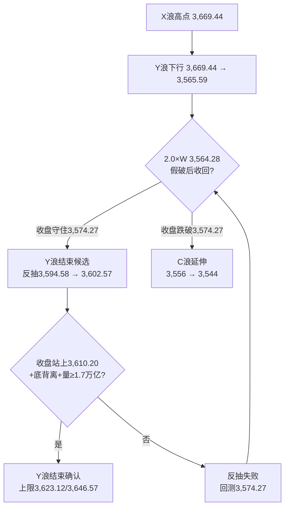
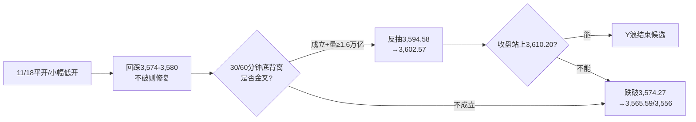

# A股晨报 - 2026年11月18日

> 数据截至：2026-11-18 09:00（北京时间）
> 编制：A股分析师AI代理
> 今日为周三（第47周第3个交易日），正常交易
> 基准：11/17晚报（Y浪2.0×W假破、尾盘ETF托底）

---

## 一、昨日晚报复盘要点回顾

### 1. 昨日判断回顾

| 判断维度 | 晨报预测 | 实际结果 | 准确度 |
|---------|---------|---------|-------|
| 上证趋势 | 看跌（低开探底、弱反抽） | -0.50%，探底回升收跌 | ✓ |
| 指数区间 | 3,560-3,615点 | 3,565.59-3,604.98点 | ✓ |
| 强支撑 | 3,574.27点（收盘） | 盘中最低3,565.59，收盘收回 | ✗（盘中破8.68点） |
| 强压力 | 3,610.20点 | 最高3,604.98点 | ✗（差5.22点） |
| 板块预判 | 7个方向 | 5对2错 | 71.4% |
| 成交量 | 1.40-1.60万亿 | 1.4577万亿 | ✓ |

- **综合准确率：70.0%**（趋势100%、点位33.3%、板块71.4%、成交量100%）
- **波浪分析准确率：约88%**——Y浪2.0×W目标3,564.28 vs 实际低点3,565.59，误差1.31点；"探底回升收3,580-3,600"基础路径兑现。

### 2. 关键偏差及原因

- **偏差1（逻辑误判）**：把费半-5%线性映射至全部电子，实际光刻胶+2.83%、光刻机+2.78%、科创50+0.62%。根因是未拆分"海外映射组（CPO/存储/PCB）"与"国产替代组（设备/材料/光刻机）"两套定价体系，且忽略前一日电子净流出126.7亿后的超跌回补。
- **偏差2（技术局限）**：把"收盘确认线"3,574.27直接当作"盘中强支撑"，盘中破8.68点后收回，属"假跌破"。关键结构位须同时标注盘中容忍带（-0.3%~-0.5%）。
- **偏差3（技术局限）**：连续缩量下跌后的反抽，压力不应直接取结构失效线。按"前日收盘+0.1%~0.2%"测算应为3,588-3,592，实际高点3,604.98落在"前日高点附近"。
- **偏差4（信息缺失）**：北向成交预估偏低，内资缩量快于外资，北向占比被动升至15.54%。

### 3. 沉淀的规则/检查项（今日直接启用）

1. **假跌破规则**：关键结构位盘中跌破<0.3%且收盘收回，按"假跌破"处理，次日须以收盘二次确认，不得用盘中破位判定浪型失效。
2. **电子拆分规则**：半导体必须拆分为"海外映射组（CPO/光模块/存储/PCB）"与"国产替代组（设备/材料/光刻胶/光刻机）"分别定价。
3. **反抽压力规则**：连续两日以上缩量下跌后的反抽日，第一压力取"前日收盘+0.1%~0.2%"与"前日高点"中的较低者（今日对应3,588-3,602.57带）。
4. **ETF托底规则**：尾盘宽基ETF放量但主力净流出<200亿，属被动托底而非增量入场，反弹须次日主动资金转正。
5. **反抽条件规则**：连续3日"跌停>涨停+下跌家数>4,000"后，若缩量至1.45万亿附近且尾盘宽基ETF放量，次日易现技术性反抽。

### 4. 对今日分析的启示

- **风险点**：3,574.27仅"盘中假破"，尚未收盘二次确认；两融去杠杆加速（融资单日净流出214.09亿）；美股连跌、欧洲重挫，外盘风险偏好未修复。
- **逻辑调整**：英伟达财报已落地（超预期），"最大靴子"解除，今日应把"外盘利空映射"改为"利好兑现+国产替代独立"双线思维；但对CPO/光模块只做修复、不做趋势。
- **关键验证**：今日收盘能否站上3,602.57/3,610.20，以及量能能否回到1.6万亿上方，是Y浪是否结束的核心。

---

## 二、隔夜市场动态（11/17收盘后至今）

### 1. 美股市场（11/17收盘，三大指数续跌）

| 指数 | 收盘 | 涨跌幅 | 备注 |
|------|------|--------|------|
| 道琼斯 | **50,759.42** | **-1.64%** | 跌848.75点，领跌 |
| 标普500 | **7,340.53** | **-1.03%** | 连续第4个交易日下跌，9月以来最长连跌 |
| 纳斯达克 | **24,328.38** | **-0.74%** | 跌181.38点，尾盘收窄 |
| 费城半导体 | — | 尾盘拉升、跌幅收窄 | 台积电-近4%、美光-近1%、英伟达-0.48%、博通+2% |
| 光通信 | — | 逆势上涨 | Coherent+3%，Lumentum/Ciena/Credo/康宁+2% |

- **常规交易时段**：美国收紧AI芯片远程出口限制，引发AI投资周期放缓担忧，科技股领跌；但芯片股尾盘拉升，纳指跌幅由盘中逾1.5%收窄至-0.74%。
- **盘后最大变量——英伟达FY27Q3超预期**：
  - 营收**1,158亿美元**（同比+103%、环比+20%），高于预期1,091亿美元；
  - 数据中心营收**1,076亿美元**（同比+110%），新一代Vera Rubin平台开始量产出货；
  - Non-GAAP EPS **2.68美元**（预期2.48美元），GAAP净利润652.9亿美元，毛利率74.8%；
  - **盘后股价涨幅扩大至约5%**，为A股算力链提供"靴子落地"式修复窗口。
- **治理扰动**：黄仁勋称"若董事会允许愿回归CEO"，董事会主席表示不打算让其复职；新任临时CEO Colette Kress将于北京时间11/19凌晨1点召开全员会议，事件仍有不确定性。

### 2. 欧洲/亚太市场

| 市场 | 收盘 | 涨跌幅 |
|------|------|--------|
| 德国DAX | **26,045.37** | **-2.08%** |
| 法国CAC40 | **8,216.78** | **-1.62%** |
| 英国富时100 | **10,689.87** | **-1.76%** |
| 恒生指数（11/17） | 26,384.28 | -0.71% |
| 韩国KOSPI（11/17） | 4,968.48 | -2.59% |
| 日经225（11/17） | — | 收跌801点 |

- **欧洲全线重挫**：美国收紧AI芯片对华出口限制，科技股领跌，DAX连续第三个交易日自历史高位回落。
- **亚太科技链仍在调整**，但A股11/17已走出"国产替代独立"结构，日韩台下跌对A股的拖累边际减弱。
- **富时A50期货夜盘**：收跌**0.09%**，报**12,650点**，对今日开盘指引为"平开至小幅低开"。

### 3. 大宗商品

| 品种 | 最新 | 变动 | 说明 |
|------|------|------|------|
| WTI原油 | **86.01美元/桶** | **+0.34%** | 低位企稳 |
| 布伦特原油 | **93.47美元/桶** | **+1.11%** | 小幅反弹 |
| 现货黄金 | **3,809.5美元/盎司** | **-1.0%** | 日内跌幅扩大，趋势破坏延续 |
| 纽约期金 | 失守**3,820美元/盎司** | **-1.15%** | 4,000整数关失守后加速 |
| 国内黄金9995 | 830.76元/克 | -0.09% | 内外盘同步走弱 |

- **黄金是本轮最弱资产**：AI资产回调引发流动性挤兑时黄金被优先抛售，叠加美债5%以上实际利率，贵金属"趋势破坏"未修复，A股黄金股仍无抄底价值。
- **原油小幅反弹**：WTI 86美元附近企稳，但需求走弱与AI衰退叙事压制，石油石化仅具防御属性。

### 4. 汇率与利率

| 项目 | 数值 | 变动 |
|------|------|------|
| 美元指数 | **103.54** | -0.04% |
| 人民币中间价（11/17） | **6.7132** | 升值9bp，连续第3日升值 |
| 在岸人民币 | 约6.66附近 | 小幅升值 |
| 美债10年期 | **5.109%** | -2.23bp |
| 美债2年期 | 4.802% | -2.53bp |
| 中国10年期国债 | **1.61%** | -2.30bp |
| 中国1年期国债 | 1.17% | -0.06bp |
| DR001 / DR007 | 1.30% / 1.41% | +0.17bp / +1.26bp |

- **美债高位微降但仍在5%上方**，CME"美联储观察"显示**12月加息25bp概率96.8%**、加息50bp概率3.2%；到明年1月累计加息50bp概率70.9%，海外利率高压未解除。
- **国内流动性平稳**：央行11/17开展**7,140亿元隔夜逆回购（1.25%）**，对冲4,600亿到期后**净投放2,540亿元**，呵护税期。
- **中美利差仍阔**（10年期中美元约350bp），人民币连续升值但幅度收窄，汇率非当前主要矛盾。

### 5. 重要海外事件

- **美国商务部发布限制远程获取先进半导体临时最终规则**：以新加坡、泰国、马来西亚、印尼、巴西存在非法对华转移芯片高风险为由，要求向相关国家企业出口先进芯片时申请许可证。
- **中国外交部、商务部先后回应**：强烈不满、坚决反对，指其为"典型经济胁迫和长臂管辖"，**"若美方一意孤行，中方将采取反制措施"**——这是今日最大的双刃变量：短期强化国产替代，但也提升科技链摩擦风险。
- **纽约联储行长Williams**：通胀仍须降温，但无需大幅升息，边际偏鸽。
- **Anthropic IPO**：计划11/18定价、11/19开始交易，全球AI资产定价锚。
- **阿里巴巴**今日举办Q3财报电话会。

---

## 三、今日关注事项

### 1. 重要数据/事件（按时间排序）

| 时间 | 数据/事件 | 前值/预期 | 影响 |
|------|----------|----------|------|
| 15:00 | 英国10月CPI月率、零售物价指数 | — | 影响欧美利率预期 |
| 18:00 | 欧元区10月CPI年率/月率终值 | — | 验证欧央行路径 |
| 21:30 | 美国当周初请失业金人数、10月新屋开工 | — | 影响12月加息定价 |
| 23:30 | 美国EIA原油库存（至11/13） | — | 影响油价 |
| 全天 | **APEC第三十三次领导人非正式会议（11/18-19，深圳）** | — | 区域/开放主题催化 |
| 全天 | 2026中国5G+工业互联网大会（武汉） | — | 6G/通信/工业互联网 |
| 11/19 01:00 | 英伟达临时CEO Colette Kress全员会议 | — | 治理不确定性 |
| 11/18 | Anthropic IPO定价；阿里巴巴Q3电话会 | — | 全球AI/中概定价 |

### 2. 政策/监管动态

- **工信部同意北京、河北、上海、江苏、浙江、安徽、湖北、广东8省市开展6G创新发展部省协同试点**，涉及商业应用须取得电信业务经营许可。
- **广东省印发《数字广东建设"十五五"规划》**：推动5G-A规模部署、6G试验攻关、万兆光网试点、粤港澳大湾区量子通信骨干网、通导遥一体化低轨星座。
- **商务部等9部门印发《关于深入推进再生资源回收体系建设促进回收行业高质量发展的意见》**：加强废旧动力电池回收处理，推动新能源汽车"车电一体报废"。
- **外交部/商务部就美半导体出口限制表态**：将采取必要措施/反制措施，维护正当权益。
- **第二次中国-加拿大经济财金战略对话成果**：欢迎加拿大养老金等长线资金通过QFI投资中国资本市场。

### 3. 公司公告/事件

- **复星医药**：董事长提议回购2.5亿-5亿元A股。
- **中国电建**：控股股东拟12个月内增持5亿-7亿元。
- **百利天恒**：全资子公司收到百时美施贵宝第二笔2.5亿美元里程碑付款，累计已收13亿美元。
- **生益科技**：连续3个交易日收盘跌幅偏离值累计超20%，公司称经营正常、订单饱满（PCB/覆铜板情绪警示）。
- **九阳股份**：股票异常波动，澄清**与华为无战略合作关系**（华为概念降温）。
- **云南锗业**：高品质磷化铟单晶片项目总投资由1.89亿元增至2.7亿元。
- **欧科亿**：拟定增募资不超9.5亿元，投向数控刀具及AI PCB钻针用超细硬质合金棒材。
- **杭萧钢构**：拟1亿-2亿元回购注销；**捷佳伟创**：拟3亿-5亿元回购。
- **荣盛发展、\*ST华幸**：收盘价首次低于1元，存在终止上市风险。
- **名创优品**：Q3收入66.25亿元（+14.3%），期内利润2.906亿元（-34.4%）。

### 4. 其他关注

- **新股申购**：今日暂无新股申购、无新股上市。
- **限售解禁**：8家公司合计解禁4.23亿股，按最新收盘价计算**解禁市值92.51亿元**，其中**恒坤新材**等2家解禁超千万股。
- **QDII ETF溢价风险**：11/17晚超20只QDII ETF发布高溢价提示，近10只于**今日开市起停牌一小时、10:30复牌**，警惕溢价回落。
- **2026苏州工业自动化及机器人展**（11/18-20）、**第三届中国（苏州）工业母机供应链展览会**（11/18-20）、**西南采矿业科技创新大会**（11/18-20）。

---

## 四、板块与个股分析（结合昨日复盘）

### 1. 基于昨日复盘结论的板块调整

- **昨日看涨板块（银行/家电/食品饮料）**：银行+0.31%、家电+0.82%、食品饮料+0.30%，全部兑现。今日在"高低切换+防御"逻辑下仍具韧性，但银行四大行已创历史新高，**只做回踩、不追高**；家电有10月出口金额+20.9%的基本面支撑，优先级上修。
- **昨日看跌板块（光模块/CPO、贵金属、石油石化）**：CPO/通信-2.27%、贵金属下跌、石油石化走弱，全部兑现。今日因英伟达超预期，**CPO/光模块改为"修复反弹但不追高"**；贵金属继续看跌；石油石化随油价小幅反弹，降为中性。
- **昨日偏差板块（半导体设备）**：光刻胶+2.83%、光刻机+2.78%，国产替代独立走强。今日**继续看涨，但须以"电子行业主力资金是否续流入"为前提**，且只聚焦订单/产能/涨价落地的核心环节，不做普涨假设。

### 2. 隔夜信息驱动的板块机会

**受益板块：**

1. **国产半导体设备/材料/光刻胶/光刻机**
   - 逻辑：美国收紧远程获取先进芯片→自主可控紧迫性上升；外交部/商务部强硬表态强化"反制+替代"预期；英伟达Q3超预期验证AI资本开支未逆转；11/17电子行业主力净流入1.39亿、结束连续流出。
   - 约束：只做"国产替代组"，与CPO/存储/PCB分开定价；若今日电子主力净流出>50亿，则降级为"冲高回落"。

2. **6G/通信设备/卫星互联网/算力基础设施**
   - 逻辑：工信部8省市6G试点+5G+工业互联网大会（武汉）+《数字广东"十五五"规划》+深圳"灵晟"超算蝉联全球第一（2.198 EFlops）。
   - 特征：政策密集、位置偏低，属"事件+产业"双驱动，适合短线轮动。

3. **家电/食品饮料/银行红利**
   - 逻辑：10月家电出口4.02亿台（+14.1%）、金额89.56亿美元（+20.9%）；缩量分化期资金沿"低位、低估值、有业绩验证"迁移；银行高股息+年末考核。
   - 约束：防御属性强于进攻，指数反抽时相对收益可能跑输。

4. **动力电池回收/再生资源**
   - 逻辑：9部门意见补齐动力电池回收短板，健全光电设备回收体系，政策首次系统部署"新三样"固废回收。

**受损板块：**

1. **贵金属/黄金股**：现货金失守3,810美元、纽约期金失守3,820美元，趋势破坏+实际利率高，反弹即减。
2. **传媒/短剧/高位连板**：11/17传媒-4.72%、批量跌停，退潮期低位主题持续性通常<3个交易日。
3. **光伏**：前三季度地面电站新增装机同比-59%、工商业分布式-67%，装机数据恶化压制估值。

### 3. 重点关注个股

| 个股/方向 | 关注理由 | 技术位置 | 操作参考 |
|-----------|---------|---------|---------|
| **有研新材** | 光刻胶/靶材龙头，11/17涨停、主力净流入11.73亿，国产替代最强主线 | 涨停后首日，防高开回落 | 不追高，回踩5日线观察 |
| **北方华创/中微公司** | 半导体设备核心，受益出口限制倒逼替代 | 跟随科创50，相对抗跌 | 只在电子资金净流入时参与 |
| **中际旭创/新易盛** | CPO/光模块，英伟达超预期带来修复窗口 | 连续下跌后超跌 | 只做修复，反抽5日线减 |
| **美的集团** | 家电出口+20.9%，连创新高 | 趋势多头 | 回踩10日线低吸 |
| **工商银行** | 红利护盘，四大行创历史新高 | 高位强势 | 只做回踩，不追高 |
| **中国电建** | 控股股东增持5亿-7亿元 | 低位 | 事件驱动，轻仓 |
| **百利天恒** | 收到BMS第二笔2.5亿美元里程碑款 | 创新药独立逻辑 | 事件催化，不追高 |
| **恒坤新材** | 今日解禁（8家合计92.51亿元） | 解禁压力 | 回避 |

---

## 五、今日核心判断

### 1. 趋势判断

- **上证指数：【震荡】（偏技术性修复）**
- **预测区间：3,570点 - 3,615点**
- **核心逻辑**：英伟达Q3营收+103%、盘后涨约5%，最大不确定性落地，叠加国产替代催化（美国出口限制+6G试点），指数具备"Y浪2.0×W假破后的技术性反抽"条件；但美股连跌4日、欧洲重挫、两融去杠杆（融资净流出214亿）、量能连续7日缩量，反抽高度受制于3,602.57-3,610.20，且3,574.27仅"盘中假破"未获收盘二次确认，故定性为"震荡修复"而非"反转"。

### 2. 关键点位

- **强支撑位：3,574.27点**（依据：月线生死线/11月结构失效线；仅收盘价可判定失效，**盘中容忍带3,565-3,574**）
- **弱支撑位：3,580.38点 / 3,586.57点**（依据：月K实体下沿、11/16低点；跌破则回测3,574.27）
- **弱压力位：3,594.58点**（依据：60分钟下降压力线；第一反抽带按规则取3,588-3,595）
- **强压力位：3,610.20点**（依据：周线箱体下沿/月线结构失效线，收复需量能≥1.7万亿）

### 3. 板块预判

- **看涨板块**：
  （1）**国产半导体设备/材料/光刻胶**（逻辑：美国出口限制倒逼自主可控+英伟达超预期+电子资金回流）
  （2）**6G/通信设备/卫星互联网**（逻辑：8省市试点+5G+工业互联网大会+数字广东规划）
  （3）**家电/食品饮料/银行红利**（逻辑：10月家电出口+20.9%，缩量期高低切换）
  （4）**动力电池回收/再生资源**（逻辑：9部门政策补齐回收短板）
- **看跌板块**：
  （1）**贵金属/黄金**（逻辑：金价失守3,810美元，趋势破坏+实际利率高）
  （2）**传媒/短剧/高位连板**（逻辑：11/17传媒-4.72%批量跌停，退潮未完成）
  （3）**光伏**（逻辑：前三季度地面电站装机-59%、工商业分布式-67%）
- **风险板块**：
  - **海外算力链（CPO/光模块/存储/PCB）**：英伟达超预期易致高开，但"利好兑现"+台积电-4%+生益科技3日-20%，**高开低走风险大，不追高**；
  - **QDII溢价ETF**：今日10:30前停牌一小时，溢价回落风险；
  - **解禁股**：恒坤新材等8家、92.51亿元；
  - **华为概念**：九阳澄清无战略合作，题材降温。

### 4. 资金面判断

- **北向资金预期**：净额不披露；成交额预计**2,100-2,400亿元**，占比**15%-16%**（前值2,265.71亿元/15.54%，按前日×0.95-1.05且不因指数下跌下调）。
- **成交量预期：【平量至小幅放量】**，预计**1.45-1.65万亿元**（前值1.4577万亿）；若反抽成立需≥1.60万亿，确认需≥1.70万亿。
- **两融**：截至11/16余额**22,650.12亿元**，融资余额环比-0.95%、融资净流出**214.09亿元**，两融成交占A股成交7.66%，杠杆资金仍在去化。
- **央行**：7,140亿元隔夜逆回购（1.25%），净投放2,540亿元，流动性"合理充裕"。

### 5. 风险预警（按优先级排序）

- **高风险**：**美国远程芯片出口限制+中方"反制措施"表态**——若今日出现具体反制清单，科技链可能剧烈波动；英伟达临时CEO/黄仁勋复职风波未平（11/19凌晨全员会）。
- **中风险**：**两融去杠杆加速**（融资单日净流出214亿）叠加成交连续7日缩量，反抽缺乏增量资金；3,574.27仅盘中假破，收盘二次确认未完成。
- **中风险**：**QDII ETF溢价回落**（10只停牌一小时）+ **92.51亿元解禁**（恒坤新材等）。
- **低风险**：APEC深圳峰会、6G试点、5G+工业互联网大会等事件性催化，持续性通常1-3日。

### 6. 昨日复盘规则应用

- **应用规则1（假跌破）**：3,574.27昨日盘中破8.68点后收回，今日以**收盘**二次确认；盘中下探3,565-3,574不视为结构失效，止损仍以收盘3,574.27为准，不上移至收回价。
- **应用规则2（电子拆分）**：国产替代组（设备/材料/光刻胶）看涨；海外映射组（CPO/存储/PCB）只做超跌修复，不因英伟达超预期而追高。
- **应用规则3（反抽压力）**：第一压力取3,588-3,595（前日收盘+0.1%~0.2%与60分钟压力线），强压力3,610.20；反抽不放量即在3,602.57-3,610.20减仓。
- **应用规则4（ETF托底）**：昨日尾盘宽基ETF放量属被动托底，今日须观察**主动资金是否转正**（主力净流入>0）才能确认反抽有效。
- **应用规则5（反抽条件）**：连续3日跌停>涨停+下跌家数>4,000后缩量至1.45万亿+ETF放量，今日易现技术性反抽，但反抽≠反转。

---

## 六、波浪理论参考

### 1. 月K线波浪分析

- **当前波浪位置**：大级别3浪2扩张（W-X-Y）的**Y浪延伸末段**；月K为"带长上影阴线"，11/17盘中最低3,565.59首次触及月线生死线3,574.27下方，**收盘3,584.58重新收回，结构未确认失效**。
- **浪型结构描述**：11月开3,614.13 → 高3,699.58 → 低**3,565.59** → 现3,584.58，月内**-0.40%**；上影85.45点、下影18.99点、实体-29.55点。
- **关键目标位**：上方3,602.57→3,610.20→3,646.57→3,664.82（颈线）；下方3,580.38→**3,574.27（生死线）**→3,565.59→3,556→3,544（2.382×W）→3,478。
- **验证条件**：**月线收盘（11/28）守住3,574.27，则3浪2扩张框架仍有效**；若月线收盘跌破3,574.27，改按"C浪延伸"，下看3,478/3,443。

### 2. 周K线波浪分析

- **当前波浪位置**：第47周（11/16-11/20）**箱体下沿3,610.20确认失守**，周线下降推动浪延伸中；3,574.27为"假破"候选。
- **浪型结构描述**：本周开3,611.54 → 高3,623.12 → 低**3,565.59** → 现3,584.58，周内**-1.37%**；周K为"带下影小阴"，连续第2周收阴、低点下移。
- **关键目标位**：上方3,594.58→3,602.57→3,610.20→3,623.12→3,646.57；下方3,574.27→3,565.59→3,556→3,544→3,523（2.618×W）。
- **验证条件**：周线止跌需**本周收盘站上3,610.20且周成交≥8.5万亿**（前两日合计仅约2.93万亿，达标难度大）；若周收盘<3,574.27，则周线下降推动浪延伸至3,544。

### 3. 日K线波浪分析

- **当前波浪位置**：W-X-Y扩张调整的**Y浪第5子浪末端**，11/17延伸至**3,565.59**后收回，**精准触及2.0×W目标3,564.28（误差1.31点）**，Y/W=1.975。
- **浪型结构描述**：W浪 3,699.58→3,647.00（-52.58）→ X浪 3,647.00→3,669.44（+22.44，0.427回撤）→ Y浪 3,669.44→**3,565.59（-103.85）**；收盘3,584.58重新站上1.618×W（3,584.37，超出0.21点）。
- **关键目标位**：下方3,580.38→**3,574.27**→3,565.59→3,564.28（2.0×W已触及）→3,556→3,544（2.382×W）；上方3,594.58→3,602.57→**3,610.20**→3,623.12→3,646.57。
- **验证条件**：**Y浪结束候选=收盘站上3,610.20+30/60分钟底背离+量能≥1.7万亿**；若3个交易日内收盘重回3,610.20上方，则"2.0×W假破+Y浪结束"成立（反抽上限3,646.57）；反之收盘<3,574.27则C浪延伸。

### 4. 60分钟K线波浪分析

- **当前波浪位置**：Y浪第5子浪**末段**，11/17早盘最后一跌至3,565.59后回升，**MACD底背离雏形（价格新低、绿柱未同步放大）**，但尚未金叉。
- **浪型结构描述**：跳空低开→反抽3,604.98→13:30跳水至3,565.59→尾盘ETF放量拉回3,584.58；**60分钟下降压力线今日约在3,594-3,600**。
- **关键目标位**：上方3,594.58→3,602.57→3,610.20→3,617；下方3,580.38→3,574.27→3,565.59。
- **验证条件**：**60分钟收盘站上3,602.57且MACD金叉=Y浪结束第一信号**；若绿柱重新放大并跌破3,574.27，则延伸至3,556/3,544。

### 5. 30分钟K线波浪分析

- **当前波浪位置**：Y浪末段**超卖修复**，30分钟MACD新低后金叉、**底背离成立**，但量能未放大。
- **浪型结构描述**：午后跳水至3,565.59时量能脉冲放大后迅速萎缩，30分钟RSI自20下方回升至40附近，尾盘连续小阳收复3,580.38。
- **关键目标位**：上方3,594.58→3,600（整数关）→3,602.57；下方3,580.38→3,574.27→3,565.59。
- **验证条件**：开盘30分钟站上3,594.58且量能不低于昨日同期→反抽延伸至3,602.57-3,610.20；若直接跌破3,574.27，则30分钟底背离失效、下探3,556。

### 6. 波浪图

**日K线波浪结构图**

**60分钟波浪结构图**

### 7. 波浪理论综合判断

- **多周期共振状态**：月线**空但未确认失效**（★☆，盘中破生死线收盘收回）、周线空（★，箱体下沿失守、连续第2周阴）、日线**Y浪2.0×W假破后止跌**（★★，底背离待收盘确认）、60分钟**底背离雏形**（★★，方向转平）、30分钟**底背离成立**（★★，超卖修复）——**"中长周期偏空+短周期超跌修复"的背离结构**，是Y浪末端典型特征。
- **当前操作级别**：**日线防守、30/60分钟只做反抽**；3,574.27未收盘失守前按"2.0×W假破+Y浪结束候选"处理，失守则观望。
- **后续演变路径**：
  - **基础路径（55%）**：平开至小幅低开，回踩3,574-3,580不破，反抽3,594.58-3,602.57后震荡，收3,585-3,605，量能1.48-1.60万亿；
  - **偏强路径（25%）**：英伟达超预期+国产替代共振+ETF增援，收盘站上3,610.20，上探3,623.12，但难一次性收复3,646.57；
  - **偏弱路径（20%）**：出口反制升级+两融去杠杆，收盘跌破3,574.27，下看3,565.59/3,556（2.382×W前哨），创业板测2,250。
- **关键拐点信号**：**止跌=收盘≥3,602.57+30分钟底背离+量≥1.6万亿**；**反转确认=收盘≥3,610.20且量≥1.7万亿**；**结构失效=收盘<3,574.27**；**延伸升级=收盘<3,565.59→3,544**。
- **风险提示**：W-X-Y计数主观性强，Y浪可延伸为"5-3-5"C浪；2.0×W为统计位置而非支撑承诺；**英伟达超预期只解除"业绩靴子"，未解除"出口管制+治理风波"风险**，不得以盘后涨幅线性外推A股满仓抄底。

---

## 七、投资策略建议

### 1. 短线策略（1-3个交易日）

- **适用场景**：日K线+60分钟技术信号，英伟达财报落地后的修复窗口
- **短线仓位：0-5%**（较昨日0-3%小幅上修，仍以条件触发为前提）
- **买入条件**（须同时满足）：
  1. 开盘30分钟**不跌破3,574.27**；
  2. 站上**3,594.58**且量能不低于昨日同期；
  3. 收盘站上**3,602.57**。
  三条不同时满足则维持0-3%或空仓。
- **卖出条件**：反抽至3,610.20-3,623.12不放量即减；触及3,623.12无量滞涨全部了结。
- **止损位**：**收盘跌破3,574.27**（或个股跌幅3%）
- **短线标的**：
  （1）**国产半导体设备/光刻胶龙头（北方华创、有研新材）**（逻辑：出口限制+英伟达超预期，只做回踩不追涨停）；
  （2）**6G/通信设备（中兴通讯等）**（逻辑：8省市试点+5G+工业互联网大会，政策事件驱动）；
  （3）**美的集团**（逻辑：家电出口+20.9%，防御+业绩验证）。

### 2. 中线策略（1-4周）

- **适用场景**：周K线波浪+运行规律分析
- **中线仓位：10%**（维持，不因单日反抽加仓）
- **方向判断**：**【持有/观望】**（较昨日"持有/观望"维持）
- **目标区间**：上证指数 **3,565点 - 3,646点**
- **中线布局板块**：
  （1）**银行/红利**（逻辑：年末考核+高股息+低波，唯一确定性）；
  （2）**食品饮料/家电**（逻辑：出口链+必选消费，退潮期防御）；
  （3）**国产半导体设备/材料**（逻辑：自主可控长逻辑，仅在电子资金净流入时持有，不追高）。
  **减配**：煤炭/公用/交运（红利内部被主题抽血，降为中性）；**清空/回避**：贵金属、CPO/光模块/存储、高位连板、传媒/短剧、光伏。
- **止盈条件**：指数到达3,623.12-3,646.57分批减仓；或持仓波段涨幅达10%
- **止损条件**：**收盘跌破3,574.27**（清中线至5%以下）；或趋势确认反转

### 3. 仓位分配总览

| 策略类型 | 仓位比例 | 方向 | 重点板块 |
|---------|---------|------|---------|
| 短线 | 0-5% | 条件触发才试探 | 国产半导体设备、6G通信、家电 |
| 中线 | 10% | 持有/观望 | 银行/红利、食品饮料/家电、半导体设备 |
| 现金 | 85-90% | — | — |

### 4. 与昨日策略对比

- **短线仓位**：由0-3%上修至**0-5%**（原因：英伟达财报超预期，最大业绩靴子落地；但仍须"不破3,574.27+站上3,594.58+收盘3,602.57"三条件同时满足）。
- **中线仓位**：维持**10%**；若今日收盘站上3,610.20且量≥1.7万亿，可上调至15%；若收盘跌破3,574.27，减至5%以下。
- **板块调整**：**新增国产半导体设备/材料为中线观察仓、6G通信为短线事件**；**减配煤炭/公用/交运**；**CPO/光模块由"看跌"改为"修复不追高"**；继续回避贵金属、高位连板、传媒/短剧、光伏。
- **纪律**：反抽不放量不加仓；3,574.27以收盘定生死；QDII溢价ETF不参与；今日解禁股（恒坤新材等）回避。

---

## 八、信息来源

1. **官方数据来源**：中国人民银行（11/17开展7,140亿元隔夜逆回购、利率1.25%、净投放2,540亿元；人民币中间价6.7132）、上海证券交易所（上证3,584.58/-0.50%、成交6,905亿、低点3,565.59）、中国货币网（DR001 1.30%、DR007 1.41%）、国家能源局（前三季度光伏新增并网11,032.9万千瓦）、工信部（6G创新发展部省协同试点）、商务部等9部门（再生资源回收体系建设意见）、外交部/商务部（就美半导体出口限制答记者问）
2. **权威财经媒体**：新华社/央视财经（美股收盘）、证券时报（美股全线收跌、英伟达财报）、中国证券报（英伟达Q3业绩超预期、盘后涨超4%）、上海证券报·中国证券网（深市科技公司自主可控）、金融界财经早餐（11/18宏观/公司要闻）、财联社（投资日历、现货黄金3,809.5美元、A50夜盘）、第一财经（今日重点关注数据）、新浪财经（国际金融要情11/18、限售解禁92.51亿元）
3. **数据平台**：东方财富（欧洲三大股指、美股收盘）、Wind资讯（两融余额22,650.12亿元、融资净流出214.09亿元）、同花顺iFinD（国债收益率）、新浪财经（美元指数103.54、美债10年期5.109%）
4. **研究机构**：财信证券晨会纪要20261118（市场策略、行业与公司动态）、广发证券（国产算力链）、粤开证券市场日报
5. **数据截止时间**：**2026-11-18 09:00（北京时间）**；美股为11/17收盘+盘后，欧洲为11/17收盘，A股/港股为11/17收盘，A50为11/18夜盘收盘；北向净额不披露，以成交额替代；两融余额截至11/16

---

> **免责声明**：本报告为AI辅助生成的开盘前分析，所有点位、概率、目标位均为基于公开数据的技术推演，不构成投资建议。市场有风险，决策需独立。
