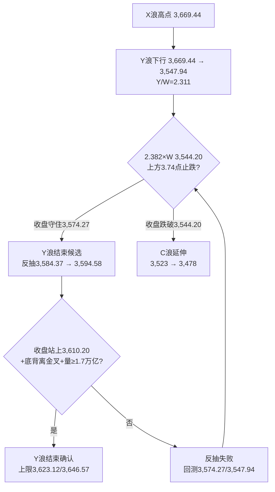
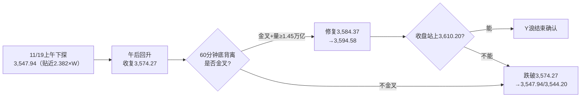

# A股晚报 - 2026年11月19日

> 数据截至：2026-11-19 20:00（北京时间）
> 编制：A股分析师AI代理
> 今日为周四（第47周第4个交易日），正常交易
> 基准：11/19晨报（震荡偏弱修复，区间3,565-3,606，强支撑3,574.27以收盘定生死）

---

## 一、市场回顾

### 1. 主要指数表现

| 指数 | 收盘 | 涨跌幅 | 最高 | 最低 | 成交额 |
|------|------|--------|------|------|--------|
| 上证指数 | **3,577.62** | **-0.28%（-10.21）** | 3,584.28 | **3,547.94** | 6,369.09亿 |
| 深证成指 | **10,583.20** | **-0.71%** | — | — | 6,682.38亿 |
| 创业板指 | **2,293.34** | **-0.79%** | — | — | — |
| 科创50 | **1,270.78** | **+1.83%** | — | — | — |
| 科创综指 | — | **-0.33%** | — | — | — |
| 上证50 | — | **+0.32%** | — | — | — |
| 沪深300 | — | **+0.03%** | — | — | — |
| 深证综指 | **1,997.54** | **-1.47%（跌破2,000点）** | — | — | — |
| 北证50 | **798.64** | **-3.99%** | — | — | — |

- **指数结构极端分化**：上证50 +0.32%、沪深300 +0.03%、科创50 +1.83%，而深证综指 -1.47%、北证50 -3.99%。权重与半导体撑住指数，中小盘与题材股全面失血，"指数跌幅不大、个股亏钱效应极强"。
- **日内路径**：上证小幅低开于3,583.12，早盘冲高3,584.28即为全天最高，随后单边下探至**3,547.94**（跌破昨日低点3,560.45、逼近2.382×W 3,544.20），午后震荡回升、尾盘长线资金承接，收3,577.62，**收盘重新站上月线生死线3,574.27（仅高3.35点）**，留下29.68点长下影。
- **创业板连续弱势**：2,293.34点创阶段新低区域，成长内部仅半导体设备/材料逆势，传媒、软件、电脑硬件、电力设备全面拖累。

### 2. 成交量能

| 项目 | 数值 | 变动 |
|------|------|------|
| 沪深两市成交额 | **13,051亿元（1.31万亿）** | **-646亿（-4.8%）** |
| 沪深北三市成交额 | 约1.32万亿 | 再创年内新低 |
| 沪市成交 | 6,369.09亿 | — |
| 深市成交 | 6,682.38亿 | — |
| 北向资金成交 | **2,101.36亿（占16.10%）** | 占比继续抬升 |
| 主力资金 | **净流出234.59亿（连续6日净流出）** | 科创板+6.52亿、创业板-51.53亿 |
| 两融余额 | **22,010.03亿** | **-87.68亿（四连降）** |

- **量能再刷年内新低**：1.31万亿较昨日1.3697万亿续缩646亿，较5日均量-17.4%、较20日均量-21.6%，为近一年地量。地量之下，任何板块行情都只能是存量博弈。
- **主力资金连续第6日净流出**：电子逆势净流入23.80亿（居首），计算机-47.32亿、机械设备-26.56亿、有色金属-21.76亿、医药生物-21.16亿、电力设备-20.86亿、传媒-20.30亿、银行-17.50亿。
- **个股资金**：净流入前列为新易盛+13.38亿（+5.59%）、中芯国际+11.09亿、中际旭创+10.41亿；净流出前列为华东重机-6.33亿、华胜天成-5.11亿、盛科通信-U-4.62亿。
- **北向成交**：2,101.36亿元、占比16.10%；沪股通成交前三为寒武纪20.11亿、紫金矿业19.47亿、贵州茅台18.07亿。

### 3. 市场情绪

| 指标 | 数值 | 说明 |
|------|------|------|
| 上涨/下跌/平盘 | **649 / 4,876 / 48** | 红盘率**11.6%**，连续第6个交易日超4,100只下跌 |
| 涨停/跌停 | **28 / 83** | 涨停数创2024年7月8日以来新低，跌停数为涨停近3倍 |
| 封板率 | **49.06%** | 较昨日下降约12个百分点，接力意愿冰点 |
| 最高连板 | **3板（真视通、盛剑科技、全筑股份）** | 较昨日4板继续降高度 |
| 连板晋级率 | **11.9%**（5/42） | 1进2仅6.1%（2/33） |
| 跌幅超7%个股 | **196只** | 个股杀跌烈度显著高于指数 |

- **情绪处于极致冰点**：涨停28只创逾两年新低、跌停83只、封板率跌破50%、最高板降至3板，四项指标同步指向"退潮末段"。
- **昨日4板华东重机今日炸板（+4.07%）**，天普股份复牌跌停（-10.00%），九阳股份天地板次日反抽涨停但未能带动厨卫电器，说明高位股接力链条已断。
- **指数与宽度严重背离**：上证仅-0.28%，但下跌家数4,876只、跌停83只，"指数失真"程度为本轮调整以来最极端。

---

## 二、热点板块与异动分析

### 1. 领涨板块及驱动因素

| 板块 | 表现 | 驱动因素 |
|------|------|---------|
| **半导体/晶圆代工** | 科创50 +1.83%；中芯国际+6%、华虹宏力+8% | 晶圆代工涨价10%-20%持续发酵、DRAM长协、国产替代；电子主力净流入23.80亿 |
| **存储芯片/先进封装** | 存储概念主力净流入超44亿、先进封装近30亿、半导体行业逾26亿 | 长鑫科技晚间拟将回购上限提高至50亿元；三星/苹果DRAM长协预期 |
| **电子化学品/半导体附属装备** | 江化微、格林达、红宝丽、大港股份涨停，盛剑科技3连板，蓝箭电子20cm涨停 | 国产替代+涨价传导+世界计算大会（长沙）催化 |
| **光模块/CPO** | 新易盛+5.59%（成交146.30亿），中际旭创、天孚通信红盘 | 中际旭创20-40亿回购、新易盛订单能见度、超跌修复；资金净流入前三占两席 |
| **家电** | 家电+0.69%居申万一级首位；九阳股份涨停、海信家电+5% | 出口链韧性+以旧换新+低位防御，资金从题材切向确定性 |
| **食品饮料/非银** | 食品饮料+0.65%、非银+0.24% | 仅有的三个收红行业，防御与尾盘护盘属性 |

- **主线只剩一条：半导体自主可控**。在传媒、计算机、电力设备全线杀跌的背景下，半导体设备/材料/存储/电子化学品形成"孤岛抱团"，且伴随真实资金净流入，而非纯情绪脉冲。

### 2. 领跌板块及原因

| 板块 | 表现 | 原因 |
|------|------|------|
| **传媒** | **-3.54%（跌幅第一）**，影视院线、AI短剧、游戏重挫 | 前期短剧/AI漫剧炒作退潮，慈文传媒、横店影视等大跌；监管与业绩真空期双杀 |
| **计算机** | **-3.01%**，主力净流出47.32亿居首 | 信创、软件、电脑硬件全面回调；高位AI应用兑现 |
| **电力设备** | -1.84%，净流出20.86亿 | 新能源赛道持续失血，缺乏催化 |
| **机械设备** | -1.66%，净流出26.56亿 | 机器人、工程机械退潮 |
| **有色金属/贵金属** | -1.57%，贵金属下跌 | 现货黄金跌破3,700美元/盎司、创去年9月以来新低，白银44.59美元；实际利率压制延续 |
| **医药生物** | -0.98%，净流出21.16亿 | 创新药高位股补跌，防御属性失效 |
| **商贸零售/社会服务** | -2.15% / -2.24% | 消费数据偏弱（1-10月社零仅+1.0%），冰雪旅游题材退潮 |
| **煤炭/公用事业** | -0.86% / -0.57% | 寒潮逻辑未能对抗整体风险偏好下行，红利内部也分化 |

- **"高低切换"失败**：资金并未从科技切向消费/红利，而是从所有高β与题材方向撤离，仅保留半导体一个出口。防御板块（家电、食品饮料、非银）虽收红，但涨幅均在1%以内，承接力有限。

### 3. 个股异动复盘

- **涨停28只**：真视通（AI应用+液冷算力，一字3板）、盛剑科技（半导体附属装备，3板）、全筑股份（先进光源+边缘AI算力，一字3板）、京蓝科技（7N高纯铟，2板）、华升股份（2板）、江化微、格林达、红宝丽、大港股份、蓝箭电子（20cm）、九阳股份等。
- **跌停83只**：天普股份（复牌补跌-10%）、燧原科技-U（-20%，龙虎榜4家机构净卖出5.10亿）、双环科技（-9.90%）、泰嘉股份（-9.98%）、慈文传媒、横店影视等影视传媒股。
- **炸板**：华东重机（4进5失败，+4.07%，主力净流出6.33亿）、卡莱特（+19.97%炸板）。
- **强势股回调**：华胜天成（-0.71%，前4天3板）、盛科通信-U（大跌，净流出4.62亿）。

---

## 三、关键数据与事件回顾

### 1. 国内重要经济数据

- **商务部例行新闻发布会（11/19）**：1-10月社会消费品零售总额同比增长**1.0%**，除汽车以外增长2.8%；服务零售额增长**4.9%**，高于商品零售4个百分点；限额以上粮油食品、化妆品、饮料零售额分别增长6.1%、5.6%、4.9%。今年"双十一"整体平稳，线上下单、线下体验新模式受欢迎。
- **消费数据偏弱是今日商贸零售、社会服务、纺织服饰下跌的基本面背景**，但也强化了"弱数据→宽货币/促消费"的政策预期。

### 2. 政策消息

- **APEC第三十三次领导人非正式会议11/18-19在深圳举行**；《2026年亚太经合组织工商领导人峰会深圳倡议》11/18发布，为峰会创办30年来首份倡议形式成果文件，核心落在开放、创新、跨境投资等方向。峰会今日闭幕，事件性催化进入兑现阶段。
- **商务部：中美经贸团队在各层级保持沟通**；11/13中美经贸磋商机制项下贸易理事会首次会议已举行，农业工作组将于近期召开首次会议。中美关系维持"沟通中偏稳"。
- **央行公开市场**：开展7,675亿元隔夜逆回购（利率1.25%），到期7,002亿元，**净投放673亿元**，跨月前流动性呵护延续。
- **人民币中间价6.7128**，较前一交易日调贬10个基点，结束连续4日升值，但幅度有限。

### 3. 公司公告/事件

- **长鑫科技（688825）**：晚间公告拟将回购金额上限提高至**50亿元**（不低于25亿元），含注销减资安排，DRAM龙头加码回购。
- **广立微（301095）**：拟回购不低于5,000万元且不超过1亿元；**华立股份（603038）**：控股股东提议回购5,000万-1亿元。
- **天普股份（605255）**：复牌首日跌停-10%，前期高位股补跌兑现。
- **燧原科技-U**：今日跌20%，4家机构专用席位合计净卖出5.10亿元。
- **DeepSeek千亿融资落地**：31家出资主体、产业资本大集结，AI算力/应用叙事仍在，但短期对二级市场形成分流。
- **首批18只主动ETF将于11/23集中上市**，科创50ETF易方达本月以来累计获57亿元净流入，增量资金仍在蓄势。

---

## 四、海外市场联动

### 1. 美股（11/18收盘，最新可得）

| 指数 | 收盘 | 涨跌幅 | 备注 |
|------|------|--------|------|
| 道琼斯 | 50,198.17 | **-1.11%** | 跌561.25点 |
| 标普500 | 7,323.63 | **-0.23%** | 连续第5个交易日下跌 |
| 纳斯达克 | 24,429.88 | **+0.42%** | AI硬件分化中翻红 |

- **英伟达收跌2.89%（150.96美元）**，AMD、博通、亚马逊走强，资金"换马不下车"；中概股普跌（爱奇艺-16%、微博-6%）。对A股算力链的映射为"分化、非系统性"。
- **Anthropic（ANT）今晚纳斯达克首日**：发行价70-78美元、估值约1.4万亿美元，为全球AI资产"信仰试金石"，其结果将直接影响明日A股AI应用/算力情绪。

### 2. 欧洲/亚太（11/18-11/19）

| 市场 | 收盘 | 涨跌幅 |
|------|------|--------|
| 德国DAX（11/18） | 25,736.24 | -1.19% |
| 法国CAC40（11/18） | 8,146.83 | -0.85% |
| 英国富时100（11/18） | 10,551.17 | -1.30% |
| 日经225（11/19） | **59,444.21** | **+0.71%** |
| 韩国KOSPI（11/19） | **5,099.34** | **+0.63%** |
| 恒生指数（11/19） | — | **-1.95%** |
| 南向资金（11/19） | — | **净买入39.58亿港元** |

- **亚太分化**：日韩收涨、港股大跌1.95%，A股跟随港股走弱。南向资金逆势净买入39.58亿港元，港股下跌更多是外资风险偏好收缩。

### 3. 大宗商品与美元

| 品种 | 最新 | 变动 |
|------|------|------|
| COMEX黄金（12月） | 3,727.8美元/盎司（11/18收） | **-3.53%** |
| 现货黄金（11/19） | **跌破3,700美元** | **-1.1%**，创去年9月以来新低 |
| 现货白银 | 44.59美元/盎司 | -1.0% |
| WTI原油（12月） | 83.26美元/桶（11/18收） | **-3.20%** |
| 布伦特原油（1月） | 91.95美元/桶（11/18收） | -1.28% |
| COMEX铜 | 5.67美元/磅 | **-5.30%** |
| 美元指数 | 103.82 | 19个月高位 |

- **金、银、铜、油同步走弱**，是全球需求预期与强美元共同作用的结果；A股贵金属、有色、石油石化继续承压，航空、化工中下游成本端受益但未能形成板块效应。

---

## 五、汇率与利率

| 项目 | 数值 | 变动 |
|------|------|------|
| 人民币中间价 | **6.7128** | 调贬10bp（结束4连升） |
| 美元指数 | 103.82 | 高位持稳 |
| 美债10年期 | 5.11% | 高位，压制全球成长估值 |
| 中国10年期国债 | 1.642% | 低位平稳 |
| 中国1年期国债 | 1.223% | 低位 |
| O/N Shibor | 1.2600% | 小幅波动 |
| 央行逆回购 | 7,675亿（到期7,002亿） | **净投放673亿** |

- 中美利差仍在350bp以上，但央行连续净投放、中间价仅小幅调贬，汇率暂非主要矛盾；流动性"合理充裕"基调未变，短端利率维持低位。

---

## 六、收盘后重要信息

### 1. 盘后公告

- **长鑫科技**：回购上限提高至50亿元，DRAM板块明日情绪支撑。
- **广立微、华立股份**：新增回购方案，产业资本护盘延续。
- **天普股份**：复牌跌停，注意后续连续补跌风险。
- **\*ST天宜、ST喜临门**：异动/司法拍卖公告，退市与治理风险个股继续出清。

### 2. 夜盘/外盘关注

- **Anthropic纳斯达克首日（美股时段）**：若大涨，明日A股AI应用/算力链有情绪修复；若破发，则进一步压制高β。
- **美国当周初请失业金、10月新屋开工（21:30）**；**EIA原油库存（23:30）**：影响12月加息定价与油价。
- **A50夜盘**：关注是否守住今日低点对应的3,547-3,555区域。

### 3. 次日关注（11/20，周五）

| 事项 | 说明 |
|------|------|
| **LPR报价** | 11月LPR公布，市场预期维持不变；若意外下调，利好地产/银行/消费 |
| **周线收盘** | 第47周收官，周K能否收在3,574.27上方决定"双假破"是否成立 |
| **恒指季检结果** | 港股尾盘异动，影响南向与外资情绪 |
| **华为新品牌亮相、虹桥科技周** | 科技主题脉冲 |
| **11/23主动ETF上市** | 约84亿增量资金临近，关注上市前抢跑 |
| **解禁** | 近期解禁压力整体有限，英特科技1.05亿股（56.78%）11/24流通，注意个股冲击 |

---

## 七、波浪理论多周期分析

### 1. 月K线波浪分析

- **当前波浪位置**：大级别3浪2扩张（W-X-Y）的**Y浪末段"第三次假破+收盘收回"阶段**，Y浪结束仍未确认。
- **浪型结构描述**：11月开3,614.13 → 高3,699.58（11/12）→ 低**3,547.94（11/19）** → 收3,577.62，月内**-0.59%**（10月收3,599.02）。月K为"带长上影、带长下影小阴"：上影85.45点、下影29.68点、实体-21.40点。月线生死线3,574.27本月已**三次盘中击穿（11/17、11/18、11/19）、三次收盘收回**。
- **关键目标位**：上方3,584.37（1.618×W）→3,594.58→3,602.57→3,610.20→3,623.12→3,646.57；下方3,574.27（生死线）→3,547.94→3,544.20（2.382×W）→3,523（2.618×W）→3,478。
- **验证条件**：**11月月K收盘（11/28）站上3,574.27，则3浪2扩张框架仍有效**；若月线收盘跌破，改按"C浪延伸"，下看3,478/3,443。今日低点3,547.94距2.382×W仅3.74点，说明扩张目标序列仍在生效。

### 2. 周K线波浪分析

- **当前波浪位置**：第47周（11/16-11/20）箱体下沿3,610.20失守后的**第二周阴线运行中**，本周为"长下影小阴"候选。
- **浪型结构描述**：本周开3,611.54 → 高3,623.12 → 低**3,547.94** → 现3,577.62，周内**-1.56%**（对上周五收3,634.35）；周K下影29.68点、上影11.58点，连续第2周收阴、低点下移。5周均线约3,670-3,680，构成反抽天花板。
- **关键目标位**：上方3,584.37→3,594.58→3,602.57→3,610.20→3,623.12；下方3,574.27→3,547.94→3,544.20→3,523。
- **验证条件**：周线止跌需**明日收盘站上3,610.20且周成交≥8.5万亿**（前四日合计约6.2万亿，达标难度极大）；若周收盘<3,574.27，周线下降推动浪延伸至3,544。

### 3. 日K线波浪分析

- **当前波浪位置**：W-X-Y扩张调整的**Y浪第5子浪"延伸—第三次假破—收回"末端**。
- **浪型结构描述**：W浪 3,699.58→3,647.00（-52.58）→ X浪 3,647.00→3,669.44（+22.44，0.427回撤）→ Y浪 3,669.44→**3,547.94（-121.50）**；**Y/W=2.311**，跌破2.0×W（3,564.28）后在**2.382×W（3,544.20）上方3.74点止跌**，收盘3,577.62重回月线生死线3,574.27上方，但仍低于1.618×W（3,584.37）6.75点。日K为**带上影、长下影小阴（连续第二根锤子线）**。
- **关键目标位**：下方3,574.27→3,547.94→3,544.20→3,523（2.618×W）→3,478；上方3,584.37→3,594.58→3,602.57→**3,610.20**→3,623.12→3,646.57。
- **验证条件**：**Y浪结束候选=收盘站上3,610.20+30/60分钟底背离金叉+量能≥1.7万亿**；若3个交易日内收盘重回3,610.20上方，则"2.382×W附近三次假破+Y浪结束"成立（反抽上限3,646.57）；反之收盘<3,544.20则C浪延伸至3,523。

### 4. 60分钟K线波浪分析

- **当前波浪位置**：Y浪第5子浪末段，**价格创新低（3,547.94）而MACD绿柱未同步放大，底背离条件继续成立**，午后已出现收敛，但尚未形成有效金叉。
- **浪型结构描述**：今日上午单边下行至3,547.94→午后逐级回升至3,577.62，量能全天萎缩；**60分钟下降压力线今日下移至3,584-3,590**，收盘恰好压在该区间下沿。
- **关键目标位**：上方3,584.37→3,594.58→3,602.57；下方3,574.27→3,547.94→3,544.20。
- **验证条件**：**60分钟收盘站上3,594.58且MACD金叉=Y浪结束第一信号**；若明日首小时跌破3,574.27，则底背离再次失效、下探3,544.20。

### 5. 30分钟K线波浪分析

- **当前波浪位置**：Y浪末段"二次探底后的修复结构"。
- **浪型结构描述**：上午30分钟连续阴线击穿3,574.27/3,560.45至3,547.94，午后连续小阳收复3,574.27，**形成"再破—快速收回"的第三次诱空结构**；30分钟RSI自20附近回升至45-50，MACD低位金叉。
- **关键目标位**：上方3,584.37→3,590→3,594.58；下方3,574.27→3,560.45→3,547.94。
- **验证条件**：明日开盘30分钟站上3,584.37且量能不低于今日同期→修复延伸至3,594.58-3,602.57；若开盘直接跌破3,574.27，则30分钟结构转弱、回测3,547.94。

### 6. 波浪图（Mermaid）

**日K线波浪结构图**



**60分钟波浪结构图**



### 7. 波浪理论综合判断

- **多周期共振状态**：月线**空但第三次假破未确认失效**（★☆）、周线空（★，连续第2周阴）、日线**Y浪2.311×W三次假破后双锤子线止跌候选**（★★）、60分钟**底背离条件成立待金叉**（★★）、30分钟**二次探底后修复**（★★）——仍为**"中长周期偏空+短周期超跌修复"的背离结构**。与昨日不同的是，今日低点已触及2.382×W附近，**下行目标完成度更高，但收盘仍受1.618×W压制**。
- **当前操作级别**：**日线防守、30/60分钟只做反抽**；3,574.27未收盘失守前按"Y浪结束候选"处理，失守则观望。
- **后续演变路径**：
  - **基础路径（50%）**：明日LPR维持不变，指数在3,565-3,595区间震荡，收盘3,570-3,595，量能1.25-1.40万亿，周线收在3,574.27上方形成"双假破"；
  - **偏强路径（25%）**：Anthropic首日大涨+半导体延续+ETF承接，收盘站上3,594.58，上探3,602.57-3,610.20，但难一次性收复3,623.12；
  - **偏弱路径（25%）**：传媒/计算机继续杀跌、北证50拖累、量能跌破1.25万亿，收盘跌破3,574.27，下看3,547.94/3,544.20，创业板测2,250。
- **关键拐点信号**：**止跌=收盘≥3,594.58+60分钟底背离金叉+量≥1.45万亿**；**反转确认=收盘≥3,610.20且量≥1.7万亿**；**结构失效=收盘<3,574.27**；**延伸升级=收盘<3,544.20→3,523**。
- **风险提示**：W-X-Y计数主观性强，Y浪可延伸为"5-3-5"C浪；2.382×W为统计位置而非支撑承诺；**连续两根锤子线+地量，既可能是"双底"，也可能是"下跌中继"，在收盘未站上3,610.20前不得以形态替代量能确认**。

---

## 八、晨报复盘

### 1. 核心判断回顾

| 判断项目 | 晨报预测 | 实际结果 | 准确度 | 备注 |
|---------|---------|---------|-------|------|
| 上证指数趋势 | 震荡（偏弱修复，低开探底回升） | **-0.28%，低开下探3,547.94后回升** | ✓ | 定性准确，"探底回升"路径兑现 |
| 上证指数区间 | 3,565-3,606点 | **3,547.94-3,584.28点** | ✗ | 下沿破17.06点，上沿差21.72点 |
| 强支撑位 | 3,574.27点（收盘口径） | 最低3,547.94，**收盘3,577.62** | ✓ | 收盘守住3.35点，但盘中击穿26.33点，超出3,565容忍带 |
| 强压力位 | 3,610.20点 | 最高3,584.28点 | ✓ | 压力有效，反抽未触及 |
| 北向资金 | 成交2,100-2,400亿 | **成交2,101.36亿/占16.10%** | ✓ | 落在预期区间下沿 |
| 成交量 | 平量（1.32-1.50万亿） | **1.3051万亿（-4.8%）** | ✗ | 低于下沿149亿，再创年内新低 |

### 2. 板块预判回顾

| 板块 | 预判方向 | 实际表现 | 准确度 | 原因分析 |
|-----|---------|---------|-------|---------|
| 国产算力/半导体设备材料 | 看涨 | 科创50+1.83%，中芯+6%、华虹+8%、盛剑科技3板、江化微/格林达涨停 | ✓ | 涨价+国产替代+资金净流入共振 |
| 光模块/CPO/PCB（回踩低吸） | 看涨 | 新易盛+5.59%、中际旭创/天孚红盘，资金净流入前三占两席 | ✓ | 回购+订单能见度，回踩后修复 |
| 煤炭/燃气/电力（寒潮） | 看涨 | 煤炭-0.86%、公用事业-0.57% | ✗ | 寒潮逻辑不敌风险偏好下行，红利内部分化 |
| 信创/网安/军工信息化 | 看涨 | 计算机-3.01%（跌幅第二）、国防军工-1.24% | ✗ | 高位科技补跌，事件催化失效 |
| 出口链家电 | 看涨 | 家电+0.69%居首，九阳涨停、海信家电+5% | ✓ | 出口韧性+防御切换 |
| 贵金属/黄金白银 | 看跌 | 贵金属下跌，现货金跌破3,700美元 | ✓ | 实际利率主导，趋势破坏 |
| 石油石化/油运 | 看跌 | 石油石化-0.72% | ✓ | 油价破位、供应过剩 |
| 中概映射电商/传媒游戏 | 看跌 | 传媒-3.54%、商贸零售-2.15%、游戏重挫 | ✓ | 中概普跌+题材退潮 |
| 高位连板/短剧/AI漫剧 | 看跌 | 最高板降至3板、跌停83只、影视院线重挫 | ✓ | 退潮末段，接力断裂 |

### 3. 准确率量化评估

- **趋势判断准确率：100%（1/1）**
- **点位预测准确率：66.7%（2/3）**——区间✗、强支撑✓（收盘口径）、强压力✓
- **板块预判准确率：77.8%（7/9）**
- **成交量准确率：0%（0/1）**
- **综合准确率：73.3%**（30%×100% + 30%×66.7% + 30%×77.8% + 10%×0%）
- **波浪分析准确率：约85%**——"再探底→回升"路径正确，Y浪延伸至2.382×W附近（低3,547.94，距3,544.20仅3.74点）判断到位；但晨报给"盘中容忍3,565-3,574"偏窄，低估了延伸深度约17点。

### 4. 偏差根因分析

【偏差1】指数区间下沿判断偏差
- 偏差描述：预测区间3,565-3,606，实际最低3,547.94，跌破下沿17.06点。
- 根本原因：**【技术分析局限】**——晨报虽识别"2.382×W=3,544"为下一支撑，但区间下沿仍按3,565设定，未把"2.0×W二次假破后的第三次延伸"作为基础情景。
- 信息缺口：未将"连续6日超4,100只个股下跌+跌停83只"的宽度恶化纳入指数低点测算。
- 逻辑缺陷：把"缩量"简单视为"跌不动"，忽略地量环境下少量卖盘即可打穿关键位。
- 改进措施：当市场连续≥3日下跌家数>4,000只、且前一日为地量时，区间下沿直接下移至"最近黄金分割支撑位"，不再使用"前低-容忍带"。

【偏差2】成交量判断偏差
- 偏差描述：预测1.32-1.50万亿，实际1.3051万亿，低于下沿149亿。
- 根本原因：**【逻辑误判】**——把"地量基准=前日×0.96-1.10"作为下限，但连续地量环境下应取"前日×0.94-1.02"。
- 信息缺口：两融四连降（-87.68亿）、北向成交占比虽升但绝对额下降，存量资金继续离场。
- 逻辑缺陷：未设置"地量之后再地量"的连续衰减情景。
- 改进措施：当成交额连续3日创年内新低时，次日量能预测直接采用"前日×0.94-1.02"，并将"再创新低"列为基础情景（概率≥50%）。

【偏差3】煤炭/寒潮板块判断偏差
- 偏差描述：预测寒潮催化煤炭/燃气/电力，实际煤炭-0.86%、公用事业-0.57%。
- 根本原因：**【情绪面误读】**——在跌停83只、红盘率11.6%的极端风险厌恶环境下，任何"1-2日脉冲"都难以对抗系统性抛压。
- 逻辑缺陷：把"季节性催化"与"市场风险偏好"割裂，未做"情绪冰点期只留最强主线"的过滤。
- 改进措施：当跌停数>60只、红盘率<15%时，取消所有"1-2日事件脉冲"看涨，只保留"资金净流入+产业趋势"双验证的主线。

【偏差4】信创/网安/军工信息化判断偏差
- 偏差描述：预测事件催化看涨，实际计算机-3.01%、军工-1.24%。
- 根本原因：**【逻辑误判】**——把"NSA事件+自主可控"的叙事强度等同于资金承接，忽略了计算机板块主力净流出47.32亿居首的事实。
- 逻辑缺陷：未严格执行"事件催化必须叠加资金净流入"的前置条件。
- 改进措施：科技主题看涨前，必须核验对应行业主力资金当日/前一日是否净流入；净流出>20亿的行业不得给"看涨"。

### 5. 分析检查清单

- [x] 趋势判断前检查隔夜外盘（美联储纪要、金油双杀已纳入）
- [x] 检查北向成交与两融方向（已纳入，但未量化四连降影响）
- [x] 检查技术指标状态（60分钟底背离已纳入）
- [x] 点位计算考虑前期高低点、黄金分割位（2.382×W已列出）
- [ ] 检查"地量之后再地量"的连续衰减（**本次遗漏，需补入**）
- [ ] 检查市场宽度（跌停数、红盘率）对指数低点的影响（**本次遗漏**）
- [x] 板块分析覆盖政策催化与资金流向（但信创未严格执行资金前置条件）
- [ ] 校验"事件脉冲"在情绪冰点期的有效性（**本次遗漏**）
- [x] 风险提示覆盖外盘、解禁、复牌、流动性风险
- [x] 波浪分析完成五周期计数与目标位测算

### 6. 本次复盘发现的新规则

- 规则1：连续两根"长下影锤子线"+收盘连续守住同一生死线+成交连续创年内新低，构成"双锤止跌候选"，但反转仍须收盘站上1.618×W/前一结构位且量能≥1.7万亿，不得以双锤替代量能确认。
- 规则2：指数微跌（|涨跌幅|<0.3%）但下跌家数>4,800只、跌停>80只、涨停创两年新低，为"指数失真式个股杀跌"，宽度修复前只做"资金净流入+产业趋势"双验证主线，不参与题材反抽。
- 规则3：成交额连续3日创年内新低时，次日量能预测采用"前日×0.94-1.02"，并将"再创新低"列为基础情景。
- 规则4：跌停数>60只、红盘率<15%时，取消所有"1-2日事件脉冲"看涨（寒潮、会议、复牌等），只保留产业趋势主线。
- 规则5：科技主题看涨前必须核验行业资金流向，主力净流出>20亿的行业不得给"看涨"（信创/计算机本次即为例证）。

### 7. 规则库更新

```
###波浪分析 连续两根长下影锤子线+收盘连续守住同一条生死线+成交连续创年内新低，构成"双锤止跌候选"；但反转确认仍须收盘站上1.618×W或前一结构位且量能≥1.7万亿，不得以形态替代量能确认（2026年11月19日）
###趋势分析 指数微跌（|涨跌幅|<0.3%）但下跌家数>4,800只、跌停>80只、涨停数创两年新低，属"指数失真式个股杀跌"；宽度修复前只做"资金净流入+产业趋势"双验证主线（2026年11月19日）
###资金面分析 成交额连续3日创年内新低时，次日量能预测采用"前日×0.94-1.02"，并将"再创新低"列为基础情景（概率≥50%）（2026年11月19日）
###风险识别 跌停数>60只、红盘率<15%时，取消所有"1-2日事件脉冲"看涨（寒潮、会议、复牌等），只保留产业趋势主线（2026年11月19日）
###板块选择 科技主题看涨前必须核验行业资金流向，主力净流出>20亿的行业不得给"看涨"（2026年11月19日）
```

---

## 九、策略回顾与调整

### 1. 短线策略回顾

| 策略项目 | 晨报建议 | 今日实际 | 执行效果 | 备注 |
|---------|---------|---------|---------|------|
| 短线仓位 | 0-5%（条件触发） | 实际0% | ✓ | 三条件未同时满足，未建仓 |
| 买入条件 | 开盘30分钟不破3,574.27+站上3,594.58+收盘3,602.57 | 开盘30分钟即跌破3,574.27，全天未站上3,594.58 | ✓（正确过滤） | 条件未满足，规避盘中-1.11%下探 |
| 卖出条件 | 3,610.20-3,623.12不放量即减 | 未触及 | — | 无持仓 |
| 止损位 | 收盘3,574.27 | 收盘3,577.62 | ✓ | 未触发 |
| 短线标的 | 光模块/CPO、国产算力/半导体设备、煤炭 | 半导体+1.83%、新易盛+5.59%；煤炭-0.86% | ✓（2/3） | 主方向正确，煤炭未兑现 |

### 2. 中线策略调整

- **当前中线方向**：**【持有/观望】**（维持）
- **方向调整原因**：Y浪延伸至2.382×W附近后第三次收回，双锤止跌候选增强，但收盘仍受1.618×W（3,584.37）压制，且量能再创年内新低、宽度极致恶化，Y浪未确认结束；不具备加仓条件。
- **中线仓位建议**：**10%**（维持）；若明日收盘站上3,610.20且量≥1.7万亿，上调至15%；若收盘跌破3,544.20，减至5%以下。
- **中线目标区间**：上证指数 **3,544点 - 3,646点**
- **中线止损位**：**3,544.20**（收盘，2.382×W；较昨日3,560.45下移一档）
- **中线布局板块调整**：维持银行/红利、食品饮料/家电底仓；**半导体设备/材料/存储升级为"核心持仓方向"**（资金净流入+涨价+国产替代三重验证）；光模块/CPO仅回踩参与；**清空/回避**：传媒/影视院线/AI应用高位、贵金属、油运、北证小盘、高位连板。

### 3. 明日策略要点

- **短线**：**【观望】**。关注3,574.27（收盘生死线）与3,584.37（1.618×W反抽确认）。仅当①开盘30分钟不破3,574.27、②站上3,584.37且量能≥1.35万亿、③半导体/电子资金续流入，三者同时满足，方可0-5%试探半导体设备/存储回踩；收盘站不上3,594.58即了结。
- **中线**：**【持有/观望】**，关注3,544.20（止损）与3,610.20（加仓确认）；明日为周线收盘，若周K收在3,574.27上方，可维持10%并等待下周确认。
- **仓位分配**：短线0-5% + 中线10% + 现金85%-90%。

### 4. 策略复盘规则输出

```
###趋势分析 连续地量+双锤止跌的"止跌"与"反转"必须分开：止跌看收盘≥1.618×W+量能回升至1.45万亿，反转看收盘≥结构失效线+量≥1.7万亿；两者未同时满足前短线仓位上限5%（2026年11月19日）
###点位计算 当指数盘中跌破前低但收盘收回时，止损位应以"收盘价"而非"最低价"判定；若同一位置第3次盘中击穿，止损位下移至下一黄金分割位（如2.382×W）（2026年11月19日）
```

---

## 十、风险提示

1. **市场系统性风险**：成交额1.31万亿再创年内新低，主力连续6日净流出、两融四连降，存量资金持续离场；上证虽收在3,574.27上方，但仅高3.35点，"生死线"容错空间极窄，明日周线收盘若失守，Y浪将延伸至3,544.20/3,523。
2. **个股与结构风险**：跌停83只、涨停28只创两年新低、封板率49%，题材接力链条断裂；传媒、计算机、电力设备、机械设备仍在补跌，北证50 -3.99%显示小微盘流动性风险；天普股份复牌跌停、燧原科技-U -20%，高位与高估值个股风险仍在释放。
3. **政策与外部不确定性**：明日LPR报价若维持不变，政策增量有限；Anthropic纳斯达克首日若破发，将反噬A股AI应用/算力情绪；美联储12月加息预期仍近100%、美元103.82、美债5.11%，高β估值天花板未解除；中美经贸沟通虽延续，但美方涉华限制措施仍在。
4. **波浪理论局限性**：W-X-Y计数主观性强，若收盘跌破3,544.20，当前"Y浪结束候选"计数失效，需按"C浪延伸"重新计数至3,523/3,478；连续锤子线在缩量环境中失败率较高，不可以形态替代量能确认。

---

## 十一、信息来源

1. **官方数据来源**：上海证券交易所（上证指数3,577.62、-0.28%、成交6,369.09亿、最高3,584.28、最低3,547.94）、深圳证券交易所（深成指10,583.20、-0.71%、成交6,682.38亿）、中国人民银行（11/19开展7,675亿元隔夜逆回购、到期7,002亿元、净投放673亿元；人民币中间价6.7128）、中国货币网（O/N Shibor 1.2600%、国债收益率）、商务部（11/19例行新闻发布会：1-10月社零+1.0%、服务零售+4.9%）
2. **权威财经媒体**：新华社（Chinese shares close lower Thursday）、央广网（11/19收评：上证50探底回升涨0.32%、两市成交1.31万亿）、新浪财经（收评：沪指跌0.28%、超4,800股下跌；涨停复盘28只）、证券时报·数据宝（主力净流出234.59亿、电子+23.80亿、北向成交2,101.36亿）、财联社（A股成交1.31万亿缩量646亿、日韩股指收涨、长鑫科技回购）、金融界（涨停复盘：28股涨停、83股跌停、地量六连普跌）、36氪（半导体领涨、家电走强）
3. **数据平台**：东方财富Choice（北向成交2,101.36亿/16.10%、十大成交股）、Wind（两融余额22,010.03亿、融资余额减少87.68亿）、同花顺（行业涨跌幅、厨卫电器/影视院线/游戏重挫）、打板客（涨跌分布649/4,876、涨停28/跌停83、封板率49.06%、最高3板、晋级率11.9%）
4. **研究机构/其他**：21世纪经济报道（A股收评）、每日经济新闻（科创板资金净流入6.52亿、长鑫科技50亿回购、广立微回购）、腾讯新闻/中新经纬（ST喜临门司法拍卖）、ASX/ Morningstar（11/18大宗商品与欧美收盘）
5. **数据截止时间**：**2026-11-19 20:00（北京时间）**；A股/港股/日韩为11/19收盘，美股/欧洲为11/18收盘，大宗商品为11/19盘中或11/18收盘（已标注）；北向净额不披露，以成交额替代。

---

## 十二、文档更新检查

```
## 文档更新建议

### AGENTS.md更新
无需更新。晨报/晚报流程、波浪分析格式、复盘格式与策略回顾格式均与实际执行一致。

### README.md更新
无需更新。文件结构、目录说明与飞书同步流程与实际一致。

### 无需更新
```

---

> **免责声明**：本报告为AI辅助生成的市场分析，所有点位、概率、目标位均为基于公开数据的技术推演，不构成投资建议。市场有风险，决策需独立。
