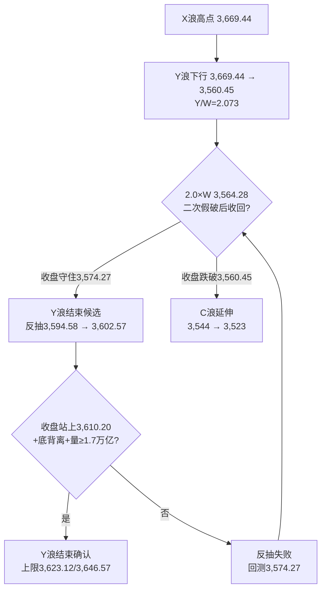
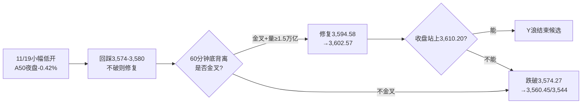

# A股晨报 - 2026年11月19日

> 数据截至：2026-11-19 09:10（北京时间）
> 编制：A股分析师AI代理
> 今日为周四（第47周第4个交易日），正常交易
> 基准：11/18晚报（Y浪2.0×W二次假破+地量锤子线，止跌候选、反转未确认）

---

## 一、昨日晚报复盘要点回顾

### 1. 昨日判断回顾

| 判断维度 | 晨报预测 | 实际结果 | 准确度 |
|---------|---------|---------|-------|
| 上证趋势 | 震荡（偏技术性修复） | +0.09%，探底回升 | ✓ |
| 指数区间 | 3,570-3,615点 | 3,560.45-3,596.55点 | ✗ |
| 强支撑 | 3,574.27点（收盘） | 盘中最低3,560.45 | ✗（盘中破13.82点，收盘收回） |
| 强压力 | 3,610.20点 | 最高3,596.55点 | ✓ |
| 板块预判 | 7个方向 | 6对1错 | 85.7% |
| 成交量 | 1.45-1.65万亿 | 1.3697万亿（-6.0%，年内新低） | ✗ |

- **综合准确率：75.7%**（趋势100%、点位66.7%、板块85.7%、成交量0%）
- **波浪分析准确率：约85%**——Y浪延伸至3,560.45（2.0×W 3,564.28被破3.83点后收回），"二次假破+锤子线"方向正确，但低估延伸幅度（Y/W=1.975→2.073）。

### 2. 关键偏差及原因

- **偏差1（逻辑误判·量能）**：把"英伟达业绩超预期"直接等同于增量资金；实际成交缩至1.3697万亿、刷新年内与16个月新低。根因是忽略两融三连降（11/17 -184.07亿）、年末考核与连续缩量形成的"地量惯性"。
- **偏差2（技术局限）**：3,574.27同一结构位第3次被盘中击穿（最低3,560.45，-0.39%），"固定-0.3%容忍带"不足。
- **偏差3（逻辑误判·板块）**：把PCB/CPO按"利好兑现、高开低走"处理，实际元件+4.90%、生益电子+18.53%、沪电/深南涨停，为全场最强主线——错把"订单上修"当"情绪博弈"。
- **偏差4（情绪面误读）**：科技主线修复日同时看涨红利防御，实际银行特大单-15.12亿、招行-0.76%，防御组被抽血。

### 3. 沉淀的规则/检查项（今日直接启用）

1. **利好兑现规则**：重大利好落地日若开盘即最高、30分钟内回落，定性"利好兑现式震荡"，不得给"看涨"。
2. **地量量能规则**：前一日为阶段地量且两融连续3日下降时，利好日量能基准=前日×0.90-1.00，放量确认须盘中≥1.5万亿。
3. **算力映射规则**：英伟达业绩超预期且盘后涨>3%、费半未转跌时，A股PCB/光模块/存储/CPO按"补涨"处理；费半转跌>1%才恢复看跌。
4. **资金互斥规则**：科技主线修复日（电子/通信领涨>1.5%），高股息（银行/白酒/公用）不得与成长组同时看涨。
5. **Y浪止跌规则**：跌破2.0×W后当日收回1.618×W上方+地量锤子线=止跌候选，Y浪结束仍须收盘站上3,610.20+量≥1.7万亿；下一支撑2.382×W=3,544。

### 4. 对今日分析的启示

- **风险点**：昨日仅"止跌候选"，收盘未站上3,602.57/3,610.20；两融三连降、量能年内新低，任何反抽都缺乏承接。
- **逻辑调整**：今日外盘出现"鹰派纪要+金油双杀+英伟达收跌"，昨日"补涨"逻辑需让位于"低开分歧"，算力链从"追补涨"改为"回踩低吸"。
- **关键验证**：开盘30分钟能否守住3,574.27、全天量能能否回到1.45万亿上方、收盘能否站上3,602.57。

---

## 二、隔夜市场动态（11/18收盘后至今）

### 1. 美股市场（11/18收盘，道指再跌、纳指逆势翻红）

| 指数 | 收盘 | 涨跌幅 | 备注 |
|------|------|--------|------|
| 道琼斯 | **50,198.17** | **-1.11%** | 跌561.25点，权重与金融拖累 |
| 标普500 | **7,323.63** | **-0.23%** | 跌16.90点，**连续第5个交易日下跌** |
| 纳斯达克 | **24,429.88** | **+0.42%** | 涨101.50点，AI硬件分化中翻红 |

- **结构撕裂**：英伟达收跌**2.89%**（报150.96美元），盘后亦未大涨；AMD、博通大涨，亚马逊涨近4%，特斯拉、谷歌、微软、苹果小幅上涨——资金"换马不下车"，从"英伟达独享"转向"多元算力"。
- **中概股普跌**：爱奇艺-16%、微博-6%、阿里巴巴-2.65%、京东-2.01%、B站-4.69%，对A股电商/传媒映射偏空。
- **治理折价未消**：黄仁勋离任后首份财报"三重超预期"（营收1,158亿、数据中心1,076亿、Q4指引1,261-1,339亿），但股价不涨，说明市场对"英伟达独大"叙事打折。

### 2. 欧洲/亚太市场

| 市场 | 收盘 | 涨跌幅 |
|------|------|--------|
| 德国DAX（11/18） | **25,736.24** | **-1.19%** |
| 法国CAC40（11/18） | **8,146.83** | **-0.85%** |
| 英国富时100（11/18） | **10,551.17** | **-1.30%** |
| 日经225（11/18） | **59,024.28** | **+0.28%** |
| 韩国KOSPI（11/18） | — | **+1.99%**（超跌反弹） |
| 恒生指数（11/18） | 23,294.75 | -0.91% |
| 南向资金（11/18） | — | 净买入27.51亿港元 |

- **欧洲全线收跌**（11/18尾盘转弱），亚太日韩收涨、港股续弱，风险偏好"西弱东稳"。
- **富时A50期货**：11/18夜盘收跌**0.42%**，今日09:00高开后现跌**0.03%-0.06%**，对A股开盘指引为"**小幅低开/平开**"。

### 3. 大宗商品（金、油双杀）

| 品种 | 最新 | 变动 | 说明 |
|------|------|------|------|
| WTI原油（12月） | **83.26美元/桶** | **-3.20%** | API库存大增530万桶、OPEC+产量升至3,560万桶/日、俄出口创7月来新高 |
| 布伦特原油（1月） | **91.95美元/桶** | **-1.28%** | 供应过剩压倒地缘溢价 |
| COMEX黄金（12月） | **3,727.8美元/盎司** | **-3.53%** | 刷新2025年9月26日以来新低 |
| COMEX白银 | 跌破**45美元/盎司** | **-5.03%** | 盘中一度失守45美元 |

- **贵金属"避险叙事"被实际利率碾压**：美元19个月新高+美债10Y 5.11%，不生息资产遭系统性抛售，A股黄金股补跌压力未释放完毕。
- **原油破位**：供应过剩逻辑压过霍尔木兹地缘溢价，石油石化、油服、油运链明确利空；航空、化工中下游成本改善。

### 4. 汇率与利率

| 项目 | 数值 | 变动 |
|------|------|------|
| 美元指数 | **103.82** | 创2025年4月以来新高（19个月高位） |
| 美债10年期 | **5.11%** | 高位持稳，压制全球成长估值 |
| 中国10年期国债 | **1.642%** | 低位平稳 |
| 中国1年期国债 | 1.223% | -0.81bp |
| 人民币中间价（11/18） | **6.7118** | 升值14bp，连续第4日升值 |

- **中美利差仍在350bp以上**，美元走强对人民币与北向资金构成压力，但中间价连续升值说明央行"稳汇率"意图明确，汇率暂非主要矛盾。
- **央行流动性**：11/18开展7,002亿元隔夜逆回购（1.25%），到期7,140亿，**净回笼138亿元**，"合理充裕"基调未变。

### 5. 重要海外事件

- **美联储10月FOMC会议纪要（11/19凌晨3:00）偏鹰**：以10比2维持利率不变，但"几乎所有"与会者认为未来数月进一步加息是合适的；**两名官员称若通胀数据不利，12月8-9日会议可以考虑加息超25bp**；AI被视为通胀与金融稳定风险的讨论核心。
- **沃勒最强硬表态**：若美联储不明确释放明年1月继续加息信号，12月应直接加息**50bp**"震撼市场"；市场定价12月加息概率近100%（25bp为主、50bp约2%）。
- **Anthropic今日（11/19）纳斯达克挂牌**（代码ANT）：发行价70-78美元，募资约644亿美元（含绿鞋最高962亿），全面摊薄估值约1.4万亿美元，超额认购10-20倍——**全球AI资产"信仰试金石"**，首日强弱直接映射A股AI应用/算力情绪，破发则反噬。
- **APEC深圳峰会（11/18-19）**：今日举行历史性首次三方会晤，若释放缓和信号（关税/高科技管制松动），将提振出口链、金融开放与科技风险偏好。
- **英伟达治理余波**：临时CEO Colette Kress已召开全员会，事件不确定性与"治理折价"仍在。

---

## 三、今日关注事项

### 1. 重要数据/事件（按时间排序）

| 时间 | 数据/事件 | 前值/预期 | 影响 |
|------|----------|----------|------|
| 09:15 | 人民币中间价 | 前值6.7118 | 汇率与外资情绪 |
| 10:00 | 商务部新闻发布会（近期商务重点工作） | — | 消费/外贸/出口链 |
| 21:30 | 美国当周初请失业金人数、10月新屋开工 | — | 影响12月加息定价 |
| 23:30 | 美国EIA原油库存（至11/14） | API +530万桶 | 油价与石化链 |
| 美股时段 | **Anthropic纳斯达克首日（ANT）** | 发行价70-78美元 | 全球AI定价锚 |
| 全天 | **APEC深圳峰会第二日/三方会晤** | — | 关税、科技管制、风险偏好 |
| 全天 | **2026世界计算大会（长沙，11/19-21）** | — | 算力/信创/国产芯片 |
| 全天 | 2026脑机接口大会（11/19-22）、大湾区创新药产业生态大会（广州，11/19-20） | — | 主题脉冲 |
| 全天 | 2026世界智能制造大会（11/19-21）、武汉商品交易会 | — | 高端制造/机器人 |
| 全天 | 游戏《GTA VI》发售（预售超1,200万份） | — | 游戏/传媒情绪 |

### 2. 政策/监管动态

- **新一轮国资国企改革进入全面实施阶段**：国务院国资委11/18研讨班明确以创新能力强的企业为主体推进专业化整合，防止"救助型"并购；各地提出3,300余项改革任务、央企1.1万余项——**利好央国企整合、军工/电力/有色等专业化重组主题**。
- **证监会辟谣"监管要求基金公司上报全部产品AI敞口"不属实**，同日两则"小作文"集中辟谣，**有助稳定AI板块预期**。
- **首批18只主动ETF将于11/23集中上市**：当前股票仓位平均50%以上，按80%下限测算**至少约84亿元增量资金待入市**，为本周确定性增量来源。
- **工信部批复8省市6G创新发展部省协同试点**（此前已落地，持续发酵）。
- **国家能源局《关于加快推动流域水风光一体化发展的指导意见》**：水风光+绿色产业双向赋能，利好绿电/水电/储能。
- **商务部等9部门再生资源回收意见**：退役光伏组件、风机叶片回收获政策支持。

### 3. 公司公告/事件

- **中际旭创（300308）**：董事长提议回购**20亿-40亿元**（年内第二次大额回购）。
- **新易盛**：明确在手订单充足、无砍单，1.6T大规模放量；**天孚通信**：CPO配套产品已批量交付、2027年提量。
- **沪电股份（002463）**：昨日获机构净买入**3.50亿元**。
- **胜宏科技**：获工行2.7亿元回购专项贷款。
- **腾讯控股**：Q3资本开支创纪录**814亿元**，预计2028年资本开支压力缓解。
- **天普股份（605255）**：停牌核查完成，**今日复牌**（前期高位股，防补跌）。
- **安杰思（688581）**：今日解禁3,956.24万股，占总股本**49.0%**。
- **华菱钢铁**：控股股东完成3亿元增持；**联域股份**提议回购2,000万-4,000万元。

### 4. 其他关注

- **新股申购**：今日暂无新股申购、无新股上市。
- **限售解禁**：4家公司合计解禁4,184.05万股，**解禁市值20.3亿元**（整体压力小，但安杰思单只占比高）。
- **晶圆代工涨价**：芯片设计企业已接获10%-20%调价通知，台积电2027年先进/成熟制程全面调价；三星与苹果拟签4-5年DRAM长协——半导体"量价齐升"坐实。

---

## 四、板块与个股分析（结合昨日复盘）

### 1. 基于昨日复盘结论的板块调整

- **昨看涨且兑现（半导体设备/材料、6G通信、家电）**：电子+1.58%、通信+1.61%、黑色家电+2.84%，全部命中。今日**半导体设备/材料维持看涨**（晶圆代工涨价+国产替代），但须以"电子主力资金续流入"为前提；**6G/通信**由"事件驱动"转为"高开兑现、不追高"。
- **昨看涨但偏差（食品饮料/银行红利）**：银行特大单-15.12亿、招行-0.76%、茅台-1.03%。今日加息预期强化、美元走强，红利具备防御价值，但**仅作为"资金流出科技时的避风港"，不与成长组同时看涨**。
- **昨看跌但偏差（PCB/CPO/存储）**：实际元件+4.90%、生益电子+18.53%、沪电/深南涨停。今日叠加"光模块三巨头回购+订单能见度"，**由"看跌"正式改为"回踩低吸的补涨主线"**；但英伟达收跌2.89%，**开盘不追高，等分歧回踩**。
- **昨看跌且兑现（贵金属、传媒/高位连板）**：贵金属继续看跌（金价-3.53%），传媒/短剧退潮未完成，维持回避。

### 2. 隔夜信息驱动的板块机会

**受益板块：**

1. **国产算力/华为昇腾链/半导体设备材料**
   - 逻辑：世界计算大会（长沙）+6G试点+数字广东规划；晶圆代工涨价10%-20%、DRAM长协坐实"量价齐升"；昨日电子主力净流入65.80亿、通信+22.47亿，寒武纪+4.89%、华虹宏力+7.28%。
   - 约束：英伟达-2.89%、中概普跌压制开盘情绪，**只做低开分歧后的回踩，不追高开**；寒武纪等重回千元高位，估值透支需防。

2. **光模块/CPO/PCB（回购+订单双保险）**
   - 逻辑：中际旭创20-40亿回购、新易盛"无砍单"、天孚CPO批量交付、胜宏回购贷款、沪电机构净买入3.5亿；元件+4.90%的强势有基本面支撑。
   - 约束：英伟达不涨、纳指仅微涨，**高开即减、回踩5日线低吸**；量能不上1.5万亿则只做日内。

3. **煤炭/燃气/电力（寒潮+红利防御）**
   - 逻辑：寒潮蓝色预警，0℃线南压至陕西南部-华北南部，取暖需求上升；秦皇岛5500大卡煤价已5连涨至1,016元/吨；加息预期下高股息防御属性。
   - 约束：油价-3.2%对能源整体形成拖累，**煤炭与油运"一冷一热"内部对冲**，仅作1-2日脉冲，不重仓。

4. **信创/网络安全/军工信息化**
   - 逻辑：NSA内网中断+警告AI自动化入侵，自主可控事件催化；国资委专业化整合强调"创新能力强的企业为主体"。

5. **出口链/家电、创新药（事件）**
   - 逻辑：美国消费名义高增+峰会缓和预期；大湾区创新药产业生态大会（11/19-20）；外资四季度密集调研电子/医药生物。

**受损板块：**

1. **贵金属/黄金白银**：COMEX金-3.53%、银-5.03%，美元19个月新高、美债5.11%，实际利率主导下跌，**反弹即减，不抄底**。
2. **石油石化/油服/油运**：WTI-3.20%、布伦特-1.28%，库存大增+OPEC+增产，地缘溢价证伪。
3. **中概映射（电商/传媒/游戏出海）**：爱奇艺-16%、微博-6%、京东-2.01%，情绪压制。
4. **高位连板/短剧/AI漫剧**：退潮未完成，九阳天地板余波、天普股份复牌防补跌。

### 3. 重点关注个股

| 个股/方向 | 关注理由 | 技术位置 | 操作参考 |
|-----------|---------|---------|---------|
| **中际旭创（300308）** | 20-40亿回购+订单覆盖2027，CPO龙头 | 深度调整后，昨日反弹 | 回踩5日线低吸，不追高开 |
| **新易盛** | 在手订单充足、无砍单、1.6T放量 | 超跌 | 只做修复反抽，5日线减 |
| **天孚通信** | CPO配套批量交付、2027提量 | 超跌 | 同上，仓位≤2% |
| **沪电股份（002463）** | 机构净买入3.5亿，PCB业绩驱动 | 涨停后高位 | 不追涨，回踩10日线观察 |
| **北方华创/中微公司** | 晶圆代工涨价+国产替代 | 跟随科创50，相对抗跌 | 电子资金净流入时参与 |
| **寒武纪** | 国产算力核心，昨日+4.89% | 千元高位，估值透支 | 只做回踩，不追高 |
| **中国神华/陕西煤业** | 寒潮+煤价5连涨+高股息 | 低位防御 | 1-2日脉冲，轻仓 |
| **美的集团** | 出口链+以旧换新，外资调研 | 趋势多头 | 回踩10日线低吸 |
| **天普股份（605255）** | 今日复牌 | 前期高位 | 回避 |
| **安杰思（688581）** | 今日解禁49%股本 | 解禁压力 | 回避 |

---

## 五、今日核心判断

### 1. 趋势判断

- **上证指数：【震荡】（偏弱修复，低开探底回升）**
- **预测区间：3,565点 - 3,606点**
- **核心逻辑**：美联储纪要偏鹰+沃勒提"12月50bp"+美元19个月新高+金油双杀，压制全球风险偏好与高β估值，A50夜盘-0.42%指向小幅低开；但昨日"地量锤子线+电子主力转正+光模块三巨头回购+主动ETF约84亿待入市"提供下方支撑，且深圳峰会三方会晤存在缓和预期，指数大概率"低开回踩3,574-3,580不破→弱反抽3,594.58-3,602.57"，反抽高度受制于3,610.20，故定性"震荡（偏弱修复）"而非"反转"。

### 2. 关键点位

- **强支撑位：3,574.27点**（依据：月线生死线/11月结构失效线，本周第4次测试；**盘中容忍带3,565-3,574**，以收盘定生死）
- **弱支撑位：3,584.37点 / 3,580.38点**（依据：1.618×W、昨日收盘下沿；跌破则回测3,574.27）
- **弱压力位：3,594.58点**（依据：60分钟下降压力线，第一反抽带3,588-3,595）
- **强压力位：3,610.20点**（依据：周线箱体下沿/前结构位，收复需量能≥1.7万亿）

### 3. 板块预判

- **看涨板块**：
  （1）**国产算力/半导体设备材料**（逻辑：晶圆代工涨价10%-20%+DRAM长协+世界计算大会+电子资金转正）
  （2）**光模块/CPO/PCB**（逻辑：三巨头回购+订单能见度，回踩低吸）
  （3）**煤炭/燃气/电力**（逻辑：寒潮+煤价5连涨+高股息防御）
  （4）**信创/网安/军工信息化**（逻辑：NSA事件+自主可控）
  （5）**出口链家电**（逻辑：美国消费韧性+峰会缓和预期）
- **看跌板块**：
  （1）**贵金属/黄金白银**（逻辑：金-3.53%、银-5.03%，实际利率5.11%主导）
  （2）**石油石化/油运**（逻辑：WTI-3.20%、库存大增、OPEC+增产）
  （3）**中概映射电商/传媒游戏**（逻辑：中概普跌、爱奇艺-16%）
  （4）**高位连板/短剧/AI漫剧**（逻辑：退潮未完成）
- **风险板块**：
  - **高β成长（科创50/创业板/算力）**：加息50bp尾部风险下估值承压，波动放大；
  - **解禁股**：安杰思（49%股本）、4家合计20.3亿元；
  - **复牌补跌股**：天普股份；
  - **纯题材算力租赁跟风股**：量能不足易"高开炸板"。

### 4. 资金面判断

- **北向资金预期**：净额不披露；成交额预计**2,100-2,400亿元**，占比**15%-16.5%**（前值2,199.97亿/16.06%）；美元走强下外资偏谨慎，不宜期待大幅净买入。
- **成交量预期：【平量】**，预计**1.32-1.50万亿元**（前值1.3697万亿，地量基准=前日×0.96-1.10）；反抽延续需≥1.50万亿，反转确认需≥1.70万亿。
- **两融**：截至11/17余额22,466.05亿元（-184.07亿），三连降，杠杆资金仍在去化。
- **增量资金**：首批18只主动ETF 11/23上市，上市前至少约84亿元待建仓，为本周确定性增量，但单日贡献有限。

### 5. 风险预警（按优先级排序）

- **高风险**：**美联储11月会议纪要偏鹰+沃勒"12月50bp"表态**，12月加息概率近100%，美元指数103.82创19个月新高、美债5.11%——全球成长股估值天花板系统性下压，A股高β板块易"低开难修复"。
- **中风险**：**英伟达收跌2.89%+"治理折价"未除**，算力链高开分歧；**Anthropic近千亿美元IPO**若破发或抽血美科技股，将反噬A股AI情绪。
- **中风险**：**金油双杀**（金-3.53%、油-3.20%）拖累资源股与指数；中概普跌压制电商/传媒映射。
- **低风险**：4家解禁20.3亿元、天普股份复牌补跌；深圳峰会/世界计算大会等事件性催化持续性1-3日。

### 6. 昨日复盘规则应用

- **应用规则1（地量量能）**：昨日1.3697万亿为年内新低，今日量能基准取"前日×0.96-1.10"即1.32-1.50万亿；若盘中前1小时同比不缩且全天≥1.50万亿，才可承认"修复放量"。
- **应用规则2（算力映射）**：费半隔夜未转跌（纳指+0.42%）但英伟达-2.89%，映射组仍按"补涨/低吸"处理，**仅在开盘30分钟站稳3,594.58时启用**；若费半盘中转跌>1%，立即降级为"高开低走"。
- **应用规则3（资金互斥）**：若今日电子/通信再度领涨>1.5%，则银行/白酒/公用按"资金流出"处理，不做"双看涨"。
- **应用规则4（假跌破）**：3,574.27以**收盘**判定，盘中下探3,565-3,574不视为失效；同一位第4次测试，容忍带扩至-0.5%（3,556）。
- **应用规则5（Y浪止跌）**：地量锤子线仅是"止跌候选"，**收盘≥3,602.57为第一确认、≥3,610.20且量≥1.7万亿为反转确认**，二者未同时满足前不加中线仓。

---

## 六、波浪理论参考

### 1. 月K线波浪分析

- **当前波浪位置**：大级别3浪2扩张（W-X-Y）的**Y浪末段"二次假破"阶段**。
- **浪型结构描述**：11月开3,614.13 → 高3,699.58 → 低**3,560.45（11/18）** → 现3,587.83，月内**-0.31%**（10月收3,599.02）；月K为"带长上影、带长下影小阴"：上影85.45点、下影27.38点、实体-26.30点。月线生死线3,574.27本月已两次被盘中击穿（11/17、11/18），两次均收盘收回。
- **关键目标位**：上方3,594.58→3,602.57→3,610.20→3,623.12→3,646.57→3,664.82（颈线）；下方**3,574.27（生死线）**→3,560.45→3,544（2.382×W）→3,523（2.618×W）→3,478。
- **验证条件**：**11月月K收盘（11/28）站上3,574.27，则3浪2扩张框架仍有效**；若月线收盘跌破，改按"C浪延伸"，下看3,478/3,443。

### 2. 周K线波浪分析

- **当前波浪位置**：第47周（11/16-11/20）箱体下沿3,610.20失守后的**第三周阴线运行中**，3,574.27为"二次假破"候选。
- **浪型结构描述**：本周开3,611.54 → 高3,623.12 → 低**3,560.45** → 现3,587.83，周内**-1.28%**；周K暂为"带长下影小阴"，连续第2周收阴、低点下移。5周均线约3,670-3,682，构成反抽天花板。
- **关键目标位**：上方3,594.58→3,602.57→3,610.20→3,623.12；下方3,574.27→3,560.45→3,544→3,523。
- **验证条件**：周线止跌需**本周收盘站上3,610.20且周成交≥8.5万亿**（前三日合计约4.9万亿，达标难度极大）；若周收盘<3,574.27，周线下降推动浪延伸至3,544。

### 3. 日K线波浪分析

- **当前波浪位置**：W-X-Y扩张调整的**Y浪第5子浪"延伸—二次假破—收回"末端**。
- **浪型结构描述**：W浪 3,699.58→3,647.00（-52.58）→ X浪 3,647.00→3,669.44（+22.44，0.427回撤）→ Y浪 3,669.44→**3,560.45（-108.99）**；**Y/W=2.073**，2.0×W（3,564.28）被跌破3.83点后当日收回，收盘3,587.83重回1.618×W（3,584.37）上方3.46点。日K为**光头长下影锤子线**，是Y浪末端的典型"诱空"形态。
- **关键目标位**：下方3,574.27→3,560.45→3,556→3,544（2.382×W）→3,523；上方3,594.58→3,602.57→**3,610.20**→3,623.12→3,646.57。
- **验证条件**：**Y浪结束候选=收盘站上3,610.20+30/60分钟底背离+量能≥1.7万亿**；若3个交易日内收盘重回3,610.20上方，则"2.0×W二次假破+Y浪结束"成立（反抽上限3,646.57）；反之收盘<3,560.45则C浪延伸至3,544。

### 4. 60分钟K线波浪分析

- **当前波浪位置**：Y浪第5子浪末段，**价格创新低（3,560.45）而MACD绿柱未同步放大，底背离条件成立**，但尚未金叉。
- **浪型结构描述**：11/18高开3,596.55→上午单边下行至3,560.45→午后逐级回升至3,587.83，量能全天萎缩；**60分钟下降压力线今日约在3,594-3,600**。
- **关键目标位**：上方3,594.58→3,602.57→3,610.20；下方3,574.27→3,560.45。
- **验证条件**：**60分钟收盘站上3,602.57且MACD金叉=Y浪结束第一信号**；若今日首小时跌破3,574.27，则底背离失效、下探3,544。

### 5. 30分钟K线波浪分析

- **当前波浪位置**：Y浪末段"失败背离后二次修复"。
- **浪型结构描述**：昨日30分钟底背离在上午被3,560.45的新低击穿（原3,565.59支撑失效），但午后连续小阳收复3,580.38/3,584.37，**形成"背离失败—快速收回"的诱空结构**；30分钟RSI自25下方回升至50附近。
- **关键目标位**：上方3,594.58→3,600（整数关）→3,602.57；下方3,580.38→3,574.27→3,560.45。
- **验证条件**：今日开盘30分钟站上3,594.58且量能不低于昨日同期→修复延伸至3,602.57-3,610.20；若开盘直接跌破3,574.27，则30分钟结构转弱、回测3,560.45。

### 6. 波浪图

**日K线波浪结构图**

**60分钟波浪结构图**

### 7. 波浪理论综合判断

- **多周期共振状态**：月线**空但二次未确认失效**（★☆）、周线空（★，连续第2周阴）、日线**Y浪2.073×W二次假破后锤子线止跌**（★★）、60分钟**底背离条件成立待金叉**（★★）、30分钟**失败背离后修复**（★★）——仍为**"中长周期偏空+短周期超跌修复"的背离结构**，且隔夜外盘（鹰派+金油双杀）削弱短周期修复强度。
- **当前操作级别**：**日线防守、30/60分钟只做反抽**；3,574.27未收盘失守前按"Y浪结束候选"处理，失守则观望。
- **后续演变路径**：
  - **基础路径（55%）**：小幅低开，回踩3,574-3,580不破，反抽3,594.58-3,602.57后震荡，收3,575-3,600，量能1.32-1.45万亿；
  - **偏强路径（25%）**：深圳峰会释放缓和信号+光模块回购/算力接棒+量能回升，收盘站上3,610.20，上探3,623.12，但难一次性收复3,646.57；
  - **偏弱路径（20%）**：加息50bp预期发酵+Anthropic破发抽血+金油续跌，收盘跌破3,560.45，下看3,544（2.382×W），创业板回测2,280。
- **关键拐点信号**：**止跌=收盘≥3,602.57+60分钟底背离金叉+量≥1.5万亿**；**反转确认=收盘≥3,610.20且量≥1.7万亿**；**结构失效=收盘<3,560.45**；**延伸升级=收盘<3,544→3,523**。
- **风险提示**：W-X-Y计数主观性强，Y浪可延伸为"5-3-5"C浪；2.0×W为统计位置而非支撑承诺；**缩量背景下的长下影"止跌"失败率较高，且今日外盘为"鹰派+商品双杀"组合，不得以单日锤子线抄底**。

---

## 七、投资策略建议

### 1. 短线策略（1-3个交易日）

- **适用场景**：日K线+60分钟技术信号，地量锤子线后的"修复验证窗口"
- **短线仓位：0-5%**（维持，且须条件触发）
- **买入条件**（须同时满足）：
  1. 开盘30分钟**不跌破3,574.27**；
  2. 站上**3,594.58**且量能不低于昨日同期；
  3. 收盘站上**3,602.57**。
  三条不同时满足则维持空仓/0-3%。
- **卖出条件**：反抽至3,610.20-3,623.12不放量即减；触及3,623.12无量滞涨全部了结。
- **止损位**：**收盘跌破3,574.27**（或个股跌幅3%）
- **短线标的**：
  （1）**光模块/CPO（中际旭创、新易盛、天孚通信）**（逻辑：20-40亿回购+订单能见度，只做回踩低吸，不追高开）；
  （2）**国产算力/半导体设备（北方华创、中微公司）**（逻辑：晶圆代工涨价+世界计算大会，电子资金续流入才参与）；
  （3）**煤炭（中国神华、陕西煤业）**（逻辑：寒潮+煤价5连涨，1-2日脉冲，轻仓）。

### 2. 中线策略（1-4周）

- **适用场景**：周K线波浪+运行规律分析
- **中线仓位：10%**（维持，不因单日反抽加仓）
- **方向判断**：**【持有/观望】**
- **目标区间**：上证指数 **3,560点 - 3,646点**
- **中线布局板块**：
  （1）**银行/红利**（逻辑：加息预期+美元强下的防御底仓，年末考核）；
  （2）**食品饮料/家电**（逻辑：出口链+必选消费，外资调研密集）；
  （3）**国产半导体设备/材料**（逻辑：涨价周期+自主可控，回调分批）。
  **新增观察仓**：光模块/CPO（仅回踩参与，不追涨停）；**清空/回避**：贵金属、石油石化/油运、高位连板、短剧/传媒、解禁股。
- **止盈条件**：指数到达3,623.12-3,646.57分批减仓；或持仓波段涨幅达10%
- **止损条件**：**收盘跌破3,560.45**（清中线至5%以下）；或趋势确认反转

### 3. 仓位分配总览

| 策略类型 | 仓位比例 | 方向 | 重点板块 |
|---------|---------|------|---------|
| 短线 | 0-5% | 条件触发才试探 | 光模块/CPO、国产算力/半导体设备、煤炭 |
| 中线 | 10% | 持有/观望 | 银行/红利、食品饮料/家电、半导体设备 |
| 现金 | 85-90% | — | — |

### 4. 与昨日策略对比

- **短线仓位**：维持**0-5%**；买入条件维持"不破3,574.27+站上3,594.58+收盘3,602.57"，但**标的由"国产半导体设备/6G/家电"调整为"光模块CPO回踩+国产算力+煤炭脉冲"**（原因：三巨头回购落地、6G进入兑现期、寒潮催化）。
- **中线仓位**：维持**10%**；若今日收盘站上3,610.20且量≥1.7万亿，上调至15%；若收盘跌破3,560.45，减至5%以下。
- **板块调整**：**光模块/CPO由"修复不追高"升级为"回踩低吸观察仓"**；**新增煤炭为短线脉冲**；**减配出口链中的地产链（美国地产投资-21.6%）**；继续回避贵金属、油运、高位连板、传媒。
- **纪律**：低开不恐慌、反抽不放量不加仓；3,574.27以收盘定生死；不参与天普股份复牌与安杰思解禁博傻；Anthropic首日破发则当日不新开AI仓位。

---

## 八、信息来源

1. **官方数据来源**：上海证券交易所（上证指数3,587.83、+0.09%、成交6,502.32亿、最高3,596.55、最低3,560.45）、深圳证券交易所、中国人民银行（11/18开展7,002亿元隔夜逆回购、利率1.25%、净回笼138亿元；人民币中间价6.7118）、中国货币网（国债收益率1.642%）、国务院国资委（11/18深化国资国企改革研讨班）、工信部（6G部省协同试点）、国家能源局（流域水风光一体化指导意见）、财政部（中央金融机构注资特别国债二期）
2. **权威财经媒体**：新华社/新华财经（美联储10月纪要、纽约股市三大股指18日涨跌不一）、央视财经（国际油价跌超3%）、中国证券报（新一轮国资国企改革、证监会辟谣AI敞口小作文）、上海证券报（18只主动ETF、国产算力接棒）、证券时报（光模块三巨头回购、英伟达单季营收破千亿）、证券日报（外资/私募调研A股）、财联社（投资日历、A50夜盘、金价3,727.8美元）、金融界（12月加息概率92.7%）
3. **数据平台**：东方财富Choice（美股/欧洲/大宗商品、WTI 83.26）、Wind（两融余额22,466.05亿、限售解禁20.3亿）、同花顺iFinD（行业资金流、北向成交2,199.97亿/16.06%）、新浪财经（美元指数103.82、美债10Y 5.11%）
4. **研究机构**：粤开证券市场日报20261118、尺度商业/利明说市（11/19盘前信息解读）、招商证券/中银证券（半导体量价齐升）
5. **数据截止时间**：**2026-11-19 09:10（北京时间）**；美股为11/18收盘，欧洲为11/18收盘，亚太为11/18收盘，A股/港股为11/18收盘，A50为11/19 09:00；北向净额不披露，以成交额替代；今日人民币中间价待09:15公布

---

> **免责声明**：本报告为AI辅助生成的开盘前分析，所有点位、概率、目标位均为基于公开数据的技术推演，不构成投资建议。市场有风险，决策需独立。
