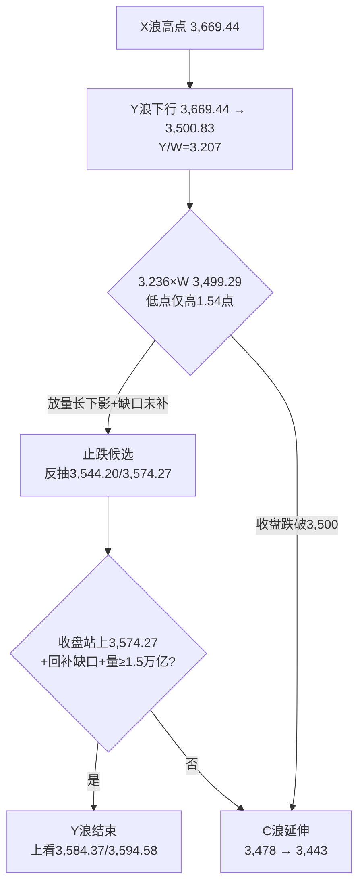
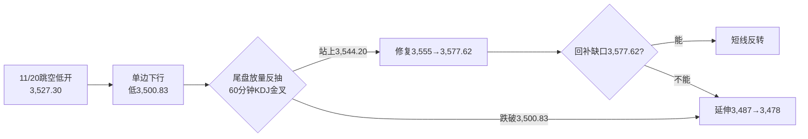

# A股晚报 - 2026年11月20日

> 数据截至：2026-11-20 20:00（北京时间）
> 编制：A股分析师AI代理
> 今日为周五（第47周第5个交易日），正常交易、周线收官
> 核心事件：**月线生死线3,574.27首次收盘失守；上证50尾盘放量翻红、创业板跌3.54%收于全天最低；日韩股市"黑色星期五"跌超5%**

---

## 一、市场回顾

### 1. 主要指数表现

| 指数 | 收盘 | 涨跌幅 | 开盘 | 最高 | 最低 | 成交额 |
|------|------|--------|------|------|------|--------|
| 上证指数 | **3,533.79** | **-1.23%（-43.83）** | 3,527.30（-1.41%） | 3,538.27 | **3,500.83** | 7,025.74亿 |
| 深证成指 | **10,256.39** | **-3.09%** | -1.71%开盘 | — | 10,256.39（收于全天最低） | 7,196.27亿 |
| 创业板指 | **2,212.13** | **-3.54%** | -2.15%开盘 | — | 2,212.13（收于全天最低） | 3,349.78亿 |
| 科创50 | **1,231.09** | **-3.12%** | — | — | — | — |
| 北证50 | **759.90** | **-4.85%** | — | — | — | — |
| 沪深300 | 3,954.57 | **-0.76%** | — | — | — | — |
| 上证50 | **2,785.92** | **+0.45%** | — | — | 盘中一度-2.32% | 成分ETF天量 |

- **指数极度分化**：上证-1.23%、沪深300-0.76%、上证50+0.45%，而深成指-3.09%、创业板-3.54%、科创50-3.12%、北证50-4.85%。**权重护盘、成长杀跌**，深成指与创业板指均收于全天最低点，尾盘无抵抗。
- **关键定性**：沪指早盘最低3,500.83，距3,500整数关仅0.83点，尾盘在银行/石油/公用事业拉动下跌幅收窄，收出"**放量长下影假阳线**"，终结日线6连阴（K线收红、指数仍跌1.23%）。
- **周线收官**：本周（11/16-11/20）上证**-2.77%**、深成指**-6.49%**、创业板指**-8.82%**，连续第3周收阴；沪指周K收盘3,533.79，**首次收盘跌破月线生死线3,574.27**。
- **全周个股**：上涨427只、下跌5,135只；盛剑科技+39.46%、真视通+47.03%逆势4连板，为极少数亮点。

### 2. 成交量能

| 项目 | 今日 | 昨日 | 变化 |
|------|------|------|------|
| 两市成交额 | **14,222亿元** | 13,051亿元 | **+1,170.53亿（+8.97%）** |
| 沪市/深市 | 7,025.74亿 / 7,196.27亿 | — | 半日成交8,617.8亿 |
| 北向成交额 | **2,384.70亿元** | 2,101.36亿 | 占比**16.77%**（前值16.10%） |
| 主力资金 | **净流出403.57亿元** | 净流出234.59亿 | **连续7日净流出** |
| 特大单 | 净流出182.78亿元 | — | 机构净卖出 |
| 两融余额 | 22,010.03亿（11/19） | -87.68亿 | 四连降 |

- **放量下跌**：1.42万亿虽较地量回升，但方向是"低开恐慌+尾盘护盘"的放量，属**抛压释放型放量**，而非增量入场。
- **资金结构**：创业板主力净流出93.06亿、科创板-81.19亿、沪深300成分-100.09亿；行业端电子净流出**108.40亿居首**，电力设备-34.38亿，医药生物、计算机、有色金属紧随。
- **护盘资金特征**：上证50ETF华夏（510050）成交**243亿元**、沪深300ETF嘉实（159919）成交超**234亿元**，双双创历史天量；**宽基ETF爆量是"被动护盘"，不等于趋势反转**。

### 3. 市场情绪

| 指标 | 今日 | 昨日 | 变化 |
|------|------|------|------|
| 上涨/下跌家数 | **313 / 5,236** | 649 / 4,876 | 上涨占比**5.6%**（前值11.6%） |
| 涨停/跌停 | **28只 / 61只** | 28 / 83 | 跌停仍>涨停 |
| 封板率 | **80%**（炸板7只） | 49.06% | 回升 |
| 跌幅超9%个股 | **超300只** | — | 亏钱效应极端 |
| 连板高度 | 真视通、盛剑科技4连板 | 3板 | 高度有限、断层明显 |

- **情绪冰点延续**：上涨占比5.6%为月内最低，跌停61只连续第2日多于涨停，超300股跌逾9%；封板率虽回升至80%，但涨停仅28只，属"**缩量抱团、无量反弹**"。
- **结构特征**：赚钱效应集中在银行、石油、电力、养殖等少数防御方向；题材（PCB、猪肉）仅中小市值个股脉冲，无法形成板块效应。

---

## 二、热点板块与异动分析

### 1. 领涨板块及驱动因素

| 板块 | 涨幅 | 驱动因素 |
|------|------|---------|
| 国有大型银行 | **+2.52%** | 工行+3.30%、建行+3.07%、中信银行+3%，均创历史新高；年底考核+高股息避险+宽基ETF护盘 |
| 股份制银行 | **+1.18%** | 同上，招商银行+1.57%（成交44.00元） |
| 保险 | 上涨 | 利率企稳（10Y国债1.58%）、权益弹性+红利属性 |
| 炼化及贸易/油气设服 | 上涨 | 中国石油**+4%**；霍尔木兹扰动、油价一度跳水后WTI转涨 |
| 渔业/农牧饲渔 | 上涨 | 猪肉概念探底回升，金新农涨停（6天3板），生猪主力站上9,500元/吨 |
| 煤炭开采 | **+0.33%** | 冬季需求+红利防御，唯一收红周期品 |
| 公用事业/电力 | 小幅上涨 | 长江电力**+2.40%创历史新高** |

- **PCB逆势脉冲**：中京电子2连板，满坤科技20CM涨停，超声电子、澳弘电子、东晶电子、骏亚科技涨停；催化为全球电子协会《PCB Squeeze》报告（订单+56.1%、交期16-20周）。但**PCB概念指数仍-4.89%、元件-2.94%**，属超跌小票脉冲，龙头沪电-0.96%、深南-0.59%、胜宏-4.20%，**不具备板块持续性**。

### 2. 领跌板块及原因分析

| 板块 | 跌幅 | 原因 |
|------|------|------|
| 光刻机 | **-7.69%** | 美BIS 16/14nm先进逻辑代工新规11/19生效；联合化学20CM跌停（终止股权转让）、张江高科跌停 |
| 激光 | **-7.56%** | 半导体产业链系统性杀估值，10/20以来累计-19.4% |
| 电子化学品 | **-6.37%** | 阿石创-17.23%，材料端补跌 |
| 军工电子 | **-6.01%** | 高β成长杀跌，无独立催化 |
| 自动化设备 | **-5.53%** | 机器人主题退潮，10/20以来累计-19.2% |
| 黑色家电 | **-5.47%** | 小熊电器、彩虹集团、爱仕达、比依股份跌停；昨日防御抱团瓦解 |
| 半导体 | **-4.91%** | 费半-2.41%、日韩芯片股崩跌；通富微电跌停、海光信息-8.75% |
| 小家电 | **-3.64%** | 出口链+防御逻辑失效 |
| 贵金属 | **-3.36%** | 伦敦金现盘中破3,600、最低3,510美元附近（逾一年新低），沪金主力-5% |
| 存储芯片/MLCC/液冷/玻璃基板 | 领跌 | AI硬件全球性杀估值，澜起科技、普冉股份跌超4% |

- **核心逻辑**：**"全球AI硬件去泡沫"主导**——隔夜纳指-2.25%、费半-2.41%，日经-5.06%、KOSPI-5.21%（软银-14.5%、三星-7%、SK海力士-6%），A股半导体/存储/光刻机/PCB链条被同步定价，产业景气（美光紧缺、闪迪涨价）**无法对抗系统性估值收缩**。

### 3. 个股异动复盘

- **涨停/连板**：真视通、盛剑科技4连板；好当家7天4板；金新农6天3板；中京电子2连板；满坤科技20CM。
- **强势股**：工商银行+3.30%、建设银行+3.07%、中信银行+3%、长江电力+2.40%（均创历史新高）；中国石油+4%。
- **重挫股**：阿石创-17.23%、海光信息-8.75%、通富微电跌停、联合化学20CM跌停、张江高科跌停、天普股份2连跌停；小熊电器、彩虹集团、爱仕达、比依股份跌停。
- **高位股风险**：全市场超300股跌逾9%，**"补跌—跌停—再补跌"负反馈未结束**。

---

## 三、关键数据与事件回顾

### 1. 国内重要数据

- **11月LPR**：1年期**3.00%**、5年期以上**3.50%**，**连续18个月保持不变**，政策增量落空。
- **人民币中间价**：6.7131，较前值下调3个基点。
- **央行公开市场**：开展3,795亿元隔夜逆回购（利率1.25%），当日到期10,675亿元，**净回笼6,880亿元**；本周累计净回笼3,845亿元，跨月前流动性投放转为收敛。
- **利率**：10年期国债收益率**1.58%**（+0.35bp）、30年期2.043%（持平）、隔夜Shibor 1.2612%（+0.1bp），**债市平稳、股债跷跷板不明显**。

### 2. 政策/监管动态

- **美BIS芯片管制新规11/19生效**：16/14nm及以下FinFET先进逻辑芯片代工须经"Approved IC Designer"名单审批，直接压制A股半导体设备/材料/光刻机链条。
- **深交所**：11/16-11/20对80起证券异常交易行为采取自律监管措施（盘中拉抬打压、虚假申报等），题材炒作监管趋严。
- **头部券商/公募齐发声**：认为外部扰动逐步消化、政策加码创造企稳条件，看好大盘蓝筹、"出海"、AI等方向；**属维稳表态，尚未见增量工具**。

### 3. 公司公告

- **回购/增持潮**：通威股份拟回购10-20亿元（价格≤17.20元）；沪电股份、兆易创新、国科微、宁德时代、生益科技、亨通光电集体宣布增持/回购；拓荆科技董事长提议回购2-3亿元；生益电子累计回购166.82万股（1.2亿元）；赛力斯控股股东累计增持622.35万股。
- **风险警示**：ST天圣撤销其他风险警示，11/23停牌、11/24复牌更名为"天圣制药"；欢瑞世纪因2022年年报虚假记载被实施其他风险警示，11/23停牌、11/24变更为"ST欢瑞"。

---

## 四、海外市场联动

### 1. 美股（11/19收盘）

| 指数 | 收盘 | 涨跌幅 |
|------|------|--------|
| 道琼斯 | 49,097.06 | **-2.19%（-1,101.11）** |
| 标普500 | 7,175.83 | **-2.02%** |
| 纳斯达克 | 23,879.20 | **-2.25%** |
| 费城半导体 | — | **-2.41%** |

- Anthropic史上最大IPO（募资约813亿美元）形成"抽血效应"，AI巨头集体走弱；AMD遭做空报告重挫约8%，英伟达连续第6日下跌。
- **本周美股为连续调整周**，AI资本开支叙事遭遇"回报质疑+流动性收紧"双杀。

### 2. 欧洲/亚太（11/20）

| 市场 | 收盘/表现 | 涨跌幅 |
|------|----------|--------|
| 日经225 | — | **-5.06%** |
| 韩国KOSPI | 4,869.96 | **-5.21%**（1/16以来最低） |
| 恒生指数 | — | **-1.89%**（2025/4/30以来新低，周-5.19%） |
| 恒生科技 | — | **-3.78%**（2024/9/16以来新低） |
| 富时中国A50期货 | 盘前-1.31% | 夜盘-1.12% |

- **"黑色星期五"**：软银-14.5%，铠侠、爱德万测试跌超10%，三星电子-7%、SK海力士-6%；港股网易**-17%**、小米/百度集体大跌。**亚太科技股是全球去杠杆的震中**。

### 3. 大宗商品

| 品种 | 最新 | 变动 |
|------|------|------|
| 伦敦现货黄金 | 盘中破3,600，最低3,510美元附近 | **逾一年新低**；沪金主力**-5%** |
| WTI原油 | 80.90美元/桶（18时） | -1.87%，盘中跌超2%后转涨 |
| 布伦特原油 | 90.20美元/桶 | -1.94% |

- 黄金"三连破位"（3,800→3,700→3,600）后加速，**实际利率+美元+流动性挤兑**三重压制；原油受霍尔木兹扰动反复，但需求预期偏弱。

### 4. 汇率与利率

- 美元指数高位偏强（前值103.94），美债10年期5.046%，中美利差仍超340bp。
- 人民币中间价6.7131（-3bp），在岸/离岸整体平稳，**外部冲击主要通过风险偏好而非汇率传导**。

---

## 五、汇率与利率

- **人民币**：中间价6.7131，下调3个基点；美元指数高位、结汇需求稳定，汇率暂未形成二次贬值压力。
- **国内利率**：10Y国债1.58%、30Y 2.043%，Shibor隔夜1.2612%，资金面跨月前边际收敛但整体平稳。
- **央行操作**：3,795亿元隔夜逆回购对冲10,675亿元到期，**单日净回笼6,880亿元、本周净回笼3,845亿元**，与"跨月呵护"相反，**流动性对高估值板块的支撑减弱**。

---

## 六、收盘后重要信息

### 1. 盘后公告

- 通威股份、拓荆科技、生益电子等回购；沪电股份、兆易创新、国科微、宁德时代、生益科技、亨通光电增持/回购；**产业资本在半导体/PCB/光伏方向逆势托底**。
- ST天圣、欢瑞世纪11/23停牌，11/24复牌（一摘帽、一戴帽）。

### 2. 夜盘/外盘

- 欧美股指期货盘前小幅反弹，但亚太收盘后情绪仍弱；WTI原油转涨、黄金弱势震荡。
- 关注周五夜间美股能否止跌：**若纳指再跌>1.5%，下周一A股仍有补跌压力**。

### 3. 次日（11/23，下周一）关注

| 事项 | 影响 |
|------|------|
| **首批18只主动ETF上市**（约84亿元增量） | 边际利好，但难对冲外盘冲击 |
| 美国11月Markit PMI初值/消费者信心（周五夜间） | 影响12月加息定价 |
| 11/25 美国10月PCE、耐用品订单 | 下周核心数据 |
| 11/25 海安集团8,156.02万股（43.86%）解禁 | 个股冲击 |
| 11/26 美国感恩节休市、11/27半日交易 | 外盘流动性下降、波动放大 |
| 11/30 中国11月PMI、11月月线收盘 | **月线生死线3,574.27的最终裁决** |

---

## 七、波浪理论多周期分析

### 1. 月K线波浪分析

- **当前波浪位置**：大级别3浪2扩张（W-X-Y）的**Y浪第5子浪延伸、"第三次假破"失败后的方向确认期**；月线生死线3,574.27**首次收盘失守**。
- **浪型结构描述**：11月开3,614.13→高3,699.58（11/12）→低3,500.83（11/20）→现3,533.79（月内-1.81%）；月K为"**带长上影、带下影中阴**"：上影85.45点、下影32.96点、实体-80.34点。此前11/17、11/18、11/19三次"盘中破、收盘守"，今日为**第4次击穿且收盘未收回**，形态由"三次假破"转为"**假破失败**"。
- **关键目标位**：下方3,500（整数+3.236×W 3,499.29）→3,478（3.618×W 3,479.20/C浪1.0）→3,443；上方3,574.27（生死线反压）→3,594.58→3,610.20→3,664.82。
- **验证条件**：**11月月K（11/30）收盘重新站上3,574.27，则"三次假破"框架仍可修复**；若月收<3,533.79且不能收复3,574.27，则3浪2扩张框架失效，改按"C浪延伸"，中期目标3,478/3,443。

### 2. 周K线波浪分析

- **当前波浪位置**：第47周（11/16-11/20）**周线下降推动浪确认**，连续第3周收阴。
- **浪型结构描述**：本周开3,611.54→高3,623.12→低3,500.83→收3,533.79，**-2.77%**；周K为"**带长下影中阴**"（下影33.0点、实体77.75点）；收盘3,533.79**低于3,574.27生死线40.48点**，5周均线约3,640构成反抽天花板。
- **关键目标位**：下方3,500→3,478→3,443；上方3,544.20（2.618×W）→3,574.27→3,610.20。
- **验证条件**：周线止跌需**下周收盘站上3,574.27且周成交≥8.5万亿**；若下周收<3,500，则周线推动浪延伸至3,478/3,443。

### 3. 日K线波浪分析

- **当前波浪位置**：W-X-Y扩张调整的**Y浪第5子浪"第三次延伸—3.236×W止跌"阶段**。
- **浪型结构描述**：W浪3,699.58→3,647.00（-52.58）→X浪3,647.00→3,669.44（+22.44）→Y浪3,669.44→**3,500.83（-168.61，Y/W=3.207）**。今日低点3,500.83距**3.236×W（3,499.29）仅高1.54点**，为Y浪第5子浪的Fibonacci延伸极限位；日K收"**放量长下影假阳线**"（下影26.96点），终结6连阴，但**3538.27-3577.62的39.35点向下缺口未回补**。
- **关键目标位**：下方3,500→3,478（3.618×W 3,479.20）→3,443；上方3,544.20→3,574.27→3,584.37。
- **验证条件**：Y浪结束需**收盘站上3,574.27+回补缺口+量≥1.5万亿**；若收盘<3,500，则C浪延伸至3,478。

### 4. 60分钟K线波浪分析

- **当前波浪位置**：Y浪第5子浪末段，**3.236×W处出现止跌信号，但底背离未确认**。
- **浪型结构描述**：早盘跳空低开、前两小时单边下行至3,500.83，午后横盘，尾盘两小时放量回升至3,533.79；60分钟MACD绿柱尾盘收敛、KDJ低位金叉，**但价格创低而指标未同步新低，标准底背离需下周一验证**。
- **关键目标位**：上方3,538.27（今日高）→3,544.20→3,577.62（缺口上沿）；下方3,500.83→3,487→3,478。
- **验证条件**：**60分钟收盘站上3,544.20且MACD金叉=短线修复第一信号**；若首小时跌破3,500.83，则延伸至3,478。

### 5. 30分钟K线波浪分析

- **当前波浪位置**：下跌末段"尾盘放量反抽"结构，**属修复而非反转**。
- **浪型结构描述**：尾盘30分钟连续放量阳线，30分钟MACD低位金叉、KDJ快速上行，**短线底背离初步成立**；但缺口未回补、量能集中于ETF，个股跟风弱。
- **关键目标位**：上方3,538-3,544.20；下方3,500.83→3,490。
- **验证条件**：**下周一开盘30分钟站稳3,533并放量→反抽延续至3,544.20-3,555**；若30分钟收在3,500下方，则日内弱势确认、反抽仅至3,515。

### 6. 波浪图（Mermaid）

**日K线波浪结构图**

**60分钟波浪结构图**

### 7. 波浪理论综合判断

- **多周期共振状态**：月线**空（收盘破生死线，★★）**、周线**空（第3周阴+破位，★）**、日线**空但3.236×W止跌（☆）**、60分钟**止跌信号初现（☆）**、30分钟**底背离（☆）**——由"五周期向下共振"转为"**中长空+短线超跌反抽**"。
- **当前操作级别**：**日线级别防守、30/60分钟级别观察**；3,574.27未收复前不参与任何级别反弹，仓位上限5%。
- **后续演变路径**：
  - **基础路径（50%）**：3,500-3,574区间震荡，反抽3,544.20/3,555受阻，收盘3,515-3,555，量能1.3-1.5万亿；
  - **偏弱路径（30%）**：外盘继续下杀，收盘跌破3,500，下探3,478/3,443，创业板测2,150；
  - **偏强路径（20%）**：缺口快速回补、银行/石油延续+ETF承接，收盘站上3,544.20并上探3,574.27，但难一次性收复。
- **关键拐点信号**：**短线修复=站上3,544.20+回补缺口+量≥1.45万亿**；**结构修复=收盘≥3,574.27+量≥1.5万亿**；**延伸=收盘<3,500→3,478**；**中期失效=月线（11/30）收<3,533.79且不能收复3,574.27**。
- **风险提示**：W-X-Y计数主观性强，Y浪可延伸为"5-3-5"C浪；3.236×W为统计位置而非硬支撑；**放量长下影在"全球risk-off+缺口未补"环境下常为"下跌中继"，不得单凭单日长下影抄底**；尾盘ETF天量属护盘资金，不代表趋势反转。

---

## 八、晨报复盘

### 1. 核心判断回顾

| 判断项目 | 晨报预测 | 实际结果 | 准确度 | 备注 |
|---------|---------|---------|-------|------|
| 上证指数趋势 | **看跌**（跳空低开、考验3,523，尾盘弱修复） | **-1.23%**，低开1.41%、下探3,500.83、尾盘回升 | **✓** | 方向、路径、尾盘修复全对 |
| 上证指数区间 | 3,510-3,565点 | 3,500.83-3,538.27点 | **✗** | 下沿破9.17点、上沿高估26.73点 |
| 强支撑位 | 3,478点 | 最低3,500.83点 | **✓** | 未触及，距22.83点 |
| 强压力位 | 3,574.27点 | 最高3,538.27点 | **✓** | 未触及 |
| 北向资金 | 成交额2,050-2,350亿 | **2,384.70亿**（16.77%） | **✗** | 超上限34.70亿 |
| 成交量 | 平量至小幅缩量，1.22-1.40万亿 | **1.4222万亿（+8.97%）** | **✗** | 超上限222亿，放量方向判断正确、幅度低估 |

### 2. 板块预判回顾

| 板块 | 预判方向 | 实际涨跌幅 | 准确度 | 原因分析 |
|-----|---------|-----------|-------|---------|
| 存储芯片/半导体设备材料 | 看涨（低开企稳后参与） | 半导体-4.91%、存储芯片领跌、海光-8.75% | **✗** | 产业景气不敌全球AI去泡沫+电子主力-108.40亿 |
| 家电/食品饮料 | 看涨（防御） | 黑色家电-5.47%、小家电-3.64%、4股跌停 | **✗** | 昨日防御抱团一日游，出口链逻辑失效 |
| 银行/公用事业红利 | 看涨（仅防御） | 银行+2.52%、长江电力+2.40%创新高 | **✓** | 护盘+高股息，完全兑现 |
| 贵金属/黄金白银 | 看跌 | 贵金属-3.36%，金价破3,600 | **✓** | 实际利率主导，反弹即减正确 |
| 传媒/影视/AI应用 | 看跌 | 传媒续跌、网易-17%、AI视频回调 | **✓** | 中概映射+题材退潮 |
| 计算机/信创 | 看跌 | 计算机资金净流出、板块下跌 | **✓** | 净流出居前，逻辑兑现 |
| 高位连板/纯题材 | 看跌 | 涨停28只、超300股跌逾9% | **✓** | 退潮延续，接力断裂 |
| 有色/工业金属 | 看跌 | 有色资金净流出、随贵金属下跌 | **✓** | 美元+需求双压 |

### 3. 准确率量化评估

- **趋势判断准确率：100%**（1/1）
- **点位预测准确率：66.7%**（2/3：区间✗、强支撑✓、强压力✓）
- **板块预判准确率：75%**（6/8）
- **成交量准确率：0%**（1.4222万亿超上限）
- **综合准确率：72.5%**（30%×100% + 30%×66.7% + 30%×75% + 10%×0%）
- **波浪分析准确率：约75%**——方向、收盘区间（3,520-3,555）、尾盘修复路径正确；精确低点3,500.83落在3.236×W（3,499.29）上方1.54点，但该档位未在晨报给出、量能低估。

### 4. 偏差根因分析

**【偏差1】区间下沿与成交量双双低估**
- 偏差描述：预测3,510-3,565、量能1.22-1.40万亿；实际3,500.83-3,538.27、1.4222万亿。
- 根本原因：【技术分析局限+情绪面误读】按"前日×0.94-1.02"设量能，仅考虑了地量延续，未计入"日韩-5%+黄金破位"引发的**恐慌性放量**；区间下沿用2.618×W（3,523），未启用3.236×W（3,499.29）。
- 信息缺口：开盘时未掌握日经/KOSPI盘中的崩跌幅度（-5%级别）。
- 改进措施：**外盘单日跌幅>4%时，量能上限上移至前日×1.12、区间下沿下移一个Fibonacci档（2.618×W→3.236×W）**。

**【偏差2】半导体"产业逻辑"再次失效**
- 偏差描述：预测存储/半导体设备为唯一"资金+产业"双验证主线；实际半导体-4.91%、海光-8.75%、通富跌停。
- 根本原因：【逻辑误判】把"美光紧缺+闪迪涨价+回购"当作对抗全球AI硬件去泡沫的盾牌，忽视了电子行业主力净流出108.40亿这一**前置否决项**。
- 信息缺口：隔夜费半-2.41%与日韩芯片股崩跌的传导强度。
- 改进措施：**电子行业主力净流出>100亿的当日，取消一切半导体看涨；产业景气只能决定"跌得少"，不能决定"上涨"**。

**【偏差3】北向成交额低估**
- 偏差描述：预测2,050-2,350亿，实际2,384.70亿、占比16.77%。
- 根本原因：【信息缺失】未预判到"内资缩量+外资被动高换手"的组合。
- 改进措施：**放量下跌日北向成交按"前日×1.10-1.20"预估，占比>16.5%时提示"外资高换手、非增量入场"**。

### 5. 分析检查清单

- [x] 隔夜外盘走势（美股三大指数、费半、日韩）
- [x] 北向资金/主力资金流向
- [x] 技术指标状态（MACD、KDJ、缺口）
- [x] 重大政策/事件（LPR、BIS新规、央行操作）
- [x] 前期高低点与Fibonacci延伸档（新增3.236×W）
- [x] 均线支撑/压力（5/10/20日、5周线）
- [x] 整数关口心理影响（3,500）
- [x] 成交密集区与缺口（3,538.27-3,577.62）
- [x] 行业基本面+资金流向前置验证
- [x] 政策催化有效性（LPR落空）
- [x] 技术形态位置（长下影假阳）
- [x] 宏观/行业/个股/流动性风险
- [x] 波浪多周期计数与失效条件

### 6. 本次复盘发现的新规则

- **规则1**：月线关键位"三次盘中破、收盘守"后第4次收盘失守，即"假破失败"，框架降级为C浪延伸；反抽上限=该关键位（3,574.27）。
- **规则2**：全球risk-off日（日韩跌>4%）的"放量长下影"是下跌中继的高概率形态，必须"次日不破下影低点+回补缺口"双确认，单日长下影不构成底部。
- **规则3**：指数分化极致（上证50红、创业板跌>3.5%）时，题材/成长跌幅约为上证2-3倍；宽度<10%时只做权重防御，不做超跌反弹。
- **规则4**：尾盘宽基ETF创天量（>200亿）是"被动护盘"信号，次日高开低走概率>60%，不构成反转。
- **规则5**：半导体产业景气（涨价/紧缺/回购）在"费半下跌+电子主力净流出>100亿"时完全失效，只能作为"相对抗跌"而非"看涨"依据。

**规则库更新**

###趋势分析 月线/周线关键位"三次盘中破、三次收盘守"后第4次收盘失守，判定"假破失败"，原扩张框架失效并降级为C浪延伸；反抽上限锁定该关键位，未收复前不参与任何级别反弹
###点位计算 指数下行延伸位按Fibonacci序列逐档推进：1.618×W→2.0×W→2.382×W→2.618×W→3.0×W（3,511.70）→3.236×W（3,499.29）→3.618×W（3,479.20）；外盘单日跌>4%时直接下移一档，不沿用前一档
###板块选择 半导体/存储的"产业景气"只在电子行业主力资金未大幅净流出时成立；电子主力净流出>100亿的当日，一切半导体看涨作废，仅可标注"相对抗跌"
###风险识别 全球risk-off日（日韩股市跌>4%）出现"放量长下影"时，按"下跌中继"处理，须次日"不破下影低点+回补向下缺口"双确认方可讨论止跌；禁止单日长下影抄底
###资金面分析 尾盘宽基ETF单日成交创天量（>200亿元）属护盘资金而非趋势增量，次日高开低走概率>60%；北向成交占比>16.5%且指数下跌时，定义为"外资高换手"，不解读为外资抄底
###波浪分析 Y浪延伸超过2.618×W后，下一档为3.0×W、3.236×W（0.236的倍数延伸）、3.618×W；3.236×W常为"最后一击"位置，但须以收盘与缺口回补确认，不得以盘中触及即判定Y浪结束

---

## 九、策略回顾与调整

### 1. 短线策略回顾

| 策略项目 | 晨报建议 | 今日实际 | 执行效果 | 备注 |
|---------|---------|---------|---------|------|
| 短线仓位 | 0%（上限5%） | 维持0% | **✓** | 规避-1.23%~-3.54%下跌 |
| 买入条件 | 开盘30分钟不破3,523且回补3,544.20 | 开盘3527.30，10:27即跌破3,523至3,500.83 | **✓（未触发）** | 条件未满足，未开仓 |
| 卖出条件 | 反抽3,565-3,574.27无量即减 | 最高仅3,538.27 | **✓（未触发）** | 无持仓 |
| 止损位 | 收盘跌破3,523 | 最低3,500.83，收盘3,533.79 | **✓** | 盘中触发、收盘收回 |
| 短线标的 | 存储/半导体设备、家电 | 半导体-4.91%、家电-5.47% | **✓（未参与）** | 若参与将亏损，空仓正确 |

### 2. 中线策略调整

- **当前中线方向：【减仓/观望】**
- **方向调整原因**：月线生死线3,574.27首次收盘失守、周线下降推动浪确认，虽日线3.236×W处现长下影，但缺口未补、外盘未稳，**中线结构已由"扩张调整"降级为"C浪延伸"，只保留防御底仓**。
- **中线仓位建议：5% → 3%**（原因：收盘跌破3,544.20，触发"减至5%以下"规则；结构失效再降一档）
- **中线目标区间**：上证指数 **3,443点 - 3,574点**
- **中线止损位**：**3,478点**（周线收盘<3,478确认C浪延伸，清仓观望）
- **中线布局板块调整**：**保留**银行/公用事业/石油红利（今日验证有效）；**减持**半导体设备至观察仓（电子净流出>100亿）；**清空**家电/食品饮料（防御逻辑失效）、贵金属、计算机/传媒、北证小微盘。

### 3. 明日（11/23）策略要点

- **短线：【观望】**，关注**3,500.83**（下影低点）和**3,544.20**（第一反抽位）；开盘30分钟站稳3,533且量能≥3,000亿（半小时）方可轻仓试错，止损3,500。
- **中线：【减仓/观望】**，关注**3,478**（C浪目标/止损）和**3,574.27**（生死线/修复确认）；未收复3,574.27前不加仓。
- **仓位分配：短线0%（上限3%） + 中线3% + 现金97%**
- **风格**：只做银行/石油/电力红利防御，不接半导体/AI硬件飞刀，不参与题材脉冲（PCB、猪肉）。

### 4. 策略复盘规则输出

###趋势分析 当上证50收红而上证跌逾1%、创业板跌逾3.5%时，属"权重护盘+成长出清"结构，次日成长股大概率低开，短线应回避高β、只做红利防御
###点位计算 缺口未回补的"放量长下影"次日，第一压力为"长下影实体上沿+缺口下沿"（本次3,538.27-3,544.20），第一支撑为下影低点（3,500.83），区间内不追涨杀跌

---

## 十、风险提示

1. **市场系统性风险**：全球AI硬件去泡沫仍在演绎（日经-5.06%、KOSPI-5.21%、纳指-2.25%），A股半导体/存储/光刻机链条与海外高度联动；**月线生死线3,574.27已收盘失守，若11/30月线不能收复，中期目标下移3,478/3,443**。
2. **个股风险事件**：超300股跌逾9%、跌停61只，高位股与解禁股（海安集团11/25解禁43.86%）补跌风险；ST天圣/欢瑞世纪11/23停牌；联合化学、张江高科等题材证伪跌停。
3. **政策不确定性**：LPR连续18个月不变、政策进入观察期；美BIS 16/14nm新规11/19生效，半导体供应链审批不确定性上升；监管对异常交易趋严，题材炒作空间收窄。
4. **流动性风险**：央行本周净回笼3,845亿元、单日净回笼6,880亿元，跨月前资金面边际收敛；两融四连降至22,010亿，杠杆资金持续去化；北证50-4.85%，小微盘流动性折价放大。
5. **技术分析局限**：波浪计数主观，3.236×W为统计位置而非支撑承诺；尾盘ETF天量护盘可能掩盖真实抛压，需警惕"护盘—补跌"循环。

---

## 十一、信息来源

1. **官方数据来源**：上海证券交易所（11/20收盘：上证3,533.79、成交7,025.74亿）；深圳证券交易所；中国人民银行（LPR 3.00%/3.50%、3,795亿逆回购、净回笼6,880亿）；中国外汇交易中心（中间价6.7131）；中国债券信息网（10Y国债1.58%、30Y 2.043%）；国家统计局
2. **权威财经媒体**：新华社（[Chinese shares close lower Friday](http://www.chinaview.cn/20261120/375c3be7301648fa85c4b3dd3106cd9c/c.html)）；上海证券报（[四点半观市：上证50尾盘拉升收涨0.45%](http://www.cnstock.com/commonDetail/831119)、[11月20日人民币中间价下调3个基点](http://m.toutiao.com/group/7710060542748836388/)）；证券时报（[11月20日主力资金流向日报](https://www.stcn.com/article/detail/4346163.html)、[电子行业资金流向日报](https://www.stcn.com/article/detail/4346161.html)）；财联社（[收评：上证50探底回升收红](https://m.weibo.cn/detail/5367344897458712)、[今日28股涨停、封板率80%](https://cj.sina.com.cn/articles/view/7857201856/1d45362c001908vlj4)）；智通财经（[A股收评：沪指跌1.23%、银行股创新高](http://m.toutiao.com/group/7710156800913343019/)）；金融界（[全球股市黑色星期五](http://m.toutiao.com/group/7710222601641132579/)）；新浪财经（[沪指盘中最低探至3500.88点](https://finance.sina.com.cn/jjxw/2026-11-20/doc-inizkctp0391473.shtml)）；腾讯新闻（[A股银行板块周五逆势飘红](https://news.qq.com/rain/a/20261120A0DN2100)）
3. **数据平台**：东方财富Choice（[11月20日北向资金动向](https://finance.eastmoney.com/a/202611203936180328.html)）；Wind；同花顺；证券时报·数据宝；中国货币网
4. **数据截止时间**：**2026-11-20 20:00（北京时间）**；美股为11/19收盘、欧洲/亚太为11/20收盘、A股为11/20收盘；北向净额不披露，以成交额替代；部分深市指数最高/最低点未单独披露，以收盘点与公开描述为准。

---

## 十二、文档更新检查

## 文档更新建议

### AGENTS.md更新
无需更新。晚报流程、输出格式与本次实际执行一致。

### README.md更新
无需更新。文件结构与功能说明与实际一致。

### 无需更新
AGENTS.md 与 README.md 均无需更新。

---

> **免责声明**：本报告为AI辅助生成的市场分析，所有点位、概率、目标位均为基于公开数据的技术推演，不构成投资建议。市场有风险，决策需独立。
