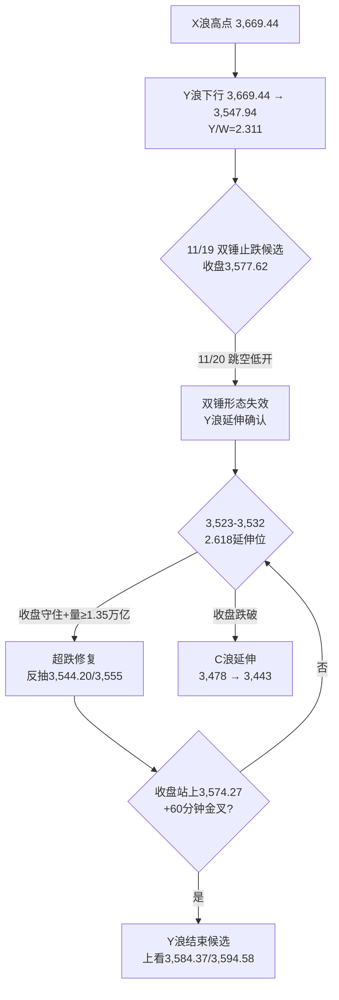
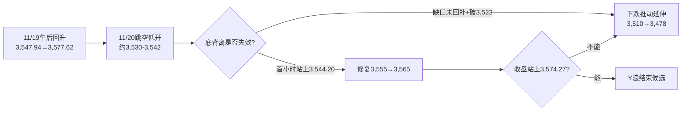

# A股晨报 - 2026年11月20日

> 数据截至：2026-11-20 09:10（北京时间）
> 编制：A股分析师AI代理
> 今日为周五（第47周第5个交易日），正常交易、周线收官
> 基准：11/19晚报（双锤止跌候选、反转未确认；月线生死线3,574.27仅高3.35点）

---

## 一、昨日晚报复盘要点回顾

### 1. 昨日判断回顾

| 判断维度 | 晨报预测 | 实际结果 | 准确度 |
|---------|---------|---------|-------|
| 上证趋势 | 震荡（偏弱修复、探底回升） | -0.28%，低开下探3,547.94后回升 | ✓ |
| 指数区间 | 3,565-3,606点 | 3,547.94-3,584.28点 | ✗（下沿破17.06点） |
| 强支撑 | 3,574.27点（收盘口径） | 最低3,547.94、收盘3,577.62 | ✓（收盘守住3.35点） |
| 强压力 | 3,610.20点 | 最高3,584.28点 | ✓ |
| 板块预判 | 9个方向 | 7对2错 | 77.8% |
| 成交量 | 平量1.32-1.50万亿 | 1.3051万亿（-4.8%，年内新低） | ✗ |

- **综合准确率：73.3%**（趋势100%、点位66.7%、板块77.8%、成交量0%）
- **波浪分析准确率：约85%**——Y浪延伸至2.382×W（3,544.20）上方3.74点止跌、收盘收回3,574.27，方向正确；但区间下沿低估约17点。

### 2. 关键偏差及原因

- **偏差1（技术局限·区间）**：区间下沿仍按3,565设定，未把"2.0×W二次假破后的第三次延伸"作为基础情景，实际最低3,547.94。
- **偏差2（逻辑误判·量能）**：地量环境仍按"前日×0.96-1.10"设下限，实际1.3051万亿再创年内新低，应取"前日×0.94-1.02"。
- **偏差3（情绪误读·煤炭）**：跌停83只、红盘率11.6%的冰点环境下，"寒潮1-2日脉冲"未能对抗系统性抛压，煤炭-0.86%、公用事业-0.57%。
- **偏差4（逻辑误判·信创）**：把"事件催化"等同于资金承接，忽略计算机主力净流出47.32亿居首，实际计算机-3.01%、军工-1.24%。

### 3. 沉淀的规则/检查项（今日直接启用）

1. **地量再地量规则**：成交连续3日创年内新低时，次日量能=前日×0.94-1.02，"再创新低"列基础情景。
2. **双锤不替代量能规则**：连续两根长下影锤子线+守住生死线仅为"止跌候选"，反转须收盘站上1.618×W/前结构位且量≥1.7万亿。
3. **指数失真规则**：指数微跌但下跌家数>4,800、跌停>80时，宽度修复前只做"资金净流入+产业趋势"双验证主线。
4. **事件脉冲过滤规则**：跌停>60只、红盘率<15%时，取消一切1-2日事件脉冲看涨（寒潮、会议、复牌等）。
5. **科技资金前置规则**：科技主题看涨前必须核验行业资金，主力净流出>20亿的行业不得给"看涨"。

### 4. 对今日分析的启示

- **风险点**：昨日的"双锤止跌候选"建立在3,574.27收盘不失守的前提上；隔夜美股跌超2%、A50盘前-1.31%，该前提今日大概率被跳空缺口破坏。
- **逻辑调整**：由"震荡修复"下调为"看跌探底"，双锤形态作废；不再以形态替代量能确认，直接按支撑位下移一档处理。
- **关键验证**：开盘缺口能否在30分钟内回补3,544.20、全天量能是否≥1.35万亿、周线收盘能否收复3,574.27。

---

## 二、隔夜市场动态（11/19收盘后至今）

### 1. 美股市场（11/19收盘：三大指数跌超2%，道指失守五万点）

| 指数 | 收盘 | 涨跌幅 | 备注 |
|------|------|--------|------|
| 道琼斯 | **49,097.06** | **-2.19%（-1,101.11）** | 收盘跌破50,000点 |
| 标普500 | **7,175.83** | **-2.02%（-147.80）** | **连续第6个交易日下跌** |
| 纳斯达克 | **23,879.20** | **-2.25%（-550.69）** | 科技巨头集体走弱 |

- **"IPO抽血+做空事件"双击**：Anthropic（ANT）以83美元发行、开盘111.50美元（+34%）、收97.17美元（+17.07%），募资约813亿美元为史上最大IPO、市值约1.27万亿美元；同日在巨额抽血下美股高开低走。
- **科技巨头普跌**：英伟达-3.3%（连续第6日下跌）、AMD重挫近8%（做空机构Hunterbrook发布做空报告，指其"循环交易"）、亚马逊-3.87%、Meta-3.27%、谷歌-2.93%、特斯拉-2.43%、微软-1.78%、苹果-0.92%；美光、博通跌超2%。
- **中概股走弱**：纳斯达克中国金龙指数-1.86%，网易-11.39%、名创优品-9.74%、金山云-6.57%；拼多多+11.04%（三季度利润同比基本持平）为少数亮点。

### 2. 欧洲/亚太市场

| 市场 | 收盘（11/19） | 涨跌幅 |
|------|------|--------|
| 德国DAX | 25,463.81 | **-1.06%** |
| 法国CAC40 | 8,080.74 | **-0.81%** |
| 英国富时100 | 10,452.68 | **-0.93%** |
| 富时中国A50期货（夜盘） | — | **-1.12%** |
| 富时中国A50期货（09:00盘初） | — | **-1.31%** |

- 欧美股市全线下跌，风险偏好同步收缩；A50夜盘与盘初连续走弱，指向A股今日**跳空低开约1.0%-1.3%**（对应3,530-3,542点）。

### 3. 大宗商品

| 品种 | 最新 | 变动 |
|------|------|------|
| 现货黄金 | **3,588.56美元/盎司** | **-1.0%**，失守3,600，创14个月新低 |
| 纽约期金 | 失守3,590美元/盎司 | **-2.59%** |
| WTI原油 | 83.16美元/桶 | **+1.03%** |
| 布伦特原油 | 92.69美元/桶 | **+0.8%** |
| COMEX铜 | 前值5.67美元/磅（最新收盘待更新） | 美元走强下预计承压 |

- **黄金三连破位**：11/18破3,800、11/19破3,700、11/20早间破3,600，三日连破三大关口，贵金属板块趋势性走坏。
- **原油逆势小涨**：霍尔木兹海峡航运遇袭、美伊冲突担忧重燃，叠加供应端扰动，限制油价跌幅，但周线仍有望连续第三周下跌。

### 4. 汇率与利率

| 项目 | 数值 | 变动 |
|------|------|------|
| 美元指数 | **103.94** | +0.14%，高位偏强 |
| 美债10年期 | **5.046%** | -2.22bp（仍处5%上方） |
| 美债2年期 | 4.764% | -4.25bp |
| 人民币中间价 | 6.7128（11/19） | 今日9:15公布，待更新 |
| 中国1年期LPR | **3.00%** | **维持不变** |
| 中国5年期以上LPR | **3.50%** | **维持不变** |

- **LPR连续持平**：11月1年期3.0%、5年期以上3.5%均与上月一致，政策增量落空，地产/银行/消费缺乏新增催化。
- 美元103.94、美债5.046%，中美利差仍超340bp，人民币汇率与高β估值继续承压。

### 5. 重要海外事件

- **美国上周初请失业金20.3万人**（预期19.8万、前值20.0万），续请176.3万人、单周增加7万人，就业边际走弱但未改变"12月不降息"定价。
- **美联储官员表态偏鹰**：副主席杰斐逊称无意调整通胀目标、AI热潮加剧短期通胀；芝加哥联储古尔斯比称不排除加息幅度高于常规水平。
- **Anthropic上市首日+17%但美股跳水**，市场解读为"AI资产抽血效应"大于"AI信仰确认"，对A股算力链映射偏空。

---

## 三、今日关注事项

### 1. 重要数据发布（按时间排序）

| 时间 | 数据/事件 | 预期/前值 | 影响 |
|------|-----------|-----------|------|
| 09:00 | **11月LPR报价** | 1Y 3.00%、5Y+ 3.50%，**均维持不变** | 政策增量落空，中性偏空 |
| 09:15 | 人民币中间价 | 前值6.7128 | 关注是否大幅调贬 |
| 09:25 | A股集合竞价 | A50盘前-1.31% | 预计低开1%左右 |
| 晚间 | 美国11月Markit PMI初值、密歇根消费者信心终值（如有） | — | 影响12月加息定价 |
| 11/25 | 美国10月耐用品订单、PCE | — | 下周核心数据 |

### 2. 政策/监管动态

- **LPR维持不变**：1年期3.0%、5年期以上3.5%，为连续多月持平；在社零仅+1.0%、地产仍弱的背景下，政策进入观察期。
- **央行流动性**：11/19开展7,675亿元隔夜逆回购、到期7,002亿元，净投放673亿元，跨月前呵护延续。
- **中美经贸**：双方各层级保持沟通，贸易理事会首次会议已举行，农业工作组近期召开，维持"沟通中偏稳"。

### 3. 公司公告

- **回购潮延续**：长鑫科技回购金额上调至25-50亿元（价格≤63.78元/股）；海光信息公告回购；紫金矿业拟20-30亿元回购A股；贝因美首次回购。
- **万科A**：控股子公司33.8亿港元贷款第二次展期（延长0.25年、累计6.25年），担保总额增至937.39亿元，地产链信用扰动仍在。
- **盛剑科技**：3连板后澄清"电子化学品材料业务不包括光刻胶产品"，高位题材证伪风险。
- **解禁**：夏厦精密、丹娜生物今日解禁比例超四成；海安集团8,156.02万股（43.86%）将于11/25流通。

### 4. 其他关注

- **新股申购**：今日暂无新股申购安排（以交易所公告为准）。
- **周线收官**：第47周最后一个交易日，周K能否收在3,574.27上方决定"双假破"框架是否成立。
- **恒生指数季检结果**：今日公布，关注港股尾盘及南向资金异动。
- **11/23首批18只主动ETF上市**：约84亿元增量资金临近，但单日贡献有限，难对冲外盘冲击。
- **存储产业链催化**：美光称2027年存储供需比2026年更紧张；闪迪11月NAND合约价上调50%，模组厂暂停出货重估报价。

---

## 四、板块与个股分析（结合昨日复盘）

### 1. 基于昨日复盘结论的板块调整

- **昨看涨且兑现（半导体设备/材料、光模块、家电）**：科创50+1.83%、中芯国际+6%、华虹宏力+8%、新易盛+5.59%、家电+0.69%。今日**半导体设备/存储维持相对强势**（美光紧缺+闪迪涨价50%+长鑫回购），但受英伟达-3.3%、AMD-8%压制，**只在低开企稳后参与，不追反弹**；**光模块/CPO由"回踩低吸"下调为"观望"**（美股AI硬件集体走弱）。
- **昨看涨但偏差（煤炭/信创）**：寒潮脉冲失效、计算机-3.01%。今日**取消事件脉冲看涨**，煤炭仅作红利防御、信创并入看跌。
- **昨看跌且兑现（贵金属、传媒、高位连板）**：金价三连破位、传媒-3.54%、涨停28只创两年新低。今日**维持看跌**，且隔夜中概网易-11.39%、名创-9.74%进一步强化。
- **昨看跌但需修正（石油石化）**：油价逆势+1.03%，霍尔木兹扰动支撑，由"看跌"改为"相对抗跌、不追高"。

### 2. 隔夜信息驱动的板块机会

**受益/相对强势板块：**

1. **存储芯片/半导体设备材料**
   - 逻辑：美光明确"2027年供需更紧张"、闪迪NAND合约价涨50%、长鑫科技25-50亿回购、海光信息回购；11/19电子主力净流入23.80亿居首，为唯一"资金+产业"双验证主线。
   - 约束：英伟达6连跌、AMD-8%，费半承压，**只做低开分歧后的回踩，不参与高开**；若电子资金转为净流出>20亿，立即撤销看涨。

2. **家电/食品饮料（出口链+防御）**
   - 逻辑：11/19家电+0.69%居申万一级首位、食品饮料+0.65%，出口韧性与以旧换新支撑；风险厌恶期资金从题材切向确定性。
   - 约束：防御属性以"抗跌"为主，弹性有限，不作进攻主力。

3. **银行/公用事业红利（仅避风港）**
   - 逻辑：外盘大跌、风险偏好收缩，高股息具备相对收益；央行净投放673亿、流动性合理充裕。
   - 约束：11/19银行主力净流出17.50亿，**仅作防御配置，不期待绝对收益**。

**受损/看跌板块：**

1. **贵金属/黄金白银**：金价三日连破3,800/3,700/3,600，创14个月新低，美元103.94+美债5.046%实际利率主导，**反弹即减、不抄底**。
2. **传媒/影视/AI应用/游戏**：网易-11.39%、名创-9.74%，中概映射偏空；11/19传媒-3.54%跌幅第一，退潮未完成。
3. **计算机/信创/软件**：11/19计算机-3.01%、主力净流出47.32亿居首；美股科技巨头普跌，高位AI应用继续兑现。
4. **高位连板/纯题材**：涨停28只创2024年7月以来新低、跌停83只、封板率49%，盛剑科技3板后澄清，接力链条断裂。
5. **有色/工业金属**：美元走强+全球需求预期偏弱，铜等工业金属承压。

### 3. 重点关注个股

| 个股/方向 | 关注理由 | 技术位置 | 操作参考 |
|-----------|---------|---------|---------|
| **长鑫科技（688825）** | 回购上限提至50亿元，DRAM龙头 | 半导体主线，相对抗跌 | 低开企稳后观察，不追高 |
| **中芯国际/华虹宏力** | 晶圆代工涨价10%-20%、国产替代 | 11/19分别+6%/+8% | 回踩5日线，仓位≤2% |
| **海光信息** | 新增回购，国产算力核心 | 高位震荡 | 只做回踩，不追 |
| **紫金矿业（601899）** | 20-30亿元回购托底 | 金价下跌压制 | 回购对冲有限，观望 |
| **美的集团** | 出口链+以旧换新+外资调研 | 趋势多头 | 回踩10日线低吸 |
| **中际旭创（300308）** | 20-40亿回购，但美股AI硬件走弱 | 超跌反弹后 | 高开即减，不追 |
| **盛剑科技** | 3连板后澄清不含光刻胶 | 高位题材 | 回避 |
| **夏厦精密/丹娜生物** | 今日解禁比例超四成 | 解禁压力 | 回避 |
| **万科A（000002）** | 子公司贷款二次展期 | 地产链信用扰动 | 回避 |

---

## 五、今日核心判断

### 1. 趋势判断

- **上证指数：【看跌】**（跳空低开、考验3,523，尾盘或有弱修复）
- **预测区间：3,510点 - 3,565点**
- **核心逻辑**：美股三大指数跌超2%、纳指-2.25%、AMD遭做空重挫8%、英伟达6连跌，叠加A50夜盘-1.12%/盘初-1.31%，外部冲击将直接击穿月线生死线3,574.27与2.382×W 3,544.20；LPR维持不变、政策增量落空，地量存量（1.3051万亿）与宽度冰点（跌停83只）使承接力极弱，指数大概率下探2.618延伸位3,523-3,532；仅半导体存储主线与回购托底，尾盘或有超跌修复，但难回补缺口。

### 2. 关键点位

- **强支撑位：3,478点**（依据：C浪延伸1.0目标/月线级别重要支撑，跌破则打开中期下行空间）
- **弱支撑位：3,523点**（依据：2.618延伸位；若以X浪高点3,669.44精确测算为3,531.79，故取3,523-3,532为支撑带）
- **弱压力位：3,544.20点**（依据：2.382×W，跳空失守后转为第一反抽压力）
- **强压力位：3,574.27点**（依据：月线生死线/11月结构失效线，失守后构成周线级反压）

### 3. 板块预判

- **看涨/相对强势板块**：
  （1）**存储芯片/半导体设备材料**（逻辑：美光2027紧缺+闪迪NAND涨50%+长鑫/海光回购+电子资金净流入23.80亿）
  （2）**家电/食品饮料**（逻辑：出口韧性+以旧换新+风险厌恶下的确定性溢价）
  （3）**银行/公用事业红利**（逻辑：外盘大跌下的避风港，仅防御）
- **看跌板块**：
  （1）**贵金属/黄金白银**（逻辑：金价三日连破三大关口、创14个月新低，实际利率主导）
  （2）**传媒/影视/AI应用/游戏**（逻辑：中概网易-11.39%、名创-9.74%，题材退潮未完成）
  （3）**计算机/信创/软件**（逻辑：11/19净流出47.32亿居首、美股科技普跌）
  （4）**高位连板/纯题材**（逻辑：涨停28只创两年新低、封板率49%、盛剑科技澄清）
  （5）**有色/工业金属**（逻辑：美元103.94走强、需求预期偏弱）
- **风险板块**：
  - **北证50/小微盘**：11/19 -3.99%，流动性风险在下跌日放大；
  - **解禁股**：夏厦精密、丹娜生物解禁超四成；
  - **地产链**：万科子公司贷款二次展期，信用担忧扰动；
  - **高β算力**：AMD做空+英伟达6连跌，估值与情绪双杀。

### 4. 资金面判断

- **北向资金预期**：净额不披露；成交额预计**2,050-2,350亿元**，占比**15.5%-17%**（前值2,101.36亿/16.10%）；美元走强、外盘大跌，外资偏谨慎。
- **成交量预期：【平量至小幅缩量】**，预计**1.22-1.40万亿元**（前值1.3051万亿；地量规则=前日×0.94-1.02=1.227-1.331万亿，低开恐慌可能带来小幅放量，上限1.40万亿）。
- **两融**：截至11/19余额22,010.03亿元（-87.68亿），四连降，杠杆资金持续去化。
- **主力资金**：11/19净流出234.59亿、连续6日净流出；今日外盘冲击下预计继续净流出，仅电子/存储可能获结构性流入。

### 5. 风险预警（按优先级排序）

- **高风险**：**美股三大指数跌超2%、纳指-2.25%、AMD-8%遭做空、英伟达6连跌**，叠加A50盘前-1.31%，A股跳空低开将直接失守3,574.27/3,544.20，Y浪延伸至3,523-3,532，极端情形下探3,478；高β与题材股承接断裂。
- **高风险**：**周线收官**——若周K收盘<3,574.27，"三次假破+三次收回"的月线框架失效，周线下降推动浪确认，中期目标下移3,478/3,443。
- **中风险**：**LPR维持不变**，政策增量落空，地产/银行/消费缺乏催化；市场对"宽货币"预期需后移至12月。
- **中风险**：**黄金三连破位**拖累贵金属/有色；**万科贷款二次展期**扰动地产链信用；**中概网易-11.39%**压制传媒/AI应用。
- **低风险**：夏厦精密、丹娜生物解禁超四成；盛剑科技3板后澄清；霍尔木兹扰动支撑油价，石油石化相对抗跌但不宜追高。

### 6. 昨日复盘规则应用

- **应用规则1（地量再地量）**：量能预测取1.22-1.33万亿，"再创年内新低"列基础情景（概率≥50%），不以"缩量=跌不动"解读。
- **应用规则2（双锤不替代量能）**：昨日双锤止跌候选因跳空缺口破坏，**直接作废**；未收盘站上3,574.27前，不按"Y浪结束"计数。
- **应用规则3（指数失真/宽度冰点）**：只保留"电子资金净流入23.80亿+存储产业趋势"双验证主线，不参与题材反抽。
- **应用规则4（事件脉冲过滤）**：取消油价、寒潮、恒指季检等1-2日事件脉冲看涨，石油石化仅列"相对抗跌"。
- **应用规则5（科技资金前置）**：计算机净流出47.32亿→看跌；电子净流入23.80亿→仅存储/半导体设备可看涨，且需盘中资金续流入验证。

---

## 六、波浪理论参考

### 1. 月K线波浪分析

- **当前波浪位置**：大级别3浪2扩张（W-X-Y）的**Y浪末段"第三次假破+收盘收回"后的方向选择期**。
- **浪型结构描述**：11月开3,614.13→高3,699.58（11/12）→低3,547.94（11/19）→收3,577.62；月线生死线3,574.27本月已三次盘中击穿、三次收盘收回。今日跳空低开将使月K转为"带长上影中阴"候选。
- **关键目标位**：上方3,574.27→3,584.37→3,594.58→3,610.20；下方3,544.20→3,523-3,532→3,478→3,443。
- **验证条件**：**11月月K收盘（11/28）站上3,574.27，则3浪2扩张框架仍有效**；若本周/本月收盘跌破，改按"C浪延伸"，下看3,478/3,443。

### 2. 周K线波浪分析

- **当前波浪位置**：第47周（11/16-11/20）箱体下沿3,610.20失守后的**第二周阴线，且为周线收官日**。
- **浪型结构描述**：本周开3,611.54→高3,623.12→低3,547.94→现3,577.62，周内-1.56%；今日低开将确认"长上影中阴"，连续第3周收阴、低点下移；5周均线约3,670-3,680构成反抽天花板。
- **关键目标位**：上方3,574.27→3,584.37→3,610.20；下方3,544.20→3,523→3,478。
- **验证条件**：周线止跌需**本周收盘站上3,574.27且周成交≥8.5万亿**（前四日约6.2万亿，达标难度极大）；若周收<3,574.27，周线下降推动浪延伸至3,523/3,478。

### 3. 日K线波浪分析

- **当前波浪位置**：W-X-Y扩张调整的**Y浪第5子浪"三次假破—跳空破位"阶段**。
- **浪型结构描述**：W浪 3,699.58→3,647.00（-52.58）→X浪 3,647.00→3,669.44（+22.44）→Y浪 3,669.44→3,547.94（-121.50，Y/W=2.311）。昨日在2.382×W（3,544.20）上方3.74点止跌并收回3,574.27，但今日跳空低开将使"双锤"形态失效，Y浪由"止跌候选"转为"延伸确认"。
- **关键目标位**：下方3,523-3,532（2.618延伸）→3,478（C浪延伸1.0）→3,443；上方3,544.20→3,574.27→3,584.37。
- **验证条件**：**Y浪结束需重新收盘站上3,574.27+30/60分钟底背离金叉+量≥1.45万亿**；若收盘<3,523，则C浪延伸至3,478。

### 4. 60分钟K线波浪分析

- **当前波浪位置**：Y浪第5子浪末段，**底背离条件将被跳空缺口破坏**。
- **浪型结构描述**：昨日午后自3,547.94回升至3,577.62，60分钟MACD收敛但未金叉；今日若低开至3,530附近，价格创新低而指标未同步修复，底背离失效，转为下跌推动延伸。
- **关键目标位**：上方3,544.20→3,555→3,574.27；下方3,523→3,510→3,478。
- **验证条件**：**60分钟收盘站上3,544.20且MACD金叉=修复第一信号**；若首小时继续下破3,523，则延伸至3,478。

### 5. 30分钟K线波浪分析

- **当前波浪位置**：Y浪末段"二次探底后的修复结构"被跳空破坏。
- **浪型结构描述**：昨日30分钟"再破—快速收回"形成第三次诱空，但今日缺口使该结构失效；开盘30分钟将直接定价缺口性质（衰竭缺口/持续缺口）。
- **关键目标位**：上方3,544.20→3,555；下方3,523→3,510。
- **验证条件**：**开盘30分钟站上3,544.20且量能不低于昨日同期→修复延伸至3,555-3,565**；若30分钟收在3,523下方，则日内弱势确认、反抽仅至3,535。

### 6. 波浪图（Mermaid）

**日K线波浪结构图**

**60分钟波浪结构图**

### 7. 波浪理论综合判断

- **多周期共振状态**：月线**空且第三次假破面临真破**（★）、周线空（★，第3周阴）、日线**双锤失效、Y浪延伸**（★）、60分钟**底背离将被缺口破坏**（★）、30分钟**修复结构失效**（★）——由昨日"中长空+短多修复"转为**"五周期向下共振"风险显著上升**。
- **当前操作级别**：**防守/反弹减仓**；3,574.27未收复前不参与任何级别反弹，仓位上限5%。
- **后续演变路径**：
  - **基础路径（55%）**：低开1%左右，早盘下探3,523-3,532，尾盘小幅修复，收盘3,520-3,555，量能1.22-1.35万亿；
  - **偏弱路径（30%）**：外盘持续走弱+北证/小微盘流动性风险，收盘跌破3,523，下探3,478，创业板测2,230；
  - **偏强路径（15%）**：缺口快速回补、半导体存储逆势走强+ETF承接，收盘站上3,544.20并上探3,565，但难一次性收复3,574.27。
- **关键拐点信号**：**止跌=收盘≥3,544.20+60分钟MACD金叉+量≥1.35万亿**；**修复=收盘≥3,574.27+量≥1.45万亿**；**结构延伸=收盘<3,523→3,478**；**中期失效=周收<3,574.27且下周不能收复**。
- **风险提示**：W-X-Y计数主观性强，Y浪可延伸为"5-3-5"C浪；2.618延伸位为统计位置而非支撑承诺；**跳空缺口既可能是"衰竭缺口"，也可能是"持续缺口"，必须以首小时量能与是否回补确认，不得以低开幅度直接抄底**。

---

## 七、投资策略建议

### 1. 短线策略（1-3个交易日）

- **适用场景**：基于日K线与30/60分钟技术信号
- **短线仓位：0%**（观望为主，条件触发上限5%）
- **买入条件**（三者同时满足）：
  1. 开盘30分钟不破3,523，且回补至3,544.20上方；
  2. 电子/半导体板块资金净流入、存储龙头红盘；
  3. 全天量能≥1.35万亿。
- **卖出条件**：反抽3,565-3,574.27无量即减；收盘站不上3,544.20即了结。
- **止损位**：收盘跌破3,523，或个股跌幅-5%。
- **短线标的**：（1）存储芯片/半导体设备（逻辑：美光紧缺+闪迪涨价50%+长鑫回购，资金净流入）；（2）家电/食品饮料（逻辑：防御+出口韧性，仅低吸不追）。

### 2. 中线策略（1-4周）

- **适用场景**：基于周K线波浪与运行规律分析
- **中线仓位：5%**（从10%下调；昨日规则"收盘跌破3,544.20减至5%以下"今日大概率触发）
- **方向判断：【减仓/观望】**
- **目标区间**：上证指数 **3,478点 - 3,574点**
- **中线布局板块**：
  （1）**存储芯片/半导体设备材料**（逻辑：产业景气+国产替代+资金净流入，核心持仓）
  （2）**家电/食品饮料/银行红利**（逻辑：防御+确定性，底仓）
- **止盈条件**：指数反弹至3,574.27或波段涨幅达8%-10%分批减。
- **止损条件**：收盘跌破3,523，或周线收盘<3,478确认趋势反转，清仓观望。

### 3. 仓位分配总览

| 策略类型 | 仓位比例 | 方向 | 重点板块 |
|---------|---------|------|---------|
| 短线 | 0%（上限5%） | 观望 | 存储/半导体设备、家电 |
| 中线 | 5% | 减仓/观望 | 存储/半导体设备、家电/食品饮料 |
| 现金 | 95% | — | — |

### 4. 与昨日策略对比

- **短线仓位**：0-5% → **0%**（原因：跳空低开将破坏双锤结构，三条件更难同时满足）。
- **中线仓位**：10% → **5%**（原因：收盘大概率跌破3,544.20，触发昨日减仓规则）。
- **板块调整**：**增配**存储/半导体设备（产业紧缺+回购）；**下调**光模块/CPO至观望（美股AI硬件走弱）；**清空/回避**传媒/影视/AI应用、贵金属、有色、北证小微盘、高位连板。
- **策略基调**：由"防守+等确认"转为"**防守优先、反弹减仓**"，不接飞刀、不抄缺口。

---

## 八、信息来源

1. **官方数据来源**：中国人民银行/全国银行间同业拆借中心（2026-11-20 LPR：1年期3.00%、5年期以上3.50%）；上海证券交易所、深圳证券交易所（11/19收盘数据）；中国货币网；国家统计局；商务部
2. **权威财经媒体**：新华社（[纽约股市三大股指19日显著下跌](http://www.xinhuanet.com/fortune/20261120/defba6b3cda54c34951bf514e85968b8/c.html)）；中国证券报（[美股三大指数跌超2%，Anthropic首日涨超17%](http://m.toutiao.com/group/7710030259193659955/)）；证券时报（[史上最大IPO，Anthropic首秀涨17%](http://m.toutiao.com/group/7710051318538224178/)）；第一财经（[1年期、5年期LPR均维持不变](http://m.toutiao.com/group/7710052762150519331/)）；财联社（[A50期货盘初跌1.31%](https://www.cls.cn/detail/2539635)、[11月20日股市避雷针](https://www.cls.cn/detail/2539603)、[美国初请失业金20.3万](https://www.cls.cn/subject/1622)）；格隆汇（[欧股收盘集体下挫](https://www.gelonghui.com/live/2768193)）；汇通网（[11月20日财经早餐：金价或测试3600](https://m.fx678.com/news/detail/202611200527392467)）
3. **数据平台**：东方财富Choice（北向成交、行业资金）、Wind（两融余额）、同花顺（行业涨跌）、证券时报·数据宝
4. **公司公告**：上交所公告（紫金矿业回购20-30亿元）、长鑫科技回购25-50亿元公告、海光信息回购公告、万科A贷款展期公告、盛剑科技澄清公告
5. **数据截止时间**：**2026-11-20 09:10（北京时间）**；美股/欧洲为11/19收盘，A股为11/19收盘，A50期货为11/20 09:00盘初，黄金/原油为11/20亚市早盘；北向净额不披露，以成交额替代；人民币中间价与部分商品最新收盘待更新。

---

> **免责声明**：本报告为AI辅助生成的市场分析，所有点位、概率、目标位均为基于公开数据的技术推演，不构成投资建议。市场有风险，决策需独立。
